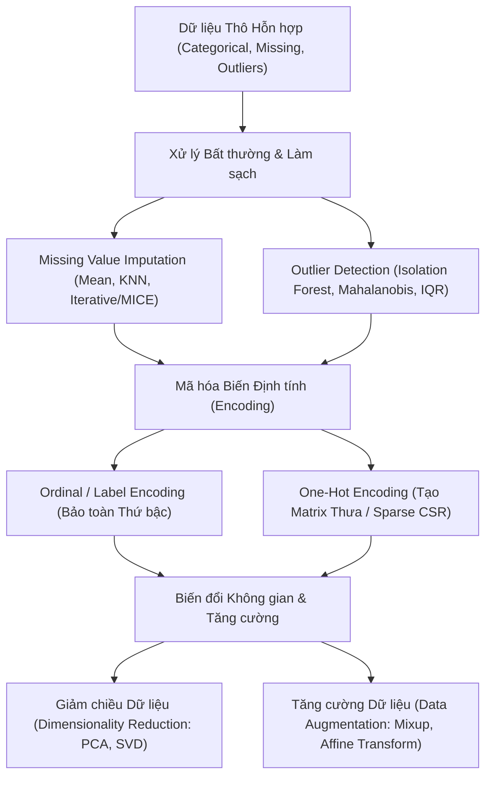
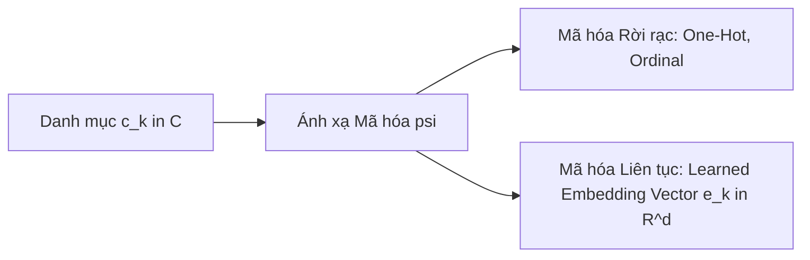
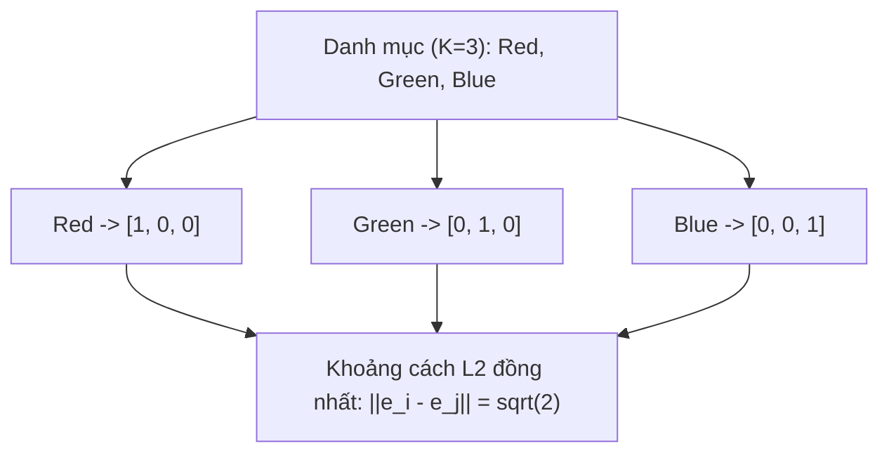
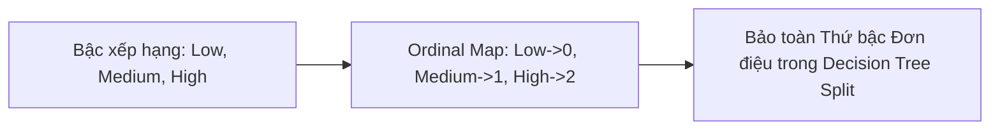
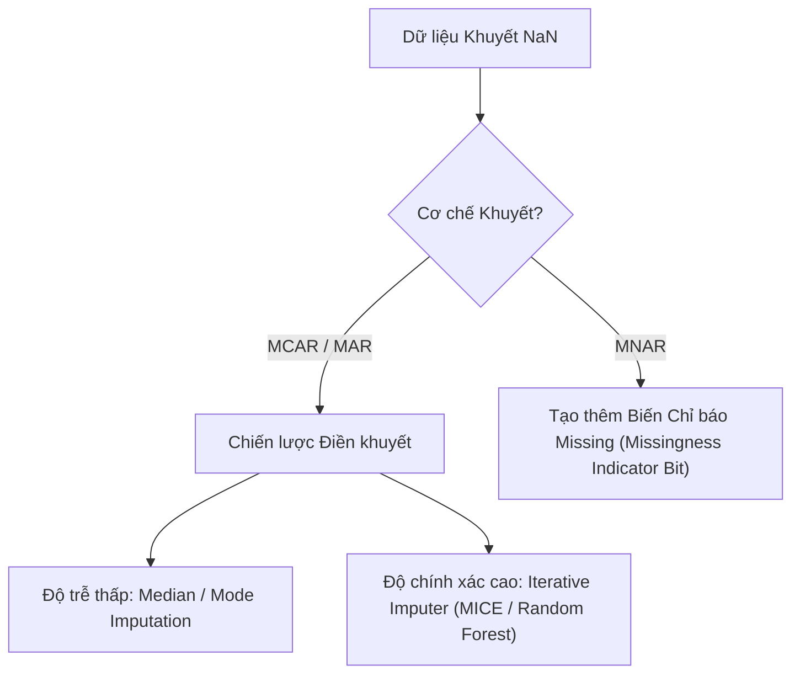
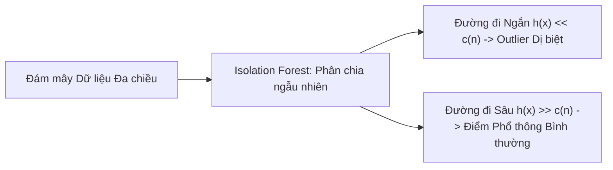
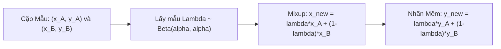

# Chuyên đề: Biến đổi Dữ liệu, Xử lý Bất thường & Tăng cường Dữ liệu (Data Transformations, Imputation & Augmentation)

## 1. Tổng quan Chuyên đề
Các thuật toán học máy và mô hình mạng nơ-ron sâu bản chất là những cỗ máy tính toán số thực trên ma trận. Tuy nhiên, dữ liệu thế giới thực luôn chứa các biến định tính (Categorical features), các giá trị bị khuyết (Missing values), các điểm ngoại lai gây nhiễu loạn phân phối (Outliers), và sự thiếu thốn về số lượng mẫu quan sát.

Chuyên đề này đi sâu vào cơ chế biến đổi biểu diễn: từ mã hóa nhị phân (One-Hot, Ordinal Encoding) tối ưu bố cục bộ nhớ thưa (Sparse CSR/CSC), các thuật toán điền khuyết dựa trên suy diễn thống kê (MICE, KNN, Matrix Completion), các thước đo phát hiện dị biệt (Z-Score, Isolation Forest, Mahalanobis Distance), cho đến các kỹ thuật Tăng cường Dữ liệu (Data Augmentation) hình học và trộn mẫu (Mixup/CutMix) bảo toàn tính bất biến đối xứng.



---

## 2. Chi tiết từng Keyword

---

### 1. Encoding (Mã hóa Định tính Tổng quát)

#### a. Định nghĩa Bản chất Toán học (Mathematical Formulation)
Mã hóa là một ánh xạ đơn ánh hoặc toàn ánh từ tập hữu hạn các nhãn rời rạc định tính $\mathcal{C} = \{c_1, c_2, \dots, c_K\}$ sang một không gian véc-tơ số học $\mathcal{V} \subseteq \mathbb{R}^d$:
$$\psi: \mathcal{C} \to \mathbb{R}^d$$
Mục tiêu là giữ lại tối đa thông tin cấu trúc (khoảng cách, thứ bậc, hoặc tương quan xác suất) của các danh mục mà không làm bùng nổ số chiều của không gian đặc trưng.

#### b. Cơ chế Tầng Sâu & Điện toán (Under The Hood / Hardware Internals)
- **Embedding Lookup Tables (Gather Kernel)**: Trong các hệ thống lớn, mã hóa danh mục được thay thế bằng bảng tra cứu Embedding $\mathbf{E} \in \mathbb{R}^{K \times d}$. Thay vì thực hiện phép nhân ma trận dày $\mathbf{x}_{onehot}^T \mathbf{E}$, phần cứng GPU kích hoạt kernel `torch.embedding` (thực chất là thao tác pointer gather trên bộ nhớ VRAM), đạt thông lượng tối đa của bus nhớ.

#### c. Sơ đồ Minh họa (Mermaid Diagram)


#### d. Code Thực chiến (Dual-Engine: C++ & Python)

```cpp
// C++17: Bảng tra cứu Hash Map Mã hóa Danh mục sang Chỉ số Số học
#include <iostream>
#include <string>
#include <unordered_map>
#include <vector>

class CategoryEncoder {
private:
    std::unordered_map<std::string, int> vocab;
    int next_id{0};

public:
    int encode(const std::string& cat) {
        auto it = vocab.find(cat);
        if (it != vocab.end()) return it->second;
        vocab[cat] = next_id;
        return next_id++;
    }

    size_t vocab_size() const noexcept { return vocab.size(); }
};

int main() {
    CategoryEncoder enc;
    std::cout << "[C++] Cat: " << enc.encode("Cat") << " | Dog: " << enc.encode("Dog") << "\n";
    return 0;
}
```

```python
# Python: Tra cứu Embedding Table với torch.nn.Embedding
import torch
import torch.nn as nn

embedding_layer = nn.Embedding(num_embeddings=1000, embedding_dim=16)
category_indices = torch.tensor([42, 105, 7]) # Batch 3 danh mục
vectors = embedding_layer(category_indices)
print(f"[Python] Embedding Output Shape: {vectors.shape}")
```

#### e. Lỗi Thường gặp & Ổn định Số học
- **Out-of-Vocabulary (OOV) Categories**: Khi gặp danh mục mới xuất hiện trong môi trường test/serving mà không có trong train, mô hình ném ngoại lệ hoặc trả về giá trị rác. Bắt buộc có token dự phòng `<UNK>` (Unknown).

#### f. Ứng dụng Thực chiến trong AI / Deep Learning
- Kiến trúc mạng nơ-ron gợi ý DLRM (Deep Learning Recommendation Model) sử dụng hàng triệu bảng embedding để mã hóa hành vi người dùng và mặt hàng.

---

### 2. One-Hot Encoding (Mã hóa One-Hot)

#### a. Định nghĩa Bản chất Toán học (Mathematical Formulation)
Mã hóa One-Hot ánh xạ mỗi danh mục $c_k \in \mathcal{C}$ ($k \in \{1, \dots, K\}$) thành một véc-tơ đơn vị chuẩn tắc trong không gian $K$ chiều $\mathbb{R}^K$:
$$\mathbf{e}_k = \big[ \underbrace{0, \dots, 0}_{k-1}, 1, \underbrace{0, \dots, 0}_{K-k} \big]^T \in \{0, 1\}^K$$
Đặc tính hình học: Khoảng cách Euclidean giữa hai danh mục bất kỳ là hằng số:
$$\|\mathbf{e}_i - \mathbf{e}_j\|_2 = \sqrt{2} \quad (\forall i \neq j)$$
Đảm bảo mô hình không áp đặt giả định sai lầm về thứ bậc tự nhiên giữa các danh mục không có quan hệ thứ tự (như Màu sắc, Thành phố).

#### b. Cơ chế Tầng Sâu & Điện toán (Under The Hood / Hardware Internals)
- **Sparse CSR Memory Storage**: Với danh mục có lực lượng lớn ($K = 100,000$), ma trận dày One-Hot tiêu tốn bộ nhớ khổng lồ. Ta biểu diễn dưới định dạng Nén Hàng Thưa (Compressed Sparse Row - CSR) gồm 3 mảng: `values` (toàn số 1), `col_indices` (chỉ số cột), và `row_ptr` (con trỏ dòng), giảm $99.9\%$ dung lượng RAM.

#### c. Sơ đồ Minh họa (Mermaid Diagram)


#### d. Code Thực chiến (Dual-Engine: C++ & Python)

```cpp
// C++20: Biến đổi One-Hot Vector hóa tối ưu bộ nhớ
#include <iostream>
#include <vector>

std::vector<float> to_one_hot(size_t index, size_t num_classes) {
    std::vector<float> vec(num_classes, 0.0f);
    if (index < num_classes) {
        vec[index] = 1.0f;
    }
    return vec;
}

int main() {
    auto one_hot = to_one_hot(2, 5); // Class 2 trong 5 class: [0, 0, 1, 0, 0]
    std::cout << "[C++] One-Hot Vector: ";
    for (float v : one_hot) std::cout << v << " ";
    std::cout << "\n";
    return 0;
}
```

```python
# Python: One-Hot Encoding với Scipy Sparse CSR Matrix
from sklearn.preprocessing import OneHotEncoder
import numpy as np

categories = np.array([['Paris'], ['Tokyo'], ['London'], ['Paris']])
encoder = OneHotEncoder(sparse_output=True) # Trả về Scipy CSR Matrix
sparse_matrix = encoder.fit_transform(categories)

print(f"[Python] Kiểu ma trận: {type(sparse_matrix)}")
print(f"[Python] Mảng dày tương đương:\n{sparse_matrix.toarray()}")
```

#### e. Lỗi Thường gặp & Ổn định Số học
- **Bẫy Biến Giả (Dummy Variable Trap)**: Trong hồi quy tuyến tính có hệ số chặn $b$, việc giữ nguyên toàn bộ $K$ cột One-Hot gây ra hiện tượng đa cộng tuyến hoàn hảo ($\sum_{k=1}^K x_{ik} = 1$). Bắt buộc phải bỏ bớt 1 cột quy chiếu (`drop='first'`).

#### f. Ứng dụng Thực chiến trong AI / Deep Learning
- Biểu diễn nhãn phân loại đa lớp khi tính toán hàm mất mát Cross-Entropy dạng phân phối mượt (Label Smoothing).

---

### 3. Label & Ordinal Encoding (Mã hóa Nhãn & Mã hóa Thứ bậc)

#### a. Định nghĩa Bản chất Toán học (Mathematical Formulation)
1. **Ordinal Encoding**: Ánh xạ các danh mục có thứ bậc nội tại (ví dụ: Thấp, Trung bình, Cao) sang các số nguyên bảo toàn quan hệ thứ tự:
   $$c_1 \prec c_2 \prec \dots \prec c_K \implies \psi(c_1) < \psi(c_2) < \dots < \psi(c_K)$$
2. **Label Encoding**: Ánh xạ danh mục tùy ý sang tập số nguyên rời rạc $\{0, 1, \dots, K-1\}$. Thích hợp cho nhãn mục tiêu $y$, không khuyến khích dùng cho đặc trưng đầu vào của mô hình tuyến tính vì vô tình áp đặt khoảng cách nhân tạo $\psi(c_2) - \psi(c_1) = \psi(c_3) - \psi(c_2)$.

#### b. Cơ chế Tầng Sâu & Điện toán (Under The Hood / Hardware Internals)
- **Cache-Friendly Integer Representation**: Mã hóa sang kiểu `uint8` hoặc `int16` thay vì chuỗi string giúp giảm kích thước tập dữ liệu đi 8 đến 16 lần, cho phép nạp toàn bộ mảng dữ liệu vào L2/L3 cache của CPU khi chạy các thuật toán cây như LightGBM / CatBoost.

#### c. Sơ đồ Minh họa (Mermaid Diagram)


#### d. Code Thực chiến (Dual-Engine: C++ & Python)

```cpp
// C++17: Ordinal Encoder với Bảng Quy tắc Thứ tự Tự định nghĩa
#include <iostream>
#include <string>
#include <map>

class OrdinalMapper {
private:
    std::map<std::string, int> order_map;

public:
    void add_rank(const std::string& level, int rank) {
        order_map[level] = rank;
    }

    int get_rank(const std::string& level) const {
        auto it = order_map.find(level);
        return (it != order_map.end()) ? it->second : -1;
    }
};

int main() {
    OrdinalMapper mapper;
    mapper.add_rank("Junior", 1);
    mapper.add_rank("Senior", 2);
    mapper.add_rank("Lead", 3);
    std::cout << "[C++] Senior Rank: " << mapper.get_rank("Senior") << "\n";
    return 0;
}
```

```python
# Python: OrdinalEncoder với chỉ định thứ tự tường minh
from sklearn.preprocessing import OrdinalEncoder
import numpy as np

data = np.array([['Medium'], ['Low'], ['High'], ['Low']])
ordered_categories = [['Low', 'Medium', 'High']]

encoder = OrdinalEncoder(categories=ordered_categories)
encoded = encoder.fit_transform(data)
print(f"[Python] Kết quả Ordinal Encoding:\n{encoded.ravel()}")
```

#### e. Lỗi Thường gặp & Ổn định Số học
- **Áp dụng sai mô hình**: Dùng Label Encoding cho đặc trưng phân loại đầu vào của Linear Regression hay SVM, khiến mô hình học mối liên hệ giả tạo rằng "High" có giá trị gấp đôi "Medium".

#### f. Ứng dụng Thực chiến trong AI / Deep Learning
- Các mô hình Cây quyết định (XGBoost, CatBoost) xử lý trực tiếp các cột số nguyên mã hóa Ordinal mà không cần bung rộng thành One-Hot.

---

### 4. Missing Value Imputation (Điền khuyết Dữ liệu)

#### a. Định nghĩa Bản chất Toán học (Mathematical Formulation)
Theo phân loại của Rubin (1976), cơ chế khuyết thiếu gồm 3 loại:
1. **MCAR (Missing Completely at Random)**: $\mathbb{P}(M \mid \mathbf{X}, Y) = \mathbb{P}(M)$.
2. **MAR (Missing at Random)**: $\mathbb{P}(M \mid \mathbf{X}, Y) = \mathbb{P}(M \mid \mathbf{X}_{obs})$.
3. **MNAR (Missing Not at Random)**: $\mathbb{P}(M \mid \mathbf{X}, Y)$ phụ thuộc trực tiếp vào chính giá trị bị khuyết.

Các phương pháp điền khuyết:
- **Mean/Median Imputation**: Ước lượng điểm tĩnh $\hat{x}_{miss} = \frac{1}{|N_{obs}|} \sum_{i \in N_{obs}} x_i$.
- **KNN Imputation**: Điền khuyết dựa trên bình quân có trọng số của $K$ láng giềng gần nhất theo khoảng cách Gower hoặc Euclidean:
  $$\hat{x}_i = \frac{\sum_{j \in \mathcal{N}_K(i)} w_{ij} x_j}{\sum_{j \in \mathcal{N}_K(i)} w_{ij}}$$
- **MICE (Multivariate Imputation by Chained Equations)**: Mô hình hóa phân phối có điều kiện đầy đủ $P(X_j \mid \mathbf{X}_{-j})$ qua chuỗi hồi quy Gibbs Sampling.

#### b. Cơ chế Tầng Sâu & Điện toán (Under The Hood / Hardware Internals)
- **NaN Bit Pattern & Branching Penalty**: Giá trị khuyết thường được biểu diễn bằng chuẩn IEEE-754 `NaN` (toàn bit 1 ở phần exponent). Kiểm tra `std::isnan()` tạo ra các lệnh rẽ nhánh điều kiện (conditional branches) làm xáo trộn luồng pipeline chỉ thị của CPU. Các thư viện hiện đại dùng mặt nạ nhị phân (Binary Bitmask) để xử lý theo vectorization.

#### c. Sơ đồ Minh họa (Mermaid Diagram)


#### d. Code Thực chiến (Dual-Engine: C++ & Python)

```cpp
// C++20: Mean Imputation Vector hóa tại chỗ bỏ qua NaN
#include <iostream>
#include <vector>
#include <cmath>

void impute_mean_in_place(std::vector<float>& data) {
    float sum = 0.0f;
    size_t count = 0;
    for (float v : data) {
        if (!std::isnan(v)) {
            sum += v;
            ++count;
        }
    }
    float mean = (count > 0) ? (sum / count) : 0.0f;
    for (float& v : data) {
        if (std::isnan(v)) {
            v = mean;
        }
    }
}

int main() {
    std::vector<float> values = {1.0f, NAN, 3.0f, NAN, 5.0f};
    impute_mean_in_place(values);
    std::cout << "[C++] Mẫu 1 sau điền khuyết: " << values[1] << "\n";
    return 0;
}
```

```python
# Python: Điền khuyết Đa biến MICE bằng IterativeImputer
import numpy as np
from sklearn.experimental import enable_iterative_imputer
from sklearn.impute import IterativeImputer

X_incomplete = np.array([
    [1.0, 2.0],
    [3.0, 6.0],
    [np.nan, 8.0],
    [5.0, np.nan]
])

imputer = IterativeImputer(max_iter=10, random_state=42)
X_completed = imputer.fit_transform(X_incomplete)
print(f"[Python] Dữ liệu hoàn chỉnh sau MICE:\n{X_completed.round(2)}")
```

#### e. Lỗi Thường gặp & Ổn định Số học
- **Làm sụt giảm Phương sai**: Điền Mean thuần túy làm giảm phương sai nhân tạo của biến và làm sai lệch phân phối kiểm định $t$-test.

#### f. Ứng dụng Thực chiến trong AI / Deep Learning
- Xử lý hồ sơ bệnh án điện tử (EHR): bệnh nhân không làm xét nghiệm không có nghĩa là chỉ số bằng 0, cần kết hợp cờ chỉ báo khuyết (Missing Indicator) làm đặc trưng đầu vào cho mô hình sống sót (Survival Analysis).

---

### 5. Outlier Detection (Phát hiện Điểm Dị biệt / Ngoại lai)

#### a. Định nghĩa Bản chất Toán học (Mathematical Formulation)
Điểm ngoại lai (Outlier) là các quan sát có mật độ xác suất cực thấp dưới phân phối dữ liệu sinh $P(\mathbf{X})$:
$$\mathbf{x}_{outlier} \iff p(\mathbf{x}) < \tau$$
Các phương pháp phát hiện:
1. **Z-Score & IQR**:
   - $Z = \frac{|x - \mu|}{\sigma} > 3$.
   - $\text{IQR} = Q_3 - Q_1$, ngoại lai nếu $x < Q_1 - 1.5 \text{IQR}$ hoặc $x > Q_3 + 1.5 \text{IQR}$.
2. **Khoảng cách Mahalanobis (Đa biến)**:
   $$D_M(\mathbf{x}) = \sqrt{(\mathbf{x} - \mathbf{\mu})^T \mathbf{\Sigma}^{-1} (\mathbf{x} - \mathbf{\mu})} > \chi^2_{d, 1-\alpha}$$
3. **Isolation Forest**:
   Đo lường độ dài đường đi trung bình $h(\mathbf{x})$ trong rừng cây cô lập nhị phân; điểm ngoại lai có đường phân chia ngắn bất thường:
   $$s(\mathbf{x}, n) = 2^{-\frac{\mathbb{E}[h(\mathbf{x})]}{c(n)}}$$

#### b. Cơ chế Tầng Sâu & Điện toán (Under The Hood / Hardware Internals)
- **Matrix Inversion Complexity**: Khoảng cách Mahalanobis yêu cầu nghịch đảo ma trận hiệp phương sai $\mathbf{\Sigma}^{-1}$ với độ phức tạp $O(d^3)$. Nếu $d$ lớn, ma trận được tính qua phân rã Cholesky $\mathbf{\Sigma} = \mathbf{L}\mathbf{L}^T$ để giải hệ phương trình tam giác với tốc độ nhanh gấp 2x và bảo đảm ổn định số học.

#### c. Sơ đồ Minh họa (Mermaid Diagram)


#### d. Code Thực chiến (Dual-Engine: C++ & Python)

```cpp
// C++17: Kiểm định Điểm Ngoại lai bằng Z-Score
#include <iostream>
#include <vector>
#include <cmath>

bool is_outlier_zscore(float val, float mean, float std_dev, float threshold = 3.0f) {
    if (std_dev <= 1e-7f) return false;
    return (std::abs(val - mean) / std_dev) > threshold;
}

int main() {
    float mu = 50.0f;
    float sigma = 5.0f;
    float anomaly_val = 68.0f;
    std::cout << "[C++] Giá trị 68.0 là Outlier: " 
              << (is_outlier_zscore(anomaly_val, mu, sigma) ? "Đúng" : "Sai") << "\n";
    return 0;
}
```

```python
# Python: Phát hiện Ngoại lai Đa biến với Isolation Forest
from sklearn.ensemble import IsolationForest
import numpy as np

# Tạo cụm dữ liệu bình thường + 2 điểm ngoại lai
X_normal = np.random.randn(100, 2)
X_outliers = np.array([[8.0, 8.0], [-7.0, -9.0]])
X_all = np.vstack([X_normal, X_outliers])

iso = IsolationForest(contamination=0.02, random_state=42)
preds = iso.fit_predict(X_all) # -1: Outlier, 1: Normal

outlier_indices = np.where(preds == -1)[0]
print(f"[Python] Chỉ số các điểm Ngoại lai phát hiện được: {outlier_indices}")
```

#### e. Lỗi Thường gặp & Ổn định Số học
- **Xóa nhầm Ngoại lai hợp lệ (Valid Anomalies)**: Trong bài toán an ninh mạng hoặc phát hiện lừa đảo thẻ, chính các "ngoại lai" mới là đối tượng cần phát hiện; xóa bỏ chúng khỏi tập train sẽ triệt tiêu hoàn toàn mục tiêu bài toán.

#### f. Ứng dụng Thực chiến trong AI / Deep Learning
- Làm sạch tập dữ liệu quy mô lớn (Data Curation) lọc bỏ ảnh rác, text hỏng trước khi nạp vào huấn luyện các mô hình Foundation Models.

---

### 6. Data Augmentation (Tăng cường Dữ liệu)

#### a. Định nghĩa Bản chất Toán học (Mathematical Formulation)
Data Augmentation mở rộng tập huấn luyện bằng cách tác động các toán tử biến đổi $\mathcal{T}_k \in \mathcal{G}$ bảo toàn nhãn (label-preserving transformations) lên mẫu gốc:
$$\tilde{\mathbf{x}} = \mathcal{T}(\mathbf{x}), \quad \mathcal{L}(f(\tilde{\mathbf{x}}), y) \to \min$$
Các phương pháp hiện đại:
1. **Geometric / Photometric (Thị giác)**: Biến đổi Affine (Xoay, Lật, Cắt tỷ lệ, Đổi màu).
2. **Mixup (Zhang et al., 2018)**: Nội suy lồi giữa hai cặp mẫu ngẫu nhiên:
   $$\tilde{\mathbf{x}} = \lambda \mathbf{x}_i + (1 - \lambda) \mathbf{x}_j, \quad \tilde{y} = \lambda y_i + (1 - \lambda) y_j \quad \text{với } \lambda \sim \text{Beta}(\alpha, \alpha)$$
3. **CutMix (Yun et al., 2019)**: Cắt và dán một vùng chữ nhật từ ảnh này sang ảnh khác.

#### b. Cơ chế Tầng Sâu & Điện toán (Under The Hood / Hardware Internals)
- **On-the-Fly GPU Augmentation (NVIDIA DALI)**: Thực hiện biến đổi ảnh trên CPU gây nghẽn cổ chai CPU-GPU bottleneck. Thư viện DALI (Data Loading and Augmentation) chuyển toàn bộ phép giải mã JPEG và biến đổi Affine thực thi trực tiếp trên GPU CUDA Cores, tăng thông lượng batch lên 5x.

#### c. Sơ đồ Minh họa (Mermaid Diagram)


#### d. Code Thực chiến (Dual-Engine: C++ & Python)

```cpp
// C++17: Triển khai Toán tử Nội suy Mixup tuyến tính
#include <iostream>
#include <vector>

void mixup_vectors(const std::vector<float>& a, 
                   const std::vector<float>& b, 
                   float lambda, 
                   std::vector<float>& out) {
    const size_t n = a.size();
    out.resize(n);
    for (size_t i = 0; i < n; ++i) {
        out[i] = lambda * a[i] + (1.0f - lambda) * b[i];
    }
}

int main() {
    std::vector<float> x1 = {1.0f, 0.0f, 0.5f};
    std::vector<float> x2 = {0.0f, 1.0f, 0.5f};
    std::vector<float> mixed;
    mixup_vectors(x1, x2, 0.7f, mixed);
    std::cout << "[C++] Mixed Sample[0]: " << mixed[0] << "\n";
    return 0;
}
```

```python
# Python: Vectorized Mixup Implementation trên GPU Tensor
import torch

def batch_mixup(x: torch.Tensor, y: torch.Tensor, alpha: float = 0.2):
    if alpha > 0:
        lam = np.random.beta(alpha, alpha)
    else:
        lam = 1.0
    batch_size = x.size(0)
    index = torch.randperm(batch_size) # Hoán vị ngẫu nhiên trong batch
    
    mixed_x = lam * x + (1 - lam) * x[index, :]
    y_a, y_b = y, y[index]
    return mixed_x, y_a, y_b, lam

images = torch.randn(4, 3, 32, 32)
labels = torch.tensor([0, 1, 2, 3])
m_x, y_a, y_b, lam = batch_mixup(images, labels)
print(f"[Python] Mixup Lambda: {lam:.4f}, Output Tensor Shape: {m_x.shape}")
```

#### e. Lỗi Thường gặp & Ổn định Số học
- **Biến đổi làm hỏng Ngữ nghĩa Nhãn**: Lật ngang (Horizontal Flip) ảnh số viết tay MNIST biến số 6 thành số 9; tăng cường văn bản bằng dịch máy ngược (Back-Translation) làm sai lệch thuật ngữ chuyên ngành.

#### f. Ứng dụng Thực chiến trong AI / Deep Learning
- Kỹ thuật bắt buộc trong huấn luyện Vision Transformers (Swin, ViT-22B) và Diffusion Models để ngăn chặn hiện tượng Overfitting khi dung lượng mô hình khổng lồ.
