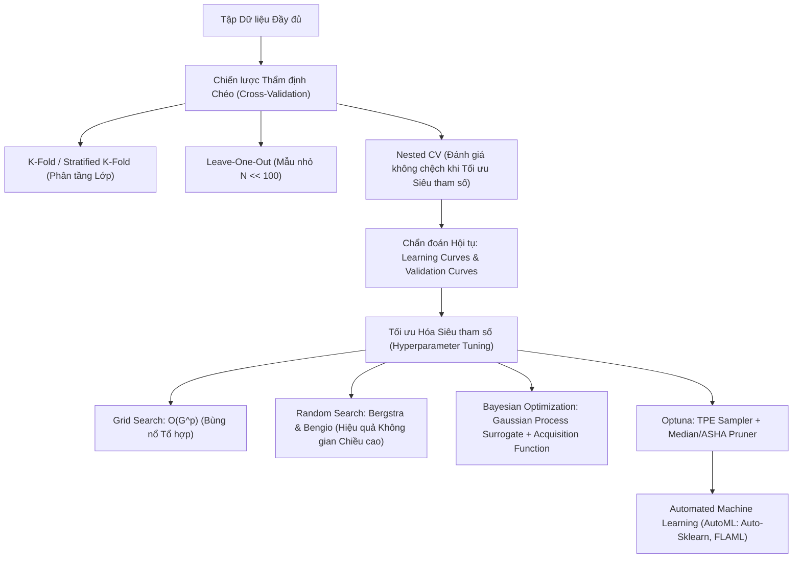
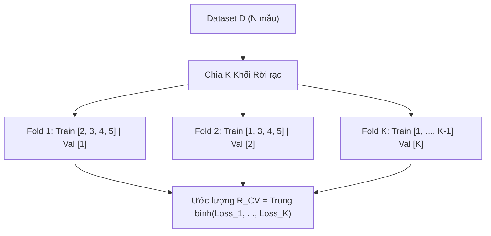
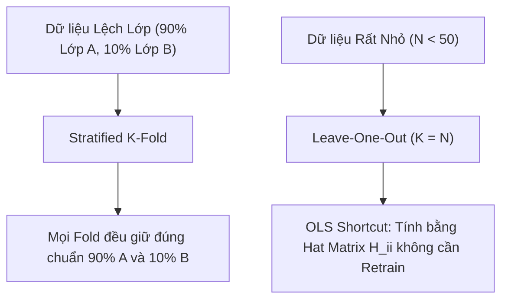
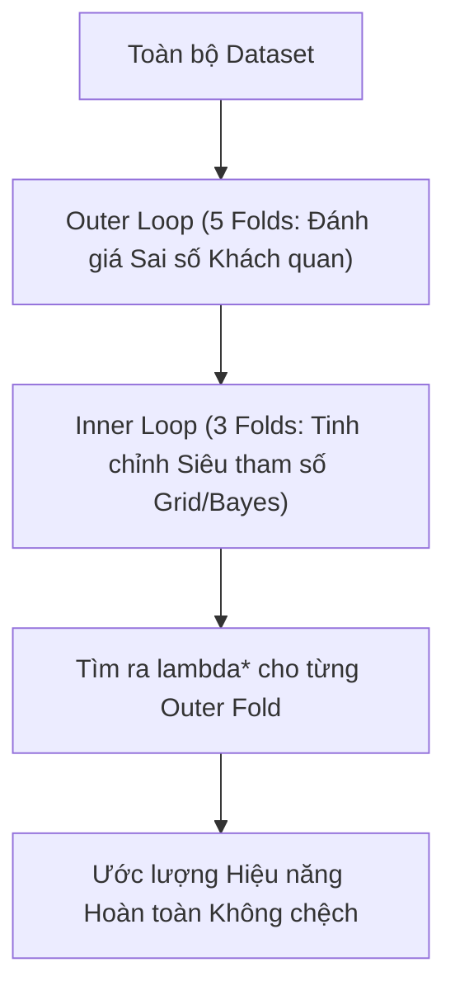
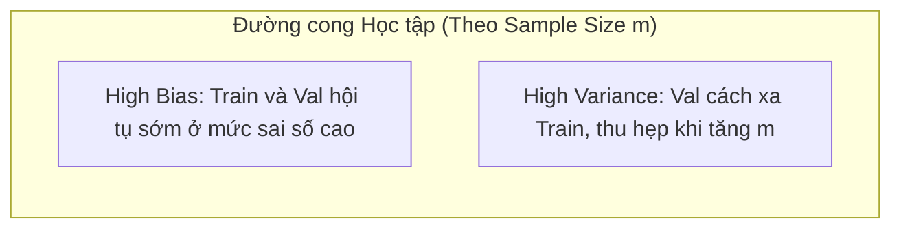
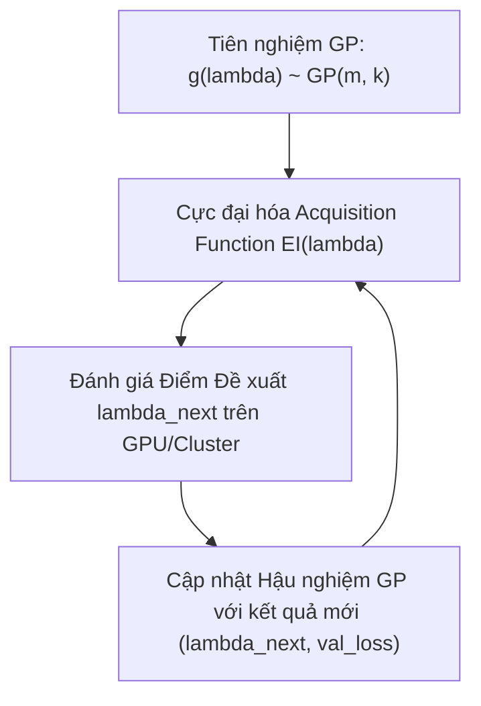
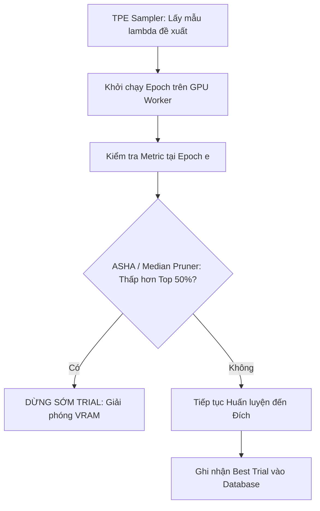

# Chuyên đề: Chiến lược Thẩm định Mô hình, Tối ưu Siêu tham số & AutoML (Validation Strategies, Hyperparameter Tuning & AutoML)

## 1. Tổng quan Chuyên đề
Một mô hình Machine Learning chỉ có giá trị thực tiễn khi hiệu năng của nó được kiểm chứng một cách khách quan, không chệch (unbiased) và có khả năng lặp lại. Quá trình này đòi hỏi các giao thức thẩm định chéo (Cross-Validation) chặt chẽ để tối đa hóa hiệu quả sử dụng dữ liệu hữu hạn mà không làm rò rỉ phân phối.

Đồng thời, việc dò tìm vector siêu tham số tối ưu $\mathbf{\lambda}^* \in \Lambda$ đã tiến hóa từ các phương pháp duyệt cạn thụ động (Grid Search, Random Search) sang các kỹ thuật tối ưu hóa hộp đen chủ động (Bayesian Optimization với Gaussian Processes, Tree-structured Parzen Estimators - TPE trong Optuna), và đỉnh cao là các hệ thống Tự động hóa Học máy (AutoML) tự động tìm kiếm kiến trúc mạng nơ-ron (NAS) và đường ống xử lý dữ liệu.



---

## 2. Chi tiết từng Keyword

---

### 1. Cross-Validation & K-Fold Cross-Validation

#### a. Định nghĩa Bản chất Toán học (Mathematical Formulation)
Thẩm định chéo K-Fold (K-Fold Cross-Validation) phân hoạch tập dữ liệu $\mathcal{D}$ gồm $N$ mẫu thành $K$ tập con rời rạc có kích thước xấp xỉ bằng nhau:
$$\mathcal{D} = \bigcup_{k=1}^K \mathcal{D}_k, \quad \mathcal{D}_i \cap \mathcal{D}_j = \emptyset \quad (\forall i \neq j), \quad |\mathcal{D}_k| \approx \frac{N}{K}$$
Tại mỗi bước lặp $k \in \{1, \dots, K\}$, mô hình được huấn luyện trên $\mathcal{D}_{-k} = \mathcal{D} \setminus \mathcal{D}_k$ và kiểm tra trên $\mathcal{D}_k$.
Ước lượng rủi ro tổng quát K-Fold là trung bình cộng sai số trên $K$ folds:
$$\hat{R}_{CV}(f) = \frac{1}{K} \sum_{k=1}^K \hat{R}_{\mathcal{D}_k}\big(f_{\mathcal{D}_{-k}}\big) = \frac{1}{K} \sum_{k=1}^K \left( \frac{1}{|\mathcal{D}_k|} \sum_{(\mathbf{x}_i, y_i) \in \mathcal{D}_k} \mathcal{L}(f_{\mathcal{D}_{-k}}(\mathbf{x}_i), y_i) \right)$$
Phương sai của ước lượng $\hat{R}_{CV}$ phụ thuộc vào mức độ tương quan giữa các mô hình huấn luyện trên các tập con gối đầu nhau:
$$\text{Var}(\hat{R}_{CV}) = \frac{1}{K} \sigma^2 + \frac{K-1}{K} \rho \sigma^2$$
Trong đó $\rho$ là hệ số tương quan giữa các lỗi đánh giá fold.

#### b. Cơ chế Tầng Sâu & Điện toán (Under The Hood / Hardware Internals)
- **Zero-Copy Index Slicing**: Thay vì sao chép dữ liệu thực tế (làm lãng phí DRAM), K-Fold được triển khai bằng các mảng chỉ số nguyên (Indices array). Tại mỗi fold, các con trỏ bộ nhớ (Memory Pointers) chỉ chiếu tới các khối offsets tương ứng của buffer dữ liệu gốc mà không cấp phát lại bộ nhớ.

#### c. Sơ đồ Minh họa (Mermaid Diagram)


#### d. Code Thực chiến (Dual-Engine: C++ & Python)

```cpp
// C++20: Bộ chia Chỉ số K-Fold tối ưu hóa bộ nhớ
#include <iostream>
#include <vector>
#include <numeric>
#include <algorithm>

struct FoldIndices {
    std::vector<size_t> train_idx;
    std::vector<size_t> val_idx;
};

std::vector<FoldIndices> create_kfold_indices(size_t n_samples, size_t k) {
    std::vector<size_t> indices(n_samples);
    std::iota(indices.begin(), indices.end(), 0);

    std::vector<FoldIndices> folds(k);
    size_t fold_size = n_samples / k;

    for (size_t i = 0; i < k; ++i) {
        size_t start = i * fold_size;
        size_t end = (i == k - 1) ? n_samples : start + fold_size;

        for (size_t idx = 0; idx < n_samples; ++idx) {
            if (idx >= start && idx < end) {
                folds[i].val_idx.push_back(indices[idx]);
            } else {
                folds[i].train_idx.push_back(indices[idx]);
            }
        }
    }
    return folds;
}

int main() {
    auto folds = create_kfold_indices(10, 3);
    std::cout << "[C++] Fold 0: Train size = " << folds[0].train_idx.size() 
              << ", Val size = " << folds[0].val_idx.size() << "\n";
    return 0;
}
```

```python
# Python: K-Fold Cross Validation chuẩn với scikit-learn
from sklearn.model_selection import KFold
import numpy as np

X = np.arange(20).reshape(10, 2)
kf = KFold(n_splits=5, shuffle=True, random_state=42)

for fold, (train_idx, val_idx) in enumerate(kf.split(X)):
    print(f"[Python] Fold {fold + 1}: Train Indices {train_idx[:3]}... | Val Indices {val_idx}")
```

#### e. Lỗi Thường gặp & Ổn định Số học
- **Rò rỉ Fold qua Shuffle**: Quên shuffle dữ liệu trước khi chia fold khi tập dữ liệu gốc được sắp xếp theo nhãn hoặc thứ tự thời gian.

#### f. Ứng dụng Thực chiến trong AI / Deep Learning
- Phương pháp đánh giá chuẩn mực trong các cuộc thi Kaggle và thẩm định mô hình hồi quy / phân loại trên dữ liệu bảng.

---

### 2. Stratified K-Fold & Leave-One-Out (LOOCV)

#### a. Định nghĩa Bản chất Toán học (Mathematical Formulation)
1. **Stratified K-Fold (K-Fold Phân tầng)**:
   Bảo đảm tỷ lệ các lớp nhãn mục tiêu trong mỗi fold con $\mathcal{D}_k$ tương đồng chính xác với tỷ lệ trong toàn bộ tập dữ liệu:
   $$\frac{|\{ (\mathbf{x}_i, y_i) \in \mathcal{D}_k \mid y_i = c \}|}{|\mathcal{D}_k|} \approx \frac{|\{ (\mathbf{x}, y) \in \mathcal{D} \mid y = c \}|}{|\mathcal{D}|} \quad (\forall c \in \mathcal{Y}, \forall k)$$
2. **Leave-One-Out Cross-Validation (LOOCV)**:
   Trường hợp giới hạn của K-Fold khi $K = N$:
   $$\hat{R}_{LOO} = \frac{1}{N} \sum_{i=1}^N \mathcal{L}(f_{\mathcal{D} \setminus \{(\mathbf{x}_i, y_i)\}}(\mathbf{x}_i), y_i)$$
   Đặc tính: Ước lượng gần như không chệch (Unbiased) của rủi ro tổng quát, nhưng phương sai cao và chi phí tính toán là $O(N \times \text{TrainTime})$.
   Với hồi quy tuyến tính OLS, LOOCV có công thức giải tích đóng (Press Statistic) tính trong đúng $O(1)$ lần train:
   $$\hat{y}_{(-i)} - y_i = \frac{\hat{y}_i - y_i}{1 - H_{ii}}$$
   Trong đó $H_{ii} = \mathbf{x}_i^T (\mathbf{X}^T\mathbf{X})^{-1} \mathbf{x}_i$ là phần tử đường chéo chính của Hat Matrix $\mathbf{H}$.

#### b. Cơ chế Tầng Sâu & Điện toán (Under The Hood / Hardware Internals)
- **Sherman-Morrison Kernel Update**: Thay vì huấn luyện lại từ đầu mô hình tuyến tính $N$ lần trong LOOCV, ta dùng công thức Sherman-Morrison cập nhật nghịch đảo ma trận $(\mathbf{X}^T\mathbf{X} - \mathbf{x}_i\mathbf{x}_i^T)^{-1}$ với độ phức tạp giảm từ $O(d^3)$ xuống $O(d^2)$.

#### c. Sơ đồ Minh họa (Mermaid Diagram)


#### d. Code Thực chiến (Dual-Engine: C++ & Python)

```cpp
// C++17: Tính LOOCV Residuals cho Tuyến tính OLS qua Leverage H_ii
#include <iostream>
#include <vector>

float compute_loo_residual_ols(float y_true, float y_pred, float leverage_h_ii) {
    // Công thức Sherman-Morrison đóng cho LOO residual
    return (y_true - y_pred) / (1.0f - leverage_h_ii);
}

int main() {
    float y = 10.0f;
    float pred = 9.2f;
    float h_ii = 0.15f; // Điểm leverage
    std::cout << "[C++] LOOCV Residual: " << compute_loo_residual_ols(y, pred, h_ii) << "\n";
    return 0;
}
```

```python
# Python: StratifiedKFold đảm bảo phân phối lớp đồng nhất
from sklearn.model_selection import StratifiedKFold
import numpy as np

y = np.array([0, 0, 0, 0, 0, 0, 1, 1, 1, 1]) # 6 class 0, 4 class 1
X = np.zeros((10, 2))

skf = StratifiedKFold(n_splits=2)
for fold, (train_idx, val_idx) in enumerate(skf.split(X, y)):
    print(f"[Python] Fold {fold + 1} Val Class Counts: {np.bincount(y[val_idx])}")
```

#### e. Lỗi Thường gặp & Ổn định Số học
- **Điểm Đòn bẩy $H_{ii} = 1$**: Khi một mẫu dữ liệu đơn lẻ cô lập hoàn toàn, phần tử $H_{ii} = 1$ gây ra phép chia cho 0 trong công thức LOO analytic residual.

#### f. Ứng dụng Thực chiến trong AI / Deep Learning
- Stratified K-Fold là bắt buộc cho mọi bài toán phân loại có độ mất cân bằng lớp (Imbalanced Classification).

---

### 3. Nested Cross-Validation (Thẩm định Chéo Lồng nhau)

#### a. Định nghĩa Bản chất Toán học (Mathematical Formulation)
Khi thẩm định chéo vừa được dùng để chọn siêu tham số $\mathbf{\lambda}^*$, vừa dùng để ước lượng sai số tổng quát, thông tin kiểm thử sẽ bị rò rỉ vào quá trình tinh chỉnh (Optimistic Evaluation Bias).
**Nested Cross-Validation** giải quyết triệt để bằng cấu trúc hai vòng lặp lồng nhau:
1. **Outer Loop (Vòng Ngoài - $K_{outer}$ folds)**: Dùng riêng để ước lượng sai số suy quát không chệch:
   $$\hat{R}_{nested} = \frac{1}{K_{outer}} \sum_{i=1}^{K_{outer}} \mathcal{L}\big(f_{\mathbf{\theta}^*(\mathbf{\lambda}_i^*)}, \mathcal{D}_{test}^{(i)}\big)$$
2. **Inner Loop (Vòng Trong - $K_{inner}$ folds)**: Dùng riêng để lựa chọn siêu tham số tối ưu $\mathbf{\lambda}_i^*$ trên tập huấn luyện của vòng ngoài $\mathcal{D}_{train}^{(i)}$:
   $$\mathbf{\lambda}_i^* = \arg\min_{\mathbf{\lambda} \in \Lambda} \frac{1}{K_{inner}} \sum_{j=1}^{K_{inner}} \hat{R}_{val}^{(j)}(\mathbf{\theta}^*(\mathbf{\lambda}))$$

#### b. Cơ chế Tầng Sâu & Điện toán (Under The Hood / Hardware Internals)
- **Nested Parallel Scheduling (MPI / Ray Clusters)**: Chi phí tính toán là $O(K_{outer} \times K_{inner} \times |\Lambda|)$. Các hệ thống phân tán lên lịch cho các fold vòng ngoài chạy song song trên các worker nodes độc lập, trong khi vòng trong tận dụng đa luồng OpenMP / CUDA.

#### c. Sơ đồ Minh họa (Mermaid Diagram)


#### d. Code Thực chiến (Dual-Engine: C++ & Python)

```cpp
// C++17: Bộ khung điều phối Nested Cross-Validation logic
#include <iostream>

void run_nested_cv_skeleton(size_t outer_k, size_t inner_k) {
    for (size_t o = 0; o < outer_k; ++o) {
        std::cout << "[C++] Outer Fold " << o + 1 << " -> Chạy Inner Loop: ";
        for (size_t i = 0; i < inner_k; ++i) {
            // Tinh chỉnh HParams trên Inner Folds
        }
        std::cout << "Hoàn tất tinh chỉnh, đánh giá trên Outer Test Fold.\n";
    }
}

int main() {
    run_nested_cv_skeleton(3, 2);
    return 0;
}
```

```python
# Python: Nested Cross-Validation kết hợp GridSearchCV với Scikit-Learn
from sklearn.model_selection import KFold, GridSearchCV, cross_val_score
from sklearn.ensemble import RandomForestClassifier
import numpy as np

X = np.random.randn(100, 4)
y = np.random.randint(0, 2, 100)

inner_cv = KFold(n_splits=3, shuffle=True, random_state=1)
outer_cv = KFold(n_splits=5, shuffle=True, random_state=2)

clf = GridSearchCV(
    estimator=RandomForestClassifier(random_state=42),
    param_grid={'n_estimators': [10, 50]},
    cv=inner_cv
)

nested_scores = cross_val_score(clf, X=X, y=y, cv=outer_cv)
print(f"[Python] Nested CV Mean Accuracy: {nested_scores.mean():.4f} (+/- {nested_scores.std():.4f})")
```

#### e. Lỗi Thường gặp & Ổn định Số học
- **Nhầm lẫn mô hình đầu ra cuối cùng**: Nested CV sinh ra $K_{outer}$ mô hình khác nhau với các siêu tham số có thể khác nhau. Mục tiêu của nó là đánh giá quy trình sinh mô hình, không phải tạo ra một mô hình đơn lẻ.

#### f. Ứng dụng Thực chiến trong AI / Deep Learning
- Tiêu chuẩn vàng trong nghiên cứu y sinh (Biomedical ML) với kích thước mẫu nhỏ nhưng số lượng đặc trưng lớn (Genomics / fMRI).

---

### 4. Learning Curves & Validation Curves

#### a. Định nghĩa Bản chất Toán học (Mathematical Formulation)
1. **Learning Curves (Đường cong Học tập)**:
   Đồ thị biểu diễn sai số huấn luyện $\hat{R}_{train}(m)$ và sai số thẩm định $\hat{R}_{val}(m)$ theo quy mô tập dữ liệu $m$:
   - Nếu $\lim_{m \to \infty} \hat{R}_{train}(m) \approx \hat{R}_{val}(m) \gg \epsilon_{target} \implies$ **Underfitting (High Bias)**. Thu thập thêm dữ liệu không có tác dụng; cần tăng dung lượng mô hình.
   - Nếu $\hat{R}_{val}(m) \gg \hat{R}_{train}(m)$ và khoảng cách thu hẹp chậm $\implies$ **Overfitting (High Variance)**. Cần thêm dữ liệu huấn luyện hoặc tăng điều chuẩn.
2. **Validation Curves (Đường cong Thẩm định)**:
   Đồ thị biểu diễn sai số theo một siêu tham số đơn lẻ $\lambda$ (như độ sâu cây, trọng số phạt L2 $\alpha$).

#### b. Cơ chế Tầng Sâu & Điện toán (Under The Hood / Hardware Internals)
- **Early Convergence Profiling**: Theo dõi đạo hàm của learning curve $\frac{d \hat{R}_{val}}{d m}$. Nếu đạo hàm xấp xỉ 0, hệ thống tự động ngắt thu thập dữ liệu để tiết kiệm chi phí dán nhãn (Active Learning stopping rule).

#### c. Sơ đồ Minh họa (Mermaid Diagram)


#### d. Code Thực chiến (Dual-Engine: C++ & Python)

```cpp
// C++17: Bộ theo dõi Learning Curve Logging Stream
#include <iostream>
#include <vector>

struct LearningPoint {
    size_t samples;
    float train_loss;
    float val_loss;
};

void print_learning_trajectory(const std::vector<LearningPoint>& curve) {
    std::cout << "[C++] Learning Curve Profile:\n";
    for (const auto& p : curve) {
        std::cout << "  N=" << p.samples 
                  << " | Train Loss=" << p.train_loss 
                  << " | Val Loss=" << p.val_loss 
                  << " | Gap=" << (p.val_loss - p.train_loss) << "\n";
    }
}

int main() {
    std::vector<LearningPoint> history = {
        {100, 0.05f, 0.60f},
        {500, 0.12f, 0.35f},
        {1000, 0.18f, 0.22f}
    };
    print_learning_trajectory(history);
    return 0;
}
```

```python
# Python: Sinh Learning Curve tự động bằng scikit-learn
from sklearn.model_selection import learning_curve
from sklearn.linear_model import Ridge
import numpy as np

X = np.random.randn(200, 10)
y = np.random.randn(200)

train_sizes, train_scores, test_scores = learning_curve(
    Ridge(), X, y, cv=5, train_sizes=np.linspace(0.1, 1.0, 5), scoring='neg_mean_squared_error'
)
print(f"[Python] Kích thước mẫu: {train_sizes}")
print(f"[Python] Mean Val Loss: {-test_scores.mean(axis=1).round(3)}")
```

#### e. Lỗi Thường gặp & Ổn định Số học
- **Đánh giá trên tập Validation bị rò rỉ**: Dẫn đến Learning Curve hội tụ giả tạo về 0.

#### f. Ứng dụng Thực chiến trong AI / Deep Learning
- TensorBoard và Weights & Biases (W&B) hiển thị Learning Curves thời gian thực để phát hiện sớm các bất thường trong huấn luyện mô hình nền tảng.

---

### 5. Hyperparameter Tuning: Grid, Random & Bayesian Optimization

#### a. Định nghĩa Bản chất Toán học (Mathematical Formulation)
Bài toán Tối ưu hóa Siêu tham số (HPO) là bài toán tối ưu hộp đen (Black-Box Optimization) đắt đỏ:
$$\mathbf{\lambda}^* = \arg\min_{\mathbf{\lambda} \in \Lambda} g(\mathbf{\lambda}) \quad \text{với } g(\mathbf{\lambda}) = \hat{R}_{val}\big(\mathbf{\theta}^*(\mathbf{\lambda})\big)$$
1. **Grid Search**: Thử nghiệm tích Descartes của các giá trị rời rạc $\Lambda_{grid} = \Lambda_1 \times \dots \times \Lambda_p$. Độ phức tạp: $O(|\Lambda_0|^p)$ (Bùng nổ số chiều).
2. **Random Search (Bergstra & Bengio, 2012)**: Lấy mẫu ngẫu nhiên $\mathbf{\lambda} \sim \mathcal{U}(\Lambda)$. Vượt trội hơn Grid Search vì hầu hết các mô hình chỉ có một vài siêu tham số thực sự quan trọng (Low Effective Dimensionality).
3. **Bayesian Optimization (BO)**:
   Xây dựng mô hình đại diện xác suất (Surrogate Model), thường là Quá trình Gaussian:
   $$g(\mathbf{\lambda}) \sim \mathcal{GP}\big(m(\mathbf{\lambda}), k(\mathbf{\lambda}, \mathbf{\lambda}')\big)$$
   Lựa chọn điểm tiếp theo bằng cách cực đại hóa Hàm Thu nhận (Acquisition Function), ví dụ Expected Improvement (EI):
   $$\text{EI}(\mathbf{\lambda}) = \mathbb{E}\big[\max(0, g_{best} - g(\mathbf{\lambda}))\big] = (g_{best} - \mu(\mathbf{\lambda})) \Phi\left(\frac{g_{best} - \mu(\mathbf{\lambda})}{\sigma(\mathbf{\lambda})}\right) + \sigma(\mathbf{\lambda}) \phi\left(\frac{g_{best} - \mu(\mathbf{\lambda})}{\sigma(\mathbf{\lambda})}\right)$$
   Cân bằng tự động giữa **Exploitation** (khai thác vùng có $\mu$ thấp) và **Exploration** (khám phá vùng có độ bất định $\sigma$ cao).

#### b. Cơ chế Tầng Sâu & Điện toán (Under The Hood / Hardware Internals)
- **Gaussian Process Matrix Kernel Inversion**: Quá trình BO với GP đòi hỏi nghịch đảo ma trận hiệp phương sai $\mathbf{K} \in \mathbb{R}^{t \times t}$ ở bước $t$, độ phức tạp $O(t^3)$. Khi số lần thử nghiệm $t > 1000$, GP trở nên quá chậm, và được thay thế bằng Tree-structured Parzen Estimator (TPE) có độ phức tạp tuyến tính $O(t)$.

#### c. Sơ đồ Minh họa (Mermaid Diagram)


#### d. Code Thực chiến (Dual-Engine: C++ & Python)

```cpp
// C++17: Tính Expected Improvement (EI) cho Bayesian Optimization
#include <iostream>
#include <cmath>

float normal_cdf_fast(float x) {
    return 0.5f * std::erfc(-x * 0.7071067811865475f);
}

float normal_pdf_fast(float x) {
    return 0.3989422804f * std::exp(-0.5f * x * x);
}

float compute_expected_improvement(float mu, float sigma, float best_val) {
    if (sigma <= 1e-7f) return 0.0f;
    float z = (best_val - mu) / sigma;
    return (best_val - mu) * normal_cdf_fast(z) + sigma * normal_pdf_fast(z);
}

int main() {
    float best_loss = 0.20f;
    float pred_mu = 0.15f;
    float pred_sigma = 0.08f;
    std::cout << "[C++] Expected Improvement (EI): " 
              << compute_expected_improvement(pred_mu, pred_sigma, best_loss) << "\n";
    return 0;
}
```

```python
# Python: Bayesian Optimization với scikit-optimize (GP Surrogate)
from skopt import gp_minimize
from skopt.space import Real

def black_box_objective(params):
    lr, weight_decay = params
    # Giả lập hàm mất mát lồi với nhiễu
    return (lr - 0.01) ** 2 + (weight_decay - 0.001) ** 2 + 0.05

space = [Real(1e-4, 1e-1, prior='log-uniform', name='lr'),
         Real(1e-5, 1e-2, prior='log-uniform', name='weight_decay')]

res = gp_minimize(black_box_objective, space, n_calls=15, random_state=42)
print(f"[Python] Tối ưu tìm được: Loss = {res.fun:.4f} tại LR = {res.x[0]:.5f}")
```

#### e. Lỗi Thường gặp & Ổn định Số học
- **Tìm kiếm trên thang đo Tuyến tính thay vì Logarit**: Learning rate hay weight decay thay đổi theo cấp số nhân ($10^{-4}, 10^{-3}, 10^{-2}$); nếu tìm kiếm trên thang đo tuyến tính sẽ bỏ qua $90\%$ dải giá trị quan trọng ở vùng nhỏ.

#### f. Ứng dụng Thực chiến trong AI / Deep Learning
- Tinh chỉnh siêu tham số các mạng Transformer lớn với hàng chục biến phụ thuộc.

---

### 6. Optuna & Automated Machine Learning - AutoML

#### a. Định nghĩa Bản chất Toán học (Mathematical Formulation)
1. **Optuna & Tree-structured Parzen Estimator (TPE)**:
   Thay vì mô hình hóa trực tiếp $P(y \mid \mathbf{\lambda})$ như GP, TPE áp dụng quy tắc Bayes đảo ngược:
   $$P(\mathbf{\lambda} \mid y) = \begin{cases} \ell(\mathbf{\lambda}) & \text{nếu } y < y^* \\ g(\mathbf{\lambda}) & \text{nếu } y \ge y^* \end{cases}$$
   Hàm Expected Improvement được tối đa hóa bằng cách cực đại hóa tỷ số:
   $$\text{EI}(\mathbf{\lambda}) \propto \frac{\ell(\mathbf{\lambda})}{g(\mathbf{\lambda})}$$
2. **Successive Halving & ASHA (Asynchronous Successive Halving)**:
   Cắt tỉa sớm (Early Pruning) các thử nghiệm kém triển vọng tại các mốc phân vị (rung) trung gian, giải phóng tài nguyên phần cứng ngay lập tức.
3. **Automated Machine Learning (AutoML - CASH Problem)**:
   Giải bài toán Combined Algorithm Selection and Hyperparameter optimization:
   $$A^*, \mathbf{\lambda}^* = \arg\min_{A^{(j)} \in \mathcal{A}, \mathbf{\lambda} \in \Lambda^{(j)}} \frac{1}{K} \sum_{k=1}^K \mathcal{L}\big(A^{(j)}(\mathbf{X}_{train}^{(k)}; \mathbf{\lambda}), \mathbf{X}_{val}^{(k)}\big)$$

#### b. Cơ chế Tầng Sâu & Điện toán (Under The Hood / Hardware Internals)
- **Database Backend & IPC Synchronization**: Optuna hỗ trợ lưu trữ trạng thái song song (SQLite / PostgreSQL backend), cho phép hàng trăm tiến trình GPU độc lập đồng bộ hóa thông tin thử nghiệm (Trial history) mà không bị xung đột khóa (Lock Contention).

#### c. Sơ đồ Minh họa (Mermaid Diagram)


#### d. Code Thực chiến (Dual-Engine: C++ & Python)

```cpp
// C++17: Bộ cắt tỉa Successive Halving (Pruning Logic)
#include <iostream>
#include <vector>
#include <algorithm>

class MedianPruner {
private:
    std::vector<float> historic_losses_at_step;

public:
    void record_loss(float loss) {
        historic_losses_at_step.push_back(loss);
        std::sort(historic_losses_at_step.begin(), historic_losses_at_step.end());
    }

    bool should_prune(float current_loss) const {
        if (historic_losses_at_step.empty()) return false;
        float median = historic_losses_at_step[historic_losses_at_step.size() / 2];
        return current_loss > median; // Cắt nếu tệ hơn trung vị
    }
};

int main() {
    MedianPruner pruner;
    pruner.record_loss(0.40f);
    pruner.record_loss(0.50f);
    pruner.record_loss(0.60f); // Median = 0.50
    std::cout << "[C++] Loss 0.55 có bị Prune: " << (pruner.should_prune(0.55f) ? "Có" : "Không") << "\n";
    std::cout << "[C++] Loss 0.45 có bị Prune: " << (pruner.should_prune(0.45f) ? "Có" : "Không") << "\n";
    return 0;
}
```

```python
# Python: Tinh chỉnh Siêu tham số với Optuna và ASHA Pruner
import optuna
import torch
import torch.nn as nn

def objective(trial):
    # Đề xuất siêu tham số
    lr = trial.suggest_float("lr", 1e-4, 1e-1, log=True)
    hidden_dim = trial.suggest_categorical("hidden_dim", [16, 32, 64])

    model = nn.Sequential(nn.Linear(10, hidden_dim), nn.ReLU(), nn.Linear(hidden_dim, 1))
    optimizer = torch.optim.Adam(model.parameters(), lr=lr)

    # Giả lập huấn luyện qua 10 epochs
    for step in range(10):
        dummy_loss = (10 - step) * 0.1 + (lr - 0.005) ** 2
        trial.report(dummy_loss, step)

        # Kiểm tra cắt tỉa sớm (Pruning)
        if trial.should_prune():
            raise optuna.exceptions.TrialPruned()

    return dummy_loss

optuna.logging.set_verbosity(optuna.logging.WARNING)
study = optuna.create_study(direction="minimize", pruner=optuna.pruners.MedianPruner())
study.optimize(objective, n_trials=20)
print(f"[Python] Best Loss: {study.best_value:.4f}")
print(f"[Python] Best Params: {study.best_params}")
```

#### e. Lỗi Thường gặp & Ổn định Số học
- **Pruning quá sớm (Aggressive Pruning)**: Các mô hình phức tạp có thể cần thời gian khởi động (warmup) trước khi loss giảm mạnh; cắt tỉa quá sớm sẽ loại bỏ nhầm các kiến trúc tiềm năng cao.

#### f. Ứng dụng Thực chiến trong AI / Deep Learning
- Các nền tảng AutoML hiện đại (H2O.ai, Auto-Sklearn, Google Cloud Vertex AI AutoML) tự động xây dựng và đóng gói toàn bộ pipeline ML từ dữ liệu thô đến REST API endpoint.
