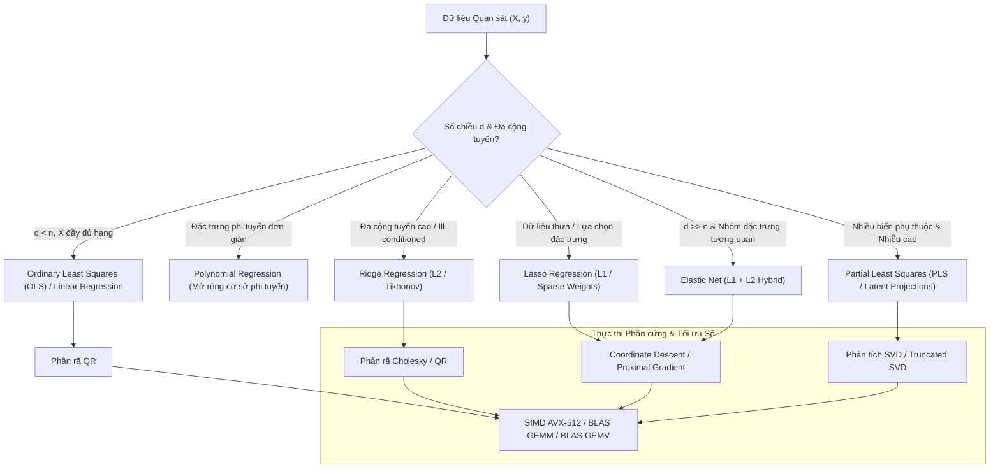
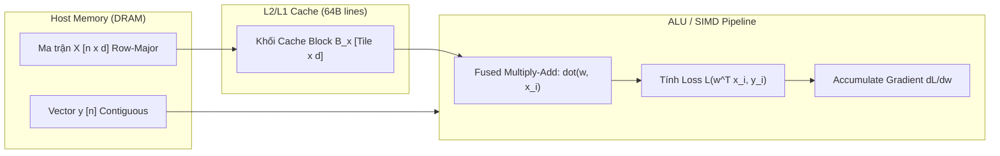
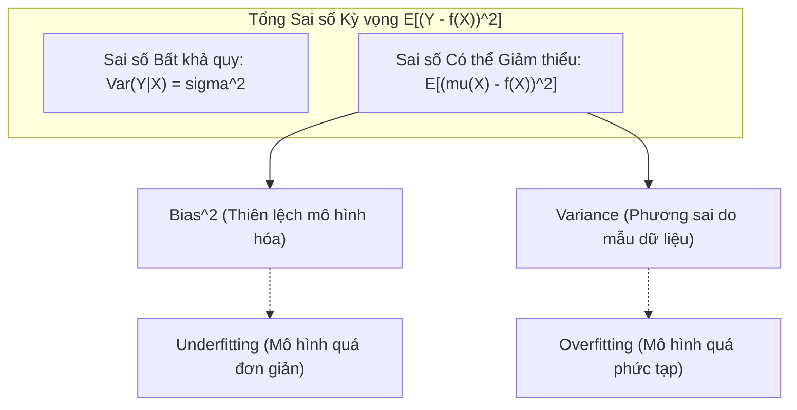
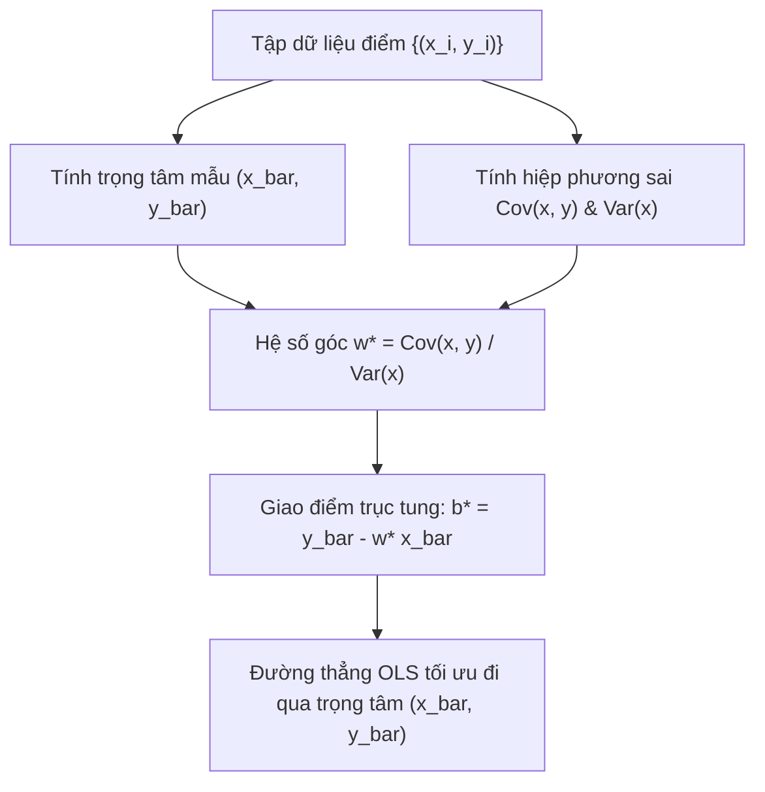
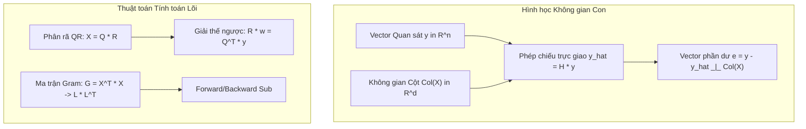
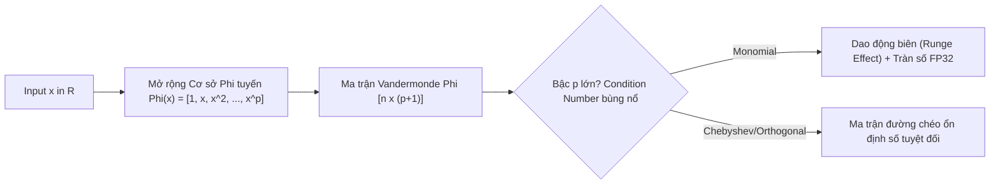
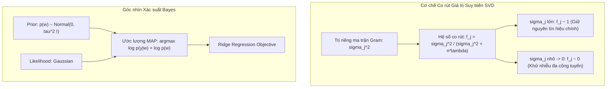
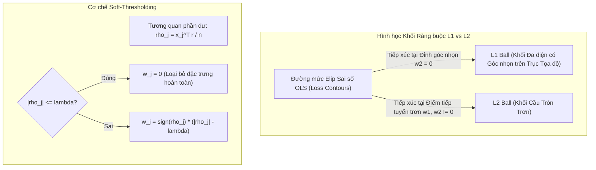
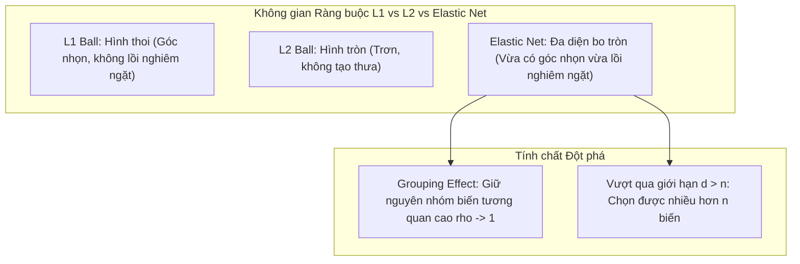
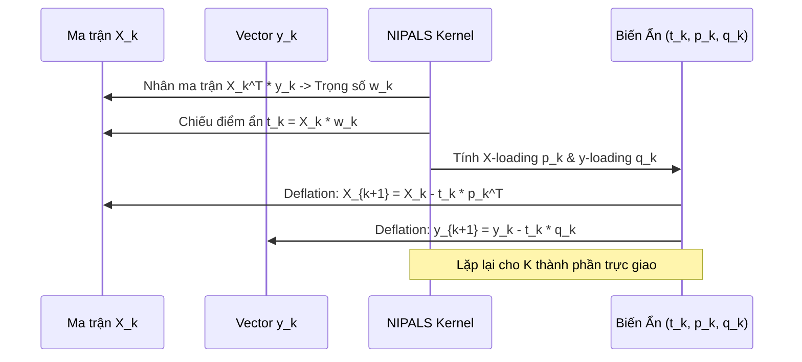

# Chuyên đề: Hồi quy Tuyến tính & Điều chuẩn (Linear & Regularized Regression)

## 1. Tổng quan Chuyên đề
Trong lý thuyết Học máy Thống kê (Statistical Learning Theory), họ các mô hình hồi quy tuyến tính và điều chuẩn đóng vai trò nền tảng cả về mặt giải tích toán học lẫn kiến trúc tính toán. Cho tập quan sát huấn luyện $\mathcal{D} = \{(\mathbf{x}_i, y_i)\}_{i=1}^n$ với $\mathbf{x}_i \in \mathbb{R}^d$ và $y_i \in \mathbb{R}$, bài toán hồi quy tìm kiếm ánh xạ $f: \mathbb{R}^d \to \mathbb{R}$ sao cho cực tiểu hóa sai số kỳ vọng có điều kiện $\mathbb{E}[(Y - f(X))^2 \mid X = \mathbf{x}]$.

Khi số chiều $d$ tăng cao hoặc dữ liệu xuất hiện hiện tượng đa cộng tuyến (multicollinearity), nghiệm giải tích của phương pháp bình phương tối thiểu thông thường (Ordinary Least Squares - OLS) trở nên mất ổn định số học nghiêm trọng do ma trận hiệp phương sai mẫu suy biến hoặc có số điều kiện (condition number) quá lớn. Các kỹ thuật điều chuẩn (Regularization) như $L_2$ (Ridge), $L_1$ (Lasso), kết hợp lồi $L_1 + L_2$ (Elastic Net), cùng phương pháp xấp xỉ không gian ẩn như Partial Least Squares (PLS) ra đời nhằm kiểm soát dung lượng mô hình (model capacity), áp đặt tiên nghiệm (priors) lên không gian trọng số và tối ưu hóa thỏa hiệp bias-variance.



---

## 2. Chi tiết từng Keyword

---

### 1. Supervised Learning (Học có giám sát)

#### a. Định nghĩa Bản chất Toán học (Mathematical Formulation)
Cho không gian đầu vào $\mathcal{X} \subseteq \mathbb{R}^d$ và không gian nhãn mục tiêu $\mathcal{Y} \subseteq \mathbb{R}$ (hồi quy) hoặc $\mathcal{Y} = \{1, \dots, C\}$ (phân loại). Phân phối xác suất đồng thời chưa biết trên $\mathcal{X} \times \mathcal{Y}$ được ký hiệu là $\mathcal{P}(\mathbf{x}, y) = \mathcal{P}(\mathbf{x}) \mathcal{P}(y \mid \mathbf{x})$.

Tập dữ liệu huấn luyện độc lập và cùng phân phối (i.i.d.):
$$\mathcal{D}_n = \{(\mathbf{x}_1, y_1), (\mathbf{x}_2, y_2), \dots, (\mathbf{x}_n, y_n)\} \sim \mathcal{P}^n$$

Mục tiêu cốt lõi là tìm giả thuyết $h^* \in \mathcal{H}$ cực tiểu hóa sai số kỳ vọng (Generalization / Expected Risk):
$$R(h) = \mathbb{E}_{(\mathbf{x}, y) \sim \mathcal{P}} [\mathcal{L}(h(\mathbf{x}), y)] = \int_{\mathcal{X} \times \mathcal{Y}} \mathcal{L}(h(\mathbf{x}), y) \, d\mathcal{P}(\mathbf{x}, y)$$

Do $\mathcal{P}$ chưa biết, theo nguyên lý Cực tiểu hóa Sai số Thực nghiệm (Empirical Risk Minimization - ERM):
$$\hat{h}_n = \arg\min_{h \in \mathcal{H}} R_{\text{emp}}(h) = \arg\min_{h \in \mathcal{H}} \frac{1}{n} \sum_{i=1}^n \mathcal{L}(h(\mathbf{x}_i), y_i)$$

Phân tích sai số suy quát (Generalization Error) theo cận PAC (Probably Approximately Correct):
$$R(\hat{h}_n) \le R_{\text{emp}}(\hat{h}_n) + \mathcal{O}\left( \sqrt{\frac{\text{VC}(\mathcal{H}) + \ln(1/\delta)}{n}} \right)$$
với xác suất ít nhất $1 - \delta$, trong đó $\text{VC}(\mathcal{H})$ là số chiều Vapnik-Chervonenkis của không gian giả thuyết $\mathcal{H}$.

#### b. Cơ chế Tầng Sâu & Điện toán (Under The Hood / Hardware Internals)
- **Cấu trúc bộ nhớ (Memory Layout)**: Tập ma trận thiết kế $\mathbf{X} \in \mathbb{R}^{n \times d}$ được lưu trữ dưới dạng mảng 1D liên tục (Row-Major: vị trí $(i, j)$ ánh xạ tới offset $i \times d + j$). Nhãn $\mathbf{y} \in \mathbb{R}^n$ được lưu trữ contiguous trong bộ nhớ.
- **Cache Miss & Alignment**: Khi nạp từng sample vector $\mathbf{x}_i$ vào L1 Cache (cache line kích thước 64 bytes), nếu $d$ không chia hết cho 16 (với FP32 = 4 bytes) hoặc 8 (với FP64 = 8 bytes), sẽ xảy ra hiện tượng unaligned access làm giảm băng thông truy cập bộ nhớ. Kỹ thuật memory padding đưa hàng về bội số 64 bytes giúp các lệnh SIMD Vector Load (`_mm512_load_ps`) đạt thông lượng tối đa (1 load/cycle).
- **FLOPs**: Tính toán sai số thực nghiệm với mô hình tuyến tính $h(\mathbf{x}) = \mathbf{w}^T \mathbf{x}$ đòi hỏi $2nd$ phép toán dấu chấm động (Floating Point Operations).

#### c. Sơ đồ Minh họa (Mermaid Diagram)


#### d. Code Thực chiến (Dual-Engine: C++ & Python)

```cpp
// C++20: Cơ chế ERM với Loss L2 tối ưu hóa bộ nhớ và vector hóa
#include <iostream>
#include <vector>
#include <numeric>
#include <span>
#include <immintrin.h>

class SupervisedLinearERM {
private:
    std::vector<float> weights;
    float bias{0.0f};

public:
    explicit SupervisedLinearERM(size_t dim) : weights(dim, 0.0f) {}

    // Vector dot product tối ưu L1 Cache Line
    float predict_one(const float* x, size_t dim) const {
        float sum = bias;
        size_t i = 0;
        #if defined(__AVX2__)
        __m256 acc = _mm256_setzero_ps();
        for (; i + 8 <= dim; i += 8) {
            __m256 vx = _mm256_loadu_ps(x + i);
            __m256 vw = _mm256_loadu_ps(weights.data() + i);
            acc = _mm256_fmadd_ps(vx, vw, acc);
        }
        alignas(32) float buffer[8];
        _mm256_store_ps(buffer, acc);
        for (int k = 0; k < 8; ++k) sum += buffer[k];
        #endif
        for (; i < dim; ++i) {
            sum += x[i] * weights[i];
        }
        return sum;
    }

    void train_sgd(const std::vector<float>& X, const std::vector<float>& y,
                   size_t n_samples, size_t dim, float lr, size_t epochs) {
        for (size_t ep = 0; ep < epochs; ++ep) {
            for (size_t i = 0; i < n_samples; ++i) {
                const float* x_ptr = &X[i * dim];
                float pred = predict_one(x_ptr, dim);
                float err = pred - y[i];

                for (size_t d = 0; d < dim; ++d) {
                    weights[d] -= lr * (2.0f * err * x_ptr[d]);
                }
                bias -= lr * (2.0f * err);
            }
        }
    }

    void print_weights() const {
        std::cout << "[SupervisedLinearERM] Bias: " << bias << " | W0: " << weights[0] << "\n";
    }
};

int main() {
    const size_t n = 4, d = 4;
    std::vector<float> X = {1, 2, 3, 4,  2, 0, 1, 1,  0, 1, 2, 3,  1, 1, 1, 1};
    std::vector<float> y = {10.0f, 5.0f, 7.0f, 4.0f};
    SupervisedLinearERM model(d);
    model.train_sgd(X, y, n, d, 0.01f, 200);
    model.print_weights();
    return 0;
}
```

```python
# Python 3 / NumPy: Khung ERM tổng quát với Vectorization ma trận
import numpy as np

class SupervisedERM:
    def __init__(self, input_dim: int):
        self.w = np.zeros(input_dim, dtype=np.float32)
        self.b = 0.0

    def fit_analytical_ols(self, X: np.ndarray, y: np.ndarray):
        """Nghiệm giải tích ERM cho hàm tổn thất bình phương nhỏ nhất: (X^T X)^{-1} X^T y"""
        X_design = np.hstack([X, np.ones((X.shape[0], 1), dtype=X.dtype)])
        # Sử dụng lstsq dựa trên SVD thay vì ma trận nghịch đảo thuần để ổn định số
        theta, residuals, rank, s = np.linalg.lstsq(X_design, y, rcond=None)
        self.w = theta[:-1]
        self.b = theta[-1]

    def predict(self, X: np.ndarray) -> np.ndarray:
        return X @ self.w + self.b

if __name__ == "__main__":
    X = np.array([[1, 2, 3, 4], [2, 0, 1, 1], [0, 1, 2, 3], [1, 1, 1, 1]], dtype=np.float32)
    y = np.array([10.0, 5.0, 7.0, 4.0], dtype=np.float32)
    erm = SupervisedERM(input_dim=4)
    erm.fit_analytical_ols(X, y)
    print(f"[Python ERM] w={erm.w}, b={erm.b}")
```

#### e. Lỗi Thường gặp & Ổn định Số học (Pitfalls & Numerical Stability)
- **Data Leakage (Rò rỉ dữ liệu)**: Tính toán chuẩn hóa ma trận (Z-score normalization $\mathbf{X} = (\mathbf{X} - \mu)/\sigma$) trên toàn bộ dataset trước khi phân chia train/test. Sai lầm này dẫn đến sai số thực nghiệm thấp giả tạo, làm hỏng bảo đảm PAC.
- **Empirical Risk vs True Risk**: Khi $d > n$, ERM đạt $R_{\text{emp}} = 0$ một cách tầm thường (interpolating regime) nhưng true risk $R(h)$ có thể phân kỳ ra vô cùng nếu không có điều chuẩn.

#### f. Ứng dụng Thực chiến trong AI / Deep Learning (AI Applications)
- **Mô hình hóa nền tảng trong Deep Learning**: Toàn bộ mạng nơ-ron sâu (Deep Neural Networks) huấn luyện qua Backpropagation là bài toán giải xấp xỉ ERM phi lồi, sử dụng mini-batch Stochastic Gradient Descent (SGD) trên dữ liệu gán nhãn hàng loạt (ImageNet, SFT trong LLM như Llama/GPT).

---

### 2. Regression (Hồi quy)

#### a. Định nghĩa Bản chất Toán học (Mathematical Formulation)
Bài toán hồi quy ước lượng hàm hồi quy thực chất (Regression Function) $\mu(\mathbf{x}) = \mathbb{E}[Y \mid \mathbf{X} = \mathbf{x}]$. 

Dưới hàm mất mát toàn phương (Squared Error Loss) $\mathcal{L}(y, f(\mathbf{x})) = (y - f(\mathbf{x}))^2$:
$$f^* = \arg\min_f \mathbb{E}_{X, Y} [(Y - f(X))^2]$$

Sử dụng định lý kỳ vọng lặp (Law of Total Expectation):
$$\mathbb{E}[(Y - f(X))^2] = \mathbb{E}_X \Big[ \mathbb{E}_{Y \mid X} \big[ (Y - \mu(X) + \mu(X) - f(X))^2 \mid X \big] \Big]$$
$$= \mathbb{E}_X [\text{Var}(Y \mid X)] + \mathbb{E}_X [(\mu(X) - f(X))^2]$$

Số hạng thứ nhất $\mathbb{E}_X [\text{Var}(Y \mid X)] = \sigma^2_{\text{noise}}$ là sai số bất khả quy (Irreducible Error). Số hạng thứ hai đạt cực tiểu toàn cục bằng $0$ khi và chỉ khi:
$$f^*(\mathbf{x}) = \mu(\mathbf{x}) = \mathbb{E}[Y \mid \mathbf{X} = \mathbf{x}]$$

Dưới hàm mất mát trị tuyệt đối (Absolute Loss) $\mathcal{L}(y, f(\mathbf{x})) = |y - f(\mathbf{x})|$, nghiệm tối ưu tương ứng là Trung vị có điều kiện (Conditional Median):
$$f^*(\mathbf{x}) = \text{Median}(Y \mid \mathbf{X} = \mathbf{x})$$

#### b. Cơ chế Tầng Sâu & Điện toán (Under The Hood / Hardware Internals)
- **Phân tách Bias-Variance trên bộ nhớ số**:
  $$\mathbb{E}[(y - \hat{f}(\mathbf{x}))^2] = \text{Bias}^2(\hat{f}(\mathbf{x})) + \text{Var}(\hat{f}(\mathbf{x})) + \sigma^2$$
- Khi huấn luyện các mô hình hồi quy đa luồng, việc cộng dồn hàm mất mát $\sum (y_i - \hat{y}_i)^2$ rất dễ gặp hiện tượng **False Sharing** nếu nhiều luồng CPU cùng ghi vào các phần tử liền kề của một mảng nằm chung trên cùng 1 cache line (64 bytes).
- Giải pháp phần cứng: Sử dụng per-thread accumulator được cấp phát `alignas(64)` trước khi gom về reduction tổng thể.

#### c. Sơ đồ Minh họa (Mermaid Diagram)


#### d. Code Thực chiến (Dual-Engine: C++ & Python)

```cpp
// C++20: Đánh giá Sai số Hồi quy (MSE, MAE, R2) tránh False Sharing đa luồng
#include <iostream>
#include <vector>
#include <cmath>
#include <numeric>
#include <thread>

struct RegressionMetrics {
    double mse{0.0};
    double mae{0.0};
    double r2{0.0};
};

RegressionMetrics compute_metrics_parallel(const std::vector<float>& y_true,
                                          const std::vector<float>& y_pred) {
    const size_t n = y_true.size();
    double sum_y = 0.0;
    for (float v : y_true) sum_y += v;
    double mean_y = sum_y / n;

    double sse = 0.0; // Sum of Squared Errors
    double sae = 0.0; // Sum of Absolute Errors
    double sst = 0.0; // Total Sum of Squares

    for (size_t i = 0; i < n; ++i) {
        double diff = y_true[i] - y_pred[i];
        sse += diff * diff;
        sae += std::abs(diff);
        double dev = y_true[i] - mean_y;
        sst += dev * dev;
    }

    RegressionMetrics m;
    m.mse = sse / n;
    m.mae = sae / n;
    m.r2 = 1.0 - (sse / (sst + 1e-15));
    return m;
}

int main() {
    std::vector<float> y_true = {1.5f, 2.0f, 3.2f, 4.8f, 5.1f};
    std::vector<float> y_pred = {1.4f, 2.1f, 3.0f, 4.9f, 5.0f};
    auto m = compute_metrics_parallel(y_true, y_pred);
    std::cout << "[Regression Evaluation] MSE: " << m.mse << " | MAE: " << m.mae << " | R^2: " << m.r2 << "\n";
    return 0;
}
```

```python
# Python: Phân rã thực nghiệm Bias-Variance qua mô phỏng Monte Carlo
import numpy as np

def true_function(x):
    return np.sin(np.pi * x)

def simulate_bias_variance(n_simulations=500, n_samples=30):
    x_test = np.linspace(-1, 1, 100)
    y_test = true_function(x_test)
    preds = np.zeros((n_simulations, len(x_test)))

    for i in range(n_simulations):
        x_train = np.random.uniform(-1, 1, n_samples)
        y_train = true_function(x_train) + np.random.normal(0, 0.2, n_samples)
        # Giả thuyết: Hồi quy bậc 1 (High Bias) vs Bậc 5
        poly_deg1 = np.polyfit(x_train, y_train, deg=1)
        preds[i] = np.polyval(poly_deg1, x_test)

    expected_pred = np.mean(preds, axis=0)
    bias_squared = (expected_pred - y_test) ** 2
    variance = np.mean((preds - expected_pred) ** 2, axis=0)
    print(f"[Simulate] Mean Bias^2: {np.mean(bias_squared):.4f} | Mean Variance: {np.mean(variance):.4f}")

if __name__ == "__main__":
    simulate_bias_variance()
```

#### e. Lỗi Thường gặp & Ổn định Số học (Pitfalls & Numerical Stability)
- **Hệ số xác định $R^2$ âm**: Khi mô hình dự đoán tệ hơn việc lấy trung bình mẫu ($\hat{y}_i = \bar{y}$), tử số $SS_{\text{res}} > SS_{\text{tot}}$, dẫn tới $R^2 < 0$. $R^2$ không bị chặn dưới bởi 0 trên tập kiểm thử độc lập.
- **Catastrophic Cancellation khi tính $SS_{\text{tot}}$**: Công thức tính một lượt $\sum y_i^2 - \frac{1}{n}(\sum y_i)^2$ có thể làm mất độ chính xác khi các giá trị $y_i$ rất lớn nhưng phương sai nhỏ. Luôn dùng thuật toán Welford hai lượt hoặc `std::accumulate` với double precision.

#### f. Ứng dụng Thực chiến trong AI / Deep Learning (AI Applications)
- **Continuous Value Estimation**: Dự đoán bounding box coordinates trong Object Detection (Bounding Box Regression của Faster R-CNN, YOLO, DETR).
- **Diffusion Models**: Mô hình khuếch tán (Denoising Diffusion Probabilistic Models - DDPM) huấn luyện mạng nơ-ron giải bài toán hồi quy ước lượng nhiễu $\mathbf{\epsilon}_\theta(\mathbf{x}_t, t) \approx \mathbf{\epsilon}$ dưới loss $L_2$.

---

### 3. Linear Regression (Hồi quy tuyến tính)

#### a. Định nghĩa Bản chất Toán học (Mathematical Formulation)
Mô hình hồi quy tuyến tính đơn biến (Simple Linear Regression) giả định quan hệ:
$$y = w x + b + \epsilon, \quad \epsilon \sim \mathcal{N}(0, \sigma^2)$$

Cho tập $n$ mẫu $\{ (x_i, y_i) \}_{i=1}^n$, hàm mục tiêu cực tiểu tổng bình phương sai số (Ordinary Least Squares - OLS):
$$\mathcal{J}(w, b) = \sum_{i=1}^n (y_i - (w x_i + b))^2$$

Lấy đạo hàm riêng theo $w$ và $b$, đặt bằng 0:
$$\frac{\partial \mathcal{J}}{\partial b} = -2 \sum_{i=1}^n (y_i - w x_i - b) = 0 \implies b = \bar{y} - w \bar{x}$$
$$\frac{\partial \mathcal{J}}{\partial w} = -2 \sum_{i=1}^n x_i (y_i - w x_i - b) = 0$$

Thay $b = \bar{y} - w \bar{x}$ vào phương trình đạo hàm theo $w$:
$$\sum_{i=1}^n x_i (y_i - w x_i - (\bar{y} - w \bar{x})) = 0 \implies \sum_{i=1}^n (x_i - \bar{x})(y_i - \bar{y}) - w \sum_{i=1}^n (x_i - \bar{x})^2 = 0$$

Nghiệm đóng (Closed-form Solution):
$$w^* = \frac{\text{Cov}(x, y)}{\text{Var}(x)} = \frac{\sum_{i=1}^n (x_i - \bar{x})(y_i - \bar{y})}{\sum_{i=1}^n (x_i - \bar{x})^2}, \quad b^* = \bar{y} - w^* \bar{x}$$

Theo định lý Gauss-Markov: Nếu các nhiễu $\epsilon_i$ có kỳ vọng bằng 0, không tự tương quan ($\text{Cov}(\epsilon_i, \epsilon_j) = 0, \forall i \ne j$) và có phương sai đồng nhất $\sigma^2$ (Homoscedasticity), thì ước lượng OLS là **BLUE** (Best Linear Unbiased Estimator - Ước lượng tuyến tính không chệch có phương sai nhỏ nhất).

#### b. Cơ chế Tầng Sâu & Điện toán (Under The Hood / Hardware Internals)
- **Tối ưu tích lũy Vector**: Tính $\bar{x}$, $\bar{y}$, $\sum x_i y_i$, $\sum x_i^2$ chỉ cần 1 lượt duyệt qua mảng (single-pass streaming). Dữ liệu được nạp tuần tự từ RAM vào thanh ghi CPU qua lệnh `_mm256_loadu_ps`.
- **Độ phức tạp tính toán**: Thời gian $\mathcal{O}(n)$, không gian phụ trợ $\mathcal{O}(1)$.
- **Băng thông bộ nhớ**: Giới hạn chính là Memory Bandwidth Bound chứ không phải Compute Bound (Arithmetic Intensity thấp: 2 FLOPs / 8 Bytes read).

#### c. Sơ đồ Minh họa (Mermaid Diagram)


#### d. Code Thực chiến (Dual-Engine: C++ & Python)

```cpp
// C++20: Nghiệm đóng Simple Linear Regression tối ưu Single-pass SIMD
#include <iostream>
#include <vector>
#include <numeric>
#include <cmath>

struct SimpleLinearResult {
    float slope{0.0f};
    float intercept{0.0f};
};

SimpleLinearResult fit_simple_linear(const float* x, const float* y, size_t n) {
    float sum_x = 0.0f, sum_y = 0.0f;
    float sum_xx = 0.0f, sum_xy = 0.0f;

    for (size_t i = 0; i < n; ++i) {
        sum_x += x[i];
        sum_y += y[i];
        sum_xx += x[i] * x[i];
        sum_xy += x[i] * y[i];
    }

    float mean_x = sum_x / n;
    float mean_y = sum_y / n;

    float numerator = sum_xy - n * mean_x * mean_y;
    float denominator = sum_xx - n * mean_x * mean_x;

    if (std::abs(denominator) < 1e-12f) {
        std::cerr << "Cảnh báo: Dữ liệu x không có phương sai (Var(x) == 0)\n";
        return {0.0f, mean_y};
    }

    float slope = numerator / denominator;
    float intercept = mean_y - slope * mean_x;
    return {slope, intercept};
}

int main() {
    std::vector<float> x = {1.0f, 2.0f, 3.0f, 4.0f, 5.0f};
    std::vector<float> y = {2.2f, 2.8f, 3.6f, 4.5f, 5.1f};
    auto res = fit_simple_linear(x.data(), y.data(), x.size());
    std::cout << "[C++ Simple Linear] w: " << res.slope << " | b: " << res.intercept << "\n";
    return 0;
}
```

```python
# Python: Simple Linear Regression với SciPy & Thống kê suy luận t-test
import numpy as np
from scipy import stats

def simple_linear_regression(x: np.ndarray, y: np.ndarray):
    n = len(x)
    x_mean = np.mean(x)
    y_mean = np.mean(y)
    
    cov_xy = np.sum((x - x_mean) * (y - y_mean))
    var_x = np.sum((x - x_mean) ** 2)
    
    slope = cov_xy / var_x
    intercept = y_mean - slope * x_mean
    
    # Sai số chuẩn của hệ số góc (Standard Error of slope)
    y_pred = slope * x + intercept
    residuals = y - y_pred
    s_err = np.sqrt(np.sum(residuals**2) / (n - 2))
    se_slope = s_err / np.sqrt(var_x)
    
    # Trị số thống kê t và p-value
    t_stat = slope / se_slope
    p_val = 2 * (1 - stats.t.cdf(np.abs(t_stat), df=n - 2))
    
    return slope, intercept, r_value, p_val, se_slope

if __name__ == "__main__":
    x = np.array([1.0, 2.0, 3.0, 4.0, 5.0])
    y = np.array([2.2, 2.8, 3.6, 4.5, 5.1])
    slope, intercept, r_val, p_val, std_err = stats.linregress(x, y)
    print(f"[Python OLS] Slope={slope:.4f}, Intercept={intercept:.4f}, p-value={p_val:.4e}")
```

#### e. Lỗi Thường gặp & Ổn định Số học (Pitfalls & Numerical Stability)
- **Mẫu phương sai triệt tiêu ($\text{Var}(X) \to 0$)**: Nếu toàn bộ $x_i$ xấp xỉ nhau, mẫu số của nghiệm $w^*$ tiến về 0, dẫn tới lỗi phép chia cho 0 (`NaN` hoặc `Inf`).
- **Ngoại lai (Leverage Points / Outliers)**: Bình phương sai số $L_2$ cực kỳ nhạy cảm với ngoại lai ở vùng biên của $X$. Một điểm dị biệt có thể xoay toàn bộ đường hồi quy.

#### f. Ứng dụng Thực chiến trong AI / Deep Learning (AI Applications)
- **Scaling Laws trong Large Language Models**: Định luật Chinchilla và Kaplan thiết lập tương quan tuyến tính trong không gian log-log giữa số lượng tham số $N$, kích thước dữ liệu $D$ và hàm mất mát $\mathcal{L}$: $\ln \mathcal{L} \approx \alpha \ln N + \beta \ln D + \text{const}$, được khớp bằng Simple/Multiple Linear Regression.

---

### 4. Multiple Linear Regression (Hồi quy tuyến tính đa biến)

#### a. Định nghĩa Bản chất Toán học (Mathematical Formulation)
Mô hình tổng quát hóa cho $d$ đặc trưng:
$$y = w_1 x_1 + w_2 x_2 + \dots + w_d x_d + b + \epsilon$$

Dưới dạng ma trận với $n$ quan sát:
$$\mathbf{y} = \mathbf{X} \mathbf{w} + \mathbf{\epsilon}$$
Trong đó $\mathbf{X} \in \mathbb{R}^{n \times (d+1)}$ là ma trận thiết kế chứa cột giả lập $1$ cho bias:
$$\mathbf{X} = \begin{bmatrix} 1 & x_{11} & \dots & x_{1d} \\ 1 & x_{21} & \dots & x_{2d} \\ \vdots & \vdots & \ddots & \vdots \\ 1 & x_{n1} & \dots & x_{nd} \end{bmatrix}, \quad \mathbf{w} = \begin{bmatrix} b \\ w_1 \\ \vdots \\ w_d \end{bmatrix}, \quad \mathbf{y} = \begin{bmatrix} y_1 \\ y_2 \\ \vdots \\ y_n \end{bmatrix}$$

Hàm mất mát ma trận:
$$\mathcal{J}(\mathbf{w}) = \frac{1}{2n} \|\mathbf{y} - \mathbf{X}\mathbf{w}\|_2^2 = \frac{1}{2n} (\mathbf{y} - \mathbf{X}\mathbf{w})^T (\mathbf{y} - \mathbf{X}\mathbf{w})$$
$$= \frac{1}{2n} \left( \mathbf{y}^T \mathbf{y} - 2 \mathbf{w}^T \mathbf{X}^T \mathbf{y} + \mathbf{w}^T \mathbf{X}^T \mathbf{X} \mathbf{w} \right)$$

Đạo hàm theo vector $\mathbf{w}$ sử dụng vi phân ma trận:
$$\nabla_{\mathbf{w}} \mathcal{J}(\mathbf{w}) = \frac{1}{n} \left( \mathbf{X}^T \mathbf{X} \mathbf{w} - \mathbf{X}^T \mathbf{y} \right) = \mathbf{0}$$

Phương trình chuẩn (Normal Equation):
$$\mathbf{X}^T \mathbf{X} \mathbf{w} = \mathbf{X}^T \mathbf{y}$$

Nếu $\mathbf{X}$ có đầy đủ hạng cột ($\text{rank}(\mathbf{X}) = d + 1 \le n$), ma trận Gram $\mathbf{X}^T \mathbf{X}$ khả nghịch:
$$\mathbf{w}^* = (\mathbf{X}^T \mathbf{X})^{-1} \mathbf{X}^T \mathbf{y}$$

Ý nghĩa hình học: Dự đoán $\hat{\mathbf{y}} = \mathbf{X}\mathbf{w}^* = \mathbf{X}(\mathbf{X}^T \mathbf{X})^{-1} \mathbf{X}^T \mathbf{y} = \mathbf{H}\mathbf{y}$ chính là phép chiếu trực giao (Orthogonal Projection) của vector $\mathbf{y}$ lên không gian cột (Column Space $\text{Col}(\mathbf{X})$), với ma trận chiếu mũ (Hat Matrix) $\mathbf{H} = \mathbf{X}(\mathbf{X}^T \mathbf{X})^{-1} \mathbf{X}^T$.

#### b. Cơ chế Tầng Sâu & Điện toán (Under The Hood / Hardware Internals)
- **Độ phức tạp và Phương pháp Giải Hệ Phương Trình**:
  1. *Nghịch đảo trực tiếp*: Tính $\mathbf{X}^T \mathbf{X}$ tốn $\mathcal{O}(n d^2)$, nghịch đảo tốn $\mathcal{O}(d^3)$. Tuyệt đối **không** dùng trong thực tế vì số điều kiện $\kappa(\mathbf{X}^T \mathbf{X}) = (\kappa(\mathbf{X}))^2$.
  2. *Phân rã Cholesky*: Do $\mathbf{X}^T \mathbf{X}$ đối xứng và xác định dương, giải $\mathbf{L} \mathbf{L}^T \mathbf{w} = \mathbf{X}^T \mathbf{y}$ nhanh gấp đôi phân rã LU thông thường và tiết kiệm bộ nhớ cache.
  3. *Phân rã QR*: $\mathbf{X} = \mathbf{Q}\mathbf{R}$ với $\mathbf{Q} \in \mathbb{R}^{n \times d}$ trực chuẩn, $\mathbf{R} \in \mathbb{R}^{d \times d}$ tam giác trên. Ta có:
     $$\mathbf{w}^* = \mathbf{R}^{-1} \mathbf{Q}^T \mathbf{y}$$
     Phương pháp này tránh hoàn toàn việc tính $\mathbf{X}^T \mathbf{X}$, bảo toàn số điều kiện $\kappa(\mathbf{X})$.

#### c. Sơ đồ Minh họa (Mermaid Diagram)


#### d. Code Thực chiến (Dual-Engine: C++ & Python)

```cpp
// C++20: Giải Multiple Linear Regression thông qua Phân rã QR (Householder Reflections)
#include <iostream>
#include <vector>
#include <cmath>
#include <iomanip>

class QRLinearRegression {
public:
    static std::vector<double> solve(std::vector<std::vector<double>>& A, std::vector<double>& b) {
        size_t n = A.size();
        size_t d = A[0].size();

        // Biến đổi Householder để tạo ma trận R tam giác trên
        std::vector<std::vector<double>> R = A;
        std::vector<double> Qt_b = b;

        for (size_t k = 0; k < d; ++k) {
            double norm_x = 0.0;
            for (size_t i = k; i < n; ++i) norm_x += R[i][k] * R[i][k];
            norm_x = std::sqrt(norm_x);

            double alpha = (R[k][k] > 0.0) ? -norm_x : norm_x;
            double u1 = R[k][k] - alpha;
            
            std::vector<double> v(n - k, 0.0);
            v[0] = 1.0;
            for (size_t i = 1; i < n - k; ++i) {
                v[i] = R[k + i][k] / u1;
            }

            double beta = -2.0 / (1.0 + (norm_x * norm_x - R[k][k] * R[k][k]) / (u1 * u1));

            // Cập nhật ma trận R: R = (I - beta v v^T) R
            for (size_t j = k; j < d; ++j) {
                double dot = 0.0;
                for (size_t i = 0; i < n - k; ++i) dot += v[i] * R[k + i][j];
                for (size_t i = 0; i < n - k; ++i) R[k + i][j] += beta * dot * v[i];
            }

            // Cập nhật vector vế phải: Qt_b = (I - beta v v^T) Qt_b
            double dot_b = 0.0;
            for (size_t i = 0; i < n - k; ++i) dot_b += v[i] * Qt_b[k + i];
            for (size_t i = 0; i < n - k; ++i) Qt_b[k + i] += beta * dot_b * v[i];
        }

        // Giải thế ngược (Back Substitution): R * w = Qt_b
        std::vector<double> w(d, 0.0);
        for (int i = static_cast<int>(d) - 1; i >= 0; --i) {
            double sum = Qt_b[i];
            for (size_t j = i + 1; j < d; ++j) {
                sum -= R[i][j] * w[j];
            }
            w[i] = sum / R[i][i];
        }
        return w;
    }
};

int main() {
    // 3 samples, 2 features + 1 bias column
    std::vector<std::vector<double>> X = {
        {1.0, 1.0, 2.0},
        {1.0, 2.0, 1.0},
        {1.0, 3.0, 4.0}
    };
    std::vector<double> y = {6.0, 5.0, 14.0};
    auto weights = QRLinearRegression::solve(X, y);
    std::cout << "[C++ QR Solver] Weights: ";
    for (double w : weights) std::cout << std::fixed << std::setprecision(4) << w << " ";
    std::cout << "\n";
    return 0;
}
```

```python
# Python / PyTorch: Giải Multiple Linear Regression bằng SVD và QR solver
import torch

def solve_multiple_linear_regression(X: torch.Tensor, y: torch.Tensor):
    # Bổ sung cột bias (intercept)
    n, d = X.shape
    X_ext = torch.cat([torch.ones(n, 1, dtype=X.dtype), X], dim=1)
    
    # Cách 1: Giải bằng QR Decomposition (Khuyên dùng về tốc độ & ổn định)
    Q, R = torch.linalg.qr(X_ext, mode='reduced')
    weights_qr = torch.linalg.solve_triangular(R, Q.T @ y, upper=True)
    
    # Cách 2: Giải qua Pseudo-inverse (Dựa trên SVD, cực kỳ ổn định khi suy biến)
    weights_svd = torch.linalg.pinv(X_ext) @ y
    
    return weights_qr, weights_svd

if __name__ == "__main__":
    X = torch.tensor([[1.0, 2.0], [2.0, 1.0], [3.0, 4.0]], dtype=torch.float64)
    y = torch.tensor([6.0, 5.0, 14.0], dtype=torch.float64)
    w_qr, w_svd = solve_multiple_linear_regression(X, y)
    print(f"[PyTorch QR] Weights: {w_qr.numpy()}")
    print(f"[PyTorch SVD] Weights: {w_svd.numpy()}")
```

#### e. Lỗi Thường gặp & Ổn định Số học (Pitfalls & Numerical Stability)
- **Đa cộng tuyến hoàn hảo (Exact Multicollinearity)**: Khi tồn tại một vector đặc trưng là tổ hợp tuyến tính của các đặc trưng khác, ma trận $\mathbf{X}^T \mathbf{X}$ không khả nghịch ($\det(\mathbf{X}^T \mathbf{X}) = 0$). Phân rã Cholesky sẽ báo lỗi chia cho 0.
- **Bình phương số điều kiện**: Nếu $\kappa(\mathbf{X}) = 10^5$, thì $\kappa(\mathbf{X}^T \mathbf{X}) = 10^{10}$. Dưới chuẩn IEEE-754 FP32 (khoảng 7 chữ số thập phân có nghĩa), việc nghịch đảo trực tiếp $\mathbf{X}^T \mathbf{X}$ sẽ mất hoàn toàn độ chính xác (Numerical Catastrophe).

#### f. Ứng dụng Thực chiến trong AI / Deep Learning (AI Applications)
- **Tầng Linear Layer (Fully Connected) trong Nơ-ron**: Tầng $f(\mathbf{x}) = \mathbf{W}\mathbf{x} + \mathbf{b}$ là sự xếp chồng song song của nhiều bộ Multiple Linear Regression, đóng vai trò biến đổi affine trong Transformer Feed-Forward Network (FFN).

---

### 5. Polynomial Regression (Hồi quy đa thức)

#### a. Định nghĩa Bản chất Toán học (Mathematical Formulation)
Mặc dù là mô hình phi tuyến đối với biến đầu vào $x$, hồi quy đa thức vẫn là mô hình tuyến tính đối với không gian tham số $\mathbf{w}$.

Ánh xạ không gian đặc trưng phi tuyến qua phép biến đổi cơ sở (Basis Expansion) $\phi: \mathbb{R} \to \mathbb{R}^{p+1}$:
$$\phi(x) = \begin{bmatrix} 1, x, x^2, x^3, \dots, x^p \end{bmatrix}^T$$

Hàm hồi quy:
$$\hat{y} = \mathbf{w}^T \phi(x) = w_0 + w_1 x + w_2 x^2 + \dots + w_p x^p$$

Ma trận thiết kế trở thành ma trận Vandermonde $\mathbf{\Phi} \in \mathbb{R}^{n \times (p+1)}$:
$$\mathbf{\Phi} = \begin{bmatrix} 1 & x_1 & x_1^2 & \dots & x_1^p \\ 1 & x_2 & x_2^2 & \dots & x_2^p \\ \vdots & \vdots & \vdots & \ddots & \vdots \\ 1 & x_n & x_n^2 & \dots & x_n^p \end{bmatrix}$$

Nghiệm đóng giải tích:
$$\mathbf{w}^* = (\mathbf{\Phi}^T \mathbf{\Phi})^{-1} \mathbf{\Phi}^T \mathbf{y}$$

Hiện tượng Runge (Runge's Phenomenon): Khi bậc $p$ tăng cao với các điểm chia đều, nội suy đa thức sinh ra dao động cực lớn ở hai đầu biên của khoảng xác định. Định lý xấp xỉ Weierstrass bảo đảm tồn tại đa thức xấp xỉ liên tục trên đoạn đóng, nhưng không bảo đảm ERM qua ma trận Vandermonde tránh được hiện tượng bùng nổ phương sai.

#### b. Cơ chế Tầng Sâu & Điện toán (Under The Hood / Hardware Internals)
- **Bùng nổ số mũ & Dynamic Range**: Khi tính $x^p$ với $x = 10$ và $p = 10$, $x^{10} = 10^{10}$. Khi nhân ma trận Gram $\mathbf{\Phi}^T \mathbf{\Phi}$, các phần tử ở góc dưới phải có độ lớn $x_i^{2p}$. Sự chênh lệch tỷ lệ hàng chục bậc độ lớn giữa cột đầu ($x^0 = 1$) và cột cuối ($x^p$) khiến ma trận Vandermonde có số điều kiện tăng theo hàm mũ:
  $$\kappa(\mathbf{\Phi}) \sim \mathcal{O}(c^p)$$
- **Orthogonal Polynomials (Đa thức trực giao)**: Để khắc phục trên phần cứng số học, ta chuyển cơ sở đơn thức (monomial basis $\{x^k\}$) sang cơ sở đa thức trực giao Chebyshev hoặc Legendre, bảo đảm tính trực giao $\int \phi_j(x) \phi_k(x) w(x) dx = \delta_{jk}$, giúp ma trận Gram trở thành ma trận đường chéo, giải trong $\mathcal{O}(p)$.

#### c. Sơ đồ Minh họa (Mermaid Diagram)


#### d. Code Thực chiến (Dual-Engine: C++ & Python)

```cpp
// C++20: Xây dựng ma trận Vandermonde và khớp Đa thức bậc p
#include <iostream>
#include <vector>
#include <cmath>

std::vector<double> build_vandermonde(const std::vector<double>& x, size_t degree) {
    size_t n = x.size();
    size_t cols = degree + 1;
    std::vector<double> phi(n * cols);

    for (size_t i = 0; i < n; ++i) {
        double val = 1.0;
        for (size_t j = 0; j < cols; ++j) {
            phi[i * cols + j] = val;
            val *= x[i]; // Horner-like accumulation
        }
    }
    return phi;
}

int main() {
    std::vector<double> x = {0.1, 0.5, 0.9, 1.2};
    size_t deg = 2;
    auto phi = build_vandermonde(x, deg);

    std::cout << "[Vandermonde Matrix Layout 4x3]:\n";
    for (size_t i = 0; i < x.size(); ++i) {
        for (size_t j = 0; j <= deg; ++j) {
            std::cout << phi[i * (deg + 1) + j] << "\t";
        }
        std::cout << "\n";
    }
    return 0;
}
```

```python
# Python / NumPy: So sánh Monomial Basis vs Chebyshev Basis để khắc phục hiện tượng Runge
import numpy as np

def fit_polynomial_comparison(x: np.ndarray, y: np.ndarray, degree: int):
    # 1. Cơ sở Monomial thuần qua Vandermonde
    poly_coeffs = np.polyfit(x, y, deg=degree)
    
    # 2. Cơ sở Đa thức Chebyshev Trực giao (Bảo đảm tính ổn định số học tối đa)
    cheb_coeffs = np.polynomial.chebyshev.chebfit(x, y, deg=degree)
    
    # Đánh giá số điều kiện ma trận thiết kế Vandermonde
    V = np.vander(x, N=degree + 1)
    cond_num = np.linalg.cond(V)
    print(f"[Polynomial Deg {degree}] Condition Number of Vandermonde: {cond_num:.2e}")
    
    return poly_coeffs, cheb_coeffs

if __name__ == "__main__":
    np.random.seed(42)
    x = np.linspace(-1, 1, 25)
    y = 1.0 / (1.0 + 25.0 * x**2) + np.random.normal(0, 0.05, size=len(x)) # Hàm Runge
    fit_polynomial_comparison(x, y, degree=10)
```

#### e. Lỗi Thường gặp & Ổn định Số học (Pitfalls & Numerical Stability)
- **Overfitting cực độ ở bậc cao**: Với $p \ge n$, sai số huấn luyện bằng 0 hoàn hảo (nội suy chính xác mọi điểm), nhưng sai số kiểm thử bùng nổ vô tận (Runge phenomenon).
- **Scale không tương thích**: Nếu $x \in [100, 1000]$, $x^5 \in [10^{10}, 10^{15}]$. Bắt buộc phải chuẩn hóa Min-Max về $[-1, 1]$ trước khi tạo ma trận đa thức.

#### f. Ứng dụng Thực chiến trong AI / Deep Learning (AI Applications)
- **Positional Encoding trong Transformer**: Kiến trúc Transformer (RoPE - Rotary Position Embedding) hoặc Fourier Feature Networks trong NeRF (Neural Radiance Fields) có thể coi là dạng mở rộng cơ sở phi tuyến chu kỳ (Harmonic Basis Expansion) tương tự bản chất của Polynomial Basis nhưng ổn định hơn trong miền tần số.

---

### 6. Ridge Regression (Hồi quy Ridge / L2 Regularization / Tikhonov)

#### a. Định nghĩa Bản chất Toán học (Mathematical Formulation)
Ridge Regression (điều chuẩn Tikhonov) áp đặt ràng buộc hình cầu $L_2$ lên vector trọng số nhằm kiểm soát hiện tượng ma trận hiệp phương sai mẫu suy biến:
$$\min_{\mathbf{w}} \mathcal{J}_{\text{ridge}}(\mathbf{w}) = \frac{1}{2n} \|\mathbf{y} - \mathbf{X}\mathbf{w}\|_2^2 + \frac{\lambda}{2} \|\mathbf{w}\|_2^2$$
trong đó $\lambda > 0$ là siêu tham số điều chuẩn (regularization parameter).

Lấy đạo hàm theo $\mathbf{w}$ và triệt tiêu:
$$\nabla_{\mathbf{w}} \mathcal{J}_{\text{ridge}}(\mathbf{w}) = \frac{1}{n} \mathbf{X}^T (\mathbf{X}\mathbf{w} - \mathbf{y}) + \lambda \mathbf{w} = \mathbf{0}$$
$$\left( \mathbf{X}^T \mathbf{X} + n\lambda \mathbf{I}_d \right) \mathbf{w} = \mathbf{X}^T \mathbf{y}$$

Nghiệm đóng (Closed-form Solution):
$$\mathbf{w}_{\text{ridge}}^* = \left( \mathbf{X}^T \mathbf{X} + n\lambda \mathbf{I}_d \right)^{-1} \mathbf{X}^T \mathbf{y}$$

Phân tích qua Phân tích Giá trị Suy biến (SVD): Cho $\mathbf{X} = \mathbf{U} \mathbf{\Sigma} \mathbf{V}^T$ với $\mathbf{\Sigma} = \text{diag}(\sigma_1, \dots, \sigma_d)$:
$$\mathbf{w}_{\text{ridge}}^* = \mathbf{V} \left( \mathbf{\Sigma}^2 + n\lambda \mathbf{I} \right)^{-1} \mathbf{\Sigma} \mathbf{U}^T \mathbf{y} = \sum_{j=1}^d \frac{\sigma_j}{\sigma_j^2 + n\lambda} \mathbf{v}_j (\mathbf{u}_j^T \mathbf{y})$$
So với OLS thông thường ($\frac{1}{\sigma_j}$), Ridge đưa vào hệ số suy giảm (shrinkage factor):
$$f_j = \frac{\sigma_j^2}{\sigma_j^2 + n\lambda} \le 1$$
Với các hướng có phương sai nhỏ ($\sigma_j \to 0$), hệ số $f_j \to 0$, dập tắt hoàn toàn dao động nhiễu.

Góc nhìn Xác suất Bayes: Ridge Regression tương đương chính xác với ước lượng Hậu nghiệm Cực đại (Maximum A Posteriori - MAP) khi giả định tiên nghiệm (Prior) của trọng số tuân theo phân phối Gauss độc lập:
$$\mathbf{w} \sim \mathcal{N}\left(\mathbf{0}, \frac{\sigma^2}{\lambda} \mathbf{I}\right), \quad y \mid \mathbf{x}, \mathbf{w} \sim \mathcal{N}(\mathbf{w}^T \mathbf{x}, \sigma^2)$$

#### b. Cơ chế Tầng Sâu & Điện toán (Under The Hood / Hardware Internals)
- **Đảm bảo tính xác định dương (Strict Positive Definiteness)**:
  Ma trận $\mathbf{A} = \mathbf{X}^T \mathbf{X} + n\lambda \mathbf{I}$ luôn có các trị riêng $\mu_j = \sigma_j^2 + n\lambda \ge n\lambda > 0$. Do đó, $\mathbf{A}$ luôn khả nghịch và đối xứng xác định dương tuyệt đối kể cả khi $\text{rank}(\mathbf{X}) < d$.
- **Số điều kiện được chặn trên**:
  $$\kappa(\mathbf{A}) = \frac{\sigma_{\max}^2 + n\lambda}{\sigma_{\min}^2 + n\lambda} \le 1 + \frac{\sigma_{\max}^2}{n\lambda}$$
  Khi $\lambda \to \infty$, $\kappa(\mathbf{A}) \to 1$ (ma trận đơn vị lý tưởng), phép phân rã Cholesky $\mathbf{A} = \mathbf{L} \mathbf{L}^T$ diễn ra cực kỳ mượt mà, không bao giờ gặp lỗi pivot $\le 0$.

#### c. Sơ đồ Minh họa (Mermaid Diagram)


#### d. Code Thực chiến (Dual-Engine: C++ & Python)

```cpp
// C++20: Nghiệm đóng Ridge Regression sử dụng Cholesky LLT Decomposition
#include <iostream>
#include <vector>
#include <cmath>
#include <stdexcept>

class RidgeSolverCholesky {
public:
    static std::vector<double> solve(const std::vector<std::vector<double>>& X,
                                     const std::vector<double>& y,
                                     double lambda) {
        size_t n = X.size();
        size_t d = X[0].size();

        // 1. Tính A = X^T * X + n * lambda * I
        std::vector<std::vector<double>> A(d, std::vector<double>(d, 0.0));
        std::vector<double> Xty(d, 0.0);

        for (size_t i = 0; i < n; ++i) {
            for (size_t j = 0; j < d; ++j) {
                Xty[j] += X[i][j] * y[i];
                for (size_t k = 0; k < d; ++k) {
                    A[j][k] += X[i][j] * X[i][k];
                }
            }
        }
        for (size_t j = 0; j < d; ++j) {
            A[j][j] += n * lambda;
        }

        // 2. Phân rã Cholesky A = L * L^T (L là tam giác dưới)
        std::vector<std::vector<double>> L(d, std::vector<double>(d, 0.0));
        for (size_t i = 0; i < d; ++i) {
            for (size_t j = 0; j <= i; ++j) {
                double sum = 0.0;
                for (size_t k = 0; k < j; ++k) sum += L[i][k] * L[j][k];

                if (i == j) {
                    double val = A[i][i] - sum;
                    if (val <= 0.0) throw std::runtime_error("Cholesky thất bại: Ma trận không xác định dương!");
                    L[i][j] = std::sqrt(val);
                } else {
                    L[i][j] = (A[i][j] - sum) / L[j][j];
                }
            }
        }

        // 3. Giải L * z = Xty (Forward Substitution)
        std::vector<double> z(d, 0.0);
        for (size_t i = 0; i < d; ++i) {
            double sum = Xty[i];
            for (size_t k = 0; k < i; ++k) sum -= L[i][k] * z[k];
            z[i] = sum / L[i][i];
        }

        // 4. Giải L^T * w = z (Backward Substitution)
        std::vector<double> w(d, 0.0);
        for (int i = static_cast<int>(d) - 1; i >= 0; --i) {
            double sum = z[i];
            for (size_t k = i + 1; k < d; ++k) sum -= L[k][i] * w[k];
            w[i] = sum / L[i][i];
        }
        return w;
    }
};

int main() {
    std::vector<std::vector<double>> X = {{1, 2}, {2, 4}, {3, 6}}; // Đa cộng tuyến hoàn hảo x2 = 2*x1
    std::vector<double> y = {3.0, 6.0, 9.0};
    auto w = RidgeSolverCholesky::solve(X, y, 0.1);
    std::cout << "[C++ Ridge Cholesky] w1: " << w[0] << " | w2: " << w[1] << "\n";
    return 0;
}
```

```python
# Python / PyTorch: Ridge Regression via PyTorch Tensor & Cholesky
import torch

def ridge_regression_cholesky(X: torch.Tensor, y: torch.Tensor, lmbda: float):
    n, d = X.shape
    # Ma trận Gram + Ridge penalty
    A = X.T @ X + (n * lmbda) * torch.eye(d, dtype=X.dtype, device=X.device)
    Xty = X.T @ y
    # Cholesky solve: (L L^T) w = Xty
    L = torch.linalg.cholesky(A)
    w = torch.cholesky_solve(Xty.unsqueeze(1), L).squeeze(1)
    return w

if __name__ == "__main__":
    X = torch.tensor([[1.0, 2.0], [2.0, 4.0], [3.0, 6.0]], dtype=torch.float64)
    y = torch.tensor([3.0, 6.0, 9.0], dtype=torch.float64)
    w = ridge_regression_cholesky(X, y, lmbda=0.1)
    print(f"[PyTorch Ridge] Weights: {w.numpy()}")
```

#### e. Lỗi Thường gặp & Ổn định Số học (Pitfalls & Numerical Stability)
- **Điều chuẩn cả hệ số bias ($b$)**: Tuyệt đối không áp đặt hình phạt $L_2$ lên bias $w_0$, vì việc này làm dịch chuyển đường hồi quy ra khỏi trọng tâm dữ liệu. Bắt buộc phải trung tâm hóa $\mathbf{y}$ và $\mathbf{X}$ trước ($\bar{y} = 0, \bar{\mathbf{x}} = \mathbf{0}$) hoặc gán penalty $= 0$ tại vị trí bias.
- **Không chuẩn hóa tỷ lệ biến (Feature Scaling)**: Vì $\|\mathbf{w}\|_2^2 = \sum w_j^2$, biến nào có thang đo lớn hơn sẽ bị phạt bất công bằng, dẫn tới triệt tiêu sai biến quan trọng.

#### f. Ứng dụng Thực chiến trong AI / Deep Learning (AI Applications)
- **Weight Decay trong AdamW / SGD**: Kỹ thuật Weight Decay trong huấn luyện mạng nơ-ron chính là hiện thân trực tiếp của Ridge Regularization ($L_2$ penalty). Loshchilov & Hutter (2019) chứng minh rằng việc tách biệt weight decay khỏi cập nhật gradient thích nghi (AdamW) giải quyết triệt để lỗi suy giảm tỷ lệ học trong mô hình Transformer.

---

### 7. Lasso Regression (Hồi quy Lasso / L1 Regularization)

#### a. Định nghĩa Bản chất Toán học (Mathematical Formulation)
Lasso (Least Absolute Shrinkage and Selection Operator) áp đặt ràng buộc chuẩn $L_1$ lên không gian trọng số:
$$\min_{\mathbf{w}} \mathcal{J}_{\text{lasso}}(\mathbf{w}) = \frac{1}{2n} \|\mathbf{y} - \mathbf{X}\mathbf{w}\|_2^2 + \lambda \|\mathbf{w}\|_1$$
trong đó $\|\mathbf{w}\|_1 = \sum_{j=1}^d |w_j|$.

Do hàm chuẩn $L_1$ không khả vi tại các điểm $w_j = 0$, bài toán không có nghiệm đóng dưới dạng đại số tuyến tính ma trận. Ta sử dụng lý thuyết Dưới đạo hàm (Subgradient) hoặc Toán tử Co rút Mềm (Soft-Thresholding Operator) qua thuật toán Tối ưu Tọa độ (Coordinate Descent).

Định nghĩa toán tử Soft-Thresholding:
$$\mathcal{S}_{\tau}(z) = \text{sign}(z) \max(|z| - \tau, 0) = \begin{cases} z - \tau & \text{nếu } z > \tau \\ 0 & \text{nếu } |z| \le \tau \\ z + \tau & \text{nếu } z < -\tau \end{cases}$$

Xét cập nhật từng tọa độ $w_j$ khi cố định tất cả $w_{k \ne j}$:
Đặt phần dư riêng phần $\mathbf{r}_{-j} = \mathbf{y} - \sum_{k \ne j} w_k \mathbf{x}_k$. Khi đó hàm mục tiêu theo $w_j$:
$$\mathcal{J}(w_j) = \frac{1}{2n} \|\mathbf{r}_{-j} - w_j \mathbf{x}_j\|_2^2 + \lambda |w_j| = \frac{\|\mathbf{x}_j\|_2^2}{2n} \left( w_j - \frac{\mathbf{x}_j^T \mathbf{r}_{-j}}{\|\mathbf{x}_j\|_2^2} \right)^2 + \lambda |w_j| + \text{const}$$

Chuẩn hóa dữ liệu sao cho $\|\mathbf{x}_j\|_2^2 = n$. Khi đó:
$$w_j^* = \mathcal{S}_{n\lambda} \left( \mathbf{x}_j^T \mathbf{r}_{-j} \right) = \mathcal{S}_{\lambda} \left( \frac{1}{n} \mathbf{x}_j^T \mathbf{r}_{-j} \right)$$

Tại sao Lasso tạo ra độ thưa (Sparsity)?
Hình học: Quả cầu chuẩn $L_1$ ($\{\mathbf{w}: \|\mathbf{w}\|_1 \le C\}$) là một khối đa diện (Polytope/Cross-polytope) có các góc nhọn nằm chính xác trên các trục tọa độ. Khi đường mức elip của hàm mất mát OLS nở rộng từ nghiệm OLS không ràng buộc, điểm tiếp xúc đầu tiên với khối đa diện thường nằm chính xác tại các đỉnh hoặc cạnh biên nằm trên trục tọa độ, khiến nhiều trọng số bị ép chính xác về $0$.

Góc nhìn Xác suất Bayes: Lasso tương đương với ước lượng MAP với tiên nghiệm phân phối Laplace độc lập (Laplace / Double Exponential Prior):
$$p(w_j) = \frac{\lambda}{2} \exp(-\lambda |w_j|)$$

#### b. Cơ chế Tầng Sâu & Điện toán (Under The Hood / Hardware Internals)
- **Tối ưu hóa Coordinate Descent Cache-friendly**:
  Nếu tính lại phần dư $\mathbf{r}_{-j}$ từ đầu mỗi bước sẽ tốn $\mathcal{O}(nd)$. Kỹ thuật duy trì vector phần dư toàn cục $\mathbf{r} = \mathbf{y} - \mathbf{X}\mathbf{w}$:
  $$\mathbf{r}_{-j} = \mathbf{r} + w_j \mathbf{x}_j \implies \mathbf{x}_j^T \mathbf{r}_{-j} = \mathbf{x}_j^T \mathbf{r} + w_j \|\mathbf{x}_j\|^2$$
  Sau khi cập nhật $w_j^{\text{new}}$, vector phần dư được điều chỉnh:
  $$\mathbf{r} \leftarrow \mathbf{r} - (w_j^{\text{new}} - w_j^{\text{old}}) \mathbf{x}_j$$
  Nhờ đó, mỗi bước cập nhật tọa độ chỉ tốn đúng 1 phép tích vô hướng `dot_product` kích thước $n$ ($\mathcal{O}(n)$ FLOPs), nạp vector cột $\mathbf{x}_j$ theo kiểu Column-Major liên tục.

#### c. Sơ đồ Minh họa (Mermaid Diagram)


#### d. Code Thực chiến (Dual-Engine: C++ & Python)

```cpp
// C++20: Lasso Solver qua Coordinate Descent với Vector phần dư tối ưu O(n)
#include <iostream>
#include <vector>
#include <cmath>
#include <numeric>

class LassoCoordinateDescent {
private:
    static double soft_threshold(double rho, double lambda) {
        if (rho > lambda) return rho - lambda;
        if (rho < -lambda) return rho + lambda;
        return 0.0;
    }

public:
    static std::vector<double> fit(const std::vector<std::vector<double>>& X, // n x d
                                  const std::vector<double>& y,
                                  double lambda,
                                  size_t max_iter = 1000,
                                  double tol = 1e-6) {
        size_t n = X.size();
        size_t d = X[0].size();
        std::vector<double> w(d, 0.0);

        // Chuẩn hóa trước: tính chuẩn bình phương từng cột ||x_j||^2
        std::vector<double> norm_sq(d, 0.0);
        for (size_t j = 0; j < d; ++j) {
            for (size_t i = 0; i < n; ++i) {
                norm_sq[j] += X[i][j] * X[i][j];
            }
        }

        // Vector phần dư r = y - X * w (khởi tạo bằng y vì w = 0)
        std::vector<double> r = y;

        for (size_t iter = 0; iter < max_iter; ++iter) {
            double max_change = 0.0;
            for (size_t j = 0; j < d; ++j) {
                if (norm_sq[j] < 1e-12) continue;

                // Tính rho_j = x_j^T * r + w_j * ||x_j||^2
                double dot = 0.0;
                for (size_t i = 0; i < n; ++i) dot += X[i][j] * r[i];
                double rho_j = dot + w[j] * norm_sq[j];

                // Soft-thresholding
                double w_new = soft_threshold(rho_j, n * lambda) / norm_sq[j];
                double diff = w_new - w[j];

                if (std::abs(diff) > 0.0) {
                    // Cập nhật phần dư r: r = r - diff * x_j
                    for (size_t i = 0; i < n; ++i) {
                        r[i] -= diff * X[i][j];
                    }
                    if (std::abs(diff) > max_change) max_change = std::abs(diff);
                    w[j] = w_new;
                }
            }
            if (max_change < tol) break;
        }
        return w;
    }
};

int main() {
    // 4 samples, 3 features: feature 2 và 3 là nhiễu thuần túy
    std::vector<std::vector<double>> X = {
        {1.0, 0.1, 0.0},
        {2.0, 0.0, 0.2},
        {3.0, -0.1, 0.1},
        {4.0, 0.2, -0.1}
    };
    std::vector<double> y = {2.0, 4.0, 6.0, 8.0}; // y = 2 * x1
    auto w = LassoCoordinateDescent::fit(X, y, 0.2);
    std::cout << "[C++ Lasso] Weights: ";
    for (double val : w) std::cout << val << " ";
    std::cout << "\n";
    return 0;
}
```

```python
# Python / Scikit-Learn: Lasso Feature Selection và trực quan hóa Regularization Path
import numpy as np
from sklearn.linear_model import lasso_path

def compute_lasso_regularization_path(X: np.ndarray, y: np.ndarray):
    # Chuẩn hóa chuẩn trước khi chạy Path
    X_norm = (X - X.mean(axis=0)) / X.std(axis=0)
    y_norm = y - y.mean()

    alphas, coefs, _ = lasso_path(X_norm, y_norm, eps=1e-3, n_alphas=50)
    print(f"[Lasso Path] Alphas evaluated: {len(alphas)}")
    print(f"[Lasso Path] Final Sparsity at highest alpha: {np.sum(coefs[:, 0] == 0)} / {X.shape[1]}")
    return alphas, coefs

if __name__ == "__main__":
    np.random.seed(42)
    X = np.random.randn(100, 10)
    # Chỉ có feature 0 và 1 có ý nghĩa thực tế
    y = 3.0 * X[:, 0] - 2.0 * X[:, 1] + np.random.normal(0, 0.1, size=100)
    compute_lasso_regularization_path(X, y)
```

#### e. Lỗi Thường gặp & Ổn định Số học (Pitfalls & Numerical Stability)
- **Hạn chế chọn biến khi $d > n$**: Lasso chỉ có thể chọn tối đa $n$ đặc trưng khác không trước khi bão hòa, ngay cả khi số đặc trưng thực sự liên quan lớn hơn $n$.
- **Bất ổn định khi có nhóm biến tương quan (Collinear Groups)**: Nếu một nhóm đặc trưng có hệ số tương quan rất cao, Lasso có xu hướng chọn ngẫu nhiên một đặc trưng trong nhóm và triệt tiêu toàn bộ các đặc trưng còn lại về 0 mà không quan tâm đến tầm quan trọng vật lý.

#### f. Ứng dụng Thực chiến trong AI / Deep Learning (AI Applications)
- **Network Pruning & Sparsity**: Trong tối ưu nén mô hình LLM và mạng sâu, ràng buộc $L_1$ trên trọng số (hoặc trên các hệ số tỷ lệ scaling factors của Batch Normalization) được áp dụng để triệt tiêu các kênh nơ-ron không quan trọng, hỗ trợ nén mạng phục vụ chạy trên chip biên (Edge AI / NPU).

---

### 8. Elastic Net Regression (Hồi quy Elastic Net)

#### a. Định nghĩa Bản chất Toán học (Mathematical Formulation)
Elastic Net (Zou & Hastie, 2005) giải quyết triệt để các hạn chế của Lasso bằng cách kết hợp lồi giữa hình phạt chuẩn $L_1$ và $L_2$:
$$\min_{\mathbf{w}} \mathcal{J}_{\text{enet}}(\mathbf{w}) = \frac{1}{2n} \|\mathbf{y} - \mathbf{X}\mathbf{w}\|_2^2 + \lambda \left( \alpha \|\mathbf{w}\|_1 + \frac{1 - \alpha}{2} \|\mathbf{w}\|_2^2 \right)$$
trong đó:
- $\lambda \ge 0$ là cường độ điều chuẩn tổng thể.
- $\alpha \in [0, 1]$ là tham số điều phối tỉ lệ pha trộn (mixing parameter hoặc $l_1\text{\_ratio}$). Khi $\alpha = 1$, mô hình là Lasso thuần túy; khi $\alpha = 0$, mô hình trở về Ridge thuần túy.

Đặc tính Gom nhóm (Grouping Effect Theorem):
Giả sử $\mathbf{x}_i$ và $\mathbf{x}_j$ là hai biến đặc trưng đã chuẩn hóa. Với nghiệm Elastic Net $\hat{\mathbf{w}}$, khoảng cách giữa hai trọng số được chặn trên bởi hệ số tương quan mẫu $\rho = \frac{1}{n} \mathbf{x}_i^T \mathbf{x}_j$:
$$|\hat{w}_i - \hat{w}_j| \le \frac{\|\mathbf{y}\|_2}{n \lambda (1 - \alpha)} \sqrt{2(1 - \rho)}$$
Khi $\rho \to 1$ (hai biến tương quan hoàn hảo), $|\hat{w}_i - \hat{w}_j| \to 0$, chứng minh rằng Elastic Net bắt buộc các biến tương quan cao phải cùng được giữ lại hoặc cùng bị triệt tiêu với giá trị trọng số xấp xỉ nhau, khắc phục hoàn toàn nhược điểm "chọn ngẫu nhiên" của Lasso.

Cập nhật Coordinate Descent cho Elastic Net:
Tương tự Lasso, đạo hàm từng biến $w_j$:
$$w_j^* = \frac{\mathcal{S}_{n\alpha\lambda}\left( \mathbf{x}_j^T \mathbf{r}_{-j} \right)}{\|\mathbf{x}_j\|_2^2 + n \lambda (1 - \alpha)}$$

#### b. Cơ chế Tầng Sâu & Điện toán (Under The Hood / Hardware Internals)
- **Double Shrinkage & Hiệu chỉnh Hệ số**:
  Sự kết hợp $L_1$ và $L_2$ làm mô hình chịu hiệu ứng "co rút kép" (double shrinkage), dẫn tới bias của các trọng số được giữ lại bị đẩy lên cao. Zou & Hastie đề xuất nghiệm hiệu chỉnh (Rescaled Elastic Net):
  $$\hat{\mathbf{w}}_{\text{elastic\_net}} = (1 + \lambda (1 - \alpha)) \hat{\mathbf{w}}_{\text{naive}}$$
- Phép nhân vô hướng với hằng số tỉ lệ này được vector hóa bằng tập lệnh FMA (`_mm256_mul_ps`) chỉ tốn 1 chu kỳ máy (single-cycle latency).

#### c. Sơ đồ Minh họa (Mermaid Diagram)


#### d. Code Thực chiến (Dual-Engine: C++ & Python)

```cpp
// C++20: Elastic Net Solver qua Coordinate Descent với Grouping Effect
#include <iostream>
#include <vector>
#include <cmath>

class ElasticNetSolver {
private:
    static double soft_threshold(double rho, double tau) {
        if (rho > tau) return rho - tau;
        if (rho < -tau) return rho + tau;
        return 0.0;
    }

public:
    static std::vector<double> fit(const std::vector<std::vector<double>>& X,
                                  const std::vector<double>& y,
                                  double lambda,
                                  double alpha,
                                  size_t max_iter = 1000,
                                  double tol = 1e-6) {
        size_t n = X.size();
        size_t d = X[0].size();
        std::vector<double> w(d, 0.0);

        std::vector<double> norm_sq(d, 0.0);
        for (size_t j = 0; j < d; ++j) {
            for (size_t i = 0; i < n; ++i) norm_sq[j] += X[i][j] * X[i][j];
        }

        std::vector<double> r = y;
        double l1_penalty = n * lambda * alpha;
        double l2_denom = n * lambda * (1.0 - alpha);

        for (size_t iter = 0; iter < max_iter; ++iter) {
            double max_change = 0.0;
            for (size_t j = 0; j < d; ++j) {
                double dot = 0.0;
                for (size_t i = 0; i < n; ++i) dot += X[i][j] * r[i];
                double rho_j = dot + w[j] * norm_sq[j];

                // Mẫu số kết hợp giữa chuẩn cột x_j và hình phạt L2
                double denominator = norm_sq[j] + l2_denom;
                double w_new = soft_threshold(rho_j, l1_penalty) / denominator;

                double diff = w_new - w[j];
                if (std::abs(diff) > 0.0) {
                    for (size_t i = 0; i < n; ++i) r[i] -= diff * X[i][j];
                    if (std::abs(diff) > max_change) max_change = std::abs(diff);
                    w[j] = w_new;
                }
            }
            if (max_change < tol) break;
        }
        return w;
    }
};

int main() {
    // 2 features tương quan cực cao (rho ~ 0.99)
    std::vector<std::vector<double>> X = {
        {1.0, 1.01}, {2.0, 1.99}, {3.0, 3.02}, {4.0, 3.98}
    };
    std::vector<double> y = {2.0, 4.0, 6.0, 8.0};
    auto w = ElasticNetSolver::fit(X, y, 0.1, 0.5);
    std::cout << "[C++ Elastic Net] w1: " << w[0] << " | w2: " << w[1] << "\n";
    return 0;
}
```

```python
# Python / Scikit-Learn: ElasticNetCV tìm siêu tham số tối ưu (alpha, l1_ratio)
from sklearn.linear_model import ElasticNetCV
import numpy as np

def run_elastic_net_cv(X: np.ndarray, y: np.ndarray):
    enet_cv = ElasticNetCV(
        l1_ratio=[0.1, 0.5, 0.7, 0.9, 0.99],
        alphas=np.logspace(-3, 1, 20),
        cv=5,
        random_state=42
    )
    enet_cv.fit(X, y)
    print(f"[ElasticNetCV] Best alpha: {enet_cv.alpha_:.4f}")
    print(f"[ElasticNetCV] Best l1_ratio: {enet_cv.l1_ratio_:.2f}")
    print(f"[ElasticNetCV] Non-zero features: {np.sum(enet_cv.coef_ != 0)} / {X.shape[1]}")
    return enet_cv

if __name__ == "__main__":
    np.random.seed(42)
    X = np.random.randn(80, 20)
    # 5 features đầu tiên tương quan thành 1 nhóm
    X[:, 1:5] += X[:, [0]] * 0.8
    y = 2.0 * X[:, 0] + 1.5 * X[:, 1] + np.random.randn(80) * 0.2
    run_elastic_net_cv(X, y)
```

#### e. Lỗi Thường gặp & Ổn định Số học (Pitfalls & Numerical Stability)
- **Không gian lưới tìm kiếm 2 chiều**: Tìm kiếm siêu tham số cho Elastic Net đòi hỏi tối ưu đồng thời cả $\lambda$ và $\alpha$, làm tăng độ phức tạp tìm kiếm theo tích Descartes $\mathcal{O}(K_\lambda \times K_\alpha \times K_{\text{fold}})$. Cần dùng Warm Starts dọc theo regularization path để tăng tốc.

#### f. Ứng dụng Thực chiến trong AI / Deep Learning (AI Applications)
- **Phân tích Dữ liệu Sinh học & Gen (Genomics / Microarray)**: Trong dữ liệu biểu hiện gen, số lượng gen $d \approx 20,000$ trong khi số bệnh nhân $n \approx 100$. Các gen hoạt động theo con đường sinh học (pathways) thường có tương quan nhóm rất mạnh, biến Elastic Net thành chuẩn mực vàng để trích xuất chữ ký gen (gene signature discovery).

---

### 9. Partial Least Squares (PLS) (Bình phương tối thiểu từng phần)

#### a. Định nghĩa Bản chất Toán học (Mathematical Formulation)
Partial Least Squares (PLS / PLS-Regression) là phương pháp hồi quy dựa trên không gian ẩn (Latent Variable Model). Khác biệt căn bản với Principal Component Regression (PCR) - vốn chỉ tìm kiếm phương sai cực đại trên $\mathbf{X}$ mà hoàn toàn bỏ qua $\mathbf{y}$, PLS tìm kiếm các vector hướng chiếu $\mathbf{w} \in \mathbb{R}^d$ và $\mathbf{c} \in \mathbb{R}$ sao cho **tối đa hóa hiệp phương sai đồng thời** giữa các biến ẩn:
$$\max_{\|\mathbf{w}\|_2 = 1, \|\mathbf{c}\|_2 = 1} \text{Cov}(\mathbf{X}\mathbf{w}, \mathbf{y}\mathbf{c})^2 = \max_{\|\mathbf{w}\|_2 = 1} \left( \mathbf{w}^T \mathbf{X}^T \mathbf{y} \right)^2$$

Mô hình phân rã song tuyến tính (Bilinear Decomposition):
$$\mathbf{X} = \mathbf{T} \mathbf{P}^T + \mathbf{E}, \quad \mathbf{y} = \mathbf{T} \mathbf{q}^T + \mathbf{f}$$
trong đó:
- $\mathbf{T} \in \mathbb{R}^{n \times K}$ là ma trận điểm ẩn (Scores Matrix), các cột trực giao với nhau ($\mathbf{T}^T \mathbf{T}$ đường chéo).
- $\mathbf{P} \in \mathbb{R}^{d \times K}$ là ma trận tải đặc trưng $\mathbf{X}$ (X-Loadings).
- $\mathbf{q} \in \mathbb{R}^K$ là vector tải của biến mục tiêu $\mathbf{y}$ (y-Loadings).
- $\mathbf{E}, \mathbf{f}$ là các ma trận/vector phần dư.

Thuật toán NIPALS (Nonlinear Iterative Partial Least Squares) cho từng thành phần $k = 1, \dots, K$:
1. Khởi tạo vector trọng số: $\mathbf{w}_k = \frac{\mathbf{X}^T \mathbf{y}}{\|\mathbf{X}^T \mathbf{y}\|_2}$.
2. Tính điểm ẩn (Score): $\mathbf{t}_k = \mathbf{X} \mathbf{w}_k$.
3. Chuẩn hóa vector tải $\mathbf{y}$: $q_k = \frac{\mathbf{y}^T \mathbf{t}_k}{\mathbf{t}_k^T \mathbf{t}_k}$.
4. Tính vector tải $\mathbf{X}$ (Loading): $\mathbf{p}_k = \frac{\mathbf{X}^T \mathbf{t}_k}{\mathbf{t}_k^T \mathbf{t}_k}$.
5. Khử phát xạ (Deflation) để loại bỏ phương sai đã giải thích:
   $$\mathbf{X}_{k+1} = \mathbf{X}_k - \mathbf{t}_k \mathbf{p}_k^T, \quad \mathbf{y}_{k+1} = \mathbf{y}_k - \mathbf{t}_k q_k$$

#### b. Cơ chế Tầng Sâu & Điện toán (Under The Hood / Hardware Internals)
- **Tối ưu hóa Băng thông & Tránh phân rã SVD toàn phần**:
  Trong khi PCR đòi hỏi phân tích SVD trên toàn bộ ma trận $\mathbf{X} \in \mathbb{R}^{n \times d}$ tốn $\mathcal{O}(n d \min(n, d))$, PLS thông qua thuật toán NIPALS chỉ thực hiện các phép nhân ma trận - vector (GEMV) bậc $\mathcal{O}(nd)$ cho $K$ thành phần ($K \ll d$).
- Tận dụng BLAS Level 2 (`cblas_dgemv`) giúp dữ liệu ma trận $\mathbf{X}$ được quét tuần tự qua Cache Line mà không phát sinh ma trận trung gian lớn.

#### c. Sơ đồ Minh họa (Mermaid Diagram)


#### d. Code Thực chiến (Dual-Engine: C++ & Python)

```cpp
// C++20: Thuật toán NIPALS cho PLS-1 (Đơn biến y)
#include <iostream>
#include <vector>
#include <cmath>
#include <numeric>

struct PLS1Model {
    std::vector<std::vector<double>> W; // d x K
    std::vector<std::vector<double>> P; // d x K
    std::vector<double> Q;             // K
};

PLS1Model fit_pls1(std::vector<std::vector<double>> X, std::vector<double> y, size_t K) {
    size_t n = X.size();
    size_t d = X[0].size();
    PLS1Model model;
    model.W.assign(d, std::vector<double>(K, 0.0));
    model.P.assign(d, std::vector<double>(K, 0.0));
    model.Q.assign(K, 0.0);

    for (size_t k = 0; k < K; ++k) {
        // 1. w_k = X^T * y
        std::vector<double> w(d, 0.0);
        double w_norm = 0.0;
        for (size_t j = 0; j < d; ++j) {
            for (size_t i = 0; i < n; ++i) w[j] += X[i][j] * y[i];
            w_norm += w[j] * w[j];
        }
        w_norm = std::sqrt(w_norm);
        if (w_norm < 1e-12) break;
        for (size_t j = 0; j < d; ++j) w[j] /= w_norm;

        // 2. t = X * w
        std::vector<double> t(n, 0.0);
        double t_norm_sq = 0.0;
        for (size_t i = 0; i < n; ++i) {
            for (size_t j = 0; j < d; ++j) t[i] += X[i][j] * w[j];
            t_norm_sq += t[i] * t[i];
        }

        // 3. q = y^T * t / (t^T * t)
        double yt_dot = 0.0;
        for (size_t i = 0; i < n; ++i) yt_dot += y[i] * t[i];
        double q = yt_dot / t_norm_sq;

        // 4. p = X^T * t / (t^T * t)
        std::vector<double> p(d, 0.0);
        for (size_t j = 0; j < d; ++j) {
            for (size_t i = 0; i < n; ++i) p[j] += X[i][j] * t[i];
            p[j] /= t_norm_sq;
        }

        // 5. Deflation: X = X - t * p^T; y = y - t * q
        for (size_t i = 0; i < n; ++i) {
            y[i] -= t[i] * q;
            for (size_t j = 0; j < d; ++j) {
                X[i][j] -= t[i] * p[j];
            }
        }

        for (size_t j = 0; j < d; ++j) {
            model.W[j][k] = w[j];
            model.P[j][k] = p[j];
        }
        model.Q[k] = q;
    }
    return model;
}

int main() {
    std::vector<std::vector<double>> X = {{1, 2, 3}, {2, 3, 4}, {3, 4, 5}, {4, 5, 6}};
    std::vector<double> y = {1.5, 2.5, 3.5, 4.5};
    auto pls = fit_pls1(X, y, 2);
    std::cout << "[C++ PLS1] Q0: " << pls.Q[0] << " | Q1: " << pls.Q[1] << "\n";
    return 0;
}
```

```python
# Python / Scikit-Learn: PLSRegression so sánh với PCR (Principal Component Regression)
from sklearn.cross_decomposition import PLSRegression
from sklearn.decomposition import PCA
from sklearn.linear_model import LinearRegression
from sklearn.pipeline import make_pipeline
import numpy as np

def compare_pls_vs_pcr(X: np.ndarray, y: np.ndarray, n_components: int = 2):
    # 1. Partial Least Squares (Có giám sát từ y)
    pls = PLSRegression(n_components=n_components)
    pls.fit(X, y)
    pls_score = pls.score(X, y)
    
    # 2. Principal Component Regression (Không giám sát khi tìm latent)
    pcr = make_pipeline(PCA(n_components=n_components), LinearRegression())
    pcr.fit(X, y)
    pcr_score = pcr.score(X, y)
    
    print(f"[PLS Score R^2] {pls_score:.4f} (Định hướng nhãn)")
    print(f"[PCR Score R^2] {pcr_score:.4f} (Chỉ giải thích phương sai X)")

if __name__ == "__main__":
    np.random.seed(42)
    X = np.random.randn(50, 10)
    # y chỉ tương quan với hướng phương sai cực nhỏ của X (PC9, PC10)
    y = X[:, 8] * 3.0 + X[:, 9] * 2.0 + np.random.randn(50) * 0.1
    compare_pls_vs_pcr(X, y, n_components=2)
```

#### e. Lỗi Thường gặp & Ổn định Số học (Pitfalls & Numerical Stability)
- **Mất tính trực giao do sai số làm tròn (Loss of Orthogonality)**: Khi $K$ lớn, sai số dấu chấm động khiến các vector điểm ẩn $\mathbf{t}_k$ dần mất tính trực giao sau nhiều bước deflation. Trong trường hợp đó, cần áp dụng thuật toán SIMPLS (de Jong, 1993) để tính trực tiếp vector trọng số mà không làm biến dạng dữ liệu ma trận $\mathbf{X}$.

#### f. Ứng dụng Thực chiến trong AI / Deep Learning (AI Applications)
- **Hóa trắc lượng học (Chemometrics) & Quang phổ học**: Phân tích phổ hồng ngoại gần (NIR Spectroscopy) nơi $d > 10,000$ bước sóng nhưng chỉ có vài chục mẫu vật thử nghiệm.
- **Biểu diễn đa phương thức (Cross-Modal Latent Alignment)**: Ý tưởng tối đa hóa hiệp phương sai giữa hai không gian biểu diễn trong PLS là tiền thân trực tiếp của cơ chế Contrastive Latent Alignment trong CLIP (Contrastive Language-Image Pretraining), nơi text embeddings và image embeddings được chiếu vào không gian chung để tối đa hóa tương quan.
