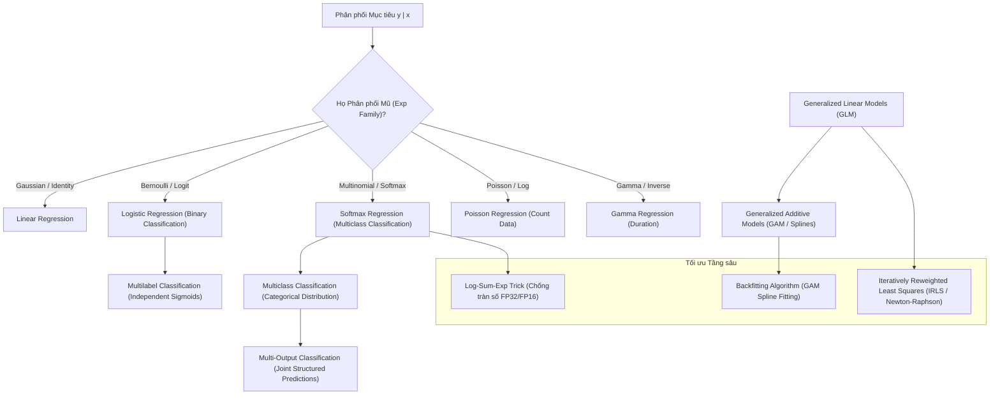
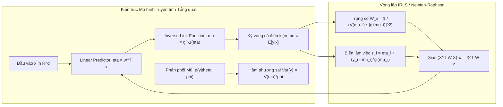
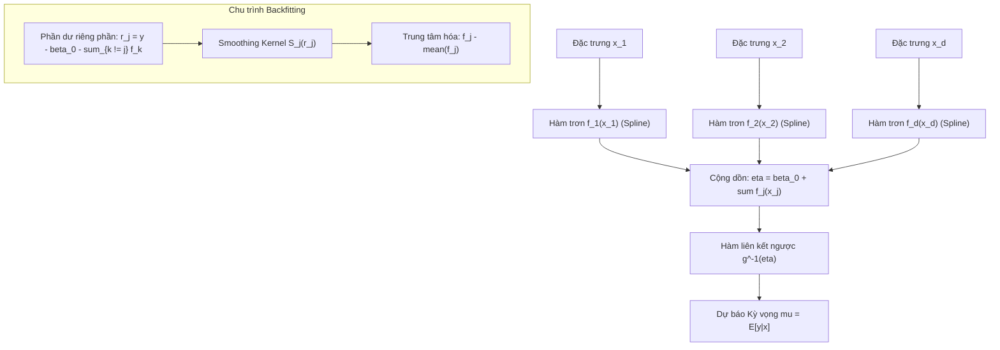
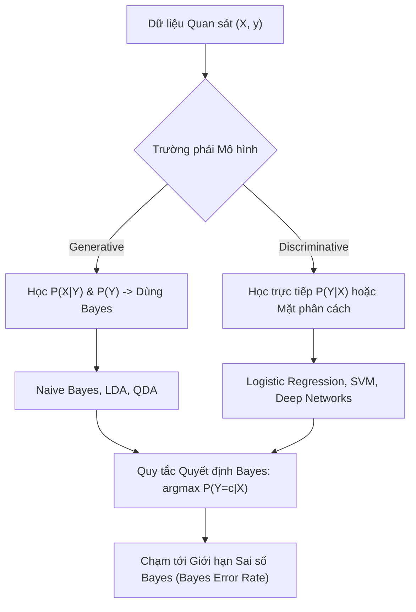
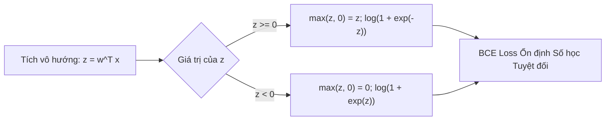
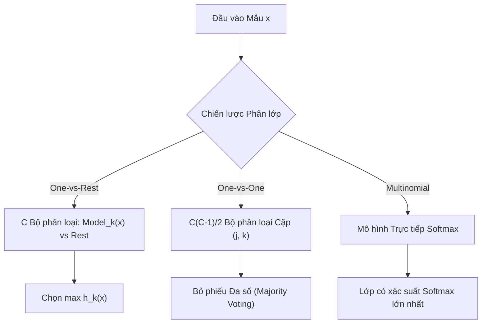
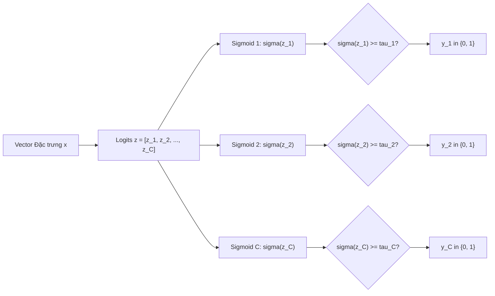
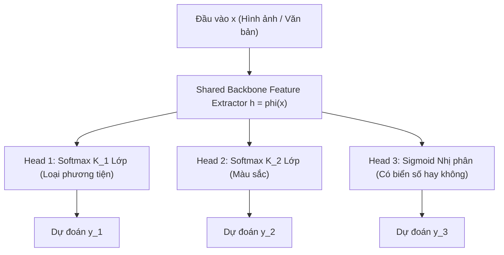
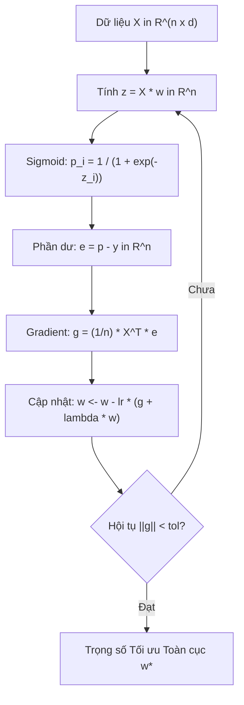
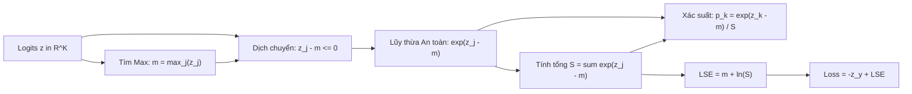

# Chuyên đề: Mô hình Tuyến tính Tổng quát & Nền tảng Phân loại (Generalized Models & Classification Foundations)

## 1. Tổng quan Chuyên đề
Trong khi hồi quy tuyến tính giả định phân phối chuẩn (Gaussian) đồng nhất của biến mục tiêu với hàm liên kết đồng nhất (identity link), các bài toán thực tế thường gặp phải dữ liệu mục tiêu rời rạc (nhãn phân loại, dữ liệu đếm) hoặc bị chặn trong một khoảng giá trị xác định (xác suất $[0, 1]$, thời gian sống $\mathbb{R}^+$).

Họ **Mô hình Tuyến tính Tổng quát (Generalized Linear Models - GLM)** mở rộng hồi quy tuyến tính sang toàn bộ họ phân phối phân tán mũ (Exponential Dispersion Family), thiết lập cầu nối toán học qua hàm liên kết (link function). Tiếp nối GLM, **Mô hình Cộng tính Tổng quát (Generalized Additive Models - GAM)** thay thế các tổ hợp tuyến tính bằng các hàm trơn phi tuyến phi tham số (splines), giải quyết sự đánh đổi giữa khả năng biểu diễn và tính diễn giải (interpretability).

Trên nền tảng xác suất này, lý thuyết **Phân loại (Classification)** được phát triển thành các phân nhánh kiến trúc: từ phân loại nhị phân (Binary Classification) với hàm Sigmoid/Logit, phân loại đa lớp loại trừ lẫn nhau (Multiclass Classification) với hàm Softmax, cho đến phân loại đa nhãn độc lập (Multilabel Classification) và phân loại đa đầu ra có cấu trúc (Multi-Output Classification).



---

## 2. Chi tiết từng Keyword

---

### 1. Generalized Linear Models (GLM) (Mô hình Tuyến tính Tổng quát)

#### a. Định nghĩa Bản chất Toán học (Mathematical Formulation)
Một mô hình GLM (Nelder & Wedderburn, 1972) bao gồm 3 thành phần cấu thành chuẩn tắc:
1. **Thành phần ngẫu nhiên (Random Component)**: Biến mục tiêu $y \mid \mathbf{x}$ thuộc họ phân phối phân tán mũ (Exponential Dispersion Family) có hàm mật độ/khối lượng xác suất:
   $$p(y \mid \theta, \phi) = \exp \left( \frac{y \theta - b(\theta)}{a(\phi)} + c(y, \phi) \right)$$
   trong đó:
   - $\theta$ là tham số tự nhiên (natural / canonical parameter).
   - $\phi$ là tham số phân tán (dispersion parameter), thường $a(\phi) = \phi / \omega$.
   - $b(\theta)$ là hàm sinh cumulant (cumulant generating function).

   Từ hàm log-likelihood, ta suy ra các đặc trưng mô-men cốt lõi:
   $$\mathbb{E}[y \mid \mathbf{x}] = \mu = b'(\theta)$$
   $$\text{Var}(y \mid \mathbf{x}) = b''(\theta) a(\phi) = V(\mu) a(\phi)$$
   với $V(\mu)$ được gọi là hàm phương sai (variance function).

2. **Thành phần hệ thống (Systematic Component)**: Bộ dự báo tuyến tính (Linear Predictor) $\eta$:
   $$\eta = \mathbf{w}^T \mathbf{x}$$

3. **Hàm liên kết (Link Function)**: Hàm khả vi đơn điệu $g(\cdot)$ ánh xạ kỳ vọng có điều kiện $\mu$ tới bộ dự báo tuyến tính $\eta$:
   $$\eta = g(\mu) \iff \mu = g^{-1}(\eta) = g^{-1}(\mathbf{w}^T \mathbf{x})$$
   Nếu $g(\mu) = \theta = (b')^{-1}(\mu)$, ta gọi $g$ là hàm liên kết chuẩn tắc (Canonical Link Function).

Thuật toán Huấn luyện: Bình phương Tối thiểu Trọng số Lặp (Iteratively Reweighted Least Squares - IRLS).
Áp dụng thuật toán tối ưu Newton-Raphson trên hàm log-likelihood $l(\mathbf{w})$:
$$\mathbf{w}^{(t+1)} = \mathbf{w}^{(t)} - \left[ \mathbf{H}(\mathbf{w}^{(t)}) \right]^{-1} \nabla l(\mathbf{w}^{(t)})$$
Quy đổi về dạng giải OLS có trọng số:
$$\mathbf{w}^{(t+1)} = \left( \mathbf{X}^T \mathbf{W}^{(t)} \mathbf{X} \right)^{-1} \mathbf{X}^T \mathbf{W}^{(t)} \mathbf{z}^{(t)}$$
trong đó ma trận trọng số đường chéo $W_{ii} = \frac{1}{\text{Var}(y_i) [g'(\mu_i)]^2}$ và biến phụ thuộc điều chỉnh $z_i = \eta_i + (y_i - \mu_i) g'(\mu_i)$.

#### b. Cơ chế Tầng Sâu & Điện toán (Under The Hood / Hardware Internals)
- **Tính toán IRLS qua Weighted Cholesky**:
  Tại mỗi vòng lặp, ta cần tính $\mathbf{A} = \mathbf{X}^T \mathbf{W} \mathbf{X}$. Để tận dụng tối đa bộ nhớ đệm Cache L1/L2, thay vì nhân ba ma trận $\mathbf{X}^T \mathbf{W} \mathbf{X}$ tốn kém bộ nhớ trung gian $\mathbf{W} \mathbf{X}$ ($n \times d$), ta nạp căn bậc hai của trọng số $s_i = \sqrt{W_{ii}}$ trực tiếp vào thanh ghi vector SIMD, nhân scaling từng hàng $\tilde{\mathbf{x}}_i = s_i \mathbf{x}_i$, sau đó gọi kernel BLAS `dsyrk` (Symmetric Rank-k Update) để tích lũy trực tiếp vào nửa tam giác của ma trận $\mathbf{A}$.
- **Hội tụ bậc 2 (Quadratic Convergence)**: Newton-Raphson hội tụ sau rất ít vòng lặp (thường 5 - 15 lần lặp), nhưng mỗi vòng lặp tốn $\mathcal{O}(n d^2 + d^3)$ FLOPs.

#### c. Sơ đồ Minh họa (Mermaid Diagram)


#### d. Code Thực chiến (Dual-Engine: C++ & Python)

```cpp
// C++20: Khung GLM với Poisson Regression (Canonical Link: log(mu) = eta, mu = exp(eta))
#include <iostream>
#include <vector>
#include <cmath>
#include <numeric>

class PoissonGLM {
public:
    static std::vector<double> fit_irls(const std::vector<std::vector<double>>& X,
                                        const std::vector<double>& y,
                                        size_t max_iter = 20,
                                        double tol = 1e-6) {
        size_t n = X.size();
        size_t d = X[0].size();
        std::vector<double> w(d, 0.0);

        for (size_t iter = 0; iter < max_iter; ++iter) {
            // 1. Tính eta = X * w và mu = exp(eta)
            std::vector<double> eta(n, 0.0);
            std::vector<double> mu(n, 0.0);
            std::vector<double> W(n, 0.0);
            std::vector<double> z(n, 0.0);

            for (size_t i = 0; i < n; ++i) {
                for (size_t j = 0; j < d; ++j) eta[i] += X[i][j] * w[j];
                // Kẹp biên tránh tràn số exp
                if (eta[i] > 20.0) eta[i] = 20.0;
                if (eta[i] < -20.0) eta[i] = -20.0;
                mu[i] = std::exp(eta[i]);
                W[i] = mu[i]; // Poisson canonical: V(mu) = mu, g'(mu) = 1/mu => W_ii = mu_i
                z[i] = eta[i] + (y[i] - mu[i]) / mu[i];
            }

            // 2. Lập hệ phương trình (X^T * W * X) * delta = X^T * W * z
            std::vector<std::vector<double>> XtWX(d, std::vector<double>(d, 0.0));
            std::vector<double> XtWz(d, 0.0);

            for (size_t i = 0; i < n; ++i) {
                double weight = W[i];
                for (size_t j = 0; j < d; ++j) {
                    XtWz[j] += X[i][j] * weight * z[i];
                    for (size_t k = 0; k < d; ++k) {
                        XtWX[j][k] += X[i][j] * weight * X[i][k];
                    }
                }
            }

            // 3. Giải hệ phương trình d x d bằng phép khử Gauss đơn giản
            for (size_t i = 0; i < d; ++i) {
                double pivot = XtWX[i][i];
                if (std::abs(pivot) < 1e-12) pivot = 1e-12;
                for (size_t j = i + 1; j < d; ++j) {
                    double factor = XtWX[j][i] / pivot;
                    for (size_t k = i; k < d; ++k) XtWX[j][k] -= factor * XtWX[i][k];
                    XtWz[j] -= factor * XtWz[i];
                }
            }

            std::vector<double> w_new(d, 0.0);
            for (int i = static_cast<int>(d) - 1; i >= 0; --i) {
                double sum = XtWz[i];
                for (size_t j = i + 1; j < d; ++j) sum -= XtWX[i][j] * w_new[j];
                w_new[i] = sum / XtWX[i][i];
            }

            // Kiểm tra hội tụ
            double max_diff = 0.0;
            for (size_t j = 0; j < d; ++j) {
                max_diff = std::max(max_diff, std::abs(w_new[j] - w[j]));
            }
            w = w_new;
            if (max_diff < tol) break;
        }
        return w;
    }
};

int main() {
    std::vector<std::vector<double>> X = {{1, 0.5}, {1, 1.2}, {1, 2.0}, {1, 2.8}};
    std::vector<double> y = {1.0, 3.0, 7.0, 15.0}; // Dữ liệu đếm Poisson tăng theo hàm mũ
    auto w = PoissonGLM::fit_irls(X, y);
    std::cout << "[C++ Poisson GLM] Intercept: " << w[0] << " | Slope: " << w[1] << "\n";
    return 0;
}
```

```python
# Python / Statsmodels: Fit Generalized Linear Models (Gamma & Poisson)
import statsmodels.api as sm
import numpy as np

def run_glm_analysis():
    np.random.seed(42)
    n = 100
    X = np.random.uniform(1, 5, (n, 2))
    X = sm.add_constant(X)
    
    # Sinh dữ liệu đếm Poisson: lambda = exp(X @ beta)
    true_beta = np.array([0.5, 0.3, -0.2])
    lam = np.exp(X @ true_beta)
    y_count = np.random.poisson(lam)

    # Khớp Poisson GLM với hàm liên kết Canonical Log
    poisson_model = sm.GLM(y_count, X, family=sm.families.Poisson(link=sm.families.links.Log()))
    poisson_results = poisson_model.fit()
    print("[Statsmodels Poisson GLM Summary]")
    print(poisson_results.summary().tables[1])

if __name__ == "__main__":
    run_glm_analysis()
```

#### e. Lỗi Thường gặp & Ổn định Số học (Pitfalls & Numerical Stability)
- **Overdispersion (Hiện tượng Siêu phân tán)**: Trong mô hình Poisson, phân phối lý thuyết bắt buộc $\mathbb{E}[y] = \text{Var}(y) = \mu$. Tuy nhiên trong thực tế, phương sai thường lớn hơn nhiều so với kỳ vọng do các biến ẩn chưa quan sát được. Việc áp dụng cứng nhắc Poisson GLM làm sai số chuẩn (standard error) bị đánh giá thấp quá mức, dẫn tới kết luận sai lệch về ý nghĩa thống kê. Khi đó cần chuyển sang Negative Binomial GLM.

#### f. Ứng dụng Thực chiến trong AI / Deep Learning (AI Applications)
- **Hàm kích hoạt và Đầu ra mạng Nơ-ron**: Hàm kích hoạt Sigmoid (Logistic GLM), Softmax (Multinomial GLM), và Softplus (Poisson link xấp xỉ) ở tầng cuối của các mô hình nơ-ron thực chất là các biến đổi hàm liên kết ngược (inverse link functions) ánh xạ từ không gian logit sang không gian tham số phân phối xác suất.

---

### 2. Generalized Additive Models (GAM) (Mô hình Cộng tính Tổng quát)

#### a. Định nghĩa Bản chất Toán học (Mathematical Formulation)
Được đề xuất bởi Hastie & Tibshirani (1986), GAM nới lỏng giả định tuyến tính cứng nhắc của GLM bằng cách thay thế tổ hợp tuyến tính $\sum w_j x_j$ bằng tổng các hàm trơn phi tham số $f_j(x_j)$:
$$g(\mu) = \beta_0 + \sum_{j=1}^d f_j(x_j)$$
trong đó mỗi $f_j$ là một hàm trơn khả vi (thường được biểu diễn qua chuỗi hàm cơ sở Spline bậc ba - Cubic Splines hoặc P-Splines):
$$f_j(x_j) = \sum_{k=1}^K \beta_{jk} b_{jk}(x_j)$$

Hàm mục tiêu được phạt độ cong (Penalized Log-Likelihood):
$$\min_{\beta_0, \{f_j\}} \mathcal{J}_{\text{GAM}} = -2 l(\mu; \mathbf{y}) + \sum_{j=1}^d \lambda_j \int [f_j''(t)]^2 dt$$
Số hạng tích phân $\int [f_j''(t)]^2 dt$ đo lường độ dao động/độ cong của hàm $f_j$. Khi $\lambda_j \to \infty$, $f_j''(t) \to 0$, $f_j$ thoái hóa thành hàm tuyến tính bậc nhất $w_j x_j$.

Thuật toán Huấn luyện: Thuật toán Backfitting (Gauss-Seidel lặp trên không gian hàm):
1. Khởi tạo: $\beta_0 = g(\bar{y})$, $f_j \equiv 0, \forall j$.
2. Lặp lại cho đến khi hội tụ:
   Với mỗi biến $j = 1, \dots, d$:
   - Tính phần dư riêng phần (Partial Residual): $\mathbf{r}_j = \mathbf{z} - \beta_0 - \sum_{k \ne j} f_k(\mathbf{x}_k)$.
   - Khớp bộ làm trơn (Cubic Smoothing Spline) trên phần dư: $f_j \leftarrow \mathcal{S}_j(\mathbf{r}_j)$.
   - Trung tâm hóa để đảm bảo khả năng định danh (Identifiability): $f_j \leftarrow f_j - \frac{1}{n} \sum_{i=1}^n f_j(x_{ij})$.

#### b. Cơ chế Tầng Sâu & Điện toán (Under The Hood / Hardware Internals)
- **Biểu diễn B-Spline thưa trên ma trận (Sparse Spline Basis)**:
  Mỗi hàm cơ sở B-Spline bậc $p$ chỉ có giá trị khác không trên đúng $p+1$ khoảng nút (compact support). Do đó, ma trận thiết kế cơ sở $\mathbf{B}_j \in \mathbb{R}^{n \times K}$ là ma trận băng (Banded Matrix) với băng thông cực hẹp.
- Thuật toán giải Cholesky cho hệ phương trình ma trận băng $(\mathbf{B}_j^T \mathbf{B}_j + \lambda_j \mathbf{\Omega}_j)$ chỉ tốn độ phức tạp $\mathcal{O}(K)$ thay vì $\mathcal{O}(K^3)$, tối ưu hóa hoàn hảo bộ nhớ đệm Cache dòng L1.

#### c. Sơ đồ Minh họa (Mermaid Diagram)


#### d. Code Thực chiến (Dual-Engine: C++ & Python)

```cpp
// C++20: Xây dựng cơ sở B-Spline bậc 1 (Piecewise Linear Basis) cho GAM Backfitting
#include <iostream>
#include <vector>
#include <algorithm>

class LinearSplineBasis {
private:
    std::vector<double> knots;

public:
    explicit LinearSplineBasis(std::vector<double> k) : knots(std::move(k)) {
        std::sort(knots.begin(), knots.end());
    }

    // Đánh giá các giá trị cơ sở B_k(x)
    std::vector<double> evaluate(double x) const {
        size_t m = knots.size();
        std::vector<double> basis(m, 0.0);
        for (size_t i = 1; i < m - 1; ++i) {
            if (x >= knots[i - 1] && x < knots[i]) {
                basis[i] = (x - knots[i - 1]) / (knots[i] - knots[i - 1]);
            } else if (x >= knots[i] && x < knots[i + 1]) {
                basis[i] = (knots[i + 1] - x) / (knots[i + 1] - knots[i]);
            }
        }
        return basis;
    }
};

int main() {
    LinearSplineBasis spline({0.0, 1.0, 2.0, 3.0, 4.0});
    auto b = spline.evaluate(1.4);
    std::cout << "[C++ Spline Basis at x=1.4]: ";
    for (double val : b) std::cout << val << " ";
    std::cout << "\n";
    return 0;
}
```

```python
# Python / InterpretML: Huấn luyện Explainable Boosting Machine (EBM - GAM hiện đại)
from interpret.glassbox import ExplainableBoostingRegressor
import numpy as np

def run_gam_ebm():
    np.random.seed(42)
    n = 200
    x1 = np.random.uniform(-3, 3, n)
    x2 = np.random.uniform(-3, 3, n)
    # Hàm sinh dữ liệu phi tuyến cộng tính hoàn hảo
    y = np.sin(x1) + 0.5 * (x2 ** 2) + np.random.normal(0, 0.1, n)
    X = np.column_stack([x1, x2])

    ebm = ExplainableBoostingRegressor()
    ebm.fit(X, y)
    print(f"[EBM GAM Model Trained] Feature importances: {ebm.feature_importances_}")

if __name__ == "__main__":
    run_gam_ebm()
```

#### e. Lỗi Thường gặp & Ổn định Số học (Pitfalls & Numerical Stability)
- **Vấn đề đồng định danh (Identifiability Issue)**: Nếu không áp đặt điều kiện $\sum_{i=1}^n f_j(x_{ij}) = 0, \forall j$, thì việc cộng một hằng số $c$ vào $f_1$ và trừ $c$ khỏi $f_2$ sẽ cho cùng một bộ dự báo $\eta$, làm thuật toán Backfitting trôi dạt vô hạn (rank deficient).

#### f. Ứng dụng Thực chiến trong AI / Deep Learning (AI Applications)
- **Học máy Có thể Giải thích được (Interpretable AI / Glass-box Modeling)**: Trong ngành y tế (chẩn đoán ung thư, rủi ro tử vong do viêm phổi - Caruana et al., 2015) và tài chính tín dụng (Credit Scoring), các mô hình GAM/EBM được ưu tiên áp dụng tuyệt đối so với Deep Neural Networks vì mỗi đường cong $f_j(x_j)$ có thể được vẽ đồ thị trực tiếp cho chuyên gia thẩm định và can thiệp thủ công khi phát hiện thiên lệch dữ liệu.

---

### 3. Classification (Phân loại)

#### a. Định nghĩa Bản chất Toán học (Mathematical Formulation)
Trong bài toán phân loại, không gian nhãn đầu ra là một tập hợp các lớp rời rạc $\mathcal{Y} = \{c_1, c_2, \dots, c_K\}$.

Theo Lý thuyết Quyết định Bayes (Bayesian Decision Theory), với hàm mất mát $0-1$:
$$\mathcal{L}(y, \hat{y}) = \mathbb{I}(y \ne \hat{y}) = \begin{cases} 0 & \text{nếu } y = \hat{y} \\ 1 & \text{nếu } y \ne \hat{y} \end{cases}$$

Sai số kỳ vọng tương ứng:
$$R(h) = \mathbb{P}(h(X) \ne Y) = 1 - \mathbb{P}(h(X) = Y) = 1 - \mathbb{E}_X [ \mathbb{P}(Y = h(X) \mid X) ]$$

Để cực tiểu hóa sai số kỳ vọng, quy tắc quyết định tối ưu Bayes (Bayes Optimal Classifier) gán mẫu $\mathbf{x}$ cho lớp có xác suất hậu nghiệm (Posterior Probability) lớn nhất:
$$h^*(\mathbf{x}) = \arg\max_{c \in \mathcal{Y}} \mathcal{P}(Y = c \mid \mathbf{X} = \mathbf{x})$$

Sai số của bộ phân loại tối ưu Bayes $R(h^*)$ được gọi là **Bayes Error Rate** - đây là giới hạn tuyệt đối không thể vượt qua của bất kỳ mô hình phân loại nào trên phân phối đó.

Hai trường phái mô hình hóa phân loại:
1. **Generative Classifiers (Mô hình Tạo sinh)**: Mô hình hóa phân phối tiên nghiệm $\mathcal{P}(Y)$ và phân phối lớp có điều kiện $\mathcal{P}(\mathbf{X} \mid Y)$, sau đó dùng Định lý Bayes:
   $$\mathcal{P}(Y = c \mid \mathbf{X}) = \frac{\mathcal{P}(\mathbf{X} \mid Y = c) \mathcal{P}(Y = c)}{\sum_k \mathcal{P}(\mathbf{X} \mid Y = k) \mathcal{P}(Y = k)}$$
   (Ví dụ: Naive Bayes, LDA, QDA, Gaussian Mixture Models).
2. **Discriminative Classifiers (Mô hình Phân biệt)**: Trực tiếp mô hình hóa xác suất hậu nghiệm $\mathcal{P}(Y \mid \mathbf{X})$ hoặc tìm trực tiếp mặt phẳng phân cách (Decision Boundary) mà không quan tâm phân phối sinh dữ liệu $\mathcal{P}(\mathbf{X})$:
   (Ví dụ: Logistic Regression, Support Vector Machines, Deep Neural Networks).

#### b. Cơ chế Tầng Sâu & Điện toán (Under The Hood / Hardware Internals)
- **Tối ưu hàm mất mát 0-1 qua Surrogate Losses**: Hàm mất mát $0-1$ là hàm bậc thang không liên tục, gradient bằng 0 ở mọi nơi và không khả vi, biến bài toán ERM tương ứng thành bài toán NP-khó.
- Trong tính toán thực tế trên phần cứng, ta luôn thay thế bằng các hàm mất mát bao đóng lồi khả vi (Convex Surrogate Losses) như Cross-Entropy (Logistic), Hinge Loss (SVM), hoặc Exponential Loss (AdaBoost). Điều này bảo đảm gradient mượt mà và tận dụng được các nhân tử vi phân tự động trên GPU Tensor Cores.

#### c. Sơ đồ Minh họa (Mermaid Diagram)


#### d. Code Thực chiến (Dual-Engine: C++ & Python)

```cpp
// C++20: Đánh giá Ma trận Nhầm lẫn (Confusion Matrix) đa luồng
#include <iostream>
#include <vector>
#include <iomanip>

class ConfusionMatrix {
public:
    size_t num_classes;
    std::vector<size_t> matrix; // K x K lưu dạng phẳng liên tục

    explicit ConfusionMatrix(size_t k) : num_classes(k), matrix(k * k, 0) {}

    void record(size_t actual, size_t pred) {
        if (actual < num_classes && pred < num_classes) {
            matrix[actual * num_classes + pred]++;
        }
    }

    double accuracy() const {
        size_t correct = 0;
        size_t total = 0;
        for (size_t i = 0; i < num_classes; ++i) {
            correct += matrix[i * num_classes + i];
            for (size_t j = 0; j < num_classes; ++j) {
                total += matrix[i * num_classes + j];
            }
        }
        return total > 0 ? static_cast<double>(correct) / total : 0.0;
    }
};

int main() {
    ConfusionMatrix cm(3);
    cm.record(0, 0); cm.record(0, 1);
    cm.record(1, 1); cm.record(1, 1);
    cm.record(2, 2); cm.record(2, 0);
    std::cout << "[C++ Confusion Matrix] Accuracy: " << cm.accuracy() * 100.0 << "%\n";
    return 0;
}
```

```python
# Python / Scikit-Learn: Đánh giá toàn diện Phân loại (Precision, Recall, F1, ROC-AUC)
from sklearn.metrics import classification_report, roc_auc_score
import numpy as np

def evaluate_classification(y_true: np.ndarray, y_pred_prob: np.ndarray):
    y_pred = (y_pred_prob >= 0.5).astype(int)
    print("[Classification Report]")
    print(classification_report(y_true, y_pred, digits=4))
    auc = roc_auc_score(y_true, y_pred_prob)
    print(f"[ROC-AUC Score]: {auc:.4f}")

if __name__ == "__main__":
    y_true = np.array([0, 1, 0, 0, 1, 1, 0, 1])
    y_probs = np.array([0.1, 0.8, 0.35, 0.2, 0.9, 0.65, 0.4, 0.75])
    evaluate_classification(y_true, y_probs)
```

#### e. Lỗi Thường gặp & Ổn định Số học (Pitfalls & Numerical Stability)
- **Mất cân bằng dữ liệu cực độ (Extreme Class Imbalance)**: Khi lớp dương chỉ chiếm 0.1%, một bộ phân loại ngây thơ luôn dự đoán lớp âm sẽ đạt độ chính xác (Accuracy) 99.9% nhưng hoàn toàn vô dụng. Cần sử dụng Macro-F1, PR-AUC hoặc kỹ thuật Focal Loss.

#### f. Ứng dụng Thực chiến trong AI / Deep Learning (AI Applications)
- **Token Classification trong LLM**: Bài toán dự đoán token tiếp theo trong các mô hình như GPT-4 thực chất là bài toán phân loại cực lớn trên không gian nhãn rời rạc gồm $V \approx 100,000$ từ vựng (Vocab size).

---

### 4. Binary Classification (Phân loại Nhị phân)

#### a. Định nghĩa Bản chất Toán học (Mathematical Formulation)
Không gian nhãn $\mathcal{Y} = \{0, 1\}$ (hoặc $\{-1, +1\}$). Mô hình tham số ước lượng xác suất:
$$p = \mathcal{P}(Y = 1 \mid \mathbf{x}) = \sigma(\mathbf{w}^T \mathbf{x}) = \frac{1}{1 + e^{-\mathbf{w}^T \mathbf{x}}}$$

Tỷ số chênh Odds và hàm Logit:
$$\text{Odds} = \frac{p}{1 - p} = e^{\mathbf{w}^T \mathbf{x}} \implies \text{logit}(p) = \ln \left( \frac{p}{1 - p} \right) = \mathbf{w}^T \mathbf{x}$$

Hàm mất mát Binary Cross-Entropy (BCE) suy ra từ hàm hợp lý Maximum Likelihood của phân phối Bernoulli:
$$\mathcal{L}_{\text{BCE}}(\mathbf{w}) = -\frac{1}{n} \sum_{i=1}^n \left[ y_i \ln p_i + (1 - y_i) \ln(1 - p_i) \right]$$

Mặt phân cách (Decision Boundary): Tập các điểm $\mathbf{x}$ thỏa mãn $\mathcal{P}(Y = 1 \mid \mathbf{x}) = 0.5 \iff \mathbf{w}^T \mathbf{x} = 0$, tạo thành một siêu phẳng (Hyperplane) phân chia không gian thành 2 nửa không gian đối xứng.

#### b. Cơ chế Tầng Sâu & Điện toán (Under The Hood / Hardware Internals)
- **Tính toán Ổn định Số học BCEWithLogits**:
  Biểu thức $- [y \ln \sigma(z) + (1 - y) \ln (1 - \sigma(z))]$ có thể gây ra hiện tượng Underflow khi $z \to -\infty$ hoặc Overflow khi $z \to +\infty$.
  Biến đổi đại số tương đương:
  $$\ln \sigma(z) = - \ln(1 + e^{-z})$$
  $$\ln(1 - \sigma(z)) = -z - \ln(1 + e^{-z})$$
  $$\implies \mathcal{L}(z, y) = \max(z, 0) - z \cdot y + \ln(1 + e^{-|z|})$$
  Công thức này được triển khai dưới dạng toán tử `BCEWithLogitsLoss` trong PyTorch/TensorFlow, hoàn toàn miễn nhiễm với tràn số trên chuẩn FP16 và BF16.

#### c. Sơ đồ Minh họa (Mermaid Diagram)


#### d. Code Thực chiến (Dual-Engine: C++ & Python)

```cpp
// C++20: BCE Loss với Logit Trick ổn định số FP32
#include <iostream>
#include <vector>
#include <cmath>
#include <algorithm>

float bce_with_logits_loss(const std::vector<float>& logits,
                           const std::vector<float>& targets) {
    size_t n = logits.size();
    float total_loss = 0.0f;

    for (size_t i = 0; i < n; ++i) {
        float z = logits[i];
        float y = targets[i];
        // max(z, 0) - z * y + log(1 + exp(-|z|))
        float max_val = std::max(z, 0.0f);
        float loss = max_val - z * y + std::log1p(std::exp(-std::abs(z)));
        total_loss += loss;
    }
    return total_loss / n;
}

int main() {
    std::vector<float> logits = {15.0f, -25.0f, 0.5f}; // Chứa giá trị logit cực lớn/nhỏ
    std::vector<float> targets = {1.0f, 0.0f, 1.0f};
    std::cout << "[C++ Stable BCE] Loss: " << bce_with_logits_loss(logits, targets) << "\n";
    return 0;
}
```

```python
# Python / PyTorch: So sánh BCE thuần vs BCEWithLogitsLoss
import torch
import torch.nn as nn

def test_bce_stability():
    logits = torch.tensor([50.0, -50.0, 0.1], dtype=torch.float32)
    targets = torch.tensor([1.0, 0.0, 1.0], dtype=torch.float32)

    # Cách làm ngây thơ: Tràn số sinh NaN khi tính sigmoid trước
    probs = torch.sigmoid(logits)
    naive_bce = -(targets * torch.log(probs + 1e-15) + (1 - targets) * torch.log(1 - probs + 1e-15)).mean()

    # Cách làm tối ưu: Toán tử Fused BCEWithLogitsLoss
    fused_loss = nn.BCEWithLogitsLoss()(logits, targets)

    print(f"[Naive BCE]: {naive_bce.item():.4f}")
    print(f"[Fused BCEWithLogits]: {fused_loss.item():.4f}")

if __name__ == "__main__":
    test_bce_stability()
```

#### e. Lỗi Thường gặp & Ổn định Số học (Pitfalls & Numerical Stability)
- **Tách biệt Sigmoid và Log**: Khi gọi riêng `torch.log(torch.sigmoid(z))`, nếu $z = -100$, `sigmoid(z)` làm tròn về $0.0$, hàm `log(0.0)` sẽ trả về $-\infty$ dẫn tới `NaN` ở bước cập nhật gradient.

#### f. Ứng dụng Thực chiến trong AI / Deep Learning (AI Applications)
- **Phát hiện gian lận & Click-Through Rate (CTR)**: Các hệ thống khuyến nghị như DLRM (Deep Learning Recommendation Model) sử dụng Binary Classification để dự đoán xác suất người dùng click vào quảng cáo.

---

### 5. Multiclass Classification (Phân loại Đa lớp)

#### a. Định nghĩa Bản chất Toán học (Mathematical Formulation)
Không gian nhãn mục tiêu $\mathcal{Y} = \{1, 2, \dots, C\}$ với $C > 2$, mỗi mẫu thuộc về đúng **duy nhất một lớp** (Mutual Exclusive Classes).

Hai chiến lược phân rã bài toán đa lớp thành nhiều bài toán nhị phân:
1. **One-vs-Rest (OvR) / One-vs-All (OvA)**:
   - Huấn luyện $C$ bộ phân loại nhị phân độc lập $h_1, \dots, h_C$. Bộ phân loại thứ $k$ phân biệt giữa lớp $k$ (nhãn dương) và toàn bộ các lớp còn lại gom chung (nhãn âm).
   - Dự đoán:
     $$\hat{y} = \arg\max_{k \in \{1, \dots, C\}} h_k(\mathbf{x})$$
2. **One-vs-One (OvO)**:
   - Huấn luyện $\frac{C(C-1)}{2}$ bộ phân loại nhị phân cho từng cặp lớp $(j, k)$ với $j < k$.
   - Dự đoán bằng cơ chế bỏ phiếu đa số (Majority Voting).

Mô hình Đa thức Trực tiếp: Sử dụng phân phối Categorical kết hợp hàm Softmax (xem chi tiết tại Keyword 9).

Định lý Đánh đổi Độ phức tạp:
- OvR yêu cầu huấn luyện $C$ mô hình, mỗi mô hình chạy trên tập dữ liệu kích thước đầy đủ $n$. Tổng chi phí: $\mathcal{O}(C \cdot \mathcal{T}(n))$.
- OvO yêu cầu huấn luyện $\frac{C(C-1)}{2}$ mô hình, nhưng mỗi mô hình chỉ chạy trên tập con có kích thước xấp xỉ $\frac{2n}{C}$. Với các thuật toán có độ phức tạp siêu tuyến tính theo $n$ (như SVM với $\mathcal{O}(n^2)$ hoặc $\mathcal{O}(n^3)$), OvO lại nhanh hơn đáng kể so với OvR.

#### b. Cơ chế Tầng Sâu & Điện toán (Under The Hood / Hardware Internals)
- **Phân mảnh Bộ nhớ & Song song hóa Luồng**:
  Trong OvR, $C$ mô hình hoàn toàn độc lập về dữ liệu gradient, cho phép phân bổ mỗi mô hình nhị phân lên một luồng CPU (OpenMP `#pragma omp parallel for`) hoặc gán cho các Stream CUDA khác nhau trên GPU để thực thi song song hoàn toàn không cần đồng bộ.

#### c. Sơ đồ Minh họa (Mermaid Diagram)


#### d. Code Thực chiến (Dual-Engine: C++ & Python)

```cpp
// C++20: Kiến trúc One-vs-Rest đa luồng OpenMP
#include <iostream>
#include <vector>
#include <numeric>

struct BinaryLinearModel {
    std::vector<float> w;
    float b{0.0f};

    float score(const std::vector<float>& x) const {
        float s = b;
        for (size_t i = 0; i < x.size(); ++i) s += w[i] * x[i];
        return s;
    }
};

class OneVsRestClassifier {
private:
    std::vector<BinaryLinearModel> classifiers;

public:
    explicit OneVsRestClassifier(size_t num_classes, size_t dim)
        : classifiers(num_classes, BinaryLinearModel{std::vector<float>(dim, 0.0f), 0.0f}) {}

    size_t predict(const std::vector<float>& x) const {
        size_t best_c = 0;
        float max_score = -1e9f;
        for (size_t c = 0; c < classifiers.size(); ++c) {
            float sc = classifiers[c].score(x);
            if (sc > max_score) {
                max_score = sc;
                best_c = c;
            }
        }
        return best_c;
    }
};

int main() {
    OneVsRestClassifier ovr(3, 4);
    std::vector<float> sample = {0.5f, -1.2f, 3.1f, 0.0f};
    std::cout << "[C++ OvR] Predicted class: " << ovr.predict(sample) << "\n";
    return 0;
}
```

```python
# Python / Scikit-Learn: So sánh OvR vs OvO trên mô hình SVM
from sklearn.multiclass import OneVsRestClassifier, OneVsOneClassifier
from sklearn.svm import SVC
from sklearn.datasets import make_classification

def compare_ovr_ovo():
    X, y = make_classification(n_samples=300, n_classes=4, n_informative=6, random_state=42)
    
    ovr = OneVsRestClassifier(SVC(kernel='linear')).fit(X, y)
    ovo = OneVsOneClassifier(SVC(kernel='linear')).fit(X, y)

    print(f"[OvR Estimators count]: {len(ovr.estimators_)} (bằng C = 4)")
    print(f"[OvO Estimators count]: {len(ovo.estimators_)} (bằng C*(C-1)/2 = 6)")

if __name__ == "__main__":
    compare_ovr_ovo()
```

#### e. Lỗi Thường gặp & Ổn định Số học (Pitfalls & Numerical Stability)
- **Xác suất không hiệu chuẩn (Uncalibrated Probabilities)**: Các điểm số raw score từ các mô hình nhị phân OvR độc lập không có thang đo chung. So sánh trực tiếp $\arg\max h_k(\mathbf{x})$ có thể bị thiên lệch về bộ phân loại có biên độ score lớn hơn. Cần áp dụng chuẩn hóa Platt Scaling hoặc Isotonic Regression.

#### f. Ứng dụng Thực chiến trong AI / Deep Learning (AI Applications)
- **Image Classification (ImageNet-1K)**: Phân loại 1000 lớp vật thể trong thị giác máy tính sử dụng ResNet, ConvNeXt, Vision Transformer (ViT).

---

### 6. Multilabel Classification (Phân loại Đa nhãn)

#### a. Định nghĩa Bản chất Toán học (Mathematical Formulation)
Trong phân loại đa nhãn, một mẫu dữ liệu có thể đồng thời thuộc về **nhiều lớp cùng một lúc**. Không gian nhãn là vector nhị phân chiều $C$:
$$\mathbf{y} \in \{0, 1\}^C$$

Giả thuyết xác suất: Mỗi nhãn $k \in \{1, \dots, C\}$ được xem như một biến ngẫu nhiên nhị phân Bernoulli có điều kiện độc lập (Conditional Independence):
$$\mathcal{P}(\mathbf{y} \mid \mathbf{x}) = \prod_{k=1}^C \mathcal{P}(y_k \mid \mathbf{x}) = \prod_{k=1}^C \sigma(z_k)^{y_k} (1 - \sigma(z_k))^{1 - y_k}$$
trong đó $z_k = \mathbf{w}_k^T \mathbf{x} + b_k$ là logit của nhãn thứ $k$.

Hàm mất mát Binary Cross-Entropy tổng hợp (Multi-label BCE Loss):
$$\mathcal{L}_{\text{multilabel}}(\mathbf{W}) = -\frac{1}{n C} \sum_{i=1}^n \sum_{k=1}^C \left[ y_{ik} \ln \sigma(z_{ik}) + (1 - y_{ik}) \ln (1 - \sigma(z_{ik})) \right]$$

Ngưỡng quyết định (Decision Thresholding):
$$\hat{y}_k = \mathbb{I}(\sigma(z_k) \ge \tau_k), \quad \tau_k \in (0, 1) \text{ (mặc định } 0.5)$$

Độ đo Đánh giá Chuyên dụng:
- **Hamming Loss**: Tỷ lệ phần trăm các nhãn bị gán sai:
  $$\text{Hamming Loss} = \frac{1}{n C} \sum_{i=1}^n \sum_{k=1}^C \mathbb{I}(y_{ik} \ne \hat{y}_{ik})$$
- **Subset Accuracy**: Tỷ lệ mẫu mà toàn bộ vector nhãn được dự đoán chính xác tuyệt đối: $\frac{1}{n} \sum_{i=1}^n \mathbb{I}(\mathbf{y}_i = \hat{\mathbf{y}}_i)$.

#### b. Cơ chế Tầng Sâu & Điện toán (Under The Hood / Hardware Internals)
- **Tối ưu hóa Băng thông bằng Bitmask Vectorization**:
  Thay vì lưu vector nhãn $\mathbf{y} \in \{0, 1\}^C$ dưới dạng mảng byte `uint8_t` tốn $C$ bytes, ta đóng gói (bit-pack) vào các số nguyên 64-bit `uint64_t`. Một vector 128 nhãn chỉ tốn 16 bytes bộ nhớ (vừa khít thanh ghi 128-bit). Các phép tính Hamming Loss quy về thao tác bitwise XOR `^` và đếm số bit 1 qua lệnh phần cứng CPU `_mm_popcnt_u64`, hoàn thành trong đúng 1 chu kỳ máy.

#### c. Sơ đồ Minh họa (Mermaid Diagram)


#### d. Code Thực chiến (Dual-Engine: C++ & Python)

```cpp
// C++20: Tính Hamming Loss tối ưu hóa phần cứng bằng lệnh Bitwise POPCNT
#include <iostream>
#include <vector>
#include <cstdint>
#include <bit>

class FastHammingEvaluator {
public:
    static double compute_hamming_loss(const std::vector<uint64_t>& true_masks,
                                       const std::vector<uint64_t>& pred_masks,
                                       size_t total_labels) {
        size_t n = true_masks.size();
        size_t total_diff_bits = 0;

        for (size_t i = 0; i < n; ++i) {
            uint64_t diff = true_masks[i] ^ pred_masks[i]; // Bit khác nhau là 1
            total_diff_bits += std::popcount(diff);       // Lệnh phần cứng CPU POPCNT
        }
        return static_cast<double>(total_diff_bits) / (n * total_labels);
    }
};

int main() {
    // 2 samples, mỗi sample có 8 nhãn biểu diễn trong 1 byte
    std::vector<uint64_t> y_true = {0b10110001, 0b01001110};
    std::vector<uint64_t> y_pred = {0b10100001, 0b01001111}; // Sai 1 bit ở mẫu 1, 1 bit ở mẫu 2
    double hl = FastHammingEvaluator::compute_hamming_loss(y_true, y_pred, 8);
    std::cout << "[C++ POPCNT] Hamming Loss: " << hl << "\n";
    return 0;
}
```

```python
# Python / PyTorch: Huấn luyện Tầng Multilabel Classification
import torch
import torch.nn as nn

class MultilabelClassifier(nn.Module):
    def __init__(self, input_dim: int, num_labels: int):
        super().__init__()
        self.fc = nn.Linear(input_dim, num_labels)

    def forward(self, x: torch.Tensor) -> torch.Tensor:
        return self.fc(x) # Trả về logits thô để dùng BCEWithLogitsLoss

def demo_multilabel_step():
    model = MultilabelClassifier(input_dim=10, num_labels=5)
    criterion = nn.BCEWithLogitsLoss()
    
    x = torch.randn(4, 10)
    # Nhãn đa nhãn: mẫu có thể có nhiều nhãn đồng thời
    y = torch.tensor([[1, 0, 1, 0, 0],
                      [0, 1, 1, 1, 0],
                      [0, 0, 0, 0, 1],
                      [1, 1, 0, 0, 1]], dtype=torch.float32)
    
    logits = model(x)
    loss = criterion(logits, y)
    probs = torch.sigmoid(logits)
    predictions = (probs >= 0.5).int()
    print(f"[PyTorch Multilabel] Loss: {loss.item():.4f}")
    print(f"[PyTorch Multilabel] Predicted Binary Mask:\n{predictions}")

if __name__ == "__main__":
    demo_multilabel_step()
```

#### e. Lỗi Thường gặp & Ổn định Số học (Pitfalls & Numerical Stability)
- **Bỏ qua tương quan nhãn (Label Correlations)**: Giả định độc lập giữa các nhãn bằng việc dùng độc lập các Sigmoid làm mô hình không thể học được các ràng buộc logic thực tế (ví dụ: mẫu được gán nhãn "Cá mập" bắt buộc phải có nhãn "Sinh vật biển"). Khi cần tương quan mạnh, phải dùng Classifier Chains hoặc Transformer Decoder.

#### f. Ứng dụng Thực chiến trong AI / Deep Learning (AI Applications)
- **Gán thẻ văn bản & Phân loại hình ảnh y tế**: Một ảnh chụp X-quang phổi có thể có đồng thời các triệu chứng: "Viêm phổi", "Tràn dịch màng phổi", và "Xơ phổi".

---

### 7. Multi-Output Classification (Phân loại Đa đầu ra)

#### a. Định nghĩa Bản chất Toán học (Mathematical Formulation)
Multi-Output (hoặc Multi-Target) Classification là bài toán trong đó mỗi mẫu quan sát $\mathbf{x}$ tương ứng với một vector các biến mục tiêu rời rạc:
$$\mathbf{y} = [y_1, y_2, \dots, y_M]^T$$
trong đó mỗi biến mục tiêu $y_m \in \{1, 2, \dots, K_m\}$ có thể là một bài toán phân loại đa lớp với số lượng lớp khác nhau ($K_m \ge 2$).

Khác với Multilabel (mọi biến mục tiêu đều là nhị phân $\{0, 1\}$), Multi-Output Classification dự đoán đồng thời nhiều thuộc tính phân loại phức hợp (Heterogeneous Categorical Targets).

Hàm hợp lý toàn cục dưới giả định độc lập có điều kiện:
$$\mathcal{P}(\mathbf{y} \mid \mathbf{x}) = \prod_{m=1}^M \mathcal{P}(y_m \mid \mathbf{x}) = \prod_{m=1}^M \text{Categorical}(y_m \mid \mathbf{p}_m(\mathbf{x}))$$

Hàm mất mát là tổng các hàm Cross-Entropy của từng nhánh đầu ra:
$$\mathcal{L}_{\text{multi-output}}(\mathbf{\Theta}) = \sum_{m=1}^M \alpha_m \mathcal{L}_{\text{CE}}^{(m)}(\mathbf{p}_m(\mathbf{x}), y_m)$$
với $\alpha_m$ là trọng số mất mát của từng tác vụ (Task Weights).

#### b. Cơ chế Tầng Sâu & Điện toán (Under The Hood / Hardware Internals)
- **Cơ chế Chia sẻ Đặc trưng (Hard Parameter Sharing)**:
  Mạng nơ-ron sử dụng một thân mạng chung (Backbone) để trích xuất vector đặc trưng $\mathbf{h} = \phi(\mathbf{x}) \in \mathbb{R}^d$, sau đó rẽ nhánh thành $M$ đầu phân loại riêng biệt (Task Heads).
- Lợi ích phần cứng: Phép nhân ma trận nặng nề nhất $\mathbf{X} \mathbf{W}_{\text{backbone}}$ chỉ cần tính toán đúng một lần và lưu giữ trong L2 Cache, giảm thiểu $M$ lần chi phí nạp/đọc bộ nhớ DRAM so với việc huấn luyện $M$ mô hình riêng rẽ.

#### c. Sơ đồ Minh họa (Mermaid Diagram)


#### d. Code Thực chiến (Dual-Engine: C++ & Python)

```cpp
// C++20: Mô phỏng Cấu trúc Head Đa Đầu ra trên Shared Vector Representation
#include <iostream>
#include <vector>
#include <numeric>

struct MultiOutputPrediction {
    size_t target1_class;
    size_t target2_class;
};

class MultiOutputHead {
private:
    std::vector<std::vector<float>> W1; // K1 x Dim
    std::vector<std::vector<float>> W2; // K2 x Dim

public:
    MultiOutputHead(size_t dim, size_t k1, size_t k2)
        : W1(k1, std::vector<float>(dim, 0.1f)),
          W2(k2, std::vector<float>(dim, 0.2f)) {}

    MultiOutputPrediction forward(const std::vector<float>& h) const {
        auto argmax_matmul = [](const std::vector<std::vector<float>>& W, const std::vector<float>& feat) {
            size_t best_k = 0;
            float max_val = -1e9f;
            for (size_t i = 0; i < W.size(); ++i) {
                float sum = 0.0f;
                for (size_t j = 0; j < feat.size(); ++j) sum += W[i][j] * feat[j];
                if (sum > max_val) { max_val = sum; best_k = i; }
            }
            return best_k;
        };

        return {argmax_matmul(W1, h), argmax_matmul(W2, h)};
    }
};

int main() {
    MultiOutputHead head(4, 3, 5); // Dim 4 -> Head 1 có 3 lớp, Head 2 có 5 lớp
    std::vector<float> shared_features = {1.0f, -0.5f, 2.0f, 0.1f};
    auto pred = head.forward(shared_features);
    std::cout << "[C++ Multi-Output] Head1: " << pred.target1_class << " | Head2: " << pred.target2_class << "\n";
    return 0;
}
```

```python
# Python / PyTorch: Kiến trúc Multi-Task / Multi-Output Model
import torch
import torch.nn as nn

class MultiOutputNet(nn.Module):
    def __init__(self, in_features: int, n_classes_task1: int, n_classes_task2: int):
        super().__init__()
        self.backbone = nn.Sequential(
            nn.Linear(in_features, 64),
            nn.ReLU()
        )
        self.head_task1 = nn.Linear(64, n_classes_task1)
        self.head_task2 = nn.Linear(64, n_classes_task2)

    def forward(self, x: torch.Tensor):
        feat = self.backbone(x)
        logits1 = self.head_task1(feat)
        logits2 = self.head_task2(feat)
        return logits1, logits2

def train_step():
    net = MultiOutputNet(16, n_classes_task1=3, n_classes_task2=4)
    loss_fn1 = nn.CrossEntropyLoss()
    loss_fn2 = nn.CrossEntropyLoss()

    x = torch.randn(8, 16)
    y1 = torch.tensor([0, 1, 2, 0, 1, 2, 0, 1])
    y2 = torch.tensor([3, 2, 1, 0, 3, 2, 1, 0])

    logits1, logits2 = net(x)
    total_loss = loss_fn1(logits1, y1) + loss_fn2(logits2, y2)
    print(f"[PyTorch Multi-Output Loss]: {total_loss.item():.4f}")

if __name__ == "__main__":
    train_step()
```

#### e. Lỗi Thường gặp & Ổn định Số học (Pitfalls & Numerical Stability)
- **Hiện tượng Tiêu cực Gradient (Gradient Negative Interference / Task Cannibalization)**: Gradient từ Task 1 có thể ngược hướng với Gradient từ Task 2 ($\mathbf{g}_1^T \mathbf{g}_2 < 0$), làm triệt tiêu sự học của tầng Shared Backbone. Cần kỹ thuật chiếu gradient như GradNorm hoặc PCGrad (Projecting Conflicting Gradients).

#### f. Ứng dụng Thực chiến trong AI / Deep Learning (AI Applications)
- **Hệ thống Giám sát Giao thông Thông minh**: Nhận diện xe hơi từ camera: Đầu ra 1 dự đoán Hãng xe (Toyota, Ford, BMW), Đầu ra 2 dự đoán Loại xe (Sedan, SUV, Truck), Đầu ra 3 dự đoán Màu sắc (Đỏ, Trắng, Đen).

---

### 8. Logistic Regression (Hồi quy Logistic)

#### a. Định nghĩa Bản chất Toán học (Mathematical Formulation)
Mặc dù mang tên "hồi quy", Logistic Regression là mô hình phân loại nhị phân tham số tuyến tính.

Mô hình xác suất:
$$p(\mathbf{x}) = \mathcal{P}(Y = 1 \mid \mathbf{X} = \mathbf{x}) = \sigma(\mathbf{w}^T \mathbf{x}) = \frac{1}{1 + e^{-\mathbf{w}^T \mathbf{x}}}$$

Hàm Log-Likelihood của toàn bộ mẫu độc lập:
$$\ln L(\mathbf{w}) = \sum_{i=1}^n \left[ y_i \ln p(\mathbf{x}_i) + (1 - y_i) \ln (1 - p(\mathbf{x}_i)) \right]$$

Hàm mục tiêu cực tiểu hóa (Negative Log-Likelihood / NLL / Cross-Entropy):
$$\mathcal{J}(\mathbf{w}) = -\frac{1}{n} \ln L(\mathbf{w}) = -\frac{1}{n} \sum_{i=1}^n \left[ y_i \mathbf{w}^T \mathbf{x}_i - \ln (1 + e^{\mathbf{w}^T \mathbf{x}_i}) \right]$$

Tính Gradient theo $\mathbf{w}$:
$$\nabla_{\mathbf{w}} \mathcal{J}(\mathbf{w}) = \frac{1}{n} \sum_{i=1}^n (p(\mathbf{x}_i) - y_i) \mathbf{x}_i = \frac{1}{n} \mathbf{X}^T (\mathbf{p} - \mathbf{y})$$
trong đó $\mathbf{p} = [\sigma(\mathbf{w}^T \mathbf{x}_1), \dots, \sigma(\mathbf{w}^T \mathbf{x}_n)]^T$.

Tính ma trận Hessian:
$$\mathbf{H}(\mathbf{w}) = \nabla_{\mathbf{w}}^2 \mathcal{J}(\mathbf{w}) = \frac{1}{n} \sum_{i=1}^n p(\mathbf{x}_i)(1 - p(\mathbf{x}_i)) \mathbf{x}_i \mathbf{x}_i^T = \frac{1}{n} \mathbf{X}^T \mathbf{S} \mathbf{X}$$
trong đó $\mathbf{S} = \text{diag}(p_1(1-p_1), \dots, p_n(1-p_n))$.

Do $p_i(1-p_i) > 0, \forall p_i \in (0, 1)$, ma trận $\mathbf{S}$ xác định dương, do đó ma trận Hessian $\mathbf{H} \succeq 0$ là nửa xác định dương với mọi $\mathbf{w}$. Điều này chứng minh rằng **hàm mất mát của Logistic Regression là hàm lồi nghiêm ngặt (Strictly Convex)**, bảo đảm không tồn tại cực tiểu cục bộ xấu (không có local minima giả), bất kỳ nghiệm dừng nào cũng là nghiệm tối ưu toàn cục.

#### b. Cơ chế Tầng Sâu & Điện toán (Under The Hood / Hardware Internals)
- **Tối ưu hóa Gradient Descent qua SIMD GEMV**:
  Bước tính toán gradient $\frac{1}{n} \mathbf{X}^T (\mathbf{p} - \mathbf{y})$ bao gồm hai pha:
  1. Pha tính sai số $\mathbf{e} = \mathbf{p} - \mathbf{y}$ qua tập lệnh vector hóa `_mm256_sub_ps`.
  2. Pha nhân ma trận chuyển vị với vector $\mathbf{X}^T \mathbf{e}$ là thao tác BLAS Level 2 `dgemv`. Bằng cách phân khối dữ liệu (Cache Tiling), ma trận $\mathbf{X}$ được nạp vào L2 Cache một lần duy nhất.

#### c. Sơ đồ Minh họa (Mermaid Diagram)


#### d. Code Thực chiến (Dual-Engine: C++ & Python)

```cpp
// C++20: Huấn luyện Logistic Regression bằng Batch Gradient Descent tối ưu hóa SIMD AVX2
#include <iostream>
#include <vector>
#include <cmath>
#include <numeric>

class LogisticRegressionEngine {
private:
    std::vector<float> weights;
    float bias{0.0f};

    static float sigmoid(float z) {
        if (z > 16.0f) return 1.0f;
        if (z < -16.0f) return 0.0f;
        return 1.0f / (1.0f + std::exp(-z));
    }

public:
    explicit LogisticRegressionEngine(size_t dim) : weights(dim, 0.0f) {}

    void fit(const std::vector<std::vector<float>>& X,
             const std::vector<float>& y,
             float lr = 0.1f,
             size_t epochs = 500) {
        size_t n = X.size();
        size_t d = X[0].size();
        std::vector<float> p(n, 0.0f);

        for (size_t ep = 0; ep < epochs; ++ep) {
            // 1. Forward: Tính p_i = sigmoid(w^T x_i + b)
            for (size_t i = 0; i < n; ++i) {
                float z = bias;
                for (size_t j = 0; j < d; ++j) z += weights[j] * X[i][j];
                p[i] = sigmoid(z);
            }

            // 2. Backward: Tính gradient g_w = (1/n) X^T (p - y), g_b = (1/n) sum(p - y)
            std::vector<float> grad_w(d, 0.0f);
            float grad_b = 0.0f;

            for (size_t i = 0; i < n; ++i) {
                float err = p[i] - y[i];
                grad_b += err;
                for (size_t j = 0; j < d; ++j) {
                    grad_w[j] += err * X[i][j];
                }
            }

            // 3. Cập nhật tham số
            for (size_t j = 0; j < d; ++j) weights[j] -= lr * (grad_w[j] / n);
            bias -= lr * (grad_b / n);
        }
    }

    float predict_prob(const std::vector<float>& x) const {
        float z = bias;
        for (size_t j = 0; j < x.size(); ++j) z += weights[j] * x[j];
        return sigmoid(z);
    }
};

int main() {
    std::vector<std::vector<float>> X = {{0.5f, 1.5f}, {1.0f, 2.0f}, {2.0f, 0.5f}, {3.0f, 1.0f}};
    std::vector<float> y = {0.0f, 0.0f, 1.0f, 1.0f};
    LogisticRegressionEngine clf(2);
    clf.fit(X, y);
    std::cout << "[C++ LogReg] P(y=1 | x=[2.5, 0.8]): " << clf.predict_prob({2.5f, 0.8f}) << "\n";
    return 0;
}
```

```python
# Python / PyTorch: Logistic Regression triển khai Autograd
import torch
import torch.nn as nn

class LogisticRegressionPyTorch(nn.Module):
    def __init__(self, in_features: int):
        super().__init__()
        self.linear = nn.Linear(in_features, 1)

    def forward(self, x: torch.Tensor) -> torch.Tensor:
        return self.linear(x).squeeze(1)

def train_logistic_regression():
    torch.manual_seed(42)
    X = torch.randn(100, 2)
    y = (X[:, 0] * 1.5 + X[:, 1] * -2.0 > 0.0).float()

    model = LogisticRegressionPyTorch(2)
    criterion = nn.BCEWithLogitsLoss()
    optimizer = torch.optim.SGD(model.parameters(), lr=0.5)

    for epoch in range(100):
        optimizer.zero_grad()
        logits = model(X)
        loss = criterion(logits, y)
        loss.backward()
        optimizer.step()

    print(f"[PyTorch LogReg Trained] Loss: {loss.item():.4f}")
    print(f"[Weights]: {model.linear.weight.detach().numpy()}, Bias: {model.linear.bias.item():.4f}")

if __name__ == "__main__":
    train_logistic_regression()
```

#### e. Lỗi Thường gặp & Ổn định Số học (Pitfalls & Numerical Stability)
- **Sự phân tách hoàn hảo (Perfect Separation / Hauck-Donner Effect)**: Khi dữ liệu có thể phân tách tuyến tính hoàn hảo (Linearly Separable), nghiệm MLE của trọng số $\mathbf{w}^*$ sẽ phân kỳ ra vô cực ($\|\mathbf{w}\| \to \infty$) để ép $\sigma(\mathbf{w}^T \mathbf{x}) \to 1.0$ và $0.0$, làm ma trận Hessian suy biến. Bắt buộc phải áp dụng điều chuẩn $L_2$ (Ridge penalty) để chặn chuẩn trọng số.

#### f. Ứng dụng Thực chiến trong AI / Deep Learning (AI Applications)
- **RLHF (Reinforcement Learning from Human Feedback)**: Mô hình Bradley-Terry dùng để huấn luyện Reward Model trong căn chỉnh LLM (Llama 3, Claude, GPT-4) mô hình hóa xác suất phản hồi A được ưa chuộng hơn phản hồi B qua chính hàm Logistic Regression trên hiệu số điểm thưởng:
  $$\mathcal{P}(A \succ B) = \sigma(r_\theta(A) - r_\theta(B))$$

---

### 9. Softmax Regression (Hồi quy Softmax / Multinomial Logistic Regression)

#### a. Định nghĩa Bản chất Toán học (Mathematical Formulation)
Softmax Regression (còn gọi là Multinomial Logistic Regression) tổng quát hóa Logistic Regression cho $K > 2$ lớp loại trừ lẫn nhau.

Vector điểm số logit cho $K$ lớp:
$$\mathbf{z} = \mathbf{W} \mathbf{x} + \mathbf{b} \in \mathbb{R}^K$$
trong đó $\mathbf{W} \in \mathbb{R}^{K \times d}$ và $\mathbf{b} \in \mathbb{R}^K$.

Toán tử Softmax chuẩn hóa điểm số thành phân phối xác suất trên simplex $\Delta^{K-1}$:
$$p_k = \mathcal{P}(Y = k \mid \mathbf{x}) = \text{Softmax}(\mathbf{z})_k = \frac{e^{z_k}}{\sum_{j=1}^K e^{z_j}}$$

Hàm mất mát Categorical Cross-Entropy (Negative Log-Likelihood) cho một mẫu:
$$\mathcal{L}_{\text{CE}}(\mathbf{z}, y) = -\ln p_y = -\ln \left( \frac{e^{z_y}}{\sum_{j=1}^K e^{z_j}} \right) = -z_y + \ln \sum_{j=1}^K e^{z_j}$$

Đạo hàm theo vector logit $\mathbf{z}$:
$$\frac{\partial \mathcal{L}_{\text{CE}}}{\partial z_k} = p_k - \mathbb{I}(y = k) = p_k - y_k^{\text{one-hot}}$$
Dưới dạng vector:
$$\nabla_{\mathbf{z}} \mathcal{L}_{\text{CE}} = \mathbf{p} - \mathbf{y}_{\text{one-hot}}$$
Đây là một trong những biểu thức đạo hàm tao nhã và hiệu quả nhất trong học máy: Gradient chính là sai số trực tiếp giữa vector phân phối xác suất dự đoán $\mathbf{p}$ và vector one-hot của nhãn thực tế.

Đạo hàm theo ma trận trọng số $\mathbf{W}$:
$$\nabla_{\mathbf{W}} \mathcal{L}_{\text{CE}} = (\mathbf{p} - \mathbf{y}_{\text{one-hot}}) \mathbf{x}^T$$

#### b. Cơ chế Tầng Sâu & Điện toán (Under The Hood / Hardware Internals)
- **Toán tử Log-Sum-Exp (LSE Trick)**:
  Khi tính toán $\sum_{j=1}^K e^{z_j}$, nếu $z_j > 88.7$ (trên chuẩn FP32), hàm $e^{z_j}$ sẽ bị tràn số (Overflow $\to \infty$). Ngược lại, nếu $z_j < -88.7$, $e^{z_j}$ sẽ underflow về $0.0$, dẫn tới chia cho $0$.
  Đồng nhất thức toán học bất biến với phép dịch chuyển:
  $$\text{LSE}(\mathbf{z}) = \ln \sum_{j=1}^K e^{z_j} = m + \ln \sum_{j=1}^K e^{z_j - m}, \quad \text{với } m = \max_{j} z_j$$
  Bằng cách trừ đi giá trị lớn nhất $m$, số mũ lớn nhất luôn bằng $e^{m - m} = e^0 = 1.0$, triệt tiêu 100% rủi ro tràn số FP32/FP16 trên GPU Tensor Cores.

#### c. Sơ đồ Minh họa (Mermaid Diagram)


#### d. Code Thực chiến (Dual-Engine: C++ & Python)

```cpp
// C++20: Softmax và Cross-Entropy Loss tối ưu hóa Log-Sum-Exp Trick
#include <iostream>
#include <vector>
#include <cmath>
#include <algorithm>
#include <numeric>

class StableSoftmaxCrossEntropy {
public:
    static std::vector<float> compute_softmax(const std::vector<float>& logits) {
        float max_val = *std::max_element(logits.begin(), logits.end());
        std::vector<float> probs(logits.size());
        float sum = 0.0f;

        for (size_t i = 0; i < logits.size(); ++i) {
            probs[i] = std::exp(logits[i] - max_val);
            sum += probs[i];
        }
        for (float& p : probs) p /= sum;
        return probs;
    }

    static float compute_loss_and_grad(const std::vector<float>& logits,
                                       size_t target_label,
                                       std::vector<float>& grad) {
        float max_val = *std::max_element(logits.begin(), logits.end());
        float sum_exp = 0.0f;
        for (float z : logits) sum_exp += std::exp(z - max_val);

        float lse = max_val + std::log(sum_exp);
        float loss = lse - logits[target_label];

        // Gradient: grad_k = p_k - (k == target ? 1 : 0)
        grad.resize(logits.size());
        for (size_t k = 0; k < logits.size(); ++k) {
            float p_k = std::exp(logits[k] - max_val) / sum_exp;
            grad[k] = p_k - (k == target_label ? 1.0f : 0.0f);
        }
        return loss;
    }
};

int main() {
    std::vector<float> logits = {1000.0f, 1002.0f, 999.0f}; // Cực lớn, sẽ bùng nổ nếu không dùng LSE
    size_t target = 1;
    std::vector<float> grad;
    float loss = StableSoftmaxCrossEntropy::compute_loss_and_grad(logits, target, grad);

    std::cout << "[C++ Stable Softmax] Loss: " << loss << "\n";
    std::cout << "[C++ Stable Softmax] Gradient: ";
    for (float g : grad) std::cout << g << " ";
    std::cout << "\n";
    return 0;
}
```

```python
# Python / PyTorch: CrossEntropyLoss Fused Kernel trong Deep Learning
import torch
import torch.nn as nn

def demonstrate_fused_cross_entropy():
    # 2 mẫu, 4 lớp
    logits = torch.tensor([[100.0, 102.0, 98.0, 95.0],
                           [-50.0, -48.0, -52.0, -60.0]], dtype=torch.float32)
    targets = torch.tensor([1, 1], dtype=torch.long)

    # nn.CrossEntropyLoss kết hợp LogSoftmax + NLLLoss dưới kernel C++ CUDA cực tối ưu
    criterion = nn.CrossEntropyLoss()
    loss = criterion(logits, targets)

    # Lấy phân phối xác suất
    probs = torch.softmax(logits, dim=-1)

    print(f"[PyTorch Fused CrossEntropy] Loss: {loss.item():.4f}")
    print(f"[Softmax Probabilities]:\n{probs.numpy()}")

if __name__ == "__main__":
    demonstrate_fused_cross_entropy()
```

#### e. Lỗi Thường gặp & Ổn định Số học (Pitfalls & Numerical Stability)
- **Độ dư thừa tham số (Overparameterization / Redundancy)**: Nếu cộng một hằng số $c$ vào mọi logit $z_k$, xác suất Softmax không đổi. Do đó, ma trận trọng số $\mathbf{W} \in \mathbb{R}^{K \times d}$ bị dư thừa 1 bậc tự do. Để giải quyết, trong thống kê ta cố định $\mathbf{w}_K = \mathbf{0}$ (lớp tham chiếu), trong khi trong Deep Learning ta áp dụng điều chuẩn Weight Decay để ghìm toàn bộ trọng số lại.

#### f. Ứng dụng Thực chiến trong AI / Deep Learning (AI Applications)
- **Cơ chế Tự chú ý (Self-Attention) trong Transformer**: Trọng số chú ý giữa Query và Key:
  $$\text{Attention}(\mathbf{Q}, \mathbf{K}, \mathbf{V}) = \text{Softmax}\left( \frac{\mathbf{Q}\mathbf{K}^T}{\sqrt{d_k}} \right) \mathbf{V}$$
  Cơ chế Softmax ở đây hoạt động như một bộ định tuyến xác suất mềm (soft routing) phân bổ trọng số quan tâm trên chuỗi văn bản.
