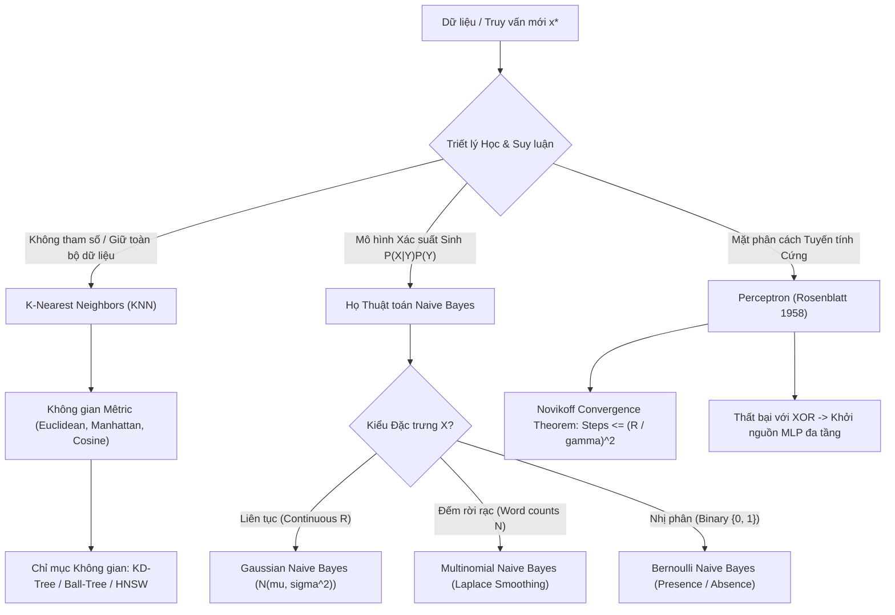
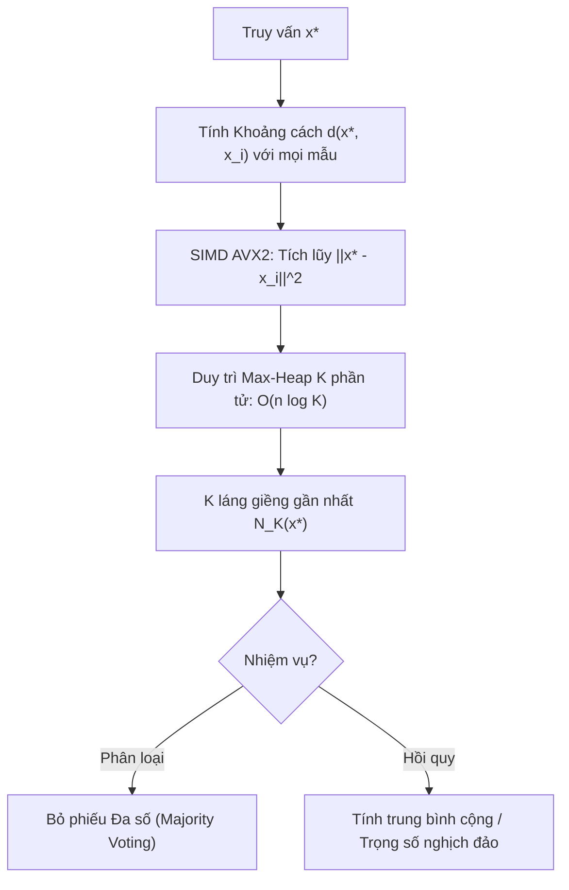
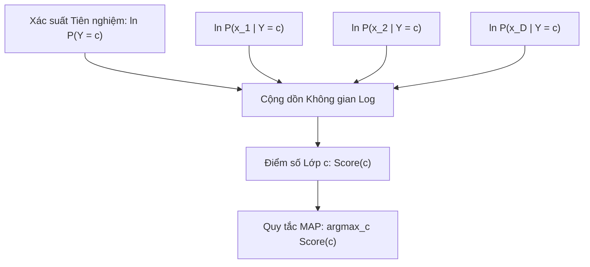
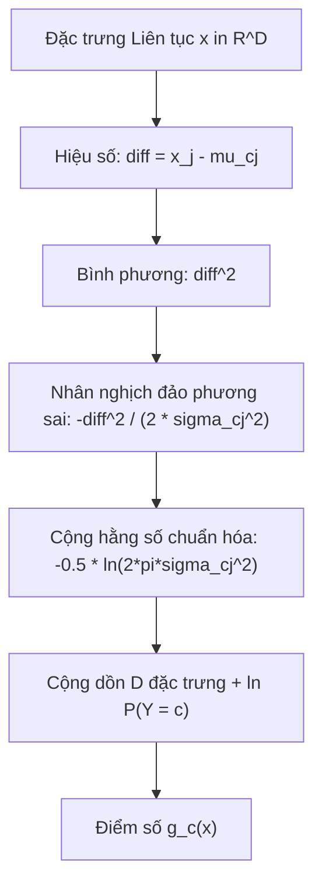
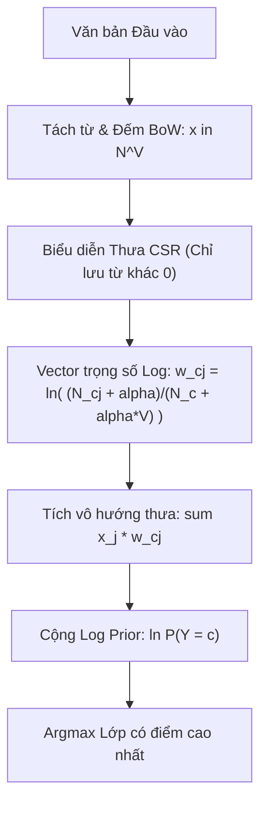
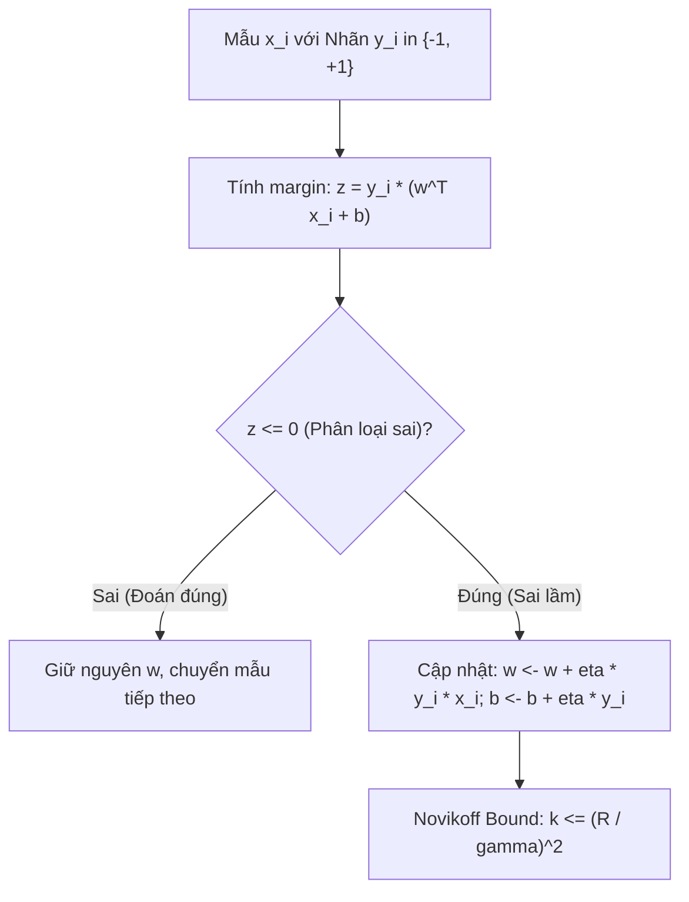

# Chuyên đề: Học Dựa trên Mẫu & Học Xác suất (Probabilistic & Instance-Based Learning)

## 1. Tổng quan Chuyên đề
Trong bản đồ các thuật toán học có giám sát, các phương pháp **Học dựa trên Mẫu (Instance-Based / Memory-Based Learning)** và **Học Xác suất Sinh (Generative Probabilistic Learning)** đại diện cho hai triết lý mô hình hóa độc đáo:

1. **Lazy Learning (Học lười biếng - KNN)**: Không xây dựng một mô hình tham số tường minh trong pha huấn luyện (chi phí huấn luyện $\mathcal{O}(1)$), mà trì hoãn toàn bộ quá trình tính toán suy luận cho đến khi nhận được mẫu truy vấn kiểm thử (chi phí truy vấn $\mathcal{O}(nd)$). Phương pháp này dựa trên cấu trúc tô-pô không gian mêtric và giả thuyết tính trơn cục bộ (local smoothness assumption).
2. **Generative Modeling (Mô hình Tạo sinh - Naive Bayes)**: Áp dụng định lý xác suất Bayes kết hợp giả định độc lập có điều kiện mạnh mẽ (Naive Conditional Independence) để mô hình hóa phân phối đồng thời $\mathcal{P}(\mathbf{X}, Y)$, cho phép suy luận xác suất nhanh chóng trong không gian logarit.
3. **Linear Threshold Learning (Perceptron)**: Đặt viên gạch đầu tiên cho kỷ nguyên Mạng nơ-ron nhân tạo thông qua thuật toán học có đảm bảo hội tụ (Novikoff's Theorem) trên các tập dữ liệu khả tách tuyến tính.



---

## 2. Chi tiết từng Keyword

---

### 1. K-Nearest Neighbors (KNN) (K láng giềng gần nhất)

#### a. Định nghĩa Bản chất Toán học (Mathematical Formulation)
Cho tập huấn luyện $\mathcal{D}_n = \{(\mathbf{x}_i, y_i)\}_{i=1}^n$ nằm trong không gian mêtric $(\mathcal{X}, d)$, trong đó $d(\mathbf{x}, \mathbf{z})$ thường là khoảng cách Minkowski bậc $p$:
$$d_p(\mathbf{x}, \mathbf{z}) = \left( \sum_{j=1}^D |x_j - z_j|^p \right)^{1/p}$$
- $p = 1$: Khoảng cách Manhattan ($L_1$).
- $p = 2$: Khoảng cách Euclid ($L_2$).
- $p \to \infty$: Khoảng cách Chebyshev ($L_\infty = \max_j |x_j - z_j|$).

Với một điểm truy vấn $\mathbf{x}^*$, sắp xếp tập huấn luyện theo khoảng cách tăng dần:
$$d(\mathbf{x}_{(1)}, \mathbf{x}^*) \le d(\mathbf{x}_{(2)}, \mathbf{x}^*) \le \dots \le d(\mathbf{x}_{(n)}, \mathbf{x}^*)$$
Tập $K$ láng giềng gần nhất được định nghĩa là:
$$\mathcal{N}_K(\mathbf{x}^*) = \{\mathbf{x}_{(1)}, \mathbf{x}_{(2)}, \dots, \mathbf{x}_{(K)}\}$$

Quy tắc Quyết định:
- **Phân loại (Classification - Majority Vote)**:
  $$\hat{y}(\mathbf{x}^*) = \arg\max_{c \in \mathcal{Y}} \sum_{i \in \mathcal{N}_K(\mathbf{x}^*)} \mathbb{I}(y_i = c)$$
- **Hồi quy (Regression - Local Averaging)**:
  $$\hat{y}(\mathbf{x}^*) = \frac{1}{K} \sum_{i \in \mathcal{N}_K(\mathbf{x}^*)} y_i$$

Định lý Cover-Hart (1967):
Gọi $R^*$ là tỷ lệ sai số của bộ phân loại tối ưu Bayes. Khi kích thước tập dữ liệu $n \to \infty$, sai số kỳ vọng $R_{1-\text{NN}}$ của thuật toán 1-NN bị chặn trên bởi:
$$R^* \le R_{1-\text{NN}} \le 2R^* (1 - R^*) \le 2R^*$$
Điều này mang ý nghĩa toán học sâu sắc: một thuật toán cực kỳ đơn giản như 1-NN, không cần huấn luyện, tiệm cận có thể đạt hiệu năng tối thiểu bằng một nửa bộ phân loại hoàn hảo nhất về mặt lý thuyết.

#### b. Cơ chế Tầng Sâu & Điện toán (Under The Hood / Hardware Internals)
- **Cấu trúc Dữ liệu Chỉ mục Không gian (Spatial Indexing)**:
  - *Brute-Force*: Độ phức tạp $\mathcal{O}(n D)$. Quét tuyến tính mảng liên tục, tận dụng tối đa SIMD FMA và Cache Streaming.
  - *KD-Tree*: Phân chia không gian bằng các siêu phẳng vuông góc với trục tọa độ. Hiệu quả khi số chiều nhỏ ($D \le 20$). Độ phức tạp tìm kiếm trung bình $\mathcal{O}(D \log n)$.
  - *Ball-Tree*: Bao bọc các điểm bằng các hình cầu lồng nhau, hoạt động tốt hơn KD-Tree trong không gian có cấu trúc phi Euclid hoặc số chiều vừa phải.
- **Top-K Selection bằng Max-Heap**:
  Thay vì sắp xếp toàn bộ $n$ khoảng cách tốn $\mathcal{O}(n \log n)$, ta duy trì một Max-Heap kích thước $K$. Với mỗi điểm, so sánh khoảng cách với đỉnh heap $\mathcal{O}(1)$; nếu nhỏ hơn thì thay thế và vun đống trong $\mathcal{O}(\log K)$. Tổng chi phí: $\mathcal{O}(n \log K)$.

#### c. Sơ đồ Minh họa (Mermaid Diagram)


#### d. Code Thực chiến (Dual-Engine: C++ & Python)

```cpp
// C++20: K-Nearest Neighbors với SIMD L2 Distance và Max-Heap Top-K
#include <iostream>
#include <vector>
#include <queue>
#include <cmath>
#include <algorithm>

struct Neighbor {
    float dist;
    int label;
    bool operator<(const Neighbor& other) const noexcept {
        return dist < other.dist; // Max-heap: phần tử khoảng cách lớn nhất nằm ở đỉnh
    }
};

class FastKNN {
private:
    std::vector<float> data; // Lưu phẳng n x d (Row-Major)
    std::vector<int> labels;
    size_t n_samples{0};
    size_t dim{0};

    float compute_l2_sq(const float* a, const float* b) const noexcept {
        float sum = 0.0f;
        for (size_t i = 0; i < dim; ++i) {
            float diff = a[i] - b[i];
            sum += diff * diff;
        }
        return sum;
    }

public:
    void fit(std::vector<float> X, std::vector<int> y, size_t n, size_t d) {
        data = std::move(X);
        labels = std::move(y);
        n_samples = n;
        dim = d;
    }

    int predict(const std::vector<float>& query, size_t k) const {
        std::priority_queue<Neighbor> max_heap;

        for (size_t i = 0; i < n_samples; ++i) {
            float d2 = compute_l2_sq(query.data(), &data[i * dim]);
            if (max_heap.size() < k) {
                max_heap.push({d2, labels[i]});
            } else if (d2 < max_heap.top().dist) {
                max_heap.pop();
                max_heap.push({d2, labels[i]});
            }
        }

        // Bỏ phiếu đa số
        std::vector<int> votes;
        while (!max_heap.empty()) {
            votes.push_back(max_heap.top().label);
            max_heap.pop();
        }
        // Tìm nhãn xuất hiện nhiều nhất
        std::sort(votes.begin(), votes.end());
        int best_label = votes[0], max_c = 0, curr_c = 0, curr_l = votes[0];
        for (int l : votes) {
            if (l == curr_l) curr_c++;
            else {
                if (curr_c > max_c) { max_c = curr_c; best_label = curr_l; }
                curr_l = l; curr_c = 1;
            }
        }
        if (curr_c > max_c) best_label = curr_l;
        return best_label;
    }
};

int main() {
    FastKNN knn;
    // 4 điểm trong không gian 2D
    std::vector<float> X = {0.0f, 0.0f,  0.5f, 0.5f,  2.0f, 2.0f,  2.5f, 2.1f};
    std::vector<int> y = {0, 0, 1, 1};
    knn.fit(X, y, 4, 2);

    std::vector<float> q = {0.2f, 0.1f};
    std::cout << "[C++ KNN] Query [0.2, 0.1] -> Class: " << knn.predict(q, 3) << "\n";
    return 0;
}
```

```python
# Python / Scikit-Learn: So sánh thời gian truy vấn giữa KD-Tree, Ball-Tree và Brute-Force
from sklearn.neighbors import NearestNeighbors
import numpy as np
import time

def benchmark_knn_algorithms():
    n, d = 20000, 32
    X = np.random.randn(n, d).astype(np.float32)
    query = np.random.randn(10, d).astype(np.float32)

    for algo in ['brute', 'kd_tree', 'ball_tree']:
        t0 = time.perf_counter()
        nn = NearestNeighbors(n_neighbors=5, algorithm=algo).fit(X)
        fit_time = time.perf_counter() - t0

        t1 = time.perf_counter()
        distances, indices = nn.kneighbors(query)
        query_time = time.perf_counter() - t1

        print(f"[Algorithm: {algo:10s}] Fit: {fit_time*1e3:.2f}ms | Query 10 pts: {query_time*1e3:.2f}ms")

if __name__ == "__main__":
    benchmark_knn_algorithms()
```

#### e. Lỗi Thường gặp & Ổn định Số học (Pitfalls & Numerical Stability)
- **Lời nguyền Số chiều (Curse of Dimensionality)**:
  Khi số chiều $D$ lớn, khoảng cách giữa các điểm có xu hướng tập trung (Distance Concentration Phenomenon):
  $$\lim_{D \to \infty} \frac{d_{\max} - d_{\min}}{d_{\min}} \to 0$$
  Khái niệm "láng giềng gần nhất" mất hoàn toàn ý nghĩa vì mọi điểm đều cách nhau một khoảng cách xấp xỉ bằng nhau. KD-Tree thoái hóa thành tìm kiếm vét cạn còn chậm hơn Brute-force do chi phí rẽ nhánh điều kiện (branch miss overhead).
- **Thiếu chuẩn hóa đặc trưng (Feature Scaling)**: Biến có thang đo lớn hơn sẽ chi phối 100% khoảng cách Euclidean.

#### f. Ứng dụng Thực chiến trong AI / Deep Learning (AI Applications)
- **Vector Search & RAG (Retrieval-Augmented Generation)**:
  Các thư viện vector database hiện đại (FAISS, Milvus, Chroma) sử dụng các biến thể xấp xỉ láng giềng gần nhất (Approximate Nearest Neighbors - ANN) như HNSW (Hierarchical Navigable Small World) hoặc IVF-PQ để truy vấn embedding văn bản ngữ nghĩa cho các hệ thống LLM.

---

### 2. Naive Bayes (Phân loại Bayes ngây thơ)

#### a. Định nghĩa Bản chất Toán học (Mathematical Formulation)
Naive Bayes là mô hình tạo sinh (Generative Model) dựa trên Định lý Xác suất Bayes. Cho mẫu quan sát $\mathbf{x} = [x_1, x_2, \dots, x_D]^T$, xác suất hậu nghiệm thuộc lớp $c$:
$$\mathcal{P}(Y = c \mid \mathbf{X} = \mathbf{x}) = \frac{\mathcal{P}(Y = c) \mathcal{P}(\mathbf{X} = \mathbf{x} \mid Y = c)}{\mathcal{P}(\mathbf{X} = \mathbf{x})} = \frac{\mathcal{P}(Y = c) \mathcal{P}(\mathbf{X} = \mathbf{x} \mid Y = c)}{\sum_{k} \mathcal{P}(Y = k) \mathcal{P}(\mathbf{X} = \mathbf{x} \mid Y = k)}$$

Giả định Ngây thơ (Naive Conditional Independence Assumption):
Với điều kiện đã biết nhãn lớp $Y = c$, tất cả các biến đặc trưng $x_1, \dots, x_D$ hoàn toàn độc lập với nhau theo xác suất:
$$\mathcal{P}(\mathbf{X} = \mathbf{x} \mid Y = c) = \prod_{j=1}^D \mathcal{P}(x_j \mid Y = c)$$

Quy tắc Phân loại Hậu nghiệm Cực đại (MAP Rule):
Do mẫu số $\mathcal{P}(\mathbf{X} = \mathbf{x})$ là hằng số chuẩn hóa không phụ thuộc vào $c$, ta có:
$$\hat{y} = \arg\max_{c \in \mathcal{Y}} \mathcal{P}(Y = c) \prod_{j=1}^D \mathcal{P}(x_j \mid Y = c)$$

Chuyển đổi sang không gian Log-Likelihood để tránh triệt tiêu số thực (Arithmetic Underflow):
$$\hat{y} = \arg\max_{c \in \mathcal{Y}} \left[ \ln \mathcal{P}(Y = c) + \sum_{j=1}^D \ln \mathcal{P}(x_j \mid Y = c) \right]$$

#### b. Cơ chế Tầng Sâu & Điện toán (Under The Hood / Hardware Internals)
- **Tránh Arithmetic Underflow**: Phép nhân hàng ngàn xác suất nhỏ $p_j \in [10^{-4}, 10^{-2}]$ sẽ nhanh chóng làm tràn dưới số thực (dưới $1.17 \times 10^{-38}$ của chuẩn FP32), dẫn tới kết quả $0.0$. Việc chuyển sang không gian Log quy toàn bộ phép nhân thành phép cộng:
  $$\prod_{j=1}^D p_j \implies \sum_{j=1}^D \ln p_j$$
  Phép cộng tích lũy này chạy cực kỳ nhanh và ổn định số học trên thanh ghi CPU.

#### c. Sơ đồ Minh họa (Mermaid Diagram)


#### d. Code Thực chiến (Dual-Engine: C++ & Python)

```cpp
// C++20: Khung tính toán Log-Likelihood cho Naive Bayes tổng quát
#include <iostream>
#include <vector>
#include <cmath>
#include <numeric>

struct ClassLogLikelihood {
    double log_prior;
    std::vector<double> log_cond_probs; // D phần tử
};

class GenericNaiveBayes {
public:
    static size_t predict(const std::vector<double>& x,
                          const std::vector<ClassLogLikelihood>& model) {
        size_t best_c = 0;
        double max_log_prob = -1e18;

        for (size_t c = 0; c < model.size(); ++c) {
            double current_log_prob = model[c].log_prior;
            for (size_t j = 0; j < x.size(); ++j) {
                // Tích lũy trong không gian logarit
                current_log_prob += x[j] * model[c].log_cond_probs[j];
            }
            if (current_log_prob > max_log_prob) {
                max_log_prob = current_log_prob;
                best_c = c;
            }
        }
        return best_c;
    }
};

int main() {
    ClassLogLikelihood c0{-0.693, {-1.2, -0.5, -2.1}};
    ClassLogLikelihood c1{-0.693, {-0.3, -1.8, -0.8}};
    std::vector<double> sample = {1.0, 0.0, 1.0};
    std::cout << "[C++ NB Engine] Predicted class: " << GenericNaiveBayes::predict(sample, {c0, c1}) << "\n";
    return 0;
}
```

```python
# Python / NumPy: Minh họa Underflow của phép nhân xác suất thuần vs Log-Sum
import numpy as np

def demonstrate_underflow():
    # 500 đặc trưng, mỗi đặc trưng có xác suất 0.05
    probs = np.full(500, 0.05)
    
    # Tính nhân thuần
    naive_mult = np.prod(probs)
    print(f"[Naive Product]: {naive_mult} (Hoàn toàn bị Underflow về 0.0!)")

    # Tính trong không gian Log
    log_sum = np.sum(np.log(probs))
    print(f"[Log-Sum Calculation]: {log_sum:.4f} (Chính xác và ổn định số học)")

if __name__ == "__main__":
    demonstrate_underflow()
```

#### e. Lỗi Thường gặp & Ổn định Số học (Pitfalls & Numerical Stability)
- **Vấn đề Tần số bằng 0 (Zero-Frequency Problem)**: Nếu một từ hoặc một giá trị đặc trưng chưa từng xuất hiện trong tập huấn luyện của lớp $c$, thì $\mathcal{P}(x_j \mid c) = 0$. Khi đó phép nhân toàn bộ phân phối xác suất sẽ bị triệt tiêu về $0$ ($\ln 0 \to -\infty$). Bắt buộc phải áp dụng kỹ thuật làm trơn Laplace (Additive Smoothing).

#### f. Ứng dụng Thực chiến trong AI / Deep Learning (AI Applications)
- **Cold-Start Baseline & Kiểm duyệt Nội dung Thời gian thực**: Trong các hệ thống lọc thư rác (Spam Filtering) và phát hiện ngôn từ độc hại (Toxicity Detection), Naive Bayes là tuyến phòng thủ đầu tiên (Tier-1 Filter) do độ trễ suy luận chỉ tính bằng micro-giây, giúp lọc 90% truy vấn thô trước khi chuyển tới mô hình Transformer lớn.

---

### 3. Gaussian Naive Bayes (Gaussian Naive Bayes)

#### a. Định nghĩa Bản chất Toán học (Mathematical Formulation)
Gaussian Naive Bayes (GNB) được thiết kế chuyên biệt cho không gian đặc trưng **liên tục** $\mathbf{x} \in \mathbb{R}^D$.

Giả định: Với mỗi lớp $c \in \mathcal{Y}$, từng đặc trưng $x_j$ tuân theo một phân phối chuẩn đơn biến độc lập:
$$x_j \mid Y = c \sim \mathcal{N}(\mu_{cj}, \sigma_{cj}^2)$$
Hàm mật độ xác suất (Probability Density Function - PDF):
$$\mathcal{P}(x_j \mid Y = c) = \frac{1}{\sqrt{2\pi \sigma_{cj}^2}} \exp \left( -\frac{(x_j - \mu_{cj})^2}{2\sigma_{cj}^2} \right)$$

Ước lượng Hợp lý Cực đại (MLE) từ dữ liệu tập con của lớp $c$ có $N_c$ mẫu:
$$\mu_{cj} = \frac{1}{N_c} \sum_{i: y_i = c} x_{ij}$$
$$\sigma_{cj}^2 = \frac{1}{N_c} \sum_{i: y_i = c} (x_{ij} - \mu_{cj})^2$$

Hàm quyết định trong không gian Log-Likelihood:
$$g_c(\mathbf{x}) = \ln \mathcal{P}(Y = c) - \frac{1}{2} \sum_{j=1}^D \ln(2\pi \sigma_{cj}^2) - \sum_{j=1}^D \frac{(x_j - \mu_{cj})^2}{2\sigma_{cj}^2}$$

Ý nghĩa Hình học về Mặt Phân cách:
Do phương sai $\sigma_{cj}^2$ phụ thuộc vào từng lớp $c$, hàm $g_c(\mathbf{x})$ chứa số hạng toàn phương $x_j^2 / \sigma_{cj}^2$. Do đó, mặt phân cách giữa hai lớp $g_c(\mathbf{x}) = g_k(\mathbf{x})$ là một **mặt cong bậc hai (Quadratic Decision Boundary)** (tương tự QDA với giả định ma trận hiệp phương sai đường chéo). Chỉ khi giả định phương sai đồng nhất giữa các lớp ($\sigma_{cj}^2 = \sigma_j^2, \forall c$), mặt phân cách mới trở thành siêu phẳng tuyến tính.

#### b. Cơ chế Tầng Sâu & Điện toán (Under The Hood / Hardware Internals)
- **Vector hóa Đánh giá Log-Gaussian qua SIMD**:
  Biểu thức $\ln \mathcal{P}(x_j \mid c)$ quy về tính:
  $$\text{const}_j - \frac{(x_j - \mu_j)^2}{2\sigma_j^2}$$
  Lưu trữ sẵn $\text{inv\_2var}_j = \frac{1}{2\sigma_j^2}$ và $\text{log\_norm}_j = -\frac{1}{2}\ln(2\pi\sigma_j^2)$.
  Khi có vector $\mathbf{x}$, vòng lặp được unroll và tính toán qua 3 lệnh SIMD: Trừ `_mm256_sub_ps`, Nhân bình phương `_mm256_mul_ps`, và FMA nhân tích lũy với `inv_2var`.

#### c. Sơ đồ Minh họa (Mermaid Diagram)


#### d. Code Thực chiến (Dual-Engine: C++ & Python)

```cpp
// C++20: Gaussian Naive Bayes inference tối ưu lưu trữ nghịch đảo phương sai
#include <iostream>
#include <vector>
#include <cmath>

struct GaussianClassParams {
    double log_prior;
    std::vector<double> means;
    std::vector<double> inv_two_vars; // 1 / (2 * sigma^2)
    std::vector<double> log_constants; // -0.5 * ln(2 * pi * sigma^2)
};

class GaussianNaiveBayesEngine {
public:
    static size_t predict(const std::vector<double>& x,
                          const std::vector<GaussianClassParams>& classes) {
        size_t best_c = 0;
        double max_score = -1e18;
        size_t d = x.size();

        for (size_t c = 0; c < classes.size(); ++c) {
            double score = classes[c].log_prior;
            for (size_t j = 0; j < d; ++j) {
                double diff = x[j] - classes[c].means[j];
                score += classes[c].log_constants[j] - (diff * diff) * classes[c].inv_two_vars[j];
            }
            if (score > max_score) {
                max_score = score;
                best_c = c;
            }
        }
        return best_c;
    }
};

int main() {
    GaussianClassParams c0{-0.693, {0.0, 0.0}, {0.5, 0.5}, {-0.918, -0.918}};
    GaussianClassParams c1{-0.693, {2.0, 2.0}, {0.5, 0.5}, {-0.918, -0.918}};
    std::vector<double> x = {1.8, 1.9};
    std::cout << "[C++ GaussianNB] Predicted class: " << GaussianNaiveBayesEngine::predict(x, {c0, c1}) << "\n";
    return 0;
}
```

```python
# Python / Scikit-Learn: GaussianNB và xử lý Variance Smoothing
from sklearn.naive_bayes import GaussianNB
import numpy as np

def run_gaussian_nb():
    X = np.array([[-1, -1], [-2, -1], [-3, -2], [1, 1], [2, 1], [3, 2]], dtype=np.float64)
    y = np.array([0, 0, 0, 1, 1, 1])

    # var_smoothing: Bổ sung epsilon * max_variance để tránh chia cho 0
    gnb = GaussianNB(var_smoothing=1e-9)
    gnb.fit(X, y)

    print(f"[GaussianNB Class Priors]: {gnb.class_prior_}")
    print(f"[GaussianNB Class Means]:\n{gnb.theta_}")
    print(f"[GaussianNB Class Variances]:\n{gnb.var_}")

if __name__ == "__main__":
    run_gaussian_nb()
```

#### e. Lỗi Thường gặp & Ổn định Số học (Pitfalls & Numerical Stability)
- **Phương sai bằng 0 (Zero Variance Collapse)**: Nếu trong một lớp, một đặc trưng có giá trị không đổi ở mọi mẫu, $\sigma_{cj}^2 = 0$. Phép tính $\ln(0)$ và chia cho $\sigma^2$ sẽ sinh ra `NaN` và `Inf`. Scikit-learn giải quyết vấn đề này qua tham số `var_smoothing`, cộng thêm $\epsilon = 10^{-9} \times \max(\sigma^2)$ vào toàn bộ phương sai.

#### f. Ứng dụng Thực chiến trong AI / Deep Learning (AI Applications)
- **Xử lý tín hiệu cảm biến sinh học (EEG/ECG)**: Phân loại trạng thái tín hiệu y tế thời gian thực trên các vi điều khiển nhúng công suất cực thấp (Ultra-low-power MCU) không có bộ gia tốc phần cứng.

---

### 4. Multinomial Naive Bayes (Multinomial Naive Bayes)

#### a. Định nghĩa Bản chất Toán học (Mathematical Formulation)
Multinomial Naive Bayes (MNB) được thiết kế cho dữ liệu đếm rời rạc (Discrete Count Data), đặc biệt là tần suất xuất hiện của từ (Term Frequencies / BoW - Bag of Words) trong xử lý ngôn ngữ tự nhiên.

Mỗi văn bản được biểu diễn bởi vector đếm $\mathbf{x} = [x_1, x_2, \dots, x_V]^T$, trong đó $x_j \in \mathbb{N}$ là số lần từ thứ $j$ xuất hiện trong văn bản, $V$ là kích thước từ điển (Vocabulary Size), và $N = \sum_{j=1}^V x_j$ là tổng độ dài văn bản.

Phân phối đa thức (Multinomial Distribution):
$$\mathcal{P}(\mathbf{x} \mid Y = c) = \frac{N!}{\prod_{j=1}^V x_j!} \prod_{j=1}^V \theta_{cj}^{x_j}$$
trong đó $\theta_{cj} = \mathcal{P}(w_j \mid Y = c)$ là xác suất sinh ra từ $w_j$ từ lớp $c$, thỏa mãn $\sum_{j=1}^V \theta_{cj} = 1$.

Làm trơn Laplace / Lidstone (Laplace Smoothing):
$$\theta_{cj} = \frac{N_{cj} + \alpha}{N_c + \alpha V}$$
- $N_{cj} = \sum_{i: y_i = c} x_{ij}$: Tổng số lần từ $w_j$ xuất hiện trong các tài liệu thuộc lớp $c$.
- $N_c = \sum_{j=1}^V N_{cj}$: Tổng số từ của toàn bộ các tài liệu lớp $c$.
- $\alpha > 0$: Hệ số làm trơn ($\alpha = 1$ là Laplace smoothing, $\alpha < 1$ là Lidstone smoothing).

Quy tắc Phân loại trong không gian Log:
Bỏ qua số hạng hoán vị $\frac{N!}{\prod x_j!}$ (vì giống nhau cho mọi lớp $c$ với cùng một văn bản $\mathbf{x}$):
$$\hat{y} = \arg\max_{c \in \mathcal{Y}} \left[ \ln \mathcal{P}(Y = c) + \sum_{j=1}^V x_j \ln \theta_{cj} \right]$$

Mô hình Tuyến tính Tương đương:
Đặt $w_{cj} = \ln \theta_{cj}$ và $b_c = \ln \mathcal{P}(Y = c)$. Khi đó hàm quyết định có dạng:
$$\hat{y} = \arg\max_{c} \left( \mathbf{w}_c^T \mathbf{x} + b_c \right)$$
Điều này chứng minh: MNB về bản chất là một **mô hình phân loại tuyến tính** hoạt động trên không gian đếm với trọng số được ước lượng thông qua đếm tần suất có làm trơn thay vì tối ưu hóa gradient descent.

#### b. Cơ chế Tầng Sâu & Điện toán (Under The Hood / Hardware Internals)
- **Tối ưu hóa Ma trận Thưa (CSR - Compressed Sparse Row)**:
  Trong NLP, một tài liệu thường chỉ chứa vài chục từ trong từ điển $V \approx 50,000$ từ (độ thưa $> 99.9\%$).
  Thay vì lưu ma trận dày $n \times V$, định dạng CSR chỉ lưu các mảng `values`, `indices`, và `indptr`.
  Phép tính $\mathbf{w}_c^T \mathbf{x}$ quy về duyệt qua đúng các phần tử khác không trong dòng của văn bản:
  $$\text{score}_c = b_c + \sum_{k = \text{indptr}[i]}^{\text{indptr}[i+1]-1} \text{values}[k] \times \mathbf{w}_c[\text{indices}[k]]$$
  Giảm thiểu hàng nghìn lần chi phí truy cập bộ nhớ DRAM, tránh hoàn toàn các phép toán vô nghĩa $0 \times \ln \theta_{cj}$.

#### c. Sơ đồ Minh họa (Mermaid Diagram)


#### d. Code Thực chiến (Dual-Engine: C++ & Python)

```cpp
// C++20: Multinomial Naive Bayes với CSR Sparse Representation
#include <iostream>
#include <vector>
#include <cmath>

struct CSRDocument {
    std::vector<int> indices;    // Chỉ số từ vựng khác 0
    std::vector<float> values;   // Số lần xuất hiện của từ
};

class MultinomialNBEngine {
private:
    std::vector<double> log_priors;
    std::vector<std::vector<double>> log_thetas; // C x V

public:
    MultinomialNBEngine(std::vector<double> priors, std::vector<std::vector<double>> thetas)
        : log_priors(std::move(priors)), log_thetas(std::move(thetas)) {}

    size_t predict_sparse(const CSRDocument& doc) const {
        size_t best_c = 0;
        double max_score = -1e18;

        for (size_t c = 0; c < log_priors.size(); ++c) {
            double score = log_priors[c];
            for (size_t k = 0; k < doc.indices.size(); ++k) {
                int word_idx = doc.indices[k];
                float count = doc.values[k];
                score += count * log_thetas[c][word_idx];
            }
            if (score > max_score) {
                max_score = score;
                best_c = c;
            }
        }
        return best_c;
    }
};

int main() {
    // 2 lớp, từ điển 4 từ
    std::vector<double> priors = {std::log(0.5), std::log(0.5)};
    std::vector<std::vector<double>> thetas = {
        {std::log(0.4), std::log(0.4), std::log(0.1), std::log(0.1)},
        {std::log(0.1), std::log(0.1), std::log(0.4), std::log(0.4)}
    };
    MultinomialNBEngine mnb(priors, thetas);

    // Văn bản chỉ chứa từ 0 (2 lần) và từ 1 (1 lần)
    CSRDocument doc{{0, 1}, {2.0f, 1.0f}};
    std::cout << "[C++ Sparse MNB] Predicted Class: " << mnb.predict_sparse(doc) << "\n";
    return 0;
}
```

```python
# Python / Scikit-Learn: Text Classification Pipeline với MultinomialNB
from sklearn.feature_extraction.text import CountVectorizer
from sklearn.naive_bayes import MultinomialNB
from sklearn.pipeline import make_pipeline

def run_multinomial_pipeline():
    docs = [
        "mua hàng giảm giá khuyến mãi sốc",
        "trúng thưởng quà tặng miễn phí nhận ngay",
        "thông báo lịch họp nghiên cứu học máy",
        "báo cáo tiến độ đề tài trí tuệ nhân tạo"
    ]
    labels = [1, 1, 0, 0] # 1: Spam, 0: Công việc

    pipeline = make_pipeline(CountVectorizer(), MultinomialNB(alpha=1.0))
    pipeline.fit(docs, labels)

    test_doc = ["chương trình khuyến mãi quà tặng"]
    pred = pipeline.predict(test_doc)
    probs = pipeline.predict_proba(test_doc)

    print(f"[MNB Prediction for '{test_doc[0]}']: Class {pred[0]} (Probs: {probs[0]})")

if __name__ == "__main__":
    run_multinomial_pipeline()
```

#### e. Lỗi Thường gặp & Ổn định Số học (Pitfalls & Numerical Stability)
- **Thiên lệch Độ dài Văn bản (Document Length Bias)**: Văn bản càng dài thì tổng $\sum x_j \ln \theta_{cj}$ càng âm lớn do tích lũy nhiều số hạng xác suất $< 1$. Nếu một lớp có xu hướng tập trung các văn bản dài, xác suất hậu nghiệm của nó có thể bị suy giảm bất hợp lý. Kỹ thuật Complement Naive Bayes (Rennie et al., 2003) được thiết kế để khắc phục lỗi này.

#### f. Ứng dụng Thực chiến trong AI / Deep Learning (AI Applications)
- **Phân loại Tài liệu Quy mô Lớn (Document Routing)**: Phân luồng hàng triệu ticket hỗ trợ khách hàng tự động tại các tập đoàn lớn dựa trên các từ khóa BoW với chi phí CPU gần như bằng 0.

---

### 5. Bernoulli Naive Bayes (Bernoulli Naive Bayes)

#### a. Định nghĩa Bản chất Toán học (Mathematical Formulation)
Bernoulli Naive Bayes được xây dựng trên không gian đặc trưng **nhị phân (Binary / Boolean Features)**:
$$\mathbf{x} = [x_1, x_2, \dots, x_D]^T \in \{0, 1\}^D$$
trong đó $x_j = 1$ biểu thị sự **xuất hiện** của đặc trưng $j$, và $x_j = 0$ biểu thị sự **vắng mặt**.

Phân phối Bernoulli Đa biến (Multivariate Bernoulli Distribution):
$$\mathcal{P}(\mathbf{x} \mid Y = c) = \prod_{j=1}^D p_{cj}^{x_j} (1 - p_{cj})^{1 - x_j}$$
trong đó $p_{cj} = \mathcal{P}(x_j = 1 \mid Y = c)$ là xác suất để đặc trưng $j$ xuất hiện trong lớp $c$.

Ước lượng tham số với làm trơn Laplace:
$$p_{cj} = \frac{N_{cj} + \alpha}{N_c + 2\alpha}$$
với $N_c$ là tổng số lượng văn bản thuộc lớp $c$, và $N_{cj}$ là số văn bản trong lớp $c$ có chứa đặc trưng $j$.

Sự Khác biệt Cốt tử với Multinomial Naive Bayes:
Multinomial Naive Bayes chỉ quan tâm tới những từ **xuất hiện** ($x_j > 0$). Ngược lại, Bernoulli Naive Bayes **phạt tường minh sự vắng mặt** của một từ thông qua thừa số $(1 - p_{cj})$.
Khai triển Log-Likelihood:
$$\ln \mathcal{P}(\mathbf{x} \mid c) = \sum_{j=1}^D \left[ x_j \ln p_{cj} + (1 - x_j) \ln(1 - p_{cj}) \right]$$
$$= \sum_{j: x_j = 1} \ln \left( \frac{p_{cj}}{1 - p_{cj}} \right) + \sum_{j=1}^D \ln(1 - p_{cj})$$
Số hạng $\sum_{j=1}^D \ln(1 - p_{cj})$ đóng vai trò như một hằng số phạt nền cho lớp $c$, trong khi $\ln \left( \frac{p_{cj}}{1 - p_{cj}} \right)$ chính là Log-Odds ratio.

#### b. Cơ chế Tầng Sâu & Điện toán (Under The Hood / Hardware Internals)
- **Đóng gói Bitmask và Lệnh Bitwise**:
  Vì $x_j \in \{0, 1\}$, một mẫu $\mathbf{x}$ được lưu trữ dưới dạng mảng `uint64_t`.
  Phép kiểm tra $x_j = 1$ không cần phân nhánh `if-else` mà sử dụng mặt nạ bit `AND`.
  Toàn bộ số hạng $\sum_{j: x_j = 1} \ln \left( \frac{p_{cj}}{1 - p_{cj}} \right)$ được tính toán bằng cách lặp qua các bit 1 thông qua lệnh compiler builtin `__builtin_ctzll` (Count Trailing Zeros) để nhảy trực tiếp tới vị trí bit 1 tiếp theo, bỏ qua 100% các bit 0 mà không tốn chu kỳ CPU.

#### c. Sơ đồ Minh họa (Mermaid Diagram)


#### d. Code Thực chiến (Dual-Engine: C++ & Python)

```cpp
// C++20: Bernoulli Naive Bayes với Bitwise Bitmask Trailing Zeros
#include <iostream>
#include <vector>
#include <cmath>
#include <cstdint>

class FastBernoulliNB {
private:
    std::vector<double> base_penalty; // sum ln(1 - p_cj) + ln P(c)
    std::vector<std::vector<double>> log_odds; // ln(p_cj / (1 - p_cj))

public:
    FastBernoulliNB(const std::vector<std::vector<double>>& p, const std::vector<double>& priors) {
        size_t C = p.size();
        size_t D = p[0].size();
        base_penalty.resize(C);
        log_odds.assign(C, std::vector<double>(D));

        for (size_t c = 0; c < C; ++c) {
            double penalty = std::log(priors[c]);
            for (size_t j = 0; j < D; ++j) {
                penalty += std::log(1.0 - p[c][j]);
                log_odds[c][j] = std::log(p[c][j] / (1.0 - p[c][j]));
            }
            base_penalty[c] = penalty;
        }
    }

    size_t predict_bitmask(uint64_t mask) const {
        size_t best_c = 0;
        double max_score = -1e18;

        for (size_t c = 0; c < base_penalty.size(); ++c) {
            double score = base_penalty[c];
            uint64_t temp_mask = mask;
            while (temp_mask > 0) {
                int bit_idx = __builtin_ctzll(temp_mask); // Nhảy tới bit 1 thấp nhất
                score += log_odds[c][bit_idx];
                temp_mask &= (temp_mask - 1);            // Xóa bit 1 thấp nhất
            }
            if (score > max_score) {
                max_score = score;
                best_c = c;
            }
        }
        return best_c;
    }
};

int main() {
    // 2 lớp, 4 đặc trưng nhị phân
    std::vector<std::vector<double>> p = {
        {0.8, 0.7, 0.1, 0.2},
        {0.1, 0.2, 0.9, 0.8}
    };
    std::vector<double> priors = {0.5, 0.5};
    FastBernoulliNB bnb(p, priors);

    uint64_t sample_mask = 0b0011; // Đặc trưng 0 và 1 có mặt, 2 và 3 vắng mặt
    std::cout << "[C++ Bitmask BernoulliNB] Predicted Class: " << bnb.predict_bitmask(sample_mask) << "\n";
    return 0;
}
```

```python
# Python / Scikit-Learn: So sánh BernoulliNB vs MultinomialNB trên văn bản ngắn
from sklearn.naive_bayes import BernoulliNB, MultinomialNB
import numpy as np

def compare_bernoulli_multinomial():
    # Dữ liệu nhị phân: 4 mẫu, 3 từ khóa
    X = np.array([[1, 1, 0], [1, 0, 0], [0, 1, 1], [0, 0, 1]])
    y = np.array([0, 0, 1, 1])

    bnb = BernoulliNB(alpha=1.0).fit(X, y)
    mnb = MultinomialNB(alpha=1.0).fit(X, y)

    test = np.array([[1, 0, 1]]) # Chứa cả từ của lớp 0 và lớp 1
    print(f"[BernoulliNB Prediction]: {bnb.predict(test)} | Probs: {bnb.predict_proba(test)}")
    print(f"[MultinomialNB Prediction]: {mnb.predict(test)} | Probs: {mnb.predict_proba(test)}")

if __name__ == "__main__":
    compare_bernoulli_multinomial()
```

#### e. Lỗi Thường gặp & Ổn định Số học (Pitfalls & Numerical Stability)
- **Áp dụng nhầm cho văn bản dài**: Với văn bản dài, hầu hết các từ quan trọng đều xuất hiện ít nhất 1 lần, làm mất đi tính phân biệt của dữ liệu nhị phân $\{0, 1\}$. Bernoulli NB chỉ phát huy hiệu quả tối đa trên văn bản ngắn (tweets, tiêu đề báo, tin nhắn SMS).

#### f. Ứng dụng Thực chiến trong AI / Deep Learning (AI Applications)
- **Phân loại mã độc nhị phân (Malware Binary Opcode Analysis)**: Kiểm tra sự có mặt hoặc vắng mặt của các hàm Windows API nguy hiểm (`CreateRemoteThread`, `VirtualAllocEx`, `WriteProcessMemory`) trong file thực thi PE (.exe).

---

### 6. Perceptron (Mạng Perceptron đơn tầng)

#### a. Định nghĩa Bản chất Toán học (Mathematical Formulation)
Được phát minh bởi Frank Rosenblatt (1958), Perceptron là mô hình mạng nơ-ron sơ khai nhất thực hiện phân loại nhị phân $\mathcal{Y} \in \{-1, +1\}$.

Mô hình ánh xạ:
$$\hat{y} = f(\mathbf{x}) = \text{sign}(\mathbf{w}^T \mathbf{x} + b) = \begin{cases} +1 & \text{nếu } \mathbf{w}^T \mathbf{x} + b \ge 0 \\ -1 & \text{nếu } \mathbf{w}^T \mathbf{x} + b < 0 \end{cases}$$

Quy tắc Cập nhật Perceptron (Perceptron Learning Rule):
Khởi tạo $\mathbf{w}_0 = \mathbf{0}, b_0 = 0$. Tại mỗi bước $t$, duyệt qua từng mẫu $(\mathbf{x}_i, y_i)$:
Nếu mẫu bị phân loại sai ($y_i (\mathbf{w}_t^T \mathbf{x}_i + b_t) \le 0$):
$$\mathbf{w}_{t+1} = \mathbf{w}_t + \eta y_i \mathbf{x}_i$$
$$b_{t+1} = b_t + \eta y_i$$
trong đó $\eta > 0$ là tốc độ học (learning rate).

Hàm Mất mát Perceptron (Perceptron Loss):
$$\mathcal{L}_{\text{perceptron}}(\mathbf{w}, b) = \frac{1}{n} \sum_{i=1}^n \max\left(0, -y_i (\mathbf{w}^T \mathbf{x}_i + b)\right)$$

Định lý Hội tụ Novikoff (Novikoff's Perceptron Convergence Theorem - 1962):
Giả sử tập dữ liệu $\mathcal{D}$ khả tách tuyến tính với lề phân cách $\gamma > 0$, tức là tồn tại $\mathbf{w}^*$ với $\|\mathbf{w}^*\|_2 = 1$ sao cho:
$$y_i (\mathbf{w}^{*T} \mathbf{x}_i) \ge \gamma, \quad \forall i = 1, \dots, n$$
Đặt $R = \max_{i} \|\mathbf{x}_i\|_2$ là bán kính của khối cầu nhỏ nhất chứa toàn bộ dữ liệu.
Khi đó, thuật toán Perceptron đảm bảo sẽ hội tụ và số lần cập nhật lỗi $k$ bị chặn trên tuyệt đối:
$$k \le \left( \frac{R}{\gamma} \right)^2$$
Hệ quả: Số bước hội tụ hoàn toàn độc lập với số chiều của không gian dữ liệu $D$ mà chỉ phụ thuộc vào tỷ số giữa bán kính bao bọc $R$ và độ rộng lề $\gamma$.

#### b. Cơ chế Tầng Sâu & Điện toán (Under The Hood / Hardware Internals)
- **Tối ưu Tính toán Điểm Tĩnh (Fixed-Point / Integer Arithmetic)**:
  Do phép kích hoạt $\text{sign}(z)$ chỉ kiểm tra bit dấu (MSB - Most Significant Bit), Perceptron có thể chạy hoàn toàn bằng số nguyên `int8_t` hoặc `int16_t` mà không cần đơn vị dấu chấm động (FPU).
- Lệnh cập nhật $\mathbf{w} \leftarrow \mathbf{w} \pm \mathbf{x}_i$ chỉ gồm phép cộng/trừ vector số nguyên, chạy trong 1 chu kỳ máy trên các vi điều khiển cấp thấp (ARM Cortex-M0).

#### c. Sơ đồ Minh họa (Mermaid Diagram)


#### d. Code Thực chiến (Dual-Engine: C++ & Python)

```cpp
// C++20: Perceptron Engine với Fixed-Point Arithmetic
#include <iostream>
#include <vector>
#include <cstdint>

class FixedPointPerceptron {
private:
    std::vector<int32_t> weights;
    int32_t bias{0};

public:
    explicit FixedPointPerceptron(size_t dim) : weights(dim, 0) {}

    void train(const std::vector<std::vector<int8_t>>& X,
               const std::vector<int8_t>& y,
               size_t max_epochs = 100) {
        size_t n = X.size();
        size_t d = X[0].size();

        for (size_t ep = 0; ep < max_epochs; ++ep) {
            bool has_error = false;
            for (size_t i = 0; i < n; ++i) {
                int32_t dot = bias;
                for (size_t j = 0; j < d; ++j) {
                    dot += weights[j] * X[i][j];
                }

                int8_t pred = (dot >= 0) ? 1 : -1;
                if (pred != y[i]) {
                    // Cập nhật w += y_i * x_i
                    for (size_t j = 0; j < d; ++j) {
                        weights[j] += y[i] * X[i][j];
                    }
                    bias += y[i];
                    has_error = true;
                }
            }
            if (!has_error) break; // Hội tụ hoàn hảo
        }
    }

    int8_t predict(const std::vector<int8_t>& x) const {
        int32_t dot = bias;
        for (size_t j = 0; j < x.size(); ++j) dot += weights[j] * x[j];
        return (dot >= 0) ? 1 : -1;
    }
};

int main() {
    // Cổng logic AND nhị phân (-1 và +1)
    std::vector<std::vector<int8_t>> X = {{-1, -1}, {-1, 1}, {1, -1}, {1, 1}};
    std::vector<int8_t> y = {-1, -1, -1, 1};

    FixedPointPerceptron p(2);
    p.train(X, y);
    std::cout << "[C++ FixedPoint Perceptron] AND(-1, 1) -> " << (int)p.predict({-1, 1}) << "\n";
    std::cout << "[C++ FixedPoint Perceptron] AND(1, 1) -> " << (int)p.predict({1, 1}) << "\n";
    return 0;
}
```

```python
# Python: Perceptron và giới hạn không phân tách được của cổng XOR
import numpy as np

class PerceptronNumpy:
    def __init__(self, dim: int):
        self.w = np.zeros(dim)
        self.b = 0.0

    def fit(self, X: np.ndarray, y: np.ndarray, max_iter=1000):
        for _ in range(max_iter):
            errors = 0
            for xi, yi in zip(X, y):
                if yi * (np.dot(self.w, xi) + self.b) <= 0:
                    self.w += yi * xi
                    self.b += yi
                    errors += 1
            if errors == 0:
                return True # Đã hội tụ
        return False # Không khả tách tuyến tính

if __name__ == "__main__":
    # Cổng AND: Khả tách tuyến tính -> Hội tụ
    X_and = np.array([[-1, -1], [-1, 1], [1, -1], [1, 1]])
    y_and = np.array([-1, -1, -1, 1])
    p_and = PerceptronNumpy(2)
    converged_and = p_and.fit(X_and, y_and)
    print(f"[Perceptron AND Converged?]: {converged_and}")

    # Cổng XOR: Không khả tách tuyến tính -> Lặp vô tận không hội tụ
    y_xor = np.array([-1, 1, 1, -1])
    p_xor = PerceptronNumpy(2)
    converged_xor = p_xor.fit(X_xor := X_and, y_xor, max_iter=100)
    print(f"[Perceptron XOR Converged?]: {converged_xor} (Khẳng định định lý Minsky & Papert 1969)")
```

#### e. Lỗi Thường gặp & Ổn định Số học (Pitfalls & Numerical Stability)
- **Vấn đề XOR & Sự không hội tụ**: Minsky & Papert (1969) đã chứng minh Perceptron đơn tầng không thể học được hàm logic XOR vì dữ liệu XOR không khả tách tuyến tính. Khi dữ liệu không khả tách, thuật toán sẽ rơi vào vòng lặp vô tận (dao động vĩnh viễn) mà không dừng lại, trọng số có thể trôi dạt (drift).

#### f. Ứng dụng Thực chiến trong AI / Deep Learning (AI Applications)
- **Nền móng của Multi-Layer Perceptron (MLP)**: Giải quyết vấn đề XOR bằng cách xếp chồng nhiều tầng Perceptron phi tuyến tính đã khai sinh ra kiến trúc Deep Neural Networks hiện đại, làm nền tảng cho mọi khối nơ-ron trong Transformer và CNN ngày nay.
