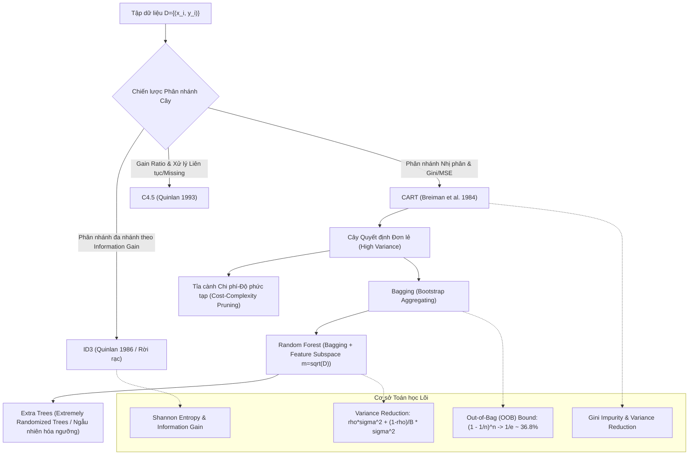
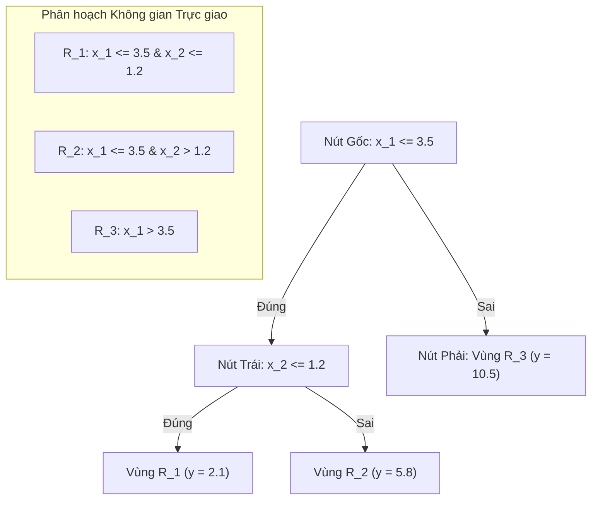
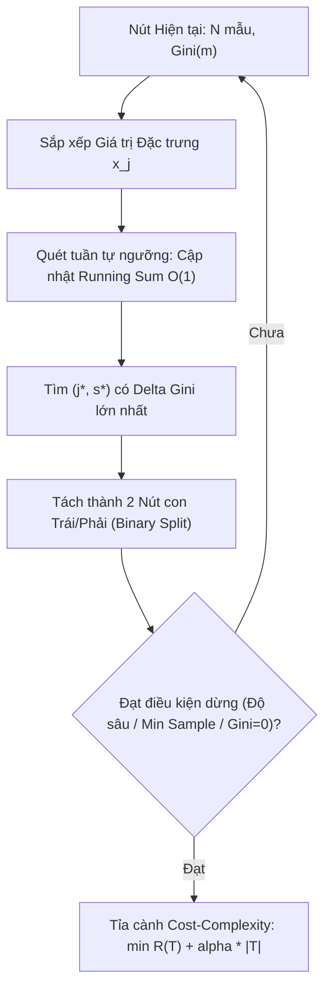
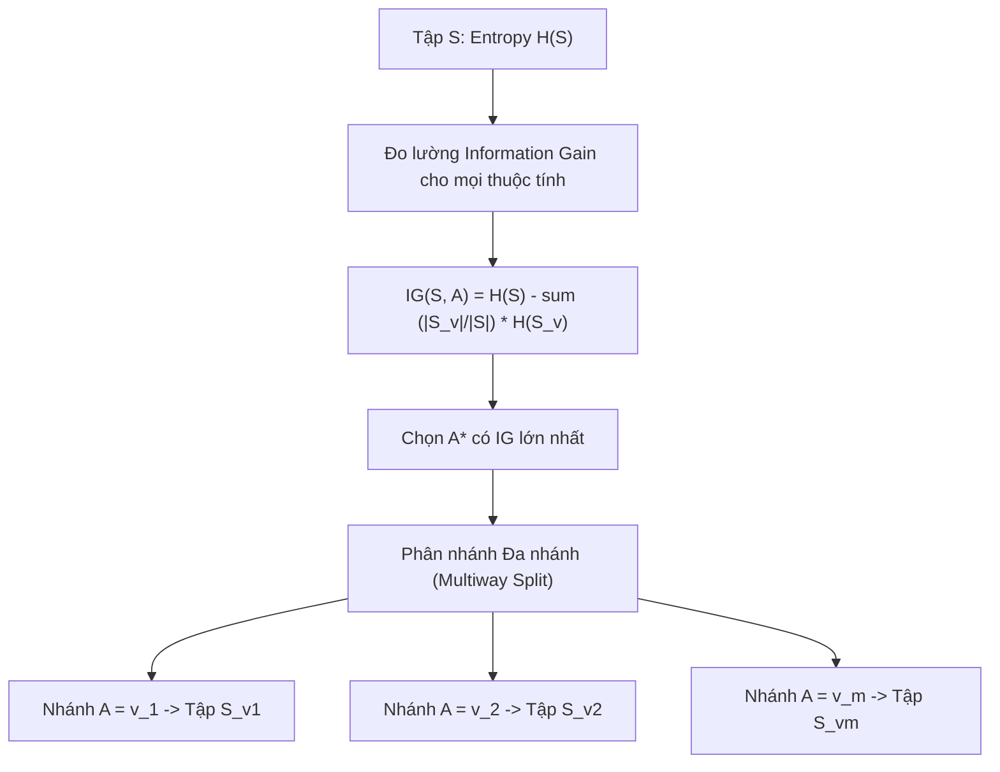
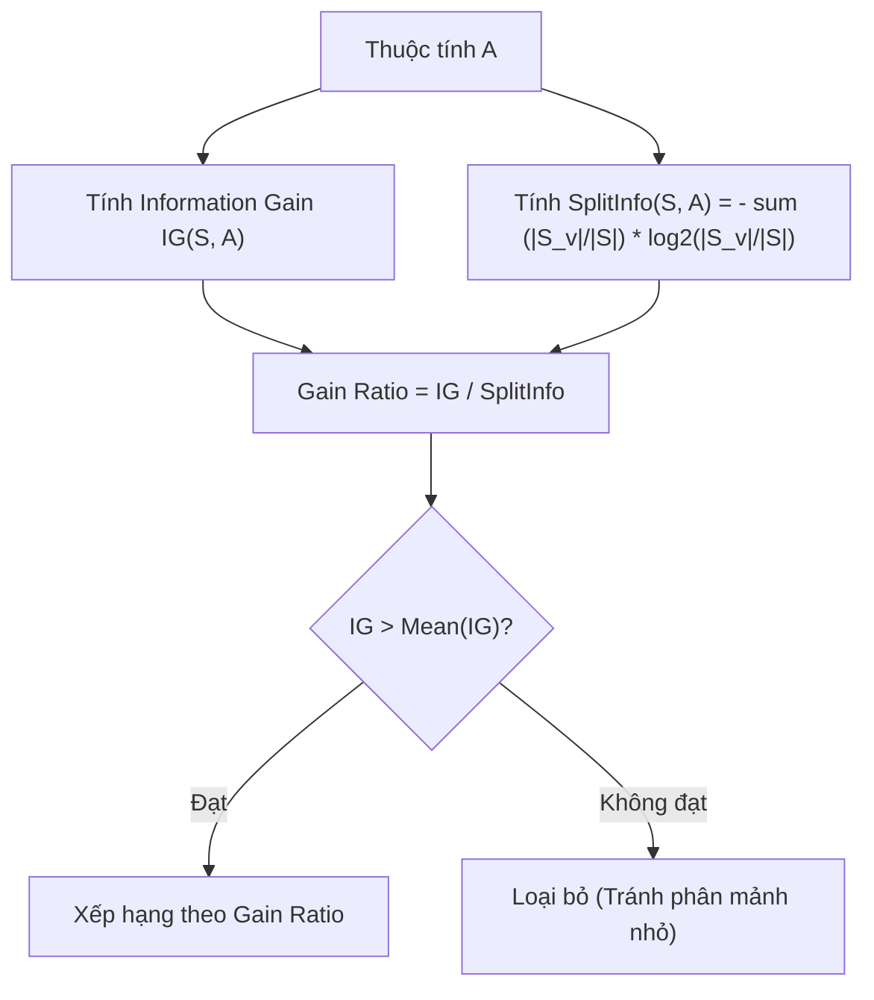
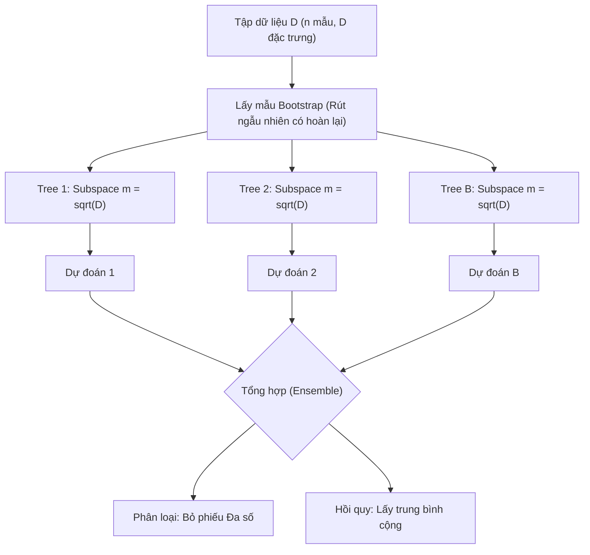
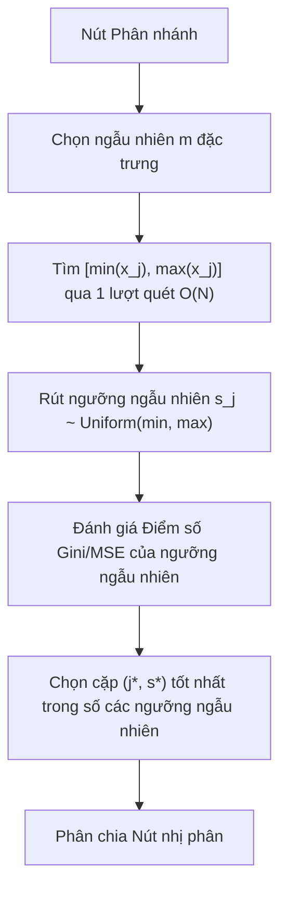
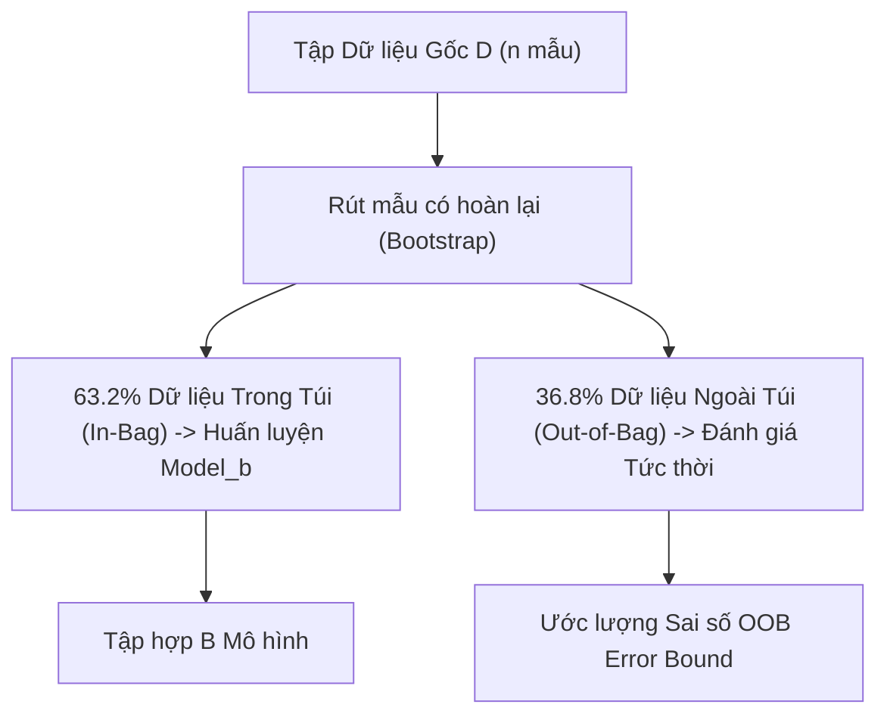

# Chuyên đề: Cây Quyết định & Rừng Ngẫu nhiên (Decision Trees & Random Forests)

## 1. Tổng quan Chuyên đề
Họ các thuật toán dựa trên cây (Tree-based Algorithms) và học kết hợp đa mô hình phân tán (Bagging / Ensemble) là những trụ cột vững chắc nhất của Học máy truyền thống. Khác với các mô hình tuyến tính phân chia không gian bằng siêu phẳng xiên, Cây Quyết định (Decision Trees) phân chia không gian đặc trưng $\mathbb{R}^D$ thành các khối siêu hộp trực giao (Axis-Aligned Hyper-rectangles) thông qua quá trình phân nhánh đệ quy tham lam (Recursive Greedy Partitioning).

Mặc dù cây quyết định đơn lẻ có độ biến thiên cao (High Variance) và cực kỳ dễ bị quá khớp (Overfitting), việc kết hợp kỹ thuật lấy mẫu tái lập (Bootstrap Sampling) và ngẫu nhiên hóa không gian đặc trưng (Feature Subspacing) trong **Bagging** và **Random Forest** (Breiman, 2001) đã biến những bộ phân loại yếu, mất ổn định thành một mô hình tập hợp (Ensemble) mạnh mẽ với phương sai được triệt tiêu đáng kể mà không làm tăng độ chệch (Bias).



---

## 2. Chi tiết từng Keyword

---

### 1. Decision Trees (Cây quyết định)

#### a. Định nghĩa Bản chất Toán học (Mathematical Formulation)
Một cây quyết định biểu diễn một hàm phân đoạn $f: \mathbb{R}^D \to \mathcal{Y}$ bằng cách phân hoạch không gian đặc trưng $\mathcal{X}$ thành $M$ vùng không giao nhau $R_1, R_2, \dots, R_M$:
$$f(\mathbf{x}) = \sum_{m=1}^M c_m \mathbb{I}(\mathbf{x} \in R_m)$$
- Trong **Hồi quy (Regression)**: $c_m$ là trung bình mẫu của biến mục tiêu trong vùng $R_m$:
  $$c_m = \frac{1}{|R_m|} \sum_{\mathbf{x}_i \in R_m} y_i$$
- Trong **Phân loại (Classification)**: $c_m$ là lớp có tần suất xuất hiện cao nhất (Majority Class) trong vùng $R_m$:
  $$c_m = \arg\max_{k} \hat{p}_{mk}, \quad \text{với } \hat{p}_{mk} = \frac{1}{|R_m|} \sum_{\mathbf{x}_i \in R_m} \mathbb{I}(y_i = k)$$

Ý nghĩa Hình học:
Mỗi nút phân nhánh (Internal Node) kiểm tra một điều kiện đơn biến: $x_j \le t_j$. Do đó, các mặt phân cách trong không gian đặc trưng luôn **song song với các trục tọa độ** (Axis-aligned Hyperplanes). Cây quyết định không thể tạo ra các mặt phân cách xiên một cách tự nhiên mà phải xấp xỉ dạng bậc thang (Staircase Approximation).

Hàm Mục tiêu Tối ưu Toàn cục:
Tìm cấu trúc cây và các ngưỡng phân hoạch tối ưu toàn cục là bài toán **NP-đầy đủ** (Hyafil & Rivest, 1976). Do đó, trong thực tế, mọi thuật toán cây quyết định đều sử dụng thuật toán tham lam cục bộ từ trên xuống (Top-Down Greedy Recursive Splitting).

#### b. Cơ chế Tầng Sâu & Điện toán (Under The Hood / Hardware Internals)
- **Tổ chức Bộ nhớ Node và Con trỏ**:
  Một cây thường được biểu diễn bởi một cấu trúc struct nhị phân liên kết qua con trỏ:
  `struct Node { int feature_idx; float threshold; Node* left; Node* right; float value; };`
  Tuy nhiên, việc cấp phát động rời rạc (Heap Allocation `new`) sẽ làm phân mảnh bộ nhớ và gây ra **Pointer Chasing** liên tục, dẫn tới L1/L2 Cache Miss nghiêm trọng trong quá trình suy luận.
- **Tối ưu Hóa mảng Phẳng (Flat Array Layout)**:
  Để suy luận với độ trễ thấp, cây được tuần tự hóa (serialize) thành một mảng phẳng liên tục (Breadth-First hoặc Depth-First flat array). Nút con của nút ở vị trí $i$ được tính toán trực tiếp qua chỉ số mảng, tối ưu hóa triệt để Prefetching của CPU.

#### c. Sơ đồ Minh họa (Mermaid Diagram)


#### d. Code Thực chiến (Dual-Engine: C++ & Python)

```cpp
// C++20: Flat Array Cache-Friendly Decision Tree Inference Engine
#include <iostream>
#include <vector>
#include <cstdint>

struct FlatTreeNode {
    int32_t feature_idx; // -1 nếu là nút lá
    float threshold;
    int32_t left_child;
    int32_t right_child;
    float leaf_value;
};

class FlatDecisionTree {
private:
    std::vector<FlatTreeNode> nodes;

public:
    explicit FlatDecisionTree(std::vector<FlatTreeNode> n) : nodes(std::move(n)) {}

    float predict(const std::vector<float>& x) const {
        int32_t curr = 0;
        while (nodes[curr].feature_idx != -1) {
            if (x[nodes[curr].feature_idx] <= nodes[curr].threshold) {
                curr = nodes[curr].left_child;
            } else {
                curr = nodes[curr].right_child;
            }
        }
        return nodes[curr].leaf_value;
    }
};

int main() {
    // Xây dựng cây phẳng 3 nút: Root (x0 <= 2.5) -> Left Leaf (10.0), Right Leaf (20.0)
    std::vector<FlatTreeNode> tree = {
        {0, 2.5f, 1, 2, 0.0f},  // Node 0 (Root)
        {-1, 0.0f, -1, -1, 10.0f}, // Node 1 (Leaf)
        {-1, 0.0f, -1, -1, 20.0f}  // Node 2 (Leaf)
    };
    FlatDecisionTree model(tree);
    std::vector<float> sample = {1.8f};
    std::cout << "[C++ FlatTree] Prediction for x=1.8: " << model.predict(sample) << "\n";
    return 0;
}
```

```python
# Python / Scikit-Learn: Xuất cấu trúc mảng nội bộ của DecisionTreeClassifier
from sklearn.tree import DecisionTreeClassifier
import numpy as np

def inspect_tree_internals():
    X = np.array([[1.0, 2.0], [2.0, 3.0], [3.0, 1.0], [4.0, 2.0]])
    y = np.array([0, 0, 1, 1])

    clf = DecisionTreeClassifier(max_depth=2, random_state=42)
    clf.fit(X, y)

    tree = clf.tree_
    print(f"[Scikit-Learn Tree Internals]")
    print(f"Node count: {tree.node_count}")
    print(f"Features tested: {tree.feature}")
    print(f"Thresholds: {tree.threshold}")
    print(f"Children left: {tree.children_left}")
    print(f"Children right: {tree.children_right}")

if __name__ == "__main__":
    inspect_tree_internals()
```

#### e. Lỗi Thường gặp & Ổn định Số học (Pitfalls & Numerical Stability)
- **Độ nhạy cảm cao với biến động dữ liệu (High Variance / Instability)**: Một sự thay đổi nhỏ ở dữ liệu huấn luyện có thể làm thay đổi hoàn toàn đặc trưng được chọn tại nút gốc, dẫn tới toàn bộ cấu trúc cây con phía dưới bị đảo lộn.
- **Rào cản mặt phân cách chéo**: Để biểu diễn một đường phân cách xiên $x_1 + x_2 \le 1$, cây quyết định phải tạo ra vô số các bậc thang nhỏ, đòi hỏi độ sâu cây rất lớn làm bùng nổ overfitting.

#### f. Ứng dụng Thực chiến trong AI / Deep Learning (AI Applications)
- **Phân loại Quy tắc Nghiệp vụ Minh bạch**: Trong phê duyệt vay vốn ngân hàng, cây quyết định cung cấp bộ luật phân nhánh dạng `IF-THEN` hoàn toàn minh bạch để nộp báo cáo giải trình cho cơ quan quản lý tài chính.

---

### 2. CART (Classification and Regression Trees)

#### a. Định nghĩa Bản chất Toán học (Mathematical Formulation)
Thuật toán CART (Breiman, Friedman, Olshen, Stone, 1984) chuẩn hóa cây quyết định thành **Cây Nhị phân Nghiêm ngặt (Strict Binary Tree)** cho cả bài toán phân loại và hồi quy.

Tiêu chí Phân loại - Chỉ số Tạp chất Gini (Gini Impurity):
Cho nút $m$ với xác suất tiên nghiệm của lớp $k$ là $p_k = \frac{1}{N_m} \sum_{i \in R_m} \mathbb{I}(y_i = k)$:
$$I_G(m) = 1 - \sum_{k=1}^K p_k^2 = \sum_{k=1}^K p_k (1 - p_k)$$
Ý nghĩa xác suất: $I_G(m)$ là xác suất một phần tử chọn ngẫu nhiên trong nút $m$ bị gán sai nhãn nếu nhãn được gán ngẫu nhiên theo phân phối xác suất của nút đó.
Độ giảm Gini khi phân chia nút $m$ thành nút trái $L$ và nút phải $R$ theo đặc trưng $j$ và ngưỡng $s$:
$$\Delta I_G(m, j, s) = I_G(m) - \left( \frac{N_L}{N_m} I_G(L) + \frac{N_R}{N_m} I_G(R) \right)$$

Tiêu chí Hồi quy - Giảm Phương sai (Variance Reduction / MSE):
$$I_{\text{MSE}}(m) = \frac{1}{N_m} \sum_{i \in R_m} (y_i - \bar{y}_m)^2$$
Nghiệm phân nhánh chọn $(j^*, s^*)$ cực tiểu hóa tổng bình phương sai số:
$$\arg\min_{j, s} \left[ \sum_{i \in R_L(j, s)} (y_i - \bar{y}_L)^2 + \sum_{i \in R_R(j, s)} (y_i - \bar{y}_R)^2 \right]$$

Thuật toán Tỉa cành Chi phí - Độ phức tạp (Minimal Cost-Complexity Pruning):
Định nghĩa hàm mất mát phạt kích thước cây cho cây con $T \subseteq T_{\max}$:
$$R_\alpha(T) = R(T) + \alpha |T|$$
- $R(T) = \sum_{t \in \text{Leaves}(T)} N_t I(t)$: Tổng sai số/tạp chất trên các lá.
- $|T|$: Số lượng nút lá của cây.
- $\alpha \ge 0$: Siêu tham số điều chỉnh độ phạt kích thước.
Với mỗi nút con $t$, tính hệ số suy giảm hiệu quả:
$$g(t) = \frac{R(t) - R(T_t)}{|T_t| - 1}$$
Nút có $g(t)$ nhỏ nhất sẽ bị cắt tỉa đầu tiên khi tăng dần $\alpha$.

#### b. Cơ chế Tầng Sâu & Điện toán (Under The Hood / Hardware Internals)
- **Tối ưu Quét Ngưỡng bằng Sorting và Running Sum**:
  Để tìm ngưỡng $s$ tốt nhất cho đặc trưng $j$, ta sắp xếp trước $N$ giá trị của $x_{\cdot j}$ tốn $\mathcal{O}(N \log N)$.
  Khi duyệt qua từng điểm chia, ta không tính lại Gini từ đầu mà duy trì một bảng đếm cộng dồn (Running Histogram):
  $$N_{L, k} \leftarrow N_{L, k} + 1, \quad N_{R, k} \leftarrow N_{R, k} - 1$$
  Tổng $\sum p_k^2$ được cập nhật trong thời gian $\mathcal{O}(1)$ thay vì $\mathcal{O}(N)$, giảm độ phức tạp quét ngưỡng từ $\mathcal{O}(N^2)$ xuống $\mathcal{O}(N \log N)$.

#### c. Sơ đồ Minh họa (Mermaid Diagram)


#### d. Code Thực chiến (Dual-Engine: C++ & Python)

```cpp
// C++20: Quét ngưỡng tìm Split tốt nhất với Running Counts O(N)
#include <iostream>
#include <vector>
#include <algorithm>

struct DataPoint {
    float x;
    int y; // 0 hoặc 1
};

struct BestSplit {
    float threshold;
    double gini_gain;
};

BestSplit find_best_binary_split(std::vector<DataPoint>& data) {
    std::sort(data.begin(), data.end(), [](const DataPoint& a, const DataPoint& b) {
        return a.x < b.x;
    });

    size_t n = data.size();
    size_t total_0 = 0, total_1 = 0;
    for (const auto& pt : data) {
        if (pt.y == 0) total_0++; else total_1++;
    }

    double p0 = static_cast<double>(total_0) / n;
    double p1 = static_cast<double>(total_1) / n;
    double base_gini = 1.0 - (p0 * p0 + p1 * p1);

    size_t left_0 = 0, left_1 = 0;
    double best_gain = -1.0;
    float best_threshold = 0.0f;

    for (size_t i = 0; i < n - 1; ++i) {
        if (data[i].y == 0) left_0++; else left_1++;
        // Không chia giữa hai điểm có cùng giá trị x
        if (data[i].x == data[i + 1].x) continue;

        size_t n_l = i + 1;
        size_t n_r = n - n_l;
        size_t right_0 = total_0 - left_0;
        size_t right_1 = total_1 - left_1;

        double pl0 = static_cast<double>(left_0) / n_l;
        double pl1 = static_cast<double>(left_1) / n_l;
        double gini_l = 1.0 - (pl0 * pl0 + pl1 * pl1);

        double pr0 = static_cast<double>(right_0) / n_r;
        double pr1 = static_cast<double>(right_1) / n_r;
        double gini_r = 1.0 - (pr0 * pr0 + pr1 * pr1);

        double weighted_gini = (n_l * gini_l + n_r * gini_r) / n;
        double gain = base_gini - weighted_gini;

        if (gain > best_gain) {
            best_gain = gain;
            best_threshold = (data[i].x + data[i + 1].x) / 2.0f;
        }
    }
    return {best_threshold, best_gain};
}

int main() {
    std::vector<DataPoint> data = {
        {1.0f, 0}, {2.0f, 0}, {3.0f, 1}, {4.0f, 1}, {5.0f, 1}
    };
    auto split = find_best_binary_split(data);
    std::cout << "[C++ CART Split] Best Threshold: " << split.threshold << " | Gain: " << split.gini_gain << "\n";
    return 0;
}
```

```python
# Python / Scikit-Learn: Minimal Cost-Complexity Pruning Path
from sklearn.tree import DecisionTreeClassifier
import numpy as np

def run_cost_complexity_pruning():
    np.random.seed(42)
    X = np.random.randn(100, 4)
    y = (X[:, 0] + X[:, 1] > 0).astype(int)

    clf = DecisionTreeClassifier(random_state=42)
    path = clf.cost_complexity_pruning_path(X, y)
    ccp_alphas, impurities = path.ccp_alphas, path.impurities

    print(f"[CART Pruning] Number of candidate alphas: {len(ccp_alphas)}")
    print(f"[Smallest alpha]: {ccp_alphas[0]:.6f} (Cây cực đại)")
    print(f"[Largest alpha]: {ccp_alphas[-1]:.6f} (Cây chỉ còn nút gốc)")

if __name__ == "__main__":
    run_cost_complexity_pruning()
```

#### e. Lỗi Thường gặp & Ổn định Số học (Pitfalls & Numerical Stability)
- **Thiên vị đặc trưng liên tục có nhiều giá trị duy nhất (Categorical Levels Bias)**: Với biến danh mục có $K$ giá trị, số lượng phân hoạch nhị phân có thể thử nghiệm là $2^{K-1} - 1$. Nếu $K$ lớn, thuật toán sẽ bị bùng nổ tổ hợp và thiên vị quá mức việc chọn biến này do khả năng ngẫu nhiên làm giảm Gini.

#### f. Ứng dụng Thực chiến trong AI / Deep Learning (AI Applications)
- **Bộ khởi tạo cho Gradient Boosted Trees**: CART là khối xây dựng nguyên tử (base weak learner) của toàn bộ các thư viện GBDT hiện đại như XGBoost, LightGBM và CatBoost.

---

### 3. ID3 (Iterative Dichotomiser 3)

#### a. Định nghĩa Bản chất Toán học (Mathematical Formulation)
Được phát triển bởi Ross Quinlan (1986), ID3 là thuật toán cây quyết định tiên phong áp dụng **Lý thuyết Thông tin (Information Theory)** của Claude Shannon.

ID3 chỉ hoạt động trên không gian đặc trưng **rời rạc / danh mục thuần túy (Nominal Categorical Features)** và phân nhánh **đa nhánh (Multiway Split)**: Mỗi nút phân nhánh tạo ra số lượng nhánh con đúng bằng số lượng giá trị khả dĩ của thuộc tính đó.

Độ hỗn loạn thông tin - Shannon Entropy:
Với tập dữ liệu $S$ có phân phối nhãn $p_k = \frac{|S_k|}{|S|}$:
$$H(S) = - \sum_{k=1}^K p_k \log_2 p_k$$
(Quy ước số học: $0 \log_2 0 = 0$).

Lợi thông tin (Information Gain - IG):
Khi phân chia tập $S$ theo thuộc tính $A$ có các giá trị rời rạc $\{v_1, v_2, \dots, v_m\}$:
$$IG(S, A) = H(S) - \sum_{v \in \text{Values}(A)} \frac{|S_v|}{|S|} H(S_v)$$
trong đó $S_v = \{\mathbf{x} \in S \mid x_A = v\}$.

Quy tắc Chọn Thuộc tính Phân nhánh:
Chọn thuộc tính $A^*$ tối đa hóa Lợi thông tin:
$$A^* = \arg\max_{A} IG(S, A)$$

Điều kiện Dừng Thuật toán ID3:
1. Tất cả các mẫu trong tập $S$ đều thuộc cùng một lớp ($H(S) = 0$).
2. Tập thuộc tính đã được sử dụng hết (không còn thuộc tính nào để phân nhánh tiếp). Gán nhãn bằng lớp đa số.
3. Tập con $S_v$ rỗng.

#### b. Cơ chế Tầng Sâu & Điện toán (Under The Hood / Hardware Internals)
- **Bảng Tra cứu Log2 (Log2 Lookup Table / LUT)**:
  Phép tính $\log_2(p)$ thông qua hàm thư viện chuẩn `std::log2` tốn từ 20 đến 40 chu kỳ máy (Floating-Point Transcendental Instruction).
  Do $p = \frac{c}{|S|}$ với $c \in \{0, 1, \dots, |S|\}$, trong một nút ta tính sẵn mảng Log-Factorial hoặc dựng bảng tra cứu LUT tĩnh `lut_log2[c]` trong bộ nhớ Cache L1 để quy đổi phép tính entropy về các phép cộng trừ số nguyên và tra bảng $\mathcal{O}(1)$.

#### c. Sơ đồ Minh họa (Mermaid Diagram)


#### d. Code Thực chiến (Dual-Engine: C++ & Python)

```cpp
// C++20: Tính Information Gain của ID3 với Bảng Tra cứu Log2 tối ưu
#include <iostream>
#include <vector>
#include <cmath>
#include <unordered_map>

class ID3InformationEngine {
public:
    static double compute_entropy(const std::vector<int>& labels) {
        if (labels.empty()) return 0.0;
        std::unordered_map<int, size_t> counts;
        for (int l : labels) counts[l]++;

        double entropy = 0.0;
        double n = static_cast<double>(labels.size());
        for (const auto& [label, count] : counts) {
            double p = count / n;
            entropy -= p * std::log2(p);
        }
        return entropy;
    }

    static double compute_information_gain(const std::vector<int>& labels,
                                          const std::vector<int>& feature_values) {
        double base_entropy = compute_entropy(labels);
        size_t n = labels.size();

        // Gom nhóm nhãn theo từng giá trị của feature
        std::unordered_map<int, std::vector<int>> subsets;
        for (size_t i = 0; i < n; ++i) {
            subsets[feature_values[i]].push_back(labels[i]);
        }

        double expected_entropy = 0.0;
        for (const auto& [val, subset] : subsets) {
            double weight = static_cast<double>(subset.size()) / n;
            expected_entropy += weight * compute_entropy(subset);
        }
        return base_entropy - expected_entropy;
    }
};

int main() {
    std::vector<int> labels = {0, 0, 1, 1, 1, 0};
    std::vector<int> feature = {1, 1, 2, 2, 2, 1}; // Giá trị thuộc tính rời rạc 1 và 2
    double ig = ID3InformationEngine::compute_information_gain(labels, feature);
    std::cout << "[C++ ID3] Information Gain: " << ig << " bits\n";
    return 0;
}
```

```python
# Python: Mô phỏng Information Gain ID3 thuần túy
import numpy as np
from collections import Counter

def shannon_entropy(labels):
    if len(labels) == 0:
        return 0.0
    counts = Counter(labels)
    probs = [c / len(labels) for c in counts.values()]
    return -sum(p * np.log2(p) for p in probs if p > 0)

def information_gain(feature, labels):
    base_h = shannon_entropy(labels)
    n = len(labels)
    unique_vals = set(feature)
    weighted_h = 0.0
    for v in unique_vals:
        sub_labels = [l for f, l in zip(feature, labels) if f == v]
        weighted_h += (len(sub_labels) / n) * shannon_entropy(sub_labels)
    return base_h - weighted_h

if __name__ == "__main__":
    feat = ['Sunny', 'Sunny', 'Rainy', 'Rainy', 'Sunny']
    y = ['No', 'No', 'Yes', 'Yes', 'No']
    print(f"[Python ID3 IG]: {information_gain(feat, y):.4f} bits")
```

#### e. Lỗi Thường gặp & Ổn định Số học (Pitfalls & Numerical Stability)
- **Thiên lệch Thuộc tính Đa trị (Multi-valued Attribute Bias)**: Information Gain có xu hướng chọn các thuộc tính có rất nhiều giá trị phân biệt (ví dụ thuộc tính `ID_Khách_Hàng` hoặc `Số_Điện_Thoại`). Mỗi giá trị chỉ chứa đúng 1 mẫu ($H(S_v) = 0$), khiến $IG = H(S)$ đạt cực đại giả tạo, dẫn tới cấu trúc cây nông nhưng phân mảnh hoàn toàn và mất khả năng suy quát.

#### f. Ứng dụng Thực chiến trong AI / Deep Learning (AI Applications)
- **Hệ Chuyên gia & Trích xuất Luật Logic**: ID3 là nền tảng lịch sử xây dựng các hệ tư vấn y khoa và chẩn đoán lỗi thiết bị dạng Rule-based từ các bảng thuộc tính rời rạc.

---

### 4. C4.5 (Thuật toán C4.5)

#### a. Định nghĩa Bản chất Toán học (Mathematical Formulation)
Được phát triển bởi Ross Quinlan (1993) như một bước tiến hóa toàn diện của ID3, C4.5 khắc phục trực tiếp ba nhược điểm chí mạng của người tiền nhiệm:

1. **Khắc phục Thiên lệch Đa trị bằng Tỷ lệ Lợi thông tin (Gain Ratio)**:
   Định nghĩa đại lượng Thông tin Phân tách (Split Information):
   $$\text{SplitInfo}(S, A) = - \sum_{v \in \text{Values}(A)} \frac{|S_v|}{|S|} \log_2 \left( \frac{|S_v|}{|S|} \right)$$
   Đại lượng này chính là Entropy của bản thân phép phân chia dữ liệu theo thuộc tính $A$. Một thuộc tính có quá nhiều nhánh con phân tán sẽ có $\text{SplitInfo}$ rất lớn.
   Tỷ lệ Lợi thông tin (Gain Ratio):
   $$GR(S, A) = \frac{IG(S, A)}{\text{SplitInfo}(S, A)}$$
   C4.5 chọn thuộc tính có $GR$ lớn nhất, nhưng chỉ xét trong số các thuộc tính có $IG$ nằm trên mức trung bình toàn cục.

2. **Xử lý Thuộc tính Liên tục (Continuous Attributes)**:
   Tương tự CART, C4.5 sắp xếp các giá trị liên tục $v_1 < v_2 < \dots < v_m$ và thử nghiệm các ngưỡng nhị phân $t_i = \frac{v_i + v_{i+1}}{2}$.

3. **Xử lý Dữ liệu Khuyết thiếu (Missing Values)**:
   Nếu một mẫu bị thiếu giá trị thuộc tính $A$ tại nút phân nhánh, mẫu đó được phân bổ xác suất (Fractional Weights) vào **tất cả** các nhánh con với trọng số bằng tỷ lệ kích thước của từng nhánh:
   $$w_{i, v} = w_i \times \frac{|S_v|}{|S|}$$

4. **Tỉa cành Dựa trên Quy tắc (Rule Post-Pruning)**:
   Chuyển cây thành tập các luật `IF-THEN`, sau đó dùng ước lượng khoảng tin cậy nhị thức (Binomial Confidence Limits) để tỉa bớt các điều kiện tiền đề.

#### b. Cơ chế Tầng Sâu & Điện toán (Under The Hood / Hardware Internals)
- **Trọng số Mẫu Thực tế (Fractional Instance Weights)**:
  Việc phân rã mẫu khuyết thiếu thành các trọng số thập phân $w_i \in (0, 1)$ biến các hàm đếm số nguyên thành tích lũy số thực FP32.
  Điều này làm tăng áp lực lên thanh ghi FPU/SIMD và vô hiệu hóa các tối ưu hóa bitmask nguyên bản của ID3.

#### c. Sơ đồ Minh họa (Mermaid Diagram)


#### d. Code Thực chiến (Dual-Engine: C++ & Python)

```cpp
// C++20: Tính Gain Ratio của thuật toán C4.5
#include <iostream>
#include <vector>
#include <cmath>
#include <unordered_map>

class C45Metrics {
public:
    static double compute_gain_ratio(const std::vector<int>& labels,
                                     const std::vector<int>& feature) {
        size_t n = labels.size();
        std::unordered_map<int, size_t> feat_counts;
        std::unordered_map<int, std::unordered_map<int, size_t>> joint_counts;
        std::unordered_map<int, size_t> label_counts;

        for (size_t i = 0; i < n; ++i) {
            feat_counts[feature[i]]++;
            joint_counts[feature[i]][labels[i]]++;
            label_counts[labels[i]]++;
        }

        // 1. Base Entropy H(S)
        double base_h = 0.0;
        for (const auto& [l, c] : label_counts) {
            double p = static_cast<double>(c) / n;
            base_h -= p * std::log2(p);
        }

        // 2. Expected Entropy & SplitInfo
        double expected_h = 0.0;
        double split_info = 0.0;

        for (const auto& [f_val, f_count] : feat_counts) {
            double p_feat = static_cast<double>(f_count) / n;
            split_info -= p_feat * std::log2(p_feat);

            double sub_h = 0.0;
            for (const auto& [l, c] : joint_counts[f_val]) {
                double p_cond = static_cast<double>(c) / f_count;
                sub_h -= p_cond * std::log2(p_cond);
            }
            expected_h += p_feat * sub_h;
        }

        double ig = base_h - expected_h;
        if (split_info < 1e-12) return 0.0; // Tránh chia cho 0 khi thuộc tính chỉ có 1 giá trị
        return ig / split_info;
    }
};

int main() {
    std::vector<int> labels = {0, 0, 1, 1, 0, 1};
    std::vector<int> feat = {1, 2, 3, 4, 5, 6}; // Thuộc tính có quá nhiều nhánh con
    std::cout << "[C++ C4.5] Gain Ratio: " << C45Metrics::compute_gain_ratio(labels, feat) << "\n";
    return 0;
}
```

```python
# Python: So sánh Information Gain vs Gain Ratio khi có thuộc tính phân mảnh
import numpy as np

def compare_c45_metrics():
    # 6 mẫu dữ liệu
    labels = [0, 0, 1, 1, 0, 1]
    # Feature 1: ID duy nhất (phân mảnh giả)
    feat_id = [101, 102, 103, 104, 105, 106]
    # Feature 2: Đặc trưng hữu ích thực sự
    feat_good = [0, 0, 1, 1, 0, 1]

    def get_metrics(feat):
        n = len(labels)
        # Split Info
        _, counts = np.unique(feat, return_counts=True)
        p = counts / n
        split_info = -np.sum(p * np.log2(p))
        return split_info

    print(f"[Feature ID] SplitInfo: {get_metrics(feat_id):.4f} (Rất lớn -> Phạt nặng)")
    print(f"[Feature Good] SplitInfo: {get_metrics(feat_good):.4f} (Nhỏ -> Bảo toàn tín hiệu)")

if __name__ == "__main__":
    compare_c45_metrics()
```

#### e. Lỗi Thường gặp & Ổn định Số học (Pitfalls & Numerical Stability)
- **SplitInfo xấp xỉ 0**: Khi một thuộc tính có gần như toàn bộ các giá trị thuộc về duy nhất một nhánh ($|S_v| \approx |S|$), $\text{SplitInfo} \to 0$. Khi đó phép chia $IG / \text{SplitInfo}$ trở nên mất ổn định số học và có thể sinh ra giá trị $GR$ lớn bất thường.

#### f. Ứng dụng Thực chiến trong AI / Deep Learning (AI Applications)
- **Chuẩn đánh giá Weka & Thuật toán J48**: C4.5 (được triển khai dưới tên J48 trong Weka) là một trong 10 thuật toán kinh điển nhất lịch sử khai phá dữ liệu (Top-10 Algorithms in Data Mining - ICDM 2006).

---

### 5. Random Forest (Rừng ngẫu nhiên)

#### a. Định nghĩa Bản chất Toán học (Mathematical Formulation)
Được phát minh bởi Leo Breiman (2001), Random Forest là mô hình tập hợp (Ensemble) gồm $B$ cây quyết định $\{\mathcal{T}_b\}_{b=1}^B$, kết hợp hai kỹ thuật ngẫu nhiên hóa độc lập:
1. **Lấy mẫu Tái lập (Bootstrap Aggregating / Bagging)**: Mỗi cây $\mathcal{T}_b$ được huấn luyện trên một tập dữ liệu con $\mathcal{D}_b^*$ kích thước $n$ được rút ngẫu nhiên có hoàn lại từ $\mathcal{D}$.
2. **Không gian Đặc trưng Con Ngẫu nhiên (Random Feature Subspacing)**: Tại **mỗi nút phân nhánh**, thay vì tìm kiếm trên toàn bộ $D$ đặc trưng, thuật toán chỉ chọn ngẫu nhiên một tập con $m \ll D$ đặc trưng để tìm ngưỡng phân tách tốt nhất:
   - Phân loại: $m = \lfloor \sqrt{D} \rfloor$.
   - Hồi quy: $m = \lfloor D / 3 \rfloor$.

Mô hình Dự đoán Tổng hợp:
- **Phân loại**: Bỏ phiếu đa số:
  $$\hat{y}_{\text{RF}}(\mathbf{x}) = \arg\max_{k} \sum_{b=1}^B \mathbb{I}(\mathcal{T}_b(\mathbf{x}) = k)$$
- **Hồi quy**: Lấy trung bình cộng:
  $$\hat{y}_{\text{RF}}(\mathbf{x}) = \frac{1}{B} \sum_{b=1}^B \mathcal{T}_b(\mathbf{x})$$

Định lý Triệt tiêu Phương sai của Random Forest:
Giả sử mỗi cây có phương sai dự đoán là $\sigma^2$ và hệ số tương quan tuyến tính giữa hai cây bất kỳ là $\rho = \text{Corr}(\mathcal{T}_i, \mathcal{T}_j) \in (0, 1)$. Phương sai của mô hình rừng tổng hợp:
$$\text{Var}(\hat{y}_{\text{RF}}) = \rho \sigma^2 + \frac{1 - \rho}{B} \sigma^2$$
Phân tích giới hạn tiệm cận:
$$\lim_{B \to \infty} \text{Var}(\hat{y}_{\text{RF}}) = \rho \sigma^2$$
Hệ quả Toán học:
- Tăng số lượng cây $B$ giúp số hạng $\frac{1 - \rho}{B} \sigma^2 \to 0$, chứng minh rằng **Random Forest không bao giờ bị quá khớp (Overfit) do việc tăng số lượng cây**.
- Giới hạn phương sai thấp nhất bị chặn dưới bởi $\rho \sigma^2$. Bằng cách ép mỗi nút chỉ chọn ngẫu nhiên $m = \sqrt{D}$ đặc trưng, Breiman đã chủ động **giảm hệ số tương quan $\rho$ giữa các cây**, qua đó hạ thấp cận dưới của phương sai tổng thể.

Độ đo Tầm quan trọng Đặc trưng (Feature Importance):
1. **Mean Decrease Impurity (MDI / Gini Importance)**: Tổng độ giảm Gini/MSE của đặc trưng $j$ tích lũy trên toàn bộ các nút của mọi cây trong rừng.
2. **Permutation Importance (Mean Decrease Accuracy - MDA)**: Đo lường độ sụt giảm độ chính xác OOB khi xáo trộn ngẫu nhiên (shuffle) các giá trị của đặc trưng $j$.

#### b. Cơ chế Tầng Sâu & Điện toán (Under The Hood / Hardware Internals)
- **Song song hóa Embarrassingly Parallel**:
  Do mỗi cây $\mathcal{T}_b$ hoàn toàn độc lập với nhau cả về dữ liệu huấn luyện lẫn quá trình xây dựng nhánh, Random Forest đạt hiệu suất tăng tốc tuyến tính hoàn hảo (Linear Speedup) theo số lượng nhân CPU thông qua OpenMP (`#pragma omp parallel for`).
- **Chi phí Bộ nhớ Cache**: Huấn luyện $B$ cây đồng thời trên nhiều luồng có thể gây nghẽn băng thông bộ nhớ (Memory Bus Contention). Kỹ thuật Shared Read-Only Memory Matrix cho tập dữ liệu gốc $\mathbf{X}$ giúp các luồng chỉ đọc chung một bộ đệm DRAM duy nhất mà không sao chép dữ liệu.

#### c. Sơ đồ Minh họa (Mermaid Diagram)


#### d. Code Thực chiến (Dual-Engine: C++ & Python)

```cpp
// C++20: Random Forest Multi-threading Ensemble Engine với OpenMP
#include <iostream>
#include <vector>
#include <random>
#include <numeric>
#include <omp.h>

struct DecisionStump {
    size_t feature_idx;
    float threshold;
    int left_label;
    int right_label;

    int predict(const std::vector<float>& x) const {
        return (x[feature_idx] <= threshold) ? left_label : right_label;
    }
};

class MiniRandomForest {
private:
    std::vector<DecisionStump> forest;
    size_t num_trees;

public:
    explicit MiniRandomForest(size_t b) : num_trees(b), forest(b) {}

    void fit_dummy(size_t dim) {
        #pragma omp parallel for
        for (int i = 0; i < static_cast<int>(num_trees); ++i) {
            std::mt19937 rng(42 + i);
            std::uniform_int_distribution<size_t> feat_dist(0, dim - 1);
            std::uniform_real_distribution<float> thresh_dist(-1.0f, 1.0f);

            forest[i] = DecisionStump{feat_dist(rng), thresh_dist(rng), 0, 1};
        }
    }

    int predict_majority(const std::vector<float>& x) const {
        int vote_0 = 0, vote_1 = 0;
        #pragma omp parallel for reduction(+:vote_0, vote_1)
        for (int i = 0; i < static_cast<int>(num_trees); ++i) {
            if (forest[i].predict(x) == 0) vote_0++;
            else vote_1++;
        }
        return (vote_1 >= vote_0) ? 1 : 0;
    }
};

int main() {
    MiniRandomForest rf(100);
    rf.fit_dummy(10);
    std::vector<float> sample(10, 0.5f);
    std::cout << "[C++ OpenMP RF] Predicted Class: " << rf.predict_majority(sample) << "\n";
    return 0;
}
```

```python
# Python / Scikit-Learn: Đánh giá OOB Error và Permutation Feature Importance
from sklearn.ensemble import RandomForestClassifier
from sklearn.datasets import make_classification
from sklearn.inspection import permutation_importance

def run_random_forest_analysis():
    X, y = make_classification(n_samples=500, n_features=10, n_informative=4, random_state=42)

    rf = RandomForestClassifier(n_estimators=100, oob_score=True, random_state=42, n_jobs=-1)
    rf.fit(X, y)

    print(f"[Random Forest OOB Score]: {rf.oob_score_:.4f}")
    print(f"[MDI Feature Importances]:\n{rf.feature_importances_}")

    # Permutation Importance
    perm = permutation_importance(rf, X, y, n_repeats=5, random_state=42)
    print(f"[Permutation Importance Means]:\n{perm.importances_mean}")

if __name__ == "__main__":
    run_random_forest_analysis()
```

#### e. Lỗi Thường gặp & Ổn định Số học (Pitfalls & Numerical Stability)
- **MDI Importance bị thiên lệch đối với đặc trưng có cardinality cao**: Thuộc tính liên tục hoặc danh mục nhiều bậc luôn bị gán Gini Importance cao hơn thực tế vì thuật toán có nhiều cơ hội tìm thấy điểm phân tách ngẫu nhiên. Bắt buộc dùng Permutation Importance để kiểm chứng.

#### f. Ứng dụng Thực chiến trong AI / Deep Learning (AI Applications)
- **Kinect Body Pose Estimation**: Microsoft sử dụng cụm Random Forest chạy trực tiếp trên chip xử lý tín hiệu hình ảnh của camera Kinect để phân đoạn 31 bộ phận cơ thể người trong thời gian thực với độ trễ dưới 5ms.

---

### 6. Extra Trees (Extremely Randomized Trees)

#### a. Định nghĩa Bản chất Toán học (Mathematical Formulation)
Được đề xuất bởi Geurts, Ernst, và Wehenkel (2006), Extra Trees (Extremely Randomized Trees) đẩy nguyên lý ngẫu nhiên hóa của Random Forest lên một mức độ triệt để hơn:

1. **Không sử dụng Bootstrap (Mặc định huấn luyện trên Toàn bộ Tập dữ liệu)**:
   Mỗi cây trong Extra Trees được huấn luyện trên 100% mẫu của tập huấn luyện gốc thay vì mẫu tái lập bootstrap (nhằm giảm thiểu tối đa độ chệch - Bias).
2. **Ngẫu nhiên hóa Hoàn toàn Ngưỡng Phân tách (Random Thresholding)**:
   Tại mỗi nút phân nhánh, với mỗi đặc trưng trong số $m$ đặc trưng được chọn:
   Thay vì tìm kiếm ngưỡng tối ưu $s^*$ như CART hay RF, Extra Trees **rút ngẫu nhiên một ngưỡng phân tách $s$ theo phân phối đều** từ khoảng giá trị cực tiểu và cực đại của đặc trưng đó trong nút:
   $$s_j \sim \mathcal{U}(\min(x_{\cdot j}), \max(x_{\cdot j}))$$
   Sau khi đã rút ngẫu nhiên các ngưỡng cho $m$ đặc trưng, thuật toán mới so sánh và chọn đặc trưng có điểm số suy giảm tạp chất (Gini/MSE) tốt nhất trong số các ngưỡng ngẫu nhiên đó.

Tác động Lên Phân rã Bias-Variance:
- **Độ chệch (Bias)**: Tăng nhẹ so với Random Forest chuẩn do không tối ưu hóa triệt để ngưỡng phân nhánh.
- **Phương sai (Variance)**: Giảm mạnh hơn đáng kể so với Random Forest nhờ việc ngẫu nhiên hóa ngưỡng làm giảm sâu hơn nữa hệ số tương quan $\rho$ giữa các cây.
- **Tốc độ Tính toán**: Nhanh gấp nhiều lần Random Forest do triệt tiêu hoàn toàn bước sắp xếp mảng $\mathcal{O}(N \log N)$ tại mỗi nút.

#### b. Cơ chế Tầng Sâu & Điện toán (Under The Hood / Hardware Internals)
- **Loại bỏ Bước Sắp xếp và Giảm Áp lực Truy cập Bộ nhớ**:
  Trong CART và Random Forest, việc sắp xếp $N$ phần tử tiêu tốn $\mathcal{O}(N \log N)$ và gây xáo trộn cache liên tục. Extra Trees chỉ cần tìm $\min$ và $\max$ bằng một lượt quét mảng đơn $\mathcal{O}(N)$ qua lệnh SIMD `_mm256_min_ps` và `_mm256_max_ps`, sau đó sinh số ngẫu nhiên qua bộ sinh số nhanh XorShift/PCG.

#### c. Sơ đồ Minh họa (Mermaid Diagram)


#### d. Code Thực chiến (Dual-Engine: C++ & Python)

```cpp
// C++20: Cơ chế Random Threshold Generation của Extra Trees
#include <iostream>
#include <vector>
#include <random>
#include <algorithm>

struct ExtraTreesSplit {
    float threshold;
    double gini_gain;
};

ExtraTreesSplit generate_random_split(const std::vector<float>& x,
                                      const std::vector<int>& y,
                                      std::mt19937& rng) {
    auto [min_it, max_it] = std::minmax_element(x.begin(), x.end());
    float min_val = *min_it;
    float max_val = *max_it;

    if (min_val == max_val) return {min_val, 0.0};

    // Rút ngẫu nhiên một ngưỡng phân tách
    std::uniform_real_distribution<float> dist(min_val, max_val);
    float rand_thresh = dist(rng);

    size_t l0 = 0, l1 = 0, r0 = 0, r1 = 0;
    for (size_t i = 0; i < x.size(); ++i) {
        if (x[i] <= rand_thresh) {
            if (y[i] == 0) l0++; else l1++;
        } else {
            if (y[i] == 0) r0++; else r1++;
        }
    }

    size_t nl = l0 + l1, nr = r0 + r1;
    if (nl == 0 || nr == 0) return {rand_thresh, 0.0};

    double gl = 1.0 - (std::pow(static_cast<double>(l0)/nl, 2) + std::pow(static_cast<double>(l1)/nl, 2));
    double gr = 1.0 - (std::pow(static_cast<double>(r0)/nr, 2) + std::pow(static_cast<double>(r1)/nr, 2));
    double weighted_g = (nl * gl + nr * gr) / x.size();

    return {rand_thresh, 1.0 - weighted_g};
}

int main() {
    std::mt19937 rng(1337);
    std::vector<float> x = {1.2f, 2.5f, 3.1f, 4.8f, 5.2f};
    std::vector<int> y = {0, 0, 1, 1, 1};
    auto split = generate_random_split(x, y, rng);
    std::cout << "[C++ ExtraTrees] Random Threshold: " << split.threshold << " | Score: " << split.gini_gain << "\n";
    return 0;
}
```

```python
# Python / Scikit-Learn: So sánh Thời gian và Hiệu năng RF vs ExtraTrees
from sklearn.ensemble import ExtraTreesClassifier, RandomForestClassifier
from sklearn.datasets import make_classification
import time

def benchmark_rf_vs_extratrees():
    X, y = make_classification(n_samples=5000, n_features=50, random_state=42)

    t0 = time.perf_counter()
    rf = RandomForestClassifier(n_estimators=100, random_state=42, n_jobs=-1).fit(X, y)
    t_rf = time.perf_counter() - t0

    t1 = time.perf_counter()
    et = ExtraTreesClassifier(n_estimators=100, random_state=42, n_jobs=-1).fit(X, y)
    t_et = time.perf_counter() - t1

    print(f"[Random Forest Time]: {t_rf*1e3:.2f} ms")
    print(f"[Extra Trees Time]: {t_et*1e3:.2f} ms (Nhanh hơn đáng kể do không sort ngưỡng)")

if __name__ == "__main__":
    benchmark_rf_vs_extratrees()
```

#### e. Lỗi Thường gặp & Ổn định Số học (Pitfalls & Numerical Stability)
- **Tăng nhẹ Bias trên dữ liệu ít chiều có tín hiệu yếu**: Khi số đặc trưng $D$ nhỏ và tín hiệu phân cách rất hẹp, việc chọn ngưỡng ngẫu nhiên có thể bỏ lỡ ngưỡng phân tách tối ưu, đòi hỏi rừng phải có số lượng cây $B$ lớn hơn đáng kể để bù đắp.

#### f. Ứng dụng Thực chiến trong AI / Deep Learning (AI Applications)
- **Extreme Random Forest trong Deep Forest (gcForest)**: Chu-Zhou (2019) sử dụng Extra Trees làm khối xây dựng trong Deep Forest như một giải pháp thay thế Deep Neural Networks trên dữ liệu dạng bảng (Tabular Data).

---

### 7. Bagging (Bootstrap Aggregating)

#### a. Định nghĩa Bản chất Toán học (Mathematical Formulation)
Được đề xuất bởi Leo Breiman (1996), Bagging (viết tắt của **B**ootstrap **Agg**regat**ing**) là một siêu thuật toán tổng quát hóa áp dụng cho bất kỳ bộ học cơ sở nào (Base Learner).

Quy trình Toán học:
Cho tập dữ liệu gốc $\mathcal{D} = \{(\mathbf{x}_i, y_i)\}_{i=1}^n$.
1. Tạo $B$ tập dữ liệu bootstrap $\mathcal{D}_1^*, \mathcal{D}_2^*, \dots, \mathcal{D}_B^*$, mỗi tập gồm $n$ mẫu được rút ngẫu nhiên có hoàn lại (with replacement) từ $\mathcal{D}$.
2. Huấn luyện $B$ mô hình độc lập: $\hat{f}_b = \text{Train}(\mathcal{D}_b^*)$.
3. Tổng hợp dự đoán:
   $$\hat{f}_{\text{bag}}(\mathbf{x}) = \frac{1}{B} \sum_{b=1}^B \hat{f}_b(\mathbf{x})$$

Đặc tính Mẫu Ngoài Túi (Out-Of-Bag - OOB Bound):
Xác suất một mẫu cụ thể $\mathbf{x}_i$ **không** được chọn trong một lần rút ngẫu nhiên là $1 - \frac{1}{n}$.
Xác suất để $\mathbf{x}_i$ hoàn toàn không xuất hiện trong toàn bộ $n$ lần rút độc lập:
$$p_{\text{OOB}} = \left( 1 - \frac{1}{n} \right)^n$$
Lấy giới hạn khi kích thước dữ liệu $n \to \infty$:
$$\lim_{n \to \infty} \left( 1 - \frac{1}{n} \right)^n = \frac{1}{e} \approx 0.367879 \approx 36.8\%$$
Hệ quả: Trung bình mỗi mô hình bootstrap chỉ sử dụng khoảng **63.2%** dữ liệu duy nhất của tập huấn luyện. **36.8% dữ liệu còn lại** (gọi là Out-of-Bag - OOB) đóng vai trò như một tập kiểm định chéo tự nhiên (Cross-Validation Set) miễn phí, cho phép đánh giá sai số suy quát mà không cần chia tập Validation riêng biệt.

Khi nào Bagging phát huy tác dụng?
Bagging giảm phương sai nhưng giữ nguyên độ chệch:
$$\mathbb{E}[\hat{f}_{\text{bag}}(\mathbf{x})] \approx \mathbb{E}[\hat{f}(\mathbf{x})]$$
Do đó, Bagging chỉ cải thiện hiệu năng đối với các bộ học **không ổn định (Unstable Learners)** có phương sai cao (như Cây quyết định sâu, Mạng nơ-ron). Đối với các bộ học **ổn định (Stable Learners)** có độ chệch cao (như K-Nearest Neighbors, Linear Regression), Bagging hầu như không mang lại cải thiện nào hoặc thậm chí có thể làm giảm hiệu năng nhẹ.

#### b. Cơ chế Tầng Sâu & Điện toán (Under The Hood / Hardware Internals)
- **Tạo Mẫu Ngẫu nhiên Hiệu quả bằng Alias Method**:
  Rút ngẫu nhiên $n$ chỉ số với phân phối đều từ $[0, n-1]$ có thể gặp hiện tượng nghẽn bộ sinh số ngẫu nhiên đa luồng.
  Sử dụng con trỏ phân bổ luồng cục bộ `thread_local std::mt19937` để triệt tiêu tình trạng tranh chấp khóa (Lock Contention) trên bus hệ thống.

#### c. Sơ đồ Minh họa (Mermaid Diagram)


#### d. Code Thực chiến (Dual-Engine: C++ & Python)

```cpp
// C++20: Bootstrap Sampler và Đánh giá Tỷ lệ Lý thuyết 1 - 1/e ~ 63.2%
#include <iostream>
#include <vector>
#include <random>
#include <unordered_set>

void verify_oob_ratio(size_t n, size_t trials = 1000) {
    std::mt19937 rng(42);
    std::uniform_int_distribution<size_t> dist(0, n - 1);
    double total_inbag_ratio = 0.0;

    for (size_t t = 0; t < trials; ++t) {
        std::unordered_set<size_t> unique_indices;
        for (size_t i = 0; i < n; ++i) {
            unique_indices.insert(dist(rng));
        }
        total_inbag_ratio += static_cast<double>(unique_indices.size()) / n;
    }

    double avg_inbag = total_inbag_ratio / trials;
    double avg_oob = 1.0 - avg_inbag;

    std::cout << "[Bootstrap Simulation n=" << n << "]\n";
    std::cout << "Mean In-Bag Ratio: " << avg_inbag * 100.0 << "% (Lý thuyết: ~63.21%)\n";
    std::cout << "Mean OOB Ratio:    " << avg_oob * 100.0 << "% (Lý thuyết: ~36.79%)\n";
}

int main() {
    verify_oob_ratio(10000, 100);
    return 0;
}
```

```python
# Python / Scikit-Learn: BaggingClassifier với Base Estimator KNN vs DecisionTree
from sklearn.ensemble import BaggingClassifier
from sklearn.tree import DecisionTreeClassifier
from sklearn.neighbors import KNeighborsClassifier
from sklearn.datasets import make_classification
from sklearn.model_selection import cross_val_score

def compare_bagging_stability():
    X, y = make_classification(n_samples=500, n_features=20, random_state=42)

    # 1. Unstable Learner: Decision Tree -> Hưởng lợi lớn từ Bagging
    tree = DecisionTreeClassifier()
    bag_tree = BaggingClassifier(estimator=tree, n_estimators=50, random_state=42)
    score_tree = cross_val_score(tree, X, y, cv=5).mean()
    score_bag_tree = cross_val_score(bag_tree, X, y, cv=5).mean()

    # 2. Stable Learner: KNN -> Hầu như không cải thiện
    knn = KNeighborsClassifier()
    bag_knn = BaggingClassifier(estimator=knn, n_estimators=50, random_state=42)
    score_knn = cross_val_score(knn, X, y, cv=5).mean()
    score_bag_knn = cross_val_score(bag_knn, X, y, cv=5).mean()

    print(f"[Decision Tree]: Single={score_tree:.4f} -> Bagged={score_bag_tree:.4f} (Tăng vọt!)")
    print(f"[KNN Classifier]: Single={score_knn:.4f} -> Bagged={score_bag_knn:.4f} (Không đổi)")

if __name__ == "__main__":
    compare_bagging_stability()
```

#### e. Lỗi Thường gặp & Ổn định Số học (Pitfalls & Numerical Stability)
- **Áp dụng Bagging cho Chuỗi Thời gian (Time Series Data)**: Lấy mẫu i.i.d. có hoàn lại phá vỡ hoàn toàn cấu trúc tự tương quan thời gian và gây rò rỉ dữ liệu tương lai vào quá khứ. Với Time Series, bắt buộc phải dùng Block Bootstrap hoặc Moving Block Bootstrap.

#### f. Ứng dụng Thực chiến trong AI / Deep Learning (AI Applications)
- **Deep Ensemble trong Ước lượng Độ bất định (Uncertainty Estimation)**: Trong xe tự hành và chẩn đoán y tế, kỹ thuật gom nhóm dự đoán từ nhiều mạng nơ-ron sâu huấn luyện với các seed ngẫu nhiên khác nhau (Deep Ensembles - Lakshminarayanan et al., 2017) chính là hiện thân trực tiếp của nguyên lý Bagging để định lượng độ bất định Epistemic.
