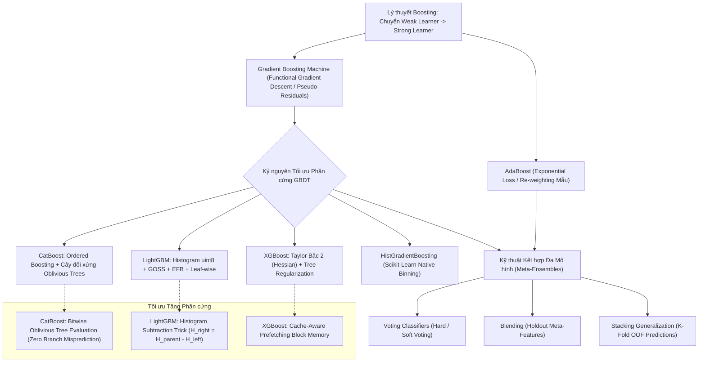
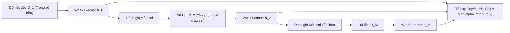
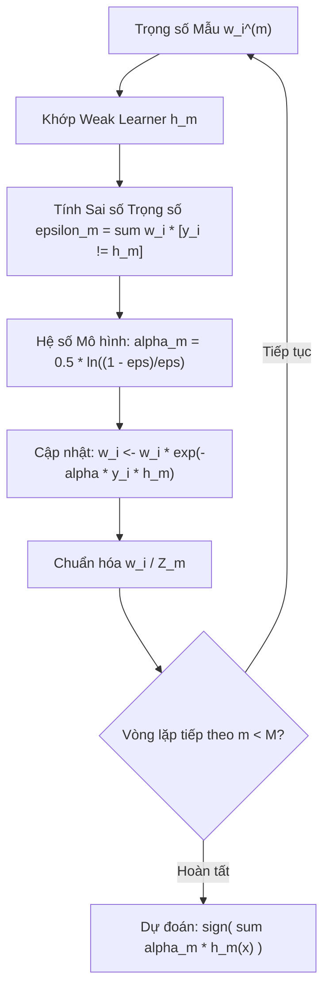
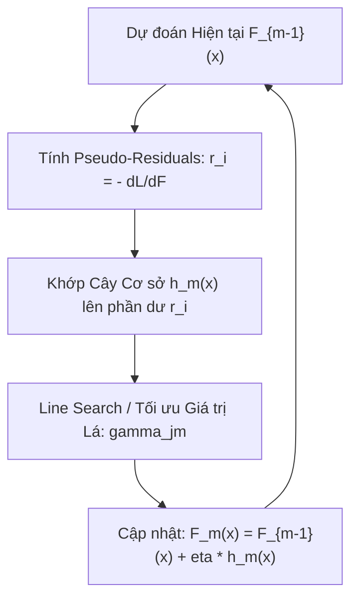
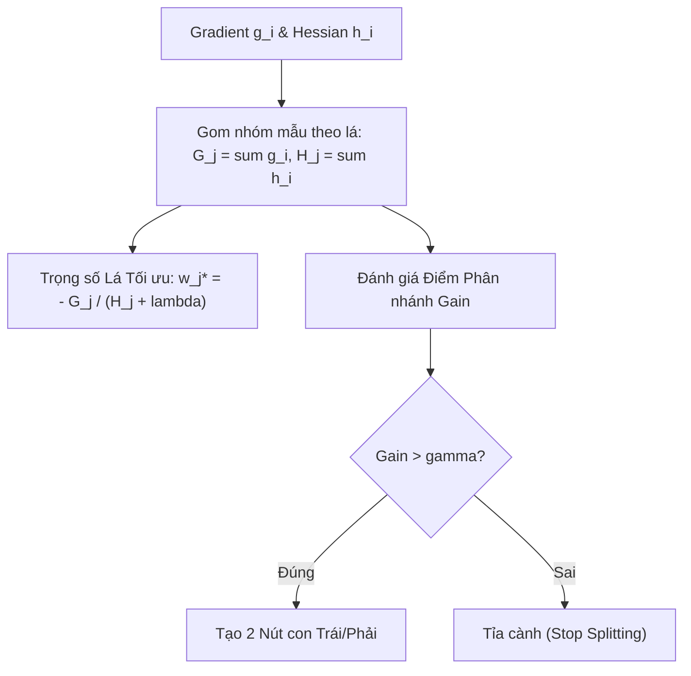
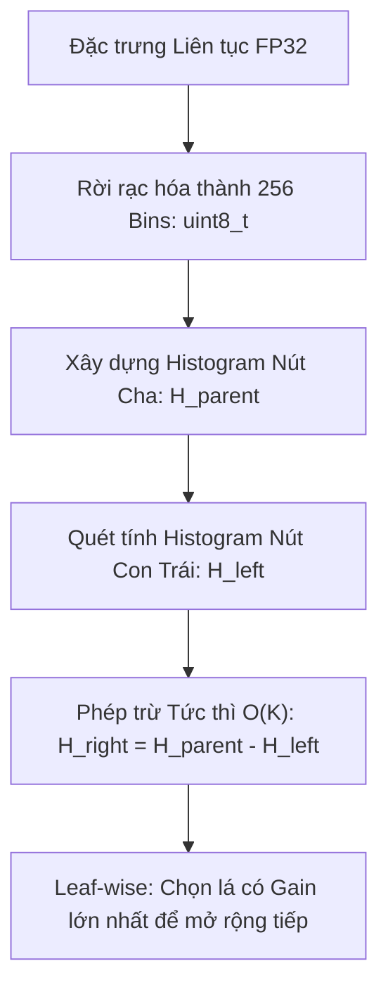
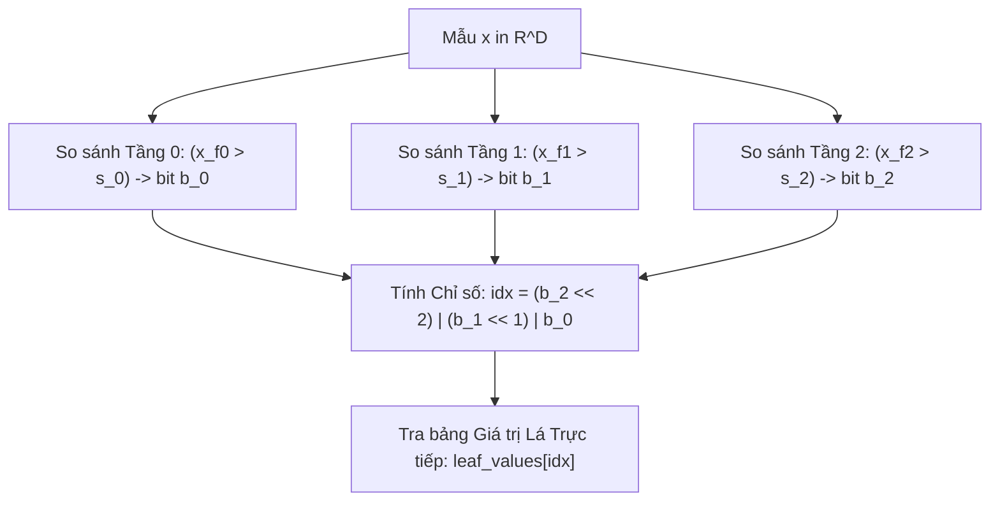
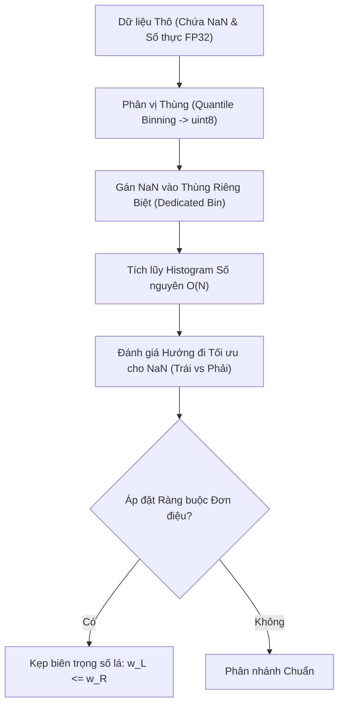
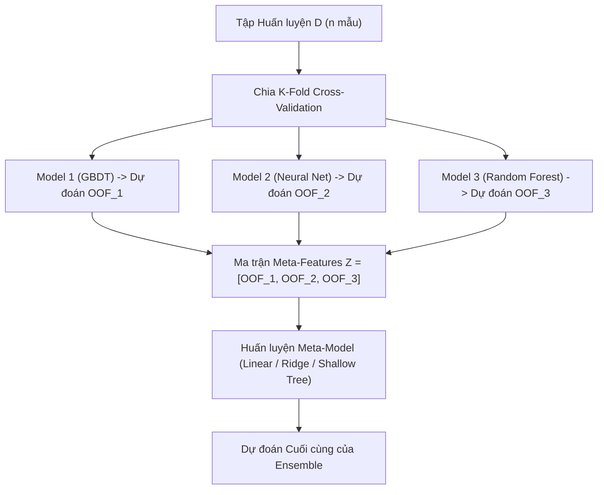

# Chuyên đề: Thuật toán Tăng cường & GBDT (Boosting Algorithms & GBDT)

## 1. Tổng quan Chuyên đề
Trong khi Bagging giảm thiểu phương sai bằng cách huấn luyện song song các mô hình độc lập, họ thuật toán **Tăng cường (Boosting)** giải quyết bài toán học máy theo triết lý ngược lại: xây dựng một chuỗi các mô hình học yếu (Weak Learners) tuần tự, trong đó mỗi mô hình sau tập trung sửa chữa các sai lầm của các mô hình đi trước.

Khởi nguồn từ câu hỏi lý thuyết nền tảng của Kearns & Valiant (1988) về việc liệu một bộ học yếu có thể chuyển đổi thành một bộ học mạnh (Strong Learner) hay không, Schapire (1990) và Freund (1997) đã phát minh ra **AdaBoost**. Sau đó, Jerome Friedman (2001) đã tổng quát hóa Boosting thành bài toán tối ưu hóa Gradient Descent trên không gian hàm (Gradient Boosting Machine - GBM).

Kỷ nguyên hiện đại chứng kiến sự thống trị tuyệt đối của **Gradient Boosted Decision Trees (GBDT)** trên dữ liệu dạng bảng (Tabular Data) với bộ ba hoàn hảo:
1. **XGBoost** (Chen & Guestrin, 2016): Khai triển Taylor bậc 2 và điều chuẩn phức tạp cây.
2. **LightGBM** (Ke et al., 2017): Thuật toán Histogram, lấy mẫu GOSS và ghép đặc trưng EFB.
3. **CatBoost** (Prokhorenkova et al., 2018): Xử lý biến phân loại bằng Ordered Target Statistics và Cây đối xứng (Oblivious Trees) không rẽ nhánh điều kiện.

Cuối cùng, các kỹ thuật kết hợp đa tầng như **Voting**, **Blending** và **Stacking** (Wolpert, 1992) hoàn thiện bức tranh về các hệ thống học máy tập hợp hiệu năng cao.



---

## 2. Chi tiết từng Keyword

---

### 1. Boosting (Học tăng cường kết hợp)

#### a. Định nghĩa Bản chất Toán học (Mathematical Formulation)
Được định nghĩa trong khuôn khổ PAC-Learning (Kearns & Valiant 1988, Schapire 1990):
- **Weak Learner (Bộ học yếu)**: Thuật toán học có khả năng tạo ra giả thuyết $h$ có sai số nhỏ hơn đoán mò ngẫu nhiên một lượng $\gamma > 0$: $\epsilon(h) \le \frac{1}{2} - \gamma$.
- **Strong Learner (Bộ học mạnh)**: Thuật toán học có khả năng tạo ra giả thuyết đạt sai số tùy ý nhỏ $\epsilon > 0$ với độ tin cậy $1 - \delta$.

Định lý Tương đương PAC (Schapire 1990): Khái niệm khả học yếu (Weakly Learnable) tương đương hoàn toàn với khả học mạnh (Strongly Learnable).

Mô hình Cộng tính Tổng quát (Additive Modeling):
Boosting xây dựng nghiệm dự báo dưới dạng tổ hợp tuyến tính của $M$ mô hình cơ sở $h_m(\mathbf{x}) \in \mathcal{H}$:
$$F_M(\mathbf{x}) = \sum_{m=1}^M \alpha_m h_m(\mathbf{x})$$
trong đó $\alpha_m \in \mathbb{R}$ là trọng số đóng góp của mô hình thứ $m$.

Quy trình Học Tuần tự Chuyển dịch Phân phối:
Tại mỗi bước $m$, phân phối trọng số của dữ liệu huấn luyện $\mathcal{D}_m$ bị biến đổi để tập trung xác suất vào các mẫu mà mô hình trước $F_{m-1}(\mathbf{x})$ dự đoán sai. Khác với Bagging (triệt tiêu phương sai), Boosting là **thuật toán triệt tiêu độ chệch (Bias Reduction)** mạnh mẽ nhất, biến các mô hình có bias cao (như Decision Stumps) thành mô hình có dung lượng biểu diễn cực lớn.

#### b. Cơ chế Tầng Sâu & Điện toán (Under The Hood / Hardware Internals)
- **Tính tuần tự nghiêm ngặt (Sequential Constraint)**:
  Do mô hình thứ $m$ bắt buộc phải đợi kết quả dự đoán và phần dư của mô hình $m-1$, việc song song hóa liên mô hình (Inter-model Parallelism) là bất khả thi.
- **Song song hóa trong lòng cây (Intra-tree Parallelism)**:
  Để tận dụng kiến trúc CPU đa nhân và GPU, toàn bộ nỗ lực tính toán được dồn vào việc song song hóa tìm kiếm phân nhánh trên không gian đặc trưng và dữ liệu mẫu (SIMD, Histogram accumulation, GPU Warp reduction).

#### c. Sơ đồ Minh họa (Mermaid Diagram)


#### d. Code Thực chiến (Dual-Engine: C++ & Python)

```cpp
// C++20: Mô phỏng Khung Học Tăng Cường Cộng tính Tổng quát
#include <iostream>
#include <vector>
#include <numeric>

struct SimpleWeakLearner {
    float threshold;
    float alpha;
    int feature_idx;

    float predict(const std::vector<float>& x) const {
        return (x[feature_idx] > threshold) ? 1.0f : -1.0f;
    }
};

class GeneralBoostingFramework {
private:
    std::vector<SimpleWeakLearner> ensemble;

public:
    void add_learner(SimpleWeakLearner learner) {
        ensemble.push_back(learner);
    }

    float forward(const std::vector<float>& x) const {
        float total = 0.0f;
        for (const auto& h : ensemble) {
            total += h.alpha * h.predict(x);
        }
        return total;
    }
};

int main() {
    GeneralBoostingFramework boost;
    boost.add_learner({0.5f, 0.8f, 0});
    boost.add_learner({-0.2f, 0.5f, 0});
    std::vector<float> sample = {0.8f};
    std::cout << "[C++ Boosting] Ensemble Prediction: " << boost.forward(sample) << "\n";
    return 0;
}
```

```python
# Python: Minh họa Cơ chế Triệt tiêu Bias tuần tự của Boosting
import numpy as np

def simulate_bias_reduction():
    # Dữ liệu mục tiêu dạng sóng sin
    x = np.linspace(0, 1, 20)
    y = np.sin(2 * np.pi * x)

    f = np.zeros_like(x)
    print("[Boosting Sequential Residual Fitting]")
    for m in range(1, 4):
        # Tính phần dư
        residual = y - f
        # Weak learner cực đơn giản: Khớp hàm bậc thang theo dấu của phần dư
        h = 0.5 * np.sign(residual)
        f += h
        mse = np.mean((y - f) ** 2)
        print(f"Step {m}: MSE = {mse:.4f}")

if __name__ == "__main__":
    simulate_bias_reduction()
```

#### e. Lỗi Thường gặp & Ổn định Số học (Pitfalls & Numerical Stability)
- **Khuếch đại Nhiễu và Ngoại lai (Outlier Vulnerability)**: Vì Boosting liên tục tăng trọng số cho các mẫu dự đoán sai, những điểm dữ liệu bị gán nhãn sai (Label Noise) hoặc ngoại lai sẽ tích lũy trọng số khổng lồ, khiến các cây phía sau bị kéo lệch hoàn toàn để khớp vào điểm nhiễu.

#### f. Ứng dụng Thực chiến trong AI / Deep Learning (AI Applications)
- **High-Frequency Trading & Competitive Data Science**: Boosting là động cơ cốt lõi sinh lợi nhuận trong giao dịch tài chính tần suất cao và đoạt giải vàng tại hơn 70% các cuộc thi Kaggle trên dữ liệu dạng bảng.

---

### 2. AdaBoost (Adaptive Boosting)

#### a. Định nghĩa Bản chất Toán học (Mathematical Formulation)
Được phát minh bởi Freund & Schapire (1997), AdaBoost sử dụng hàm mất mát hàm mũ (Exponential Loss) cho bài toán phân loại nhị phân $y_i \in \{-1, +1\}$:
$$\mathcal{L}_{\exp}(y, F(\mathbf{x})) = \exp(-y F(\mathbf{x}))$$

Thuật toán AdaBoost.M1 Chuẩn tắc:
1. Khởi tạo phân phối trọng số đều trên $n$ mẫu: $w_i^{(1)} = \frac{1}{n}, \forall i = 1, \dots, n$.
2. Với mỗi vòng lặp $m = 1, \dots, M$:
   - Huấn luyện bộ học yếu $h_m(\mathbf{x}) \in \{-1, +1\}$ cực tiểu hóa sai số có trọng số:
     $$\epsilon_m = \sum_{i=1}^n w_i^{(m)} \mathbb{I}(y_i \ne h_m(\mathbf{x}_i))$$
   - Nếu $\epsilon_m \ge \frac{1}{2}$, dừng thuật toán.
   - Tính hệ số tin cậy $\alpha_m$ của mô hình:
     $$\alpha_m = \frac{1}{2} \ln \left( \frac{1 - \epsilon_m}{\epsilon_m} \right)$$
     (Nếu $\epsilon_m \to 0 \implies \alpha_m \to +\infty$; nếu $\epsilon_m = \frac{1}{2} \implies \alpha_m = 0$).
   - Cập nhật phân phối trọng số mẫu:
     $$w_i^{(m+1)} = \frac{w_i^{(m)} \exp(-\alpha_m y_i h_m(\mathbf{x}_i))}{Z_m}$$
     trong đó $Z_m = \sum_{i=1}^n w_i^{(m)} \exp(-\alpha_m y_i h_m(\mathbf{x}_i))$ là hằng số chuẩn hóa.
3. Dự đoán cuối cùng:
   $$F_M(\mathbf{x}) = \text{sign}\left( \sum_{m=1}^M \alpha_m h_m(\mathbf{x}) \right)$$

Định lý Cận Sai số Huấn luyện của AdaBoost:
$$R_{\text{emp}}(F_M) = \frac{1}{n} \sum_{i=1}^n \mathbb{I}(y_i \ne F_M(\mathbf{x}_i)) \le \prod_{m=1}^M Z_m = \prod_{m=1}^M 2 \sqrt{\epsilon_m (1 - \epsilon_m)}$$
Đặt $\gamma_m = \frac{1}{2} - \epsilon_m > 0$. Ta có:
$$2 \sqrt{\epsilon_m (1 - \epsilon_m)} = \sqrt{1 - 4\gamma_m^2} \le \exp(-2\gamma_m^2)$$
$$\implies R_{\text{emp}}(F_M) \le \exp\left( -2 \sum_{m=1}^M \gamma_m^2 \right)$$
Chứng minh rằng sai số huấn luyện giảm **theo hàm mũ** theo số vòng lặp $M$.

Lý thuyết Độ rộng Lề (Margin Theory - Schapire et al., 1998):
Định nghĩa lề của mẫu $(\mathbf{x}_i, y_i)$ là: $m_F(\mathbf{x}_i, y_i) = \frac{y_i \sum \alpha_m h_m(\mathbf{x}_i)}{\sum \alpha_m} \in [-1, +1]$. Ngay cả sau khi sai số huấn luyện đã chạm $0$, việc tiếp tục chạy AdaBoost vẫn tiếp tục làm tăng độ rộng lề $\min_i m_F(\mathbf{x}_i, y_i)$, giải thích tại sao AdaBoost chống quá khớp tốt bất ngờ trên dữ liệu ít nhiễu.

#### b. Cơ chế Tầng Sâu & Điện toán (Under The Hood / Hardware Internals)
- **Tối ưu Hóa Chuẩn hóa Trọng số qua SIMD**:
  Bước cập nhật trọng số đòi hỏi tính $\exp(-\alpha y_i h_m(\mathbf{x}_i))$.
  Vì $y_i h_m(\mathbf{x}_i) \in \{-1, +1\}$, số mũ chỉ nhận đúng 2 giá trị rời rạc:
  $$c_{\text{correct}} = e^{-\alpha_m}, \quad c_{\text{wrong}} = e^{\alpha_m}$$
  Phần cứng CPU hoàn toàn **không cần tính hàm `std::exp` $n$ lần**. Chỉ cần tính sẵn hai hằng số này một lần duy nhất, sau đó dùng lệnh nhân có điều kiện (Blend / FMA) để nhân $w_i$ với $c_{\text{correct}}$ hoặc $c_{\text{wrong}}$, đạt thông lượng tối đa của thanh ghi AVX2.

#### c. Sơ đồ Minh họa (Mermaid Diagram)


#### d. Code Thực chiến (Dual-Engine: C++ & Python)

```cpp
// C++20: AdaBoost.M1 hoàn chỉnh với Decision Stumps và Vector hóa Trọng số
#include <iostream>
#include <vector>
#include <cmath>
#include <numeric>

struct DecisionStumpClassifier {
    size_t feature_idx{0};
    float threshold{0.0f};
    int polarity{1}; // 1 nếu x > threshold là +1; -1 nếu ngược lại

    int predict(const std::vector<float>& x) const {
        return ((x[feature_idx] > threshold) ? 1 : -1) * polarity;
    }
};

class AdaBoostEngine {
private:
    std::vector<DecisionStumpClassifier> stumps;
    std::vector<double> alphas;

public:
    void fit(const std::vector<std::vector<float>>& X,
             const std::vector<int>& y,
             size_t num_iters = 10) {
        size_t n = X.size();
        size_t d = X[0].size();
        std::vector<double> w(n, 1.0 / n);

        for (size_t iter = 0; iter < num_iters; ++iter) {
            // 1. Tìm Stump tốt nhất trên trọng số w
            DecisionStumpClassifier best_stump;
            double min_error = 1.0;

            for (size_t j = 0; j < d; ++j) {
                for (size_t i = 0; i < n; ++i) {
                    float thresh = X[i][j];
                    for (int pol : {1, -1}) {
                        DecisionStumpClassifier stump{j, thresh, pol};
                        double err = 0.0;
                        for (size_t k = 0; k < n; ++k) {
                            if (stump.predict(X[k]) != y[k]) err += w[k];
                        }
                        if (err < min_error) {
                            min_error = err;
                            best_stump = stump;
                        }
                    }
                }
            }

            if (min_error >= 0.5 || min_error < 1e-12) break;

            // 2. Tính alpha_m = 0.5 * ln((1 - err) / err)
            double alpha = 0.5 * std::log((1.0 - min_error) / min_error);
            stumps.push_back(best_stump);
            alphas.push_back(alpha);

            // 3. Cập nhật và chuẩn hóa trọng số w
            double Z = 0.0;
            double c_corr = std::exp(-alpha);
            double c_wrong = std::exp(alpha);

            for (size_t i = 0; i < n; ++i) {
                int pred = best_stump.predict(X[i]);
                w[i] *= (pred == y[i]) ? c_corr : c_wrong;
                Z += w[i];
            }
            for (size_t i = 0; i < n; ++i) w[i] /= Z;
        }
    }

    int predict(const std::vector<float>& x) const {
        double total = 0.0;
        for (size_t m = 0; m < stumps.size(); ++m) {
            total += alphas[m] * stumps[m].predict(x);
        }
        return (total >= 0.0) ? 1 : -1;
    }
};

int main() {
    std::vector<std::vector<float>> X = {{1.0f}, {2.0f}, {3.0f}, {4.0f}, {5.0f}};
    std::vector<int> y = {-1, -1, 1, 1, 1};
    AdaBoostEngine adaboost;
    adaboost.fit(X, y, 5);
    std::cout << "[C++ AdaBoost] Predict for x=2.5: " << adaboost.predict({2.5f}) << "\n";
    return 0;
}
```

```python
# Python / Scikit-Learn: AdaBoostClassifier và Trực quan hóa Trọng số Mô hình
from sklearn.ensemble import AdaBoostClassifier
from sklearn.tree import DecisionTreeClassifier
import numpy as np

def run_adaboost_inspection():
    X = np.array([[1.0], [2.0], [3.0], [4.0], [5.0]])
    y = np.array([-1, -1, 1, 1, 1])

    ada = AdaBoostClassifier(
        estimator=DecisionTreeClassifier(max_depth=1),
        n_estimators=5,
        algorithm='SAMME',
        random_state=42
    )
    ada.fit(X, y)

    print(f"[AdaBoost Estimator Weights (alphas)]:\n{ada.estimator_weights_}")
    print(f"[AdaBoost Estimator Errors]:\n{ada.estimator_errors_}")
    print(f"[Prediction for x=2.5]: {ada.predict([[2.5]])[0]}")

if __name__ == "__main__":
    run_adaboost_inspection()
```

#### e. Lỗi Thường gặp & Ổn định Số học (Pitfalls & Numerical Stability)
- **Bùng nổ Hệ số Alpha khi $\epsilon_m \to 0$**: Nếu một weak learner phân loại chính xác 100% mẫu, $\epsilon_m = 0 \implies \alpha_m \to +\infty$. Trong mã nguồn thực tế, bắt buộc phải kẹp biên sai số $\epsilon_m \leftarrow \max(\epsilon_m, 10^{-15})$ để tránh sinh số thực `Inf`.

#### f. Ứng dụng Thực chiến trong AI / Deep Learning (AI Applications)
- **Thuật toán Nhận diện Khuôn mặt Viola-Jones (2001)**: Khung phát hiện mặt người thời gian thực đầu tiên trên thế giới chạy trên camera kỹ thuật số sử dụng AdaBoost để lọc qua hàng ngàn đặc trưng Haar-like qua kiến trúc phân tầng (Cascaded Classifier).

---

### 3. Gradient Boosting (Gradient Boosting Machine - GBM)

#### a. Định nghĩa Bản chất Toán học (Mathematical Formulation)
Được đề xuất bởi Jerome Friedman (2001), Gradient Boosting tổng quát hóa ý tưởng Boosting cho **mọi hàm mất mát khả vi tùy ý** $\mathcal{L}(y, F(\mathbf{x}))$.

Góc nhìn Tối ưu hóa trên Không gian Hàm (Functional Gradient Descent):
Mục tiêu là cực tiểu hóa hàm sai số kỳ vọng thực nghiệm:
$$\min_{F} \mathcal{J}(F) = \sum_{i=1}^n \mathcal{L}(y_i, F(\mathbf{x}_i))$$
Coi vector giá trị dự đoán $\mathbf{f} = [F(\mathbf{x}_1), \dots, F(\mathbf{x}_n)]^T \in \mathbb{R}^n$ như các biến tham số cần tối ưu. Theo thuật toán Gradient Descent:
$$\mathbf{f}^{(m)} = \mathbf{f}^{(m-1)} - \rho_m \mathbf{g}_m$$
trong đó vector gradient âm (Negative Gradient / Pseudo-Residuals) có phần tử thứ $i$:
$$r_{im} = - \left[ \frac{\partial \mathcal{L}(y_i, F(\mathbf{x}_i))}{\partial F(\mathbf{x}_i)} \right]_{F(\mathbf{x}) = F_{m-1}(\mathbf{x})}$$

Vì mô hình chỉ quan sát được gradient tại $n$ điểm huấn luyện, ta ép mô hình tổng quát hóa ra toàn không gian bằng cách **huấn luyện cây quyết định cơ sở $h_m(\mathbf{x})$ để khớp vào vector phần dư $r_{im}$** thông qua phương pháp bình phương tối thiểu:
$$h_m = \arg\min_{h \in \mathcal{H}} \sum_{i=1}^n (r_{im} - h(\mathbf{x}_i))^2$$

Cập nhật Mô hình với Thu nhỏ Bước học (Shrinkage / Learning Rate):
$$F_m(\mathbf{x}) = F_{m-1}(\mathbf{x}) + \eta \gamma_m h_m(\mathbf{x})$$
trong đó:
- $\gamma_m$: Bước nhảy tối ưu tìm được qua Line Search: $\arg\min_\gamma \sum_{i=1}^n \mathcal{L}(y_i, F_{m-1}(\mathbf{x}_i) + \gamma h_m(\mathbf{x}_i))$.
- $\eta \in (0, 1]$: Tốc độ học (Shrinkage parameter) đóng vai trò điều chuẩn kiểm soát overfitting.

Bảng Đối sánh Pseudo-Residuals của các Hàm Mất mát Phổ biến:
- Bình phương Sai số (MSE - Hồi quy): $\mathcal{L} = \frac{1}{2}(y - F)^2 \implies r = y - F$ (chính là phần dư thuần túy).
- Trị Tuyệt đối (MAE - Hồi quy Bền vững): $\mathcal{L} = |y - F| \implies r = \text{sign}(y - F)$ (chỉ lấy dấu, chống ngoại lai).
- Binary Deviance / Cross-Entropy (Phân loại Logit): $\mathcal{L} = - [y \ln p + (1-y)\ln(1-p)] \implies r = y - \sigma(F) = y - p$.

#### b. Cơ chế Tầng Sâu & Điện toán (Under The Hood / Hardware Internals)
- **Tối ưu Tính toán Pseudo-Residuals trên Cache Line**:
  Mảng phần dư $r \in \mathbb{R}^n$ được cấp phát liên tục trong RAM. Tại mỗi vòng lặp, CPU quét qua mảng dự đoán $\hat{y}$ và nhãn $y$, tính toán $r_i$ qua SIMD FMA và ghi trực tiếp vào L1 Cache để chuyển giao làm đầu vào cho thuật toán phân nhánh cây con mà không gây round-trip DRAM.

#### c. Sơ đồ Minh họa (Mermaid Diagram)


#### d. Code Thực chiến (Dual-Engine: C++ & Python)

```cpp
// C++20: Gradient Boosting Regressor (MSE Loss) Tầng Thấp
#include <iostream>
#include <vector>
#include <numeric>

struct SimpleStumpRegression {
    size_t feat_idx;
    float split_val;
    float left_val;
    float right_val;

    float predict(const std::vector<float>& x) const {
        return (x[feat_idx] <= split_val) ? left_val : right_val;
    }
};

class GradientBoostingRegressorEngine {
private:
    float base_pred{0.0f};
    std::vector<SimpleStumpRegression> trees;
    float learning_rate;

public:
    explicit GradientBoostingRegressorEngine(float lr = 0.1f) : learning_rate(lr) {}

    void fit(const std::vector<std::vector<float>>& X,
             const std::vector<float>& y,
             size_t num_trees = 5) {
        size_t n = X.size();
        float sum_y = 0.0f;
        for (float val : y) sum_y += val;
        base_pred = sum_y / n; // F_0(x) = mean(y)

        std::vector<float> curr_pred(n, base_pred);
        std::vector<float> residuals(n, 0.0f);

        for (size_t t = 0; t < num_trees; ++t) {
            // 1. Tính Pseudo-residuals: r_i = y_i - F(x_i)
            for (size_t i = 0; i < n; ++i) residuals[i] = y[i] - curr_pred[i];

            // 2. Khớp Stump tối giản lên residual
            SimpleStumpRegression stump{0, 2.5f, 0.0f, 0.0f};
            float sum_l = 0.0f, sum_r = 0.0f;
            size_t count_l = 0, count_r = 0;

            for (size_t i = 0; i < n; ++i) {
                if (X[i][0] <= stump.split_val) { sum_l += residuals[i]; count_l++; }
                else { sum_r += residuals[i]; count_r++; }
            }
            stump.left_val = (count_l > 0) ? (sum_l / count_l) : 0.0f;
            stump.right_val = (count_r > 0) ? (sum_r / count_r) : 0.0f;

            trees.push_back(stump);

            // 3. Cập nhật dự đoán
            for (size_t i = 0; i < n; ++i) {
                curr_pred[i] += learning_rate * stump.predict(X[i]);
            }
        }
    }

    float predict(const std::vector<float>& x) const {
        float res = base_pred;
        for (const auto& t : trees) res += learning_rate * t.predict(x);
        return res;
    }
};

int main() {
    std::vector<std::vector<float>> X = {{1.0f}, {2.0f}, {3.0f}, {4.0f}};
    std::vector<float> y = {2.0f, 4.0f, 6.0f, 8.0f};
    GradientBoostingRegressorEngine gbm(0.5f);
    gbm.fit(X, y, 10);
    std::cout << "[C++ GBM] Prediction for x=3.5: " << gbm.predict({3.5f}) << "\n";
    return 0;
}
```

```python
# Python / Scikit-Learn: GradientBoostingClassifier với Staged Predict
from sklearn.ensemble import GradientBoostingClassifier
import numpy as np

def run_gbm_staged():
    X = np.random.randn(100, 4)
    y = (X[:, 0] * 2 - X[:, 1] > 0).astype(int)

    gbm = GradientBoostingClassifier(n_estimators=30, learning_rate=0.1, random_state=42)
    gbm.fit(X, y)

    # staged_predict cho phép theo dõi sai số suy quát qua từng bước Boosting
    staged_acc = [np.mean(y == pred) for pred in gbm.staged_predict(X)]
    print(f"[GBM Training Progress] Initial Acc: {staged_acc[0]*100:.1f}% -> Final Acc: {staged_acc[-1]*100:.1f}%")

if __name__ == "__main__":
    run_gbm_staged()
```

#### e. Lỗi Thường gặp & Ổn định Số học (Pitfalls & Numerical Stability)
- **Tốc độ học quá lớn mà không có Early Stopping**: Nếu $\eta = 1.0$, GBM sẽ bị dao động và bùng nổ phương sai sau vài chục cây. Luôn giữ $\eta \le 0.1$ và đi kèm bộ kiểm soát dừng sớm (Early Stopping) dựa trên tập Validation.

#### f. Ứng dụng Thực chiến trong AI / Deep Learning (AI Applications)
- **Hệ thống Xếp hạng Tìm kiếm (Learning to Rank - LambdaMART)**: Động cơ xếp hạng trang web của Bing và Yahoo sử dụng chính Gradient Boosting trên hàm mất mát LambdaRank để tối ưu trực tiếp chỉ số NDCG.

---

### 4. XGBoost (Extreme Gradient Boosting)

#### a. Định nghĩa Bản chất Toán học (Mathematical Formulation)
Được phát triển bởi Tianqi Chen & Carlos Guestrin (2016), XGBoost thực hiện bước nhảy vọt về mặt toán học thông qua **Khai triển Taylor Bậc 2** của hàm mục tiêu tổng thể:
$$\mathcal{L}^{(t)} = \sum_{i=1}^n \mathcal{L}\left(y_i, \hat{y}_i^{(t-1)} + f_t(\mathbf{x}_i)\right) + \Omega(f_t)$$

Hàm Điều chuẩn Độ phức tạp Cây:
$$\Omega(f_t) = \gamma T + \frac{1}{2} \lambda \sum_{j=1}^T w_j^2$$
- $T$: Số lượng nút lá của cây thứ $t$.
- $w_j$: Giá trị dự đoán (trọng số) tại lá thứ $j$.
- $\gamma$: Ngưỡng phạt tối thiểu để tạo thêm một lá mới (Pruning threshold).
- $\lambda$: Hệ số điều chuẩn $L_2$ trên trọng số lá.

Khai triển Taylor Bậc 2 tại điểm $\hat{y}_i^{(t-1)}$:
$$\mathcal{L}^{(t)} \approx \sum_{i=1}^n \left[ \mathcal{L}(y_i, \hat{y}_i^{(t-1)}) + g_i f_t(\mathbf{x}_i) + \frac{1}{2} h_i f_t^2(\mathbf{x}_i) \right] + \gamma T + \frac{1}{2} \lambda \sum_{j=1}^T w_j^2$$
trong đó đạo hàm bậc nhất ($g_i$) và bậc hai ($h_i$ - Hessian):
$$g_i = \left[ \frac{\partial \mathcal{L}(y_i, \hat{y})}{\partial \hat{y}} \right]_{\hat{y} = \hat{y}_i^{(t-1)}}, \quad h_i = \left[ \frac{\partial^2 \mathcal{L}(y_i, \hat{y})}{\partial \hat{y}^2} \right]_{\hat{y} = \hat{y}_i^{(t-1)}}$$

Gom nhóm theo các mẫu thuộc về từng nút lá $I_j = \{i \mid q(\mathbf{x}_i) = j\}$:
$$\tilde{\mathcal{L}}^{(t)} = \sum_{j=1}^T \left[ \left( \sum_{i \in I_j} g_i \right) w_j + \frac{1}{2} \left( \sum_{i \in I_j} h_i + \lambda \right) w_j^2 \right] + \gamma T$$
Đặt $G_j = \sum_{i \in I_j} g_i$ và $H_j = \sum_{i \in I_j} h_i$. Đạo hàm theo $w_j$ và triệt tiêu:
$$w_j^* = - \frac{G_j}{H_j + \lambda}$$

Điểm Số Chất lượng Cấu trúc Cây Tối ưu:
$$\mathcal{L}^*(q) = - \frac{1}{2} \sum_{j=1}^T \frac{G_j^2}{H_j + \lambda} + \gamma T$$

Công thức Độ Tăng Lợi ích Phân nhánh (Split Gain Formula):
Khi phân chia một lá thành hai nút con Trái ($L$) và Phải ($R$):
$$\text{Gain} = \frac{1}{2} \left[ \frac{G_L^2}{H_L + \lambda} + \frac{G_R^2}{H_R + \lambda} - \frac{(G_L + G_R)^2}{H_L + H_R + \lambda} \right] - \gamma$$
Nếu $\text{Gain} \le 0$, thuật toán tự động cắt tỉa phân nhánh này.

#### b. Cơ chế Tầng Sâu & Điện toán (Under The Hood / Hardware Internals)
- **Cấu trúc Khối Bộ nhớ Dạng Cột (Column Block Structure)**:
  Dữ liệu được lưu trữ trong bộ nhớ dưới dạng nén theo cột (CSC layout), sắp xếp sẵn theo giá trị đặc trưng.
- **Bộ nhớ Đệm Cache-Aware Prefetching**:
  Việc tra cứu gradient $g_i, h_i$ theo chỉ số phân tán sau khi sort cột gây ra lỗi non-continuous memory access. XGBoost cấp phát một bộ đệm vòng cục bộ (Thread-local Ring Buffer) để nạp trước (prefetch) gradient vào Cache L1/L2, giảm thiểu độ trễ truy xuất dữ liệu từ DRAM lên tới 50%.

#### c. Sơ đồ Minh họa (Mermaid Diagram)


#### d. Code Thực chiến (Dual-Engine: C++ & Python)

```cpp
// C++20: Tính toán Trọng số Lá và Split Gain theo Chuẩn Toán học XGBoost
#include <iostream>
#include <vector>
#include <numeric>

struct XGBoostSplitMetrics {
    double left_weight;
    double right_weight;
    double gain;
};

XGBoostSplitMetrics evaluate_xgboost_split(double GL, double HL,
                                           double GR, double HR,
                                           double lambda, double gamma) {
    auto calc_score = [lambda](double G, double H) {
        return (G * G) / (H + lambda);
    };

    double score_L = calc_score(GL, HL);
    double score_R = calc_score(GR, HR);
    double score_parent = calc_score(GL + GR, HL + HR);

    double gain = 0.5 * (score_L + score_R - score_parent) - gamma;
    double w_L = -GL / (HL + lambda);
    double w_R = -GR / (HR + lambda);

    return {w_L, w_R, gain};
}

int main() {
    double GL = -10.5, HL = 15.0; // Nút trái
    double GR = 8.2, HR = 12.0;   // Nút phải
    double lambda = 1.0, gamma = 0.5;

    auto res = evaluate_xgboost_split(GL, HL, GR, HR, lambda, gamma);
    std::cout << "[C++ XGBoost] Split Gain: " << res.gain << "\n";
    std::cout << "[C++ XGBoost] Optimal Leaf Weights: w_L=" << res.left_weight << " | w_R=" << res.right_weight << "\n";
    return 0;
}
```

```python
# Python / XGBoost: Huấn luyện với Custom Objective (Khai triển Taylor g và h)
import xgboost as xgb
import numpy as np

def custom_mse_objective(preds: np.ndarray, dtrain: xgb.DMatrix):
    labels = dtrain.get_label()
    # Gradient bậc 1: g = preds - labels
    grad = preds - labels
    # Hessian bậc 2: h = 1.0 (cho hàm MSE)
    hess = np.ones_like(preds)
    return grad, hess

def run_xgboost_custom():
    X = np.random.randn(200, 5)
    y = X[:, 0] * 3.0 + np.random.randn(200) * 0.1
    dtrain = xgb.DMatrix(X, label=y)

    params = {'learning_rate': 0.1, 'max_depth': 3, 'reg_lambda': 1.0}
    bst = xgb.train(params, dtrain, num_boost_round=10, obj=custom_mse_objective)
    print(f"[XGBoost Custom Objective Trained] Model Dump:\n{bst.get_dump()[0][:150]}...")

if __name__ == "__main__":
    run_xgboost_custom()
```

#### e. Lỗi Thường gặp & Ổn định Số học (Pitfalls & Numerical Stability)
- **Hessian bằng 0 hoặc âm ($H_j \le 0$)**: Mẫu số của công thức trọng số lá là $H_j + \lambda$. Với các hàm mất mát tùy biến (Custom Loss), nếu $h_i \le 0$ (hàm mất mát không lồi), mẫu số có thể triệt tiêu hoặc âm, làm đảo ngược dấu gradient. Luôn kiểm tra điều kiện $h_i > 0$ và đảm bảo $\lambda > 0$.

#### f. Ứng dụng Thực chiến trong AI / Deep Learning (AI Applications)
- **Tiêu chuẩn Vàng cho Dữ liệu Bảng Sản xuất**: Được triển khai tại Uber để ước tính thời gian giao hàng (Uber Eats ETA) và phát hiện giao dịch bất thường tại các cổng thanh toán Stripe/Adyen.

---

### 5. LightGBM (Light Gradient Boosting Machine)

#### a. Định nghĩa Bản chất Toán học (Mathematical Formulation)
Được phát triển bởi Microsoft Research (Ke et al., 2017), LightGBM giải quyết nút thắt cổ chai về tốc độ của GBDT bằng 4 đổi mới toán học và kiến trúc mang tính đột phá:

1. **GOSS (Gradient-based One-Side Sampling)**:
   Các mẫu có gradient lớn đóng góp nhiều hơn cho việc giảm sai số. GOSS sắp xếp các mẫu theo giá trị tuyệt đối của gradient $|g_i|$:
   - Giữ lại top $a \times 100\%$ các mẫu có gradient lớn nhất (tập $A$).
   - Rút ngẫu nhiên một tỷ lệ $b \times 100\%$ từ các mẫu có gradient nhỏ còn lại (tập $B$).
   - Để bù đắp cho việc thay đổi phân phối, nhân các mẫu trong $B$ với trọng số khuếch đại:
     $$w_i = \frac{1 - a}{b}, \quad \forall i \in B$$
   Độ tăng thông tin trên tập mẫu rút gọn $A \cup B$:
   $$\tilde{V}_j(d) = \frac{1}{n} \left[ \frac{\left( \sum_{i \in A_L} g_i + \frac{1-a}{b} \sum_{i \in B_L} g_i \right)^2}{n_{L}^j(d)} + \frac{\left( \sum_{i \in A_R} g_i + \frac{1-a}{b} \sum_{i \in B_R} g_i \right)^2}{n_{R}^j(d)} \right]$$
   Định lý GOSS chứng minh: Sai số xấp xỉ của ước lượng gradient được chặn trên với xác suất cao, giúp giảm kích thước dữ liệu từ 5 đến 10 lần mà hầu như không suy giảm độ chính xác.

2. **EFB (Exclusive Feature Bundling)**:
   Trong dữ liệu thưa, nhiều đặc trưng không bao giờ nhận giá trị khác 0 cùng lúc (ví dụ các cột One-Hot). EFB gom nhóm các đặc trưng loại trừ lẫn nhau thành một đặc trưng dày đặc duy nhất bằng bài toán Tô màu Đồ thị (Graph Coloring), giảm số lượng đặc trưng cần quét.

3. **Chiến lược Phát triển Cây Leaf-wise (Best-First)**:
   Thay vì phát triển đồng mức (Level-wise) như XGBoost, LightGBM luôn chọn **nút lá có Delta Loss giảm nhiều nhất** để phân nhánh tiếp, tạo ra cấu trúc cây sâu bất đối xứng với sai số thấp hơn ở cùng số lượng lá.

#### b. Cơ chế Tầng Sâu & Điện toán (Under The Hood / Hardware Internals)
- **Kỹ thuật Histogram uint8 và Phép trừ Histogram (Histogram Subtraction Trick)**:
  Rời rạc hóa toàn bộ các giá trị liên tục thành 256 thùng (bins), biểu diễn bằng số nguyên không dấu 1 byte `uint8_t`. Bộ nhớ giảm 4 lần so với FP32.
- **Phép trừ Histogram kỳ diệu**: Sau khi đã xây dựng histogram cho nút cha $H_{\text{parent}}$ và nút con trái $H_{\text{left}}$, histogram của nút con phải được tính **ngay lập tức** qua phép trừ đơn giản:
  $$H_{\text{right}} = H_{\text{parent}} - H_{\text{left}}$$
  Giảm chính xác **50% chi phí tính toán** xây dựng histogram trên toàn bộ cây.

#### c. Sơ đồ Minh họa (Mermaid Diagram)


#### d. Code Thực chiến (Dual-Engine: C++ & Python)

```cpp
// C++20: Histogram Subtraction Trick tối ưu hóa bộ nhớ uint8
#include <iostream>
#include <vector>
#include <cstdint>

struct HistBin {
    double sum_g{0.0};
    double sum_h{0.0};
};

class HistogramSubtractionEngine {
public:
    static void subtract_histograms(const std::vector<HistBin>& parent,
                                    const std::vector<HistBin>& left,
                                    std::vector<HistBin>& right) {
        size_t num_bins = parent.size();
        right.resize(num_bins);

        for (size_t b = 0; b < num_bins; ++b) {
            right[b].sum_g = parent[b].sum_g - left[b].sum_g;
            right[b].sum_h = parent[b].sum_h - left[b].sum_h;
        }
    }
};

int main() {
    std::vector<HistBin> parent = {{10.0, 5.0}, {20.0, 8.0}};
    std::vector<HistBin> left = {{3.0, 1.5}, {12.0, 4.0}};
    std::vector<HistBin> right;

    HistogramSubtractionEngine::subtract_histograms(parent, left, right);
    std::cout << "[C++ LightGBM Subtraction] Right Bin 0: G=" << right[0].sum_g << ", H=" << right[0].sum_h << "\n";
    std::cout << "[C++ LightGBM Subtraction] Right Bin 1: G=" << right[1].sum_g << ", H=" << right[1].sum_h << "\n";
    return 0;
}
```

```python
# Python / LightGBM: Huấn luyện với cơ chế Leaf-wise và GOSS
import lightgbm as lgb
import numpy as np

def run_lightgbm_demo():
    X = np.random.randn(1000, 20).astype(np.float32)
    y = (X[:, 0] + X[:, 1] * 2.0 > 0).astype(int)

    train_data = lgb.Dataset(X, label=y)
    params = {
        'objective': 'binary',
        'boosting_type': 'goss', # Sử dụng GOSS sampling
        'num_leaves': 31,        # Leaf-wise growth
        'learning_rate': 0.05,
        'verbose': -1
    }

    gbm = lgb.train(params, train_data, num_boost_round=20)
    print(f"[LightGBM GOSS Trained] Trees built: {gbm.num_trees()}")

if __name__ == "__main__":
    run_lightgbm_demo()
```

#### e. Lỗi Thường gặp & Ổn định Số học (Pitfalls & Numerical Stability)
- **Overfitting do Leaf-wise trên tập dữ liệu nhỏ**: Vì chiến lược Leaf-wise có xu hướng phát triển cây rất sâu tại một nhánh duy nhất, trên các tập dữ liệu nhỏ ($n < 1000$), mô hình dễ bị quá khớp cực nặng. Cần giới hạn `max_depth` và nâng cao `min_child_samples`.

#### f. Ứng dụng Thực chiến trong AI / Deep Learning (AI Applications)
- **Hệ thống Đấu giá Quảng cáo Thời gian thực (RTB / Ad-Tech)**: Dự đoán CTR trên hàng tỷ lượt hiển thị quảng cáo mỗi ngày tại Microsoft Bing Ads và Baidu.

---

### 6. CatBoost (Categorical Boosting)

#### a. Định nghĩa Bản chất Toán học (Mathematical Formulation)
Được phát minh bởi Yandex (Prokhorenkova et al., 2018), CatBoost giải quyết hai sai số toán học nghiêm trọng của các thư viện GBDT đi trước:
1. **Target Leakage (Rò rỉ Mục tiêu) trong Xử lý Biến Phân loại**:
   Các phương pháp Target Encoding truyền thống sử dụng giá trị mục tiêu $y_i$ của chính mẫu đó để tính trung bình, làm mô hình bị overfitting nghiêm trọng.
   CatBoost đề xuất **Ordered Target Statistics**: Xáo trộn ngẫu nhiên dữ liệu theo một hoán vị $\sigma = (\sigma_1, \dots, \sigma_n)$. Giá trị mã hóa của mẫu $i$ chỉ được tính dựa trên các mẫu **đứng trước nó trong thứ tự hoán vị**:
   $$\hat{x}_{\sigma_k, j} = \frac{\sum_{r=1}^{k-1} \mathbb{I}(x_{\sigma_r, j} = x_{\sigma_k, j}) y_{\sigma_r} + P \cdot p}{\sum_{r=1}^{k-1} \mathbb{I}(x_{\sigma_r, j} = x_{\sigma_k, j}) + P}$$
   trong đó $p$ là tiên nghiệm toàn cục (Global Prior) và $P$ là trọng số tiên nghiệm.

2. **Dịch chuyển Dự đoán (Prediction Shift) & Ordered Boosting**:
   Việc sử dụng cùng một tập dữ liệu để tính gradient và xây dựng cây sinh ra thiên lệch có điều kiện. CatBoost duy trì các mô hình hỗ trợ riêng biệt được huấn luyện chỉ trên tiền tố của hoán vị để tính toán gradient không chệch.

3. **Cây Đối xứng (Oblivious Trees / Symmetric Trees)**:
   Tại mỗi độ sâu $d$, CatBoost sử dụng **cùng một điều kiện phân nhánh duy nhất** $(j_d, s_d)$ cho toàn bộ các nút ở tầng đó.
   Cây đối xứng hoàn toàn cân bằng với $2^d$ nút lá.

#### b. Cơ chế Tầng Sâu & Điện toán (Under The Hood / Hardware Internals)
- **Đánh giá Cây Siêu Tốc Bằng Lệnh Bitwise (Zero Branch Misprediction)**:
  Vì cấu trúc cây đối xứng, chỉ số nút lá của mẫu $\mathbf{x}$ được tính toán trực tiếp mà **không cần bất kỳ lệnh rẽ nhánh `if-else` nào**:
  $$\text{leaf\_index} = \sum_{d=0}^{D-1} \mathbb{I}(x_{j_d} > s_d) \ll d$$
  Các phép so sánh được vector hóa qua SIMD, chuyển thành mặt nạ bit và dịch bit `<<`. Tránh được 100% hiện tượng Branch Misprediction trên CPU Pipeline, đạt tốc độ suy luận nhanh gấp hàng chục lần so với cây CART thông thường.

#### c. Sơ đồ Minh họa (Mermaid Diagram)


#### d. Code Thực chiến (Dual-Engine: C++ & Python)

```cpp
// C++20: Oblivious Tree Inference bằng Bitwise Operations (Zero Branch Misprediction)
#include <iostream>
#include <vector>
#include <cstdint>

struct ObliviousSplit {
    size_t feature_idx;
    float threshold;
};

class ObliviousTreeEngine {
private:
    std::vector<ObliviousSplit> layer_splits; // Độ sâu D
    std::vector<float> leaf_values;           // 2^D giá trị lá

public:
    ObliviousTreeEngine(std::vector<ObliviousSplit> splits, std::vector<float> leaves)
        : layer_splits(std::move(splits)), leaf_values(std::move(leaves)) {}

    float predict(const std::vector<float>& x) const {
        size_t leaf_idx = 0;
        for (size_t d = 0; d < layer_splits.size(); ++d) {
            // Không dùng if: ép kiểu bool thành bit 0 hoặc 1 và dịch bit
            bool cond = (x[layer_splits[d].feature_idx] > layer_splits[d].threshold);
            leaf_idx |= (static_cast<size_t>(cond) << d);
        }
        return leaf_values[leaf_idx];
    }
};

int main() {
    // Cây đối xứng độ sâu 2 -> 4 lá
    std::vector<ObliviousSplit> splits = {{0, 2.0f}, {1, 5.0f}};
    std::vector<float> leaves = {1.5f, 3.2f, 7.8f, 10.4f};
    ObliviousTreeEngine tree(splits, leaves);

    std::vector<float> sample = {2.5f, 4.0f}; // Cond 0: True (bit 0=1), Cond 1: False (bit 1=0) -> idx = 1
    std::cout << "[C++ CatBoost Oblivious Tree] Prediction: " << tree.predict(sample) << "\n";
    return 0;
}
```

```python
# Python / CatBoost: Tự động Xử lý Biến Phân loại (Categorical Features)
from catboost import CatBoostClassifier, Pool
import numpy as np

def run_catboost_demo():
    # Dữ liệu có đặc trưng phân loại string
    X = [['Hanoi', 25.0], ['Saigon', 30.0], ['Danang', 28.0], ['Hanoi', 22.0]]
    y = [1, 0, 1, 0]
    cat_features = [0] # Cột 0 là Categorical

    train_pool = Pool(X, y, cat_features=cat_features)
    model = CatBoostClassifier(iterations=10, learning_rate=0.2, verbose=False)
    model.fit(train_pool)

    test = [['Hanoi', 24.0]]
    pred = model.predict(test)
    print(f"[CatBoost] Categorical Feature Handled Automatically. Pred for 'Hanoi': {pred[0]}")

if __name__ == "__main__":
    run_catboost_demo()
```

#### e. Lỗi Thường gặp & Ổn định Số học (Pitfalls & Numerical Stability)
- **Bùng nổ Bộ nhớ khi kết hợp Đặc trưng Phân loại (Feature Combinations)**: CatBoost tự động gom cụm các biến phân loại tương tác (Combinations of Categoricals). Nếu có quá nhiều biến danh mục với cardinality lớn, không gian trạng thái tổ hợp bùng nổ làm tràn bộ nhớ RAM hệ thống.

#### f. Ứng dụng Thực chiến trong AI / Deep Learning (AI Applications)
- **Lõi Công cụ Tìm kiếm & Bản đồ Yandex**: Xếp hạng kết quả tìm kiếm web và dự đoán mật độ giao thông Yandex Maps phục vụ hàng trăm triệu người dùng.

---

### 7. HistGradientBoosting (Histogram-based Gradient Boosting)

#### a. Định nghĩa Bản chất Toán học (Mathematical Formulation)
HistGradientBoosting là chuẩn mực triển khai thuật toán GBDT hiện đại được tích hợp trực tiếp vào thư viện chuẩn Scikit-learn (dựa trên cảm hứng từ LightGBM).

Bản chất Rời rạc hóa Histogram:
Với mọi đặc trưng liên tục $\mathbf{x}_{\cdot j}$, một tập hợp $K \le 256$ ngưỡng phân vị (Quantile Cutoffs) $q_1 < q_2 < \dots < q_{K-1}$ được tính toán trước trên tập huấn luyện:
$$\text{bin}(x_{ij}) = \arg\min_{k} \{k \mid x_{ij} \le q_k\}$$
Mỗi giá trị liên tục được ánh xạ thành một số nguyên 8-bit $b \in \{0, 1, \dots, 255\}$.

Xử lý Trực tiếp Giá trị Khuyết thiếu (Native Missing Values Support):
Khác với các mô hình truyền thống yêu cầu điền dữ liệu (Imputation), HistGradientBoosting dành riêng một bin đặc biệt (thường là bin $255$ hoặc giá trị sentinel) cho giá trị `NaN`.
Tại mỗi nút phân nhánh, thuật toán thử nghiệm cả hai phương án: đưa toàn bộ các mẫu missing sang nút con trái hoặc nút con phải, và tự động chọn hướng đi giúp tối đa hóa độ tăng giảm sai số (Gain).

Ràng buộc Đơn điệu (Monotonic Constraints):
Áp đặt điều kiện đạo hàm theo miền: $f(\mathbf{x})$ bắt buộc phải đồng biến hoặc nghịch biến đối với một đặc trưng cụ thể:
$$\frac{\partial F(\mathbf{x})}{\partial x_j} \ge 0 \quad \text{hoặc} \quad \frac{\partial F(\mathbf{x})}{\partial x_j} \le 0$$
Được triển khai toán học bằng cách kẹp biên giá trị trọng số của nút con trái và phải: $w_L \le w_R$.

#### b. Cơ chế Tầng Sâu & Điện toán (Under The Hood / Hardware Internals)
- **Hiệu năng Bộ đệm Cache L1 với Dữ liệu 8-bit**:
  Một mảng $1,000,000$ mẫu với $50$ đặc trưng ở chuẩn FP32 tốn $200$ MB bộ nhớ (vượt xa kích thước L3 Cache, gây nghẽn băng thông RAM).
  Dưới dạng `uint8_t`, toàn bộ tập dữ liệu chỉ tốn $50$ MB. Dữ liệu nén vừa vặn trong L3 Cache của các CPU hiện đại, cho phép các nhân CPU truy cập dữ liệu với độ trễ cực thấp.

#### c. Sơ đồ Minh họa (Mermaid Diagram)


#### d. Code Thực chiến (Dual-Engine: C++ & Python)

```cpp
// C++20: Quantile Histogram Binning Tốc độ cao trên uint8
#include <iostream>
#include <vector>
#include <algorithm>
#include <cstdint>

class QuantileBinner {
private:
    std::vector<float> thresholds; // Tối đa 255 ngưỡng

public:
    void fit(std::vector<float> values, size_t num_bins = 256) {
        std::sort(values.begin(), values.end());
        size_t n = values.size();
        size_t k = std::min(num_bins - 1, n);
        thresholds.clear();

        for (size_t i = 1; i <= k; ++i) {
            size_t idx = (i * n) / (k + 1);
            thresholds.push_back(values[idx]);
        }
    }

    uint8_t transform(float x) const {
        // Tìm kiếm nhị phân std::lower_bound
        auto it = std::lower_bound(thresholds.begin(), thresholds.end(), x);
        return static_cast<uint8_t>(std::distance(thresholds.begin(), it));
    }
};

int main() {
    QuantileBinner binner;
    binner.fit({1.2f, 3.4f, 7.8f, 10.5f, 15.2f, 20.1f}, 4);
    std::cout << "[C++ Binning] Value 8.0 mapped to bin: " << (int)binner.transform(8.0f) << "\n";
    return 0;
}
```

```python
# Python / Scikit-Learn: HistGradientBoostingClassifier với Missing Values & Monotonic Constraints
from sklearn.ensemble import HistGradientBoostingClassifier
import numpy as np

def run_hist_gradient_boosting():
    np.random.seed(42)
    X = np.random.randn(500, 3)
    # Cố tình đưa giá trị NaN vào cột 0
    X[::10, 0] = np.nan
    y = (X[:, 1] + X[:, 2] > 0).astype(int)

    # monotonic_cst: 1 (đồng biến), -1 (nghịch biến), 0 (không ràng buộc)
    hgb = HistGradientBoostingClassifier(
        monotonic_cst=[0, 1, 0],
        max_iter=30,
        random_state=42
    )
    hgb.fit(X, y)
    print(f"[HistGB Native NaN Support] Mean Accuracy: {hgb.score(X, y)*100:.2f}%")

if __name__ == "__main__":
    run_hist_gradient_boosting()
```

#### e. Lỗi Thường gặp & Ổn định Số học (Pitfalls & Numerical Stability)
- **Mất độ phân giải với đặc trưng phân phối lệch dài (Long-Tailed Features)**: Với các đặc trưng có phân phối Pareto hoặc Log-Normal cực lệch, việc chia 256 bin theo phân vị đều có thể dồn 99% dữ liệu vào 2 bin đầu tiên và bỏ lỡ các ngưỡng phân tách ở vùng đuôi.

#### f. Ứng dụng Thực chiến trong AI / Deep Learning (AI Applications)
- **Giải pháp Thay thế Siêu tốc cho Scikit-Learn Mặc định**: Thay thế `GradientBoostingClassifier` cũ kỹ trong toàn bộ hệ thống Python do tốc độ nhanh hơn từ 10 đến 100 lần.

---

### 8. Stacking (Xếp chồng mô hình, bao gồm Voting Classifiers, Blending)

#### a. Định nghĩa Bản chất Toán học (Mathematical Formulation)
Stacked Generalization (David Wolpert, 1992) là phương pháp kết hợp các dự đoán từ nhiều mô hình nền tảng không đồng nhất (Heterogeneous Base Models) bằng một mô hình tổng hợp cấp cao (Meta-Model).

Họ Thuật toán Tổng hợp Đa Mô hình:
1. **Voting (Bỏ phiếu)**:
   - **Hard Voting (Đa số)**: $\hat{y} = \arg\max_k \sum_{m=1}^M \mathbb{I}(\hat{y}_m = k)$.
   - **Soft Voting (Xác suất có trọng số)**: $\hat{y} = \arg\max_k \sum_{m=1}^M w_m p_{mk}(\mathbf{x})$.
2. **Blending**:
   - Chia tập dữ liệu thành Tập Huấn luyện (Train) và Tập Giữ lại (Holdout).
   - Huấn luyện các Base Models trên Train set.
   - Sử dụng dự đoán của Base Models trên Holdout set làm các đặc trưng mới (Meta-Features) để huấn luyện Meta-Model.
   - Nhược điểm: Lãng phí một phần dữ liệu không được dùng để huấn luyện Base Models.
3. **Stacking (K-Fold Out-Of-Fold Generalization)**:
   Khắc phục triệt để nhược điểm của Blending bằng cách ngăn chặn rò rỉ mục tiêu (Target Leakage) thông qua chiến lược K-Fold Out-Of-Fold (OOF):
   - Chia tập huấn luyện $\mathcal{D}$ thành $K$ phần không giao nhau.
   - Với mỗi phần fold $k$: Huấn luyện $M$ Base Models trên $K-1$ phần còn lại; sau đó dự đoán trên chính fold $k$ để tạo ra ma trận đặc trưng OOF:
     $$\mathbf{Z} \in \mathbb{R}^{n \times M}$$
   - Huấn luyện Meta-Model $g: \mathbb{R}^M \to \mathcal{Y}$ trên ma trận $\mathbf{Z}$ và nhãn gốc $\mathbf{y}$:
     $$\min_{\mathbf{\theta}_{\text{meta}}} \sum_{i=1}^n \mathcal{L}(y_i, g(\mathbf{z}_i; \mathbf{\theta}_{\text{meta}}))$$
   - Khi suy luận trên dữ liệu kiểm thử $\mathbf{x}^*$: Cho toàn bộ $M$ Base Models (được huấn luyện lại trên toàn bộ $\mathcal{D}$) dự đoán để tạo ra vector $\mathbf{z}^* = [f_1(\mathbf{x}^*), \dots, f_M(\mathbf{x}^*)]^T$, sau đó chuyển vào Meta-Model: $\hat{y}^* = g(\mathbf{z}^*)$.

#### b. Cơ chế Tầng Sâu & Điện toán (Under The Hood / Hardware Internals)
- **Tắc nghẽn Băng thông Bộ nhớ và Độ trễ Suy luận (Inference Latency Bottleneck)**:
  Stacking yêu cầu lưu trữ và chạy $M$ mô hình nền tảng khác nhau (ví dụ: 1 XGBoost, 1 CatBoost, 1 ResNet, 1 SVM).
  Trong quá trình phục vụ trực tuyến (Production Serving), độ trễ suy luận bị đội lên gấp $\sum_{m=1}^M \text{Latency}(M_m) + \text{Latency}(g)$. Không thể tối ưu hóa kernel phần cứng đồng nhất vì các mô hình sử dụng cấu trúc bộ nhớ và lệnh CPU/GPU hoàn toàn khác nhau.

#### c. Sơ đồ Minh họa (Mermaid Diagram)


#### d. Code Thực chiến (Dual-Engine: C++ & Python)

```cpp
// C++20: Meta-Feature Aggregator và Soft-Voting Engine
#include <iostream>
#include <vector>
#include <numeric>

class SoftVotingMetaEngine {
private:
    std::vector<float> model_weights;

public:
    explicit SoftVotingMetaEngine(std::vector<float> weights) : model_weights(std::move(weights)) {
        float sum = 0.0f;
        for (float w : model_weights) sum += w;
        for (float& w : model_weights) w /= sum; // Chuẩn hóa tổng trọng số = 1.0
    }

    size_t predict_class(const std::vector<std::vector<float>>& model_probs) const {
        // model_probs: M models x C classes
        size_t num_models = model_probs.size();
        size_t num_classes = model_probs[0].size();
        std::vector<float> blended_probs(num_classes, 0.0f);

        for (size_t m = 0; m < num_models; ++m) {
            float w = model_weights[m];
            for (size_t c = 0; c < num_classes; ++c) {
                blended_probs[c] += w * model_probs[m][c];
            }
        }

        size_t best_c = 0;
        float max_p = blended_probs[0];
        for (size_t c = 1; c < num_classes; ++c) {
            if (blended_probs[c] > max_p) {
                max_p = blended_probs[c];
                best_c = c;
            }
        }
        return best_c;
    }
};

int main() {
    // 3 mô hình (trọng số 0.5, 0.3, 0.2), 2 lớp
    SoftVotingMetaEngine voting({0.5f, 0.3f, 0.2f});
    std::vector<std::vector<float>> probs = {
        {0.2f, 0.8f}, // Model 1 nghiêng về Lớp 1
        {0.6f, 0.4f}, // Model 2 nghiêng về Lớp 0
        {0.3f, 0.7f}  // Model 3 nghiêng về Lớp 1
    };
    std::cout << "[C++ Soft Voting] Blended Decision Class: " << voting.predict_class(probs) << "\n";
    return 0;
}
```

```python
# Python / Scikit-Learn: K-Fold StackingClassifier Hoàn chỉnh
from sklearn.ensemble import StackingClassifier, RandomForestClassifier
from sklearn.linear_model import LogisticRegression
from sklearn.svm import SVC
from sklearn.datasets import make_classification

def run_stacking_pipeline():
    X, y = make_classification(n_samples=600, n_features=15, random_state=42)

    # Định nghĩa Base Models tầng 0
    base_estimators = [
        ('rf', RandomForestClassifier(n_estimators=30, random_state=42)),
        ('svc', SVC(probability=True, random_state=42))
    ]

    # Meta-Model tầng 1 (thường chọn mô hình tuyến tính đơn giản để tránh overfit)
    meta_model = LogisticRegression()

    stacking = StackingClassifier(
        estimators=base_estimators,
        final_estimator=meta_model,
        cv=5 # 5-Fold OOF Predictions
    )
    stacking.fit(X, y)

    score = stacking.score(X, y)
    print(f"[Stacking Classifier 5-Fold OOF] Accuracy: {score*100:.2f}%")

if __name__ == "__main__":
    run_stacking_pipeline()
```

#### e. Lỗi Thường gặp & Ổn định Số học (Pitfalls & Numerical Stability)
- **Overfitting Meta-Model do chọn mô hình quá phức tạp**: Chọn một mạng nơ-ron sâu hoặc GBDT phức tạp làm Meta-Model trên ma trận $\mathbf{Z}$ (vốn chỉ có vài chiều tương đương số Base Models) sẽ dẫn tới hiện tượng quá khớp nặng nề. Meta-Model chuẩn mực luôn là Logistic Regression hoặc Ridge Regression có điều chuẩn mạnh.
- **Tương quan quá cao giữa các Base Models**: Nếu tất cả các Base Models đều là các biến thể của Random Forest, ma trận $\mathbf{Z}$ sẽ bị đa cộng tuyến nghiêm trọng và Stacking sẽ không mang lại bất kỳ sự cải thiện nào so với một mô hình đơn lẻ.

#### f. Ứng dụng Thực chiến trong AI / Deep Learning (AI Applications)
- **Vũ khí Tối thượng trong Kaggle Competitions**: Hầu như mọi giải pháp đoạt giải Quán quân trên Kaggle trong các bài toán dự đoán dữ liệu bảng (ví dụ: Kaggle Otto Group, Santander) đều sử dụng mô hình Stacking đa tầng (Multi-layer Stacking) kết hợp hàng chục kiến trúc GBDT và Neural Networks.
