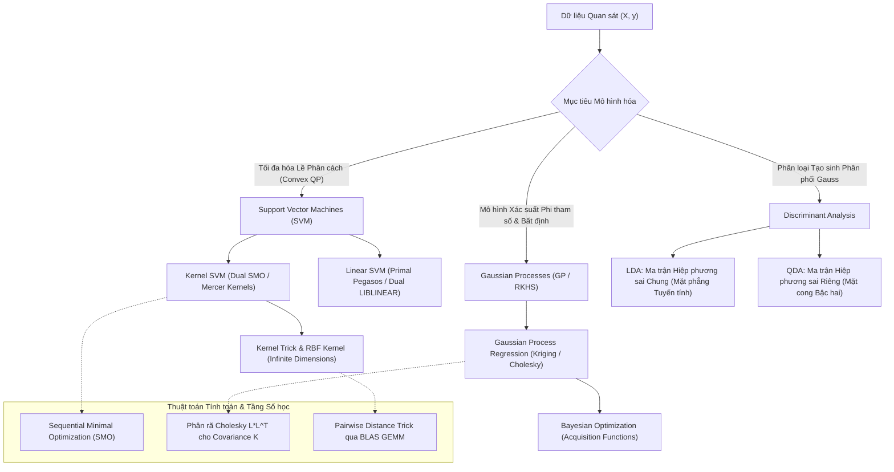
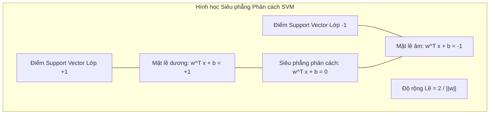
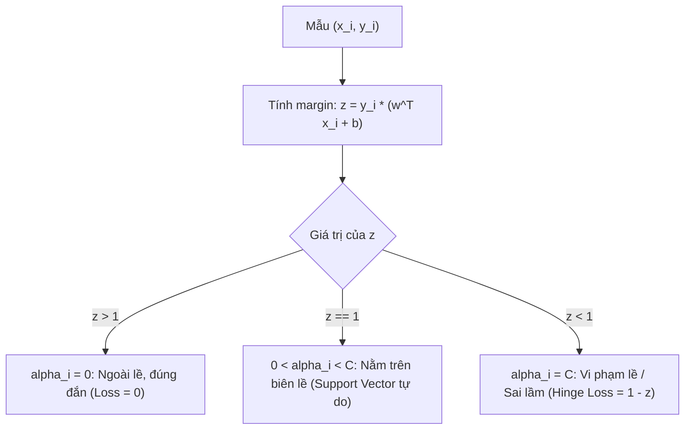
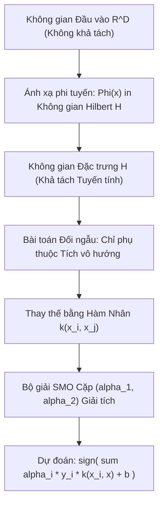
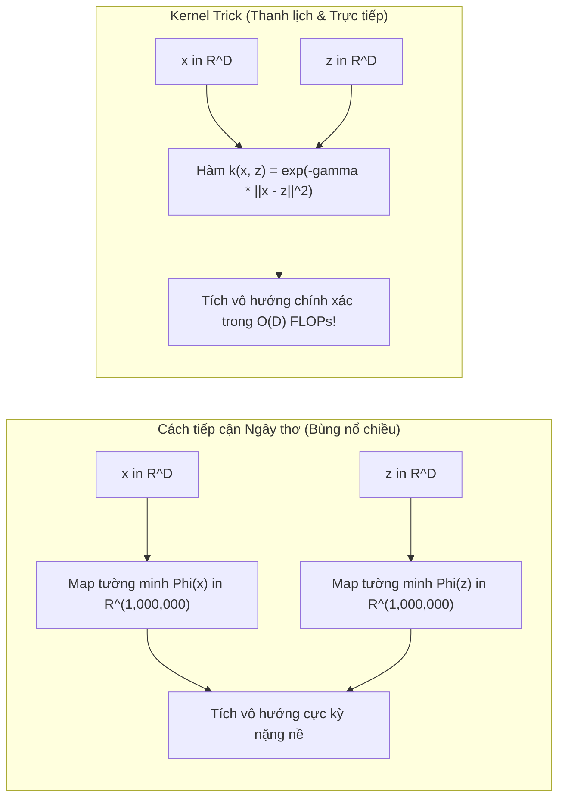
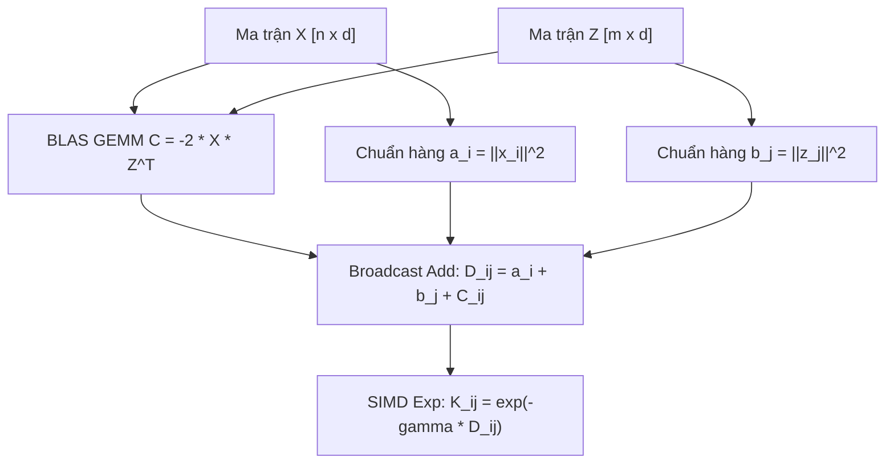
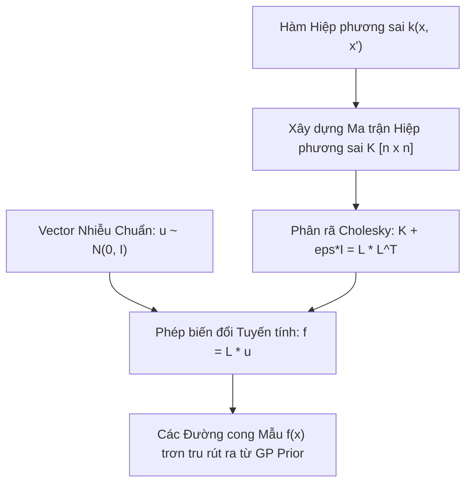
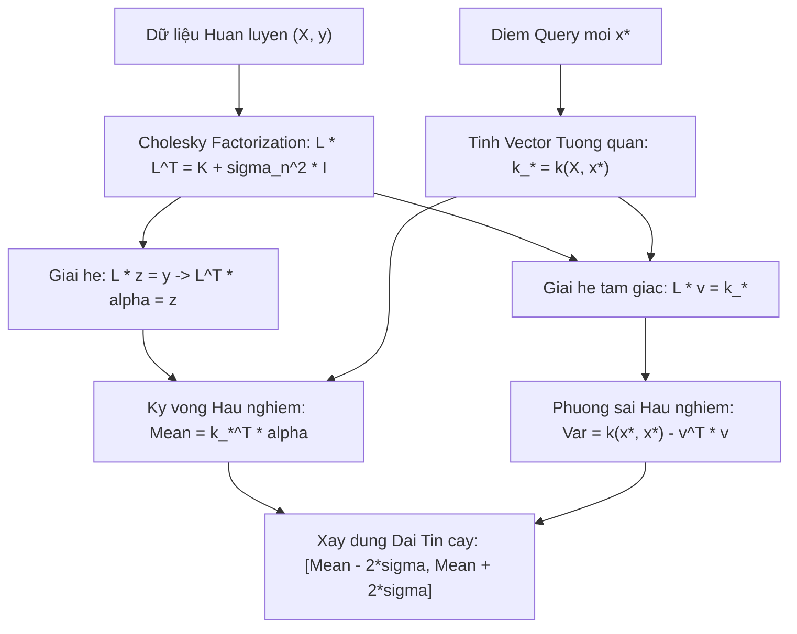
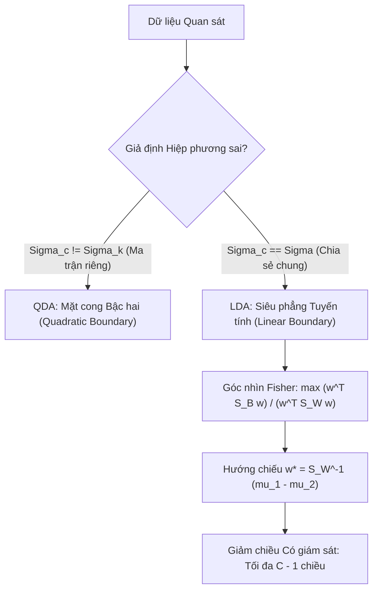

# Chuyên đề: Máy Vector Hỗ trợ & Quá trình Gauss (Kernel Machines & Gaussian Processes)

## 1. Tổng quan Chuyên đề
Lý thuyết Học máy dựa trên Hàm nhân (Kernel Methods) và Quá trình Gauss (Gaussian Processes) đại diện cho đỉnh cao của sự kết hợp giữa **Hình học Lồi (Convex Geometry)**, **Không gian Hilbert Tái tạo Hạt nhân (Reproducing Kernel Hilbert Spaces - RKHS)**, và **Lý thuyết Xác suất Bayes Phi tham số (Non-parametric Bayesian Theory)**.

Máy Vector Hỗ trợ (Support Vector Machines - SVM) giải quyết bài toán phân loại và hồi quy thông qua nguyên lý Tối đa hóa Lề (Maximum Margin Principle), quy bài toán học máy về bài toán Quy hoạch Toàn phương Lồi (Convex Quadratic Programming) với nghiệm duy nhất toàn cục. Nhờ vào Mẹo Hàm nhân (Kernel Trick), SVM ánh xạ dữ liệu một cách ẩn vào không gian đặc trưng vô hạn chiều mà không phải chịu chi phí tính toán bùng nổ.

Mặt khác, Quá trình Gauss (Gaussian Processes - GP) mở rộng phân phối chuẩn đa biến sang không gian hàm số vô hạn chiều, cung cấp không chỉ giá trị dự đoán trung bình mà còn định lượng chính xác độ bất định (Uncertainty Quantification) tại từng điểm dữ liệu truy vấn.

Cùng với Phân tích Phân biệt Tuyến tính & Phi tuyến (LDA / QDA) - đại diện kinh điển của trường phái mô hình tạo sinh Gaussian - chuyên đề này hoàn thiện toàn bộ khung toán học sâu sắc của Học có Giám sát.



---

## 2. Chi tiết từng Keyword

---

### 1. Support Vector Machines (SVM) (Máy vector hỗ trợ)

#### a. Định nghĩa Bản chất Toán học (Mathematical Formulation)
Được phát triển bởi Vladimir Vapnik và Alexey Chervonenkis (1963, 1995), SVM tìm kiếm một siêu phẳng phân cách tối ưu (Optimal Margin Hyperplane) phân chia hai lớp nhãn $y_i \in \{-1, +1\}$:
$$\mathbf{w}^T \mathbf{x} + b = 0$$

Định nghĩa Độ rộng Lề Hình học (Geometric Margin):
Khoảng cách Euclid từ một điểm dữ liệu $\mathbf{x}_i$ bất kỳ tới siêu phẳng là:
$$\gamma_i = \frac{y_i (\mathbf{w}^T \mathbf{x}_i + b)}{\|\mathbf{w}\|_2}$$
Lề của toàn bộ tập dữ liệu là khoảng cách từ siêu phẳng tới điểm dữ liệu gần nhất:
$$\gamma = \min_{i=1,\dots,n} \gamma_i$$

Bài toán Tối đa hóa Lề Hình học:
$$\max_{\mathbf{w}, b} \gamma \quad \text{s.t.} \quad \frac{y_i (\mathbf{w}^T \mathbf{x}_i + b)}{\|\mathbf{w}\|_2} \ge \gamma, \quad \forall i$$
Vì siêu phẳng không thay đổi khi nhân vô hướng $(\mathbf{w}, b)$ với một hằng số dương, ta chuẩn hóa lề hàm số (Functional Margin) sao cho tại các điểm gần nhất:
$$\min_{i} y_i (\mathbf{w}^T \mathbf{x}_i + b) = 1$$
Khi đó, độ rộng lề hình học tổng thể giữa hai bờ phân cách là:
$$\text{Margin} = \frac{1}{\|\mathbf{w}\|_2} - \left( -\frac{1}{\|\mathbf{w}\|_2} \right) = \frac{2}{\|\mathbf{w}\|_2}$$

Bài toán Đối ngẫu Lồi Nguyên thủy (Primal Optimization Problem):
Tối đa hóa $\frac{2}{\|\mathbf{w}\|_2}$ tương đương với bài toán Cực tiểu hóa Bình phương Chuẩn $L_2$:
$$\min_{\mathbf{w}, b} \frac{1}{2} \|\mathbf{w}\|_2^2 \quad \text{s.t.} \quad y_i (\mathbf{w}^T \mathbf{x}_i + b) \ge 1, \quad \forall i = 1, \dots, n$$

Các Vector Hỗ trợ (Support Vectors):
Những điểm dữ liệu nằm chính xác trên hai mặt biên lề:
$$y_i (\mathbf{w}^T \mathbf{x}_i + b) = 1$$
được gọi là **Support Vectors**. Toàn bộ siêu phẳng tối ưu $\mathbf{w}^*, b^*$ chỉ được định đoạt hoàn toàn bởi tập hợp các Support Vectors này; việc loại bỏ hoặc dịch chuyển bất kỳ điểm dữ liệu nào khác ngoài vùng biên lề hoàn toàn không làm thay đổi vị trí của siêu phẳng phân cách.

#### b. Cơ chế Tầng Sâu & Điện toán (Under The Hood / Hardware Internals)
- **Tính thưa của Nghiệm (Sparsity of Solution)**:
  Nghiệm của SVM được biểu diễn hoàn toàn dưới dạng tổ hợp tuyến tính của chỉ các Support Vectors: $\mathbf{w}^* = \sum_{i \in \text{SV}} \alpha_i y_i \mathbf{x}_i$. Với các tập dữ liệu lớn, số lượng Support Vectors thường chỉ chiếm một tỷ lệ rất nhỏ (vài phần trăm), giúp giảm thiểu tối đa dung lượng bộ nhớ lưu trữ mô hình và tăng tốc độ suy luận.
- **Quy hoạch Toàn phương Lồi (Convex QP)**:
  Hàm mục tiêu toàn phương $\frac{1}{2} \mathbf{w}^T \mathbf{w}$ là hàm lồi nghiêm ngặt với các ràng buộc bất đẳng thức tuyến tính. Do đó, bài toán không có bất kỳ cực tiểu cục bộ nào; mọi nghiệm tìm được bởi các thuật toán tối ưu (Interior Point hoặc Active Set) đều là nghiệm tối ưu toàn cục duy nhất.

#### c. Sơ đồ Minh họa (Mermaid Diagram)


#### d. Code Thực chiến (Dual-Engine: C++ & Python)

```cpp
// C++20: Kiểm tra Điều kiện Support Vector và Đánh giá Margin
#include <iostream>
#include <vector>
#include <cmath>

struct SupportVectorPoint {
    std::vector<float> x;
    int y;
    float alpha;
};

class SVMGeometryEvaluator {
public:
    static float compute_margin_width(const std::vector<float>& w) {
        float norm_sq = 0.0f;
        for (float val : w) norm_sq += val * val;
        float norm = std::sqrt(norm_sq);
        return (norm > 1e-12f) ? (2.0f / norm) : 0.0f;
    }

    static bool is_on_margin(const std::vector<float>& x, int y,
                             const std::vector<float>& w, float b, float tol = 1e-3f) {
        float dot = b;
        for (size_t i = 0; i < x.size(); ++i) dot += w[i] * x[i];
        float margin_val = y * dot;
        return std::abs(margin_val - 1.0f) <= tol;
    }
};

int main() {
    std::vector<float> w = {0.6f, 0.8f}; // ||w|| = 1.0
    float b = -0.5f;
    std::cout << "[C++ SVM Geometry] Margin Width: " << SVMGeometryEvaluator::compute_margin_width(w) << "\n";

    std::vector<float> pt = {1.5f, 1.0f}; // 0.6*1.5 + 0.8*1.0 - 0.5 = 1.2
    std::cout << "[C++ SVM] Is on Margin (+1)?: "
              << std::boolalpha << SVMGeometryEvaluator::is_on_margin(pt, 1, w, b, 0.25f) << "\n";
    return 0;
}
```

```python
# Python / Scikit-Learn: Trích xuất và Trực quan hóa Support Vectors
from sklearn.svm import SVC
import numpy as np

def inspect_support_vectors():
    X = np.array([[1.0, 2.0], [2.0, 3.0], [3.0, 3.0], [2.0, 1.0], [3.0, 2.0]], dtype=np.float64)
    y = np.array([1, 1, 1, -1, -1])

    clf = SVC(kernel='linear', C=1e5) # Hard margin approximation
    clf.fit(X, y)

    print(f"[Linear SVM Trained]")
    print(f"Weights (w): {clf.coef_[0]}")
    print(f"Bias (b): {clf.intercept_[0]}")
    print(f"Number of Support Vectors: {len(clf.support_vectors_)}")
    print(f"Support Vector Indices: {clf.support_}")
    print(f"Dual Coefficients (alpha * y): {clf.dual_coef_[0]}")

if __name__ == "__main__":
    inspect_support_vectors()
```

#### e. Lỗi Thường gặp & Ổn định Số học (Pitfalls & Numerical Stability)
- **Độ nhạy cảm tuyệt đối với Thang đo Đặc trưng (Feature Scale Sensitivity)**: Vì khoảng cách Euclid $\frac{|\mathbf{w}^T \mathbf{x} + b|}{\|\mathbf{w}\|_2}$ phụ thuộc trực tiếp vào thang đo của các trục tọa độ, nếu một đặc trưng có thang đo lớn gấp $1000$ lần các đặc trưng khác, siêu phẳng sẽ bị ép song song với trục đó, phá hỏng khả năng phân tách. Luôn dùng `StandardScaler` trước khi đưa dữ liệu vào SVM.

#### f. Ứng dụng Thực chiến trong AI / Deep Learning (AI Applications)
- **Phân loại Văn bản & Dữ liệu Sinh học Phân tử (Microarray Cancer Detection)**: SVM hoạt động xuất sắc trên các tập dữ liệu có số chiều cực lớn nhưng số lượng mẫu rất nhỏ ($D \gg n$, ví dụ phân loại bệnh ung thư từ dữ liệu biểu hiện gen 20,000 chiều với 50 mẫu bệnh nhân).

---

### 2. Linear SVM (SVM tuyến tính)

#### a. Định nghĩa Bản chất Toán học (Mathematical Formulation)
Trong thực tế, dữ liệu hiếm khi khả tách tuyến tính hoàn hảo (Linearly Separable). Để cho phép một số mẫu vi phạm biên lề, Cortes & Vapnik (1995) đưa vào các **Biến Bù Lỏng (Slack Variables)** $\xi_i \ge 0$, khai sinh mô hình **Soft Margin SVM**.

Bài toán Tối ưu Nguyên thủy (Primal Soft-Margin Formulation):
$$\min_{\mathbf{w}, b, \mathbf{\xi}} \frac{1}{2} \|\mathbf{w}\|_2^2 + C \sum_{i=1}^n \xi_i$$
$$\text{thỏa mãn:} \quad y_i (\mathbf{w}^T \mathbf{x}_i + b) \ge 1 - \xi_i, \quad \xi_i \ge 0, \quad \forall i = 1, \dots, n$$
trong đó $C > 0$ là siêu tham số đánh đổi giữa độ rộng lề và mức độ phạt sai số (Regularization Parameter):
- $C$ lớn: Phạt nặng các vi phạm $\xi_i$, lề hẹp, dễ overfit (tiến về Hard Margin).
- $C$ nhỏ: Cho phép nhiều vi phạm, lề rộng hơn, ưu tiên tính suy quát (High Bias).

Dạng Hàm Mất mát Hinge (Hinge Loss Formulation):
Do $\xi_i = \max(0, 1 - y_i(\mathbf{w}^T \mathbf{x}_i + b))$, bài toán nguyên thủy có thể viết lại tương đương dưới dạng không ràng buộc:
$$\min_{\mathbf{w}, b} \frac{1}{2} \|\mathbf{w}\|_2^2 + C \sum_{i=1}^n \max\left(0, 1 - y_i(\mathbf{w}^T \mathbf{x}_i + b)\right)$$

Điều kiện Tối ưu Karush-Kuhn-Tucker (KKT Conditions):
Xây dựng hàm Lagrangian với các nhân tử Lagrange $\alpha_i \ge 0$ và $\mu_i \ge 0$:
$$\mathcal{L}(\mathbf{w}, b, \mathbf{\xi}, \mathbf{\alpha}, \mathbf{\mu}) = \frac{1}{2} \|\mathbf{w}\|_2^2 + C \sum_{i=1}^n \xi_i - \sum_{i=1}^n \alpha_i \left[ y_i (\mathbf{w}^T \mathbf{x}_i + b) - 1 + \xi_i \right] - \sum_{i=1}^n \mu_i \xi_i$$
Các điều kiện dừng KKT tại điểm tối ưu:
$$\nabla_{\mathbf{w}} \mathcal{L} = \mathbf{0} \implies \mathbf{w} = \sum_{i=1}^n \alpha_i y_i \mathbf{x}_i$$
$$\nabla_b \mathcal{L} = 0 \implies \sum_{i=1}^n \alpha_i y_i = 0$$
$$\nabla_{\xi_i} \mathcal{L} = 0 \implies C - \alpha_i - \mu_i = 0 \implies 0 \le \alpha_i \le C$$
Điều kiện bù (Complementary Slackness):
$$\alpha_i \left[ y_i (\mathbf{w}^T \mathbf{x}_i + b) - 1 + \xi_i \right] = 0$$
$$\mu_i \xi_i = (C - \alpha_i) \xi_i = 0$$

Ý nghĩa Phân loại Nghiệm theo Hệ số $\alpha_i$:
1. $\alpha_i = 0$: Mẫu nằm ngoài vùng lề ($y_i (\mathbf{w}^T \mathbf{x}_i + b) > 1$), được phân loại đúng an toàn.
2. $0 < \alpha_i < C$: Mẫu nằm **chính xác trên mặt biên lề** ($\xi_i = 0, y_i (\mathbf{w}^T \mathbf{x}_i + b) = 1$). Đây là các Free Support Vectors dùng để tính bias $b^*$.
3. $\alpha_i = C$: Mẫu vi phạm biên lề ($\xi_i > 0$). Mẫu có thể nằm bên trong lề hoặc bị phân loại sai hoàn toàn sang nửa không gian đối diện.

#### b. Cơ chế Tầng Sâu & Điện toán (Under The Hood / Hardware Internals)
- **Thuật toán Pegasos (Primal Estimated sub-GrAdient SOlver for SVM)**:
  Shalev-Shwartz et al. (2011) chứng minh rằng thay vì giải bài toán đối ngẫu tốn kém $\mathcal{O}(n^2)$, ta có thể tối ưu trực tiếp bài toán nguyên thủy bằng Stochastic Subgradient Descent:
  Tại mỗi bước $t$, chọn ngẫu nhiên mẫu $(\mathbf{x}_i, y_i)$:
  Nếu $y_i (\mathbf{w}_t^T \mathbf{x}_i) < 1$:
  $$\mathbf{w}_{t+1} = \left( 1 - \frac{1}{t} \right) \mathbf{w}_t + \eta_t y_i \mathbf{x}_i$$
  Ngược lại:
  $$\mathbf{w}_{t+1} = \left( 1 - \frac{1}{t} \right) \mathbf{w}_t$$
  Thuật toán này chỉ tốn độ phức tạp $\mathcal{O}(d)$ mỗi bước, chạy cực nhanh và có thể mở rộng lên hàng chục triệu mẫu dữ liệu lớn.

#### c. Sơ đồ Minh họa (Mermaid Diagram)


#### d. Code Thực chiến (Dual-Engine: C++ & Python)

```cpp
// C++20: Thuật toán Pegasos Linear SVM Stochastic Subgradient Descent
#include <iostream>
#include <vector>
#include <random>
#include <cmath>

class PegasosLinearSVM {
private:
    std::vector<float> w;
    float lambda; // C = 1 / lambda

public:
    PegasosLinearSVM(size_t dim, float reg_lambda)
        : w(dim, 0.0f), lambda(reg_lambda) {}

    void train(const std::vector<std::vector<float>>& X,
               const std::vector<int>& y,
               size_t max_steps = 10000) {
        size_t n = X.size();
        size_t d = w.size();
        std::mt19937 rng(42);
        std::uniform_int_distribution<size_t> dist(0, n - 1);

        for (size_t t = 1; t <= max_steps; ++t) {
            size_t idx = dist(rng);
            const auto& xi = X[idx];
            int yi = y[idx];

            float dot = 0.0f;
            for (size_t j = 0; j < d; ++j) dot += w[j] * xi[j];

            float eta = 1.0f / (lambda * t);
            float scale = 1.0f - (1.0f / t);
            for (size_t j = 0; j < d; ++j) w[j] *= scale;

            if (yi * dot < 1.0f) {
                // Vi phạm lề: w += eta * yi * xi
                float step = eta * yi;
                for (size_t j = 0; j < d; ++j) w[j] += step * xi[j];
            }
        }
    }

    int predict(const std::vector<float>& x) const {
        float dot = 0.0f;
        for (size_t j = 0; j < w.size(); ++j) dot += w[j] * x[j];
        return (dot >= 0.0f) ? 1 : -1;
    }
};

int main() {
    std::vector<std::vector<float>> X = {{1.0f, 2.0f}, {2.0f, 3.0f}, {2.0f, 0.5f}, {3.0f, 1.0f}};
    std::vector<int> y = {1, 1, -1, -1};
    PegasosLinearSVM svm(2, 0.01f);
    svm.train(X, y, 5000);
    std::cout << "[C++ Pegasos] Prediction for [1.5, 2.5]: " << svm.predict({1.5f, 2.5f}) << "\n";
    return 0;
}
```

```python
# Python / Scikit-Learn: So sánh LIBLINEAR (LinearSVC) vs Pegasos (SGDClassifier)
from sklearn.svm import LinearSVC
from sklearn.linear_model import SGDClassifier
import numpy as np

def benchmark_linear_svm():
    X = np.random.randn(1000, 20)
    y = np.where(X[:, 0] * 1.5 - X[:, 1] > 0, 1, -1)

    # 1. Coordinate Descent (LIBLINEAR)
    lsvc = LinearSVC(C=1.0, dual=False, random_state=42).fit(X, y)
    # 2. Stochastic Subgradient Descent (Hinge Loss)
    sgd_svm = SGDClassifier(loss='hinge', penalty='l2', alpha=1e-3, random_state=42).fit(X, y)

    print(f"[LinearSVC Score]: {lsvc.score(X, y)*100:.2f}%")
    print(f"[SGDClassifier (Pegasos) Score]: {sgd_svm.score(X, y)*100:.2f}%")

if __name__ == "__main__":
    benchmark_linear_svm()
```

#### e. Lỗi Thường gặp & Ổn định Số học (Pitfalls & Numerical Stability)
- **Hinge Loss Không Khả vi tại Điểm Lề ($z = 1$)**: Tại $y_i(\mathbf{w}^T \mathbf{x}_i + b) = 1$, đạo hàm của hàm Hinge Loss không xác định. Các thuật toán tối ưu phải sử dụng khái niệm Dưới đạo hàm (Subgradient): $\partial \max(0, 1-z) = \{-y_i \text{ nếu } z < 1; 0 \text{ nếu } z > 1; [-y_i, 0] \text{ nếu } z = 1\}$.

#### f. Ứng dụng Thực chiến trong AI / Deep Learning (AI Applications)
- **Phân loại Văn bản Quy mô Công nghiệp (LIBLINEAR)**: Được tích hợp trong động cơ tìm kiếm và phân loại tin nhắn SMS/Email nhờ tốc độ hội tụ nhanh gấp hàng ngàn lần so với SVM phi tuyến.

---

### 3. Kernel SVM (SVM phi tuyến với hàm nhân)

#### a. Định nghĩa Bản chất Toán học (Mathematical Formulation)
Khi dữ liệu không thể phân tách tuyến tính trong không gian đầu vào $\mathbb{R}^D$, ta ánh xạ dữ liệu sang một không gian đặc trưng mới $\mathcal{H}$ có số chiều cao hơn (hoặc vô hạn chiều) thông qua phép biến đổi phi tuyến:
$$\phi: \mathbb{R}^D \to \mathcal{H}$$
Trong không gian $\mathcal{H}$, dữ liệu trở nên khả tách tuyến tính.

Bài toán Đối ngẫu Lagrange (Dual Optimization Problem):
Thay thế tích vô hướng Euclid $\mathbf{x}_i^T \mathbf{x}_j$ bằng tích vô hướng trong không gian mới $\langle \phi(\mathbf{x}_i), \phi(\mathbf{x}_j) \rangle = k(\mathbf{x}_i, \mathbf{x}_j)$:
$$\max_{\mathbf{\alpha}} \mathcal{Q}(\mathbf{\alpha}) = \sum_{i=1}^n \alpha_i - \frac{1}{2} \sum_{i=1}^n \sum_{j=1}^n \alpha_i \alpha_j y_i y_j k(\mathbf{x}_i, \mathbf{x}_j)$$
$$\text{thỏa mãn:} \quad 0 \le \alpha_i \le C, \quad \forall i = 1, \dots, n \quad \text{và} \quad \sum_{i=1}^n \alpha_i y_i = 0$$

Hàm Quyết định Dự đoán Phi tuyến:
$$f(\mathbf{x}^*) = \text{sign}\left( \mathbf{w}^{*T} \phi(\mathbf{x}^*) + b^* \right) = \text{sign}\left( \sum_{i \in \text{SV}} \alpha_i^* y_i k(\mathbf{x}_i, \mathbf{x}^*) + b^* \right)$$
Một điểm mấu chốt: **Không bao giờ cần tính toán tường minh vector $\phi(\mathbf{x})$ hay vector trọng số $\mathbf{w}^*$**. Mọi phép toán huấn luyện và suy luận chỉ phụ thuộc duy nhất vào giá trị vô hướng của hàm nhân $k(\mathbf{x}_i, \mathbf{x}_j)$.

Thuật toán SMO (Sequential Minimal Optimization - John Platt, 1998):
Do ràng buộc đẳng thức $\sum_{i=1}^n \alpha_i y_i = 0$, không thể tối ưu hóa từng hệ số $\alpha_i$ đơn lẻ (vì thay đổi một $\alpha_i$ sẽ vi phạm ràng buộc tổng). SMO giải quyết bài toán bằng cách:
1. Tại mỗi bước, chọn ra **cặp 2 nhân tử Lagrange** $(\alpha_1, \alpha_2)$ cần tối ưu hóa.
2. Cố định toàn bộ các $\alpha_{k \ne 1, 2}$ còn lại. Khi đó $\alpha_1 y_1 + \alpha_2 y_2 = \zeta = \text{const} \implies \alpha_1 = (\zeta - \alpha_2 y_2) y_1$.
3. Thay thế vào hàm mục tiêu $\mathcal{Q}(\alpha)$, bài toán quy về tìm cực trị của một tam thức bậc hai một biến $\alpha_2$, có **nghiệm giải tích đóng (Analytical Solution)** cực nhanh:
   $$\alpha_2^{\text{new, unclipped}} = \alpha_2^{\text{old}} + \frac{y_2 (E_1 - E_2)}{\eta}$$
   trong đó sai số dự đoán $E_i = f(\mathbf{x}_i) - y_i$ và độ cong đạo hàm $\eta = 2 k(\mathbf{x}_1, \mathbf{x}_2) - k(\mathbf{x}_1, \mathbf{x}_1) - k(\mathbf{x}_2, \mathbf{x}_2)$.
4. Kẹp biên $\alpha_2^{\text{new}}$ vào đoạn $[L, H]$ để thỏa mãn ràng buộc $0 \le \alpha_2 \le C$, sau đó suy ra $\alpha_1^{\text{new}}$.

#### b. Cơ chế Tầng Sâu & Điện toán (Under The Hood / Hardware Internals)
- **Quản lý Bộ đệm Kernel Cache (Gram Matrix Caching)**:
  Ma trận Kernel $\mathbf{K} \in \mathbb{R}^{n \times n}$ tốn $n^2 \times 4$ bytes (với $n = 100,000$, ma trận này tốn 40 GB RAM).
  SMO triển khai một bộ nhớ đệm Kernel Cache động theo cơ chế LRU (Least Recently Used). Khi cache hit, thuật toán lấy trực tiếp $k(\mathbf{x}_i, \mathbf{x}_j)$; khi cache miss, CPU tính toán lại kernel tức thời thông qua lệnh SIMD để tránh tràn bộ nhớ hệ thống.

#### c. Sơ đồ Minh họa (Mermaid Diagram)


#### d. Code Thực chiến (Dual-Engine: C++ & Python)

```cpp
// C++20: Cập nhật Cặp Hệ số Lagrange (alpha_1, alpha_2) Chuẩn Thuật toán SMO
#include <iostream>
#include <algorithm>
#include <cmath>

struct SMOResult {
    double alpha1_new;
    double alpha2_new;
    bool updated;
};

SMOResult step_smo(double a1_old, double a2_old, int y1, int y2,
                   double E1, double E2, double C,
                   double k11, double k12, double k22) {
    double eta = 2.0 * k12 - k11 - k22;
    if (eta >= 0.0) return {a1_old, a2_old, false}; // eta phải âm để hàm mục tiêu lồi

    // 1. Tính toán biên kẹp [L, H]
    double L, H;
    if (y1 != y2) {
        L = std::max(0.0, a2_old - a1_old);
        H = std::min(C, C + a2_old - a1_old);
    } else {
        L = std::max(0.0, a1_old + a2_old - C);
        H = std::min(C, a1_old + a2_old);
    }
    if (L >= H) return {a1_old, a2_old, false};

    // 2. Nghiệm giải tích không bị chặn của alpha2
    double a2_new = a2_old - (y2 * (E1 - E2)) / eta;

    // 3. Kẹp biên alpha2 vào đoạn [L, H]
    if (a2_new > H) a2_new = H;
    else if (a2_new < L) a2_new = L;

    if (std::abs(a2_new - a2_old) < 1e-5) return {a1_old, a2_old, false};

    // 4. Suy ra alpha1_new
    double a1_new = a1_old + y1 * y2 * (a2_old - a2_new);

    return {a1_new, a2_new, true};
}

int main() {
    double a1 = 0.5, a2 = 0.5;
    int y1 = 1, y2 = -1;
    double E1 = -0.8, E2 = 0.6;
    double C = 2.0;
    double k11 = 1.0, k12 = 0.3, k22 = 1.0;

    auto res = step_smo(a1, a2, y1, y2, E1, E2, C, k11, k12, k22);
    std::cout << "[C++ SMO Step] Updated? " << std::boolalpha << res.updated << "\n";
    std::cout << "alpha1: " << res.alpha1_new << " | alpha2: " << res.alpha2_new << "\n";
    return 0;
}
```

```python
# Python / Scikit-Learn: Kernel SVM với RBF Kernel và Custom Kernel Matrix
from sklearn.svm import SVC
import numpy as np

def run_kernel_svm_custom():
    X = np.array([[-1, -1], [-1, 1], [1, -1], [1, 1]])
    y = np.array([-1, 1, 1, -1]) # Bài toán XOR kinh điển (phi tuyến)

    # Khớp SVM với RBF Kernel
    clf = SVC(kernel='rbf', gamma=1.0, C=10.0)
    clf.fit(X, y)

    print(f"[Kernel SVM XOR Accuracy]: {clf.score(X, y)*100:.1f}% (Phân loại hoàn hảo)")
    print(f"Support Vectors Indices: {clf.support_}")

if __name__ == "__main__":
    run_kernel_svm_custom()
```

#### e. Lỗi Thường gặp & Ổn định Số học (Pitfalls & Numerical Stability)
- **Độ phức tạp Tính toán Siêu tuyến tính $\mathcal{O}(n^2) - \mathcal{O}(n^3)$**: Khi tập dữ liệu vượt quá $100,000$ mẫu, Kernel SVM trở nên bất khả thi về mặt tính toán thời gian và bộ nhớ. Trong trường hợp dữ liệu lớn, bắt buộc phải sử dụng Linear SVM hoặc xấp xỉ Random Fourier Features.

#### f. Ứng dụng Thực chiến trong AI / Deep Learning (AI Applications)
- **Nhận dạng Chữ số Viết tay (MNIST Benchmark)**: Thập niên 1990, SVM với Kernel đa thức và RBF của Yann LeCun và Corinna Cortes là chuẩn mực đánh bại mạng nơ-ron sơ khai trên tập dữ liệu MNIST.

---

### 4. Kernel Trick (Mẹo hàm nhân)

#### a. Định nghĩa Bản chất Toán học (Mathematical Formulation)
Mẹo Hàm nhân (Kernel Trick - Aizerman et al., 1964) là một trong những phát kiến toán học thanh lịch nhất của trí tuệ nhân tạo.

Định nghĩa: Một hàm số hai biến $k: \mathcal{X} \times \mathcal{X} \to \mathbb{R}$ được gọi là một **Hàm nhân Hợp lệ (Valid Kernel)** nếu tồn tại một không gian Hilbert $\mathcal{H}$ và một ánh xạ $\phi: \mathcal{X} \to \mathcal{H}$ sao cho với mọi cặp $\mathbf{x}, \mathbf{z} \in \mathcal{X}$:
$$k(\mathbf{x}, \mathbf{z}) = \langle \phi(\mathbf{x}), \phi(\mathbf{z}) \rangle_{\mathcal{H}}$$

Ý nghĩa Đột phá:
Thay vì phải tính toán tọa độ của điểm dữ liệu trong không gian nhiều chiều (hoặc vô hạn chiều) $\phi(\mathbf{x})$ rồi mới nhân vô hướng, ta **tính toán trực tiếp giá trị tích vô hướng đó thông qua hàm $k(\mathbf{x}, \mathbf{z})$ ngay trong không gian đầu vào thấp chiều ban đầu** với độ phức tạp chỉ $\mathcal{O}(D)$.

Định lý Mercer (Mercer's Theorem - 1909):
Hàm liên tục đối xứng $k(\mathbf{x}, \mathbf{z})$ là một hàm nhân hợp lệ khi và chỉ khi với mọi tập dữ liệu hữu hạn $\{\mathbf{x}_1, \dots, \mathbf{x}_n\}$, ma trận Gram tương ứng $\mathbf{K} \in \mathbb{R}^{n \times n}$ với $K_{ij} = k(\mathbf{x}_i, \mathbf{x}_j)$ là một **Ma trận Đối xứng Nửa Xác định Dương (Symmetric Positive Semi-Definite - PSD)**:
$$\mathbf{c}^T \mathbf{K} \mathbf{c} = \sum_{i=1}^n \sum_{j=1}^n c_i c_j k(\mathbf{x}_i, \mathbf{x}_j) \ge 0, \quad \forall \mathbf{c} \in \mathbb{R}^n$$

Các Họ Kernel Tiêu chuẩn:
1. **Linear Kernel**: $k(\mathbf{x}, \mathbf{z}) = \mathbf{x}^T \mathbf{z} + c$.
2. **Polynomial Kernel**: $k(\mathbf{x}, \mathbf{z}) = (\gamma \mathbf{x}^T \mathbf{z} + c)^d$.
3. **Radial Basis Function (RBF) / Gaussian Kernel**: $k(\mathbf{x}, \mathbf{z}) = \exp(-\gamma \|\mathbf{x} - \mathbf{z}\|_2^2)$.
4. **Sigmoid Kernel (Hyperbolic Tangent)**: $k(\mathbf{x}, \mathbf{z}) = \tanh(\gamma \mathbf{x}^T \mathbf{z} + c)$ (chỉ là PSD trên một số miền tham số nhất định).

#### b. Cơ chế Tầng Sâu & Điện toán (Under The Hood / Hardware Internals)
- **Xấp xỉ Random Fourier Features (RFF - Rahimi & Recht, 2007)**:
  Để vượt qua rào cản tính toán $\mathcal{O}(n^2)$ của Kernel Trick trên phần cứng hiện đại (GPU), định lý Bochner chỉ ra rằng bất kỳ kernel dừng nào $k(\mathbf{x} - \mathbf{z})$ đều là biến đổi Fourier của một phân phối xác suất. Ta ánh xạ ngẫu nhiên:
  $$z(\mathbf{x}) = \sqrt{\frac{2}{D_{\text{rff}}}} \cos(\mathbf{W}\mathbf{x} + \mathbf{b})$$
  trong đó $\mathbf{W} \sim \mathcal{N}(0, 2\gamma \mathbf{I})$ và $\mathbf{b} \sim \mathcal{U}(0, 2\pi)$.
  Khi đó $\langle z(\mathbf{x}), z(\mathbf{z}) \rangle \approx k_{\text{rbf}}(\mathbf{x}, \mathbf{z})$, cho phép sử dụng các thuật toán giải tuyến tính tốc độ cao $\mathcal{O}(n D_{\text{rff}})$.

#### c. Sơ đồ Minh họa (Mermaid Diagram)


#### d. Code Thực chiến (Dual-Engine: C++ & Python)

```cpp
// C++20: Random Fourier Features (RFF) Engine xấp xỉ RBF Kernel
#include <iostream>
#include <vector>
#include <random>
#include <cmath>

class RandomFourierFeatures {
private:
    size_t in_dim;
    size_t rff_dim;
    std::vector<std::vector<float>> W; // rff_dim x in_dim
    std::vector<float> b;              // rff_dim

public:
    RandomFourierFeatures(size_t in_d, size_t out_d, float gamma)
        : in_dim(in_d), rff_dim(out_d), W(out_d, std::vector<float>(in_d)), b(out_d) {
        std::mt19937 rng(42);
        std::normal_distribution<float> w_dist(0.0f, std::sqrt(2.0f * gamma));
        std::uniform_real_distribution<float> b_dist(0.0f, 2.0f * static_cast<float>(M_PI));

        for (size_t i = 0; i < rff_dim; ++i) {
            b[i] = b_dist(rng);
            for (size_t j = 0; j < in_dim; ++j) {
                W[i][j] = w_dist(rng);
            }
        }
    }

    std::vector<float> transform(const std::vector<float>& x) const {
        std::vector<float> z(rff_dim);
        float scale = std::sqrt(2.0f / rff_dim);

        for (size_t i = 0; i < rff_dim; ++i) {
            float proj = b[i];
            for (size_t j = 0; j < in_dim; ++j) proj += W[i][j] * x[j];
            z[i] = scale * std::cos(proj);
        }
        return z;
    }
};

int main() {
    RandomFourierFeatures rff(2, 500, 0.5f);
    std::vector<float> x1 = {1.0f, 2.0f};
    std::vector<float> x2 = {1.2f, 2.1f};

    auto z1 = rff.transform(x1);
    auto z2 = rff.transform(x2);

    float approx_kernel = 0.0f;
    for (size_t i = 0; i < z1.size(); ++i) approx_kernel += z1[i] * z2[i];

    // Tính giá trị RBF chính xác
    float dist_sq = (1.0f-1.2f)*(1.0f-1.2f) + (2.0f-2.1f)*(2.0f-2.1f);
    float exact_kernel = std::exp(-0.5f * dist_sq);

    std::cout << "[RFF Approximation]: " << approx_kernel << " | [Exact RBF]: " << exact_kernel << "\n";
    return 0;
}
```

```python
# Python / Scikit-Learn: RBFSampler (Random Fourier Features) kết hợp SGDClassifier
from sklearn.kernel_approximation import RBFSampler
from sklearn.linear_model import SGDClassifier
import numpy as np

def demo_rff_pipeline():
    X = np.random.randn(2000, 10)
    y = np.where(np.sum(X**2, axis=1) > 10.0, 1, -1)

    # Biến đổi không gian RFF
    rff = RBFSampler(gamma=0.2, n_components=300, random_state=42)
    X_features = rff.fit_transform(X)

    # Huấn luyện tuyến tính siêu tốc O(N * D_rff)
    clf = SGDClassifier(max_iter=50, random_state=42)
    clf.fit(X_features, y)

    print(f"[RFF + Linear Model Accuracy]: {clf.score(X_features, y)*100:.2f}%")

if __name__ == "__main__":
    demo_rff_pipeline()
```

#### e. Lỗi Thường gặp & Ổn định Số học (Pitfalls & Numerical Stability)
- **Hàm nhân Vi phạm Điều kiện Mercer**: Nếu tự định nghĩa một hàm khoảng cách tùy biến nhưng ma trận Gram sinh ra có trị riêng âm ($\lambda_{\min} < 0$), hàm mục tiêu của SVM không còn lồi, thuật toán SMO sẽ phân kỳ hoặc kẹt trong vòng lặp vô tận.

#### f. Ứng dụng Thực chiến trong AI / Deep Learning (AI Applications)
- **Linear Attention trong Transformer (Performer / FAVOR+)**: Choromanski et al. (2020) sử dụng biến thể Positive Random Features (Kernel Trick) để phân tách cơ chế Self-Attention Softmax thành tích của hai ma trận $\mathbf{Q}' \mathbf{K}'^T$, giảm độ phức tạp của Transformer từ $\mathcal{O}(L^2)$ xuống $\mathcal{O}(L)$ tuyến tính.

---

### 5. Radial Basis Function (RBF) (Hàm bán kính cơ sở RBF / Gaussian Kernel)

#### a. Định nghĩa Bản chất Toán học (Mathematical Formulation)
Hàm nhân Radial Basis Function (RBF) - hay Gaussian Kernel - là hàm nhân đa năng và phổ biến nhất trong Học máy:
$$k_{\text{rbf}}(\mathbf{x}, \mathbf{z}) = \exp\left( -\gamma \|\mathbf{x} - \mathbf{z}\|_2^2 \right) = \exp\left( -\frac{\|\mathbf{x} - \mathbf{z}\|_2^2}{2\sigma^2} \right)$$
trong đó:
- $\gamma = \frac{1}{2\sigma^2} > 0$ là siêu tham số kiểm soát độ rộng của vùng ảnh hưởng (Bandwidth).
- $\|\mathbf{x} - \mathbf{z}\|_2$ là khoảng cách Euclid giữa hai vector điểm.

Chứng minh Không gian Đặc trưng Vô hạn Chiều thông qua Khai triển Taylor:
Xét trường hợp 1 chiều với $\gamma = \frac{1}{2}$ ($\sigma = 1$), giả sử dữ liệu được chuẩn hóa:
$$k(x, z) = \exp\left( -\frac{1}{2}(x - z)^2 \right) = \exp\left( -\frac{1}{2}x^2 \right) \exp\left( -\frac{1}{2}z^2 \right) \exp(xz)$$
Áp dụng khai triển chuỗi Taylor cho $\exp(xz)$:
$$\exp(xz) = \sum_{k=0}^{\infty} \frac{(xz)^k}{k!} = \sum_{k=0}^{\infty} \frac{x^k}{\sqrt{k!}} \frac{z^k}{\sqrt{k!}}$$
$$\implies k(x, z) = \sum_{k=0}^{\infty} \left( e^{-x^2/2} \frac{x^k}{\sqrt{k!}} \right) \left( e^{-z^2/2} \frac{z^k}{\sqrt{k!}} \right) = \langle \phi(x), \phi(z) \rangle$$
Ánh xạ đặc trưng tương ứng là một vector có **vô hạn phần tử**:
$$\phi(x) = e^{-x^2/2} \begin{bmatrix} 1, \frac{x}{\sqrt{1!}}, \frac{x^2}{\sqrt{2!}}, \frac{x^3}{\sqrt{3!}}, \dots \end{bmatrix}^T$$
Điều này chứng minh: RBF Kernel ánh xạ dữ liệu vào một **Không gian Hilbert Vô hạn Chiều**, cho phép biểu diễn bất kỳ mặt phân cách phi tuyến phức tạp nào.

Vai trò của Siêu tham số $\gamma$:
- $\gamma \to \infty$ ($\sigma \to 0$): $k(\mathbf{x}, \mathbf{z}) \to 0$ khi $\mathbf{x} \ne \mathbf{z}$, và $k(\mathbf{x}, \mathbf{x}) = 1$. Ma trận Gram thoái hóa thành ma trận đơn vị $\mathbf{I}$, mỗi mẫu chỉ ảnh hưởng tới chính nó $\implies$ Overfitting cực độ (High Variance).
- $\gamma \to 0$ ($\sigma \to \infty$): $k(\mathbf{x}, \mathbf{z}) \to 1, \forall \mathbf{x}, \mathbf{z}$. Mô hình coi mọi điểm đều giống nhau $\implies$ Underfitting cực độ (High Bias).

#### b. Cơ chế Tầng Sâu & Điện toán (Under The Hood / Hardware Internals)
- **Mẹo Tính Toàn bộ Khoảng cách Cặp thông qua BLAS GEMM**:
  Để tính ma trận khoảng cách $\|\mathbf{x}_i - \mathbf{z}_j\|_2^2$ cho hai tập dữ liệu $\mathbf{X} \in \mathbb{R}^{n \times d}$ và $\mathbf{Z} \in \mathbb{R}^{m \times d}$, việc dùng 3 vòng lặp lồng nhau tốn $\mathcal{O}(n m d)$ và gây cache thrashing.
  Đồng nhất thức đại số:
  $$\|\mathbf{x}_i - \mathbf{z}_j\|_2^2 = \|\mathbf{x}_i\|_2^2 + \|\mathbf{z}_j\|_2^2 - 2 \mathbf{x}_i^T \mathbf{z}_j$$
  1. Tính vector bình phương chuẩn hàng: $\mathbf{a} = \text{row\_sum}(\mathbf{X} \odot \mathbf{X}) \in \mathbb{R}^n$, $\mathbf{b} = \text{row\_sum}(\mathbf{Z} \odot \mathbf{Z}) \in \mathbb{R}^m$.
  2. Tính ma trận tích vô hướng qua kernel phần cứng BLAS Level 3 `dgemm`: $\mathbf{C} = \mathbf{X} \mathbf{Z}^T$ (đạt 95% hiệu suất đỉnh của GPU/CPU Tensor Cores).
  3. Cộng broadcasting: $\mathbf{D}_{ij} = a_i + b_j - 2 C_{ij}$, sau đó gọi vector SIMD `_mm256_exp_ps`.

#### c. Sơ đồ Minh họa (Mermaid Diagram)


#### d. Code Thực chiến (Dual-Engine: C++ & Python)

```cpp
// C++20: Tính Ma trận RBF Kernel bằng Mẹo Phân rã Ma trận GEMM
#include <iostream>
#include <vector>
#include <cmath>

class FastRBFKernelMatrix {
public:
    static std::vector<std::vector<float>> compute_gram(const std::vector<std::vector<float>>& X,
                                                        float gamma) {
        size_t n = X.size();
        size_t d = X[0].size();
        std::vector<float> row_norms(n, 0.0f);

        for (size_t i = 0; i < n; ++i) {
            for (size_t j = 0; j < d; ++j) {
                row_norms[i] += X[i][j] * X[i][j];
            }
        }

        std::vector<std::vector<float>> K(n, std::vector<float>(n, 0.0f));
        for (size_t i = 0; i < n; ++i) {
            K[i][i] = 1.0f; // exp(-gamma * 0) = 1
            for (size_t j = i + 1; j < n; ++j) {
                float dot = 0.0f;
                for (size_t k = 0; k < d; ++k) dot += X[i][k] * X[j][k];

                float dist_sq = row_norms[i] + row_norms[j] - 2.0f * dot;
                if (dist_sq < 0.0f) dist_sq = 0.0f; // Tránh sai số dấu chấm động âm

                float val = std::exp(-gamma * dist_sq);
                K[i][j] = val;
                K[j][i] = val; // Ma trận đối xứng
            }
        }
        return K;
    }
};

int main() {
    std::vector<std::vector<float>> X = {{0.0f, 0.0f}, {1.0f, 1.0f}, {2.0f, 2.0f}};
    auto K = FastRBFKernelMatrix::compute_gram(X, 0.5f);

    std::cout << "[C++ RBF Gram Matrix 3x3]:\n";
    for (size_t i = 0; i < 3; ++i) {
        for (size_t j = 0; j < 3; ++j) std::cout << K[i][j] << "\t";
        std::cout << "\n";
    }
    return 0;
}
```

```python
# Python / PyTorch: Vectorized Pairwise RBF Kernel Matrix qua GPU Tensor Operations
import torch

def pairwise_rbf_kernel_pytorch(X: torch.Tensor, gamma: float = 0.5):
    # X: [n, d]
    # ||x - z||^2 = ||x||^2 + ||z||^2 - 2 x^T z
    x_norm_sq = torch.sum(X ** 2, dim=-1, keepdim=True) # [n, 1]
    dist_sq = x_norm_sq + x_norm_sq.T - 2.0 * (X @ X.T) # [n, n]
    dist_sq = torch.clamp(dist_sq, min=0.0) # Khử sai số làm tròn âm
    K = torch.exp(-gamma * dist_sq)
    return K

if __name__ == "__main__":
    X = torch.tensor([[0.0, 0.0], [1.0, 1.0], [2.0, 2.0]], dtype=torch.float32)
    K = pairwise_rbf_kernel_pytorch(X, gamma=0.5)
    print(f"[PyTorch Pairwise RBF Gram Matrix]:\n{K.numpy()}")
```

#### e. Lỗi Thường gặp & Ổn định Số học (Pitfalls & Numerical Stability)
- **Sai số Làm tròn Sinh ra Khoảng cách Âm**: Khi tính $a_i + b_j - 2 C_{ij}$, đối với hai điểm trùng nhau ($i = j$), do sai số làm tròn FP32, giá trị tính được có thể là $-10^{-7}$. Nếu truyền trực tiếp vào `sqrt` sẽ sinh lỗi `NaN`. Luôn sử dụng hàm `std::max(0.0f, dist_sq)` hoặc `torch.clamp(min=0.0)`.

#### f. Ứng dụng Thực chiến trong AI / Deep Learning (AI Applications)
- **Cơ chế Attention Cục bộ & Gaussian Process Kernels**: RBF là hàm nhân nền tảng tuyệt đối trong mô hình hóa bề mặt phản ứng vật lý và là hàm cơ sở trong các mạng nơ-ron RBF Networks dùng cho xấp xỉ hàm thời gian thực.

---

### 6. Gaussian Processes (Quá trình Gauss - GP)

#### a. Định nghĩa Bản chất Toán học (Mathematical Formulation)
Quá trình Gauss (Gaussian Process - GP) (Rasmussen & Williams, 2006) là một sự tổng quát hóa vô hạn chiều của phân phối chuẩn đa biến.

Định nghĩa Hình thức:
Một Quá trình Gauss là một tập hợp các biến ngẫu nhiên vô hạn $\{f(\mathbf{x}) \mid \mathbf{x} \in \mathcal{X}\}$ sao cho **mọi tập con hữu hạn bất kỳ** $\{\mathbf{x}_1, \dots, \mathbf{x}_n\}$ đều tuân theo một phân phối chuẩn đa biến đồng thời (Joint Multivariate Gaussian Distribution):
$$f(\mathbf{x}) \sim \mathcal{GP}\left( m(\mathbf{x}), k(\mathbf{x}, \mathbf{x}') \right)$$
được định nghĩa hoàn toàn bởi hai hàm:
1. **Hàm kỳ vọng (Mean Function)**:
   $$m(\mathbf{x}) = \mathbb{E}[f(\mathbf{x})]$$
   (thường chuẩn hóa $m(\mathbf{x}) \equiv 0$ trong thực tế).
2. **Hàm hiệp phương sai (Covariance / Kernel Function)**:
   $$k(\mathbf{x}, \mathbf{x}') = \mathbb{E}\left[ (f(\mathbf{x}) - m(\mathbf{x})) (f(\mathbf{x}') - m(\mathbf{x}')) \right]$$

Tính chất Phân lề Đóng (Marginalization Property):
Nếu phân phối của tập $(\mathbf{y}_1, \mathbf{y}_2)$ là phân phối chuẩn nhiều chiều:
$$\begin{bmatrix} \mathbf{y}_1 \\ \mathbf{y}_2 \end{bmatrix} \sim \mathcal{N}\left( \begin{bmatrix} \mathbf{\mu}_1 \\ \mathbf{\mu}_2 \end{bmatrix}, \begin{bmatrix} \mathbf{\Sigma}_{11} & \mathbf{\Sigma}_{12} \\ \mathbf{\Sigma}_{21} & \mathbf{\Sigma}_{22} \end{bmatrix} \right)$$
thì phân phối phân lề của riêng $\mathbf{y}_1$ hoàn toàn độc lập với việc có mặt hay không của $\mathbf{y}_2$:
$$\mathbf{y}_1 \sim \mathcal{N}(\mathbf{\mu}_1, \mathbf{\Sigma}_{11})$$
Tính chất toán học kỳ diệu này đảm bảo rằng: Việc chúng ta chỉ quan sát một số lượng hữu hạn $n$ mẫu trong số vô hạn các điểm của vũ trụ không hề làm biến dạng phân phối Gaussian tại các điểm đã quan sát.

#### b. Cơ chế Tầng Sâu & Điện toán (Under The Hood / Hardware Internals)
- **Tạo Mẫu Đồ thị Hàm số bằng Phân rã Cholesky**:
  Để lấy mẫu (sample) các đường cong hàm số từ một Gaussian Process tiên nghiệm tại $n$ điểm tọa độ:
  1. Xây dựng ma trận hiệp phương sai $\mathbf{K} \in \mathbb{R}^{n \times n}$.
  2. Bổ sung một lượng nhiễu ổn định (Nugget / Jitter) vào đường chéo: $\mathbf{K}_{\epsilon} = \mathbf{K} + 10^{-6} \mathbf{I}$.
  3. Phân rã Cholesky: $\mathbf{K}_{\epsilon} = \mathbf{L} \mathbf{L}^T$.
  4. Lấy mẫu vector Gauss chuẩn độc lập $\mathbf{u} \sim \mathcal{N}(\mathbf{0}, \mathbf{I})$.
  5. Biến đổi: $\mathbf{f} = \mathbf{L} \mathbf{u}$. Vector $\mathbf{f}$ chính là một mẫu đường cong liên tục trơn tru rút ra từ Quá trình Gauss.

#### c. Sơ đồ Minh họa (Mermaid Diagram)


#### d. Code Thực chiến (Dual-Engine: C++ & Python)

```cpp
// C++20: Lấy Mẫu Hàm số từ Gaussian Process Prior bằng Cholesky LLT
#include <iostream>
#include <vector>
#include <random>
#include <cmath>

class GPSampler {
public:
    static std::vector<float> sample_prior(const std::vector<float>& x_coords, float l = 1.0f) {
        size_t n = x_coords.size();
        std::vector<std::vector<float>> K(n, std::vector<float>(n, 0.0f));

        // 1. Dựng RBF Covariance Matrix
        for (size_t i = 0; i < n; ++i) {
            for (size_t j = 0; j < n; ++j) {
                float d = x_coords[i] - x_coords[j];
                K[i][j] = std::exp(-0.5f * (d * d) / (l * l));
            }
            K[i][i] += 1e-5f; // Jitter
        }

        // 2. Cholesky Decomposition K = L * L^T
        std::vector<std::vector<float>> L(n, std::vector<float>(n, 0.0f));
        for (size_t i = 0; i < n; ++i) {
            for (size_t j = 0; j <= i; ++j) {
                float sum = 0.0f;
                for (size_t k = 0; k < j; ++k) sum += L[i][k] * L[j][k];
                if (i == j) L[i][j] = std::sqrt(std::max(0.0f, K[i][i] - sum));
                else L[i][j] = (K[i][j] - sum) / L[j][j];
            }
        }

        // 3. f = L * u
        std::mt19937 rng(42);
        std::normal_distribution<float> norm_dist(0.0f, 1.0f);
        std::vector<float> u(n);
        for (size_t i = 0; i < n; ++i) u[i] = norm_dist(rng);

        std::vector<float> f(n, 0.0f);
        for (size_t i = 0; i < n; ++i) {
            for (size_t j = 0; j <= i; ++j) f[i] += L[i][j] * u[j];
        }
        return f;
    }
};

int main() {
    std::vector<float> x = {0.0f, 0.2f, 0.4f, 0.6f, 0.8f, 1.0f};
    auto sample = GPSampler::sample_prior(x, 0.5f);
    std::cout << "[C++ GP Prior Sample]: ";
    for (float val : sample) std::cout << val << " ";
    std::cout << "\n";
    return 0;
}
```

```python
# Python / NumPy: Rút mẫu các đường cong từ Gaussian Process Prior
import numpy as np

def sample_gp_prior(n_pts=50, n_samples=3):
    x = np.linspace(-3, 3, n_pts)
    # RBF Kernel
    dist_matrix = (x[:, None] - x[None, :]) ** 2
    K = np.exp(-0.5 * dist_matrix) + 1e-6 * np.eye(n_pts) # Add Jitter

    # Cholesky LL^T
    L = np.linalg.cholesky(K)
    # Mẫu nhiễu trắng
    u = np.random.normal(0, 1, size=(n_pts, n_samples))
    sampled_curves = L @ u

    print(f"[GP Prior Samples Generated] Shape: {sampled_curves.shape}")
    print(f"Sample 0 head values: {sampled_curves[:5, 0]}")

if __name__ == "__main__":
    np.random.seed(42)
    sample_gp_prior()
```

#### e. Lỗi Thường gặp & Ổn định Số học (Pitfalls & Numerical Stability)
- **Ma trận Hiệp phương sai Suy biến (Ill-Conditioned Covariance Matrix)**: Khi hai điểm dữ liệu $\mathbf{x}_i$ và $\mathbf{x}_j$ nằm cực kỳ gần nhau, hai hàng tương ứng trong ma trận $\mathbf{K}$ gần như trùng khớp, khiến $\det(\mathbf{K}) \to 0$ và phân rã Cholesky báo lỗi sụp đổ trị riêng âm. Bắt buộc phải cộng một lượng nhiễu đường chéo (Tikhonov Jitter $\epsilon = 10^{-6} \sim 10^{-4}$).

#### f. Ứng dụng Thực chiến trong AI / Deep Learning (AI Applications)
- **Tối ưu hóa Bayes (Bayesian Optimization)**: Định lượng độ bất định của hàm mục tiêu "hộp đen" trong việc tinh chỉnh siêu tham số mô hình Deep Learning (Optuna, BoTorch, Ray Tune).

---

### 7. Gaussian Process Regression (Hồi quy Quá trình Gauss - GPR)

#### a. Định nghĩa Bản chất Toán học (Mathematical Formulation)
Gaussian Process Regression (GPR - còn được gọi là **Kriging** trong địa thống kê) giải bài toán hồi quy dưới góc nhìn suy luận Bayes đầy đủ:
$$y = f(\mathbf{x}) + \epsilon, \quad \epsilon \sim \mathcal{N}(0, \sigma_n^2)$$
với tiên nghiệm hàm số: $f(\mathbf{x}) \sim \mathcal{GP}(0, k(\mathbf{x}, \mathbf{x}'))$.

Cho tập huấn luyện $\mathcal{D} = \{(\mathbf{X}, \mathbf{y})\}$ gồm $n$ quan sát và tập điểm kiểm thử mới $\mathbf{X}_* \in \mathbb{R}^{m \times d}$.
Theo định nghĩa GP, phân phối đồng thời giữa dữ liệu đã quan sát $\mathbf{y}$ và các giá trị hàm số chưa biết $\mathbf{f}_* = f(\mathbf{X}_*)$ là một phân phối chuẩn đa biến:
$$\begin{bmatrix} \mathbf{y} \\ \mathbf{f}_* \end{bmatrix} \sim \mathcal{N}\left( \mathbf{0}, \begin{bmatrix} \mathbf{K}(\mathbf{X}, \mathbf{X}) + \sigma_n^2 \mathbf{I} & \mathbf{K}(\mathbf{X}, \mathbf{X}_*) \\ \mathbf{K}(\mathbf{X}_*, \mathbf{X}) & \mathbf{K}(\mathbf{X}_*, \mathbf{X}_*) \end{bmatrix} \right)$$
Ký hiệu ngắn gọn: $\mathbf{K}_y = \mathbf{K}(\mathbf{X}, \mathbf{X}) + \sigma_n^2 \mathbf{I}$, $\mathbf{K}_* = \mathbf{K}(\mathbf{X}, \mathbf{X}_*)$, và $\mathbf{K}_{**} = \mathbf{K}(\mathbf{X}_*, \mathbf{X}_*)$.

Định lý Phân phối Hậu nghiệm Có điều kiện (Conditional Posterior Distribution):
Áp dụng công thức điều kiện của phân phối chuẩn đa biến:
$$\mathbf{f}_* \mid \mathbf{X}, \mathbf{y}, \mathbf{X}_* \sim \mathcal{N}\left( \bar{\mathbf{f}}_*, \text{cov}(\mathbf{f}_*) \right)$$
trong đó:
- **Kỳ vọng Hậu nghiệm (Posterior Mean - Dự đoán Giá trị Hồi quy)**:
  $$\bar{\mathbf{f}}_* = \mathbf{K}_*^T \mathbf{K}_y^{-1} \mathbf{y} = \mathbf{K}(\mathbf{X}_*, \mathbf{X}) \left[ \mathbf{K}(\mathbf{X}, \mathbf{X}) + \sigma_n^2 \mathbf{I} \right]^{-1} \mathbf{y}$$
- **Hiệp phương sai Hậu nghiệm (Posterior Covariance - Định lượng Độ Bất định)**:
  $$\text{cov}(\mathbf{f}_*) = \mathbf{K}_{**} - \mathbf{K}_*^T \mathbf{K}_y^{-1} \mathbf{K}_*$$

Ý nghĩa Vật lý và Hình học:
- Phương sai dự đoán tại điểm $\mathbf{x}_*$: $\mathbb{V}[f_*] = k(\mathbf{x}_*, \mathbf{x}_*) - \mathbf{k}_*^T \mathbf{K}_y^{-1} \mathbf{k}_*$.
- Tại các vùng không gian có nhiều điểm dữ liệu huấn luyện, số hạng khấu trừ $\mathbf{k}_*^T \mathbf{K}_y^{-1} \mathbf{k}_*$ đạt cực đại xấp xỉ $k(\mathbf{x}_*, \mathbf{x}_*)$, khiến phương sai $\mathbb{V}[f_*] \to 0$ (mô hình cực kỳ tự tin).
- Tại các vùng trống thiếu vắng dữ liệu quan sát, số hạng khấu trừ tiến về $0$, phương sai dội ngược trở lại bằng phương sai tiên nghiệm $k(\mathbf{x}_*, \mathbf{x}_*)$ (mô hình cảnh báo độ bất định cao).

#### b. Cơ chế Tầng Sâu & Điện toán (Under The Hood / Hardware Internals)
- **Thuật toán Cholesky Ổn định Số học Tránh Nghịch đảo Trực tiếp**:
  Tuyệt đối không nghịch đảo $\mathbf{K}_y^{-1}$ một cách tường minh. Quy trình chuẩn mực trong LAPACK:
  1. Phân rã Cholesky: $\mathbf{L} \mathbf{L}^T = \mathbf{K}_y = \mathbf{K} + \sigma_n^2 \mathbf{I}$ (tốn $\frac{1}{3} n^3$ FLOPs).
  2. Giải hệ tam giác tiến và lùi: $\mathbf{\alpha} = \mathbf{L}^T \setminus (\mathbf{L} \setminus \mathbf{y})$ (tốn $\mathcal{O}(n^2)$).
  3. Kỳ vọng dự đoán quy về tích vô hướng: $\bar{f}_* = \mathbf{k}_*^T \mathbf{\alpha}$.
  4. Để tính phương sai, giải $\mathbf{v} = \mathbf{L} \setminus \mathbf{k}_*$, khi đó $\mathbb{V}[f_*] = k(\mathbf{x}_*, \mathbf{x}_*) - \mathbf{v}^T \mathbf{v}$.

#### c. Sơ đồ Minh họa (Mermaid Diagram)


#### d. Code Thực chiến (Dual-Engine: C++ & Python)

```cpp
// C++20: GPR Inference Engine sử dụng Phân rã Cholesky Chuẩn LAPACK
#include <iostream>
#include <vector>
#include <cmath>

class GPREngine {
private:
    std::vector<float> X_train;
    std::vector<float> alpha;
    std::vector<std::vector<float>> L;
    float l_scale;
    float sigma_n_sq;

public:
    GPREngine(std::vector<float> x, const std::vector<float>& y, float l, float noise)
        : X_train(std::move(x)), l_scale(l), sigma_n_sq(noise * noise) {
        size_t n = X_train.size();
        std::vector<std::vector<float>> Ky(n, std::vector<float>(n, 0.0f));

        for (size_t i = 0; i < n; ++i) {
            for (size_t j = 0; j < n; ++j) {
                float d = X_train[i] - X_train[j];
                Ky[i][j] = std::exp(-0.5f * (d * d) / (l_scale * l_scale));
            }
            Ky[i][i] += sigma_n_sq;
        }

        // Cholesky LL^T
        L.assign(n, std::vector<float>(n, 0.0f));
        for (size_t i = 0; i < n; ++i) {
            for (size_t j = 0; j <= i; ++j) {
                float sum = 0.0f;
                for (size_t k = 0; k < j; ++k) sum += L[i][k] * L[j][k];
                if (i == j) L[i][j] = std::sqrt(std::max(1e-6f, Ky[i][i] - sum));
                else L[i][j] = (Ky[i][j] - sum) / L[j][j];
            }
        }

        // Forward: L * z = y
        std::vector<float> z(n, 0.0f);
        for (size_t i = 0; i < n; ++i) {
            float sum = y[i];
            for (size_t k = 0; k < i; ++k) sum -= L[i][k] * z[k];
            z[i] = sum / L[i][i];
        }

        // Backward: L^T * alpha = z
        alpha.assign(n, 0.0f);
        for (int i = static_cast<int>(n) - 1; i >= 0; --i) {
            float sum = z[i];
            for (size_t k = i + 1; k < n; ++k) sum -= L[k][i] * alpha[k];
            alpha[i] = sum / L[i][i];
        }
    }

    std::pair<float, float> predict(float x_star) const {
        size_t n = X_train.size();
        std::vector<float> k_star(n);
        for (size_t i = 0; i < n; ++i) {
            float d = x_star - X_train[i];
            k_star[i] = std::exp(-0.5f * (d * d) / (l_scale * l_scale));
        }

        // Mean = k_*^T * alpha
        float mean = 0.0f;
        for (size_t i = 0; i < n; ++i) mean += k_star[i] * alpha[i];

        // Var = k(x*, x*) - v^T * v, với L * v = k_*
        std::vector<float> v(n, 0.0f);
        for (size_t i = 0; i < n; ++i) {
            float sum = k_star[i];
            for (size_t k = 0; k < i; ++k) sum -= L[i][k] * v[k];
            v[i] = sum / L[i][i];
        }
        float v_dot = 0.0f;
        for (float val : v) v_dot += val * val;
        float var = std::max(0.0f, 1.0f - v_dot);

        return {mean, var};
    }
};

int main() {
    std::vector<float> X = {1.0f, 2.0f, 4.0f};
    std::vector<float> y = {1.2f, 2.1f, 3.8f};
    GPREngine gpr(X, y, 1.0f, 0.1f);

    auto [m, v] = gpr.predict(2.0f); // Truy vấn ngay tại điểm huấn luyện
    std::cout << "[C++ GPR at x=2.0]: Mean=" << m << " | Var=" << v << " (Gần 0 vì đã quan sát)\n";

    auto [m2, v2] = gpr.predict(6.0f); // Truy vấn xa vùng dữ liệu
    std::cout << "[C++ GPR at x=6.0]: Mean=" << m2 << " | Var=" << v2 << " (Lớn vì không chắc chắn)\n";
    return 0;
}
```

```python
# Python / Scikit-Learn: GaussianProcessRegressor với Dải Tin Cậy 95%
from sklearn.gaussian_process import GaussianProcessRegressor
from sklearn.gaussian_process.kernels import RBF, WhiteKernel
import numpy as np

def run_gpr_demo():
    X = np.array([[1.0], [2.0], [4.0]])
    y = np.array([1.2, 2.1, 3.8])

    kernel = RBF(length_scale=1.0) + WhiteKernel(noise_level=0.01)
    gpr = GaussianProcessRegressor(kernel=kernel, random_state=42)
    gpr.fit(X, y)

    X_test = np.array([[2.0], [6.0]])
    mean, std = gpr.predict(X_test, return_std=True)

    print(f"[GPR at x=2.0]: Mean={mean[0]:.2f}, Std={std[0]:.4f} (Rất tự tin)")
    print(f"[GPR at x=6.0]: Mean={mean[1]:.2f}, Std={std[1]:.4f} (Độ bất định cao)")

if __name__ == "__main__":
    run_gpr_demo()
```

#### e. Lỗi Thường gặp & Ổn định Số học (Pitfalls & Numerical Stability)
- **Giới hạn Mở rộng Quy mô (Scalability Bottleneck $\mathcal{O}(n^3)$)**: GPR thuần túy đòi hỏi phân rã Cholesky ma trận $n \times n$, hoàn toàn tê liệt khi $n > 10,000$. Để giải quyết, bắt buộc phải dùng các biến thể xấp xỉ như Sparse GP (Inducing Points / FITC / VFE) hoặc GP phân tán (KISS-GP / GPyTorch).

#### f. Ứng dụng Thực chiến trong AI / Deep Learning (AI Applications)
- **Mô hình Đại diện trong Thiết kế Khí động học & Dược phẩm**: Mô phỏng sức cản cánh máy bay hoặc ái lực liên kết phân tử thuốc (Molecular Docking), nơi mỗi lần đo đạc thực nghiệm tốn hàng ngàn USD hoặc mất nhiều ngày chạy mô phỏng vật lý CFD.

---

### 8. Linear Discriminant Analysis (LDA) & Quadratic Discriminant Analysis (QDA) (Phân tích phân biệt tuyến tính & phi tuyến)

#### a. Định nghĩa Bản chất Toán học (Mathematical Formulation)
LDA (Ronald Fisher, 1936) và QDA là các mô hình phân loại xác suất tạo sinh (Generative Gaussian Models). Giả định phân phối có điều kiện của dữ liệu thuộc lớp $c \in \{1, \dots, K\}$ tuân theo phân phối chuẩn đa biến:
$$\mathbf{x} \mid Y = c \sim \mathcal{N}(\mathbf{\mu}_c, \mathbf{\Sigma}_c)$$
Hàm mật độ xác suất:
$$\mathcal{P}(\mathbf{x} \mid Y = c) = \frac{1}{(2\pi)^{D/2} |\mathbf{\Sigma}_c|^{1/2}} \exp\left( -\frac{1}{2}(\mathbf{x} - \mathbf{\mu}_c)^T \mathbf{\Sigma}_c^{-1} (\mathbf{x} - \mathbf{\mu}_c) \right)$$

1. **Quadratic Discriminant Analysis (QDA)**:
   Không áp đặt ràng buộc hiệp phương sai, mỗi lớp có ma trận $\mathbf{\Sigma}_c$ độc lập riêng biệt.
   Hàm phân biệt (Discriminant Function) trong không gian Log:
   $$\delta_c(\mathbf{x}) = \ln \mathcal{P}(\mathbf{x} \mid Y = c) + \ln \mathcal{P}(Y = c)$$
   $$\delta_c(\mathbf{x}) = -\frac{1}{2} \ln |\mathbf{\Sigma}_c| - \frac{1}{2} (\mathbf{x} - \mathbf{\mu}_c)^T \mathbf{\Sigma}_c^{-1} (\mathbf{x} - \mathbf{\mu}_c) + \ln \pi_c$$
   Do tồn tại số hạng bậc hai $\mathbf{x}^T \mathbf{\Sigma}_c^{-1} \mathbf{x}$, mặt phân cách giữa hai lớp $\delta_c(\mathbf{x}) = \delta_k(\mathbf{x})$ là một **Mặt cong Bậc hai (Quadratic Hyper-surface)**.

2. **Linear Discriminant Analysis (LDA)**:
   Áp đặt giả định mạnh mẽ hơn: Toàn bộ các lớp **chia sẻ chung một ma trận hiệp phương sai duy nhất** $\mathbf{\Sigma}_c = \mathbf{\Sigma}, \forall c$.
   Khi đó, số hạng toàn phương $-\frac{1}{2} \mathbf{x}^T \mathbf{\Sigma}^{-1} \mathbf{x}$ giống nhau cho mọi lớp và bị triệt tiêu khi so sánh.
   Hàm phân biệt trở thành hàm tuyến tính bậc nhất:
   $$\delta_c(\mathbf{x}) = \mathbf{x}^T \mathbf{\Sigma}^{-1} \mathbf{\mu}_c - \frac{1}{2} \mathbf{\mu}_c^T \mathbf{\Sigma}^{-1} \mathbf{\mu}_c + \ln \pi_c = \mathbf{w}_c^T \mathbf{x} + b_c$$
   với $\mathbf{w}_c = \mathbf{\Sigma}^{-1} \mathbf{\mu}_c$ và $b_c = -\frac{1}{2} \mathbf{\mu}_c^T \mathbf{\Sigma}^{-1} \mathbf{\mu}_c + \ln \pi_c$.
   Mặt phân cách giữa hai lớp là một **Siêu phẳng Tuyến tính (Linear Hyperplane)**.

Góc nhìn Hình học Fisher (Fisher's Linear Discriminant):
Không cần giả định phân phối chuẩn, Fisher tìm kiếm vector hướng chiếu $\mathbf{w}$ sao cho **tối đa hóa tỷ số giữa phương sai giữa các lớp (Between-class Scatter $\mathbf{S}_B$) và phương sai nội bộ lớp (Within-class Scatter $\mathbf{S}_W$)**:
$$\mathcal{J}(\mathbf{w}) = \frac{\mathbf{w}^T \mathbf{S}_B \mathbf{w}}{\mathbf{w}^T \mathbf{S}_W \mathbf{w}}$$
Nghiệm tối ưu chính là vector riêng tổng quát ứng với trị riêng lớn nhất của bài toán:
$$\mathbf{S}_W^{-1} \mathbf{S}_B \mathbf{w} = \lambda \mathbf{w} \implies \mathbf{w}^* \propto \mathbf{S}_W^{-1} (\mathbf{\mu}_1 - \mathbf{\mu}_2)$$

#### b. Cơ chế Tầng Sâu & Điện toán (Under The Hood / Hardware Internals)
- **Thuật toán SVD Tránh Tạo Ma trận Hiệp phương sai Tường minh**:
  Việc tính toán ma trận $\mathbf{S}_W \in \mathbb{R}^{D \times D}$ tốn $\mathcal{O}(n D^2)$ bộ nhớ và việc nghịch đảo nó tốn $\mathcal{O}(D^3)$. Khi $D$ lớn, điều này cực kỳ dễ gây lỗi số điều kiện lớn.
  Các thư viện cao cấp (như LAPACK trong Scikit-learn) giải LDA thông qua **Phân rã SVD trên ma trận dữ liệu đã trung tâm hóa**: $\mathbf{X}_c = \mathbf{U} \mathbf{\Sigma} \mathbf{V}^T$, cho phép xoay và thu nhỏ không gian đặc trưng mà không bao giờ cần tạo ma trận hiệp phương sai $D \times D$.

#### c. Sơ đồ Minh họa (Mermaid Diagram)


#### d. Code Thực chiến (Dual-Engine: C++ & Python)

```cpp
// C++20: Tính Vector Hướng Chiếu Fisher Tuyến tính (Fisher Linear Discriminant w*)
#include <iostream>
#include <vector>
#include <cmath>

class FisherLDA2Class {
public:
    static std::vector<double> compute_projection_vector(
        const std::vector<std::vector<double>>& c1,
        const std::vector<std::vector<double>>& c2) {
        size_t d = c1[0].size();
        size_t n1 = c1.size();
        size_t n2 = c2.size();

        // 1. Tính Mean vectors
        std::vector<double> mu1(d, 0.0), mu2(d, 0.0);
        for (const auto& row : c1) for (size_t j = 0; j < d; ++j) mu1[j] += row[j] / n1;
        for (const auto& row : c2) for (size_t j = 0; j < d; ++j) mu2[j] += row[j] / n2;

        // 2. Tính Within-class Scatter Matrix Sw
        std::vector<std::vector<double>> Sw(d, std::vector<double>(d, 0.0));
        for (const auto& row : c1) {
            for (size_t i = 0; i < d; ++i) {
                for (size_t j = 0; j < d; ++j) {
                    Sw[i][j] += (row[i] - mu1[i]) * (row[j] - mu1[j]);
                }
            }
        }
        for (const auto& row : c2) {
            for (size_t i = 0; i < d; ++i) {
                for (size_t j = 0; j < d; ++j) {
                    Sw[i][j] += (row[i] - mu2[i]) * (row[j] - mu2[j]);
                }
            }
        }
        // Thêm Jitter để đảm bảo khả nghịch
        for (size_t i = 0; i < d; ++i) Sw[i][i] += 1e-4;

        // 3. Giải Sw * w = (mu1 - mu2) bằng phép khử Gauss 2x2 đơn giản
        std::vector<double> diff(d);
        for (size_t i = 0; i < d; ++i) diff[i] = mu1[i] - mu2[i];

        // Giải cho trường hợp d = 2
        double det = Sw[0][0] * Sw[1][1] - Sw[0][1] * Sw[1][0];
        std::vector<double> w(2);
        w[0] = (Sw[1][1] * diff[0] - Sw[0][1] * diff[1]) / det;
        w[1] = (-Sw[1][0] * diff[0] + Sw[0][0] * diff[1]) / det;

        return w;
    }
};

int main() {
    std::vector<std::vector<double>> class1 = {{1, 2}, {2, 3}, {3, 3}};
    std::vector<std::vector<double>> class2 = {{6, 5}, {7, 7}, {8, 6}};
    auto w = FisherLDA2Class::compute_projection_vector(class1, class2);

    std::cout << "[C++ Fisher LDA] Projection Vector w*: [" << w[0] << ", " << w[1] << "]\n";
    return 0;
}
```

```python
# Python / Scikit-Learn: So sánh LDA vs QDA và Khả năng Giảm Chiều Có Giám Sát
from sklearn.discriminant_analysis import LinearDiscriminantAnalysis, QuadraticDiscriminantAnalysis
from sklearn.datasets import make_classification
import numpy as np

def run_lda_qda_comparison():
    X, y = make_classification(n_samples=300, n_features=6, n_classes=3, n_informative=4, random_state=42)

    # LDA vừa phân loại vừa giảm chiều có giám sát xuống tối đa C - 1 chiều
    lda = LinearDiscriminantAnalysis(n_components=2)
    X_lda = lda.fit_transform(X, y)

    qda = QuadraticDiscriminantAnalysis()
    qda.fit(X, y)

    print(f"[LDA Score]: {lda.score(X, y)*100:.2f}% | Projected Shape: {X_lda.shape}")
    print(f"[QDA Score]: {qda.score(X, y)*100:.2f}% (Mặt cong linh hoạt hơn)")

if __name__ == "__main__":
    run_lda_qda_comparison()
```

#### e. Lỗi Thường gặp & Ổn định Số học (Pitfalls & Numerical Stability)
- **Vấn đề Mẫu Nhỏ (Small Sample Size Problem - SSS)**: Khi số lượng mẫu nhỏ hơn số chiều ($n < D$), ma trận hiệp phương sai nội bộ lớp $\mathbf{S}_W$ bị suy biến ($\text{rank}(\mathbf{S}_W) \le n - C < D$) và không thể nghịch đảo. Giải pháp: Sử dụng Regularized LDA (Shrinkage LDA) với ước lượng Ledoit-Wolf: $\mathbf{\Sigma}_{\text{shrunk}} = (1 - \gamma)\mathbf{\Sigma} + \gamma \frac{\text{tr}(\mathbf{\Sigma})}{D} \mathbf{I}$.

#### f. Ứng dụng Thực chiến trong AI / Deep Learning (AI Applications)
- **Thuật toán Nhận diện Khuôn mặt Fisherfaces (Belhumeur et al., 1997)**: Chiếu ảnh khuôn mặt qua PCA để giảm số chiều tránh lỗi SSS, sau đó áp dụng LDA để tối đa hóa sự phân biệt giữa danh tính các cá nhân trong điều kiện góc nghiêng và ánh sáng thay đổi.
