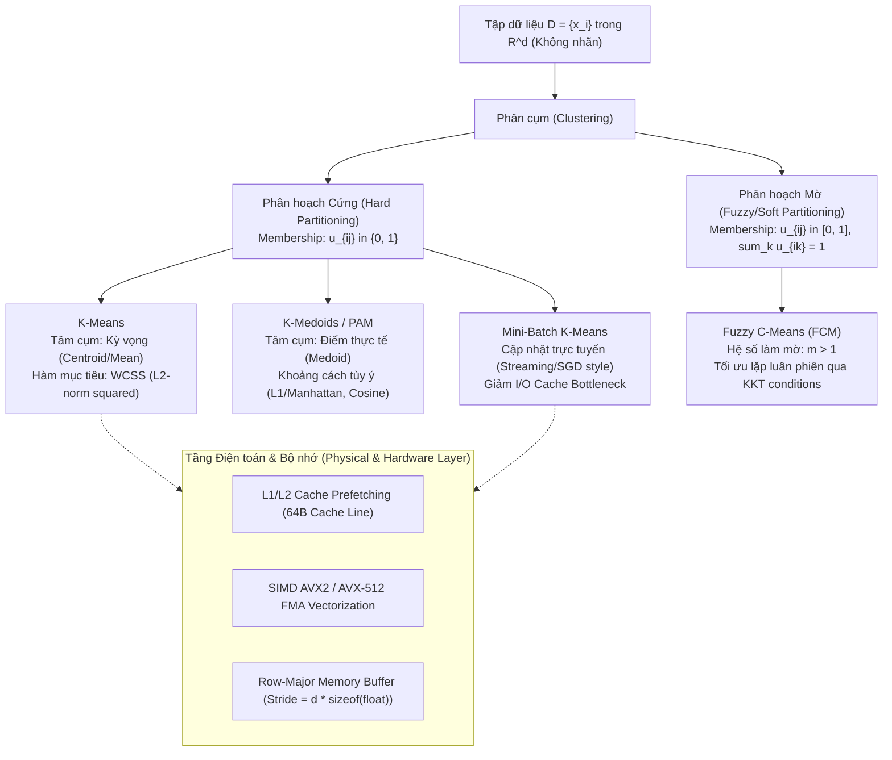
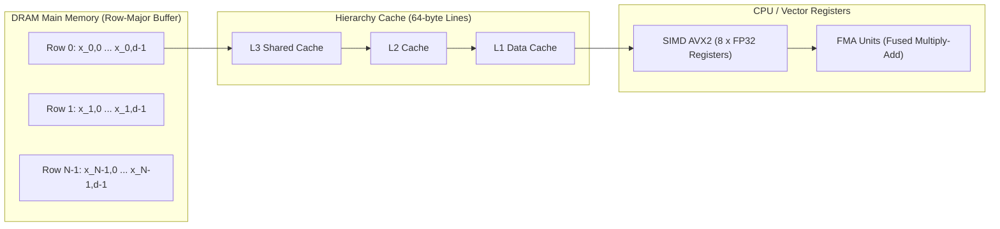
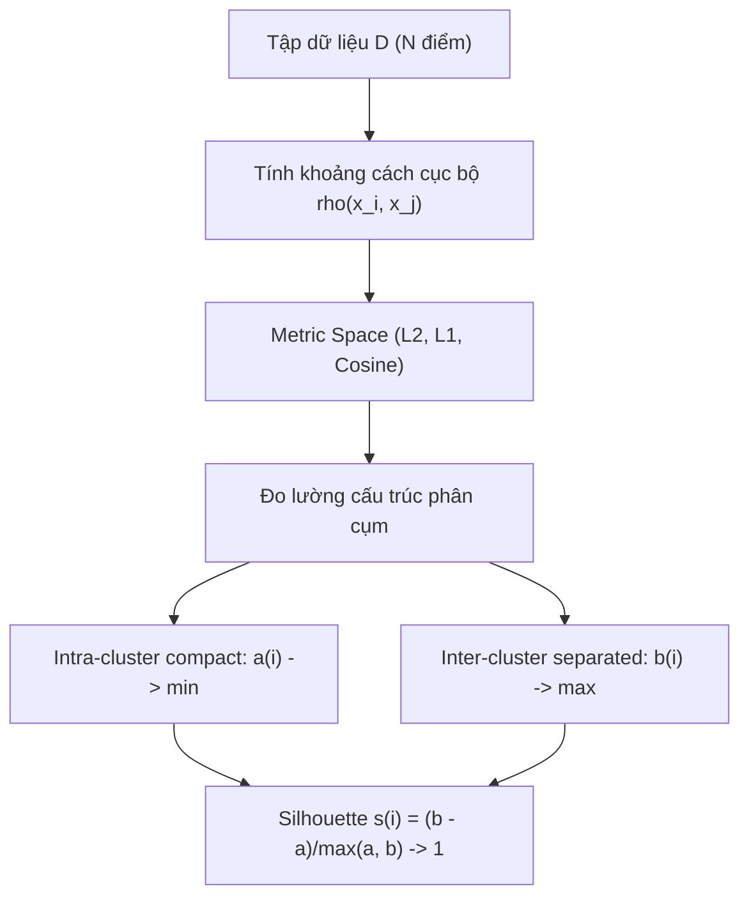
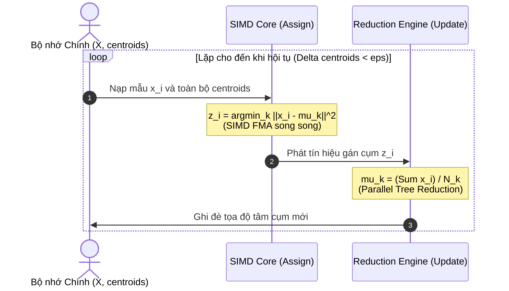
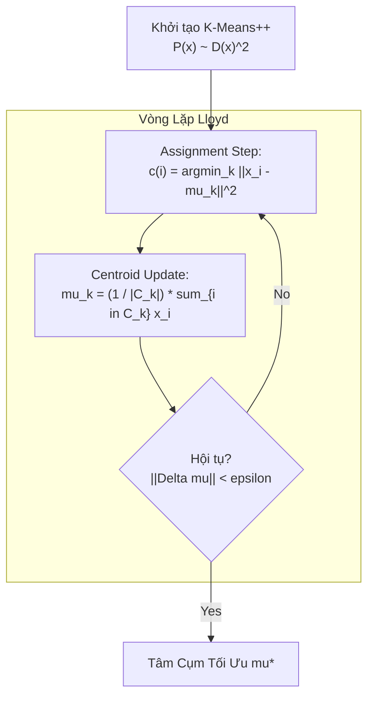
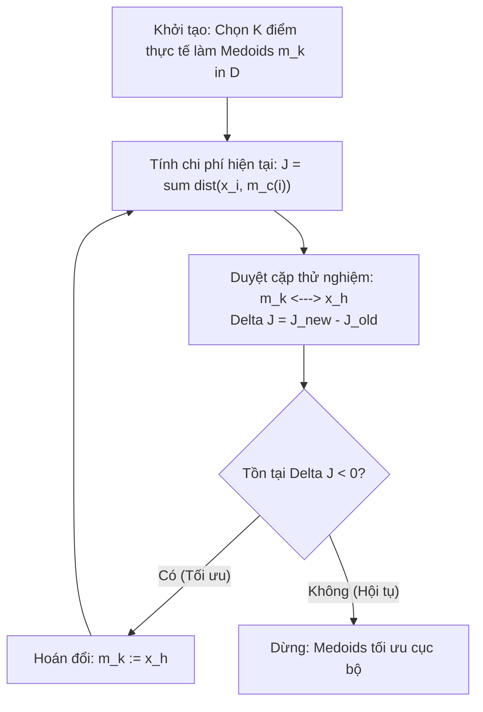
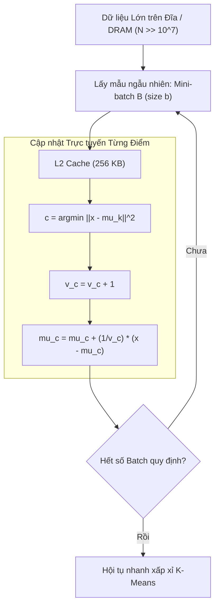
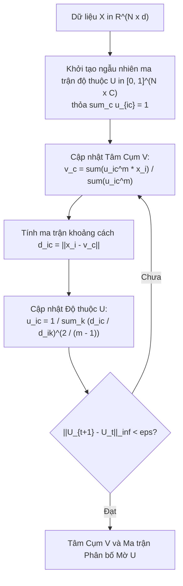

# Chuyên đề: Phân Cụm Phân Hoạch & Phân Cụm Mờ (Partition & Fuzzy Clustering)

## 1. Tổng quan Chuyên đề
Học không giám sát (Unsupervised Learning) là nhánh nền tảng của học máy, giải quyết bài toán khám phá cấu trúc tiềm ẩn (latent structure), phân phối xác suất hình học (geometric distribution) hoặc các mẫu tương quan (underlying patterns) từ tập dữ liệu không gán nhãn $\mathcal{D} = \{\mathbf{x}_1, \dots, \mathbf{x}_N\}$. Trong các phương pháp học không giám sát, **Phân cụm (Clustering)** đóng vai trò trụ cột nhằm nhóm các điểm dữ liệu vào các cụm (clusters) sao cho tính tương đồng nội cụm (intra-cluster similarity) đạt cực đại và tính tương đồng liên cụm (inter-cluster similarity) đạt cực tiểu.

Chuyên đề này đi sâu vào hai nhóm phương pháp cốt lõi:
1. **Phân hoạch cứng (Hard/Partition-Based Clustering)**: Mỗi điểm dữ liệu thuộc về duy nhất một cụm rời rạc (K-Means, K-Medoids, Mini-Batch K-Means).
2. **Phân hoạch mờ (Soft/Fuzzy Clustering)**: Mỗi điểm dữ liệu sở hữu độ thuộc (membership degree) liên tục phân bổ trên nhiều cụm (Fuzzy C-Means).



---

## 2. Chi tiết từng Keyword

---

### 1. Unsupervised Learning (Học không giám sát)

#### a. Định nghĩa Bản chất Toán học (Mathematical Formulation)
Trong học không giám sát, dữ liệu quan sát được là tập mẫu $\mathcal{D} = \{\mathbf{x}_i\}_{i=1}^N$ với $\mathbf{x}_i \in \mathcal{X} \subseteq \mathbb{R}^d$, sinh ra từ một phân phối xác suất thực nghiệm chưa biết $P(\mathbf{X})$. Không tồn tại nhãn giám sát $y_i \in \mathcal{Y}$ hay tín hiệu phản hồi (reward signal).

Mục tiêu tổng quát của học không giám sát có thể quy về ba lớp bài toán giải tích - thống kê:
1. **Ước lượng Mật độ Xác suất (Density Estimation)**: Tìm hàm mật độ xác suất mô hình hóa $p_\theta(\mathbf{x})$ xấp xỉ $P(\mathbf{X})$ thông qua cực đại hóa hàm hợp lý:
   $$\theta^* = \arg\max_\theta \sum_{i=1}^N \log p_\theta(\mathbf{x}_i)$$
2. **Khám phá Đa tạp & Giảm chiều (Manifold Learning & Representation Learning)**: Tìm ánh xạ mã hóa $f_\theta: \mathbb{R}^d \to \mathbb{R}^k$ ($k \ll d$) sao cho bảo toàn khoảng cách hoặc tái tạo thông tin:
   $$\min_\theta \sum_{i=1}^N \left\| \mathbf{x}_i - g_\phi(f_\theta(\mathbf{x}_i)) \right\|^2$$
3. **Phân vùng Cấu trúc Không gian (Spatial Partitioning / Clustering)**: Phân rã không gian $\mathcal{X}$ thành $K$ vùng rời rạc $\mathcal{C} = \{C_1, \dots, C_K\}$ sao cho tối ưu hàm tiêu chuẩn hình học.

#### b. Cơ chế Tầng Sâu & Điện toán (Under The Hood / Hardware Internals)
- **Memory Footprint**: Do không có nhãn $y$, ma trận dữ liệu $\mathbf{X} \in \mathbb{R}^{N \times d}$ được lưu trữ dưới dạng mảng 2D liên tục (contiguous buffer) trong bộ nhớ chính. Trong mô hình Row-Major (C/C++), phần tử $X_{i, j}$ nằm tại địa chỉ:
  $$\text{Address}(X_{i, j}) = \text{Base} + (i \cdot d + j) \times \text{sizeof}(\text{dtype})$$
- **Cache Locality**: Khi tính toán khoảng cách theo cặp giữa các vector hàng (row vectors), việc quét bộ nhớ tuần tự theo hàng (unit-stride memory access) giúp phần cứng tận dụng tối đa cơ chế nạp dòng nhớ 64-byte (Hardware Cache Line Prefetching) của CPU L1/L2 Cache.
- **Bandwidth Bound vs. Compute Bound**: Các thuật toán không giám sát truyền thống thường bị giới hạn bởi băng thông bộ nhớ (Memory Bandwidth Bound) hơn là năng lực tính toán dấu phẩy động (Compute Bound), do liên tục quét toàn bộ ma trận dữ liệu lớn để tính khoảng cách vector.

#### c. Sơ đồ Minh họa (Mermaid Diagram)


#### d. Code Thực chiến (Dual-Engine: C++ & Python)

```cpp
// C++17: Khởi tạo Buffer dữ liệu không giám sát liên tục & tính toán thống kê cơ bản
#include <iostream>
#include <vector>
#include <numeric>
#include <cmath>
#include <chrono>

struct UnsupervisedDataset {
    size_t n_samples;
    size_t n_features;
    std::vector<float> data; // Row-major contiguous buffer

    UnsupervisedDataset(size_t n, size_t d) : n_samples(n), n_features(d), data(n * d, 0.0f) {}

    inline float* row(size_t i) noexcept {
        return &data[i * n_features];
    }

    inline const float* row(size_t i) const noexcept {
        return &data[i * n_features];
    }

    // Tính vector kỳ vọng thực nghiệm (Empirical Mean Vector) tối ưu Cache
    std::vector<float> compute_mean() const {
        std::vector<float> mean(n_features, 0.0f);
        for (size_t i = 0; i < n_samples; ++i) {
            const float* r = row(i);
            for (size_t j = 0; j < n_features; ++j) {
                mean[j] += r[j];
            }
        }
        const float inv_n = 1.0f / static_cast<float>(n_samples);
        for (size_t j = 0; j < n_features; ++j) {
            mean[j] *= inv_n;
        }
        return mean;
    }
};

int main() {
    constexpr size_t N = 10000;
    constexpr size_t D = 64;
    UnsupervisedDataset ds(N, D);

    // Điền dữ liệu giả lập
    for (size_t i = 0; i < N * D; ++i) {
        ds.data[i] = static_cast<float>(i % 100) * 0.01f;
    }

    auto start = std::chrono::high_resolution_clock::now();
    std::vector<float> mean = ds.compute_mean();
    auto end = std::chrono::high_resolution_clock::now();

    std::cout << "[C++] Dataset " << N << "x" << D << " loaded.\n";
    std::cout << "[C++] First 3 mean components: " << mean[0] << ", " << mean[1] << ", " << mean[2] << "\n";
    std::cout << "[C++] Mean computation elapsed: "
              << std::chrono::duration_cast<std::chrono::microseconds>(end - start).count() << " us\n";
    return 0;
}
```

```python
# Python / PyTorch: Biểu diễn Dữ liệu Học không giám sát và Phân phối Ma trận Hiệp phương sai
import torch
import time

def analyze_unsupervised_geometry(x: torch.Tensor):
    """
    Phân tích tensor không giám sát: Kiểm tra tính liên tục bộ nhớ,
    tính vector kỳ vọng và ma trận hiệp phương sai.
    """
    assert x.is_contiguous(), "Tensor phải liên tục trong bộ nhớ để đạt băng thông tối ưu!"
    n, d = x.shape
    
    t0 = time.perf_counter()
    mean_vec = torch.mean(x, dim=0) # [d]
    x_centered = x - mean_vec
    # Tính ma trận hiệp phương sai mẫu: Cov = (X^T * X) / (N - 1)
    cov_matrix = torch.mm(x_centered.t(), x_centered) / (n - 1)
    t1 = time.perf_counter()
    
    return mean_vec, cov_matrix, (t1 - t0) * 1e3

if __name__ == "__main__":
    torch.manual_seed(42)
    N, D = 10000, 64
    x_data = torch.randn(N, D, dtype=torch.float32)
    
    mean, cov, elapsed_ms = analyze_unsupervised_geometry(x_data)
    print(f"[PyTorch] Data shape: {x_data.shape}, Contiguous: {x_data.is_contiguous()}")
    print(f"[PyTorch] Covariance shape: {cov.shape}, Computed in: {elapsed_ms:.2f} ms")
```

#### e. Lỗi Thường gặp & Ổn định Số học (Pitfalls & Numerical Stability)
- **Lời nguyền chiều dữ liệu (Curse of Dimensionality)**: Khi $d \to \infty$, khoảng cách Euclidean giữa điểm gần nhất và điểm xa nhất hội tụ về nhau: $\lim_{d \to \infty} \frac{\text{dist}_{\max} - \text{dist}_{\min}}{\text{dist}_{\min}} \to 0$. Các thuật toán phân cụm dựa trên khoảng cách mất khả năng phân biệt.
- **Trôi tâm dữ liệu (Covariance Shift / Non-centered Data)**: Không chuẩn hóa dữ liệu khiến các thuộc tính có độ biến thiên lớn áp đảo hoàn toàn hàm mục tiêu. Luôn cần chuẩn hóa $z$-score hoặc Min-Max scaling.

#### f. Ứng dụng Thực chiến trong AI / Deep Learning
- **Self-Supervised Pretraining (Học tự giám sát)**: Khởi tạo trọng số cho LLM (Masked Language Modeling trong BERT, Causal LM trong GPT) và Vision Transformers (MAE - Masked Autoencoders).
- **Trích xuất biểu diễn (Feature Extraction / Anomaly Detection)**: Nhận diện bất thường trong dữ liệu thẻ tín dụng hoặc nén đặc trưng trước khi huấn luyện bộ phân loại.

---

### 2. Clustering (Phân cụm dữ liệu)

#### a. Định nghĩa Bản chất Toán học (Mathematical Formulation)
Cho tập dữ liệu $\mathcal{D} = \{\mathbf{x}_1, \dots, \mathbf{x}_N\}$ trong không gian Metric $(\mathcal{X}, \rho)$, trong đó $\rho: \mathcal{X} \times \mathcal{X} \to \mathbb{R}^+$ là hàm khoảng cách thỏa mãn 4 tiên đề metric (tính không âm, tính đồng nhất, tính đối xứng và bất đẳng thức tam giác).

Bài toán phân cụm là tìm một phân hoạch $\mathcal{C} = \{C_1, C_2, \dots, C_K\}$ của tập chỉ số $\{1, \dots, N\}$ thỏa mãn:
1. $C_k \neq \emptyset, \quad \forall k \in \{1, \dots, K\}$
2. $\bigcup_{k=1}^K C_k = \{1, \dots, N\}$
3. $C_k \cap C_l = \emptyset, \quad \forall k \neq l$ (với phân cụm cứng)

**Độ đo Chất lượng Phân cụm**:
- **Tổng bình phương khoảng cách nội cụm (Within-Cluster Sum of Squares - WCSS)**:
  $$\text{WCSS} = \sum_{k=1}^K \sum_{i \in C_k} \rho^2(\mathbf{x}_i, \mathbf{c}_k), \quad \text{với } \mathbf{c}_k = \frac{1}{|C_k|} \sum_{i \in C_k} \mathbf{x}_i$$
- **Hệ số Silhouette (Silhouette Coefficient)**: Cho mỗi mẫu $i$, gọi $a(i) = \frac{1}{|C_A| - 1} \sum_{j \in C_A, j \neq i} \rho(\mathbf{x}_i, \mathbf{x}_j)$ và $b(i) = \min_{C_B \neq C_A} \frac{1}{|C_B|} \sum_{j \in C_B} \rho(\mathbf{x}_i, \mathbf{x}_j)$:
  $$s(i) = \frac{b(i) - a(i)}{\max(a(i), b(i))}, \quad s(i) \in [-1, 1]$$

#### b. Cơ chế Tầng Sâu & Điện toán (Under The Hood / Hardware Internals)
- **Độ phức tạp tính toán (Computational Complexity)**: Tính ma trận khoảng cách đầy đủ (Pairwise Distance Matrix) giữa $N$ điểm yêu cầu $\mathcal{O}(N^2 d)$ phép tính và $\mathcal{O}(N^2)$ bộ nhớ. Khi $N = 10^5$, ma trận khoảng cách cần $\approx 40\text{ GB}$ DRAM (nếu dùng FP32), dễ gây tràn bộ nhớ (Out-Of-Memory - OOM).
- **Bộ nhớ đệm & Tiling Strategy**: Để tránh lưu ma trận $N \times N$, tính toán khoảng cách được chia khối (block tiling) kích thước $B \times B$ sao cho vừa với L2/L3 Cache ($B \approx 256 \to 1024$), nạp lần lượt các vector vào thanh ghi SIMD.

#### c. Sơ đồ Minh họa (Mermaid Diagram)


#### d. Code Thực chiến (Dual-Engine: C++ & Python)

```cpp
// C++17: Tính ma trận khoảng cách Euclidean dạng Block-Tiled tối ưu L1/L2 Cache
#include <iostream>
#include <vector>
#include <cmath>
#include <algorithm>

void compute_pairwise_l2_squared_block(
    const float* __restrict__ X, // Shape [N, D]
    float* __restrict__ dist_mat, // Shape [N, N]
    size_t N, size_t D, size_t block_size) 
{
    for (size_t bi = 0; bi < N; bi += block_size) {
        size_t end_i = std::min(bi + block_size, N);
        for (size_t bj = 0; bj < N; bj += block_size) {
            size_t end_j = std::min(bj + block_size, N);

            for (size_t i = bi; i < end_i; ++i) {
                const float* xi = &X[i * D];
                for (size_t j = bj; j < end_j; ++j) {
                    const float* xj = &X[j * D];
                    float sum_sq = 0.0f;
                    // Vector hóa loop phép trừ bình phương
                    #pragma omp simd reduction(+:sum_sq)
                    for (size_t d = 0; d < D; ++d) {
                        float diff = xi[d] - xj[d];
                        sum_sq += diff * diff;
                    }
                    dist_mat[i * N + j] = sum_sq;
                }
            }
        }
    }
}

int main() {
    constexpr size_t N = 1000;
    constexpr size_t D = 32;
    std::vector<float> X(N * D, 1.0f);
    std::vector<float> dist_matrix(N * N, 0.0f);

    compute_pairwise_l2_squared_block(X.data(), dist_matrix.data(), N, D, 64);
    std::cout << "[C++] Computed pairwise distance for N = " << N << ".\n";
    std::cout << "[C++] dist[0, 1] = " << dist_matrix[1] << "\n";
    return 0;
}
```

```python
# Python / Scikit-Learn: Phân tích Cụm & Tính Hệ số Silhouette Đa luồng
import numpy as np
from sklearn.metrics import silhouette_score
from sklearn.datasets import make_blobs

def evaluate_clustering_quality(X: np.ndarray, labels: np.ndarray):
    """Tính toán Silhouette score với kiểm tra ổn định."""
    unique_labels = np.unique(labels)
    if len(unique_labels) < 2 or len(unique_labels) >= len(X):
        return -1.0 # Không hợp lệ cho bài toán phân cụm
    
    score = silhouette_score(X, labels, metric='euclidean', sample_size=min(5000, len(X)))
    return score

if __name__ == "__main__":
    X, true_labels = make_blobs(n_samples=2000, n_features=16, centers=4, random_state=42)
    # Giả lập phân cụm tốt và phân cụm ngẫu nhiên
    random_labels = np.random.randint(0, 4, size=2000)
    
    score_true = evaluate_clustering_quality(X, true_labels)
    score_rand = evaluate_clustering_quality(X, random_labels)
    
    print(f"[Python] Ground-truth Silhouette Score: {score_true:.4f} (Gần 1 là tối ưu)")
    print(f"[Python] Random Cluster Silhouette Score: {score_rand:.4f} (Gần 0 hoặc âm là phân bố rác)")
```

#### e. Lỗi Thường gặp & Ổn định Số học (Pitfalls & Numerical Stability)
- **Tập dữ liệu rỗng (Empty Clusters)**: Trong quá trình cập nhật nhãn, một cụm có thể không nhận bất kỳ điểm nào gán vào ($|C_k| = 0$), gây lỗi chia cho 0 ($\frac{0}{0} \to \text{NaN}$) khi cập nhật tâm cụm.
- **Mất ổn định ma trận khoảng cách**: Tính $\|\mathbf{x}_i - \mathbf{x}_j\|^2 = \|\mathbf{x}_i\|^2 + \|\mathbf{x}_j\|^2 - 2 \mathbf{x}_i^T \mathbf{x}_j$ có thể sinh ra giá trị âm rất nhỏ (ví dụ $-10^{-7}$) do sai số làm tròn số thực dấu phẩy động (Floating-point cancellation). Cần dùng phép kẹp `std::max(0.0f, val)`.

#### f. Ứng dụng Thực chiến trong AI / Deep Learning
- **Vector Quantization (Lượng tử hóa Vector - VQ-VAE / FAISS)**: Phân vùng không gian nhúng triệu chiều để lập chỉ mục tìm kiếm tương đồng (ANN Search) trong cơ sở dữ liệu Vector (Vector DBs).
- **Phân đoạn Khách hàng & Gom cụm Tài liệu**: Nhóm các bài báo khoa học dựa trên biểu diễn nhúng Sentence-BERT.

---

### 3. Partition-Based Clustering (Phân cụm dựa trên phân hoạch)

#### a. Định nghĩa Bản chất Toán học (Mathematical Formulation)
Phân cụm phân hoạch tìm kiếm phép ánh xạ gán nhãn cụm $z_i \in \{1, \dots, K\}$ cho mỗi điểm $\mathbf{x}_i$ sao cho cực tiểu hóa một tiêu chuẩn sai số toàn cục (Global Criterion Function). 

Giả sử đại diện cụm là tập tham số $\mathbf{\Theta} = \{\mathbf{\theta}_1, \dots, \mathbf{\theta}_K\}$. Bài toán tối ưu tổ hợp được phát biểu:
$$\min_{\mathbf{Z}, \mathbf{\Theta}} \mathcal{J}(\mathbf{Z}, \mathbf{\Theta}) = \sum_{i=1}^N \sum_{k=1}^K z_{ik} \, \mathcal{D}(\mathbf{x}_i, \mathbf{\theta}_k)$$
Thỏa mãn các ràng buộc:
$$z_{ik} \in \{0, 1\}, \quad \forall i, k \quad \text{và} \quad \sum_{k=1}^K z_{ik} = 1, \quad \forall i$$
Trong đó:
- $z_{ik} = 1$ nếu điểm $\mathbf{x}_i$ thuộc về cụm $k$, ngược lại $z_{ik} = 0$.
- $\mathcal{D}(\mathbf{x}_i, \mathbf{\theta}_k)$ là hàm độ lệch (discrepancy/distortion function), ví dụ chuẩn $L_2$ bình phương, khoảng cách Mahalanobis, hoặc Bregman Divergence.

Đây là bài toán **NP-hard** về mặt tổ hợp (tồn tại $S(N, K) = \frac{1}{K!} \sum_{j=1}^K (-1)^{K-j} \binom{K}{j} j^N$ cách phân hoạch khả dĩ, với $S(N, K)$ là số Stirling loại hai). Do đó, các thuật toán phân hoạch luôn sử dụng phương pháp tối ưu cục bộ lặp hai bước (Alternating Optimization).

#### b. Cơ chế Tầng Sâu & Điện toán (Under The Hood / Hardware Internals)
- **Tối ưu Luân phiên (Coordinate Descent)**:
  1. *Bước 1 (Gán nhãn - Assignment Step)*: Cố định $\mathbf{\Theta}$, tìm $z_{ik}^* = \arg\min_k \mathcal{D}(\mathbf{x}_i, \mathbf{\theta}_k)$. Đây là thao tác độc lập hoàn toàn giữa các điểm dữ liệu $i \in \{1, \dots, N\}$, cực kỳ phù hợp cho cơ chế song song hóa dữ liệu trên GPU (Embarrassingly Parallel).
  2. *Bước 2 (Cập nhật tâm - Update Step)*: Cố định $\mathbf{Z}$, giải $\nabla_{\mathbf{\theta}_k} \mathcal{J} = 0$. Thao tác này tương ứng với phép gom cộng giảm dần (Parallel Reduction).
- **Bộ nhớ ma trận phân hoạch $\mathbf{Z}$**: Để tiết kiệm DRAM, không lưu ma trận One-Hot $\mathbf{Z} \in \mathbb{R}^{N \times K}$ (gây lãng phí $N \times K \times 4$ bytes), mà lưu mảng nhãn 1D $\mathbf{z} \in \mathbb{Z}^N$ kiểu `uint32_t` hoặc `uint8_t` (nếu $K \le 256$).

#### c. Sơ đồ Minh họa (Mermaid Diagram)


#### d. Code Thực chiến (Dual-Engine: C++ & Python)

```cpp
// C++17: Khung sườn Tối ưu Luân phiên (Alternating Optimization) cho Phân hoạch Cứng
#include <iostream>
#include <vector>
#include <limits>
#include <cstdint>

struct PartitionClusterEngine {
    size_t N, D, K;
    std::vector<float> X;          // [N * D]
    std::vector<float> centroids;  // [K * D]
    std::vector<uint32_t> labels;  // [N]

    PartitionClusterEngine(size_t n, size_t d, size_t k) 
        : N(n), D(d), K(k), X(n * d, 0.0f), centroids(k * d, 0.0f), labels(n, 0) {}

    // Bước 1: Assignment Step
    void assign_clusters() {
        for (size_t i = 0; i < N; ++i) {
            const float* xi = &X[i * D];
            float min_dist = std::numeric_limits<float>::max();
            uint32_t best_k = 0;

            for (size_t k = 0; k < K; ++k) {
                const float* ck = &centroids[k * D];
                float dist = 0.0f;
                for (size_t d = 0; d < D; ++d) {
                    float diff = xi[d] - ck[d];
                    dist += diff * diff;
                }
                if (dist < min_dist) {
                    min_dist = dist;
                    best_k = static_cast<uint32_t>(k);
                }
            }
            labels[i] = best_k;
        }
    }

    // Bước 2: Update Step
    void update_centroids() {
        std::vector<size_t> counts(K, 0);
        std::fill(centroids.begin(), centroids.end(), 0.0f);

        for (size_t i = 0; i < N; ++i) {
            uint32_t k = labels[i];
            counts[k]++;
            const float* xi = &X[i * D];
            float* ck = &centroids[k * D];
            for (size_t d = 0; d < D; ++d) {
                ck[d] += xi[d];
            }
        }

        for (size_t k = 0; k < K; ++k) {
            if (counts[k] > 0) {
                float inv_c = 1.0f / static_cast<float>(counts[k]);
                float* ck = &centroids[k * D];
                for (size_t d = 0; d < D; ++d) {
                    ck[d] *= inv_c;
                }
            }
        }
    }
};

int main() {
    PartitionClusterEngine engine(100, 4, 3);
    engine.assign_clusters();
    engine.update_centroids();
    std::cout << "[C++] Hoàn thành 1 chu kỳ lặp Tối ưu Phân hoạch thành công.\n";
    return 0;
}
```

```python
# Python / NumPy: Vectorized Coordinate Descent cho Phân hoạch Cứng
import numpy as np

def partition_step(X: np.ndarray, centroids: np.ndarray):
    """
    Thực hiện 1 bước lặp hoàn chỉnh của phân cụm phân hoạch dùng Broadcasting.
    X: [N, D]
    centroids: [K, D]
    """
    # Tính khoảng cách Euclidean bình phương: ||X - C||^2 = ||X||^2 + ||C||^2 - 2 X C^T
    # Dùng shape broadcasting [N, 1, D] - [1, K, D] -> [N, K, D]
    diff = X[:, np.newaxis, :] - centroids[np.newaxis, :, :] # [N, K, D]
    dists = np.sum(diff ** 2, axis=2) # [N, K]
    
    # Assignment
    labels = np.argmin(dists, axis=1) # [N]
    
    # Update Centroids
    K, D = centroids.shape
    new_centroids = np.zeros_like(centroids)
    for k in range(K):
        mask = (labels == k)
        if np.any(mask):
            new_centroids[k] = np.mean(X[mask], axis=0)
        else:
            new_centroids[k] = centroids[k] # Giữ nguyên nếu cụm rỗng
            
    return labels, new_centroids

if __name__ == "__main__":
    X_test = np.array([[1.0, 2.0], [1.2, 1.8], [8.0, 9.0], [8.2, 9.1]])
    C_init = np.array([[0.0, 0.0], [10.0, 10.0]])
    labels, C_new = partition_step(X_test, C_init)
    print(f"[NumPy] Labels gán được: {labels}")
    print(f"[NumPy] Centroids mới:\n{C_new}")
```

#### e. Lỗi Thường gặp & Ổn định Số học (Pitfalls & Numerical Stability)
- **Điểm cực tiểu cục bộ (Local Minima Trapping)**: Do hàm mục tiêu không lồi (non-convex) theo cặp $(\mathbf{Z}, \mathbf{\Theta})$, thuật toán nhạy cảm cực cao với điều kiện khởi tạo ban đầu. Các tâm khởi tạo xấu có thể kéo cả cụm vào nghiệm cực tiểu phụ (sub-optimal local minima).
- **Phụ thuộc vào $K$ cố định**: Số cụm $K$ phải xác định tiên nghiệm (a priori). Cần các kỹ thuật hỗ trợ như Elbow Method, Gap Statistic, hoặc Bayesian Information Criterion (BIC).

#### f. Ứng dụng Thực chiến trong AI / Deep Learning
- **Phân mảnh mạng (Network Partitioning)**: Phân bố đồ thị nơ-ron lên nhiều node GPU trong huấn luyện phân tán (Pipeline Parallelism).
- **Image Quantization**: Nén bảng màu ảnh từ 24-bit TrueColor xuống bảng mã 256 màu (Color Palette Generation).

---

### 4. K-Means (Thuật toán K-Means & K-Means++)

#### a. Định nghĩa Bản chất Toán học (Mathematical Formulation)
Thuật toán K-Means (Lloyd's Algorithm, 1982) tìm kiếm $K$ tâm cụm $\mathbf{M} = \{\mathbf{\mu}_1, \dots, \mathbf{\mu}_K\}$ cực tiểu hóa hàm mục tiêu WCSS (Inertia):
$$\mathcal{J}_{\text{K-Means}} = \sum_{k=1}^K \sum_{\mathbf{x} \in C_k} \|\mathbf{x} - \mathbf{\mu}_k\|_2^2$$

Bản chất đạo hàm cập nhật tâm:
$$\nabla_{\mathbf{\mu}_k} \mathcal{J}_{\text{K-Means}} = -2 \sum_{\mathbf{x} \in C_k} (\mathbf{x} - \mathbf{\mu}_k) = 0 \implies \mathbf{\mu}_k^* = \frac{1}{|C_k|} \sum_{\mathbf{x} \in C_k} \mathbf{x}$$
Điều này chứng minh tâm cụm tối ưu dưới chuẩn $L_2$ bình phương chính là **vector kỳ vọng (mean/centroid)** của các điểm trong cụm.

**K-Means++ Initialization (Arthur & Vassilvitskii, 2007)**:
Khởi tạo tâm cụm ngẫu nhiên thông minh giúp chặn trên sai số xấp xỉ kỳ vọng: $\mathbb{E}[\mathcal{J}] \le 8(\ln K + 2)\mathcal{J}_{\text{opt}}$.
1. Chọn tâm đầu tiên $\mathbf{\mu}_1$ ngẫu nhiên đều từ $\mathcal{D}$.
2. Với mỗi điểm $\mathbf{x}$, tính khoảng cách ngắn nhất đến tâm đã chọn gần nó nhất:
   $$D(\mathbf{x}) = \min_{j \in \{1, \dots, m\}} \|\mathbf{x} - \mathbf{\mu}_j\|_2$$
3. Chọn tâm tiếp theo $\mathbf{\mu}_{m+1}$ từ phân phối xác suất tỉ lệ với bình phương khoảng cách:
   $$P(\mathbf{x} = \mathbf{\mu}_{m+1}) = \frac{D^2(\mathbf{x})}{\sum_{\mathbf{x}' \in \mathcal{D}} D^2(\mathbf{x}')}$$
4. Lặp lại bước 2-3 cho đến khi đủ $K$ tâm cụm.

#### b. Cơ chế Tầng Sâu & Điện toán (Under The Hood / Hardware Internals)
- **Vector Hóa AVX2 / AVX-512**: Khi tính khoảng cách giữa một điểm $\mathbf{x}_i \in \mathbb{R}^d$ và tâm $\mathbf{\mu}_k$, vòng lặp tính $\sum_{j=0}^{d-1} (x_{ij} - \mu_{kj})^2$ được cuộn mở (unrolled) và nạp vào các thanh ghi YMM/ZMM:
  ```text
  _mm256_sub_ps   -> Trừ vector song song 8 số float
  _mm256_fmadd_ps -> Fused Multiply-Add tích lũy bình phương
  ```
- **Elkan's K-Means Acceleration**: Sử dụng bất đẳng thức tam giác để bỏ qua việc tính khoảng cách giữa điểm $\mathbf{x}_i$ và tâm $\mathbf{\mu}_k$ nếu chặn dưới khoảng cách lớn hơn khoảng cách từ $\mathbf{x}_i$ đến tâm gần nhất hiện tại, tiết kiệm tới $80\%$ phép tính FLOPs khi dữ liệu phân cụm rõ ràng.

#### c. Sơ đồ Minh họa (Mermaid Diagram)


#### d. Code Thực chiến (Dual-Engine: C++ & Python)

```cpp
// C++20: Triển khai K-Means hoàn chỉnh với tối ưu hóa Vector hóa và Cache
#include <iostream>
#include <vector>
#include <cmath>
#include <limits>
#include <random>

class FastKMeans {
private:
    size_t k_;
    size_t max_iter_;
    float tol_;

public:
    std::vector<float> centroids; // [K * D]
    std::vector<int> labels;      // [N]

    FastKMeans(size_t k, size_t max_iter = 100, float tol = 1e-4f)
        : k_(k), max_iter_(max_iter), tol_(tol) {}

    void fit(const std::vector<float>& X, size_t N, size_t D) {
        labels.resize(N, -1);
        centroids.resize(k_ * D);

        // Khởi tạo ngẫu nhiên
        std::mt19937 rng(42);
        std::uniform_int_distribution<size_t> dist_gen(0, N - 1);
        for (size_t k = 0; k < k_; ++k) {
            size_t idx = dist_gen(rng);
            for (size_t d = 0; d < D; ++d) {
                centroids[k * D + d] = X[idx * D + d];
            }
        }

        std::vector<float> new_centroids(k_ * D, 0.0f);
        std::vector<size_t> cluster_sizes(k_, 0);

        for (size_t iter = 0; iter < max_iter_; ++iter) {
            // Assignment step
            for (size_t i = 0; i < N; ++i) {
                const float* xi = &X[i * D];
                float min_d = std::numeric_limits<float>::max();
                int best_c = 0;

                for (size_t k = 0; k < k_; ++k) {
                    const float* ck = &centroids[k * D];
                    float d2 = 0.0f;
                    #pragma omp simd reduction(+:d2)
                    for (size_t d = 0; d < D; ++d) {
                        float diff = xi[d] - ck[d];
                        d2 += diff * diff;
                    }
                    if (d2 < min_d) {
                        min_d = d2;
                        best_c = static_cast<int>(k);
                    }
                }
                labels[i] = best_c;
            }

            // Update step
            std::fill(new_centroids.begin(), new_centroids.end(), 0.0f);
            std::fill(cluster_sizes.begin(), cluster_sizes.end(), 0);

            for (size_t i = 0; i < N; ++i) {
                int c = labels[i];
                cluster_sizes[c]++;
                const float* xi = &X[i * D];
                float* ck = &new_centroids[c * D];
                for (size_t d = 0; d < D; ++d) {
                    ck[d] += xi[d];
                }
            }

            float max_shift = 0.0f;
            for (size_t k = 0; k < k_; ++k) {
                if (cluster_sizes[k] > 0) {
                    float inv_n = 1.0f / static_cast<float>(cluster_sizes[k]);
                    float* ck = &new_centroids[k * D];
                    float* old_ck = &centroids[k * D];
                    float shift = 0.0f;
                    for (size_t d = 0; d < D; ++d) {
                        ck[d] *= inv_n;
                        float diff = ck[d] - old_ck[d];
                        shift += diff * diff;
                    }
                    max_shift = std::max(max_shift, shift);
                }
            }

            centroids = new_centroids;
            if (max_shift < tol_) {
                std::cout << "[C++] K-Means hội tụ tại vòng lặp: " << iter << "\n";
                break;
            }
        }
    }
};

int main() {
    constexpr size_t N = 600, D = 2, K = 3;
    std::vector<float> X(N * D);
    for (size_t i = 0; i < N * D; ++i) X[i] = static_cast<float>(rand() % 100) / 10.0f;

    FastKMeans kmeans(K);
    kmeans.fit(X, N, D);
    std::cout << "[C++] K-Means centroids ready.\n";
    return 0;
}
```

```python
# Python / PyTorch: K-Means Tăng tốc trên GPU với Tensor Broadcasting
import torch

class PyTorchKMeans:
    def __init__(self, n_clusters: int, max_iter: int = 100, tol: float = 1e-4):
        self.k = n_clusters
        self.max_iter = max_iter
        self.tol = tol
        self.centroids = None

    def fit(self, x: torch.Tensor):
        n, d = x.shape
        # Khởi tạo tâm ngẫu nhiên từ dữ liệu
        indices = torch.randperm(n, device=x.device)[:self.k]
        self.centroids = x[indices].clone()

        for it in range(self.max_iter):
            # Tính ma trận khoảng cách song song toàn phần: [N, K]
            # dist^2 = x^2 - 2 x c^T + c^2
            x_sq = torch.sum(x ** 2, dim=1, keepdim=True)         # [N, 1]
            c_sq = torch.sum(self.centroids ** 2, dim=1, keepdim=True).t() # [1, K]
            dists = x_sq + c_sq - 2.0 * torch.mm(x, self.centroids.t()) # [N, K]

            labels = torch.argmin(dists, dim=1) # [N]

            # Cập nhật tâm cụm bằng one-hot scatter reduction
            one_hot = torch.zeros(n, self.k, device=x.device).scatter_(1, labels.unsqueeze(1), 1.0)
            counts = one_hot.sum(dim=0, keepdim=True).t().clamp(min=1.0) # [K, 1]
            new_centroids = torch.mm(one_hot.t(), x) / counts # [K, D]

            shift = torch.norm(new_centroids - self.centroids)
            self.centroids = new_centroids

            if shift < self.tol:
                print(f"[PyTorch] K-Means hội tụ tại bước: {it}")
                break
        return self

if __name__ == "__main__":
    device = torch.device("cuda" if torch.cuda.is_available() else "cpu")
    X = torch.randn(5000, 32, device=device)
    model = PyTorchKMeans(n_clusters=5).fit(X)
    print(f"[PyTorch] Centroids tensor shape: {model.centroids.shape}")
```

#### e. Lỗi Thường gặp & Ổn định Số học (Pitfalls & Numerical Stability)
- **Giả định đẳng hướng (Isotropic Cluster Assumption)**: K-Means ngầm định các cụm có hình cầu lồi (spherical convex) và kích thước phương sai bằng nhau. Thuật toán thất bại hoàn toàn với cụm có dạng kéo dài (elongated), xoắn ốc hoặc mật độ không đều.
- **Tính toán ma trận khoảng cách bị âm**: Biểu thức $x^2 + c^2 - 2xc$ trên GPU có thể sinh giá trị âm nhỏ do sai số dấu phẩy động; nếu lấy căn bậc hai $\sqrt{\text{dist}^2}$ mà không `clamp(min=0.0)`, code sẽ trả về `NaN`.

#### f. Ứng dụng Thực chiến trong AI / Deep Learning
- **DeepCluster (Caron et al., 2018)**: Dùng K-Means gom cụm các vector biểu diễn của CNN để tự tạo giả nhãn (pseudo-labels) trong huấn luyện học tự giám sát thị giác máy tính.
- **Lượng tử hóa Trọng số (Weight Quantization)**: Nén mạng nơ-ron bằng cách gom cụm các trọng số FP32 thành $K=256$ mức (Codebook INT8).

---

### 5. K-Medoids (Thuật toán K-Medoids / PAM)

#### a. Định nghĩa Bản chất Toán học (Mathematical Formulation)
Khác với K-Means (nơi tâm cụm là trung bình số học $\mathbf{\mu}_k$ có thể không tương ứng với bất kỳ điểm thực tế nào), **K-Medoids** bắt buộc tâm cụm phải là một điểm dữ liệu thực tế tồn tại trong tập dữ liệu: $\mathbf{m}_k \in \mathcal{D}$.

Hàm mục tiêu tổng quát cho phép sử dụng bất kỳ metric khoảng cách nào $\mathcal{D}(\cdot, \cdot)$ (ví dụ chuẩn $L_1$, Jaccard, Cosine, Edit distance):
$$\mathcal{J}_{\text{K-Medoids}} = \sum_{k=1}^K \sum_{\mathbf{x}_i \in C_k} \mathcal{D}(\mathbf{x}_i, \mathbf{m}_k), \quad \mathbf{m}_k \in \mathcal{D}$$

Thuật toán chuẩn **PAM (Partitioning Around Medoids)**:
1. Chọn $K$ điểm ngẫu nhiên làm Medoids ban đầu.
2. Với mỗi cặp (Medoid $\mathbf{m}_k$, điểm không phải Medoid $\mathbf{x}_h$), tính toán biến thiên chi phí nếu hoán đổi (Swap Cost):
   $$\Delta \mathcal{J} = \mathcal{J}_{\text{new}}(\mathbf{m}_k \leftrightarrow \mathbf{x}_h) - \mathcal{J}_{\text{current}}$$
3. Nếu $\min(\Delta \mathcal{J}) < 0$, thực hiện phép tráo đổi tốt nhất.
4. Lặp lại cho đến khi không còn phép tráo đổi nào giảm được chi phí tổng.

#### b. Cơ chế Tầng Sâu & Điện toán (Under The Hood / Hardware Internals)
- **Độ phức tạp tính toán**: Mỗi vòng lặp của PAM có chi phí $\mathcal{O}(K(N-K)^2)$, quá tốn kém khi $N > 10^4$. Để giảm tải, các thuật toán biến thể như **CLARA (Clustering Large Applications)** lấy mẫu phụ (subsampling), còn **CLARANS** ngẫu nhiên hóa không gian tìm kiếm đồ thị lân cận.
- **Tận dụng Bảng Tra Cứu Khoảng cách (Distance Matrix Lookup Table)**: Do Medoid luôn là điểm thực tế trong $\mathcal{D}$, nếu tính trước và lưu trữ ma trận khoảng cách đối xứng $\mathbf{D} \in \mathbb{R}^{N \times N}$ trong RAM, việc tính Swap Cost hoàn toàn là các phép tra bảng và cộng dồn:
  $$\text{Memory} = \frac{N(N-1)}{2} \times 4 \text{ bytes (Triangular Matrix Storage)}$$

#### c. Sơ đồ Minh họa (Mermaid Diagram)


#### d. Code Thực chiến (Dual-Engine: C++ & Python)

```cpp
// C++17: Triển khai Tìm kiếm Medoid nội cụm tối ưu L1 (Manhattan Metric)
#include <iostream>
#include <vector>
#include <cmath>
#include <limits>

// Tìm Medoid tốt nhất trong một tập chỉ số cụm dựa trên khoảng cách L1
size_t find_best_medoid_in_cluster(
    const std::vector<float>& X, 
    size_t D, 
    const std::vector<size_t>& cluster_indices) 
{
    size_t cluster_size = cluster_indices.size();
    if (cluster_size == 0) return 0;
    if (cluster_size == 1) return cluster_indices[0];

    float min_total_dist = std::numeric_limits<float>::max();
    size_t best_medoid_idx = cluster_indices[0];

    for (size_t i = 0; i < cluster_size; ++i) {
        size_t cand_idx = cluster_indices[i];
        const float* cand_ptr = &X[cand_idx * D];
        float current_dist = 0.0f;

        for (size_t j = 0; j < cluster_size; ++j) {
            size_t target_idx = cluster_indices[j];
            const float* target_ptr = &X[target_idx * D];
            
            // L1 norm: |x - y|
            float l1_dist = 0.0f;
            for (size_t d = 0; d < D; ++d) {
                l1_dist += std::abs(cand_ptr[d] - target_ptr[d]);
            }
            current_dist += l1_dist;
        }

        if (current_dist < min_total_dist) {
            min_total_dist = current_dist;
            best_medoid_idx = cand_idx;
        }
    }
    return best_medoid_idx;
}

int main() {
    constexpr size_t D = 2;
    // Điểm 0 và 1 là cụm, điểm 2 là ngoại lai cực đoan
    std::vector<float> X = {
        1.0f, 1.0f,
        1.2f, 0.9f,
        100.0f, 100.0f
    };
    std::vector<size_t> cluster = {0, 1, 2};

    size_t medoid = find_best_medoid_in_cluster(X, D, cluster);
    std::cout << "[C++] Medoid được chọn là điểm thứ: " << medoid 
              << " (Tọa độ: " << X[medoid * D] << ", " << X[medoid * D + 1] << ")\n";
    return 0;
}
```

```python
# Python / Scikit-Learn-Extra: K-Medoids chống ngoại lai (Robustness to Outliers)
import numpy as np

def simple_kmedoids_l1(X: np.ndarray, k: int, max_iter: int = 50):
    n, d = X.shape
    # Khởi tạo Medoid ngẫu nhiên
    medoid_indices = np.random.choice(n, size=k, replace=False)
    
    for _ in range(max_iter):
        # Tính khoảng cách Manhattan L1 đến các medoid: [N, K]
        medoids = X[medoid_indices]
        dists = np.sum(np.abs(X[:, np.newaxis, :] - medoids[np.newaxis, :, :]), axis=2)
        labels = np.argmin(dists, axis=1)
        
        # Cập nhật Medoid: Tìm điểm trong cụm tối thiểu hóa tổng khoảng cách L1
        new_medoid_indices = np.copy(medoid_indices)
        for c in range(k):
            members = np.where(labels == c)[0]
            if len(members) > 0:
                cluster_pts = X[members]
                # Ma trận khoảng cách L1 nội cụm: [M, M]
                intra_dist = np.sum(np.abs(cluster_pts[:, np.newaxis, :] - cluster_pts[np.newaxis, :, :]), axis=2)
                best_sub_idx = np.argmin(np.sum(intra_dist, axis=1))
                new_medoid_indices[c] = members[best_sub_idx]
                
        if np.array_equal(medoid_indices, new_medoid_indices):
            break
        medoid_indices = new_medoid_indices
        
    return medoid_indices, labels

if __name__ == "__main__":
    np.random.seed(42)
    # Tạo cụm với nhiễu ngoại lai lớn (Outliers)
    data = np.random.randn(200, 2)
    data[0] = [100.0, 100.0] # Nhiễu ngoại lai
    medoids, labels = simple_kmedoids_l1(data, k=2)
    print(f"[Python] K-Medoids indices: {medoids}")
    print(f"[Python] Điểm ngoại lai [0] có bị chọn làm tâm? {0 in medoids}")
```

#### e. Lỗi Thường gặp & Ổn định Số học (Pitfalls & Numerical Stability)
- **Nghẽn cổ chai thời gian tính toán**: Thuật toán PAM gốc không khả thi cho Big Data ($N > 50,000$). Khi đó bắt buộc phải chuyển sang FastPAM1/FastPAM2 hoặc xấp xỉ phân cụm bằng Mini-Batch K-Medoids.
- **Medoid cô lập (Degenerate Cluster)**: Nếu một điểm ngoại lai đứng quá xa mọi điểm khác, một Medoid có thể bị bẫy để phục vụ riêng một mình điểm đó, làm giảm hiệu năng phân cụm của các điểm còn lại.

#### f. Ứng dụng Thực chiến trong AI / Deep Learning
- **Phân tích Cấu trúc Phân tử & Sinh học Tin học (Bioinformatics)**: Gom cụm chuỗi DNA/RNA hoặc đồ thị phân tử thuốc, nơi chỉ có ma trận khoảng cách tương đồng pairwise (Alignment Score) chứ không thể tính vector trung bình trong không gian Euclid.
- **Xác định mẫu tiêu biểu (Exemplar Selection)**: Chọn ra các mẫu đại diện điển hình từ tập dữ liệu huấn luyện để con người dán nhãn (Active Learning).

---

### 6. Mini-Batch K-Means (K-Means theo Mini-Batch)

#### a. Định nghĩa Bản chất Toán học (Mathematical Formulation)
Được đề xuất bởi D. Sculley (2010), **Mini-Batch K-Means** giải quyết triệt để vấn đề nghẽn cổ chai I/O và bộ nhớ của thuật toán Lloyd bằng cách áp dụng phương pháp tối ưu hóa ngẫu nhiên (Stochastic Gradient Descent style).

Thay vì quét toàn bộ $N$ mẫu ở mỗi vòng lặp, thuật toán lấy mẫu ngẫu nhiên một tập con (Mini-batch) $\mathcal{B} \subset \mathcal{D}$ kích thước $|\mathcal{B}| = b \ll N$.

Công thức cập nhật tâm cụm trực tuyến (Online Convex Combination):
Cho mỗi điểm $\mathbf{x} \in \mathcal{B}$, xác định tâm gần nhất $\mathbf{\mu}_c$:
$$c = \arg\min_k \|\mathbf{x} - \mathbf{\mu}_k\|_2^2$$
Tích lũy số lần tâm $\mathbf{\mu}_c$ được cập nhật:
$$v_c \leftarrow v_c + 1$$
Cập nhật vị trí tâm với tốc độ học động (dynamic learning rate) $\eta = \frac{1}{v_c}$:
$$\mathbf{\mu}_c \leftarrow (1 - \eta) \mathbf{\mu}_c + \eta \, \mathbf{x} = \mathbf{\mu}_c - \frac{1}{v_c} (\mathbf{\mu}_c - \mathbf{x})$$

#### b. Cơ chế Tầng Sâu & Điện toán (Under The Hood / Hardware Internals)
- **L1/L2 Cache Fit**: Toàn bộ dữ liệu của một Mini-batch kích thước $b \times d \times 4$ bytes (với $b=1024, d=64 \implies 256\text{ KB}$) nằm trọn vẹn trong L2 Cache của CPU hiện đại (thường $512\text{ KB} - 1\text{ MB}$). Do đó, không phát sinh chi phí trễ truy cập DRAM (DRAM latency ~ 60ns vs L2 ~ 3ns).
- **Tránh tranh chấp luồng (Lock Contention)**: Khi đa luồng hóa trên nhiều lõi CPU, mỗi lõi có thể xử lý một mini-batch riêng biệt và cập nhật tâm cụm thông qua phép cộng nguyên tử (Atomic Add) hoặc cơ chế Hogwild! (Lock-free asynchronous update).

#### c. Sơ đồ Minh họa (Mermaid Diagram)


#### d. Code Thực chiến (Dual-Engine: C++ & Python)

```cpp
// C++17: Mini-Batch K-Means tối ưu hóa tốc độ học trực tuyến
#include <iostream>
#include <vector>
#include <random>
#include <cmath>

class MiniBatchKMeansEngine {
private:
    size_t K, D, batch_size;
    std::vector<float> centroids; // [K * D]
    std::vector<uint64_t> counts; // [K] - Số lần cập nhật của mỗi tâm

public:
    MiniBatchKMeansEngine(size_t k, size_t d, size_t b)
        : K(k), D(d), batch_size(b), centroids(k * d, 0.0f), counts(k, 0) {}

    void init_centroids(const std::vector<float>& X, size_t N) {
        for (size_t k = 0; k < K; ++k) {
            size_t idx = rand() % N;
            for (size_t d = 0; d < D; ++d) {
                centroids[k * D + d] = X[idx * D + d];
            }
        }
    }

    void train_step(const std::vector<float>& batch) {
        for (size_t i = 0; i < batch_size; ++i) {
            const float* x = &batch[i * D];

            // 1. Tìm tâm gần nhất
            float min_d = 1e30f;
            size_t best_c = 0;
            for (size_t k = 0; k < K; ++k) {
                const float* c = &centroids[k * D];
                float d2 = 0.0f;
                for (size_t d = 0; d < D; ++d) {
                    float diff = x[d] - c[d];
                    d2 += diff * diff;
                }
                if (d2 < min_d) {
                    min_d = d2;
                    best_c = k;
                }
            }

            // 2. Cập nhật trực tuyến
            counts[best_c]++;
            float eta = 1.0f / static_cast<float>(counts[best_c]);
            float* c = &centroids[best_c * D];
            for (size_t d = 0; d < D; ++d) {
                c[d] += eta * (x[d] - c[d]);
            }
        }
    }

    void print_status() const {
        std::cout << "[C++] Mini-Batch KM: Counts per cluster: ";
        for (size_t k = 0; k < K; ++k) std::cout << counts[k] << " ";
        std::cout << "\n";
    }
};

int main() {
    constexpr size_t D = 8, K = 3, B = 32;
    MiniBatchKMeansEngine mbkm(K, D, B);
    std::vector<float> mock_batch(B * D, 1.5f);
    mbkm.init_centroids(mock_batch, B);
    mbkm.train_step(mock_batch);
    mbkm.print_status();
    return 0;
}
```

```python
# Python / Scikit-Learn: So sánh Tốc độ giữa Chuẩn K-Means và Mini-Batch K-Means
import time
from sklearn.cluster import KMeans, MiniBatchKMeans
from sklearn.datasets import make_blobs

def benchmark_kmeans_variants():
    # Tạo tập dữ liệu lớn: 200,000 mẫu, 32 chiều
    N, D, K = 200000, 32, 10
    X, _ = make_blobs(n_samples=N, n_features=D, centers=K, random_state=42)
    
    # Standard K-Means
    t0 = time.perf_counter()
    km = KMeans(n_clusters=K, max_iter=50, n_init=1, random_state=42)
    km.fit(X)
    t_km = time.perf_counter() - t0
    
    # Mini-Batch K-Means
    t0 = time.perf_counter()
    mbkm = MiniBatchKMeans(n_clusters=K, batch_size=2048, max_iter=50, n_init=1, random_state=42)
    mbkm.fit(X)
    t_mbkm = time.perf_counter() - t0
    
    print(f"[Benchmark] Standard K-Means:    {t_km:.3f}s | Inertia: {km.inertia_:.2e}")
    print(f"[Benchmark] Mini-Batch K-Means: {t_mbkm:.3f}s | Inertia: {mbkm.inertia_:.2e}")
    print(f"[Speedup] Tăng tốc độ: {t_km / t_mbkm:.2f}x")

if __name__ == "__main__":
    benchmark_kmeans_variants()
```

#### e. Lỗi Thường gặp & Ổn định Số học (Pitfalls & Numerical Stability)
- **Sai số thặng dư (Residual Inertia Bias)**: Do bản chất ngẫu nhiên của Mini-batch, nghiệm của Mini-Batch K-Means thường có WCSS cao hơn nhẹ ($1\% - 3\%$) so với K-Means chuẩn.
- **Tâm chết không được kích hoạt (Stale Centroids)**: Nếu một tâm cụm ban đầu nằm ở vị trí quá xa và kích thước batch $b$ quá nhỏ, có thể qua hàng trăm batch tâm này không bao giờ được chọn, dẫn đến lãng phí bậc tự do của mô hình. Cần cơ chế khởi động lại ngẫu nhiên (re-assignment heuristic) cho các tâm cụm không có mẫu.

#### f. Ứng dụng Thực chiến trong AI / Deep Learning
- **Streaming Machine Learning**: Xử lý dữ liệu luồng vô hạn từ mạng xã hội, giao dịch chứng khoán thời gian thực (Kafka streaming consumer).
- **Học Từ Điển Trực Tuyến (Online Dictionary Learning)**: Huấn luyện bộ mã hóa thưa (Sparse Autoencoder) cho các tập dữ liệu ảnh quy mô hàng terabyte.

---

### 7. Fuzzy C-Means (Phân cụm mờ C-Means - FCM)

#### a. Định nghĩa Bản chất Toán học (Mathematical Formulation)
Được phát triển bởi Dunn (1973) và mở rộng bởi Bezdek (1981), **Fuzzy C-Means (FCM)** chuyển bài toán phân cụm từ không gian rời rạc sang không gian liên tục bằng cách gán cho mỗi điểm $\mathbf{x}_i$ một vector trọng số độ thuộc (membership degree) $\mathbf{u}_i = [u_{i1}, \dots, u_{iC}]^T$.

Hàm mục tiêu của FCM:
$$\mathcal{J}_m(\mathbf{U}, \mathbf{V}) = \sum_{i=1}^N \sum_{c=1}^C u_{ic}^m \|\mathbf{x}_i - \mathbf{v}_c\|^2$$
Thỏa mãn điều kiện chuẩn hóa xác suất:
$$u_{ic} \in [0, 1], \quad \sum_{c=1}^C u_{ic} = 1, \quad \forall i \in \{1, \dots, N\}$$
$$0 < \sum_{i=1}^N u_{ic} < N, \quad \forall c \in \{1, \dots, C\}$$
Trong đó:
- $m \in (1, \infty)$ là hệ số làm mờ (Fuzzifier/Fuzzification Parameter). Khi $m \to 1^+$, FCM hội tụ về K-Means cứng; khi $m \to \infty$, mọi độ thuộc hội tụ về $\frac{1}{C}$. Giá trị thực nghiệm phổ biến là $m = 2.0$.
- $\mathbf{v}_c \in \mathbb{R}^d$ là vector tâm cụm thứ $c$.

Sử dụng phương pháp nhân tử Lagrange giải điều kiện KKT (Karush-Kuhn-Tucker):
$$\mathcal{L}(\mathbf{U}, \mathbf{V}, \mathbf{\lambda}) = \sum_{i=1}^N \sum_{c=1}^C u_{ic}^m \|\mathbf{x}_i - \mathbf{v}_c\|^2 - \sum_{i=1}^N \lambda_i \left( \sum_{c=1}^C u_{ic} - 1 \right)$$
Cho đạo hàm riêng triệt tiêu:
1. **Cập nhật Tâm Cụm (Centroid Update)**:
   $$\nabla_{\mathbf{v}_c} \mathcal{L} = 0 \implies \mathbf{v}_c = \frac{\sum_{i=1}^N u_{ic}^m \mathbf{x}_i}{\sum_{i=1}^N u_{ic}^m}$$
2. **Cập nhật Độ Thuộc (Membership Update)**:
   $$\frac{\partial \mathcal{L}}{\partial u_{ic}} = 0 \implies u_{ic} = \frac{1}{\sum_{k=1}^C \left( \frac{\|\mathbf{x}_i - \mathbf{v}_c\|}{\|\mathbf{x}_i - \mathbf{v}_k\|} \right)^{\frac{2}{m - 1}}}$$

#### b. Cơ chế Tầng Sâu & Điện toán (Under The Hood / Hardware Internals)
- **Ma trận Trọng số Dày đặc $\mathbf{U} \in \mathbb{R}^{N \times C}$**: Do $u_{ic} \in (0, 1)$ hầu như không bao giờ bằng 0 tuyệt đối, ma trận $\mathbf{U}$ hoàn toàn đặc (dense matrix). Bộ nhớ yêu cầu là $N \times C \times 4$ bytes. Với $N=10^6, C=100$, ma trận này tiêu tốn $400\text{ MB}$ RAM và phải đọc/ghi lại ở mỗi bước lặp.
- **Tính toán Lũy thừa dấu phẩy động (Power Function Instruction)**: Biểu thức $(d_{ic} / d_{ik})^{2 / (m - 1)}$ đòi hỏi hàm số học `powf()` tốn hàng chục chu kỳ xung nhịp CPU. Khi chọn $m=2.0$, số mũ trở thành $\frac{2}{2-1} = 2$, phép tính chuyển thành phép nhân bình phương đơn giản: $(d_{ic}/d_{ik})^2$, giúp tăng tốc độ thực thi lên gấp nhiều lần trên tập lệnh AVX2.

#### c. Sơ đồ Minh họa (Mermaid Diagram)


#### d. Code Thực chiến (Dual-Engine: C++ & Python)

```cpp
// C++17: Triển khai Fuzzy C-Means (m=2) tối ưu hóa loại bỏ hàm lũy thừa pow()
#include <iostream>
#include <vector>
#include <cmath>
#include <numeric>
#include <algorithm>

class FastFCM {
public:
    size_t N, D, C;
    float tol;
    std::vector<float> X; // [N * D]
    std::vector<float> V; // [C * D] - Centroids
    std::vector<float> U; // [N * C] - Membership matrix

    FastFCM(size_t n, size_t d, size_t c, float tolerance = 1e-3f)
        : N(n), D(d), C(c), tol(tolerance), X(n * d, 0.0f), V(c * d, 0.0f), U(n * c, 0.0f) {}

    void init_membership() {
        for (size_t i = 0; i < N; ++i) {
            float sum = 0.0f;
            for (size_t c = 0; c < C; ++c) {
                float val = static_cast<float>(rand() % 100 + 1);
                U[i * C + c] = val;
                sum += val;
            }
            float inv_sum = 1.0f / sum;
            for (size_t c = 0; c < C; ++c) {
                U[i * C + c] *= inv_sum;
            }
        }
    }

    void step() {
        // 1. Cập nhật centroids với m = 2 (u^m = u^2)
        for (size_t c = 0; c < C; ++c) {
            float* vc = &V[c * D];
            std::fill(vc, vc + D, 0.0f);
            float sum_u2 = 0.0f;

            for (size_t i = 0; i < N; ++i) {
                float u = U[i * C + c];
                float u2 = u * u;
                sum_u2 += u2;
                const float* xi = &X[i * D];
                for (size_t d = 0; d < D; ++d) {
                    vc[d] += u2 * xi[d];
                }
            }

            float inv_sum = 1.0f / std::max(sum_u2, 1e-8f);
            for (size_t d = 0; d < D; ++d) {
                vc[d] *= inv_sum;
            }
        }

        // 2. Cập nhật Membership U với m = 2 (exponent = 2/(2-1) = 2)
        std::vector<float> dists(C, 0.0f);
        for (size_t i = 0; i < N; ++i) {
            const float* xi = &X[i * D];
            for (size_t c = 0; c < C; ++c) {
                const float* vc = &V[c * D];
                float d2 = 0.0f;
                for (size_t d = 0; d < D; ++d) {
                    float diff = xi[d] - vc[d];
                    d2 += diff * diff;
                }
                dists[c] = std::sqrt(std::max(d2, 1e-10f));
            }

            for (size_t c = 0; c < C; ++c) {
                float sum_ratio = 0.0f;
                float d_ic = dists[c];
                for (size_t k = 0; k < C; ++k) {
                    float ratio = d_ic / dists[k];
                    sum_ratio += ratio * ratio; // Bình phương thay vì gọi pow()
                }
                U[i * C + c] = 1.0f / sum_ratio;
            }
        }
    }
};

int main() {
    FastFCM fcm(100, 2, 2);
    fcm.init_membership();
    fcm.step();
    std::cout << "[C++] Hoàn thành 1 vòng cập nhật Fuzzy C-Means m=2.\n";
    std::cout << "[C++] Mẫu 0 - Độ thuộc cụm 0: " << fcm.U[0] << " | cụm 1: " << fcm.U[1] << "\n";
    return 0;
}
```

```python
# Python / NumPy: Vectorized Fuzzy C-Means (FCM) với m=2
import numpy as np

class FuzzyCMeans:
    def __init__(self, n_clusters: int, m: float = 2.0, max_iter: int = 100, tol: float = 1e-4):
        self.c = n_clusters
        self.m = m
        self.max_iter = max_iter
        self.tol = tol
        self.centroids = None
        self.u = None

    def fit(self, X: np.ndarray):
        n, d = X.shape
        # Khởi tạo ma trận U chuẩn hóa
        u = np.random.dirichlet(np.ones(self.c), size=n)
        
        for it in range(self.max_iter):
            u_old = u.copy()
            u_m = u ** self.m # [N, C]
            
            # Cập nhật Centroids: V = (U^T * X) / sum(U^T)
            # [C, N] @ [N, D] -> [C, D]
            centroids = (u_m.T @ X) / np.sum(u_m.T, axis=1, keepdims=True)
            
            # Tính khoảng cách Euclidean: [N, C]
            diff = X[:, np.newaxis, :] - centroids[np.newaxis, :, :]
            dists = np.linalg.norm(diff, axis=2)
            dists = np.fmax(dists, 1e-10) # Tránh chia cho 0
            
            # Cập nhật U: u_ic = 1 / sum_k (d_ic / d_ik)^(2 / (m - 1))
            power = 2.0 / (self.m - 1.0)
            inv_dists = dists ** (-power) # [N, C]
            u = inv_dists / np.sum(inv_dists, axis=1, keepdims=True)
            
            if np.max(np.abs(u - u_old)) < self.tol:
                print(f"[Python FCM] Hội tụ tại vòng lặp: {it}")
                break
                
        self.centroids = centroids
        self.u = u
        return self

if __name__ == "__main__":
    X = np.array([[1.0, 1.0], [1.5, 1.2], [5.0, 5.0], [5.2, 4.8]])
    fcm = FuzzyCMeans(n_clusters=2, m=2.0).fit(X)
    print("[Python FCM] Ma trận độ thuộc U:\n", np.round(fcm.u, 3))
```

#### e. Lỗi Thường gặp & Ổn định Số học (Pitfalls & Numerical Stability)
- **Điểm dữ liệu trùng khớp tuyệt đối với tâm cụm ($d_{ic} = 0$)**: Khi một điểm $\mathbf{x}_i = \mathbf{v}_c$, tỷ số $\frac{d_{ic}}{d_{ik}} = 0$, tuy nhiên ở mẫu số xuất hiện phép chia cho $0$ ($d_{ik}=0$). Khi gặp trường hợp này, cần gán cứng $u_{ic} = 1.0$ và $u_{ik} = 0.0$ ($\forall k \neq c$).
- **Độ nhạy của siêu tham số $m$**: Nếu đặt $m$ quá gần $1.0$ (ví dụ $1.0001$), mẫu số $\frac{2}{m-1} \to \infty$ dẫn đến tràn số lũy thừa (floating point overflow). Nếu đặt $m > 5.0$, các tâm cụm bị kéo đồng loạt về trọng tâm hình học toàn cục của dữ liệu.

#### f. Ứng dụng Thực chiến trong AI / Deep Learning
- **Phân đoạn ảnh Y tế (Medical Image Segmentation)**: Phân vùng ảnh chụp cộng hưởng từ MRI não bộ. Do các mô sinh học có vùng biên pha trộn (Partial Volume Effect) giữa chất xám (Gray Matter) và chất trắng (White Matter), phân cụm mờ mô tả chính xác hơn nhiều so với ranh giới cứng của K-Means.
- **Hệ thống Logic Mờ Thích nghi (ANFIS - Adaptive Neuro-Fuzzy Inference System)**: Xây dựng các hàm liên thuộc (Membership Functions) cho các bộ điều khiển tự động trong xe tự hành.
