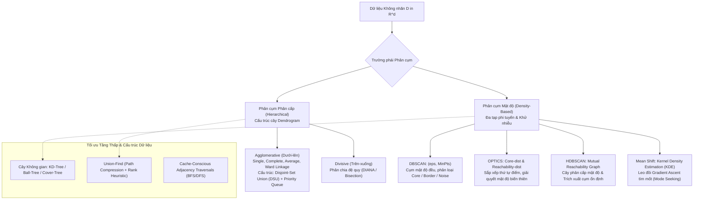
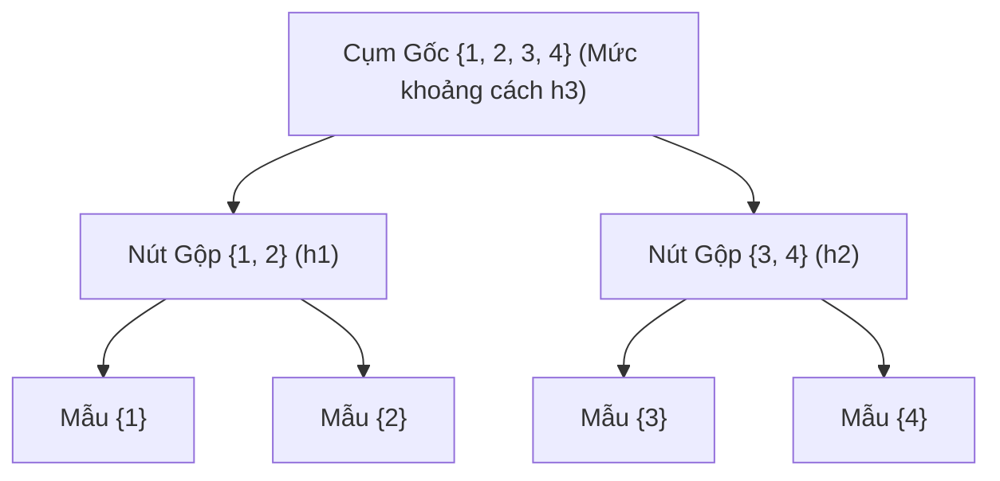
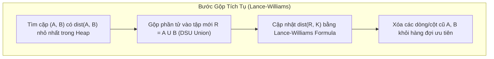
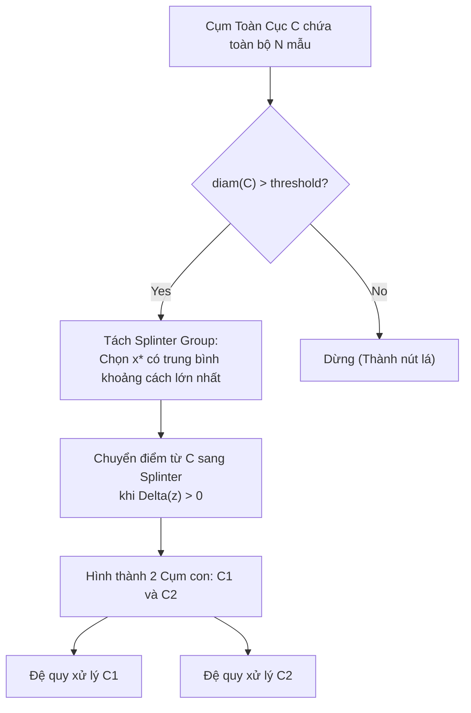
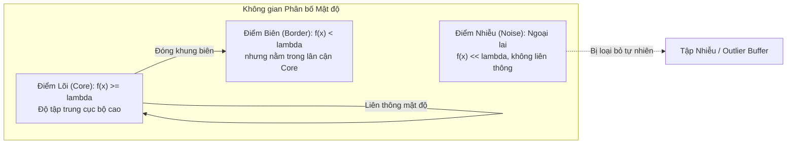
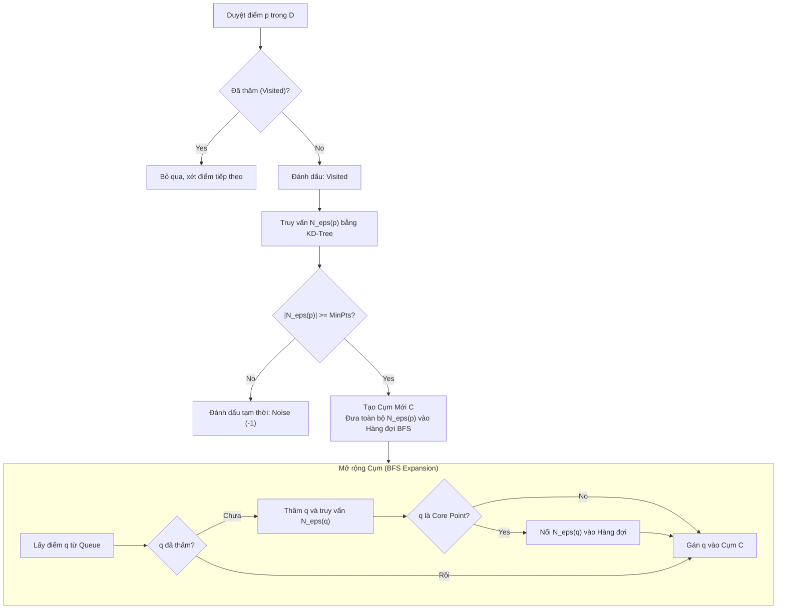
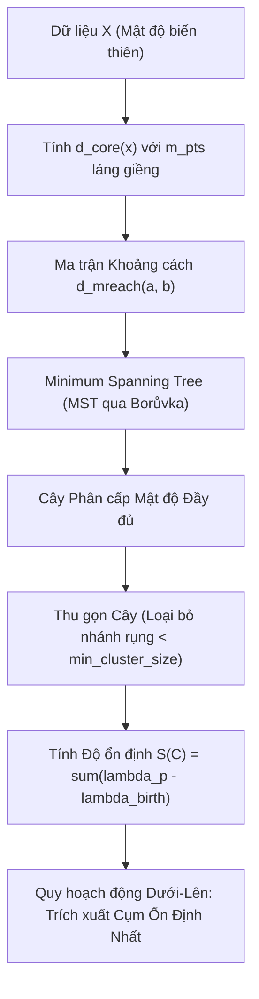
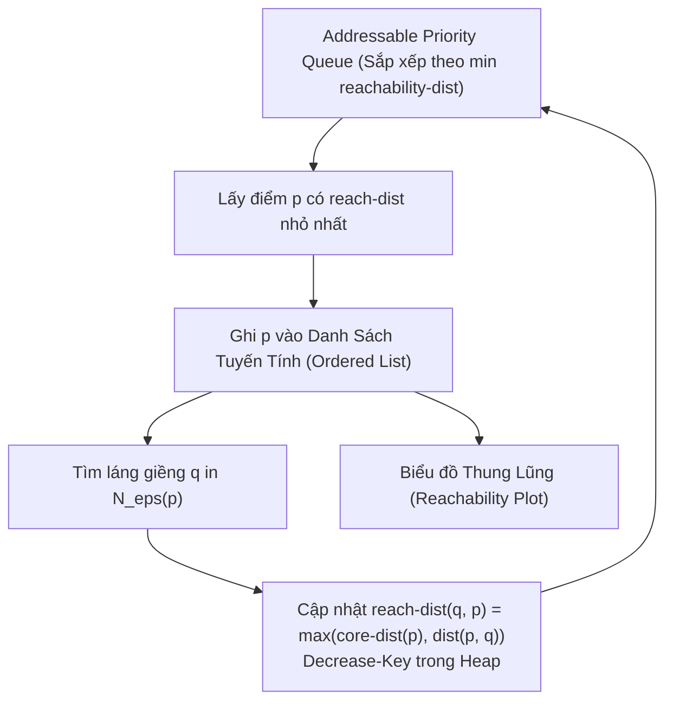
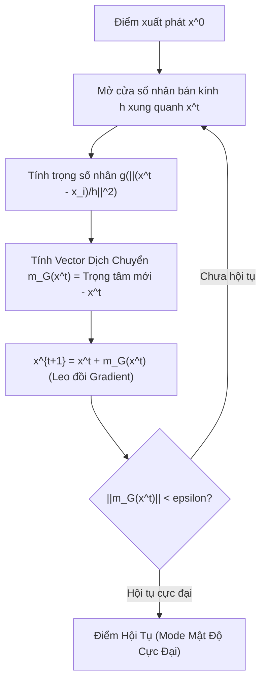

# Chuyên đề: Phân Cụm Phân Cấp & Phân Cụm Dựa Trên Mật Độ (Hierarchical & Density Clustering)

## 1. Tổng quan Chuyên đề
Trong khi các phương pháp phân hoạch (Partition-based) như K-Means giả định hình học cụm có dạng lồi (convex) và số lượng cụm $K$ phải được xác định trước, thì dữ liệu thực tế trong khoa học dữ liệu và thị giác máy tính thường phân bố theo cấu trúc đa tạp phức tạp (complex manifolds), mật độ không đồng nhất, chứa nhiều nhiễu ngoại lai (noise/outliers) và có tính phân cấp lồng nhau (hierarchical nesting).

Chuyên đề này khảo sát hai trường phái phân cụm tiên tiến:
1. **Phân cụm Phân cấp (Hierarchical Clustering)**: Xây dựng cây phân cấp (Dendrogram) biểu diễn quan hệ lồng ghép giữa các cụm theo hướng Tích tụ dưới-lên (Agglomerative) hoặc Phân tách trên-xuống (Divisive).
2. **Phân cụm Dựa trên Mật độ (Density-Based Clustering)**: Định nghĩa cụm là các vùng không gian có mật độ điểm cao được ngăn cách bởi các vùng mật độ thấp, cho phép nhận diện hình dạng phi lồi tùy ý và lọc nhiễu tự nhiên (DBSCAN, HDBSCAN, OPTICS, Mean Shift).



---

## 2. Chi tiết từng Keyword

---

### 1. Hierarchical Clustering (Phân cụm phân cấp)

#### a. Định nghĩa Bản chất Toán học (Mathematical Formulation)
Phân cụm phân cấp xây dựng một họ các phân hoạch của tập dữ liệu $\mathcal{D} = \{\mathbf{x}_1, \dots, \mathbf{x}_N\}$ lồng nhau theo thứ tự:
$$\mathcal{P}_0 \prec \mathcal{P}_1 \prec \dots \prec \mathcal{P}_{N-1}$$
Trong đó:
- $\mathcal{P}_0 = \{\{\mathbf{x}_1\}, \{\mathbf{x}_2\}, \dots, \{\mathbf{x}_N\}\}$ là phân hoạch mịn nhất (mỗi điểm là một cụm đơn - singleton).
- $\mathcal{P}_{N-1} = \{\mathcal{D}\}$ là phân hoạch thô nhất (toàn bộ dữ liệu nằm trong 1 cụm duy nhất).
- Ký hiệu $\mathcal{P}_a \prec \mathcal{P}_b$ nghĩa là mỗi cụm trong $\mathcal{P}_a$ là tập con của một cụm nào đó trong $\mathcal{P}_b$.

Cấu trúc này được trực quan hóa bằng một cây nhị phân có trọng số gọi là **Dendrogram**. Trục tung của Dendrogram biểu diễn khoảng cách kết hợp (cophenetic distance) $d_{\text{coph}}(i, j)$, tương ứng với mức độ khác biệt tại thời điểm hai điểm $\mathbf{x}_i$ và $\mathbf{x}_j$ lần đầu tiên được gộp chung vào một nút cha.

**Hệ số Tương quan Cophenetic (Cophenetic Correlation Coefficient - CPCC)**:
Đo lường mức độ bảo toàn khoảng cách gốc $\rho(i, j)$ sau khi ánh xạ lên cây Dendrogram:
$$\text{CPCC} = \frac{\sum_{i < j} (\rho(i, j) - \bar{\rho})(d_{\text{coph}}(i, j) - \bar{d}_{\text{coph}})}{\sqrt{\sum_{i < j} (\rho(i, j) - \bar{\rho})^2 \sum_{i < j} (d_{\text{coph}}(i, j) - \bar{d}_{\text{coph}})^2}}$$

#### b. Cơ chế Tầng Sâu & Điện toán (Under The Hood / Hardware Internals)
- **Độ phức tạp Bộ nhớ & Tính toán**: Thuật toán phân cấp cổ điển đòi hỏi lưu trữ ma trận khoảng cách đối xứng $\mathbf{D} \in \mathbb{R}^{N \times N}$ chiếm $\mathcal{O}(N^2)$ bộ nhớ và mất $\mathcal{O}(N^3)$ thời gian. 
- **Tối ưu hóa Băng thông Nhớ**: Bằng cách sử dụng danh sách láng giềng tương hỗ gần nhất (Nearest-Neighbor Chain Algorithm) phối hợp với hàng đợi ưu tiên (Priority Queue / Min-Heap), độ phức tạp thời gian có thể rút ngắn xuống $\mathcal{O}(N^2)$ đối với Ward Linkage và Single Linkage (SLINK).

#### c. Sơ đồ Minh họa (Mermaid Diagram)


#### d. Code Thực chiến (Dual-Engine: C++ & Python)

```cpp
// C++17: Cấu trúc Nút Dendrogram & Duyệt Cây Phân Cấp
#include <iostream>
#include <vector>
#include <memory>
#include <iomanip>

struct DendrogramNode {
    int id;
    float distance;
    std::shared_ptr<DendrogramNode> left;
    std::shared_ptr<DendrogramNode> right;
    size_t cluster_size;

    DendrogramNode(int node_id, float dist, std::shared_ptr<DendrogramNode> l, 
                   std::shared_ptr<DendrogramNode> r, size_t size)
        : id(node_id), distance(dist), left(std::move(l)), right(std::move(r)), cluster_size(size) {}

    bool is_leaf() const noexcept {
        return left == nullptr && right == nullptr;
    }
};

void print_tree(const std::shared_ptr<DendrogramNode>& node, int depth = 0) {
    if (!node) return;
    std::cout << std::string(depth * 3, ' ');
    if (node->is_leaf()) {
        std::cout << "|-- Leaf ID: " << node->id << "\n";
    } else {
        std::cout << "+-- Merge Dist: " << std::fixed << std::setprecision(2) 
                  << node->distance << " (Size: " << node->cluster_size << ")\n";
        print_tree(node->left, depth + 1);
        print_tree(node->right, depth + 1);
    }
}

int main() {
    auto l1 = std::make_shared<DendrogramNode>(1, 0.0f, nullptr, nullptr, 1);
    auto l2 = std::make_shared<DendrogramNode>(2, 0.0f, nullptr, nullptr, 1);
    auto m1 = std::make_shared<DendrogramNode>(10, 1.25f, l1, l2, 2);

    auto l3 = std::make_shared<DendrogramNode>(3, 0.0f, nullptr, nullptr, 1);
    auto root = std::make_shared<DendrogramNode>(11, 3.40f, m1, l3, 3);

    std::cout << "[C++] Cấu trúc Cây Dendrogram:\n";
    print_tree(root);
    return 0;
}
```

```python
# Python / SciPy: Xây dựng Dendrogram và Đánh giá Cophenetic Correlation
import numpy as np
from scipy.spatial.distance import pdist
from scipy.cluster.hierarchy import linkage, cophenet, dendrogram

def build_and_evaluate_hierarchy(X: np.ndarray):
    # Tính ma trận khoảng cách Euclidean nén dạng vector 1D: N*(N-1)/2
    dist_condensed = pdist(X, metric='euclidean')
    
    # Thực hiện liên kết Ward Linkage
    Z = linkage(dist_condensed, method='ward')
    
    # Tính hệ số Cophenetic Correlation
    cpcc, _ = cophenet(Z, dist_condensed)
    return Z, cpcc

if __name__ == "__main__":
    np.random.seed(42)
    data = np.random.randn(20, 3)
    Z_matrix, score = build_and_evaluate_hierarchy(data)
    print(f"[SciPy] Kích thước ma trận Linkage Z: {Z_matrix.shape}")
    print(f"[SciPy] Hệ số Cophenetic Correlation (CPCC): {score:.4f} (Gần 1.0 là bảo toàn khoảng cách cao)")
```

#### e. Lỗi Thường gặp & Ổn định Số học (Pitfalls & Numerical Stability)
- **Quyết định không thể đảo ngược (Irreversibility Problem)**: Một khi hai điểm đã bị gộp sai ở các bước đầu tiên (do nhiễu hoặc điểm dị biệt), sai số này sẽ lan truyền vĩnh viễn lên các nút cha phía trên mà không thể tách rời lại được.
- **Hiện tượng Tràn Ngăn xếp (Stack Overflow)**: Khi duyệt cây phân cấp với $N > 10^5$ phần tử bằng đệ quy, độ sâu cây có thể gây tràn ngăn xếp (Call Stack Overflow). Cần sử dụng ngăn xếp tường minh (Explicit Heap Stack) hoặc duyệt theo thứ tự Level-Order.

#### f. Ứng dụng Thực chiến trong AI / Deep Learning
- **Phát sinh Cây Phát sinh Loài (Phylogenetic Tree Reconstruction)**: Phân tích tiến hóa của các biến thể virus (SARS-CoV-2) dựa trên khoảng cách Levenshtein giữa các chuỗi gen.
- **Hierarchical Softmax**: Tổ chức từ vựng (Vocabulary Tree) trong các mô hình ngôn ngữ lớn (Word2Vec, FastText) để giảm độ phức tạp tính toán Softmax từ $\mathcal{O}(|V|)$ xuống $\mathcal{O}(\log |V|)$.

---

### 2. Agglomerative Clustering (Phân cụm tích tụ)

#### a. Định nghĩa Bản chất Toán học (Mathematical Formulation)
**Agglomerative Clustering** tiếp cận bài toán theo chiến lược Dưới-lên (Bottom-up). Khởi đầu với $N$ cụm đơn vị, tại mỗi bước, thuật toán tìm và sáp nhập cặp cụm $(A, B)$ có độ đo khoảng cách liên cụm $\mathcal{D}(A, B)$ nhỏ nhất:
$$(A^*, B^*) = \arg\min_{A, B} \mathcal{D}(A, B)$$

Khoảng cách liên cụm được xác định qua các tiêu chuẩn liên kết (Linkage Criteria):
1. **Single Linkage (Khoảng cách cực tiểu)**:
   $$\mathcal{D}_{\text{single}}(A, B) = \min_{\mathbf{x} \in A, \mathbf{y} \in B} \|\mathbf{x} - \mathbf{y}\|$$
2. **Complete Linkage (Khoảng cách cực đại)**:
   $$\mathcal{D}_{\text{complete}}(A, B) = \max_{\mathbf{x} \in A, \mathbf{y} \in B} \|\mathbf{x} - \mathbf{y}\|$$
3. **Average Linkage (UPGMA)**:
   $$\mathcal{D}_{\text{average}}(A, B) = \frac{1}{|A||B|} \sum_{\mathbf{x} \in A} \sum_{\mathbf{y} \in B} \|\mathbf{x} - \mathbf{y}\|$$
4. **Ward's Minimum Variance Linkage**: Cực tiểu hóa mức gia tăng tổng phương sai nội cụm khi sáp nhập:
   $$\Delta \text{ESS}_{AB} = \text{ESS}_{A \cup B} - (\text{ESS}_A + \text{ESS}_B) = \frac{|A||B|}{|A| + |B|} \|\mathbf{\mu}_A - \mathbf{\mu}_B\|^2$$

**Công thức Đệ quy Cập nhật Khoảng cách Lance-Williams (1967)**:
Khi gộp cụm $A$ và $B$ thành cụm mới $R = A \cup B$, khoảng cách giữa $R$ và một cụm bất kỳ $K$ được tính toán trực tiếp mà không cần truy cập lại các điểm dữ liệu gốc:
$$\mathcal{D}(R, K) = \alpha_A \mathcal{D}(A, K) + \alpha_B \mathcal{D}(B, K) + \beta \mathcal{D}(A, B) + \gamma |\mathcal{D}(A, K) - \mathcal{D}(B, K)|$$

#### b. Cơ chế Tầng Sâu & Điện toán (Under The Hood / Hardware Internals)
- **Cấu trúc Dữ liệu Rời rạc (Disjoint-Set Union - DSU)**: Quản lý trạng thái phân hoạch bằng mảng cha `parent[i]` phối hợp với hai kỹ thuật: nén đường đi (Path Compression) và hợp nhất theo hạng (Union by Rank). Thời gian truy vấn tập hợp đạt độ phức tạp gần như tuyến tính $\mathcal{O}(\alpha(N))$, trong đó $\alpha$ là hàm nghịch đảo Ackermann ($\alpha(N) < 5$ với mọi giá trị $N$ thực tế).
- **Tránh Tái tính toán (Dynamic Distance Updating)**: Nhờ công thức Lance-Williams, ma trận khoảng cách giữa các cụm có thể cập nhật tại chỗ (`in-place update`) vào chính các ô nhớ của dòng/cột cụm bị gộp, tối ưu hóa tái sử dụng Cache Line L1.

#### c. Sơ đồ Minh họa (Mermaid Diagram)


#### d. Code Thực chiến (Dual-Engine: C++ & Python)

```cpp
// C++17: Cấu trúc DSU Tối ưu (Union-Find) hỗ trợ Agglomerative Clustering
#include <iostream>
#include <vector>
#include <numeric>

class DisjointSetUnion {
private:
    std::vector<int> parent;
    std::vector<int> rank;

public:
    explicit DisjointSetUnion(int n) : parent(n), rank(n, 0) {
        std::iota(parent.begin(), parent.end(), 0);
    }

    // Path compression
    int find(int i) {
        if (parent[i] == i)
            return i;
        return parent[i] = find(parent[i]);
    }

    // Union by rank
    bool unite(int i, int j) {
        int root_i = find(i);
        int root_j = find(j);
        if (root_i == root_j) return false;

        if (rank[root_i] < rank[root_j]) {
            parent[root_i] = root_j;
        } else if (rank[root_i] > rank[root_j]) {
            parent[root_j] = root_i;
        } else {
            parent[root_j] = root_i;
            rank[root_i]++;
        }
        return true;
    }
};

int main() {
    constexpr int N = 5;
    DisjointSetUnion dsu(N);

    // Gộp điểm 0 và 1; sau đó gộp 2 và 3; sau đó gộp (0, 1) với (2, 3)
    dsu.unite(0, 1);
    dsu.unite(2, 3);
    dsu.unite(1, 3);

    std::cout << "[C++] DSU Root(0): " << dsu.find(0) << " | Root(2): " << dsu.find(2) << "\n";
    std::cout << "[C++] Điểm 0 và 2 cùng cụm? " << (dsu.find(0) == dsu.find(2) ? "Có" : "Không") << "\n";
    return 0;
}
```

```python
# Python / Scikit-Learn: So sánh Các Tiêu chuẩn Linkage trên Đa tạp Phi Tuyến
from sklearn.cluster import AgglomerativeClustering
from sklearn.datasets import make_moons

def test_linkage_criteria():
    X, _ = make_moons(n_samples=200, noise=0.05, random_state=42)
    
    linkages = ['single', 'complete', 'average', 'ward']
    results = {}
    
    for lk in linkages:
        model = AgglomerativeClustering(n_clusters=2, linkage=lk)
        labels = model.fit_predict(X)
        results[lk] = labels
        
    print("[Python] Đã chạy xong 4 tiêu chuẩn liên kết trên tập dữ liệu Two Moons.")
    print(f"- Single linkage: Thích hợp nhận diện chuỗi liên tục nhưng dễ bị dính cầu nối (chaining effect).")
    print(f"- Ward linkage: Xu hướng gom các cụm hình cầu cân đối về kích thước.")

if __name__ == "__main__":
    test_linkage_criteria()
```

#### e. Lỗi Thường gặp & Ổn định Số học (Pitfalls & Numerical Stability)
- **Hiệu ứng Chuỗi (Chaining Effect)**: Single Linkage cực kỳ nhạy cảm với các điểm nhiễu nằm rải rác giữa hai cụm, đóng vai trò như chiếc cầu nối khiến hai cụm hoàn toàn tách biệt bị sáp nhập sớm một cách sai lầm.
- **Xu hướng hình cầu của Ward Linkage**: Ward Linkage tối ưu phương sai giống K-Means, nên sẽ thất bại nếu cụm có cấu trúc dải mỏng, phi tuyến uốn lượn.

#### f. Ứng dụng Thực chiến trong AI / Deep Learning
- **Phân loại Tài liệu Chủ đề Đa tầng**: Gom nhóm tin tức báo chí theo các cấp độ phân cấp (Tin tức -> Thể thao -> Bóng đá -> Ngoại hạng Anh).
- **Hierarchical Clustering Constrained Fine-Tuning**: Gom cụm các trọng số Adapter (LoRA) để phân phối việc gộp trọng số trong các hệ thống Multi-Task Learning.

---

### 3. Divisive Clustering (Phân cụm phân tách)

#### a. Định nghĩa Bản chất Toán học (Mathematical Formulation)
Trái ngược với Agglomerative, **Divisive Clustering** tiếp cận bài toán theo hướng Trên-xuống (Top-down). Bắt đầu với một cụm duy nhất chứa toàn bộ $N$ điểm dữ liệu, tại mỗi bước thuật toán phân rã đệ quy một cụm đã chọn thành hai cụm con:
$$C \to \{C_1, C_2\}, \quad C_1 \cap C_2 = \emptyset, \quad C_1 \cup C_2 = C$$

Thuật toán tiêu biểu nhất là **DIANA (Divisive Analysis)** của Kaufman & Rousseeuw (1990):
1. **Chọn cụm để phân chia**: Chọn cụm có đường kính lớn nhất (Largest Diameter):
   $$\text{diam}(C) = \max_{\mathbf{x}, \mathbf{y} \in C} \|\mathbf{x} - \mathbf{y}\|$$
2. **Khởi tạo Đảng phái Tách rời (Splinter Group)**: Tìm điểm $\mathbf{x}^* \in C$ có độ khác biệt trung bình với các điểm còn lại trong cụm là lớn nhất:
   $$\mathbf{x}^* = \arg\max_{\mathbf{x} \in C} \left( \frac{1}{|C|-1} \sum_{\mathbf{y} \in C, \mathbf{y} \neq \mathbf{x}} \|\mathbf{x} - \mathbf{y}\| \right)$$
   Gán $A = \{\mathbf{x}^*\}$ (Splinter Group) và $B = C \setminus \{\mathbf{x}^*\}$.
3. **Phát triển Splinter Group**: Di chuyển dần các điểm $\mathbf{z} \in B$ sang $A$ nếu khoảng cách trung bình từ $\mathbf{z}$ đến $A$ nhỏ hơn khoảng cách trung bình từ $\mathbf{z}$ đến phần còn lại của $B$:
   $$\Delta(\mathbf{z}) = \left( \frac{1}{|B|-1} \sum_{\mathbf{y} \in B, \mathbf{y} \neq \mathbf{z}} \|\mathbf{z} - \mathbf{y}\| \right) - \left( \frac{1}{|A|} \sum_{\mathbf{y} \in A} \|\mathbf{z} - \mathbf{y}\| \right)$$
   Nếu $\max_{\mathbf{z} \in B} \Delta(\mathbf{z}) > 0$, chuyển điểm $\mathbf{z}$ có độ chênh lệch cực đại sang $A$. Lặp lại đến khi $\Delta(\mathbf{z}) \le 0, \forall \mathbf{z} \in B$.

#### b. Cơ chế Tầng Sâu & Điện toán (Under The Hood / Hardware Internals)
- **Độ phức tạp Phân chia 2 Cụm**: Xét duyệt toàn bộ $2^{|C|-1}-1$ cách chia đôi tập hợp là bài toán quá lớn. Thuật toán DIANA sử dụng tìm kiếm heuristic có chi phí $\mathcal{O}(|C|^2)$, hoặc xấp xỉ bằng cách chạy thuật toán phân chia 2 tâm cụm (2-Means / Bisecting K-Means).
- **Bộ nhớ Ngăn xếp Đệ quy (Recursion Tree Memory)**: Quá trình phân chia có thể thực hiện song song hoàn toàn giữa các nhánh con (Parallel Tree Traversal), phân bổ công việc lên các luồng độc lập của OpenMP hoặc GPU Streams.

#### c. Sơ đồ Minh họa (Mermaid Diagram)


#### d. Code Thực chiến (Dual-Engine: C++ & Python)

```cpp
// C++17: Mô phỏng Bisecting K-Means (Biến thể Phân Tách Divisive tối ưu)
#include <iostream>
#include <vector>
#include <cmath>
#include <algorithm>

struct Point1D {
    float val;
};

// Phân chia nhị phân một tập dữ liệu 1D bằng ngưỡng trung vị (Median Split Heuristic)
void bisect_cluster(const std::vector<float>& cluster, 
                    std::vector<float>& left, 
                    std::vector<float>& right) 
{
    if (cluster.empty()) return;
    std::vector<float> sorted_data = cluster;
    std::sort(sorted_data.begin(), sorted_data.end());

    size_t mid = sorted_data.size() / 2;
    left.assign(sorted_data.begin(), sorted_data.begin() + mid);
    right.assign(sorted_data.begin() + mid, sorted_data.end());
}

int main() {
    std::vector<float> global_cluster = {1.0f, 1.5f, 2.0f, 8.0f, 8.5f, 9.0f};
    std::vector<float> child_a, child_b;

    bisect_cluster(global_cluster, child_a, child_b);

    std::cout << "[C++] Cụm con A (Size " << child_a.size() << "): ";
    for (float v : child_a) std::cout << v << " ";
    std::cout << "\n[C++] Cụm con B (Size " << child_b.size() << "): ";
    for (float v : child_b) std::cout << v << " ";
    std::cout << "\n";
    return 0;
}
```

```python
# Python / Scikit-Learn: Bisecting K-Means (Divisive Clustering Hiện Đại)
from sklearn.cluster import BisectingKMeans
import numpy as np

def run_bisecting_kmeans():
    X = np.array([
        [1.0, 2.0], [1.5, 1.8], [2.0, 2.2],
        [8.0, 8.0], [8.5, 8.2], [9.0, 7.8],
        [15.0, 1.0], [15.2, 1.4], [14.8, 0.9]
    ])
    
    # BisectingKMeans phân tách trên-xuống theo cây nhị phân
    model = BisectingKMeans(n_clusters=3, random_state=42, bisecting_strategy='largest_cluster')
    labels = model.fit_predict(X)
    
    print("[Python] Nhãn gán từ Bisecting K-Means:", labels)
    print("[Python] Tọa độ tâm cụm tìm được:\n", model.cluster_centers_)

if __name__ == "__main__":
    run_bisecting_kmeans()
```

#### e. Lỗi Thường gặp & Ổn định Số học (Pitfalls & Numerical Stability)
- **Mất cân bằng Cây (Unbalanced Tree Generation)**: Nếu tại mỗi bước chỉ có 1 hoặc 2 điểm bị tách ra khỏi cụm chính, cây phân tách sẽ bị lệch hoàn toàn (skewed tree), làm giảm hiệu năng phân cấp và đẩy độ sâu cây lên $\mathcal{O}(N)$.
- **Chi phí Khởi tạo Cao**: Khác với Agglomerative có thể dừng lại sớm ở các cụm nhỏ, Divisive phải xử lý cụm toàn cục ban đầu có kích thước $N$ trọn vẹn, gây nghẽn tính toán lớn ở các tầng đầu tiên.

#### f. Ứng dụng Thực chiến trong AI / Deep Learning
- **Phân cấp Không gian Nhúng Từ vựng (Hierarchical Concept Extraction)**: Xây dựng Ontology cây ngữ nghĩa tự động từ các vector nhúng Word2Vec hoặc CLIP text embeddings.
- **Decision Tree Unsupervised Pre-structuring**: Tạo các biên phân vùng không gian để khởi tạo cây quyết định trong các bộ giải thuật Gradient Boosting.

---

### 4. Density-Based Clustering (Phân cụm dựa trên mật độ)

#### a. Định nghĩa Bản chất Toán học (Mathematical Formulation)
Trường phái phân cụm dựa trên mật độ mô hình hóa dữ liệu như các mẫu lấy từ một hàm mật độ xác suất liên tục $f(\mathbf{x})$. Một cụm được định nghĩa một cách chặt chẽ là một thành phần liên thông của tập mức mật độ cao (Connected Component of High-Density Level Set):
$$L(\lambda) = \{\mathbf{x} \in \mathbb{R}^d \mid f(\mathbf{x}) \ge \lambda\}$$
Trong đó $\lambda > 0$ là ngưỡng mật độ tối thiểu.

Hàm mật độ thực nghiệm được xấp xỉ thông qua phương pháp Ước lượng Mật độ Nhân (Kernel Density Estimation - KDE):
$$\hat{f}(\mathbf{x}) = \frac{1}{N h^d} \sum_{i=1}^N \mathcal{K}\left( \frac{\mathbf{x} - \mathbf{x}_i}{h} \right)$$
Trong đó $\mathcal{K}(\cdot)$ là hàm nhân đối xứng (thường là nhân Gaussian) và $h > 0$ là băng thông (Bandwidth).

**Đặc tính Hình học Toán học**:
- Khả năng cô lập các cấu trúc đa tạp phi tuyến phức tạp (ví dụ: vòng tròn lồng nhau, hình xoắn ốc) mà các phương pháp phân hoạch dựa trên khoảng cách tâm hoàn toàn bất lực.
- Phân biệt tường minh giữa **Điểm lõi mật độ (Dense Core Points)**, **Điểm biên (Border Points)** và **Nhiễu ngoại lai (Noise/Outliers)**.

#### b. Cơ chế Tầng Sâu & Điện toán (Under The Hood / Hardware Internals)
- **Cấu trúc Lập chỉ mục Không gian (Spatial Indexing Structures)**: Thay vì duyệt vét cạn $N$ điểm với chi phí $\mathcal{O}(N^2)$, các thuật toán mật độ dựa trên các cấu trúc cây tìm kiếm không gian:
  1. **KD-Tree**: Phân chia không gian bằng các siêu phẳng trực giao theo từng chiều tọa độ (hiệu quả cao với $d \le 10$).
  2. **Ball-Tree**: Phân chia không gian bằng các siêu cầu lồng nhau, chặn dưới khoảng cách bằng bất đẳng thức tam giác (hiệu quả với $d \le 50$).
- Khi $d > 50$, hiệu ứng "Curse of Dimensionality" khiến mọi cây không gian đều thoái hóa về tìm kiếm vét cạn $\mathcal{O}(N)$ do các nhánh cây đều phải được duyệt (Tree Branch Exhaustion).

#### c. Sơ đồ Minh họa (Mermaid Diagram)


#### d. Code Thực chiến (Dual-Engine: C++ & Python)

```cpp
// C++17: Ước lượng Mật độ Nhân Gaussian (KDE) 1D tối ưu hóa Vector
#include <iostream>
#include <vector>
#include <cmath>

class Simple1DKDE {
private:
    std::vector<float> samples;
    float bandwidth;
    float inv_bw;
    float norm_factor;

public:
    Simple1DKDE(std::vector<float> pts, float h) 
        : samples(std::move(pts)), bandwidth(h) {
        inv_bw = 1.0f / bandwidth;
        // Nhân Gaussian 1D: 1 / (h * sqrt(2 * pi))
        norm_factor = 1.0f / (bandwidth * std::sqrt(2.0f * 3.14159265f));
    }

    [[nodiscard]] float estimate(float x) const noexcept {
        float total_kernel = 0.0f;
        for (float xi : samples) {
            float u = (x - xi) * inv_bw;
            total_kernel += std::exp(-0.5f * u * u);
        }
        return (norm_factor / static_cast<float>(samples.size())) * total_kernel;
    }
};

int main() {
    std::vector<float> data = {1.0f, 1.2f, 1.1f, 5.0f, 5.1f, 9.0f};
    Simple1DKDE kde(data, 0.5f);

    std::cout << "[C++] Mật độ ước lượng tại x = 1.1 (Vùng dày đặc): " << kde.estimate(1.1f) << "\n";
    std::cout << "[C++] Mật độ ước lượng tại x = 3.0 (Vùng thưa thớt): " << kde.estimate(3.0f) << "\n";
    return 0;
}
```

```python
# Python / Scikit-Learn: Ước lượng Mật độ KDE Đa chiều và Trực quan hóa Cấp mức
import numpy as np
from sklearn.neighbors import KernelDensity

def compute_density_profile(X: np.ndarray, bandwidth: float = 0.5):
    # Sử dụng Ball-Tree để tăng tốc truy vấn lân cận mật độ
    kde = KernelDensity(bandwidth=bandwidth, kernel='gaussian', algorithm='ball_tree')
    kde.fit(X)
    
    # Đánh giá log-density trên chính các mẫu dữ liệu
    log_density = kde.score_samples(X)
    density = np.exp(log_density)
    return density

if __name__ == "__main__":
    np.random.seed(42)
    # 2 cụm đặc và một vài điểm ngoại lai cực đoan
    X_data = np.vstack([np.random.randn(50, 2), np.random.randn(50, 2) + 5.0, np.array([[15.0, 15.0]])])
    densities = compute_density_profile(X_data)
    
    print(f"[Python] Mật độ trung bình vùng lõi: {np.mean(densities[:100]):.4f}")
    print(f"[Python] Mật độ của điểm ngoại lai [15, 15]: {densities[-1]:.6e} (Gần như bằng 0)")
```

#### e. Lỗi Thường gặp & Ổn định Số học (Pitfalls & Numerical Stability)
- **Triệt tiêu số học trong KDE**: Hàm mũ Gaussian $\exp\left(-\frac{\|\mathbf{x} - \mathbf{x}_i\|^2}{2h^2}\right)$ sẽ tràn dưới (Underflow về $0.0$) nếu khoảng cách vượt quá $6h$. Cần tính toán trong miền log (Log-Domain) phối hợp thuật toán LogSumExp.
- **Băng thông toàn cục cố định**: Băng thông $h$ cố định không thể thích nghi với các tập dữ liệu có mật độ thay đổi liên tục trên các vùng không gian khác nhau.

#### f. Ứng dụng Thực chiến trong AI / Deep Learning
- **Anomaly Detection (Phát hiện Bất thường)**: Xác định các mẫu dữ liệu đầu vào nằm ngoài phân phối huấn luyện (Out-of-Distribution - OOD detection) cho xe tự hành.
- **Point Cloud Segmentation**: Gom cụm các đám mây điểm 3D thu nhận từ cảm biến LiDAR để nhận diện chướng ngại vật thời gian thực.

---

### 5. DBSCAN (Density-Based Spatial Clustering of Applications with Noise)

#### a. Định nghĩa Bản chất Toán học (Mathematical Formulation)
Được đề xuất bởi Ester et al. (1996), **DBSCAN** sử dụng 2 siêu tham số: bán kính lân cận $\epsilon > 0$ và số điểm tối thiểu $\text{MinPts} \in \mathbb{N}^+$.

**Các khái niệm hình thức cơ bản**:
1. **$\epsilon$-Lân cận ($\epsilon$-Neighborhood)**:
   $$N_\epsilon(\mathbf{p}) = \{\mathbf{q} \in \mathcal{D} \mid \text{dist}(\mathbf{p}, \mathbf{q}) \le \epsilon\}$$
2. **Điểm Lõi (Core Point)**:
   $$\mathbf{p} \text{ là Core Point} \iff |N_\epsilon(\mathbf{p})| \ge \text{MinPts}$$
3. **Trực tiếp Tiếp cận được theo Mật độ (Directly Density-Reachable)**:
   Điểm $\mathbf{q}$ tiếp cận trực tiếp được từ $\mathbf{p}$ nếu $\mathbf{p}$ là Core Point và $\mathbf{q} \in N_\epsilon(\mathbf{p})$.
4. **Tiếp cận được theo Mật độ (Density-Reachable)**:
   Tồn tại một chuỗi các điểm $\mathbf{p}_1, \mathbf{p}_2, \dots, \mathbf{p}_n$ với $\mathbf{p}_1 = \mathbf{p}$ và $\mathbf{p}_n = \mathbf{q}$ sao cho $\mathbf{p}_{i+1}$ tiếp cận trực tiếp được từ $\mathbf{p}_i$.
5. **Liên thông theo Mật độ (Density-Connected)**:
   Hai điểm $\mathbf{p}$ và $\mathbf{q}$ liên thông theo mật độ nếu tồn tại điểm $\mathbf{o}$ sao cho cả $\mathbf{p}$ và $\mathbf{q}$ đều tiếp cận được theo mật độ từ $\mathbf{o}$.

**Định nghĩa Cụm trong DBSCAN**:
Một cụm $C \subseteq \mathcal{D}$ là một tập con không rỗng thỏa mãn 2 điều kiện:
- **Tính Cực đại (Maximality)**: $\forall \mathbf{p}, \mathbf{q}$, nếu $\mathbf{p} \in C$ và $\mathbf{q}$ tiếp cận được từ $\mathbf{p}$ thì $\mathbf{q} \in C$.
- **Tính Liên thông (Connectivity)**: $\forall \mathbf{p}, \mathbf{q} \in C$, $\mathbf{p}$ và $\mathbf{q}$ liên thông mật độ với nhau.
Các điểm không thuộc bất kỳ cụm nào được gán nhãn là **Nhiễu (Noise, Label = -1)**.

#### b. Cơ chế Tầng Sâu & Điện toán (Under The Hood / Hardware Internals)
- **Mô hình Thuật toán Đồ thị (Graph Traversal)**: DBSCAN bản chất là thuật toán tìm kiếm theo chiều rộng (BFS) hoặc chiều sâu (DFS) trên đồ thị ngầm định được sinh bởi các láng giềng $\epsilon$.
- **Lưu trữ Trạng thái và Bộ nhớ Đệm**: Để tránh duyệt lại các điểm, trạng thái mỗi điểm được lưu trong mảng mặt nạ bit hoặc byte: `UNVISITED`, `VISITED`, `CORE`, `NOISE`. Việc sử dụng `std::vector<uint8_t>` giúp tối đa hóa khả năng lưu trữ trên một dòng Cache Line 64 byte (chứa được trạng thái của 64 điểm cùng lúc).

#### c. Sơ đồ Minh họa (Mermaid Diagram)


#### d. Code Thực chiến (Dual-Engine: C++ & Python)

```cpp
// C++17: Triển khai Lõi DBSCAN với Hàng đợi BFS Tối ưu hóa Bộ nhớ
#include <iostream>
#include <vector>
#include <cmath>
#include <queue>

constexpr int NOISE = -1;
constexpr int UNASSIGNED = 0;

struct Point2D { float x, y; };

float dist_sq(const Point2D& a, const Point2D& b) noexcept {
    float dx = a.x - b.x;
    float dy = a.y - b.y;
    return dx * dx + dy * dy;
}

std::vector<int> region_query(const std::vector<Point2D>& pts, size_t p_idx, float eps_sq) {
    std::vector<int> neighbors;
    for (size_t i = 0; i < pts.size(); ++i) {
        if (dist_sq(pts[p_idx], pts[i]) <= eps_sq) {
            neighbors.push_back(static_cast<int>(i));
        }
    }
    return neighbors;
}

std::vector<int> run_dbscan(const std::vector<Point2D>& pts, float eps, size_t min_pts) {
    const size_t n = pts.size();
    float eps_sq = eps * eps;
    std::vector<int> labels(n, UNASSIGNED);
    int cluster_id = 0;

    for (size_t i = 0; i < n; ++i) {
        if (labels[i] != UNASSIGNED) continue;

        std::vector<int> neighbors = region_query(pts, i, eps_sq);
        if (neighbors.size() < min_pts) {
            labels[i] = NOISE;
            continue;
        }

        cluster_id++;
        labels[i] = cluster_id;
        std::queue<int> q;
        for (int neighbor : neighbors) {
            if (neighbor != static_cast<int>(i)) q.push(neighbor);
        }

        while (!q.empty()) {
            int curr = q.front();
            q.pop();

            if (labels[curr] == NOISE) labels[curr] = cluster_id;
            if (labels[curr] != UNASSIGNED) continue;

            labels[curr] = cluster_id;
            std::vector<int> curr_neighbors = region_query(pts, curr, eps_sq);
            if (curr_neighbors.size() >= min_pts) {
                for (int nb : curr_neighbors) {
                    q.push(nb);
                }
            }
        }
    }
    return labels;
}

int main() {
    std::vector<Point2D> points = {
        {1.0f, 1.0f}, {1.1f, 1.0f}, {1.0f, 1.2f}, // Cluster 1
        {8.0f, 8.0f}, {8.1f, 8.2f}, {8.2f, 8.0f}, // Cluster 2
        {100.0f, 100.0f}                          // Outlier
    };

    auto labels = run_dbscan(points, 0.5f, 2);
    std::cout << "[C++] DBSCAN Kết quả gán nhãn:\n";
    for (size_t i = 0; i < labels.size(); ++i) {
        std::cout << "Điểm " << i << ": Nhãn " << labels[i] << "\n";
    }
    return 0;
}
```

```python
# Python / Scikit-Learn: DBSCAN trên Cấu trúc Moons & Phân loại Nhiễu
from sklearn.cluster import DBSCAN
from sklearn.datasets import make_moons
import numpy as np

def evaluate_dbscan():
    X, _ = make_moons(n_samples=300, noise=0.08, random_state=42)
    # Thêm một số điểm ngoại lai cực đoan
    outliers = np.array([[2.5, 1.5], [-1.5, -1.0], [0.5, 2.0]])
    X_full = np.vstack([X, outliers])
    
    db = DBSCAN(eps=0.2, min_samples=5, metric='euclidean', algorithm='auto')
    labels = db.fit_predict(X_full)
    
    n_clusters = len(set(labels)) - (1 if -1 in labels else 0)
    n_noise = np.sum(labels == -1)
    
    print(f"[Python] Số cụm phát hiện: {n_clusters}")
    print(f"[Python] Số điểm bị đánh nhãn nhiễu (-1): {n_noise}")
    return labels

if __name__ == "__main__":
    evaluate_dbscan()
```

#### e. Lỗi Thường gặp & Ổn định Số học (Pitfalls & Numerical Stability)
- **Mật độ đa biến (Varying Density Failure)**: Nếu dữ liệu có hai cụm với mật độ chênh lệch lớn (ví dụ cụm A rất dày đặc, cụm B rất thưa thớt), việc chọn $\epsilon$ toàn cục là bất khả thi: nếu $\epsilon$ nhỏ để tách A thì B sẽ bị coi là nhiễu hoàn toàn; nếu $\epsilon$ lớn để gom B thì A sẽ bị nuốt chửng cùng các nhiễu lân cận.
- **Biên giới không xác định đối với Điểm Biên (Border Points)**: Một điểm biên nằm trong $\epsilon$-lân cận của hai điểm lõi thuộc hai cụm khác nhau sẽ nhận nhãn của cụm nào duyệt tới nó trước, làm thuật toán mất tính tất định hoàn toàn đối với điểm biên.

#### f. Ứng dụng Thực chiến trong AI / Deep Learning
- **Phát hiện Vết nứt Bề mặt & Khuyết tật Cơ khí**: Nhận diện các chuỗi điểm bất thường trên ảnh kính hiển vi kim loại trong dây chuyền sản xuất bán dẫn.
- **GPS Trajectory Clustering**: Gom nhóm hành trình di chuyển của xe taxi từ tọa độ kinh độ - vĩ độ để phát hiện các tuyến đường huyết mạch.

---

### 6. HDBSCAN (Hierarchical DBSCAN)

#### a. Định nghĩa Bản chất Toán học (Mathematical Formulation)
Được phát triển bởi Campello, Moulavi, và Zimek (2013), **HDBSCAN** kết hợp phân cụm phân cấp với nguyên lý mật độ, loại bỏ hoàn toàn sự phụ thuộc vào siêu tham số bán kính cố định $\epsilon$, cho phép tìm các cụm có mật độ thay đổi liên tục.

**Các bước toán học trụ cột**:
1. **Khoảng cách Lõi (Core Distance)**: Với tham số $m_{\text{pts}}$, khoảng cách lõi $d_{\text{core}}(\mathbf{x})$ là khoảng cách từ $\mathbf{x}$ đến láng giềng gần thứ $m_{\text{pts}}$ của nó:
   $$d_{\text{core}}(\mathbf{x}) = d(\mathbf{x}, N_{m_{\text{pts}}}(\mathbf{x}))$$
2. **Khoảng cách Tiếp cận Tương hỗ (Mutual Reachability Distance)**:
   $$d_{\text{mreach}}(\mathbf{a}, \mathbf{b}) = \max\left\{ d_{\text{core}}(\mathbf{a}), \, d_{\text{core}}(\mathbf{b}), \, d(\mathbf{a}, \mathbf{b}) \right\}$$
   Độ đo này đẩy các điểm ở vùng thưa cách xa nhau ra, bảo toàn mật độ ở các vùng dày đặc.
3. **Cây Khung Nhỏ nhất (Minimum Spanning Tree - MST)**: Xây dựng MST trên đồ thị đầy đủ trọng số $d_{\text{mreach}}$.
4. **Cây Phân cấp Thu gọn (Condensed Cluster Tree)**: Thay vì lưu cây nhị phân đầy đủ, HDBSCAN lọc bỏ các phân tách chỉ làm rơi rụng vài điểm đơn lẻ (coi là rơi rụng do mất mật độ), chỉ giữ lại các phân tách thực sự chia thành các cụm lớn hơn $m_{\text{clSize}}$ (Minimum Cluster Size).
5. **Độ Ổn định Cụm (Cluster Stability $\star$)**:
   Định nghĩa $\lambda = \frac{1}{\epsilon}$. Với mỗi cụm $C_i$:
   $$\mathcal{S}(C_i) = \sum_{\mathbf{p} \in C_i} (\lambda_{\text{p}}(\mathbf{p}) - \lambda_{\text{birth}}(C_i))$$
   Trong đó $\lambda_{\text{p}}(\mathbf{p})$ là giá trị mật độ nghịch đảo mà tại đó điểm $\mathbf{p}$ bị rơi ra khỏi cụm. Cụm tối ưu được chọn bằng quy hoạch động duyệt cây dưới-lên (Excess of Mass algorithm).

#### b. Cơ chế Tầng Sâu & Điện toán (Under The Hood / Hardware Internals)
- **Thuật toán Prim với Borůvka K-d Tree (Fast Dual-Tree Borůvka)**: Xây dựng MST trên đồ thị đầy đủ $N$ đỉnh mất $\mathcal{O}(N^2)$ bộ nhớ và thời gian. Thuật toán Dual-Tree Borůvka kết hợp cây không gian k-d tree giúp tính MST với độ phức tạp thời gian chỉ $\mathcal{O}(N \log N)$ và bộ nhớ $\mathcal{O}(N)$, cho phép HDBSCAN chạy trên hàng triệu điểm.
- **Bộ nhớ nén đồ thị (Condensed Hierarchy Array)**: Cấu trúc Condensed Tree được nén thành một mảng tuyến tính các bản ghi `(parent_id, child_id, lambda_val, cluster_size)`, dễ dàng nạp liên tục vào L3 Cache để giải quy hoạch động chọn cụm tối ưu.

#### c. Sơ đồ Minh họa (Mermaid Diagram)


#### d. Code Thực chiến (Dual-Engine: C++ & Python)

```cpp
// C++17: Tính Khoảng cách Tiếp cận Tương hỗ (Mutual Reachability Distance)
#include <iostream>
#include <vector>
#include <cmath>
#include <algorithm>

float compute_mutual_reachability(
    float dist_ab, 
    float core_dist_a, 
    float core_dist_b) noexcept 
{
    return std::max({core_dist_a, core_dist_b, dist_ab});
}

int main() {
    float core_a = 0.45f;
    float core_b = 1.20f;
    float actual_dist = 0.80f;

    float d_mreach = compute_mutual_reachability(actual_dist, core_a, core_b);
    std::cout << "[C++] Khoảng cách thực tế: " << actual_dist << "\n";
    std::cout << "[C++] Khoảng cách Tiếp cận Tương hỗ (d_mreach): " << d_mreach 
              << " (Đã được chặn dưới bởi core_dist_b = 1.20)\n";
    return 0;
}
```

```python
# Python / HDBSCAN: Phân cụm Tự động với Mật độ Biến thiên Không cần eps
import numpy as np
import hdbscan
from sklearn.datasets import make_blobs

def run_hdbscan_clustering():
    # Tạo 2 cụm có mật độ rất lệch nhau: Cụm 1 đặc (std=0.2), Cụm 2 thưa (std=1.2)
    X1, _ = make_blobs(n_samples=300, centers=[[0, 0]], cluster_std=0.2, random_state=42)
    X2, _ = make_blobs(n_samples=300, centers=[[5, 5]], cluster_std=1.2, random_state=42)
    X = np.vstack([X1, X2])

    clusterer = hdbscan.HDBSCAN(min_cluster_size=15, min_samples=5, metric='euclidean', gen_min_span_tree=True)
    labels = clusterer.fit_predict(X)
    
    unique_labels = set(labels)
    print(f"[Python] HDBSCAN tìm thấy các nhãn: {unique_labels}")
    print(f"[Python] Xác suất thuộc cụm trung bình: {np.mean(clusterer.probabilities_):.4f}")
    return clusterer

if __name__ == "__main__":
    run_hdbscan_clustering()
```

#### e. Lỗi Thường gặp & Ổn định Số học (Pitfalls & Numerical Stability)
- **Nghịch đảo Mật độ $\lambda = \frac{1}{\epsilon}$ tiến tới vô cực**: Khi hai điểm trùng tọa độ chính xác ($\epsilon \to 0$), $\lambda \to \infty$. Cần sử dụng giá trị làm mịn cực tiểu $\epsilon_{\min} = 10^{-12}$ để tránh tràn số floating-point division by zero.
- **Độ nhạy của tham số `min_cluster_size`**: Nếu đặt tham số này quá nhỏ, cây thu gọn không lọc được các nhiễu vi mô và trích xuất hàng trăm cụm vụn vặt; nếu đặt quá lớn, các cụm hợp lệ nhỏ sẽ bị gộp vào nhiễu.

#### f. Ứng dụng Thực chiến trong AI / Deep Learning
- **Phân cụm Chủ đề Tài liệu trong BERTopic**: Trích xuất các chủ đề ngữ nghĩa từ vector nhúng của Transformer (BERT/RoBERTa), nơi mật độ các khái niệm trong không gian ngữ nghĩa phân bổ không đồng đều.
- **Unsupervised Face Recognition Grouping**: Gom các khuôn mặt trích xuất từ camera an ninh vào cùng một định danh mà không cần biết trước số lượng người.

---

### 7. OPTICS (Ordering Points To Identify the Clustering Structure)

#### a. Định nghĩa Bản chất Toán học (Mathematical Formulation)
Được phát triển bởi Ankerst, Breunig, Kriegel, và Sander (1999), **OPTICS** không gán nhãn cứng phân cụm ngay lập tức mà tạo ra một thứ tự sắp xếp tuyến tính các điểm (Reachability-Plot Ordering) phản ánh toàn diện cấu trúc mật độ đa tầng.

**Hai khái niệm cốt tử của OPTICS**:
1. **Khoảng cách Lõi (Core Distance của điểm $\mathbf{p}$)**:
   $$\text{core-dist}_\epsilon(\mathbf{p}) = \begin{cases} 
   \text{UNDEFINED}, & \text{nếu } |N_\epsilon(\mathbf{p})| < \text{MinPts} \\
   \text{Khoảng cách đến láng giềng thứ MinPts gần nhất}, & \text{ngược lại}
   \end{cases}$$
2. **Khoảng cách Tiếp cận được (Reachability Distance của $\mathbf{p}$ từ $\mathbf{o}$)**:
   $$\text{reach-dist}_\epsilon(\mathbf{p}, \mathbf{o}) = \begin{cases}
   \text{UNDEFINED}, & \text{nếu } |N_\epsilon(\mathbf{o})| < \text{MinPts} \\
   \max\{\text{core-dist}_\epsilon(\mathbf{o}), \, \text{dist}(\mathbf{o}, \mathbf{p})\}, & \text{ngược lại}
   \end{cases}$$

**Thuật toán OPTICS**:
- Duyệt qua các điểm chưa xử lý, đưa vào một hàng đợi ưu tiên có khóa là `reachability-distance` nhỏ nhất.
- Tại mỗi bước, lấy điểm có reachability-distance nhỏ nhất ra, ghi nhận vào danh sách thứ tự xử lý (Ordered List), và cập nhật khoảng cách reachability của các láng giềng chưa thăm của nó.
- Kết quả trực quan hóa bằng biểu đồ thung lũng (Reachability Plot): Các "thung lũng" (valleys) tương ứng với các cụm mật độ cao, các "đỉnh núi" (peaks) tương ứng với ranh giới phân tách hoặc nhiễu.

#### b. Cơ chế Tầng Sâu & Điện toán (Under The Hood / Hardware Internals)
- **Hàng đợi Ưu tiên có thể Cập nhật Khóa (Indexed Addressable Priority Queue / Fibonacci Heap)**: Khi một điểm đã nằm trong hàng đợi được phát hiện có reachability-distance mới nhỏ hơn, ta phải thực hiện thao tác giảm khóa (`decrease-key`). Sử dụng Fibonacci Heap hoặc Binary Heap có bảng chỉ mục nghịch đảo (Addressable Heap) đảm bảo thao tác giảm khóa đạt chi phí $\mathcal{O}(1)$ đến $\mathcal{O}(\log N)$.
- **Reachability Plot Streaming Serialization**: Kết quả danh sách điểm và reachability-distance được ghi tuần tự ra buffer liên tục, cho phép trích xuất cụm theo ngưỡng cắt $\epsilon'$ bất kỳ hoặc phương pháp biến thiên độ dốc $\xi$ (Xi-Steepness Extraction) mà không cần tính toán lại dữ liệu không gian.

#### c. Sơ đồ Minh họa (Mermaid Diagram)


#### d. Code Thực chiến (Dual-Engine: C++ & Python)

```cpp
// C++17: Cấu trúc Phần tử OPTICS và Tính Toán Reachability Distance
#include <iostream>
#include <vector>
#include <cmath>
#include <algorithm>
#include <limits>

constexpr float UNDEFINED_DIST = -1.0f;

struct OPTICSObject {
    int id;
    float core_distance{UNDEFINED_DIST};
    float reachability_distance{UNDEFINED_DIST};
    bool processed{false};
};

float calculate_reachability(float actual_dist, float core_dist_origin) noexcept {
    if (core_dist_origin < 0.0f) return UNDEFINED_DIST; // Gốc không phải là Core Point
    return std::max(core_dist_origin, actual_dist);
}

int main() {
    OPTICSObject origin{0, 1.5f, UNDEFINED_DIST, true};
    float dist_p1 = 0.8f;
    float dist_p2 = 2.3f;

    float reach_p1 = calculate_reachability(dist_p1, origin.core_distance);
    float reach_p2 = calculate_reachability(dist_p2, origin.core_distance);

    std::cout << "[C++] Điểm 1: Khoảng cách = " << dist_p1 << " -> Reachability = " << reach_p1 << "\n";
    std::cout << "[C++] Điểm 2: Khoảng cách = " << dist_p2 << " -> Reachability = " << reach_p2 << "\n";
    return 0;
}
```

```python
# Python / Scikit-Learn: Chạy OPTICS và Trích xuất Cụm bằng Phương Pháp Xi (xi-steepness)
from sklearn.cluster import OPTICS
import numpy as np

def run_optics_analysis():
    # Tạo tập dữ liệu mật độ hỗn hợp
    np.random.seed(42)
    X = np.concatenate([
        np.random.normal(0, 0.5, (50, 2)),
        np.random.normal(5, 1.5, (100, 2)),
        np.random.uniform(-5, 10, (20, 2)) # Nhiễu ngẫu nhiên
    ])
    
    # max_eps=np.inf cho phép khám phá mọi thang đo khoảng cách
    optics_model = OPTICS(min_samples=10, xi=0.05, min_cluster_size=0.1)
    optics_model.fit(X)
    
    ordering = optics_model.ordering_
    reachability = optics_model.reachability_[ordering]
    labels = optics_model.labels_[ordering]
    
    print(f"[Python] Đã hoàn thành sắp xếp OPTICS cho {len(X)} điểm.")
    print(f"[Python] Số cụm trích xuất được theo thuật toán Xi: {len(set(optics_model.labels_)) - 1}")
    return optics_model

if __name__ == "__main__":
    run_optics_analysis()
```

#### e. Lỗi Thường gặp & Ổn định Số học (Pitfalls & Numerical Stability)
- **Giá trị khoảng cách `UNDEFINED`**: Các điểm không thể tiếp cận được từ bất kỳ điểm lõi nào sở hữu giá trị `UNDEFINED` (thường được biểu diễn bằng $\infty$ hoặc số âm). Việc so sánh toán học trực tiếp mà không kiểm tra cờ này sẽ gây sai lệch trật tự sắp xếp của Heap.
- **Chi phí Trích xuất Cụm $\xi$**: Thuật toán trích xuất thung lũng dựa trên độ dốc $\xi$ phụ thuộc vào việc tìm điểm rơi dốc (Downward Steep) và leo dốc (Upward Steep), rất nhạy cảm với các gợn sóng nhiễu nhỏ trong biểu đồ Reachability Plot.

#### f. Ứng dụng Thực chiến trong AI / Deep Learning
- **Phân tích Cấu trúc Không gian Địa lý (Geographical Spatial Structure)**: Xác định quy mô và mật độ phân cấp của các đô thị, trung tâm thương mại và khu dân cư thưa thớt từ dữ liệu viễn thám vệ tinh.
- **Phát hiện Hành vi Bất thường trong An ninh Mạng**: Phân tích tần suất các gói tin mạng theo thời gian để phát hiện các đợt tấn công DDoS phân tán.

---

### 8. Mean Shift (Thuật toán Mean Shift)

#### a. Định nghĩa Bản chất Toán học (Mathematical Formulation)
Được đề xuất lần đầu bởi Fukunaga & Hostetler (1975) và hoàn thiện bởi Cheng (1995) cùng Comaniciu & Meer (2002), **Mean Shift** là thuật toán phi tham số (non-parametric) tìm kiếm các mốt (modes - cực đại cục bộ) của hàm mật độ xác suất liên tục $f(\mathbf{x})$.

Hàm ước lượng mật độ nhân (KDE) với hàm nhân đối xứng $\mathcal{K}(\mathbf{x}) = c_{k, d} k(\|\mathbf{x}\|^2)$:
$$\hat{f}_K(\mathbf{x}) = \frac{c_{k, d}}{N h^d} \sum_{i=1}^N k\left( \left\| \frac{\mathbf{x} - \mathbf{x}_i}{h} \right\|^2 \right)$$
Lấy gradient theo $\mathbf{x}$:
$$\nabla \hat{f}_K(\mathbf{x}) = \frac{2 c_{k, d}}{N h^{d+2}} \sum_{i=1}^N (\mathbf{x} - \mathbf{x}_i) k'\left( \left\| \frac{\mathbf{x} - \mathbf{x}_i}{h} \right\|^2 \right)$$
Đặt $g(s) = -k'(s)$, ta biến đổi biểu thức gradient thành:
$$\nabla \hat{f}_K(\mathbf{x}) = \frac{2 c_{k, d}}{N h^{d+2}} \left[ \sum_{i=1}^N g\left( \left\| \frac{\mathbf{x} - \mathbf{x}_i}{h} \right\|^2 \right) \right] \mathbf{m}_G(\mathbf{x})$$

Trong đó **Vector Dịch chuyển Trung bình (Mean Shift Vector)**:
$$\mathbf{m}_G(\mathbf{x}) = \frac{\sum_{i=1}^N \mathbf{x}_i \, g\left( \left\| \frac{\mathbf{x} - \mathbf{x}_i}{h} \right\|^2 \right)}{\sum_{i=1}^N g\left( \left\| \frac{\mathbf{x} - \mathbf{x}_i}{h} \right\|^2 \right)} - \mathbf{x}$$

**Bản chất Leo đồi (Gradient Ascent)**:
Vector Mean Shift $\mathbf{m}_G(\mathbf{x})$ luôn chỉ về hướng gia tăng mật độ lớn nhất (gradient) của bề mặt mật độ $f(\mathbf{x})$. Thuật toán lặp công thức cập nhật vị trí:
$$\mathbf{x}^{t+1} = \mathbf{x}^t + \mathbf{m}_G(\mathbf{x}^t) = \frac{\sum_{i=1}^N \mathbf{x}_i \, g\left( \left\| \frac{\mathbf{x}^t - \mathbf{x}_i}{h} \right\|^2 \right)}{\sum_{i=1}^N g\left( \left\| \frac{\mathbf{x}^t - \mathbf{x}_i}{h} \right\|^2 \right)}$$
Các điểm hội tụ về cùng một mốt (cực đại cục bộ) sẽ được gom chung thành một cụm.

#### b. Cơ chế Tầng Sâu & Điện toán (Under The Hood / Hardware Internals)
- **Độ phức tạp Tính toán Cao**: Nếu cập nhật cho toàn bộ $N$ điểm đồng thời, mỗi vòng lặp tốn $\mathcal{O}(N^2)$ khoảng cách vector. Khi $N = 10^5$, chi phí tính toán bùng nổ.
- **Tăng tốc Lưới Lân cận (Binning / Grid Neighbor Search)**: Phân chia không gian thành các ô lưới kích thước $h$. Chỉ các điểm nằm trong các ô lân cận trực tiếp với tâm cửa sổ mới được đưa vào vòng lặp cộng dồn trọng số, giảm độ phức tạp xuống $\mathcal{O}(N \times \text{points\_in\_bin})$.

#### c. Sơ đồ Minh họa (Mermaid Diagram)


#### d. Code Thực chiến (Dual-Engine: C++ & Python)

```cpp
// C++17: Triển khai Bước Leo Đồi Mean Shift với Nhân Flat (Uniform Kernel)
#include <iostream>
#include <vector>
#include <cmath>

struct Vector2D {
    float x, y;
};

// Thực hiện 1 bước dịch chuyển Mean Shift cho điểm truy vấn
Vector2D mean_shift_step_uniform(const Vector2D& current, 
                                 const std::vector<Vector2D>& points, 
                                 float bandwidth) 
{
    float bw_sq = bandwidth * bandwidth;
    float sum_x = 0.0f;
    float sum_y = 0.0f;
    size_t count = 0;

    for (const auto& pt : points) {
        float dx = pt.x - current.x;
        float dy = pt.y - current.y;
        float d2 = dx * dx + dy * dy;

        if (d2 <= bw_sq) {
            sum_x += pt.x;
            sum_y += pt.y;
            count++;
        }
    }

    if (count == 0) return current; // Không có láng giềng
    float inv_c = 1.0f / static_cast<float>(count);
    return {sum_x * inv_c, sum_y * inv_c};
}

int main() {
    std::vector<Vector2D> data = {
        {1.0f, 1.0f}, {1.2f, 1.1f}, {0.9f, 0.8f}, // Cụm tập trung quanh (1, 1)
        {5.0f, 5.0f}
    };

    Vector2D probe{1.5f, 1.5f};
    Vector2D next_pos = mean_shift_step_uniform(probe, data, 1.0f);

    std::cout << "[C++] Điểm ban đầu: (" << probe.x << ", " << probe.y << ")\n";
    std::cout << "[C++] Điểm sau 1 bước dịch chuyển: (" << next_pos.x << ", " << next_pos.y << ")\n";
    return 0;
}
```

```python
# Python / Scikit-Learn: Phân đoạn Ảnh bằng Thuật toán Mean Shift
from sklearn.cluster import MeanShift, estimate_bandwidth
import numpy as np

def run_meanshift_demo():
    np.random.seed(42)
    # Tạo 3 mốt phân phối Gaussian trong không gian 2D
    X = np.vstack([
        np.random.randn(100, 2) * 0.4 + np.array([2, 2]),
        np.random.randn(100, 2) * 0.4 + np.array([-2, -2]),
        np.random.randn(100, 2) * 0.4 + np.array([2, -2])
    ])
    
    # Tự động ước lượng băng thông h bằng láng giềng k-NN
    bw = estimate_bandwidth(X, quantile=0.2, n_samples=200)
    
    ms = MeanShift(bandwidth=bw, bin_seeding=True)
    ms.fit(X)
    
    labels = ms.labels_
    cluster_centers = ms.cluster_centers_
    
    print(f"[Python] Băng thông ước lượng (bandwidth h): {bw:.4f}")
    print(f"[Python] Số mốt (cụm) tự động phát hiện: {len(cluster_centers)}")
    print(f"[Python] Tọa độ các đỉnh mốt cực đại:\n{np.round(cluster_centers, 2)}")

if __name__ == "__main__":
    run_meanshift_demo()
```

#### e. Lỗi Thường gặp & Ổn định Số học (Pitfalls & Numerical Stability)
- **Độ nhạy cực đại của Băng thông $h$**: Nếu $h$ quá nhỏ, mỗi điểm dữ liệu tự biến thành một mốt riêng lẻ (Over-segmentation); nếu $h$ quá lớn, tất cả các mốt bị hòa tan thành một cụm duy nhất (Under-segmentation).
- **Yên ngựa và vùng cực tiểu phẳng**: Tại các vùng mật độ phẳng hoặc điểm yên ngựa, gradient $\nabla f(\mathbf{x}) \approx 0$, khiến bước dịch chuyển bị kẹt hoặc dao động liên tục mà không thể tiến đến đỉnh mốt.

#### f. Ứng dụng Thực chiến trong AI / Deep Learning
- **Theo vết Đối tượng trong Video (Real-Time Object Tracking / CamShift)**: Theo dõi chuyển động khuôn mặt hoặc phương tiện giao thông thời gian thực trên histogram màu (Color Histogram Mode Tracking).
- **Phân đoạn Ảnh Ngữ nghĩa (Image Segmentation & Discontinuity Preserving Smoothing)**: Làm mịn ảnh bảo toàn biên và gom cụm không gian màu - vị trí $(R, G, B, x, y)$.
