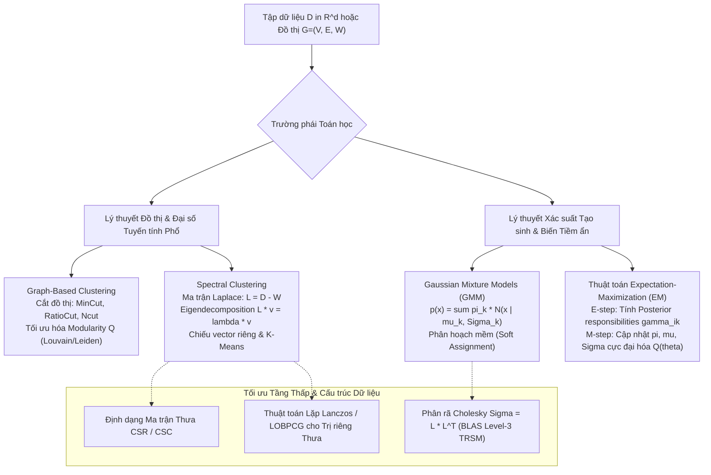
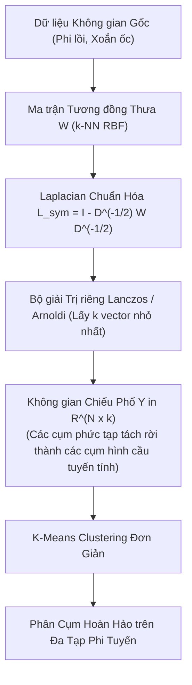
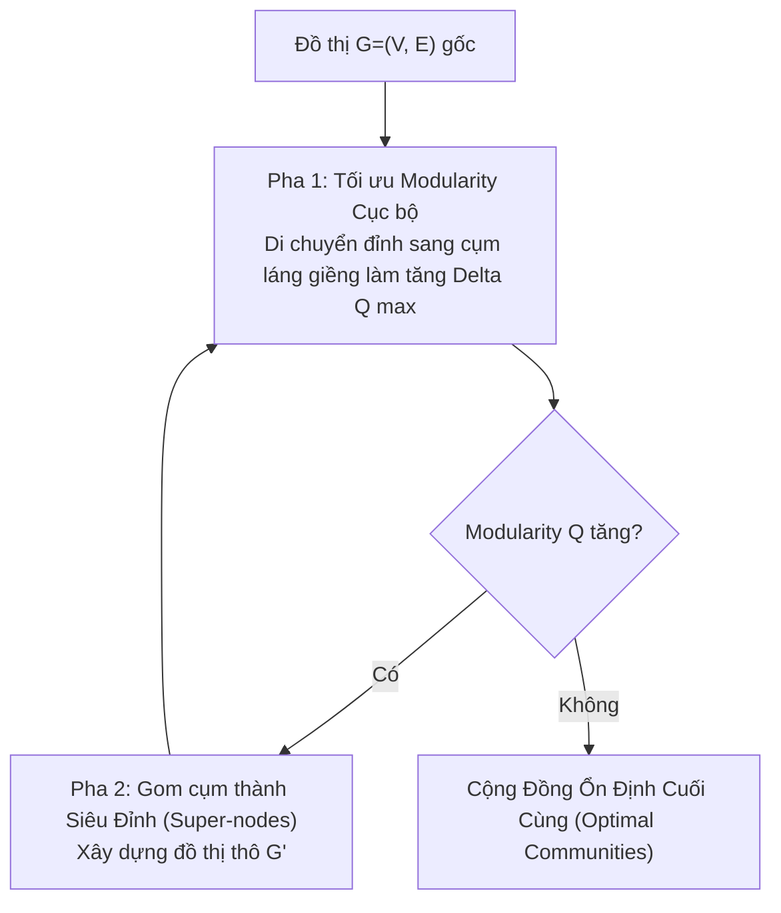
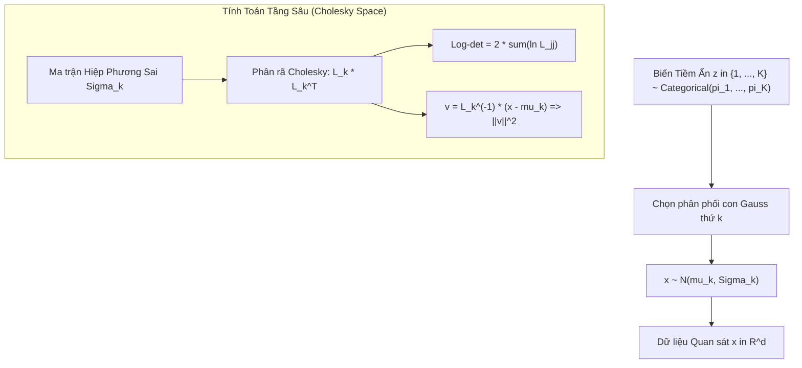
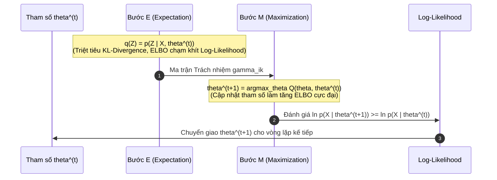

# Chuyên đề: Phân Cụm Phổ & Mô Hình Hỗn Hợp (Spectral & Mixture Clustering)

## 1. Tổng quan Chuyên đề
Trong nhiều bài toán thực tế, dữ liệu không chỉ có cấu trúc phi lồi phức tạp mà còn thể hiện mối quan hệ tô pô phi Euclidean (đồ thị tương đồng, mạng xã hội) hoặc bắt nguồn từ các phân phối xác suất chồng lấn (overlapping latent sub-populations). Để giải quyết những thách thức này, hai trường phái toán học nâng cao được phát triển:
1. **Phân cụm Phổ và Đồ thị (Spectral & Graph-Based Clustering)**: Sử dụng lý thuyết phổ của ma trận Laplace đồ thị (Spectral Graph Theory) để chiếu dữ liệu từ không gian phi tuyến sang không gian vector riêng tuyến tính, chuyển bài toán phân cắt đồ thị NP-hard thành bài toán trị riêng liên tục.
2. **Mô hình Hỗn hợp & Thuật toán EM (Gaussian Mixture Models & Expectation-Maximization)**: Tiếp cận theo lý thuyết xác suất tạo sinh (Generative Modeling), coi dữ liệu là tổng hợp của các biến tiềm ẩn (Latent Variables) và tối ưu hóa hàm hợp lý thông qua việc nâng chặn dưới Evidence Lower Bound (ELBO).



---

## 2. Chi tiết từng Keyword

---

### 1. Spectral Clustering (Phân cụm phổ)

#### a. Định nghĩa Bản chất Toán học (Mathematical Formulation)
Cho đồ thị vô hướng có trọng số $G = (V, E)$ với ma trận kề trọng số đối xứng $\mathbf{W} \in \mathbb{R}^{N \times N}$ ($W_{ij} \ge 0$) và ma trận bậc đường chéo $\mathbf{D} = \text{diag}(d_1, \dots, d_N)$ với $d_i = \sum_{j=1}^N W_{ij}$.

**Các dạng Ma trận Laplace Đồ thị (Graph Laplacians)**:
1. **Laplacian Chưa Chuẩn Hóa (Unnormalized Graph Laplacian)**:
   $$\mathbf{L} = \mathbf{D} - \mathbf{W}$$
   Tính chất: $\mathbf{L}$ là ma trận nửa xác định dương đối xứng (Symmetric Positive Semi-Definite - SPSD). Với mọi vector $\mathbf{f} \in \mathbb{R}^N$:
   $$\mathbf{f}^T \mathbf{L} \mathbf{f} = \frac{1}{2} \sum_{i, j=1}^N W_{ij} (f_i - f_j)^2 \ge 0$$
2. **Laplacian Chuẩn Hóa Đối Xứng (Symmetric Normalized Laplacian)**:
   $$\mathbf{L}_{\text{sym}} = \mathbf{D}^{-1/2} \mathbf{L} \mathbf{D}^{-1/2} = \mathbf{I} - \mathbf{D}^{-1/2} \mathbf{W} \mathbf{D}^{-1/2}$$
3. **Laplacian Bước Ngẫu Nhiên (Random Walk Normalized Laplacian)**:
   $$\mathbf{L}_{\text{rw}} = \mathbf{D}^{-1} \mathbf{L} = \mathbf{I} - \mathbf{D}^{-1} \mathbf{W}$$

**Bản chất Nới lỏng của Normalized Cut (Relaxation of NCut)**:
Bài toán phân cắt đồ thị chuẩn hóa (Normalized Cut - Shi & Malik, 2000) nhằm cực tiểu hóa:
$$\text{NCut}(A, B) = \frac{\text{cut}(A, B)}{\text{vol}(A)} + \frac{\text{cut}(A, B)}{\text{vol}(B)}$$
Trong đó $\text{cut}(A, B) = \sum_{i \in A, j \in B} W_{ij}$ và $\text{vol}(A) = \sum_{i \in A} d_i$.
Đây là bài toán tối ưu rời rạc NP-hard. Bằng cách nới lỏng vector chỉ thị nhãn rời rạc thành biến liên tục $\mathbf{f} \in \mathbb{R}^N$ với ràng buộc trực giao $\mathbf{f}^T \mathbf{D} \mathbf{1} = 0$, bài toán quy về thương số Rayleigh chuẩn hóa:
$$\min_{\mathbf{f} \neq \mathbf{0}} \frac{\mathbf{f}^T \mathbf{L} \mathbf{f}}{\mathbf{f}^T \mathbf{D} \mathbf{f}} \quad \text{sao cho } \mathbf{f}^T \mathbf{D} \mathbf{1} = 0$$
Theo định lý cực trị Courant-Fischer, nghiệm tối ưu chính là **vector riêng ứng với trị riêng nhỏ thứ hai** của bài toán trị riêng tổng quát $\mathbf{L} \mathbf{v} = \lambda \mathbf{D} \mathbf{v}$ (còn gọi là Vector Fiedler).

**Quy trình Thuật toán Spectral Clustering (Ng, Jordan, Weiss - NJW, 2001)**:
1. Xây dựng ma trận tương đồng $\mathbf{W}$ (thường dùng RBF Kernel: $W_{ij} = \exp(-\|\mathbf{x}_i - \mathbf{x}_j\|^2 / 2\sigma^2)$).
2. Tính $\mathbf{L}_{\text{sym}} = \mathbf{I} - \mathbf{D}^{-1/2} \mathbf{W} \mathbf{D}^{-1/2}$.
3. Tìm $k$ vector riêng $\mathbf{u}_1, \dots, \mathbf{u}_k$ ứng với $k$ trị riêng nhỏ nhất của $\mathbf{L}_{\text{sym}}$ và ghép thành ma trận $\mathbf{U} = [\mathbf{u}_1, \dots, \mathbf{u}_k] \in \mathbb{R}^{N \times k}$.
4. Chuẩn hóa từng hàng của $\mathbf{U}$ theo chuẩn $L_2$: $Y_{ij} = \frac{U_{ij}}{\sqrt{\sum_t U_{it}^2}}$.
5. Chạy thuật toán K-Means cổ điển trên các hàng của ma trận $\mathbf{Y} \in \mathbb{R}^{N \times k}$.

#### b. Cơ chế Tầng Sâu & Điện toán (Under The Hood / Hardware Internals)
- **Độ phức tạp Phân rã Trị riêng (Eigendecomposition Complexity)**: Phân rã toàn phần ma trận dày đặc kích thước $N \times N$ bằng thuật toán QR tiêu tốn $\mathcal{O}(N^3)$ phép tính và $\mathcal{O}(N^2)$ bộ nhớ. Khi $N > 10^4$, việc này bất khả thi.
- **Thuật toán Lanczos & LOBPCG cho Ma trận Thưa (Sparse Eigensolvers)**: Trong thực tế, chỉ lưu $k$-láng giềng gần nhất (k-NN graph), ma trận $\mathbf{W}$ là ma trận thưa (Sparse Matrix với số phần tử khác không $\text{nnz} \sim k \cdot N$). Sử dụng thuật toán lặp Lanczos hoặc Locally Optimal Block Preconditioned Conjugate Gradient (LOBPCG) chỉ đòi hỏi các phép nhân ma trận - vector thưa (SpMV: Sparse Matrix-Vector Multiplication):
  $$\text{Complexity} = \mathcal{O}(k \cdot \text{nnz} \cdot \text{iter}) \ll \mathcal{O}(N^3)$$
  Phép toán SpMV tối ưu hóa truy cập bộ nhớ liên tục theo định dạng CSR (Compressed Sparse Row).

#### c. Sơ đồ Minh họa (Mermaid Diagram)


#### d. Code Thực chiến (Dual-Engine: C++ & Python)

```cpp
// C++17: Xây dựng Ma trận Laplacian Chưa Chuẩn Hóa L = D - W và Tính D^(-1/2)
#include <iostream>
#include <vector>
#include <cmath>
#include <iomanip>

struct DenseGraph {
    size_t N;
    std::vector<float> W; // [N x N]
    std::vector<float> D; // [N] - Đường chéo ma trận bậc

    explicit DenseGraph(size_t n) : N(n), W(n * n, 0.0f), D(n, 0.0f) {}

    void set_edge(size_t i, size_t j, float weight) {
        W[i * N + j] = weight;
        W[j * N + i] = weight;
    }

    void compute_degree_matrix() {
        for (size_t i = 0; i < N; ++i) {
            float deg = 0.0f;
            for (size_t j = 0; j < N; ++j) {
                deg += W[i * N + j];
            }
            D[i] = deg;
        }
    }

    // Tính L_sym = I - D^(-1/2) W D^(-1/2)
    std::vector<float> compute_normalized_laplacian() {
        compute_degree_matrix();
        std::vector<float> inv_sqrt_D(N, 0.0f);
        for (size_t i = 0; i < N; ++i) {
            inv_sqrt_D[i] = (D[i] > 1e-8f) ? (1.0f / std::sqrt(D[i])) : 0.0f;
        }

        std::vector<float> L_sym(N * N, 0.0f);
        for (size_t i = 0; i < N; ++i) {
            for (size_t j = 0; j < N; ++j) {
                float norm_w = inv_sqrt_D[i] * W[i * N + j] * inv_sqrt_D[j];
                L_sym[i * N + j] = (i == j ? 1.0f : 0.0f) - norm_w;
            }
        }
        return L_sym;
    }
};

int main() {
    DenseGraph g(3);
    g.set_edge(0, 1, 1.0f);
    g.set_edge(1, 2, 2.0f);

    auto L_sym = g.compute_normalized_laplacian();
    std::cout << "[C++] Ma trận L_sym [3x3]:\n";
    for (size_t i = 0; i < 3; ++i) {
        for (size_t j = 0; j < 3; ++j) {
            std::cout << std::setw(8) << std::setprecision(3) << L_sym[i * 3 + j] << " ";
        }
        std::cout << "\n";
    }
    return 0;
}
```

```python
# Python / Scikit-Learn: Spectral Clustering tách hai vòng tròn đồng tâm (Concentric Circles)
import numpy as np
from sklearn.datasets import make_circles
from sklearn.cluster import SpectralClustering, KMeans

def compare_spectral_vs_kmeans():
    # Tạo 2 vòng tròn đồng tâm (bài toán phi tuyến điển hình)
    X, _ = make_circles(n_samples=400, factor=0.4, noise=0.03, random_state=42)

    # 1. K-Means truyền thống (thất bại hoàn toàn trên đa tạp này)
    km = KMeans(n_clusters=2, random_state=42)
    labels_km = km.fit_predict(X)

    # 2. Spectral Clustering với RBF Kernel Affinity
    sc = SpectralClustering(n_clusters=2, affinity='nearest_neighbors', n_neighbors=10, assign_labels='kmeans', random_state=42)
    labels_sc = sc.fit_predict(X)

    print(f"[Python] Spectral Clustering chạy xong trên {len(X)} mẫu.")
    print(f"- Số mẫu gán cụm 0 (Spectral): {np.sum(labels_sc == 0)}")
    print(f"- Số mẫu gán cụm 1 (Spectral): {np.sum(labels_sc == 1)}")

if __name__ == "__main__":
    compare_spectral_vs_kmeans()
```

#### e. Lỗi Thường gặp & Ổn định Số học (Pitfalls & Numerical Stability)
- **Đồ thị không liên thông (Disconnected Components)**: Nếu đồ thị gồm $k$ thành phần liên thông rời rạc, ma trận $\mathbf{L}$ sẽ có đúng $k$ trị riêng bằng $0$ ($\lambda_1 = \dots = \lambda_k = 0$). Các vector riêng ứng với không gian riêng (Eigenspace) này có thể là bất kỳ tổ hợp tuyến tính trực chuẩn nào, khiến thuật toán K-Means ở bước sau có thể chọn nghiệm tùy tiện.
- **Nghịch đảo căn bậc hai $D_{ii}^{-1/2}$ khi bậc bằng 0**: Các đỉnh cô lập có $d_i = 0$, dẫn đến lỗi chia cho 0. Bắt buộc phải thêm điều kiện kẹp `D_ii = max(D_ii, 1e-12)`.

#### f. Ứng dụng Thực chiến trong AI / Deep Learning
- **Phân đoạn Ảnh Tự động (Image Segmentation via Normalized Cuts)**: Biểu diễn từng pixel như một đỉnh đồ thị, trọng số là độ tương đồng màu sắc và khoảng cách không gian.
- **Spectral Graph Convolutional Networks (Spectral GCN - Kipf & Welling, 2017)**: Định nghĩa tích chập trên đồ thị thông qua phép biến đổi Fourier đồ thị (Graph Fourier Transform), sử dụng đa thức Chebyshev xấp xỉ bộ lọc phổ trên ma trận Laplacian $\mathbf{L}_{\text{sym}}$.

---

### 2. Graph-Based Clustering (Phân cụm dựa trên đồ thị)

#### a. Định nghĩa Bản chất Toán học (Mathematical Formulation)
Phân cụm dựa trên đồ thị mô hình hóa dữ liệu thành đồ thị $G = (V, E, W)$, trong đó $V$ là tập các thực thể và cạnh $(u, v) \in E$ có trọng số $W_{uv} \ge 0$ phản ánh độ kết nối.

**Các Độ đo Cắt Đồ thị (Graph Cut Metrics)**:
Cho phân hoạch $V$ thành $K$ tập con không giao nhau $C_1, \dots, C_K$:
1. **Ratio Cut**: Cân bằng số lượng đỉnh trong từng cụm:
   $$\text{RatioCut}(C_1, \dots, C_K) = \frac{1}{2} \sum_{k=1}^K \frac{\text{cut}(C_k, \bar{C}_k)}{|C_k|}$$
2. **Normalized Cut (NCut)**: Cân bằng tổng bậc (volume) của từng cụm:
   $$\text{NCut}(C_1, \dots, C_K) = \frac{1}{2} \sum_{k=1}^K \frac{\text{cut}(C_k, \bar{C}_k)}{\text{vol}(C_k)}$$
3. **Độ Dẫn (Conductance)** của lát cắt:
   $$\Phi(S) = \frac{\text{cut}(S, \bar{S})}{\min(\text{vol}(S), \text{vol}(\bar{S}))}$$
   Bất đẳng thức Cheeger liên hệ độ dẫn nhỏ nhất $\Phi_G$ với trị riêng thứ hai $\lambda_2$ của ma trận Laplacian chuẩn hóa:
   $$\frac{\lambda_2}{2} \le \Phi_G \le \sqrt{2 \lambda_2}$$

**Tối ưu hóa Modularity (Newman-Girvan Modularity $Q$)**:
Đo lường mức độ sai khác giữa cấu trúc cụm thực tế và mô hình mạng ngẫu nhiên cấu hình (Configuration Model):
$$Q = \frac{1}{2m} \sum_{i, j} \left( W_{ij} - \frac{d_i d_j}{2m} \right) \delta(c_i, c_j)$$
Trong đó:
- $m = \frac{1}{2} \sum_{i, j} W_{ij}$ là tổng trọng số cạnh toàn mạng.
- $d_i$ là bậc của đỉnh $i$.
- $\delta(c_i, c_j) = 1$ nếu đỉnh $i$ và $j$ cùng cụm, ngược lại bằng 0.
Giá trị $Q \in [-0.5, 1.0]$. Giá trị $Q > 0.3$ thể hiện cấu trúc cộng đồng (community structure) cực kỳ rõ nét.

**Thuật toán Louvain (Blondel et al., 2008)**:
Phương pháp tham lam đa tỷ lệ (Multi-scale Greedy):
- *Pha 1 (Local Modularity Optimization)*: Mỗi nút được gán vào cộng đồng láng giềng làm tăng $\Delta Q$ nhiều nhất cho đến khi đạt cực tiểu địa phương.
- *Pha 2 (Community Aggregation)*: Gom toàn bộ các nút trong một cộng đồng thành một siêu nút (Super-node) của đồ thị thô hơn, cạnh giữa các siêu nút là tổng trọng số cạnh liên cộng đồng. Lặp lại cho đến khi $Q$ không thể tăng thêm.

#### b. Cơ chế Tầng Sâu & Điện toán (Under The Hood / Hardware Internals)
- **Định dạng Lưu trữ Thưa CSR (Compressed Sparse Row)**:
  Lưu đồ thị gồm $N$ đỉnh và $M$ cạnh bằng 3 mảng:
  - `row_ptr` (kích thước $N + 1$): Chỉ số bắt đầu danh sách cạnh của đỉnh $i$.
  - `col_idx` (kích thước $2M$): Chỉ số đỉnh láng giềng.
  - `values` (kích thước $2M$): Trọng số cạnh.
  Định dạng này đảm bảo các cạnh kề của một đỉnh nằm liên tục trong bộ nhớ, tối đa hóa tỷ lệ trúng dòng Cache L1 (Cache Hit Rate) khi duyệt láng giềng.
- **Node Reordering (Thuật toán Reverse Cuthill-McKee - RCM)**: Sắp xếp lại thứ tự đánh số đỉnh đồ thị để thu hẹp độ rộng băng thông ma trận (Matrix Bandwidth), giảm thiểu khoảng cách nhảy bộ nhớ giữa các truy cập cạnh liên tiếp.

#### c. Sơ đồ Minh họa (Mermaid Diagram)


#### d. Code Thực chiến (Dual-Engine: C++ & Python)

```cpp
// C++17: Biểu diễn Đồ thị Thưa CSR và Tính toán Độ Tăng Modularity Delta Q
#include <iostream>
#include <vector>
#include <numeric>

struct CSRGraph {
    size_t N;
    std::vector<int> row_ptr;
    std::vector<int> col_idx;
    std::vector<float> weights;
    float total_weight_m{0.0f};

    CSRGraph(size_t n, const std::vector<int>& r, const std::vector<int>& c, const std::vector<float>& w)
        : N(n), row_ptr(r), col_idx(c), weights(w) {
        float sum = 0.0f;
        for (float val : weights) sum += val;
        total_weight_m = sum * 0.5f; // Đồ thị vô hướng, mỗi cạnh đếm 2 lần
    }

    // Tính độ biến thiên Modularity khi chuyển nút i vào cụm C
    float compute_delta_Q(int node, float k_i, float k_i_in, float Sigma_tot) const {
        if (total_weight_m <= 0.0f) return 0.0f;
        float inv_2m = 1.0f / (2.0f * total_weight_m);
        // Delta Q = [k_i_in / 2m] - [ (Sigma_tot * k_i) / (2m)^2 ]
        float term1 = k_i_in * inv_2m;
        float term2 = (Sigma_tot * k_i) * (inv_2m * inv_2m);
        return term1 - term2;
    }
};

int main() {
    // Đồ thị tam giác 3 đỉnh: 0-1, 1-2, 2-0
    std::vector<int> row_ptr = {0, 2, 4, 6};
    std::vector<int> col_idx = {1, 2, 0, 2, 0, 1};
    std::vector<float> weights = {1.0f, 1.0f, 1.0f, 1.0f, 1.0f, 1.0f};

    CSRGraph g(3, row_ptr, col_idx, weights);
    float dQ = g.compute_delta_Q(0, 2.0f, 1.0f, 2.0f);

    std::cout << "[C++] Đồ thị CSR khởi tạo thành công với m = " << g.total_weight_m << "\n";
    std::cout << "[C++] Delta Q dự kiến khi gộp đỉnh 0: " << dQ << "\n";
    return 0;
}
```

```python
# Python / NetworkX: Phát hiện Cộng đồng Bằng Thuật toán Louvain
import networkx as nx
from community import community_louvain # python-louvain package

def run_graph_community_detection():
    # Tạo đồ thị mạng xã hội kinh điển: Zachary's Karate Club
    G = nx.karate_club_graph()
    
    # Chạy thuật toán Louvain
    partition = community_louvain.best_partition(G, weight='weight', random_state=42)
    modularity = community_louvain.modularity(partition, G)
    
    num_communities = len(set(partition.values()))
    print(f"[Python] Số cộng đồng phát hiện trong mạng Karate Club: {num_communities}")
    print(f"[Python] Điểm Modularity Q toàn cục: {modularity:.4f} (Rất cao cho mạng 34 đỉnh)")
    return partition

if __name__ == "__main__":
    run_graph_community_detection()
```

#### e. Lỗi Thường gặp & Ổn định Số học (Pitfalls & Numerical Stability)
- **Giới hạn Độ phân giải của Modularity (Resolution Limit)**: Fortunato & Barthélemy (2007) đã chứng minh rằng cực đại hóa Modularity không thể phát hiện các cộng đồng có quy mô nhỏ hơn $\sqrt{2m}$ cạnh, khiến các nhóm nhỏ liên kết chặt chẽ bị gộp nhầm vào các cộng đồng lớn xung quanh.
- **Cộng đồng Rời rạc Không Liên thông trong Louvain**: Thuật toán Louvain có thể vô tình tạo ra các cộng đồng mà về mặt tô pô bị đứt đoạn thành nhiều thành phần không nối với nhau. Thuật toán **Leiden (Traag et al., 2019)** đã khắc phục triệt để lỗi này bằng bước tinh chỉnh ngẫu nhiên (Refinement Phase).

#### f. Ứng dụng Thực chiến trong AI / Deep Learning
- **Phát hiện Gian lận Tài chính (Financial Fraud Ring Detection)**: Gom cụm các đồ thị giao dịch ngân hàng để phát hiện các vòng rửa tiền khép kín (Money Mules).
- **Phân vùng Đồ thị Huấn luyện Phân tán (Distributed GNN Partitioning)**: Phân rã đồ thị kiến thức hàng tỷ cạnh lên nhiều node GPU bằng METIS để cân bằng tải bộ nhớ HBM.

---

### 3. Gaussian Mixture Models (GMM - Mô hình hỗn hợp Gauss)

#### a. Định nghĩa Bản chất Toán học (Mathematical Formulation)
**Gaussian Mixture Models (GMM)** là mô hình xác suất tạo sinh tham số biểu diễn hàm mật độ xác suất của biến ngẫu nhiên liên tục $\mathbf{x} \in \mathbb{R}^d$ dưới dạng tổ hợp tuyến tính của $K$ phân phối Gauss đa biến:
$$p(\mathbf{x} \mid \mathbf{\theta}) = \sum_{k=1}^K \pi_k \mathcal{N}(\mathbf{x} \mid \mathbf{\mu}_k, \mathbf{\Sigma}_k)$$
Trong đó:
- $\mathbf{\theta} = \{\pi_k, \mathbf{\mu}_k, \mathbf{\Sigma}_k\}_{k=1}^K$ là tập tham số toàn cục của mô hình.
- $\pi_k = P(z = k)$ là hệ số hòa trộn (Mixing Coefficients), thỏa mãn:
  $$\pi_k \ge 0, \quad \sum_{k=1}^K \pi_k = 1$$
- $\mathcal{N}(\mathbf{x} \mid \mathbf{\mu}_k, \mathbf{\Sigma}_k)$ là hàm mật độ Gauss đa biến $d$-chiều:
  $$\mathcal{N}(\mathbf{x} \mid \mathbf{\mu}_k, \mathbf{\Sigma}_k) = \frac{1}{(2\pi)^{d/2} |\mathbf{\Sigma}_k|^{1/2}} \exp\left( -\frac{1}{2} (\mathbf{x} - \mathbf{\mu}_k)^T \mathbf{\Sigma}_k^{-1} (\mathbf{x} - \mathbf{\mu}_k) \right)$$

**Các Dạng Ràng buộc Ma trận Hiệp Phương Sai $\mathbf{\Sigma}_k$**:
1. **Spherical**: $\mathbf{\Sigma}_k = \sigma_k^2 \mathbf{I}$ (Đẳng hướng, tương tự K-Means nhưng có bán kính mềm).
2. **Diagonal**: $\mathbf{\Sigma}_k = \text{diag}(\sigma_{k1}^2, \dots, \sigma_{kd}^2)$ (Các trục độc lập thống kê với nhau, số tham số $\mathcal{O}(Kd)$).
3. **Tied**: $\mathbf{\Sigma}_k = \mathbf{\Sigma}, \forall k$ (Mọi cụm chia sẻ chung một ma trận hiệp phương sai).
4. **Full**: $\mathbf{\Sigma}_k$ đối xứng xác định dương tùy ý (Mô tả góc xoay elip tùy ý, số tham số $\mathcal{O}(K d^2)$).

**Hàm Hợp lý Log (Log-Likelihood)**:
$$\ln p(\mathbf{X} \mid \mathbf{\theta}) = \sum_{i=1}^N \ln \left( \sum_{k=1}^K \pi_k \mathcal{N}(\mathbf{x}_i \mid \mathbf{\mu}_k, \mathbf{\Sigma}_k) \right)$$
Do phép tính tổng nằm bên trong hàm $\ln$, không thể giải nghiệm giải tích dạng đóng (Closed-form solution) trực tiếp bằng cách giải $\nabla_{\mathbf{\theta}} \ln p = 0$, bắt buộc phải sử dụng thuật toán Expectation-Maximization.

#### b. Cơ chế Tầng Sâu & Điện toán (Under The Hood / Hardware Internals)
- **Tối ưu hóa Bằng Phân Rã Cholesky (Cholesky Decomposition)**:
  Không bao giờ tính ma trận nghịch đảo $\mathbf{\Sigma}^{-1}$ hoặc định thức $|\mathbf{\Sigma}|$ trực tiếp vì chi phí cao và mất ổn định số học. Thay vào đó, phân tích $\mathbf{\Sigma} = \mathbf{L} \mathbf{L}^T$, với $\mathbf{L}$ là ma trận tam giác dưới:
  1. Định thức: $|\mathbf{\Sigma}| = \left( \prod_{j=1}^d L_{jj} \right)^2 \implies \ln |\mathbf{\Sigma}| = 2 \sum_{j=1}^d \ln L_{jj}$.
  2. Khoảng cách Mahalanobis bình phương:
     $$(\mathbf{x} - \mathbf{\mu})^T \mathbf{\Sigma}^{-1} (\mathbf{x} - \mathbf{\mu}) = \|\mathbf{L}^{-1}(\mathbf{x} - \mathbf{\mu})\|^2$$
     Được tính bằng cách giải hệ phương trình tam giác $\mathbf{L} \mathbf{v} = (\mathbf{x} - \mathbf{\mu})$ qua hàm BLAS Level-3 `dtrsm` (Triangular Solve), sau đó tính $\|\mathbf{v}\|^2$.

#### c. Sơ đồ Minh họa (Mermaid Diagram)


#### d. Code Thực chiến (Dual-Engine: C++ & Python)

```cpp
// C++17: Tính Log-Likelihood của Phân phối Gauss Đa biến dùng Phân rã Cholesky 2D
#include <iostream>
#include <vector>
#include <cmath>

struct Gaussian2D {
    float mu_x, mu_y;
    // Ma trận Cholesky tam giác dưới L = [[L00, 0], [L10, L11]]
    float L00, L10, L11;

    Gaussian2D(float mx, float my, float l00, float l10, float l11)
        : mu_x(mx), mu_y(my), L00(l00), L10(l10), L11(l11) {}

    float log_prob(float x, float y) const {
        float dx = x - mu_x;
        float dy = y - mu_y;

        // Giải L * v = d:
        // v0 = dx / L00
        // v1 = (dy - L10 * v0) / L11
        float v0 = dx / L00;
        float v1 = (dy - L10 * v0) / L11;
        float maha_sq = v0 * v0 + v1 * v1;

        // log |Sigma| = 2 * (ln L00 + ln L11)
        float log_det = 2.0f * (std::log(L00) + std::log(L11));
        constexpr float LOG_2PI = 1.837877f; // ln(2 * pi)

        return -0.5f * (2.0f * LOG_2PI + log_det + maha_sq);
    }
};

int main() {
    // Gauss có tâm tại (0, 0), hiệp phương sai đường chéo std=[1.0, 2.0]
    Gaussian2D g(0.0f, 0.0f, 1.0f, 0.0f, 2.0f);
    float lp = g.log_prob(0.5f, 1.0f);

    std::cout << "[C++] Log-probability tại (0.5, 1.0): " << lp << "\n";
    std::cout << "[C++] Probability mật độ: " << std::exp(lp) << "\n";
    return 0;
}
```

```python
# Python / Scikit-Learn: GMM với Đa dạng Ràng buộc Hiệp Phương Sai
from sklearn.mixture import GaussianMixture
import numpy as np

def run_gmm_evaluation():
    np.random.seed(42)
    # Tạo dữ liệu từ 2 thành phần hình elip nghiêng
    X1 = np.random.randn(200, 2) @ np.array([[2.0, 1.0], [0.5, 1.5]])
    X2 = np.random.randn(200, 2) + np.array([5.0, 5.0])
    X = np.vstack([X1, X2])

    # GMM với hiệp phương sai đầy đủ (full covariance)
    gmm = GaussianMixture(n_components=2, covariance_type='full', max_iter=100, random_state=42)
    gmm.fit(X)

    # Dự đoán xác suất hậu nghiệm (soft responsibilities)
    probs = gmm.predict_proba(X[:3])

    print(f"[Python] GMM Hội tụ sau: {gmm.n_iter_} bước")
    print(f"[Python] Trọng số hòa trộn pi: {np.round(gmm.weights_, 3)}")
    print(f"[Python] Ma trận trách nhiệm (responsibilities) 3 mẫu đầu:\n{np.round(probs, 3)}")

if __name__ == "__main__":
    run_gmm_evaluation()
```

#### e. Lỗi Thường gặp & Ổn định Số học (Pitfalls & Numerical Stability)
- **Kỳ dị Điểm (Singularity / Infinite Likelihood Spike)**: Nếu một thành phần Gauss co cụm lại chỉ bao bọc đúng một điểm dữ liệu duy nhất ($\mathbf{x}_n = \mathbf{\mu}_k$), thì phương sai $\sigma_k^2 \to 0$, định thức $|\mathbf{\Sigma}_k| \to 0$ và mật độ xác suất $\mathcal{N}(\mathbf{x}_n \mid \mathbf{\mu}_k, \mathbf{\Sigma}_k) \to \infty$. Khi đó log-likelihood tiến tới $+\infty$. Để ngăn chặn điều này, luôn thêm một số hạng điều hòa (Tikhonov Regularization / Covariance Ridge) vào đường chéo:
  $$\mathbf{\Sigma}_k \leftarrow \mathbf{\Sigma}_k + \epsilon_{\text{cov}} \mathbf{I}, \quad \text{với } \epsilon_{\text{cov}} \approx 10^{-6}$$
- **Tràn dưới Số học (Floating Point Underflow)**: Trong không gian nhiều chiều ($d > 50$), mật độ $\mathcal{N}(\mathbf{x})$ trở nên cực kỳ nhỏ ($< 10^{-100}$), gây underflow về 0.0 trong kiểu dữ liệu FP32. Bắt buộc phải duy trì tính toán toàn bộ trong miền Log-Domain.

#### f. Ứng dụng Thực chiến trong AI / Deep Learning
- **Mô hình Hóa Âm học trong Nhận dạng Tiếng nói (Speech Recognition - GMM-HMMs)**: Mô hình hóa phân bố phổ của các âm vị (Phonemes) từ hệ số MFCC.
- **Mô hình Tạo sinh Tiềm ẩn (Variational Autoencoder với GMM Prior - VaDE)**: Thay thế tiên nghiệm Gauss đơn giản $\mathcal{N}(\mathbf{0}, \mathbf{I})$ bằng phân phối hỗn hợp Gauss để học không gian tiềm ẩn đa mốt (Multimodal Latent Space).

---

### 4. Expectation-Maximization (EM - Thuật toán Cực đại hóa Kỳ vọng)

#### a. Định nghĩa Bản chất Toán học (Mathematical Formulation)
**Thuật toán EM (Dempster, Laird, Rubin - 1977)** là phương pháp lặp đa năng tìm ước lượng hợp lý cực đại (Maximum Likelihood Estimation - MLE) hoặc hậu nghiệm cực đại (MAP) cho các mô hình thống kê chứa biến tiềm ẩn (Latent/Hidden Variables) không quan sát được.

Cho tập dữ liệu quan sát $\mathbf{X}$ và tập biến tiềm ẩn $\mathbf{Z}$. Ta muốn giải bài toán:
$$\max_{\mathbf{\theta}} \ln p(\mathbf{X} \mid \mathbf{\theta}) = \max_{\mathbf{\theta}} \ln \sum_{\mathbf{Z}} p(\mathbf{X}, \mathbf{Z} \mid \mathbf{\theta})$$

**Chứng minh Bất Đẳng Thức Jensen & Evidence Lower Bound (ELBO)**:
Với mọi phân phối xác suất bất kỳ $q(\mathbf{Z})$ trên không gian biến tiềm ẩn:
$$\ln p(\mathbf{X} \mid \mathbf{\theta}) = \ln \sum_{\mathbf{Z}} q(\mathbf{Z}) \frac{p(\mathbf{X}, \mathbf{Z} \mid \mathbf{\theta})}{q(\mathbf{Z})} = \ln \mathbb{E}_{q(\mathbf{Z})} \left[ \frac{p(\mathbf{X}, \mathbf{Z} \mid \mathbf{\theta})}{q(\mathbf{Z})} \right]$$
Do hàm logarithm là hàm lõm ($\ln'' < 0$), theo **Bất đẳng thức Jensen**:
$$\ln \mathbb{E}[g(\mathbf{Z})] \ge \mathbb{E}[\ln g(\mathbf{Z})]$$
Ta suy ra:
$$\ln p(\mathbf{X} \mid \mathbf{\theta}) \ge \sum_{\mathbf{Z}} q(\mathbf{Z}) \ln \left( \frac{p(\mathbf{X}, \mathbf{Z} \mid \mathbf{\theta})}{q(\mathbf{Z})} \right) \triangleq \text{ELBO}(q, \mathbf{\theta})$$

Mối quan hệ chính xác được phân tích thông qua độ phân kỳ Kullback-Leibler (KL-Divergence):
$$\ln p(\mathbf{X} \mid \mathbf{\theta}) = \text{ELBO}(q, \mathbf{\theta}) + \text{KL}(q(\mathbf{Z}) \,\|\, p(\mathbf{Z} \mid \mathbf{X}, \mathbf{\theta}))$$
Do $\text{KL} \ge 0$, ta có $\text{ELBO}(q, \mathbf{\theta}) \le \ln p(\mathbf{X} \mid \mathbf{\theta})$.

**Hai Bước Lặp của Thuật toán EM**:
1. **Bước E (Expectation Step)**:
   Cố định tham số hiện tại $\mathbf{\theta}^{(t)}$, tối đa hóa ELBO theo $q$. Chặn dưới đạt cực đại khi và chỉ khi $\text{KL} = 0$, nghĩa là:
   $$q^{(t+1)}(\mathbf{Z}) = p(\mathbf{Z} \mid \mathbf{X}, \mathbf{\theta}^{(t)})$$
   Xác định hàm mục tiêu kỳ vọng $\mathcal{Q}(\mathbf{\theta}, \mathbf{\theta}^{(t)})$:
   $$\mathcal{Q}(\mathbf{\theta}, \mathbf{\theta}^{(t)}) \triangleq \mathbb{E}_{\mathbf{Z} \sim p(\mathbf{Z} \mid \mathbf{X}, \mathbf{\theta}^{(t)})} [\ln p(\mathbf{X}, \mathbf{Z} \mid \mathbf{\theta})]$$
   Đối với GMM, bước này tính trách nhiệm hậu nghiệm (Responsibilities):
   $$\gamma_{ik} = P(z_{ik} = 1 \mid \mathbf{x}_i, \mathbf{\theta}^{(t)}) = \frac{\pi_k^{(t)} \mathcal{N}(\mathbf{x}_i \mid \mathbf{\mu}_k^{(t)}, \mathbf{\Sigma}_k^{(t)})}{\sum_{j=1}^K \pi_j^{(t)} \mathcal{N}(\mathbf{x}_i \mid \mathbf{\mu}_j^{(t)}, \mathbf{\Sigma}_j^{(t)})}$$
2. **Bước M (Maximization Step)**:
   Cập nhật tham số mới cực đại hóa hàm $\mathcal{Q}$:
   $$\mathbf{\theta}^{(t+1)} = \arg\max_{\mathbf{\theta}} \mathcal{Q}(\mathbf{\theta}, \mathbf{\theta}^{(t)})$$
   Đối với GMM, đặt $N_k = \sum_{i=1}^N \gamma_{ik}$:
   $$\pi_k^{(t+1)} = \frac{N_k}{N}, \quad \mathbf{\mu}_k^{(t+1)} = \frac{1}{N_k} \sum_{i=1}^N \gamma_{ik} \mathbf{x}_i, \quad \mathbf{\Sigma}_k^{(t+1)} = \frac{1}{N_k} \sum_{i=1}^N \gamma_{ik} (\mathbf{x}_i - \mathbf{\mu}_k^{(t+1)})(\mathbf{x}_i - \mathbf{\mu}_k^{(t+1)})^T$$

**Định lý Hội tụ Đơn điệu (Monotonic Convergence Theorem)**:
$$\ln p(\mathbf{X} \mid \mathbf{\theta}^{(t+1)}) \ge \mathcal{Q}(\mathbf{\theta}^{(t+1)}, \mathbf{\theta}^{(t)}) \ge \mathcal{Q}(\mathbf{\theta}^{(t)}, \mathbf{\theta}^{(t)}) = \ln p(\mathbf{X} \mid \mathbf{\theta}^{(t)})$$
Đảm bảo hàm hợp lý quan sát $\ln p(\mathbf{X} \mid \mathbf{\theta})$ không bao giờ giảm sau mỗi chu kỳ lặp.

#### b. Cơ chế Tầng Sâu & Điện toán (Under The Hood / Hardware Internals)
- **Ổn định Số học LogSumExp cho Responsibilities**:
  Khi tính $\gamma_{ik}$, nếu tính tích $\pi_k \mathcal{N}_k$ trực tiếp sẽ bị tràn dưới. Đặt $a_{ik} = \ln \pi_k + \ln \mathcal{N}(\mathbf{x}_i \mid \mathbf{\mu}_k, \mathbf{\Sigma}_k)$:
  $$\ln \gamma_{ik} = a_{ik} - \text{LogSumExp}_j(a_{ij}) = a_{ik} - \left( m_i + \ln \sum_{j=1}^K \exp(a_{ij} - m_i) \right)$$
  Trong đó $m_i = \max_j a_{ij}$. Thao tác này hoàn toàn loại trừ nguy cơ tràn số (Overflow/Underflow).
- **Bộ nhớ Ma trận Trách nhiệm (Responsibility Buffer Allocation)**: Ma trận $\mathbf{\Gamma} \in \mathbb{R}^{N \times K}$ có kích thước $N \times K \times 4$ bytes. Việc phân bổ cố định (Pre-allocation) vùng nhớ liên tục này trong suốt quá trình huấn luyện ngăn ngừa chi phí cấp phát bộ nhớ động liên tục (`malloc/free`) trong từng vòng lặp.

#### c. Sơ đồ Minh họa (Mermaid Diagram)


#### d. Code Thực chiến (Dual-Engine: C++ & Python)

```cpp
// C++17: Triển khai Ổn định Số học LogSumExp cho Thuật toán EM
#include <iostream>
#include <vector>
#include <cmath>
#include <algorithm>

float compute_log_sum_exp(const std::vector<float>& log_probs) {
    if (log_probs.empty()) return -1e30f;
    float max_val = *std::max_element(log_probs.begin(), log_probs.end());
    if (std::isinf(max_val) && max_val < 0.0f) return -1e30f;

    float sum_exp = 0.0f;
    for (float lp : log_probs) {
        sum_exp += std::exp(lp - max_val);
    }
    return max_val + std::log(sum_exp);
}

// Tính Responsibilities chuẩn hóa trong miền log
std::vector<float> compute_normalized_responsibilities(const std::vector<float>& log_unnorm_probs) {
    float log_total = compute_log_sum_exp(log_unnorm_probs);
    std::vector<float> responsibilities(log_unnorm_probs.size());
    for (size_t k = 0; k < log_unnorm_probs.size(); ++k) {
        responsibilities[k] = std::exp(log_unnorm_probs[k] - log_total);
    }
    return responsibilities;
}

int main() {
    // Giả lập log(pi_k * N_k) với các giá trị số mũ rất âm
    std::vector<float> log_unnorm = {-750.2f, -748.5f, -753.1f};
    auto gamma = compute_normalized_responsibilities(log_unnorm);

    std::cout << "[C++] Responsibilities sau khi khử tràn số bằng LogSumExp:\n";
    for (size_t k = 0; k < gamma.size(); ++k) {
        std::cout << "Cụm " << k << ": " << gamma[k] << "\n";
    }
    return 0;
}
```

```python
# Python / PyTorch: Thuật toán EM 1D Tối ưu hóa Vector hóa Hoàn Toàn
import torch

def em_gmm_1d(x: torch.Tensor, k: int, max_iter: int = 50, tol: float = 1e-4):
    n = x.shape[0]
    # Khởi tạo tham số
    pi = torch.ones(k) / k
    indices = torch.randperm(n)[:k]
    mu = x[indices].clone()
    var = torch.var(x).repeat(k)
    
    prev_log_lik = -float('inf')

    for it in range(max_iter):
        # 1. Bước E: Tính log-density [N, K]
        # ln N(x | mu, var) = -0.5 * (ln(2*pi*var) + (x - mu)^2 / var)
        diff = x.unsqueeze(1) - mu.unsqueeze(0) # [N, K]
        log_density = -0.5 * (torch.log(2.0 * torch.pi * var) + (diff ** 2) / var)
        log_joint = log_density + torch.log(pi.unsqueeze(0)) # [N, K]
        
        # LogSumExp qua các cụm
        log_evidence = torch.logsumexp(log_joint, dim=1, keepdim=True) # [N, 1]
        log_responsibilities = log_joint - log_evidence
        gamma = torch.exp(log_responsibilities) # [N, K]

        current_log_lik = log_evidence.sum().item()
        if abs(current_log_lik - prev_log_lik) < tol:
            print(f"[PyTorch EM] Hội tụ tại vòng lặp: {it}")
            break
        prev_log_lik = current_log_lik

        # 2. Bước M: Cập nhật pi, mu, var
        n_k = gamma.sum(dim=0) # [K]
        pi = n_k / n
        mu = (gamma * x.unsqueeze(1)).sum(dim=0) / n_k
        diff_updated = x.unsqueeze(1) - mu.unsqueeze(0)
        var = (gamma * (diff_updated ** 2)).sum(dim=0) / n_k + 1e-6 # Covariance ridge

    return pi, mu, var

if __name__ == "__main__":
    torch.manual_seed(42)
    # Dữ liệu trộn từ 2 cụm Gauss 1D: N(2, 0.5) và N(8, 1.0)
    samples = torch.cat([torch.randn(300) * 0.5 + 2.0, torch.randn(700) * 1.0 + 8.0])
    weights, means, variances = em_gmm_1d(samples, k=2)
    print(f"[PyTorch EM] Means: {means.tolist()}")
    print(f"[PyTorch EM] Weights: {weights.tolist()}")
```

#### e. Lỗi Thường gặp & Ổn định Số học (Pitfalls & Numerical Stability)
- **Tốc độ Hội tụ Chậm (Slow Convergence)**: Khi các thành phần phân phối có sự chồng lấn lớn (high component overlap), ma trận Hessian của hàm mục tiêu có các trị riêng rất gần 0, khiến thuật toán EM chỉ hội tụ tuyến tính với tốc độ cực kỳ chậm.
- **Bẫy Điểm Yên ngựa & Cực tiểu Địa phương**: EM chỉ bảo đảm hội tụ tới một điểm dừng (Stationary Point: cực tiểu, cực đại địa phương hoặc điểm yên ngựa) chứ không đảm bảo tìm được cực đại toàn cục. Cần khởi tạo nhiều lần (Multi-start) với K-Means++.

#### f. Ứng dụng Thực chiến trong AI / Deep Learning
- **Mô hình Khôi phục Dữ liệu Bị khuyết (Missing Data Imputation)**: Ước lượng các giá trị bị khuyết trong cơ sở dữ liệu y tế lớn mà không cần loại bỏ cả dòng dữ liệu.
- **Variational Autoencoder (VAE)**: Bản chất suy luận biến phân (Variational Inference) trong VAE là việc mở rộng thuật toán EM (Variational EM) lên mạng nơ-ron sâu với hàm $q_\phi(\mathbf{z} \mid \mathbf{x})$ xấp xỉ phân phối hậu nghiệm phức tạp.
