# Chuyên đề: Giảm Chiều Tuyến Tính & Đa Tạp (Linear & Manifold Dimensionality Reduction)

## 1. Tổng quan Chuyên đề
Trong kỷ nguyên dữ liệu lớn và học sâu, dữ liệu thường tồn tại trong không gian có số chiều cực lớn ($d \sim 10^3 \to 10^7$, ví dụ vector nhúng văn bản, dữ liệu biểu hiện gen, hoặc tensor hình ảnh độ phân giải cao). Tuy nhiên, hiện tượng **Lời nguyền Chiều Dữ liệu (Curse of Dimensionality)** dẫn đến sự thưa thớt không gian hình học, làm mất hiệu lực của các metric khoảng cách và gây bùng nổ chi phí tính toán.

**Giả thuyết Đa tạp (Manifold Hypothesis)** khẳng định rằng: Dữ liệu thực tế thường không lấp đầy toàn bộ không gian số chiều cao $\mathbb{R}^d$, mà tập trung xung quanh một đa tạp con trơn (Smooth Sub-manifold) có số chiều nội tại (Intrinsic Dimension) thấp hơn rất nhiều ($k \ll d$). Chuyên đề này khảo sát toàn diện hai trường phái giảm chiều:
1. **Giảm chiều Tuyến tính (Linear Dimensionality Reduction)**: Chiếu trực giao hoặc tối ưu hóa phương sai toàn cục (PCA, ICA, LDA).
2. **Giảm chiều Phi tuyến & Học Đa tạp (Nonlinear Manifold Learning)**: Bảo toàn khoảng cách trắc địa hoặc tô pô xác suất cục bộ (Kernel PCA, Isomap, LLE, t-SNE, UMAP, Autoencoders).

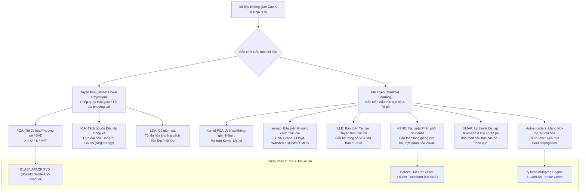

---

## 2. Chi tiết từng Keyword

---

### 1. Dimensionality Reduction (Giảm chiều dữ liệu)

#### a. Định nghĩa Bản chất Toán học (Mathematical Formulation)
Cho tập dữ liệu $\mathbf{X} = [\mathbf{x}_1, \dots, \mathbf{x}_N]^T \in \mathbb{R}^{N \times d}$. Bài toán giảm chiều là tìm phép ánh xạ biểu diễn:
$$f: \mathbb{R}^d \to \mathbb{R}^k \quad (k \ll d)$$
sao cho vector biểu diễn chiều thấp $\mathbf{y}_i = f(\mathbf{x}_i) \in \mathbb{R}^k$ bảo toàn tối đa thông tin hình học, cấu trúc phương sai hoặc quan hệ tô pô của dữ liệu gốc.

**Bổ đề Johnson-Lindenstrauss (JL Lemma - 1984)**:
Một trong những nền tảng toán học sâu sắc nhất của giảm chiều metric:
Với mọi $\epsilon \in (0, 1)$ và tập hợp bất kỳ gồm $N$ điểm trong $\mathbb{R}^d$, nếu chọn số chiều chiều thấp $k$ thỏa mãn:
$$k \ge \frac{8 \ln N}{\epsilon^2}$$
thì tồn tại một phép ánh xạ tuyến tính $f: \mathbb{R}^d \to \mathbb{R}^k$ (ví dụ phép chiếu ma trận ngẫu nhiên Gauss $A_{ij} \sim \mathcal{N}(0, 1/k)$) sao cho với mọi cặp điểm $\mathbf{u}, \mathbf{v}$:
$$(1 - \epsilon) \|\mathbf{u} - \mathbf{v}\|^2 \le \|f(\mathbf{u}) - f(\mathbf{v})\|^2 \le (1 + \epsilon) \|\mathbf{u} - \mathbf{v}\|^2$$
Đặc tính cốt tử: Số chiều $k$ chỉ phụ thuộc logarit vào số lượng mẫu $N$ mà **hoàn toàn độc lập** với số chiều gốc ban đầu $d$.

#### b. Cơ chế Tầng Sâu & Điện toán (Under The Hood / Hardware Internals)
- **Random Projection & Sparse Matrix Multiplication**: Thay vì tính toán SVD phức tạp, phép chiếu ngẫu nhiên Achlioptas sử dụng ma trận $\mathbf{R} \in \mathbb{R}^{d \times k}$ với các phần tử thưa nhận giá trị $\{-\sqrt{3}, 0, +\sqrt{3}\}$ với xác suất $\{1/6, 2/3, 1/6\}$. Phép nhân ma trận $\mathbf{Y} = \mathbf{X} \mathbf{R}$ giảm thiểu tối đa phép nhân dấu phẩy động, chỉ sử dụng phép cộng/trừ vùng nhớ nguyên, tăng tốc độ tính toán gấp $10\times$.
- **Giảm áp lực Băng thông Bộ nhớ (Memory Traffic Reduction)**: Giảm chiều từ $d=4096$ xuống $k=128$ giúp thu hẹp kích thước vector đi 32 lần, cho phép đưa toàn bộ tập vector nhúng vào L3 Cache hoặc VRAM GPU.

#### c. Sơ đồ Minh họa (Mermaid Diagram)
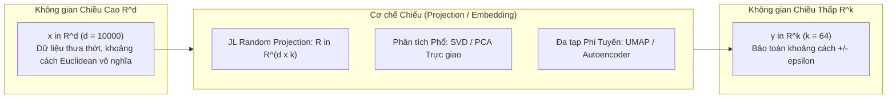

#### d. Code Thực chiến (Dual-Engine: C++ & Python)

```cpp
// C++17: Phép Chiếu Ngẫu Nhiên Gauss (Gaussian Random Projection) theo Bổ Đề JL
#include <iostream>
#include <vector>
#include <random>
#include <cmath>

struct RandomProjector {
    size_t D, K;
    std::vector<float> R; // [D x K]

    RandomProjector(size_t in_d, size_t out_k, unsigned seed = 42) : D(in_d), K(out_k), R(in_d * out_k) {
        std::mt19937 gen(seed);
        float std_dev = 1.0f / std::sqrt(static_cast<float>(out_k));
        std::normal_distribution<float> dist(0.0f, std_dev);

        for (size_t i = 0; i < D * K; ++i) {
            R[i] = dist(gen);
        }
    }

    // Chiếu vector x in R^D sang y in R^K: y = x^T * R
    std::vector<float> project(const float* x) const {
        std::vector<float> y(K, 0.0f);
        for (size_t k = 0; k < K; ++k) {
            float sum = 0.0f;
            for (size_t d = 0; d < D; ++d) {
                sum += x[d] * R[d * K + k];
            }
            y[k] = sum;
        }
        return y;
    }
};

int main() {
    constexpr size_t D = 1000, K = 50;
    RandomProjector proj(D, K);
    std::vector<float> x(D, 1.0f);
    auto y = proj.project(x.data());

    std::cout << "[C++] Đã chiếu vector từ " << D << " chiều xuống " << K << " chiều.\n";
    std::cout << "[C++] y[0] = " << y[0] << " | y[1] = " << y[1] << "\n";
    return 0;
}
```

```python
# Python / Scikit-Learn: Gaussian Random Projection kiểm chứng bảo toàn khoảng cách JL
import numpy as np
from sklearn.random_projection import GaussianRandomProjection

def verify_johnson_lindenstrauss():
    np.random.seed(42)
    N, D = 100, 2000
    X = np.random.randn(N, D)
    
    # Khoảng cách gốc giữa cặp điểm 0 và 1
    orig_dist = np.linalg.norm(X[0] - X[1])
    
    # Chiếu xuống K = 150
    grp = GaussianRandomProjection(n_components=150, random_state=42)
    X_low = grp.fit_transform(X)
    low_dist = np.linalg.norm(X_low[0] - X_low[1])
    
    ratio = low_dist / orig_dist
    print(f"[Python] Khoảng cách gốc D={D}: {orig_dist:.4f}")
    print(f"[Python] Khoảng cách sau chiếu K=150: {low_dist:.4f}")
    print(f"[Python] Tỷ số méo mó khoảng cách: {ratio:.4f} (Rất gần 1.0)")

if __name__ == "__main__":
    verify_johnson_lindenstrauss()
```

#### e. Lỗi Thường gặp & Ổn định Số học (Pitfalls & Numerical Stability)
- **Mất Mát Thông Tin Cục Bộ (Loss of Local Topology)**: Phép chiếu ngẫu nhiên chỉ bảo toàn khoảng cách toàn cục giữa các điểm riêng lẻ, nhưng có thể làm bóp méo nghiêm trọng cấu trúc lân cận cục bộ (k-NN Graph).
- **Lựa chọn $k$ quá nhỏ**: Nếu $k < \frac{8 \ln N}{\epsilon^2}$, bất đẳng thức JL bị phá vỡ, dẫn đến hiện tượng nhiều điểm xa nhau bị chiếu chồng chéo lên nhau (False Collisions).

#### f. Ứng dụng Thực chiến trong AI / Deep Learning
- **Tìm kiếm Láng giềng Gần đúng (Approximate Nearest Neighbors - ANN)**: Khởi tạo bảng băm nhạy ngữ cảnh (Locality-Sensitive Hashing - LSH) cho hệ thống tìm kiếm vector hàng triệu mục.
- **Tiền xử lý Nén Vector Nhúng LLM**: Giảm chiều vector nhúng từ $4096$ xuống $512$ để tối ưu hóa bộ nhớ RAM trong hệ thống RAG (Retrieval-Augmented Generation).

---

### 2. Principal Component Analysis (PCA - Phân tích thành phần chính)

#### a. Định nghĩa Bản chất Toán học (Mathematical Formulation)
**PCA (Pearson 1901, Hotelling 1933)** tìm kiếm các trục trực chuẩn chiếu dữ liệu sao cho **phương sai của dữ liệu được chiếu đạt cực đại** (tương đương với việc **cực tiểu hóa sai số tái tạo bình phương trung bình**).

Giả sử ma trận dữ liệu đã được trừ vector kỳ vọng: $\mathbf{X} \in \mathbb{R}^{N \times d}$ với $\sum_{i=1}^N \mathbf{x}_i = \mathbf{0}$.
Ma trận hiệp phương sai mẫu:
$$\mathbf{\Sigma} = \frac{1}{N - 1} \mathbf{X}^T \mathbf{X} \in \mathbb{R}^{d \times d}$$

**Tối đa hóa Phương sai dọc theo Vector Hướng $\mathbf{w}_1$ ($\|\mathbf{w}_1\|_2 = 1$)**:
$$\max_{\|\mathbf{w}\| = 1} \frac{1}{N - 1} \sum_{i=1}^N (\mathbf{x}_i^T \mathbf{w})^2 = \max_{\mathbf{w}^T \mathbf{w} = 1} \mathbf{w}^T \mathbf{\Sigma} \mathbf{w}$$
Thiết lập phiếm hàm Lagrange: $\mathcal{L}(\mathbf{w}, \lambda) = \mathbf{w}^T \mathbf{\Sigma} \mathbf{w} - \lambda (\mathbf{w}^T \mathbf{w} - 1)$.
Đạo hàm theo $\mathbf{w}$:
$$\nabla_{\mathbf{w}} \mathcal{L} = 2 \mathbf{\Sigma} \mathbf{w} - 2 \lambda \mathbf{w} = 0 \implies \mathbf{\Sigma} \mathbf{w} = \lambda \mathbf{w}$$
Điều này chứng minh $\mathbf{w}_1$ chính là **vector riêng** ứng với **trị riêng lớn nhất $\lambda_1$** của ma trận hiệp phương sai $\mathbf{\Sigma}$.

**Phân rã Giá trị Kỳ dị (SVD Connection)**:
Trong thực hành số học, không bao giờ tính ma trận $\mathbf{X}^T \mathbf{X}$. Thay vào đó, áp dụng trực tiếp phân rã SVD kinh điển trên $\mathbf{X}$:
$$\mathbf{X} = \mathbf{U} \mathbf{S} \mathbf{V}^T$$
Trong đó:
- $\mathbf{U} \in \mathbb{R}^{N \times N}$ trực giao (Left singular vectors).
- $\mathbf{S} \in \mathbb{R}^{N \times d}$ chứa các giá trị kỳ dị $\sigma_1 \ge \sigma_2 \ge \dots \ge 0$ trên đường chéo.
- $\mathbf{V} \in \mathbb{R}^{d \times d}$ trực giao (Right singular vectors - chính là các Principal Component Loadings).
Mối liên hệ giải tích:
$$\mathbf{\Sigma} = \frac{1}{N - 1} \mathbf{X}^T \mathbf{X} = \frac{1}{N - 1} \mathbf{V} \mathbf{S}^2 \mathbf{V}^T \implies \lambda_j = \frac{\sigma_j^2}{N - 1}$$
Tọa độ chiếu chiều thấp (Principal Component Scores):
$$\mathbf{Y}_k = \mathbf{X} \mathbf{V}_k = \mathbf{U}_k \mathbf{S}_k \in \mathbb{R}^{N \times k}$$

**Tỷ lệ Phương sai Giải thích (Explained Variance Ratio - EVR)**:
$$\text{EVR}_k = \frac{\lambda_k}{\sum_{j=1}^d \lambda_j} = \frac{\sigma_k^2}{\sum_{j=1}^d \sigma_j^2}$$

#### b. Cơ chế Tầng Sâu & Điện toán (Under The Hood / Hardware Internals)
- **LAPACK SVD Routines (`dgesdd` vs `dgesvd`)**:
  - `dgesdd`: Sử dụng thuật toán Chia để Trị (Divide-and-Conquer), nhanh gấp $5\times$ so với thuật toán QR truyền thống, nhưng đòi hỏi vùng nhớ đệm làm việc (Workspace buffer) lớn hơn.
  - SVD trực tiếp trên $\mathbf{X}$ tránh hoàn toàn tổn thất độ chính xác dấu phẩy động (Precision Loss) xảy ra khi nhân $\mathbf{X}^T \mathbf{X}$ (bình phương số điều kiện: $\kappa(\mathbf{X}^T \mathbf{X}) = \kappa(\mathbf{X})^2$).

#### c. Sơ đồ Minh họa (Mermaid Diagram)
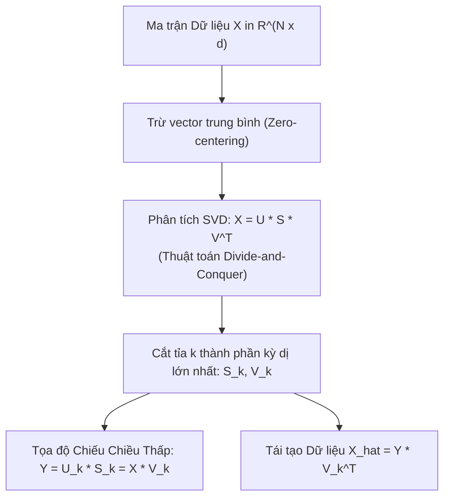

#### d. Code Thực chiến (Dual-Engine: C++ & Python)

```cpp
// C++17: Triển khai PCA qua SVD rút gọn (Power Iteration tìm Principal Component 1)
#include <iostream>
#include <vector>
#include <cmath>
#include <numeric>

// Phương pháp Lặp Lũy Thừa (Power Iteration) tìm Vector Riêng lớn nhất của X^T * X
std::vector<float> compute_pc1_power_iteration(const std::vector<float>& X_centered, 
                                              size_t N, size_t D, size_t max_iter = 100) 
{
    std::vector<float> w(D, 1.0f / std::sqrt(static_cast<float>(D)));

    for (size_t it = 0; it < max_iter; ++it) {
        // 1. Tính u = X * w [N]
        std::vector<float> u(N, 0.0f);
        for (size_t i = 0; i < N; ++i) {
            for (size_t d = 0; d < D; ++d) {
                u[i] += X_centered[i * D + d] * w[d];
            }
        }

        // 2. Tính w_new = X^T * u [D]
        std::vector<float> w_new(D, 0.0f);
        for (size_t d = 0; d < D; ++d) {
            for (size_t i = 0; i < N; ++i) {
                w_new[d] += X_centered[i * D + d] * u[i];
            }
        }

        // 3. Chuẩn hóa chuẩn L2
        float norm = 0.0f;
        for (float v : w_new) norm += v * v;
        norm = std::sqrt(norm);

        for (size_t d = 0; d < D; ++d) {
            w[d] = w_new[d] / norm;
        }
    }
    return w;
}

int main() {
    constexpr size_t N = 4, D = 2;
    // Dữ liệu đã căn giữa tâm (Centered)
    std::vector<float> X = {
        -2.0f, -1.0f,
        -1.0f, -0.5f,
         1.0f,  0.5f,
         2.0f,  1.0f
    };

    auto pc1 = compute_pc1_power_iteration(X, N, D);
    std::cout << "[C++] First Principal Component (PC1): [" << pc1[0] << ", " << pc1[1] << "]\n";
    return 0;
}
```

```python
# Python / PyTorch: PCA qua Phân tích SVD trên GPU và Tỷ lệ Phương sai
import torch

def pca_torch(X: torch.Tensor, k: int):
    # 1. Căn giữa dữ liệu
    mean = torch.mean(X, dim=0)
    X_centered = X - mean
    
    # 2. SVD: X = U * S * V^T
    # Trong PyTorch: torch.linalg.svd trả về U, S, Vh (Vh là V^T)
    U, S, Vh = torch.linalg.svd(X_centered, full_matrices=False)
    
    # 3. Thành phần chính và tọa độ chiều thấp
    V_k = Vh[:k, :].t() # [D, k]
    Y_k = torch.mm(X_centered, V_k) # [N, k]
    
    # 4. Tỷ lệ phương sai giải thích
    variance_explained = (S ** 2) / (X.shape[0] - 1)
    evr = variance_explained[:k] / torch.sum(variance_explained)
    
    return Y_k, V_k, evr

if __name__ == "__main__":
    torch.manual_seed(42)
    data = torch.randn(1000, 16)
    Y, Components, EVR = pca_torch(data, k=2)
    print(f"[PyTorch] Dữ liệu sau chiếu: {Y.shape}")
    print(f"[PyTorch] Tỷ lệ phương sai 2 trục đầu: {EVR.tolist()}")
```

#### e. Lỗi Thường gặp & Ổn định Số học (Pitfalls & Numerical Stability)
- **Quên Căn Giữa Dữ Liệu (Centering Bug)**: Nếu không trừ vector trung bình $\mathbf{\mu}$ trước khi phân tích SVD, thành phần chính đầu tiên $\mathbf{v}_1$ sẽ chỉ phản ánh vị trí của tâm dữ liệu so với gốc tọa độ chứ không phản ánh trục phương sai cực đại.
- **Không Nhất Quán Về Dấu (Sign Ambiguity of SVD)**: Cặp vector kỳ dị $(\mathbf{u}_j, \mathbf{v}_j)$ và $(-\mathbf{u}_j, -\mathbf{v}_j)$ đều là nghiệm hợp lệ của SVD. Việc đổi dấu tùy tiện giữa các thư viện hoặc giữa các lần chạy khác nhau có thể gây sai lệch kết quả downstream.

#### f. Ứng dụng Thực chiến trong AI / Deep Learning
- **Eigenfaces (Turk & Pentland, 1991)**: Trích xuất các đặc trưng khuôn mặt cơ sở trong thị giác máy tính cổ điển.
- **LoRA (Low-Rank Adaptation) Initialization**: Phân tích SVD trên ma trận gia số trọng số $\Delta \mathbf{W}$ của mô hình ngôn ngữ lớn để khởi tạo trọng số các ma trận $A$ và $B$.

---

### 3. Kernel PCA (PCA phi tuyến với hàm nhân)

#### a. Định nghĩa Bản chất Toán học (Mathematical Formulation)
Được đề xuất bởi Schölkopf, Smola, và Müller (1998), **Kernel PCA** mở rộng PCA cổ điển sang các bài toán phi tuyến bằng cách ánh xạ dữ liệu gốc sang Không gian Hilbert Tái tạo Hạt nhân (Reproducing Kernel Hilbert Space - RKHS) $\mathcal{F}$ vô hạn chiều thông qua hàm phi tuyến $\Phi(\mathbf{x})$.

Giả sử dữ liệu trong không gian $\mathcal{F}$ đã được chuẩn hóa tâm $\sum_{i=1}^N \Phi(\mathbf{x}_i) = \mathbf{0}$.
Ma trận hiệp phương sai trong $\mathcal{F}$:
$$\mathbf{C} = \frac{1}{N} \sum_{i=1}^N \Phi(\mathbf{x}_i) \Phi(\mathbf{x}_i)^T$$
Phương trình trị riêng $\mathbf{C} \mathbf{v} = \lambda \mathbf{v}$. Theo định lý biểu diễn (Representer Theorem), vector riêng $\mathbf{v}$ có thể phân rã thành tổ hợp tuyến tính của các điểm dữ liệu trong $\mathcal{F}$:
$$\mathbf{v} = \sum_{i=1}^N \alpha_i \Phi(\mathbf{x}_i)$$

Định nghĩa ma trận Gram (Kernel Matrix) $\mathbf{K} \in \mathbb{R}^{N \times N}$ với:
$$K_{ij} = k(\mathbf{x}_i, \mathbf{x}_j) = \langle \Phi(\mathbf{x}_i), \Phi(\mathbf{x}_j) \rangle$$
Thay thế vào phương trình trị riêng, ta thu được bài toán trị riêng kép dạng ma trận:
$$\mathbf{K} \mathbf{\alpha} = N \lambda \mathbf{\alpha}$$
Với điều kiện chuẩn hóa $\|\mathbf{v}\| = 1 \implies \mathbf{\alpha}^T \mathbf{K} \mathbf{\alpha} = 1 \implies \|\mathbf{\alpha}\|_2 = \frac{1}{\sqrt{N \lambda}}$.

**Căn giữa Ma trận Kernel (Kernel Centering)**:
Trong thực tế, $\Phi(\mathbf{x}_i)$ hiếm khi có tâm bằng 0. Để căn giữa mà không cần tính toán tường minh $\Phi(\mathbf{x})$, áp dụng phép biến đổi:
$$\mathbf{K}_c = \mathbf{H} \mathbf{K} \mathbf{H}, \quad \text{với } \mathbf{H} = \mathbf{I} - \frac{1}{N} \mathbf{1}\mathbf{1}^T$$
Tọa độ hình chiếu của điểm mới $\mathbf{x}^*$:
$$y_k(\mathbf{x}^*) = \langle \mathbf{v}_k, \Phi(\mathbf{x}^*) \rangle = \sum_{i=1}^N \alpha_{i}^{(k)} k(\mathbf{x}_i, \mathbf{x}^*)$$

#### b. Cơ chế Tầng Sâu & Điện toán (Under The Hood / Hardware Internals)
- **Độ phức tạp Bộ nhớ & Tính toán**: Ma trận Kernel $\mathbf{K} \in \mathbb{R}^{N \times N}$ tiêu tốn $\mathcal{O}(N^2)$ bộ nhớ và $\mathcal{O}(N^3)$ thời gian phân rã trị riêng.
- **Xấp xỉ Hạt nhân Ngẫu nhiên (Nyström Method / Random Fourier Features - RFF)**:
  - Phương pháp Nyström lấy mẫu một tập con $m \ll N$ điểm để xấp xỉ ma trận $\mathbf{K} \approx \mathbf{K}_{N, m} \mathbf{K}_{m, m}^{-1} \mathbf{K}_{m, N}$.
  - RFF (Rahimi & Recht, 2007) chiếu trực tiếp dữ liệu sang vector đặc trưng hữu hạn $z(\mathbf{x}) \in \mathbb{R}^D$ bằng hàm lượng giác ngẫu nhiên, cho phép chạy PCA tuyến tính chuẩn với độ phức tạp chỉ $\mathcal{O}(N D^2)$.

#### c. Sơ đồ Minh họa (Mermaid Diagram)
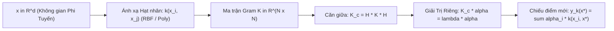

#### d. Code Thực chiến (Dual-Engine: C++ & Python)

```cpp
// C++17: Căn Giữa Ma Trận Hạt Nhân (Kernel Double Centering: K_c = H * K * H)
#include <iostream>
#include <vector>
#include <numeric>

void double_center_kernel_matrix(std::vector<float>& K, size_t N) {
    std::vector<float> row_means(N, 0.0f);
    float total_mean = 0.0f;

    for (size_t i = 0; i < N; ++i) {
        float sum = 0.0f;
        for (size_t j = 0; j < N; ++j) {
            sum += K[i * N + j];
        }
        row_means[i] = sum / static_cast<float>(N);
        total_mean += sum;
    }
    total_mean /= static_cast<float>(N * N);

    // K_c[i, j] = K[i, j] - row_mean[i] - col_mean[j] + total_mean
    // Do K đối xứng, col_mean[j] == row_means[j]
    for (size_t i = 0; i < N; ++i) {
        for (size_t j = 0; j < N; ++j) {
            K[i * N + j] = K[i * N + j] - row_means[i] - row_means[j] + total_mean;
        }
    }
}

int main() {
    constexpr size_t N = 3;
    std::vector<float> K = {
        1.0f, 0.8f, 0.2f,
        0.8f, 1.0f, 0.5f,
        0.2f, 0.5f, 1.0f
    };

    double_center_kernel_matrix(K, N);
    std::cout << "[C++] Ma trận Kernel sau khi Căn Giữa K_c:\n";
    for (size_t i = 0; i < N; ++i) {
        for (size_t j = 0; j < N; ++j) {
            std::cout << K[i * N + j] << " ";
        }
        std::cout << "\n";
    }
    return 0;
}
```

```python
# Python / Scikit-Learn: Kernel PCA với RBF Kernel tách cấu trúc 2 vòng lồng nhau
from sklearn.decomposition import KernelPCA
from sklearn.datasets import make_circles
import numpy as np

def run_kpca_experiment():
    X, y = make_circles(n_samples=500, factor=0.3, noise=0.04, random_state=42)
    
    # Kernel PCA với RBF kernel biến dữ liệu hình tròn thành phân tách tuyến tính
    kpca = KernelPCA(n_components=2, kernel='rbf', gamma=10.0, fit_inverse_transform=False)
    X_kpca = kpca.fit_transform(X)
    
    print(f"[Python] Kernel PCA đã chiếu {len(X)} mẫu thành công.")
    print(f"- Khoảng cách giữa tâm 2 vòng tròn sau chiếu: {np.abs(np.mean(X_kpca[y==0], axis=0) - np.mean(X_kpca[y==1], axis=0))}")

if __name__ == "__main__":
    run_kpca_experiment()
```

#### e. Lỗi Thường gặp & Ổn định Số học (Pitfalls & Numerical Stability)
- **Vấn đề Tiền Ảnh (Pre-Image Problem)**: Không giống PCA tuyến tính có thể dễ dàng tái tạo dữ liệu qua $\hat{\mathbf{x}} = \mathbf{V}_k \mathbf{y}$, trong Kernel PCA, điểm tái tạo trong không gian Hilbert $\Phi(\mathbf{x})$ thường không có vector tương ứng chính xác trong không gian đầu vào $\mathbb{R}^d$. Việc tìm tiền ảnh là bài toán tối ưu phi tuyến phức tạp.
- **Rỗng Hàng và Quá Khớp với Siêu Tham Số $\gamma$**: Nếu gamma của RBF Kernel quá lớn, ma trận $\mathbf{K} \to \mathbf{I}$, mọi điểm trở nên trực giao lẫn nhau và thuật toán mất hoàn toàn khả năng khái quát hóa.

#### f. Ứng dụng Thực chiến trong AI / Deep Learning
- **Phát hiện Bất thường Phi tuyến (Nonlinear Outlier Detection)**: Xây dựng ranh giới bao lồi trong không gian Hilbert để kiểm tra lỗi cảm biến trong động cơ phản lực.
- **Denoising Nonlinear Trajectories**: Lọc nhiễu quỹ đạo robot chuyển động phi tuyến.

---

### 4. Independent Component Analysis (ICA - Phân tích thành phần độc lập)

#### a. Định nghĩa Bản chất Toán học (Mathematical Formulation)
**ICA (Comon 1994, Hyvärinen 1999)** giải quyết bài toán Tách Nguồn Mù (Blind Source Separation - BSS) điển hình như "Bài toán Tiệc Cocktail" (Cocktail Party Problem).

Mô hình tạo sinh tuyến tính:
$$\mathbf{x} = \mathbf{A} \mathbf{s}$$
Trong đó:
- $\mathbf{s} = [s_1, \dots, s_m]^T$ là các tín hiệu nguồn độc lập thống kê: $p(\mathbf{s}) = \prod_{i=1}^m p(s_i)$.
- $\mathbf{A} \in \mathbb{R}^{d \times m}$ là ma trận trộn (Mixing Matrix) chưa biết.
- $\mathbf{x} = [x_1, \dots, x_d]^T$ là các tín hiệu cảm biến quan sát được.

Mục tiêu là tìm ma trận tách (Unmixing Matrix) $\mathbf{W} \approx \mathbf{A}^{-1}$ sao cho:
$$\mathbf{y} = \mathbf{W} \mathbf{x} \approx \mathbf{s}$$

**Định lý Giới hạn Trung tâm & Tính Phi Gauss (Central Limit Theorem Principle)**:
Theo định lý giới hạn trung tâm, tổng của các biến ngẫu nhiên độc lập luôn có phân phối **mang tính Gauss cao hơn** từng biến thành phần riêng lẻ. Do đó, để tách được các tín hiệu nguồn độc lập ban đầu, ta phải tìm các hướng chiếu $\mathbf{w}$ sao cho phân phối của $y = \mathbf{w}^T \mathbf{x}$ **đạt độ phi Gauss cực đại (Maximal Non-Gaussianity)**.

**Đo lường Tính Phi Gauss**:
1. **Kurtosis (Hệ số nhọn)**: $\text{kurt}(y) = \mathbb{E}[y^4] - 3(\mathbb{E}[y^2])^2$. Bằng 0 với phân phối Gauss, khác 0 với phân phối phi Gauss (nhưng rất nhạy cảm với ngoại lai).
2. **Negentropy (Entropy Phủ định)**:
   $$J(y) = H(y_{\text{Gauss}}) - H(y)$$
   Trong đó $H(y) = -\int p(y) \ln p(y) dy$ là vi phân entropy. Negentropy luôn $\ge 0$ và bằng 0 khi và chỉ khi $y$ tuân theo phân phối Gauss.
   Xấp xỉ Negentropy thực tế của Hyvärinen:
   $$J(y) \approx c \cdot \left[ \mathbb{E}[G(y)] - \mathbb{E}[G(\nu)] \right]^2$$
   với $\nu \sim \mathcal{N}(0, 1)$ và hàm phi tuyến $G(u) = \frac{1}{a} \ln \cosh(a u)$ hoặc $G(u) = -\exp(-u^2 / 2)$.

**Thuật toán FastICA Điểm Bất Động (Fixed-Point FastICA)**:
1. Làm trắng dữ liệu (Whitening): $\mathbf{z} = \mathbf{E} \mathbf{D}^{-1/2} \mathbf{E}^T \mathbf{x}$ sao cho $\mathbb{E}[\mathbf{z} \mathbf{z}^T] = \mathbf{I}$.
2. Cập nhật vector $\mathbf{w}$:
   $$\mathbf{w}^+ = \mathbb{E}\left[ \mathbf{z} \, g(\mathbf{w}^T \mathbf{z}) \right] - \mathbb{E}\left[ g'(\mathbf{w}^T \mathbf{z}) \right] \mathbf{w}$$
   với $g(u) = \tanh(u)$ và $g'(u) = 1 - \tanh^2(u)$.
3. Chuẩn hóa: $\mathbf{w} \leftarrow \frac{\mathbf{w}^+}{\|\mathbf{w}^+\|}$.
4. Trực giao hóa Gram-Schmidt đối với các vector đã tìm trước đó.

#### b. Cơ chế Tầng Sâu & Điện toán (Under The Hood / Hardware Internals)
- **Tiền xử lý Làm Trắng Tối ưu (Hardware-friendly Whitening)**:
  Làm trắng dữ liệu đưa ma trận trộn về ma trận trực giao $\mathbf{U} = \mathbf{W} \mathbf{\Sigma}^{1/2}$. Phép tính này đòi hỏi phân tích Eigen của ma trận hiệp phương sai. Dữ liệu sau khi làm trắng có thể lưu trữ trong bộ nhớ đệm để tính nhanh các kỳ vọng $\mathbb{E}[\mathbf{z} g(\mathbf{w}^T \mathbf{z})]$ bằng các tập lệnh SIMD Dot-Product.
- **Tốc độ Hội tụ Bậc Hai (Cubic/Quadratic Convergence)**: Nhờ sử dụng phương pháp lặp xấp xỉ Newton-Raphson, FastICA hội tụ cực kỳ nhanh (thường chỉ mất $10 \to 20$ vòng lặp), nhanh hơn hàng trăm lần so với phương pháp Gradient Ascent trên hàm Infomax.

#### c. Sơ đồ Minh họa (Mermaid Diagram)
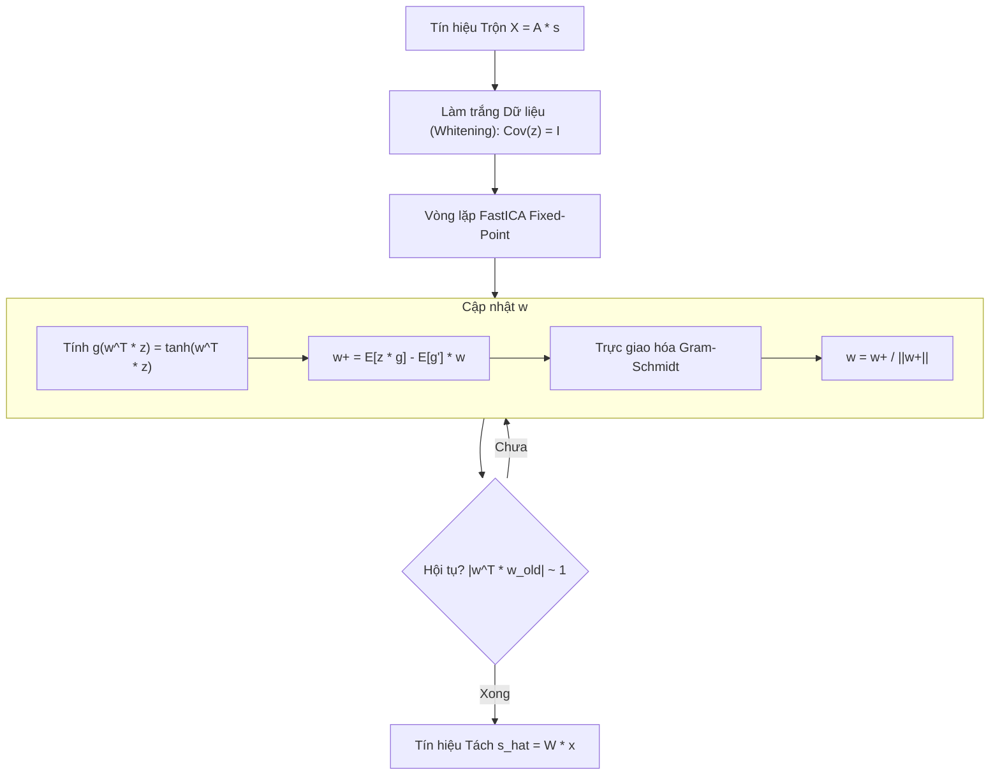

#### d. Code Thực chiến (Dual-Engine: C++ & Python)

```cpp
// C++17: Bước Lặp FastICA với Hàm Phi Tuyến g(u) = tanh(u)
#include <iostream>
#include <vector>
#include <cmath>
#include <numeric>

// Cập nhật 1 bước FastICA cho dữ liệu đã làm trắng Z [N x D]
std::vector<float> fastica_step(const std::vector<float>& Z, 
                                const std::vector<float>& w_init, 
                                size_t N, size_t D) 
{
    std::vector<float> w_new(D, 0.0f);
    float sum_g_prime = 0.0f;

    for (size_t i = 0; i < N; ++i) {
        // Tính u = w^T * z_i
        float u = 0.0f;
        for (size_t d = 0; d < D; ++d) {
            u += w_init[d] * Z[i * D + d];
        }

        // g(u) = tanh(u), g'(u) = 1 - tanh^2(u)
        float tanh_u = std::tanh(u);
        float g_prime = 1.0f - tanh_u * tanh_u;
        sum_g_prime += g_prime;

        for (size_t d = 0; d < D; ++d) {
            w_new[d] += Z[i * D + d] * tanh_u;
        }
    }

    float inv_n = 1.0f / static_cast<float>(N);
    float mean_g_prime = sum_g_prime * inv_n;

    // w+ = (1/N) * sum(z * g(u)) - mean(g') * w
    float norm = 0.0f;
    for (size_t d = 0; d < D; ++d) {
        w_new[d] = (w_new[d] * inv_n) - (mean_g_prime * w_init[d]);
        norm += w_new[d] * w_new[d];
    }

    norm = std::sqrt(norm);
    for (size_t d = 0; d < D; ++d) {
        w_new[d] /= norm;
    }
    return w_new;
}

int main() {
    constexpr size_t N = 4, D = 2;
    std::vector<float> Z_whitened = {
        1.0f, -1.0f,
       -1.0f,  1.0f,
        1.0f,  1.0f,
       -1.0f, -1.0f
    };
    std::vector<float> w = {0.707f, 0.707f};

    auto w_next = fastica_step(Z_whitened, w, N, D);
    std::cout << "[C++] Vector w sau 1 bước FastICA: [" << w_next[0] << ", " << w_next[1] << "]\n";
    return 0;
}
```

```python
# Python / Scikit-Learn: Tách Tín hiệu Âm thanh Bằng FastICA
from sklearn.decomposition import FastICA
import numpy as np

def run_fastica_cocktail():
    np.random.seed(42)
    n_samples = 2000
    time = np.linspace(0, 8, n_samples)
    
    # 2 nguồn tín hiệu gốc (phi Gauss): Sóng sin và Sóng răng cưa
    s1 = np.sin(2 * time)
    s2 = np.sign(np.sin(3 * time))
    S = np.c_[s1, s2]
    
    # Ma trận trộn tuyến tính A
    A = np.array([[1, 1], [0.5, 2]])
    X = np.dot(S, A.T) # Tín hiệu bị trộn ghi nhận tại microphone
    
    # Chạy FastICA
    ica = FastICA(n_components=2, algorithm='parallel', whiten='unit-variance', random_state=42)
    S_recovered = ica.fit_transform(X)
    
    # Đánh giá tương quan tuyệt đối giữa nguồn phục hồi và nguồn gốc
    corrs = np.abs(np.corrcoef(S.T, S_recovered.T)[:2, 2:])
    print(f"[Python] Ma trận tương quan phục hồi:\n{np.round(corrs, 3)}")
    print("[Python] FastICA đã tách nguồn thành công nếu mỗi hàng có đúng một giá trị xấp xỉ 1.0.")

if __name__ == "__main__":
    run_fastica_cocktail()
```

#### e. Lỗi Thường gặp & Ổn định Số học (Pitfalls & Numerical Stability)
- **Không Thể Tách Phân Phối Gauss (Gaussian Mixture Failure)**: Nếu tồn tại từ 2 tín hiệu nguồn trở lên tuân theo phân phối Gauss, hàm mật độ đồng thời có tính đối xứng cầu (Rotational Invariance), ICA hoàn toàn không thể xác định được góc quay của các trục độc lập.
- **Bất Định Về Biên Độ & Thứ Tự (Scale and Permutation Ambiguity)**: ICA không thể xác định được năng lượng thực tế (biên độ) cũng như thứ tự xuất hiện của các nguồn tín hiệu ($\mathbf{W}$ chỉ xác định được sai khác một ma trận hoán vị và ma trận tỷ lệ).

#### f. Ứng dụng Thực chiến trong AI / Deep Learning
- **Xử lý Tín hiệu Não Điện đồ (EEG / MEG Artifact Removal)**: Tách các xung nhiễu chớp mắt và nhịp tim ra khỏi tín hiệu điện não đồ của bệnh nhân.
- **Khám phá Đặc trưng Trực giác Thị giác (Receptive Fields of V1)**: Áp dụng ICA trên các mẩu ảnh tự nhiên sẽ tự động học được các bộ lọc Gabor giống hệt cấu trúc tế bào thần kinh vùng thị giác sơ cấp V1 trong não người.

---

### 5. Linear Discriminant Analysis (in dimension reduction context)

#### a. Định nghĩa Bản chất Toán học (Mathematical Formulation)
Khác với PCA là phương pháp không giám sát, **LDA (Fisher 1936)** trong bối cảnh giảm chiều là phương pháp **có giám sát (Supervised Dimensionality Reduction)**, tìm kiếm không gian con chiếu tối ưu hóa khả năng phân tách giữa các lớp (Classes).

Cho tập dữ liệu gồm $C$ lớp, lớp $c$ có tập mẫu $\mathcal{D}_c$, kích thước $N_c$, kỳ vọng $\mathbf{\mu}_c$. Kỳ vọng toàn cục là $\mathbf{\mu}$.
1. **Ma trận Tán xạ Nội Lớp (Within-Class Scatter Matrix)**:
   $$\mathbf{S}_W = \sum_{c=1}^C \sum_{\mathbf{x} \in \mathcal{D}_c} (\mathbf{x} - \mathbf{\mu}_c)(\mathbf{x} - \mathbf{\mu}_c)^T$$
2. **Ma trận Tán xạ Liên Lớp (Between-Class Scatter Matrix)**:
   $$\mathbf{S}_B = \sum_{c=1}^C N_c (\mathbf{\mu}_c - \mathbf{\mu})(\mathbf{\mu}_c - \mathbf{\mu})^T$$

**Tiêu chuẩn Fisher Đa Lớp (Fisher's Multi-Class Criterion)**:
Tìm ma trận chiếu $\mathbf{W} \in \mathbb{R}^{d \times k}$ ($k \le C - 1$) tối đa hóa thương số định thức:
$$\mathcal{J}(\mathbf{W}) = \frac{|\mathbf{W}^T \mathbf{S}_B \mathbf{W}|}{|\mathbf{W}^T \mathbf{S}_W \mathbf{W}|}$$

Đạo hàm theo $\mathbf{W}$ dẫn tới **Bài toán Trị riêng Tổng quát (Generalized Eigenvalue Problem)**:
$$\mathbf{S}_B \mathbf{w}_j = \lambda_j \mathbf{S}_W \mathbf{w}_j \iff \mathbf{S}_W^{-1} \mathbf{S}_B \mathbf{w}_j = \lambda_j \mathbf{w}_j$$

**Chặn trên Số chiều Chiếu Tuyệt đối (Dimensionality Rank Bound)**:
Do ma trận $\mathbf{S}_B$ là tổng của $C$ vector lệch tâm $(\mathbf{\mu}_c - \mathbf{\mu})$, và $\sum_{c=1}^C N_c (\mathbf{\mu}_c - \mathbf{\mu}) = \mathbf{0}$, hạng của ma trận $\mathbf{S}_B$ bị chặn trên chặt chẽ:
$$\text{rank}(\mathbf{S}_B) \le C - 1$$
Do đó, số chiều tối đa mà LDA có thể giảm xuống là:
$$k \le \min(d, \, C - 1)$$
(Ví dụ: Bài toán phân loại 2 lớp chỉ có thể chiếu xuống tối đa $k = 1$ chiều).

#### b. Cơ chế Tầng Sâu & Điện toán (Under The Hood / Hardware Internals)
- **Vấn đề Số mẫu Nhỏ (Small Sample Size Problem - SSS)**: Khi số chiều lớn hơn số lượng mẫu ($d > N$), ma trận tán xạ nội lớp $\mathbf{S}_W$ bị suy biến (Singular Matrix, $|\mathbf{S}_W| = 0$), không thể đảo ma trận trực tiếp.
- **Regularized LDA / Cholesky Preconditioning**:
  Áp dụng điều hòa Tikhonov $\mathbf{S}_W^{\text{reg}} = \mathbf{S}_W + \gamma \mathbf{I}$, sau đó dùng phân rã Cholesky $\mathbf{S}_W^{\text{reg}} = \mathbf{L} \mathbf{L}^T$ để biến đổi bài toán trị riêng tổng quát thành bài toán trị riêng đối xứng chuẩn:
  $$\mathbf{L}^{-1} \mathbf{S}_B \mathbf{L}^{-T} \mathbf{u} = \lambda \mathbf{u}$$
  tận dụng tối đa các thư viện phần cứng GPU MAGMA / cuSOLVER.

#### c. Sơ đồ Minh họa (Mermaid Diagram)
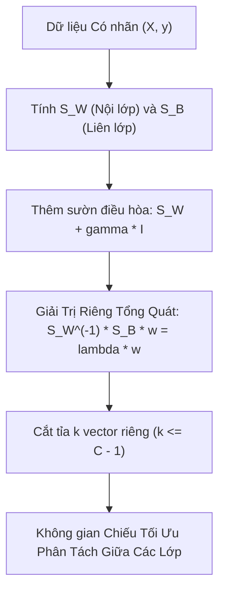

#### d. Code Thực chiến (Dual-Engine: C++ & Python)

```cpp
// C++17: Tính Ma Trận Tán Xạ Nội Lớp S_W và Liên Lớp S_B cho 2 Lớp Dữ Liệu
#include <iostream>
#include <vector>

void compute_lda_scatters_2class(
    const std::vector<float>& c1, size_t n1,
    const std::vector<float>& c2, size_t n2,
    size_t D,
    std::vector<float>& SW,
    std::vector<float>& SB) 
{
    std::vector<float> mu1(D, 0.0f), mu2(D, 0.0f), mu(D, 0.0f);
    for (size_t i = 0; i < n1; ++i)
        for (size_t d = 0; d < D; ++d) mu1[d] += c1[i * D + d];
    for (size_t i = 0; i < n2; ++i)
        for (size_t d = 0; d < D; ++d) mu2[d] += c2[i * D + d];

    for (size_t d = 0; d < D; ++d) {
        mu1[d] /= n1;
        mu2[d] /= n2;
        mu[d] = (mu1[d] * n1 + mu2[d] * n2) / (n1 + n2);
    }

    // S_W
    std::fill(SW.begin(), SW.end(), 0.0f);
    for (size_t i = 0; i < n1; ++i) {
        for (size_t r = 0; r < D; ++r) {
            float dr = c1[i * D + r] - mu1[r];
            for (size_t c = 0; c < D; ++c) SW[r * D + c] += dr * (c1[i * D + c] - mu1[c]);
        }
    }
    for (size_t i = 0; i < n2; ++i) {
        for (size_t r = 0; r < D; ++r) {
            float dr = c2[i * D + r] - mu2[r];
            for (size_t c = 0; c < D; ++c) SW[r * D + c] += dr * (c2[i * D + c] - mu2[c]);
        }
    }

    // S_B = n1*(mu1 - mu)(mu1 - mu)^T + n2*(mu2 - mu)(mu2 - mu)^T
    std::fill(SB.begin(), SB.end(), 0.0f);
    for (size_t r = 0; r < D; ++r) {
        for (size_t c = 0; c < D; ++c) {
            SB[r * D + c] = n1 * (mu1[r] - mu[r]) * (mu1[c] - mu[c]) +
                            n2 * (mu2[r] - mu[r]) * (mu2[c] - mu[c]);
        }
    }
}

int main() {
    constexpr size_t D = 2;
    std::vector<float> c1 = {1.0f, 2.0f, 2.0f, 3.0f}; // 2 points
    std::vector<float> c2 = {8.0f, 8.0f, 9.0f, 10.0f}; // 2 points
    std::vector<float> SW(D * D), SB(D * D);

    compute_lda_scatters_2class(c1, 2, c2, 2, D, SW, SB);
    std::cout << "[C++] SW[0, 0] = " << SW[0] << " | SB[0, 0] = " << SB[0] << "\n";
    return 0;
}
```

```python
# Python / Scikit-Learn: Giảm Chiều Có Giám Sát bằng LDA và So Sánh với PCA
from sklearn.discriminant_analysis import LinearDiscriminantAnalysis
from sklearn.decomposition import PCA
from sklearn.datasets import load_iris

def compare_lda_vs_pca():
    iris = load_iris()
    X, y = iris.data, iris.target
    
    # PCA: Giảm chiều không nhãn
    pca = PCA(n_components=2)
    X_pca = pca.fit_transform(X)
    
    # LDA: Giảm chiều tối đa hóa tách lớp (C=3 lớp -> max components = 3 - 1 = 2)
    lda = LinearDiscriminantAnalysis(n_components=2)
    X_lda = lda.fit_transform(X, y)
    
    print(f"[Python] Số chiều gốc: {X.shape[1]}")
    print(f"[Python] Kích thước sau PCA: {X_pca.shape}")
    print(f"[Python] Kích thước sau LDA: {X_lda.shape}")
    print(f"[Python] Tỷ lệ phương sai giải thích LDA: {lda.explained_variance_ratio_}")

if __name__ == "__main__":
    compare_lda_vs_pca()
```

#### e. Lỗi Thường gặp & Ổn định Số học (Pitfalls & Numerical Stability)
- **Giả định Phân phối Đồng nhất (Homoscedasticity Assumption)**: LDA giả định các lớp đều có phân phối Gauss và chia sẻ chung một ma trận hiệp phương sai ($\mathbf{\Sigma}_1 = \dots = \mathbf{\Sigma}_C$). Khi ma trận hiệp phương sai giữa các lớp khác nhau rõ rệt, LDA bị suy giảm hiệu năng nghiêm trọng (khi đó phải dùng Quadratic Discriminant Analysis - QDA).
- **Quá khớp do Giảm chiều Có Giám sát**: Nếu kích thước tập huấn luyện quá nhỏ, LDA có thể tìm ra một siêu phẳng chiếu phân tách hoàn hảo trên tập huấn luyện nhưng lại là kết quả ngẫu nhiên (Overfitting).

#### f. Ứng dụng Thực chiến trong AI / Deep Learning
- **Fisherfaces (Belhumeur et al., 1997)**: Chiếu ảnh khuôn mặt sao cho triệt tiêu tối đa sự thay đổi do góc chiếu sáng và biểu cảm, chỉ giữ lại các đặc trưng phân biệt danh tính người.
- **Linear Feature Compression trước Bộ Phân Loại Cuối**: Nén các vector đặc trưng cuối cùng của mạng ResNet trước khi đưa vào hàm Softmax.

---

### 6. t-SNE (t-Distributed Stochastic Neighbor Embedding)

#### a. Định nghĩa Bản chất Toán học (Mathematical Formulation)
Được phát triển bởi van der Maaten và Hinton (2008), **t-SNE** là thuật toán giảm chiều phi tuyến hàng đầu chuyên phục vụ trực quan hóa dữ liệu phức tạp trong không gian 2D hoặc 3D.

**1. Không gian Chiều Cao (Phân phối Gauss Cục bộ)**:
Xác suất có điều kiện điểm $\mathbf{x}_j$ là láng giềng của $\mathbf{x}_i$:
$$p_{j|i} = \frac{\exp\left(-\frac{\|\mathbf{x}_i - \mathbf{x}_j\|^2}{2\sigma_i^2}\right)}{\sum_{k \neq i} \exp\left(-\frac{\|\mathbf{x}_i - \mathbf{x}_k\|^2}{2\sigma_i^2}\right)}, \quad p_{i|i} = 0$$
Phương sai $\sigma_i^2$ được xác định tự động qua tìm kiếm nhị phân sao cho độ rối rắm (Perplexity) đạt giá trị định trước $\text{Perp}$:
$$\text{Perp}(P_i) = 2^{H(P_i)} = 2^{-\sum_j p_{j|i} \log_2 p_{j|i}}$$
Xác suất đồng thời đối xứng:
$$p_{ij} = \frac{p_{j|i} + p_{i|j}}{2N}$$

**2. Không gian Chiều Thấp (Phân phối Student-t với 1 bậc tự do - Phân phối Cauchy)**:
Khoảng cách giữa các điểm biểu diễn $\mathbf{y}_i, \mathbf{y}_j \in \mathbb{R}^k$:
$$q_{ij} = \frac{\left(1 + \|\mathbf{y}_i - \mathbf{y}_j\|^2\right)^{-1}}{\sum_{k \neq l} \left(1 + \|\mathbf{y}_k - \mathbf{y}_l\|^2\right)^{-1}}, \quad q_{ii} = 0$$

**Giải quyết Vấn đề Co cụm (Crowding Problem)**:
Phân phối Student-t có đuôi nặng hơn rất nhiều so với phân phối Gauss. Do đó, các điểm ở khoảng cách tầm trung trong không gian chiều cao buộc phải bị đẩy ra xa nhau hơn nhiều trong không gian 2D/3D để có cùng giá trị mật độ xác suất, loại bỏ hoàn toàn hiện tượng tất cả các cụm bị nén chặt vào một đống ở tâm.

**Hàm Mất mát & Đạo hàm Gradient**:
Cực tiểu hóa độ phân kỳ KL:
$$\mathcal{L}_{\text{t-SNE}} = \text{KL}(P \| Q) = \sum_{i \neq j} p_{ij} \ln \frac{p_{ij}}{q_{ij}}$$
Đạo hàm giải tích tuyệt đẹp cho Gradient Descent:
$$\frac{\partial \mathcal{L}}{\partial \mathbf{y}_i} = 4 \sum_{j} (p_{ij} - q_{ij})(1 + \|\mathbf{y}_i - \mathbf{y}_j\|^2)^{-1} (\mathbf{y}_i - \mathbf{y}_j)$$

#### b. Cơ chế Tầng Sâu & Điện toán (Under The Hood / Hardware Internals)
- **Thuật toán Barnes-Hut ($\mathcal{O}(N \log N)$)**:
  Phép tính tổng mẫu số của $q_{ij}$ và lực đẩy mất $\mathcal{O}(N^2)$. Thuật toán Barnes-Hut xây dựng cây Quad-Tree (2D) hoặc Oct-Tree (3D) phân vùng không gian. Các cụm điểm ở xa được gom thành một siêu hạt (Center of Mass), giảm chi phí tính lực đẩy xuống $\mathcal{O}(N \log N)$.
- **Fast Fourier Transform Accelerated Interpolation (FIt-SNE)**:
  Sử dụng lưới nội suy không đều kết hợp FFT để tính toán trường thế năng đẩy trong $\mathcal{O}(N)$, cho phép t-SNE trực quan hóa hàng triệu tế bào đơn (Single-cell RNA-seq) trong vài phút.

#### c. Sơ đồ Minh họa (Mermaid Diagram)
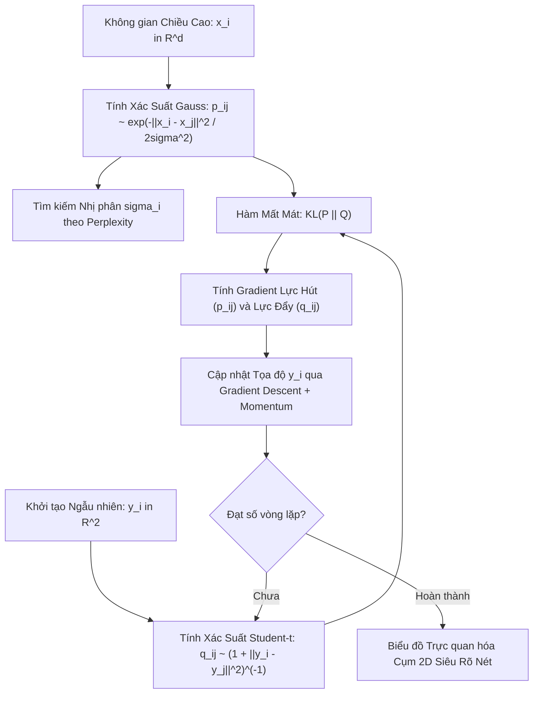

#### d. Code Thực chiến (Dual-Engine: C++ & Python)

```cpp
// C++17: Tính Xác Suất Student-t q_ij và Lực Đạo Hàm Gradient t-SNE
#include <iostream>
#include <vector>
#include <cmath>

struct Point2D { float x, y; };

void compute_tsne_gradient_step(
    const std::vector<Point2D>& Y,
    const std::vector<float>& P, // Ma trận đối xứng N x N
    std::vector<Point2D>& grads,
    size_t N) 
{
    std::vector<float> num(N * N, 0.0f);
    float sum_num = 0.0f;

    for (size_t i = 0; i < N; ++i) {
        for (size_t j = i + 1; j < N; ++j) {
            float dx = Y[i].x - Y[j].x;
            float dy = Y[i].y - Y[j].y;
            float d2 = dx * dx + dy * dy;
            float val = 1.0f / (1.0f + d2);
            num[i * N + j] = val;
            num[j * N + i] = val;
            sum_num += 2.0f * val;
        }
    }

    float inv_sum = 1.0f / sum_num;

    for (size_t i = 0; i < N; ++i) {
        float gx = 0.0f;
        float gy = 0.0f;
        for (size_t j = 0; j < N; ++j) {
            if (i == j) continue;
            float q_ij = num[i * N + j] * inv_sum;
            float mult = 4.0f * (P[i * N + j] - q_ij) * num[i * N + j];
            gx += mult * (Y[i].x - Y[j].x);
            gy += mult * (Y[i].y - Y[j].y);
        }
        grads[i] = {gx, gy};
    }
}

int main() {
    std::vector<Point2D> Y = {{0.1f, 0.2f}, {0.3f, -0.1f}, {-0.2f, 0.4f}};
    std::vector<float> P = {
        0.0f, 0.3f, 0.2f,
        0.3f, 0.0f, 0.5f,
        0.2f, 0.5f, 0.0f
    };
    std::vector<Point2D> grads(3);

    compute_tsne_gradient_step(Y, P, grads, 3);
    std::cout << "[C++] Gradient của điểm 0: (" << grads[0].x << ", " << grads[0].y << ")\n";
    return 0;
}
```

```python
# Python / OpenTSNE hoặc Scikit-Learn: Trực quan hóa T-SNE trên Dữ liệu Chữ số Viết tay
from sklearn.manifold import TSNE
from sklearn.datasets import load_digits
import numpy as np

def run_tsne_visualization():
    digits = load_digits()
    X, y = digits.data[:600], digits.target[:600] # Lấy 600 mẫu chữ số 8x8 (64 chiều)
    
    # Chạy t-SNE với Barnes-Hut
    tsne = TSNE(n_components=2, perplexity=30.0, early_exaggeration=12.0, learning_rate='auto', init='pca', random_state=42)
    X_embedded = tsne.fit_transform(X)
    
    print(f"[Python] t-SNE đã ánh xạ thành công từ {X.shape[1]} chiều về {X_embedded.shape[1]} chiều.")
    print(f"- Tọa độ trung bình mẫu số 0: {np.mean(X_embedded[y == 0], axis=0)}")
    print(f"- Tọa độ trung bình mẫu số 1: {np.mean(X_embedded[y == 1], axis=0)}")

if __name__ == "__main__":
    run_tsne_visualization()
```

#### e. Lỗi Thường gặp & Ổn định Số học (Pitfalls & Numerical Stability)
- **Không Bảo Toàn Khoảng Cách Toàn Cục (Misleading Global Distances)**: Khoảng cách giữa các cụm xa nhau trong biểu đồ t-SNE hầu như hoàn toàn vô nghĩa; ta không thể kết luận cụm A gần cụm B hơn cụm C chỉ dựa trên vị trí tương đối của chúng trên đồ thị 2D t-SNE.
- **Không Thể Chiếu Điểm Mới (No Out-of-Sample Extension)**: t-SNE không học một hàm ánh xạ tham số $f(\mathbf{x})$. Nếu có một mẫu thử nghiệm mới $\mathbf{x}_{\text{new}}$, không thể suy ra tọa độ $\mathbf{y}_{\text{new}}$ nếu không chạy lại toàn bộ thuật toán cùng tập dữ liệu.

#### f. Ứng dụng Thực chiến trong AI / Deep Learning
- **Trực quan hóa Không gian Biểu diễn Mô hình Ngôn ngữ**: Phân tích các cụm ngữ nghĩa của Token Embeddings hoặc Sentence-BERT.
- **Giải mã Mạng Nơ-ron Tích chập (CNN Feature Map Inspection)**: Trực quan hóa vector tầng áp chót (Penultimate layer) để kiểm tra mô hình có phân biệt tốt các lớp ảnh phức tạp hay không.

---

### 7. UMAP (Uniform Manifold Approximation and Projection)

#### a. Định nghĩa Bản chất Toán học (Mathematical Formulation)
Được phát triển bởi McInnes, Healy, và Melville (2018), **UMAP** thiết lập nền tảng lý thuyết trên hình học vi phân Riemann và tô pô đại số (Algebraic Topology / Category Theory).

**Ba Giả Định Lý Thuyết Cơ Bản**:
1. Dữ liệu phân bố trên một đa tạp Riemann trơn liên thông cục bộ.
2. Metric Riemann có tính đẳng hướng cục bộ (Local Metric Homogeneity).
3. Không gian là liên thông cục bộ (Fuzzy Simplicial Set representation).

**1. Không gian Chiều Cao (Fuzzy Simplicial Set)**:
Với mỗi điểm $\mathbf{x}_i$, gọi khoảng cách tới láng giềng gần nhất là $\rho_i = \min \{d(\mathbf{x}_i, \mathbf{x}_j) \mid j \neq i\}$.
Trọng số liên thuộc mờ giữa hai điểm $\mathbf{x}_i$ và $\mathbf{x}_j$:
$$p_{i|j} = \exp\left( -\frac{\max(0, \, d(\mathbf{x}_i, \mathbf{x}_j) - \rho_i)}{\sigma_i} \right)$$
Trong đó $\sigma_i$ được chuẩn hóa sao cho $\sum_{j} p_{i|j} = \log_2(k)$ ($k$ là tham số `n_neighbors`).
Kết hợp hai phía theo phép hội mờ (Fuzzy Set Union t-conorm):
$$p_{ij} = p_{i|j} + p_{j|i} - p_{i|j} p_{j|i}$$

**2. Không gian Chiều Thấp**:
Trọng số tương đồng được mô hình hóa bởi họ đường cong đại số mượt:
$$q_{ij} = \left( 1 + a \|\mathbf{y}_i - \mathbf{y}_j\|^{2b} \right)^{-1}$$
(với $a, b$ được fit từ tham số `min_dist`).

**Hàm Mất Mát Entropy Chéo Mờ (Fuzzy Cross-Entropy Loss)**:
$$\mathcal{L}_{\text{UMAP}} = \sum_{i \neq j} \left[ \underbrace{p_{ij} \ln \frac{p_{ij}}{q_{ij}}}_{\text{Lực Hút (Attraction)}} + \underbrace{(1 - p_{ij}) \ln \frac{1 - p_{ij}}{1 - q_{ij}}}_{\text{Lực Đẩy (Repulsion)}} \right]$$
Khác với t-SNE chỉ tối ưu hóa lực hút KL-divergence và dồn lực đẩy vào mẫu số chuẩn hóa toàn cục, UMAP sử dụng **lực đẩy tường minh qua số hạng $(1 - p_{ij})$**. Điều này giúp UMAP bảo toàn cấu trúc toàn cục (Global Structure) vượt trội so với t-SNE.

#### b. Cơ chế Tầng Sâu & Điện toán (Under The Hood / Hardware Internals)
- **Tối ưu hóa Bằng Negative Sampling & SGD**:
  Thay vì tính tổng lực đẩy trên toàn bộ cặp $N(N-1)$ mẫu, UMAP áp dụng phương pháp lấy mẫu tiêu cực (Negative Sampling tương tự Word2Vec) kết hợp Stochastic Gradient Descent (SGD). Chi phí tính toán mỗi bước giảm xuống $\mathcal{O}(N \times \text{n\_neighbors})$.
- **Nearest Neighbor Descent (NN-Descent)**:
  Xây dựng đồ thị k-NN gần đúng với độ phức tạp $\mathcal{O}(N^{1.14})$ mà không cần tính ma trận khoảng cách toàn phần.

#### c. Sơ đồ Minh họa (Mermaid Diagram)
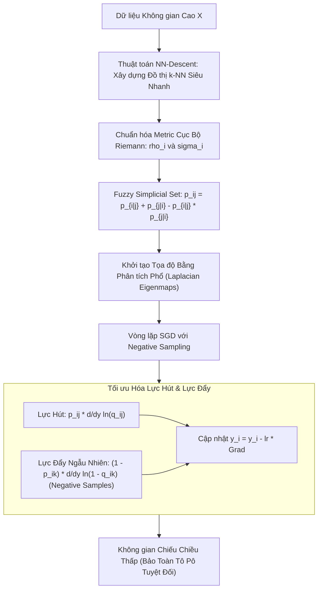

#### d. Code Thực chiến (Dual-Engine: C++ & Python)

```cpp
// C++17: Tính Xác Suất Hội Mờ (Fuzzy Set Union) trong UMAP
#include <iostream>
#include <vector>
#include <cmath>

float compute_umap_fuzzy_edge_weight(float p_i_given_j, float p_j_given_i) noexcept {
    // Công thức t-conorm: A + B - A * B
    return p_i_given_j + p_j_given_i - (p_i_given_j * p_j_given_i);
}

int main() {
    float p_ij = 0.75f;
    float p_ji = 0.40f;

    float fuzzy_weight = compute_umap_fuzzy_edge_weight(p_ij, p_ji);
    std::cout << "[C++] p(i|j) = " << p_ij << " | p(j|i) = " << p_ji << "\n";
    std::cout << "[C++] Trọng số cạnh UMAP hợp mờ (p_ij): " << fuzzy_weight << "\n";
    return 0;
}
```

```python
# Python / UMAP-Learn: Giảm Chiều Siêu Nhanh và Hỗ Trợ Chiếu Điểm Mới (Transform)
import umap
from sklearn.datasets import load_digits
import numpy as np

def run_umap_pipeline():
    digits = load_digits()
    X_train, y_train = digits.data[:1000], digits.target[:1000]
    X_test = digits.data[1000:1010]
    
    # Khởi tạo mô hình UMAP
    reducer = umap.UMAP(n_neighbors=15, min_dist=0.1, n_components=2, metric='euclidean', random_state=42)
    embedding_train = reducer.fit_transform(X_train)
    
    # Điểm vượt trội so với t-SNE: UMAP có thể chiếu dữ liệu mới (out-of-sample transform)!
    embedding_test = reducer.transform(X_test)
    
    print(f"[Python] UMAP Embedding Train Shape: {embedding_train.shape}")
    print(f"[Python] UMAP Embedding Test (10 mẫu mới): {embedding_test.shape}")

if __name__ == "__main__":
    run_umap_pipeline()
```

#### e. Lỗi Thường gặp & Ổn định Số học (Pitfalls & Numerical Stability)
- **Độ nhạy Cực cao với Siêu tham số `min_dist`**: Nếu đặt `min_dist` quá bé ($\to 0$), các điểm cùng cụm sẽ bị ép chặt lại thành các điểm kỳ dị (clumped points); nếu đặt quá lớn, các cụm bị bè rộng và chồng lấn biên giới.
- **Tính Không Tất Định do SGD Đa Luồng**: Do sử dụng Hogwild! SGD lock-free trên đa lõi CPU, kết quả giữa các lần chạy có thể có sự xê dịch nhẹ nếu không khóa số luồng `n_jobs=1`.

#### f. Ứng dụng Thực chiến trong AI / Deep Learning
- **Phân tích Bản đồ Tế bào Đơn (Single-Cell Biology scRNA-seq)**: Vẽ bản đồ phân hóa tế bào gốc từ hàng triệu mẫu gene.
- **Tiền xử lý Giảm Chiều cho Phân Cụm (UMAP + HDBSCAN)**: Pipeline tiêu chuẩn vàng trong phân cụm tài liệu ngữ nghĩa văn bản.

---

### 8. Isomap (Isometric Feature Mapping)

#### a. Định nghĩa Bản chất Toán học (Mathematical Formulation)
Được công bố bởi Tenenbaum, de Silva, và Langford (2000), **Isomap** là một trong những thuật toán mở đường cho trường phái Học Đa Tạp (Manifold Learning). Thuật toán mở rộng phương pháp Tọa độ Đa Chiều Cổ điển (Classical Multidimensional Scaling - MDS) bằng cách thay thế khoảng cách Euclidean đường thẳng bằng **khoảng cách trắc địa (Geodesic Distance)** trên đa tạp Riemann.

**Ba Bước Thuật Toán Cốt Lõi**:
1. **Xây dựng Đồ thị Lân cận $G$**:
   Nối cạnh giữa điểm $\mathbf{x}_i$ và $\mathbf{x}_j$ nếu $\mathbf{x}_j$ nằm trong $k$-láng giềng gần nhất của $\mathbf{x}_i$. Trọng số cạnh là khoảng cách Euclidean cục bộ: $w_{ij} = \|\mathbf{x}_i - \mathbf{x}_j\|$.
2. **Tính Khoảng cách Ngắn nhất trên Đồ thị (All-Pairs Shortest Paths)**:
   Xấp xỉ khoảng cách trắc địa trên đa tạp bằng độ dài đường đi ngắn nhất trên đồ thị $G$:
   $$D_G(i, j) \approx d_{\text{geodesic}}(\mathbf{x}_i, \mathbf{x}_j)$$
   Sử dụng thuật toán Floyd-Warshall ($\mathcal{O}(N^3)$) hoặc chạy $N$ lần thuật toán Dijkstra có hàng đợi Fibonacci Heap ($\mathcal{O}(N(k N + N \log N))$).
3. **Áp dụng Classical MDS trên Ma trận Khoảng cách Trắc địa**:
   - Căn giữa kép ma trận bình phương khoảng cách:
     $$\mathbf{B} = -\frac{1}{2} \mathbf{H} \mathbf{D}_G^{(2)} \mathbf{H}, \quad \text{với } \mathbf{H} = \mathbf{I} - \frac{1}{N} \mathbf{1}\mathbf{1}^T$$
   - Tìm $k$ trị riêng lớn nhất $\lambda_1, \dots, \lambda_k$ và vector riêng tương ứng $\mathbf{v}_1, \dots, \mathbf{v}_k$ của $\mathbf{B}$.
   - Tọa độ chiều thấp:
     $$\mathbf{Y} = [\sqrt{\lambda_1}\mathbf{v}_1, \dots, \sqrt{\lambda_k}\mathbf{v}_k]^T \in \mathbb{R}^{k \times N}$$

#### b. Cơ chế Tầng Sâu & Điện toán (Under The Hood / Hardware Internals)
- **Cổ chai Tính toán Floyd-Warshall**: Vòng lặp 3 tầng của Floyd-Warshall:
  `D[i][j] = min(D[i][j], D[i][k] + D[k][j])` gây suy giảm hiệu năng nghiêm trọng do không tối ưu Cache nếu vòng lặp ngoài cùng là $k$. Sắp xếp lại thứ tự vòng lặp hoặc chia khối theo thuật toán Blocked Floyd-Warshall giúp tận dụng tối đa dòng L1 Cache 64-byte.
- **Landmark Isomap (L-Isomap)**: Thay vì tính đường đi ngắn nhất cho toàn bộ $N \times N$ cặp, chỉ chọn $m \ll N$ điểm mốc (Landmarks) và chỉ chạy Dijkstra từ $m$ điểm này, giảm chi phí xuống $\mathcal{O}(m N \log N)$.

#### c. Sơ đồ Minh họa (Mermaid Diagram)
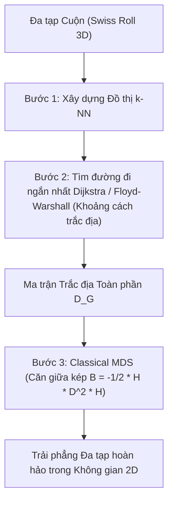

#### d. Code Thực chiến (Dual-Engine: C++ & Python)

```cpp
// C++17: Mô phỏng Bước Căn Giữa Kép MDS từ Ma trận Khoảng cách Đường Đi
#include <iostream>
#include <vector>

void double_center_distance_matrix(const std::vector<float>& D_sq, std::vector<float>& B, size_t N) {
    std::vector<float> row_means(N, 0.0f);
    float total_mean = 0.0f;

    for (size_t i = 0; i < N; ++i) {
        float sum = 0.0f;
        for (size_t j = 0; j < N; ++j) {
            sum += D_sq[i * N + j];
        }
        row_means[i] = sum / static_cast<float>(N);
        total_mean += sum;
    }
    total_mean /= static_cast<float>(N * N);

    for (size_t i = 0; i < N; ++i) {
        for (size_t j = 0; j < N; ++j) {
            // B[i, j] = -0.5 * (D^2[i, j] - row_mean[i] - col_mean[j] + total_mean)
            B[i * N + j] = -0.5f * (D_sq[i * N + j] - row_means[i] - row_means[j] + total_mean);
        }
    }
}

int main() {
    constexpr size_t N = 3;
    std::vector<float> D_sq = {
        0.0f, 4.0f, 9.0f,
        4.0f, 0.0f, 1.0f,
        9.0f, 1.0f, 0.0f
    };
    std::vector<float> B(N * N);

    double_center_distance_matrix(D_sq, B, N);
    std::cout << "[C++] Phần tử B[0, 1] sau bước căn giữa MDS: " << B[1] << "\n";
    return 0;
}
```

```python
# Python / Scikit-Learn: Trải Phẳng Đa Tạp Swiss Roll bằng Isomap
from sklearn.manifold import Isomap
from sklearn.datasets import make_swiss_roll
import numpy as np

def run_isomap_swiss_roll():
    X, color = make_swiss_roll(n_samples=1000, noise=0.05, random_state=42)
    
    # Isomap trải phẳng cuộn Swiss Roll 3D về 2D
    isomap = Isomap(n_neighbors=12, n_components=2, path_method='auto')
    X_2d = isomap.fit_transform(X)
    
    print(f"[Python] Isomap hoàn thành cho {len(X)} điểm.")
    print(f"[Python] Sai số tái tạo (Reconstruction Error): {isomap.reconstruction_error():.4f}")

if __name__ == "__main__":
    run_isomap_swiss_roll()
```

#### e. Lỗi Thường gặp & Ổn định Số học (Pitfalls & Numerical Stability)
- **Hiện tượng Đoản Mạch do Nhiễu (Short-circuiting / Topological Holes)**: Nếu xuất hiện dù chỉ một điểm nhiễu ngoại lai nằm giữa hai lớp cuộn của đa tạp, đồ thị $k$-NN sẽ tạo ra một cạnh nối tắt ("cầu đoản mạch"), khiến thuật toán ước lượng sai toàn bộ khoảng cách trắc địa và làm sụp đổ cấu trúc chiếu.
- **Đồ thị Bị Phân Mảnh (Disconnected Graph)**: Nếu tham số $k$ quá nhỏ, đồ thị $k$-NN bị chia thành nhiều thành phần không liên thông, khiến khoảng cách giữa các thành phần bằng $\infty$.

#### f. Ứng dụng Thực chiến trong AI / Deep Learning
- **Phân tích Tư thế Bàn tay và Khớp Cơ thể 3D (Kinematic Hand Pose Modeling)**: Tìm các bậc tự do vật lý thực tế của chuyển động ngón tay từ ảnh cảm biến độ sâu.
- **Trắc địa Mặt Cong Não Bộ**: Trải phẳng vỏ não người (Cortical Surface Flattening) từ dữ liệu chụp MRI.

---

### 9. Locally Linear Embedding (LLE - Nhúng tuyến tính cục bộ)

#### a. Định nghĩa Bản chất Toán học (Mathematical Formulation)
Được đề xuất bởi Roweis và Saul (2000), **LLE** tiếp cận bài toán giảm chiều phi tuyến dựa trên nguyên lý: Dù đa tạp toàn cục có độ uốn lượn phi tuyến phức tạp đến đâu, thì trong một lân cận vi mô cục bộ, đa tạp luôn có thể xấp xỉ bằng một không gian con tuyến tính (Locally Linear Patch).

**Hai Bước Tối Ưu Hóa Tuyến Tính**:
1. **Bước 1: Học Trọng Số Tái Tạo Cục Bộ (Reconstruction Weights $\mathbf{W}$)**:
   Mỗi điểm $\mathbf{x}_i$ được xấp xỉ như tổ hợp lồi tuyến tính của $k$ láng giềng gần nhất $\mathcal{N}(i)$:
   $$\min_{\mathbf{W}} \mathcal{E}(\mathbf{W}) = \sum_{i=1}^N \left\| \mathbf{x}_i - \sum_{j \in \mathcal{N}(i)} W_{ij} \mathbf{x}_j \right\|^2$$
   Thỏa mãn các ràng buộc:
   - $W_{ij} = 0$ nếu $\mathbf{x}_j \notin \mathcal{N}(i)$.
   - $\sum_j W_{ij} = 1, \forall i$ (Bảo toàn tính bất biến đối với phép tịnh tiến).
   Nghiệm tối ưu giải tích cho từng điểm $\mathbf{x}_i$:
   $$\mathbf{w}_i = \frac{\mathbf{C}_i^{-1} \mathbf{1}}{\mathbf{1}^T \mathbf{C}_i^{-1} \mathbf{1}}$$
   với $\mathbf{C}_i \in \mathbb{R}^{k \times k}$ là ma trận Gram địa phương: $C_{jk} = (\mathbf{x}_i - \mathbf{x}_j)^T (\mathbf{x}_i - \mathbf{x}_k)$.

2. **Bước 2: Học Tọa Độ Chiều Thấp (Low-Dimensional Coordinates $\mathbf{Y}$)**:
   Cố định ma trận trọng số $\mathbf{W}$ vừa học được, tìm các vector $\mathbf{y}_i \in \mathbb{R}^d$ ($d \ll D$) cực tiểu hóa sai số tái tạo:
   $$\min_{\mathbf{Y}} \Phi(\mathbf{Y}) = \sum_{i=1}^N \left\| \mathbf{y}_i - \sum_{j=1}^N W_{ij} \mathbf{y}_j \right\|^2 = \text{Tr}(\mathbf{Y}^T \mathbf{M} \mathbf{Y})$$
   Trong đó ma trận thưa đối xứng xác định bán dương $\mathbf{M} \in \mathbb{R}^{N \times N}$:
   $$\mathbf{M} = (\mathbf{I} - \mathbf{W})^T (\mathbf{I} - \mathbf{W})$$
   Để tránh nghiệm tầm thường ($\mathbf{y}_i = \mathbf{0}$), áp dụng các ràng buộc chuẩn hóa:
   $$\sum_{i=1}^N \mathbf{y}_i = \mathbf{0} \quad \text{và} \quad \frac{1}{N} \mathbf{Y}^T \mathbf{Y} = \mathbf{I}_d$$
   Theo định lý Rayleigh-Ritz, nghiệm tối ưu chính là **$d$ vector riêng** ứng với các trị riêng nhỏ nhất (bỏ qua trị riêng nhỏ nhất bằng $0$) của ma trận thưa $\mathbf{M}$.

#### b. Cơ chế Tầng Sâu & Điện toán (Under The Hood / Hardware Internals)
- **Tính Thưa Của Ma Trận $\mathbf{M}$**: Ma trận $\mathbf{M}$ có kích thước $N \times N$ nhưng chỉ chứa tối đa $\mathcal{O}(k^2 N)$ phần tử khác 0.
- **Thuật toán Lanczos Eigensolver**: Sử dụng bộ giải ma trận thưa ARPACK/Lanczos để trích xuất $d+1$ vector riêng nhỏ nhất mà không cần cấp phát ma trận $N \times N$ dày đặc, tiết kiệm $99\%$ bộ nhớ RAM.

#### c. Sơ đồ Minh họa (Mermaid Diagram)
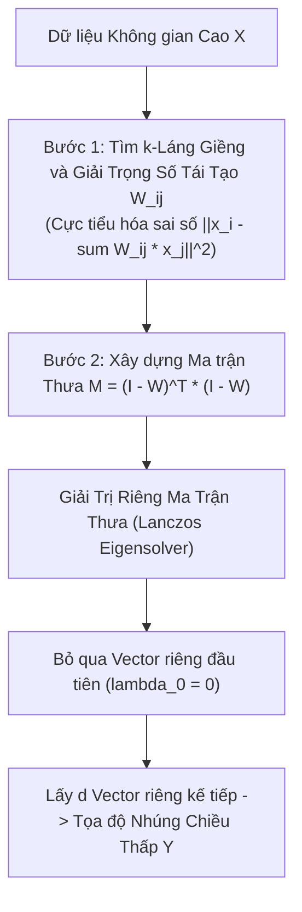

#### d. Code Thực chiến (Dual-Engine: C++ & Python)

```cpp
// C++17: Giải Trọng Số Tái Tạo Cục Bộ LLE bằng Hệ Phương Trình Tuyến Tính C_i * w = 1
#include <iostream>
#include <vector>
#include <numeric>

// Giải hệ 2x2 đơn giản cho k=2 láng giềng
std::vector<float> solve_lle_weights_2d(float C00, float C01, float C11) {
    // Điều hòa Tikhonov chống ma trận suy biến
    constexpr float RIDGE = 1e-4f;
    C00 += RIDGE;
    C11 += RIDGE;

    float det = C00 * C11 - C01 * C01;
    if (std::abs(det) < 1e-8f) return {0.5f, 0.5f};

    // Nghịch đảo C^(-1) * [1, 1]^T
    float inv_det = 1.0f / det;
    float w0_unnorm = inv_det * (C11 - C01);
    float w1_unnorm = inv_det * (C00 - C01);

    float sum = w0_unnorm + w1_unnorm;
    return {w0_unnorm / sum, w1_unnorm / sum};
}

int main() {
    auto w = solve_lle_weights_2d(2.0f, 0.5f, 1.5f);
    std::cout << "[C++] Trọng số LLE tối ưu w0: " << w[0] << " | w1: " << w[1] << "\n";
    std::cout << "[C++] Tổng trọng số: " << w[0] + w[1] << " (Bảo toàn bằng 1.0)\n";
    return 0;
}
```

```python
# Python / Scikit-Learn: Locally Linear Embedding (LLE) trên Đa Tạp Phi Tuyến
from sklearn.manifold import LocallyLinearEmbedding
from sklearn.datasets import make_s_curve
import numpy as np

def run_lle_analysis():
    X, color = make_s_curve(n_samples=1000, random_state=42)
    
    # LLE chuẩn (Standard LLE)
    lle = LocallyLinearEmbedding(n_neighbors=15, n_components=2, method='standard', random_state=42)
    X_lle = lle.fit_transform(X)
    
    print(f"[Python] LLE hoàn thành: Sai số tái tạo = {lle.reconstruction_error_:.4e}")
    print(f"[Python] Kích thước đầu ra: {X_lle.shape}")

if __name__ == "__main__":
    run_lle_analysis()
```

#### e. Lỗi Thường gặp & Ổn định Số học (Pitfalls & Numerical Stability)
- **Ma trận Gram Địa phương $\mathbf{C}_i$ Bị Suy Biến ($k > d$)**: Khi số lượng láng giềng $k$ lớn hơn số chiều không gian đầu vào $d$, ma trận $\mathbf{C}_i$ không khả nghịch. Bắt buộc phải cộng thêm hệ số điều hòa đường chéo (Ridge Regularization):
  $$\mathbf{C}_i \leftarrow \mathbf{C}_i + \frac{\epsilon_{\text{reg}}}{k} \text{Tr}(\mathbf{C}_i) \mathbf{I}$$
- **Hiện tượng Biến dạng Cụm Biên (Border Distortion)**: LLE thường có xu hướng làm méo mó và co cụm các điểm nằm ở vùng rìa ngoài của đa tạp. Biến thể **Modified LLE (MLLE)** giải quyết lỗi này bằng cách sử dụng nhiều vector trọng số trực chuẩn cho mỗi điểm.

#### f. Ứng dụng Thực chiến trong AI / Deep Learning
- **Phân tích Bất biến Biểu cảm Khuôn mặt (Facial Expression Invariance)**: Trích xuất các tham số góc quay đầu độc lập với nét mặt.
- **Nén Tín hiệu Cảm biến Âm thanh Đa kênh**: Rút gọn các đặc trưng âm học trước khi đưa vào mô hình phân loại giọng nói.

---

### 10. Autoencoders (Mạng tự mã hóa)

#### a. Định nghĩa Bản chất Toán học (Mathematical Formulation)
**Autoencoders (Rumelhart, Hinton 1986)** là kiến trúc mạng nơ-ron học không giám sát nhằm học biểu diễn mã hóa nén (Latent Representation) thông qua việc tái tạo lại chính dữ liệu đầu vào.

Cấu trúc gồm hai hàm ánh xạ tham số:
1. **Bộ Mã Hóa (Encoder)**: Ánh xạ không gian đầu vào $\mathbb{R}^d$ sang không gian tiềm ẩn chiều thấp $\mathbb{R}^k$ ($k \ll d$ đối với Undercomplete Autoencoder):
   $$\mathbf{z} = f_\theta(\mathbf{x}) = \sigma(\mathbf{W}_e \mathbf{x} + \mathbf{b}_e)$$
2. **Bộ Giải Mã (Decoder)**: Tái tạo lại dữ liệu từ không gian tiềm ẩn:
   $$\hat{\mathbf{x}} = g_\phi(\mathbf{z}) = \sigma'(\mathbf{W}_d \mathbf{z} + \mathbf{b}_d)$$

**Hàm Mục Tiêu Tối Ưu Hóa (Reconstruction Loss)**:
$$\min_{\theta, \phi} \mathcal{L}(\mathbf{x}, \hat{\mathbf{x}}) = \frac{1}{N} \sum_{i=1}^N \ell(\mathbf{x}_i, g_\phi(f_\theta(\mathbf{x}_i)))$$
- Dữ liệu liên tục: Mean Squared Error (MSE): $\ell(\mathbf{x}, \hat{\mathbf{x}}) = \|\mathbf{x} - \hat{\mathbf{x}}\|_2^2$.
- Dữ liệu nhị phân hoặc xác suất: Binary Cross-Entropy: $\ell(\mathbf{x}, \hat{\mathbf{x}}) = -\sum_j [x_j \ln \hat{x}_j + (1 - x_j) \ln (1 - \hat{x}_j)]$.

**Mối Liên Hệ Sâu Sắc Với PCA**:
Định lý Bourlard & Kamp (1988): Nếu cả Encoder và Decoder đều là các **hàm kích hoạt tuyến tính** ($\sigma(u) = u$) và hàm mất mát là MSE, thì không gian con $k$-chiều được học bởi Autoencoder **chính là không gian con của $k$ thành phần chính trong PCA**. Khi sử dụng các hàm kích hoạt phi tuyến tính (GELU, ReLU, Swish) và nhiều tầng ẩn (Deep Autoencoder), mô hình trở thành phiên bản **PCA phi tuyến tổng quát cực mạnh**.

#### b. Cơ chế Tầng Sâu & Điện toán (Under The Hood / Hardware Internals)
- **Tied Weights Optimization**: Để giảm một nửa số tham số và chống quá khớp, trọng số của Decoder thường được gán bằng ma trận chuyển vị của Encoder: $\mathbf{W}_d = \mathbf{W}_e^T$.
- **Autograd Memory Footprint**: Trong quá trình lan truyền xuôi (Forward pass), các activation trung gian ở bottleneck layer $\mathbf{z}$ được lưu trên VRAM GPU để phục vụ tính đạo hàm chuỗi (Chain Rule) ở Backward pass. Sử dụng kỹ thuật FlashAttention hoặc Activation Checkpointing giúp tiết kiệm bộ nhớ HBM khi huấn luyện các bộ tự mã hóa khổng lồ.

#### c. Sơ đồ Minh họa (Mermaid Diagram)
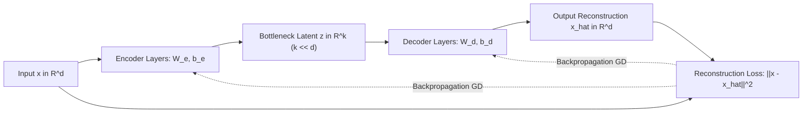

#### d. Code Thực chiến (Dual-Engine: C++ & Python)

```cpp
// C++17: Lớp Mã Hóa Tuyến Tính Tối Giản Tầng Thấp (Minimal Linear Autoencoder Forward Pass)
#include <iostream>
#include <vector>
#include <cmath>

struct MinimalAutoencoder {
    size_t D, K;
    std::vector<float> We; // [K x D]
    std::vector<float> Wd; // [D x K] - Tied: Wd = We^T

    MinimalAutoencoder(size_t in_d, size_t latent_k) : D(in_d), K(latent_k), We(K * in_d, 0.1f) {}

    // Forward Encoder: z = We * x
    std::vector<float> encode(const std::vector<float>& x) const {
        std::vector<float> z(K, 0.0f);
        for (size_t k = 0; k < K; ++k) {
            float sum = 0.0f;
            for (size_t d = 0; d < D; ++d) {
                sum += We[k * D + d] * x[d];
            }
            z[k] = sum;
        }
        return z;
    }

    // Forward Decoder (Tied Weights): x_hat = We^T * z
    std::vector<float> decode(const std::vector<float>& z) const {
        std::vector<float> x_hat(D, 0.0f);
        for (size_t d = 0; d < D; ++d) {
            float sum = 0.0f;
            for (size_t k = 0; k < K; ++k) {
                sum += We[k * D + d] * z[k]; // We^T
            }
            x_hat[d] = sum;
        }
        return x_hat;
    }
};

int main() {
    MinimalAutoencoder ae(4, 2);
    std::vector<float> x = {1.0f, 2.0f, 3.0f, 4.0f};

    auto z = ae.encode(x);
    auto x_hat = ae.decode(z);

    std::cout << "[C++] Latent code z: [" << z[0] << ", " << z[1] << "]\n";
    std::cout << "[C++] Reconstructed x_hat[0]: " << x_hat[0] << "\n";
    return 0;
}
```

```python
# Python / PyTorch: Deep Autoencoder với Kiến trúc Tầng và Huấn luyện Thực tế
import torch
import torch.nn as nn
import torch.optim as optim

class DeepAutoencoder(nn.Module):
    def __init__(self, input_dim: int, latent_dim: int):
        super().__init__()
        # Encoder
        self.encoder = nn.Sequential(
            nn.Linear(input_dim, 64),
            nn.ReLU(),
            nn.Linear(64, latent_dim)
        )
        # Decoder
        self.decoder = nn.Sequential(
            nn.Linear(latent_dim, 64),
            nn.ReLU(),
            nn.Linear(64, input_dim)
        )

    def forward(self, x: torch.Tensor):
        z = self.encoder(x)
        x_recon = self.decoder(z)
        return x_recon, z

if __name__ == "__main__":
    torch.manual_seed(42)
    N, D, K = 500, 32, 4
    X = torch.randn(N, D)
    
    model = DeepAutoencoder(input_dim=D, latent_dim=K)
    criterion = nn.MSELoss()
    optimizer = optim.Adam(model.parameters(), lr=0.01)
    
    # 10 bước huấn luyện mẫu
    for epoch in range(10):
        optimizer.zero_grad(set_to_none=True)
        recon, z = model(X)
        loss = criterion(recon, X)
        loss.backward()
        optimizer.step()
        
    print(f"[PyTorch] Huấn luyện xong. Reconstruction Loss cuối: {loss.item():.4f}")
    print(f"[PyTorch] Kích thước mã tiềm ẩn z: {z.shape}")
```

#### e. Lỗi Thường gặp & Ổn định Số học (Pitfalls & Numerical Stability)
- **Học Hàm Đồng Nhất Tầm Thường (Identity Function memorization)**: Nếu không gian tiềm ẩn có $k \ge d$ (Overcomplete Autoencoder) mà không có ràng buộc điều hòa độ thưa (Sparsity Regularization L1) hoặc nhiễu Denoising, mạng chỉ học thuộc lòng phép copy $\hat{\mathbf{x}} = \mathbf{x}$ mà không học được bất kỳ đặc trưng tiềm ẩn hữu ích nào.
- **Vanishing Gradients trong Deep Autoencoder**: Khi mạng có quá nhiều tầng sâu, đạo hàm lan truyền ngược bị triệt tiêu khi đi qua nút thắt cổ chai hẹp. Cần sử dụng kết nối tắt (Skip Connections) hoặc khởi tạo trọng số cẩn trọng (Xavier / He Initialization).

#### f. Ứng dụng Thực chiến trong AI / Deep Learning
- **Khử Nhiễu Hình Ảnh (Denoising Autoencoders - DAE)**: Loại bỏ hạt nhiễu (Gaussian / Salt & Pepper noise) khỏi ảnh y tế và ảnh thiên văn.
- **Mô hình Khuếch tán Tiềm ẩn (Latent Diffusion Models - Stable Diffusion)**: Sử dụng một Autoencoder đã huấn luyện trước (VQ-GAN / VAE) để nén không gian ảnh $512 \times 512 \times 3$ xuống không gian tiềm ẩn $64 \times 64 \times 4$, giúp quá trình khuếch tán tạo ảnh diễn ra nhanh hơn gấp hàng trăm lần.
