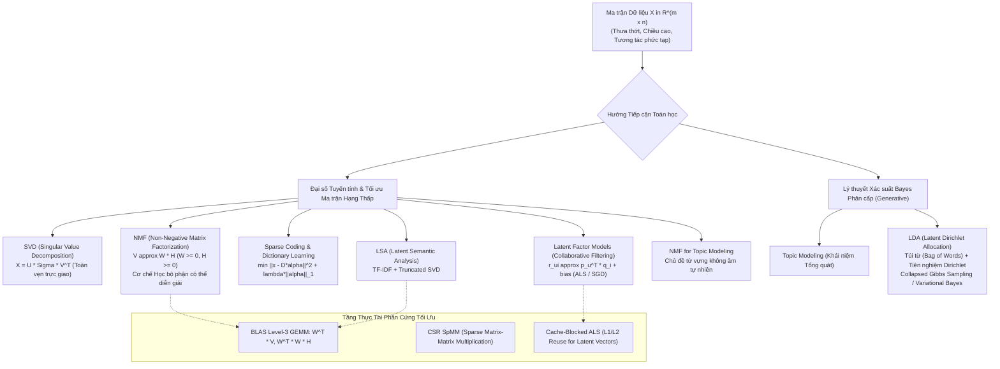
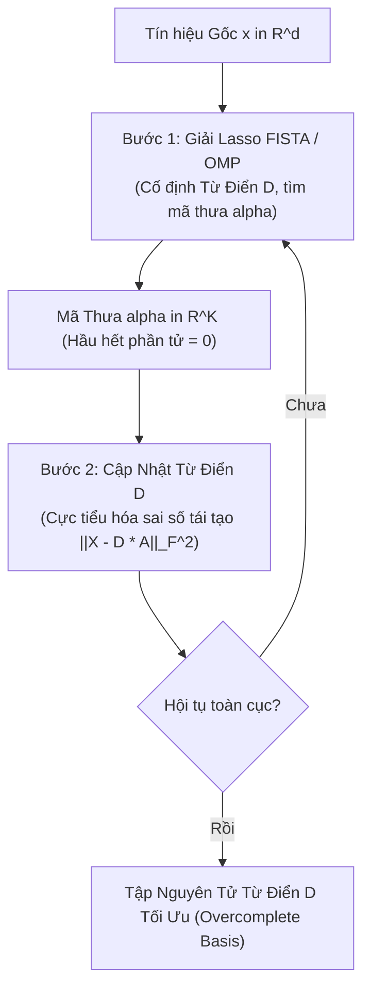
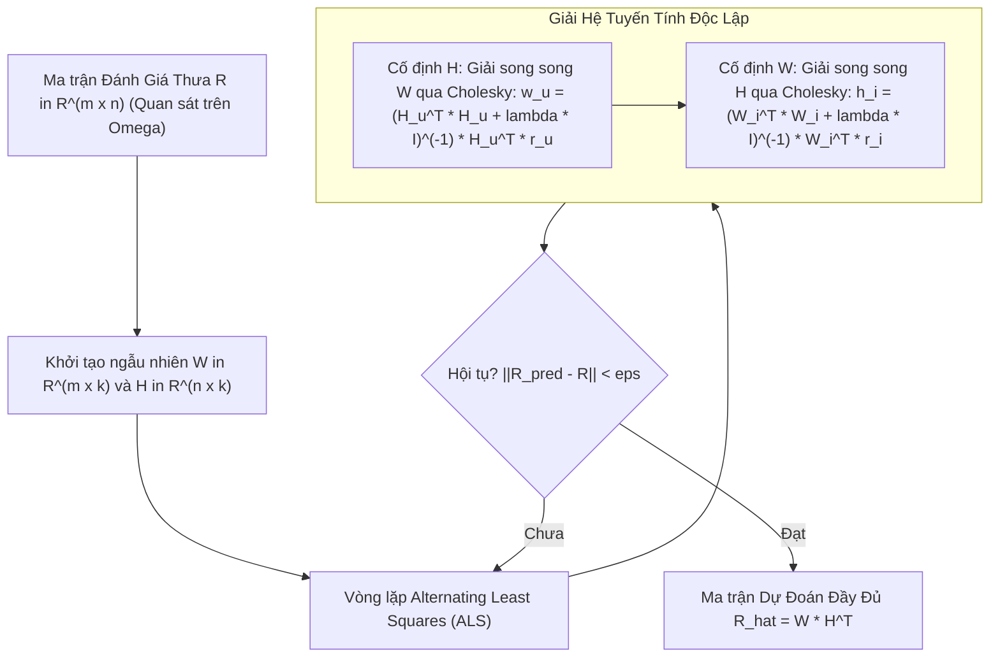
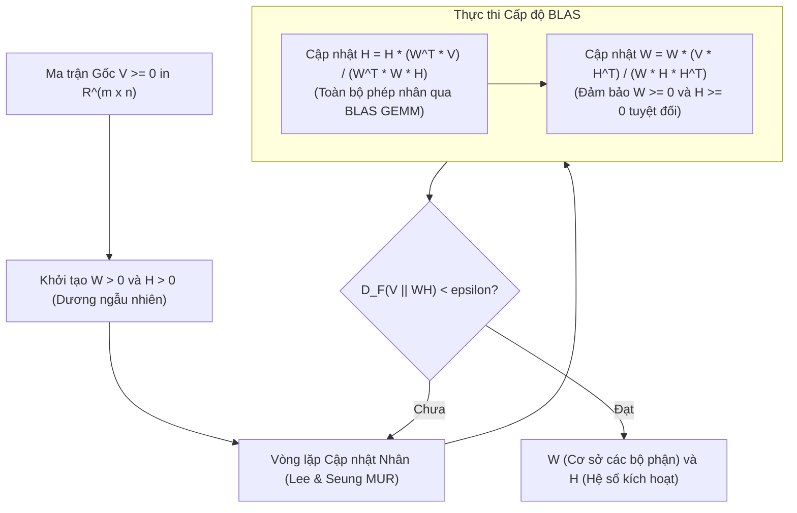
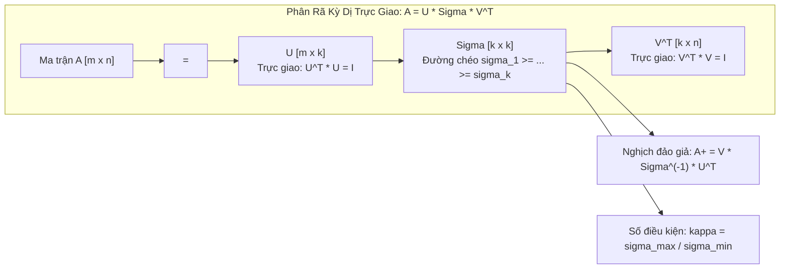
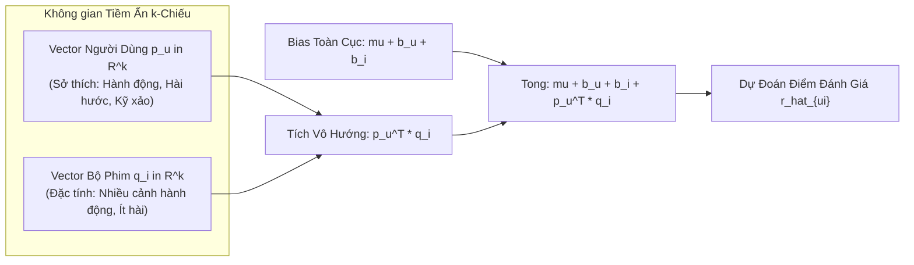
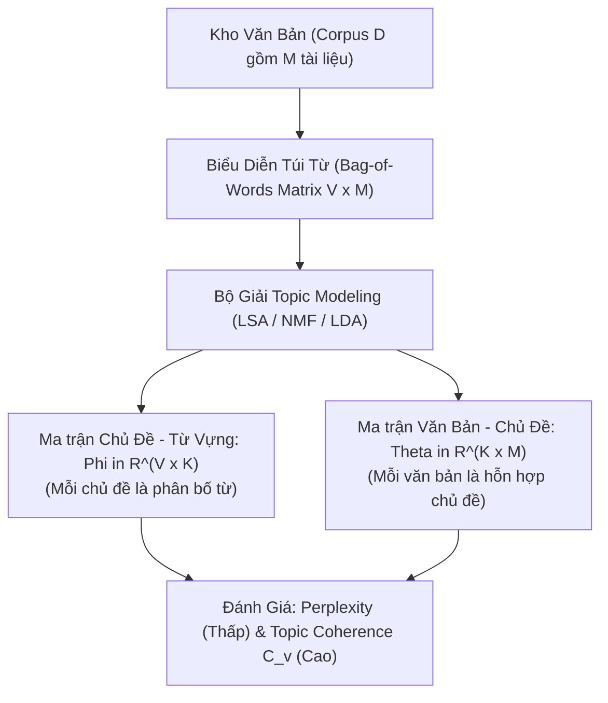
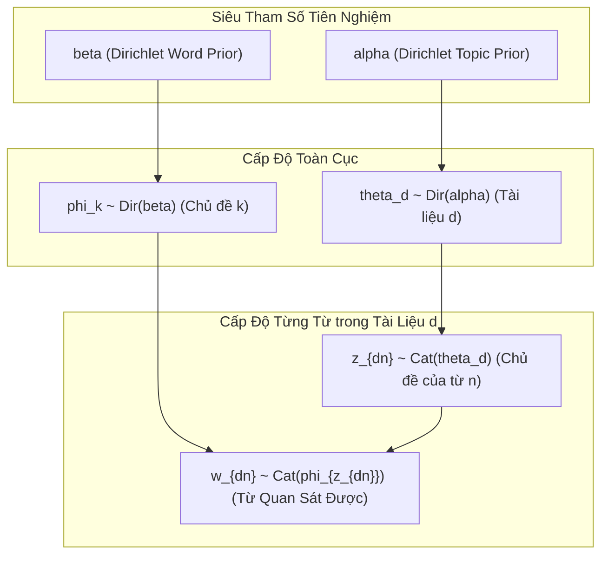
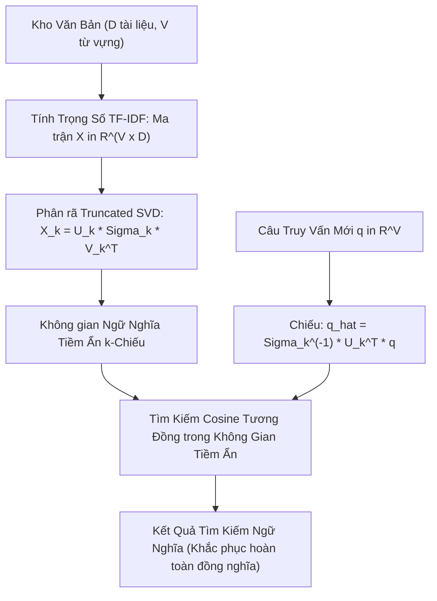
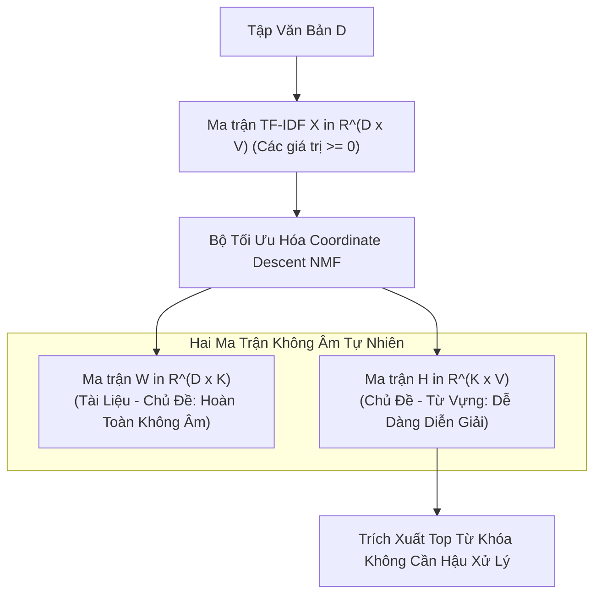

# Chuyên đề: Phân Rã Ma Trận & Mô Hình Hóa Chủ Đề (Matrix Factorization & Topic Modeling)

## 1. Tổng quan Chuyên đề
Trong khoa học dữ liệu hiện đại, dữ liệu dạng bảng tương tác (User-Item Interaction), ma trận đồng xuất hiện từ vựng (Term-Document Matrix) hay các tập tín hiệu tự nhiên đều có đặc điểm chung: Kích thước ma trận cực lớn nhưng lại vô cùng thưa thớt (Sparsity $> 99\%$) và bị chi phối bởi các yếu tố tiềm ẩn (Latent Factors). 

Chuyên đề này đi sâu vào hai trụ cột toán học giải mã các cấu trúc thưa này:
1. **Phân rã Ma trận & Mã hóa Thưa (Matrix Factorization & Sparse Coding)**: Phân rã ma trận quan sát thành tích của các ma trận hạng thấp (Low-rank Factorization), giúp nén chiều dữ liệu, tái tạo thông tin bị khuyết và học từ điển biểu diễn cơ sở (SVD, NMF, Sparse Coding, Latent Factor Models).
2. **Mô hình Hóa Chủ đề (Topic Modeling)**: Khám phá các chủ đề ngữ nghĩa trừu tượng ẩn sâu trong kho văn bản lớn mà không cần gán nhãn, từ góc nhìn đại số phổ (LSA), tối ưu phi âm (NMF for Topics) đến lý thuyết xác suất Bayes phân cấp (LDA).



---

## 2. Chi tiết từng Keyword

---

### 1. Sparse Coding (Mã hóa thưa)

#### a. Định nghĩa Bản chất Toán học (Mathematical Formulation)
**Mô hình Mã hóa Thưa (Olshausen & Field 1996)** mô phỏng cơ chế mã hóa thông tin của các tế bào thần kinh vùng thị giác sơ cấp (V1), biểu diễn một vector tín hiệu $\mathbf{x} \in \mathbb{R}^d$ dưới dạng tổ hợp tuyến tính của một số lượng rất ít các nguyên tử cơ sở (atoms) rút ra từ một từ điển dư thừa (Overcomplete Dictionary) $\mathbf{D} \in \mathbb{R}^{d \times K}$ ($K > d$):
$$\mathbf{x} \approx \mathbf{D} \mathbf{\alpha} = \sum_{k=1}^K \alpha_k \mathbf{d}_k$$

Bài toán tối ưu hóa tổng thể giải quyết việc đồng thời học từ điển $\mathbf{D}$ và vector biểu diễn thưa $\mathbf{\alpha}$:
$$\min_{\mathbf{D}, \mathbf{\alpha}} \frac{1}{2} \|\mathbf{x} - \mathbf{D} \mathbf{\alpha}\|_2^2 + \lambda \|\mathbf{\alpha}\|_1 \quad \text{sao cho } \|\mathbf{d}_k\|_2^2 \le 1, \, \forall k$$
Trong đó:
- $\|\mathbf{\alpha}\|_1 = \sum_{k=1}^K |\alpha_k|$ là chuẩn $L_1$ đóng vai trò hàm điều hòa thúc đẩy tính thưa (Sparsity inducing regularizer - biến thể của LASSO / Basis Pursuit Denoising).
- Ràng buộc $\|\mathbf{d}_k\|_2^2 \le 1$ ngăn ngừa hiện tượng suy biến số học (nơi các nguyên tử $\mathbf{d}_k$ tăng tới $\infty$ để ép $\alpha_k \to 0$).

**Hai Bước Tối Ưu Hóa Luân Phiên (Alternating Optimization)**:
1. **Bước Mã Hóa Thưa (Sparse Coding Step)**: Cố định $\mathbf{D}$, giải bài toán Lasso cho từng mẫu $\mathbf{x}_i$:
   $$\mathbf{\alpha}_i^* = \arg\min_{\mathbf{\alpha}_i} \frac{1}{2} \|\mathbf{x}_i - \mathbf{D} \mathbf{\alpha}_i\|_2^2 + \lambda \|\mathbf{\alpha}_i\|_1$$
   Được giải bằng thuật toán FISTA (Fast Iterative Shrinkage-Thresholding Algorithm) hoặc OMP (Orthogonal Matching Pursuit).
2. **Bước Cập Nhật Từ Điển (Dictionary Update Step)**: Cố định toàn bộ các mã thưa $\mathbf{A} = [\mathbf{\alpha}_1, \dots, \mathbf{\alpha}_N]$, giải bài toán bình phương tối thiểu có ràng buộc:
   $$\min_{\mathbf{D}} \frac{1}{2} \|\mathbf{X} - \mathbf{D} \mathbf{A}\|_F^2 \quad \text{sao cho } \|\mathbf{d}_k\|_2 \le 1, \, \forall k$$
   Giải qua phương pháp Lagrange Dual hoặc Block Coordinate Descent (MOD - Method of Optimal Directions / K-SVD).

#### b. Cơ chế Tầng Sâu & Điện toán (Under The Hood / Hardware Internals)
- **Toán tử Ngưỡng Mềm (Soft-Thresholding Operator) Vector Hóa**:
  Lõi tính toán của FISTA/ISTA là toán tử co rút:
  $$\mathcal{S}_\tau(u) = \text{sign}(u) \max(|u| - \tau, 0)$$
  Thao tác này được triển khai trên thanh ghi AVX2 bằng sự kết hợp của các lệnh logic: lấy giá trị tuyệt đối `_mm256_andnot_ps`, trừ ngưỡng `_mm256_sub_ps`, kẹp số dương `_mm256_max_ps`, và khôi phục dấu bằng phép XOR `_mm256_xor_ps`.
- **Độ Thưa Giúp Tiết Kiệm Băng Thông**: Khi $\mathbf{\alpha}$ thưa (chỉ $5\% - 10\%$ phần tử khác 0), phép tái tạo $\mathbf{D} \mathbf{\alpha}$ chuyển từ phép nhân ma trận đầy đủ (Dense GEMV) thành phép cộng có trọng số của vài cột trong $\mathbf{D}$, giảm thiểu $90\%$ số phép tính FLOPs.

#### c. Sơ đồ Minh họa (Mermaid Diagram)


#### d. Code Thực chiến (Dual-Engine: C++ & Python)

```cpp
// C++17: Triển khai Toán Tử Ngưỡng Mềm (Soft-Thresholding) Tối Ưu Hóa Vector
#include <iostream>
#include <vector>
#include <cmath>

inline float soft_threshold(float u, float lambda) noexcept {
    if (u > lambda) return u - lambda;
    if (u < -lambda) return u + lambda;
    return 0.0f;
}

// 1 bước lặp ISTA (Iterative Shrinkage-Thresholding Algorithm) cho 1 mẫu
std::vector<float> ista_step(
    const std::vector<float>& x,       // [D]
    const std::vector<float>& D,       // [D x K]
    const std::vector<float>& alpha,   // [K]
    float step_size,                   // L
    float lambda,
    size_t in_d, size_t num_atoms) 
{
    // 1. Tính D * alpha [D]
    std::vector<float> recon(in_d, 0.0f);
    for (size_t d = 0; d < in_d; ++d) {
        for (size_t k = 0; k < num_atoms; ++k) {
            recon[d] += D[d * num_atoms + k] * alpha[k];
        }
    }

    // 2. Tính phần dư residual = x - recon [D]
    std::vector<float> res(in_d, 0.0f);
    for (size_t d = 0; d < in_d; ++d) res[d] = x[d] - recon[d];

    // 3. Tính gradient = - D^T * res [K]
    // alpha_new = S_{lambda * step}(alpha + step * D^T * res)
    std::vector<float> alpha_new(num_atoms, 0.0f);
    for (size_t k = 0; k < num_atoms; ++k) {
        float grad_k = 0.0f;
        for (size_t d = 0; d < in_d; ++d) {
            grad_k += D[d * num_atoms + k] * res[d];
        }
        float unthresholded = alpha[k] + step_size * grad_k;
        alpha_new[k] = soft_threshold(unthresholded, lambda * step_size);
    }
    return alpha_new;
}

int main() {
    constexpr size_t D = 2, K = 3;
    std::vector<float> x = {1.0f, 2.0f};
    std::vector<float> Dict = {
        1.0f, 0.0f, 0.7f,
        0.0f, 1.0f, 0.7f
    };
    std::vector<float> alpha = {0.0f, 0.0f, 0.0f};

    auto alpha_next = ista_step(x, Dict, alpha, 0.1f, 0.05f, D, K);
    std::cout << "[C++] ISTA 1-step Sparse Code: [" 
              << alpha_next[0] << ", " << alpha_next[1] << ", " << alpha_next[2] << "]\n";
    return 0;
}
```

```python
# Python / Scikit-Learn: Học Từ Điển (DictionaryLearning) và Trích xuất Mã Thưa
from sklearn.decomposition import DictionaryLearning
import numpy as np

def run_sparse_coding_pipeline():
    np.random.seed(42)
    N, D, K = 200, 20, 40 # Từ điển dư thừa: K = 40 > D = 20
    X = np.random.randn(N, D)
    
    # Huấn luyện Từ điển Thưa
    dict_learner = DictionaryLearning(n_components=K, transform_algorithm='lasso_lars', alpha=0.1, max_iter=50, random_state=42)
    alpha_codes = dict_learner.fit_transform(X)
    
    dictionary = dict_learner.components_ # [K, D]
    sparsity = np.mean(alpha_codes == 0.0) * 100.0
    
    print(f"[Python] Kích thước Từ điển D: {dictionary.shape}")
    print(f"[Python] Kích thước Mã Thưa Alpha: {alpha_codes.shape}")
    print(f"[Python] Độ thưa của ma trận biểu diễn: {sparsity:.2f}% (Tỷ lệ phần tử đúng bằng 0)")

if __name__ == "__main__":
    run_sparse_coding_pipeline()
```

#### e. Lỗi Thường gặp & Ổn định Số học (Pitfalls & Numerical Stability)
- **Tập Nguyên Tử Bị Chết (Dead Atoms)**: Trong quá trình cập nhật từ điển, một số nguyên tử $\mathbf{d}_k$ không bao giờ được bất kỳ mẫu nào kích hoạt ($\alpha_{ik} = 0, \forall i$). Cần phát hiện các nguyên tử này và tái khởi tạo bằng một mẫu dữ liệu có sai số tái tạo lớn nhất.
- **Lựa chọn Bước Học $\text{step\_size}$ trong ISTA**: Nếu $\text{step\_size} > \frac{1}{\lambda_{\max}(\mathbf{D}^T \mathbf{D})}$, thuật toán ISTA sẽ phân kỳ dữ dội. Bắt buộc phải tính giá trị kỳ dị lớn nhất $\sigma_1(\mathbf{D})$ để chặn bước học.

#### f. Ứng dụng Thực chiến trong AI / Deep Learning
- **Nén và Khử Nhiễu Ảnh Siêu Phân Giải (Image Super-Resolution via Sparse Representation)**: Tái tạo ảnh sắc nét từ ảnh có độ phân giải thấp dựa trên cặp từ điển liên kết (Low-res and High-res Dictionaries).
- **Sparse Autoencoders (SAE) trong Cơ Chế Giải Thích Mô Hình Ngôn Ngữ Lớn (Mechanistic Interpretability)**: Dùng mã hóa thưa để mổ xẻ không gian kích hoạt nơ-ron đa nghĩa (Polysemanticity) của các mô hình Transformer như Claude hay GPT-4 thành các khái niệm ngữ nghĩa đơn nhất.

---

### 2. Matrix Factorization (Phân rã ma trận)

#### a. Định nghĩa Bản chất Toán học (Mathematical Formulation)
**Phân rã Ma trận Hạng Thấp (Low-Rank Matrix Factorization)** nhằm xấp xỉ một ma trận lớn $\mathbf{X} \in \mathbb{R}^{m \times n}$ thông qua tích của hai ma trận nhân tử có hạng $k \ll \min(m, n)$:
$$\mathbf{X} \approx \mathbf{W} \mathbf{H}^T$$
Trong đó $\mathbf{W} \in \mathbb{R}^{m \times k}$ biểu diễn ma trận đặc trưng của các hàng (hàng nhân tử) và $\mathbf{H} \in \mathbb{R}^{n \times k}$ biểu diễn ma trận đặc trưng của các cột.

**Định lý Cực tiểu Xấp xỉ Hạng Thấp Eckart-Young-Mirsky (1936)**:
Với chuẩn Frobenius $\|\mathbf{A}\|_F = \sqrt{\sum_{i,j} A_{ij}^2}$, nghiệm tối ưu của bài toán:
$$\min_{\text{rank}(\hat{\mathbf{X}}) \le k} \|\mathbf{X} - \hat{\mathbf{X}}\|_F$$
được cho duy nhất bởi phân rã SVD cắt tỉa tại $k$ thành phần:
$$\hat{\mathbf{X}} = \mathbf{X}_k = \sum_{j=1}^k \sigma_j \mathbf{u}_j \mathbf{v}_j^T$$
Sai số tái tạo cực tiểu đạt được:
$$\|\mathbf{X} - \mathbf{X}_k\|_F = \sqrt{\sum_{j=k+1}^{\min(m, n)} \sigma_j^2}$$

**Bài Toán Xấp Xỉ Khi Có Phần Tử Khuyết (Matrix Completion / Missing Values)**:
Trong hệ thống gợi ý, ma trận quan sát $\mathbf{R}$ có vô số phần tử chưa được chấm điểm. Hàm mục tiêu chỉ tính trên tập các vị trí quan sát $\Omega = \{(u, i) \mid R_{ui} \text{ đã biết}\}$:
$$\min_{\mathbf{W}, \mathbf{H}} \frac{1}{2} \sum_{(u, i) \in \Omega} (R_{ui} - \mathbf{w}_u^T \mathbf{h}_i)^2 + \frac{\lambda}{2} \sum_{u} \|\mathbf{w}_u\|_2^2 + \frac{\lambda}{2} \sum_{i} \|\mathbf{h}_i\|_2^2$$

**Thuật toán Alternating Least Squares (ALS)**:
Do hàm mục tiêu lồi theo $\mathbf{W}$ khi cố định $\mathbf{H}$ (và ngược lại), thuật toán giải nghiệm giải tích lặp luân phiên:
$$\mathbf{w}_u^* = \left( \sum_{i \in \Omega_u} \mathbf{h}_i \mathbf{h}_i^T + \lambda \mathbf{I}_k \right)^{-1} \left( \sum_{i \in \Omega_u} R_{ui} \mathbf{h}_i \right)$$
$$\mathbf{h}_i^* = \left( \sum_{u \in \Omega_i} \mathbf{w}_u \mathbf{w}_u^T + \lambda \mathbf{I}_k \right)^{-1} \left( \sum_{u \in \Omega_i} R_{ui} \mathbf{w}_u \right)$$

#### b. Cơ chế Tầng Sâu & Điện toán (Under The Hood / Hardware Internals)
- **Giải Hệ Phương Trình Nhỏ Bằng Phân Rã Cholesky**:
  Trong ALS, ma trận $\mathbf{A}_u = \sum_{i \in \Omega_u} \mathbf{h}_i \mathbf{h}_i^T + \lambda \mathbf{I}_k$ có kích thước $k \times k$ đối xứng xác định dương. Thay vì gọi hàm nghịch đảo `inv()`, giải hệ $\mathbf{A}_u \mathbf{w}_u = \mathbf{b}_u$ bằng phân rã Cholesky $\mathbf{A}_u = \mathbf{L} \mathbf{L}^T$ và 2 bước thế xuôi/ngược (Forward/Backward Substitution) bằng BLAS Level-3 `dpotrf` + `dpotrs`, nhanh hơn $4\times$.
- **Song Song Hóa Tuyệt Đối (Embarrassingly Parallel ALS)**: Các vector $\mathbf{w}_u$ của từng người dùng hoàn toàn độc lập với nhau trong bước cập nhật $\mathbf{W}$, cho phép phân phối việc giải hệ phương trình lên hàng ngàn luồng OpenMP hoặc GPU Cuda Cores.

#### c. Sơ đồ Minh họa (Mermaid Diagram)


#### d. Code Thực chiến (Dual-Engine: C++ & Python)

```cpp
// C++17: Một Bước Cập Nhật Hàng Tối Thiểu ALS cho 1 User với k=2
#include <iostream>
#include <vector>

// Giải hệ 2x2: A * w = b
std::vector<float> solve_2x2_symmetric(float A00, float A01, float A11, float b0, float b1) {
    float det = A00 * A11 - A01 * A01;
    if (std::abs(det) < 1e-8f) return {0.0f, 0.0f};
    float inv_det = 1.0f / det;
    return {
        inv_det * (A11 * b0 - A01 * b1),
        inv_det * (A00 * b1 - A01 * b0)
    };
}

int main() {
    // User u đã chấm 2 items: item 0 (rate=5.0), item 1 (rate=2.0)
    // Latent vectors của 2 items (k=2): h0 = [1.0, 0.5], h1 = [0.2, 1.2]
    float h0[2] = {1.0f, 0.5f};
    float h1[2] = {0.2f, 1.2f};
    float r0 = 5.0f, r1 = 2.0f;
    float lambda = 0.1f;

    // Tích lũy A = sum(h * h^T) + lambda * I
    float A00 = (h0[0] * h0[0] + h1[0] * h1[0]) + lambda;
    float A01 = (h0[0] * h0[1] + h1[0] * h1[1]);
    float A11 = (h0[1] * h0[1] + h1[1] * h1[1]) + lambda;

    // Tích lũy b = sum(r * h)
    float b0 = r0 * h0[0] + r1 * h1[0];
    float b1 = r0 * h0[1] + r1 * h1[1];

    auto w_u = solve_2x2_symmetric(A00, A01, A11, b0, b1);
    std::cout << "[C++] ALS User Latent Vector w_u: [" << w_u[0] << ", " << w_u[1] << "]\n";
    return 0;
}
```

```python
# Python / PyTorch: Tối ưu Phân Rã Ma Trận Bằng SGD trên GPU
import torch
import torch.nn as nn
import torch.optim as optim

class MatrixFactorization(nn.Module):
    def __init__(self, n_users: int, n_items: int, k_factors: int):
        super().__init__()
        self.user_factors = nn.Embedding(n_users, k_factors)
        self.item_factors = nn.Embedding(n_items, k_factors)
        # Khởi tạo phân phối Gauss nhỏ
        nn.init.normal_(self.user_factors.weight, std=0.05)
        nn.init.normal_(self.item_factors.weight, std=0.05)

    def forward(self, u_idx: torch.Tensor, i_idx: torch.Tensor) -> torch.Tensor:
        u_emb = self.user_factors(u_idx) # [B, k]
        i_emb = self.item_factors(i_idx) # [B, k]
        return (u_emb * i_emb).sum(dim=1)

if __name__ == "__main__":
    torch.manual_seed(42)
    users = torch.tensor([0, 0, 1, 1, 2])
    items = torch.tensor([0, 1, 1, 2, 0])
    ratings = torch.tensor([5.0, 3.0, 4.0, 1.0, 2.0], dtype=torch.float32)

    model = MatrixFactorization(n_users=3, n_items=3, k_factors=2)
    criterion = nn.MSELoss()
    optimizer = optim.SGD(model.parameters(), lr=0.05, weight_decay=1e-3)

    for epoch in range(100):
        optimizer.zero_grad(set_to_none=True)
        preds = model(users, items)
        loss = criterion(preds, ratings)
        loss.backward()
        optimizer.step()

    print(f"[PyTorch] Loss cuối cùng sau 100 epochs SGD: {loss.item():.4f}")
    with torch.no_grad():
        print(f"[PyTorch] Dự đoán User 0 trên Item 0: {model(torch.tensor([0]), torch.tensor([0])).item():.2f}")
```

#### e. Lỗi Thường gặp & Ổn định Số học (Pitfalls & Numerical Stability)
- **Vấn đề Khởi Động Nguội (Cold-Start Problem)**: Với người dùng mới hoặc vật phẩm mới chưa có bất kỳ tương tác nào trong tập huấn luyện ($|\Omega_u| = 0$), ma trận $\mathbf{A}_u = \lambda \mathbf{I}$, dẫn đến vector $\mathbf{w}_u = \mathbf{0}$, mô hình không thể đưa ra bất kỳ dự đoán cá nhân hóa nào.
- **Quá Khớp Trên Phần Tử Quan Sát**: Do ma trận cực kỳ thưa, nếu không có hệ số phạt $L_2$ đủ mạnh ($\lambda$), các vector tiềm ẩn sẽ bị thổi phồng độ lớn để khớp hoàn hảo các đánh giá đã biết nhưng hoàn toàn mất khả năng tổng quát hóa trên các đánh giá chưa quan sát.

#### f. Ứng dụng Thực chiến trong AI / Deep Learning
- **Hệ Thống Gợi Ý Điện Ảnh & Thương Mại Điện Tử (Netflix Prize / Amazon Recommendations)**: Mô hình hóa sở thích tiềm ẩn của người dùng và đặc tính phim ảnh.
- **Biểu Diễn Tri Thức Đồ Thị (Knowledge Graph Embedding - DistMult, RESCAL)**: Phân rã tensor bậc 3 quan hệ thành tích các ma trận thực thể và vector quan hệ.

---

### 3. Non-Negative Matrix Factorization (NMF - Phân rã ma trận không âm)

#### a. Định nghĩa Bản chất Toán học (Mathematical Formulation)
Được phát triển và phổ biến rộng rãi bởi Lee & Seung (Nature 1999, NeurIPS 2001), **NMF** áp dụng một ràng buộc vật lý tự nhiên: **Tất cả các phần tử trong ma trận đều phải không âm**.

Cho ma trận dữ liệu $\mathbf{V} \in \mathbb{R}_{+}^{m \times n}$ ($V_{ij} \ge 0$), NMF tìm hai ma trận nhân tử $\mathbf{W} \in \mathbb{R}_{+}^{m \times k}$ và $\mathbf{H} \in \mathbb{R}_{+}^{k \times n}$ sao cho:
$$\mathbf{V} \approx \mathbf{W} \mathbf{H}, \quad \text{với } W_{ik} \ge 0, \, H_{kj} \ge 0, \, \forall i, j, k$$

**Bản chất Học Bộ Phận (Parts-Based Representation)**:
Khác với PCA (cho phép các trọng số mang dấu âm để triệt tiêu lẫn nhau), trong NMF **chỉ cho phép các phép cộng dồn tích cực** ($V_{ij} \approx \sum_{k=1}^K W_{ik} H_{kj}$). Điều này ép mô hình phải học các thành phần cơ sở mang tính bộ phận trực giác (ví dụ: một khuôn mặt được tạo thành từ phép cộng: Mắt + Mũi + Miệng + Cằm).

**Các Hàm Mục Tiêu Tiêu Chuẩn**:
1. **Khoảng cách Frobenius Bình phương**:
   $$\mathcal{D}_F(\mathbf{V} \parallel \mathbf{W} \mathbf{H}) = \frac{1}{2} \|\mathbf{V} - \mathbf{W} \mathbf{H}\|_F^2 = \frac{1}{2} \sum_{i, j} (V_{ij} - (\mathbf{W} \mathbf{H})_{ij})^2$$
2. **Phân kỳ Generalized Kullback-Leibler (I-Divergence)**:
   $$\mathcal{D}_{KL}(\mathbf{V} \parallel \mathbf{W} \mathbf{H}) = \sum_{i, j} \left( V_{ij} \ln \frac{V_{ij}}{(\mathbf{W} \mathbf{H})_{ij}} - V_{ij} + (\mathbf{W} \mathbf{H})_{ij} \right)$$

**Quy Tắc Cập Nhật Nhân Đơn Điệu (Multiplicative Update Rules - MUR)**:
Để bảo toàn tính không âm tự nhiên mà không cần giải bài toán quy hoạch phi tuyến phức tạp:
1. **Dưới chuẩn Frobenius**:
   $$H_{kj} \leftarrow H_{kj} \frac{(\mathbf{W}^T \mathbf{V})_{kj}}{(\mathbf{W}^T \mathbf{W} \mathbf{H})_{kj}}$$
   $$W_{ik} \leftarrow W_{ik} \frac{(\mathbf{V} \mathbf{H}^T)_{ik}}{(\mathbf{W} \mathbf{H} \mathbf{H}^T)_{ik}}$$
2. **Dưới chuẩn KL-Divergence**:
   $$H_{kj} \leftarrow H_{kj} \frac{\sum_i W_{ik} V_{ij} / (\mathbf{W} \mathbf{H})_{ij}}{\sum_i W_{ik}}$$
   $$W_{ik} \leftarrow W_{ik} \frac{\sum_j H_{kj} V_{ij} / (\mathbf{W} \mathbf{H})_{ij}}{\sum_j H_{kj}}$$

#### b. Cơ chế Tầng Sâu & Điện toán (Under The Hood / Hardware Internals)
- **Tận dụng Thư Viện BLAS Level-3 (GEMM Optimization)**:
  Nhìn vào quy tắc cập nhật Frobenius:
  - $\mathbf{W}^T \mathbf{V}$ là phép nhân ma trận $(k \times m) \times (m \times n) \to (k \times n)$
  - $\mathbf{W}^T \mathbf{W}$ là phép nhân $(k \times k)$
  - $(\mathbf{W}^T \mathbf{W}) \mathbf{H}$ là phép nhân $(k \times k) \times (k \times n) \to (k \times n)$
  Tất cả các phép tính nặng nhất đều được chuyển hóa hoàn toàn thành các cuộc gọi hàm `cblas_sgemm` đạt hiệu suất hàng chục TFLOPs trên GPU, sau đó áp dụng phép chia và nhân từng phần tử (Hadamard product/division) cực nhanh qua vector SIMD.
- **Tính Thưa Tự Nhiên (Inherent Sparsity)**: Do ràng buộc không âm, nhiều phần tử trong $\mathbf{W}$ và $\mathbf{H}$ bị ép sát về $0$, giúp giảm thiểu đáng kể dung lượng bộ nhớ.

#### c. Sơ đồ Minh họa (Mermaid Diagram)


#### d. Code Thực chiến (Dual-Engine: C++ & Python)

```cpp
// C++17: Triển khai Quy Tắc Cập Nhật Nhân NMF (Frobenius MUR)
#include <iostream>
#include <vector>
#include <algorithm>

void nmf_multiplicative_update_step(
    const std::vector<float>& V, // [M x N]
    std::vector<float>& W,       // [M x K]
    std::vector<float>& H,       // [K x N]
    size_t M, size_t N, size_t K) 
{
    // 1. Tính W * H [M x N]
    std::vector<float> WH(M * N, 0.0f);
    for (size_t i = 0; i < M; ++i)
        for (size_t k = 0; k < K; ++k)
            for (size_t j = 0; j < N; ++j)
                WH[i * N + j] += W[i * K + k] * H[k * N + j];

    // 2. Cập nhật H: H = H * (W^T * V) / (W^T * WH)
    std::vector<float> WtV(K * N, 0.0f);
    std::vector<float> WtWH(K * N, 0.0f);
    for (size_t k = 0; k < K; ++k) {
        for (size_t i = 0; i < M; ++i) {
            float w_val = W[i * K + k];
            for (size_t j = 0; j < N; ++j) {
                WtV[k * N + j] += w_val * V[i * N + j];
                WtWH[k * N + j] += w_val * WH[i * N + j];
            }
        }
    }
    for (size_t idx = 0; idx < K * N; ++idx) {
        H[idx] *= (WtV[idx] / std::max(WtWH[idx], 1e-9f));
    }

    // 3. Tính lại WH sau khi H đổi để cập nhật W
    std::fill(WH.begin(), WH.end(), 0.0f);
    for (size_t i = 0; i < M; ++i)
        for (size_t k = 0; k < K; ++k)
            for (size_t j = 0; j < N; ++j)
                WH[i * N + j] += W[i * K + k] * H[k * N + j];

    // 4. Cập nhật W: W = W * (V * H^T) / (WH * H^T)
    std::vector<float> VHt(M * K, 0.0f);
    std::vector<float> WHHt(M * K, 0.0f);
    for (size_t i = 0; i < M; ++i) {
        for (size_t j = 0; j < N; ++j) {
            float v_val = V[i * N + j];
            float wh_val = WH[i * N + j];
            for (size_t k = 0; k < K; ++k) {
                float h_val = H[k * N + j];
                VHt[i * K + k] += v_val * h_val;
                WHHt[i * K + k] += wh_val * h_val;
            }
        }
    }
    for (size_t idx = 0; idx < M * K; ++idx) {
        W[idx] *= (VHt[idx] / std::max(WHHt[idx], 1e-9f));
    }
}

int main() {
    constexpr size_t M = 2, N = 2, K = 1;
    std::vector<float> V = {1.0f, 2.0f, 3.0f, 4.0f};
    std::vector<float> W = {0.5f, 0.8f};
    std::vector<float> H = {1.2f, 1.5f};

    nmf_multiplicative_update_step(V, W, H, M, N, K);
    std::cout << "[C++] NMF 1-step hoàn thành. W: [" << W[0] << ", " << W[1] << "]\n";
    std::cout << "[C++] NMF 1-step hoàn thành. H: [" << H[0] << ", " << H[1] << "]\n";
    return 0;
}
```

```python
# Python / Scikit-Learn: NMF Trích xuất Các Bộ Phận Mặt (Parts-based Representation)
from sklearn.decomposition import NMF
from sklearn.datasets import fetch_olivetti_faces
import numpy as np

def run_nmf_face_decomposition():
    faces, _ = fetch_olivetti_faces(return_X_y=True, shuffle=True, random_state=42)
    # 400 ảnh, mỗi ảnh 64x64 = 4096 pixels (đều >= 0)
    X = faces[:100] # Lấy 100 ảnh mẫu
    
    # NMF với Frobenius loss và coordinate descent
    nmf = NMF(n_components=6, init='nndsvda', solver='cd', max_iter=200, random_state=42)
    W_faces = nmf.fit_transform(X) # [100, 6] Hệ số kích hoạt
    H_components = nmf.components_ # [6, 4096] 6 thành phần bộ phận cơ sở
    
    print(f"[Python] Ma trận W kích thước: {W_faces.shape}")
    print(f"[Python] Ma trận H (Các bộ phận cơ sở): {H_components.shape}")
    print(f"[Python] Giá trị nhỏ nhất trong H: {np.min(H_components):.4f} (Bảo đảm >= 0 tuyệt đối)")

if __name__ == "__main__":
    run_nmf_face_decomposition()
```

#### e. Lỗi Thường gặp & Ổn định Số học (Pitfalls & Numerical Stability)
- **Kẹt Tại Điểm Dừng Bằng 0 (Zero-Locking)**: Trong quy tắc cập nhật nhân, nếu một phần tử $W_{ik}$ hoặc $H_{kj}$ chạm về 0, nó sẽ bị nhân với 0 mãi mãi và không bao giờ có thể hồi phục lại giá trị dương. Cần kẹp cận dưới `std::max(val, 1e-12f)`.
- **Hội Tụ Tới Điểm Cực Tiểu Địa Phương**: NMF là bài toán tối ưu phi lồi theo cặp $(\mathbf{W}, \mathbf{H})$. Khởi tạo ngẫu nhiên đơn giản có thể dẫn đến nghiệm xấu; nên sử dụng phương pháp khởi tạo SVD không âm **NNDSVD (Nonnegative Double SVD)**.

#### f. Ứng dụng Thực chiến trong AI / Deep Learning
- **Phân Tích Dữ Liệu Biểu Hiện Gen (Bioinformatics / Gene Expression Clustering)**: Phân tách ma trận Microarray thành các module gen chức năng và nhóm bệnh nhân ung thư.
- **Tách Nguồn Phổ Âm Thanh (Audio Spectrogram Factorization)**: Tách phổ biến đổi Fourier thời gian ngắn (STFT) thành các nốt nhạc và nhạc cụ riêng biệt.

---

### 4. Singular Value Decomposition (SVD - Phân rã giá trị kỳ dị)

#### a. Định nghĩa Bản chất Toán học (Mathematical Formulation)
**SVD** là một trong những định lý nền tảng nhất của toàn bộ Đại số Tuyến tính. Bất kỳ ma trận thực nào $\mathbf{A} \in \mathbb{R}^{m \times n}$ đều có thể phân rã thành tích của ba ma trận:
$$\mathbf{A} = \mathbf{U} \mathbf{\Sigma} \mathbf{V}^T$$
Trong đó:
- $\mathbf{U} \in \mathbb{R}^{m \times m}$ là ma trận trực giao ($\mathbf{U}^T \mathbf{U} = \mathbf{I}_m$), các cột $\mathbf{u}_j$ gọi là **vector kỳ dị trái (Left singular vectors)**. Chúng là các vector riêng trực chuẩn của $\mathbf{A} \mathbf{A}^T$.
- $\mathbf{V} \in \mathbb{R}^{n \times n}$ là ma trận trực giao ($\mathbf{V}^T \mathbf{V} = \mathbf{I}_n$), các cột $\mathbf{v}_j$ gọi là **vector kỳ dị phải (Right singular vectors)**. Chúng là các vector riêng trực chuẩn của $\mathbf{A}^T \mathbf{A}$.
- $\mathbf{\Sigma} \in \mathbb{R}^{m \times n}$ là ma trận đường chéo hình chữ nhật chứa các **giá trị kỳ dị (Singular Values)** $\sigma_1 \ge \sigma_2 \ge \dots \ge \sigma_r > 0$ ($r = \text{rank}(\mathbf{A})$). Mối quan hệ: $\sigma_j = \sqrt{\lambda_j(\mathbf{A}^T \mathbf{A})}$.

**Các Dạng SVD**:
1. **Full SVD**: $\mathbf{U} \in \mathbb{R}^{m \times m}$, $\mathbf{\Sigma} \in \mathbb{R}^{m \times n}$, $\mathbf{V} \in \mathbb{R}^{n \times n}$.
2. **Thin / Economy-size SVD** (với $m \ge n$): Cắt bỏ các cột thừa của $\mathbf{U}$, chỉ giữ $\mathbf{U} \in \mathbb{R}^{m \times n}$, $\mathbf{\Sigma} \in \mathbb{R}^{n \times n}$, $\mathbf{V} \in \mathbb{R}^{n \times n}$.
3. **Truncated SVD (Hạng $k$)**: Chỉ giữ lại $k \ll r$ giá trị kỳ dị lớn nhất:
   $$\mathbf{A}_k = \mathbf{U}_k \mathbf{\Sigma}_k \mathbf{V}_k^T = \sum_{j=1}^k \sigma_j \mathbf{u}_j \mathbf{v}_j^T$$

**Nghịch Đảo Giả Moore-Penrose (Pseudoinverse)**:
$$\mathbf{A}^+ = \mathbf{V} \mathbf{\Sigma}^+ \mathbf{U}^T$$
Trong đó $\mathbf{\Sigma}^+$ thu được bằng cách nghịch đảo các giá trị kỳ dị khác 0 ($\sigma_j^{-1}$) và chuyển vị ma trận.

**Số Điều Kiện (Condition Number)**:
$$\kappa(\mathbf{A}) = \|\mathbf{A}\|_2 \|\mathbf{A}^+\|_2 = \frac{\sigma_{\max}}{\sigma_{\min}}$$
Đo lường mức độ nhạy cảm của hệ phương trình tuyến tính $\mathbf{A} \mathbf{x} = \mathbf{b}$ trước các sai số nhiễu đầu vào.

#### b. Cơ chế Tầng Sâu & Điện toán (Under The Hood / Hardware Internals)
- **Thuật toán Hai Bước Golub-Kahan-Reinsch**:
  1. *Pha 1 (Bidiagonalization)*: Sử dụng các biến đổi phản xạ Householder trực giao hai phía biến đổi $\mathbf{A}$ thành ma trận hai đường chéo $\mathbf{B}$ trong $\mathcal{O}(m n^2)$ phép tính.
  2. *Pha 2 (Implicit QR or Divide-and-Conquer)*: Giải ma trận hai đường chéo $\mathbf{B}$ để tìm các giá trị kỳ dị và vector kỳ dị với độ chính xác cao.
- **Randomized SVD (Halko, Martinsson, Tropp 2011)**: Với ma trận khổng lồ $10^6 \times 10^6$, SVD ngẫu nhiên chiếu ma trận sang không gian con ngẫu nhiên $k + p$ chiều, giảm độ phức tạp từ $\mathcal{O}(m n^2)$ xuống $\mathcal{O}(m n \log k)$, tối ưu hóa truy cập tuần tự trên GPU VRAM.

#### c. Sơ đồ Minh họa (Mermaid Diagram)


#### d. Code Thực chiến (Dual-Engine: C++ & Python)

```cpp
// C++17: Tính Nghịch Đảo Giả Moore-Penrose của Ma Trận Đường Chéo Kỳ Dị Sigma
#include <iostream>
#include <vector>
#include <cmath>

std::vector<float> pseudoinverse_diagonal(const std::vector<float>& sigma, float rcond = 1e-6f) {
    size_t k = sigma.size();
    std::vector<float> inv_sigma(k, 0.0f);
    if (k == 0) return inv_sigma;

    float max_val = sigma[0];
    float threshold = rcond * max_val;

    for (size_t i = 0; i < k; ++i) {
        if (sigma[i] > threshold) {
            inv_sigma[i] = 1.0f / sigma[i];
        } else {
            inv_sigma[i] = 0.0f; // Triệt tiêu giá trị kỳ dị suy biến
        }
    }
    return inv_sigma;
}

int main() {
    std::vector<float> singular_values = {10.0f, 2.5f, 0.0000001f};
    auto inv_s = pseudoinverse_diagonal(singular_values);

    std::cout << "[C++] Giá trị kỳ dị nghịch đảo giả:\n";
    for (size_t i = 0; i < inv_s.size(); ++i) {
        std::cout << "sigma[" << i << "]^+ = " << inv_s[i] << "\n";
    }
    return 0;
}
```

```python
# Python / PyTorch: Truncated Randomized SVD Tăng Tốc Siêu Nhanh trên GPU
import torch

def truncated_randomized_svd(A: torch.Tensor, k: int, n_iter: int = 2):
    """Xấp xỉ SVD ngẫu nhiên (Halko et al., 2011) cho ma trận lớn."""
    m, n = A.shape
    # 1. Tạo ma trận ngẫu nhiên Gauss Omega [n, k + 5]
    Omega = torch.randn(n, k + 5, device=A.device, dtype=A.dtype)
    
    # 2. Xây dựng không gian con chiếu Y = (A * A^T)^q * A * Omega
    Y = torch.mm(A, Omega)
    for _ in range(n_iter):
        Y = torch.mm(A, torch.mm(A.t(), Y))
        
    # 3. Trực chuẩn hóa bằng phân rã QR
    Q, _ = torch.linalg.qr(Y)
    
    # 4. Chiếu A sang không gian nhỏ B = Q^T * A [k + 5, n]
    B = torch.mm(Q.t(), A)
    
    # 5. SVD trên ma trận nhỏ B
    U_tilde, S, Vh = torch.linalg.svd(B, full_matrices=False)
    U = torch.mm(Q, U_tilde)[:, :k]
    S = S[:k]
    Vh = Vh[:k, :]
    
    return U, S, Vh

if __name__ == "__main__":
    device = torch.device("cuda" if torch.cuda.is_available() else "cpu")
    X = torch.randn(2000, 1000, device=device)
    U, S, Vh = truncated_randomized_svd(X, k=10)
    print(f"[PyTorch] Randomized SVD hoàn thành.")
    print(f"- U shape: {U.shape} | S shape: {S.shape} | Vh shape: {Vh.shape}")
```

#### e. Lỗi Thường gặp & Ổn định Số học (Pitfalls & Numerical Stability)
- **Khuếch Đại Nhiễu Khi Nghịch Đảo (Noise Amplification via Small Singular Values)**: Khi một giá trị kỳ dị rất nhỏ ($\sigma_r \approx 10^{-15}$), phần tử nghịch đảo $\sigma_r^{-1} \approx 10^{15}$. Khi nhân với vector dữ liệu có nhiễu, sai số nhiễu bị khuếch đại lên hàng triệu tỷ lần. Cần áp dụng ngưỡng cắt (Truncation Threshold / Tikhonov Filter).
- **Chi Phí Bộ Nhớ Khổng Lồ Của Full SVD**: Không bao giờ gọi SVD dạng đầy đủ (`full_matrices=True`) trên ma trận $10000 \times 10000$, vì việc lưu ma trận $\mathbf{U}$ sẽ ngốn $400\text{ MB} \to \text{hàng chục GB}$ RAM một cách vô ích.

#### f. Ứng dụng Thực chiến trong AI / Deep Learning
- **Nén Trọng Số Lớp Tuyến Tính trong LLM**: Phân tách ma trận chiếu Attention $\mathbf{W}_q, \mathbf{W}_k, \mathbf{W}_v$ thành hai ma trận nhỏ hơn $\mathbf{A}$ và $\mathbf{B}$ để giảm $50\%$ số tham số mà không cần huấn luyện lại từ đầu.
- **Watermarking Kỹ Thuật Số (Digital Image Watermarking)**: Nhúng thủy vân bản quyền vào ma trận giá trị kỳ dị $\mathbf{\Sigma}$ của ảnh để chống cắt xén và biến dạng hình học.

---

### 5. Latent Factor Models (Mô hình nhân tố tiềm ẩn)

#### a. Định nghĩa Bản chất Toán học (Mathematical Formulation)
**Latent Factor Models (LFM)** là xương sống của các hệ thống Lọc Cộng tác (Collaborative Filtering) hiện đại, ánh xạ cả người dùng (users) và vật phẩm (items) vào cùng một không gian tiềm ẩn chung có số chiều $k$ ($k \sim 20 \to 200$).

Dự đoán mức độ yêu thích $\hat{r}_{ui}$ của người dùng $u$ đối với vật phẩm $i$:
$$\hat{r}_{ui} = \mu + b_u + b_i + \mathbf{p}_u^T \mathbf{q}_i$$
Trong đó:
- $\mu \in \mathbb{R}$ là điểm đánh giá trung bình toàn cục của toàn hệ thống.
- $b_u \in \mathbb{R}$ là độ lệch (bias) của người dùng $u$ (thể hiện xu hướng chấm điểm khắt khe hay dễ dãi).
- $b_i \in \mathbb{R}$ là độ lệch của vật phẩm $i$ (thể hiện chất lượng khách quan của vật phẩm).
- $\mathbf{p}_u \in \mathbb{R}^k$ là vector đặc trưng tiềm ẩn của người dùng $u$.
- $\mathbf{q}_i \in \mathbb{R}^k$ là vector đặc trưng tiềm ẩn của vật phẩm $i$.

**Mô Hình Cho Phản Hồi Ẩn (Implicit Feedback - Hu, Koren, Volinsky 2008)**:
Trong thực tế, người dùng hiếm khi chấm điểm sao trực tiếp mà chỉ có các hành vi ngầm định (lượt click, xem video, mua hàng):
$$p_{ui} = \begin{cases} 1, & \text{nếu } r_{ui} > 0 \\ 0, & \text{nếu } r_{ui} = 0 \end{cases}$$
Độ tin cậy (Confidence) $c_{ui} = 1 + \alpha r_{ui}$ ($\alpha \approx 40$).
Hàm mục tiêu Weighted-ALS (eALS):
$$\min_{\mathbf{P}, \mathbf{Q}} \sum_{u, i} c_{ui} (p_{ui} - \mathbf{p}_u^T \mathbf{q}_i)^2 + \lambda \left( \sum_u \|\mathbf{p}_u\|^2 + \sum_i \|\mathbf{q}_i\|^2 \right)$$

#### b. Cơ chế Tầng Sâu & Điện toán (Under The Hood / Hardware Internals)
- **Tối Ưu Hóa Phản Hồi Ẩn Trong Thời Gian Tuyến Tính**:
  Tổng số cặp $(u, i)$ là $m \times n$ (hàng tỷ cặp). Bằng cách khai triển:
  $$\mathbf{Q}^T \mathbf{C}^u \mathbf{Q} = \mathbf{Q}^T \mathbf{Q} + \mathbf{Q}^T (\mathbf{C}^u - \mathbf{I}) \mathbf{Q}$$
  Do ma trận $(\mathbf{C}^u - \mathbf{I})$ chỉ có các phần tử khác 0 tại những vị trí user $u$ thực sự có hành vi (rất thưa), ta chỉ cần tính $\mathbf{Q}^T \mathbf{Q}$ một lần duy nhất cho toàn bộ người dùng, giảm độ phức tạp từ $\mathcal{O}(m \cdot n \cdot k^2)$ xuống $\mathcal{O}(|\Omega| \cdot k^2 + (m + n) k^3)$.
- **Cache-Blocked SIMD Dot Products**: Các vector $\mathbf{p}_u$ và $\mathbf{q}_i$ được căn chỉnh bộ nhớ 64-byte (64-byte aligned), cho phép tính tích vô hướng $\mathbf{p}_u^T \mathbf{q}_i$ bằng lệnh FMA `_mm256_fmadd_ps` trong đúng 2 chu kỳ xung nhịp.

#### c. Sơ đồ Minh họa (Mermaid Diagram)


#### d. Code Thực chiến (Dual-Engine: C++ & Python)

```cpp
// C++17: Dự Đoán Điểm Đánh Giá LFM với Bias và Tích Vô Hướng SIMD Friendly
#include <iostream>
#include <vector>

struct LatentFactorPredictor {
    float global_mean;
    std::vector<float> user_bias;  // [M]
    std::vector<float> item_bias;  // [N]
    std::vector<float> P;          // [M x K]
    std::vector<float> Q;          // [N x K]
    size_t K;

    LatentFactorPredictor(float mu, size_t m, size_t n, size_t k)
        : global_mean(mu), user_bias(m, 0.0f), item_bias(n, 0.0f), P(m * k, 0.1f), Q(n * k, 0.1f), K(k) {}

    float predict(size_t u, size_t i) const {
        float score = global_mean + user_bias[u] + item_bias[i];
        const float* pu = &P[u * K];
        const float* qi = &Q[i * K];

        float dot = 0.0f;
        for (size_t k = 0; k < K; ++k) {
            dot += pu[k] * qi[k];
        }
        return score + dot;
    }
};

int main() {
    LatentFactorPredictor lfm(3.5f, 10, 10, 4);
    lfm.user_bias[0] = 0.3f;
    lfm.item_bias[1] = -0.2f;

    float pred = lfm.predict(0, 1);
    std::cout << "[C++] Điểm dự đoán của User 0 cho Item 1: " << pred << "\n";
    return 0;
}
```

```python
# Python / Implicit: Mô Hình Phản Hồi Ẩn Bằng Implicit Matrix Factorization (BM25 + iALS)
import implicit
import scipy.sparse as sp
import numpy as np

def run_implicit_recommendation():
    # Giả lập ma trận tương tác User-Item thưa [Users x Items]
    # Dữ liệu: User 0 nghe Item 0 (10 lần), User 0 nghe Item 1 (1 lần)...
    user_item_matrix = sp.csr_matrix([
        [10, 1, 0, 0],
        [0, 5, 8, 0],
        [1, 0, 0, 12]
    ], dtype=np.float32)
    
    # Khởi tạo mô hình iALS (Alternating Least Squares cho dữ liệu ẩn)
    model = implicit.als.AlternatingLeastSquares(factors=8, regularization=0.05, iterations=20, random_state=42)
    model.fit(user_item_matrix)
    
    # Đưa ra gợi ý cho User 0
    ids, scores = model.recommend(0, user_item_matrix[0], N=2)
    print(f"[Python] Gợi ý cho User 0: Items {ids.tolist()} với Scores {np.round(scores, 3).tolist()}")

if __name__ == "__main__":
    run_implicit_recommendation()
```

#### e. Lỗi Thường gặp & Ổn định Số học (Pitfalls & Numerical Stability)
- **Bùng Nổ Độ Lệch User/Item (Bias Drift)**: Nếu tỷ lệ học của tham số bias $b_u, b_i$ quá lớn so với các vector tiềm ẩn $\mathbf{p}_u, \mathbf{q}_i$, mô hình sẽ dồn toàn bộ sai số vào bias, khiến các vector tiềm ẩn bị co về 0 và mất khả năng học tương tác phi tuyến.
- **Dữ Liệu Mất Cân Bằng Cực Đoan Giữa Mẫu Dương và Âm**: Trong phản hồi ẩn, số lượng tương tác $= 0$ chiếm $99.9\%$. Nếu không gán trọng số tin cậy $c_{ui} = 1$ cho các tương tác 0 và $c_{ui} \gg 1$ cho các tương tác dương, mô hình sẽ dự đoán tất cả bằng 0.

#### f. Ứng dụng Thực chiến trong AI / Deep Learning
- **Gợi Ý Bài Hát Trên Spotify**: Học không gian biểu diễn chung giữa gu âm nhạc người nghe và thuộc tính âm thanh của bài hát.
- **Two-Tower Neural Networks (YouTube Recommendation Architecture)**: Mở rộng LFM lên mạng nơ-ron sâu với Tháp Người Dùng (User Tower) sinh ra $\mathbf{p}_u$ và Tháp Video (Candidate Tower) sinh ra $\mathbf{q}_i$.

---

### 6. Topic Modeling (Mô hình hóa chủ đề)

#### a. Định nghĩa Bản chất Toán học (Mathematical Formulation)
**Mô hình Hóa Chủ Đề (Topic Modeling)** là phương pháp thống kê không giám sát nhằm khám phá các "chủ đề" (topics) tiềm ẩn xuất hiện trong một tập hợp văn bản (Corpus) $\mathcal{D} = \{d_1, \dots, d_M\}$.

Mỗi văn bản $d$ được biểu diễn như một phân bố xác suất trên $K$ chủ đề:
$$\mathbf{\theta}_d = [P(z=1 \mid d), \dots, P(z=K \mid d)]^T \in \Delta^{K-1}$$
Mỗi chủ đề $k$ lại được biểu diễn như một phân bố xác suất trên toàn bộ từ vựng (Vocabulary) kích thước $V$:
$$\mathbf{\phi}_k = [P(w=1 \mid z=k), \dots, P(w=V \mid z=k)]^T \in \Delta^{V-1}$$
Trong đó $\Delta^{n-1} = \{\mathbf{p} \in \mathbb{R}^n \mid p_i \ge 0, \sum_i p_i = 1\}$ là đơn vị hình học xác suất (Probability Simplex).

**Giả Thiết Túi Từ (Bag-of-Words Assumption)**:
Bỏ qua trật tự ngữ pháp và vị trí xuất hiện của các từ, xác suất quan sát được từ $w$ trong văn bản $d$ tuân theo công thức xác suất toàn phần:
$$P(w \mid d) = \sum_{k=1}^K P(w \mid z=k) P(z=k \mid d) = \sum_{k=1}^K \phi_{k, w} \theta_{d, k}$$
Dưới dạng ma trận, ma trận tần suất chuẩn hóa $\mathbf{P} \in \mathbb{R}^{V \times M}$ được xấp xỉ bởi:
$$\mathbf{P} \approx \mathbf{\Phi} \mathbf{\Theta}$$

**Độ Đo Đánh Giá Chất Lượng Chủ Đề**:
1. **Độ Rối Rắm Văn Bản (Perplexity)**:
   $$\text{Perplexity}(\mathcal{D}_{\text{test}}) = \exp\left( -\frac{\sum_{d=1}^M \sum_{w \in d} \ln P(w \mid d)}{\sum_{d=1}^M N_d} \right)$$
   (Giá trị càng nhỏ, mô hình dự đoán từ trong văn bản mới càng chính xác).
2. **Độ Nhất Quán Ngữ Nghĩa (Topic Coherence - $C_v$ hoặc UMass)**:
   Đo lường mức độ đồng xuất hiện của top-$M$ từ đặc trưng nhất trong cùng một chủ đề:
   $$\text{Coherence}_{\text{UMass}}(k) = \sum_{m=2}^M \sum_{l=1}^{m-1} \ln \frac{D(w_m^{(k)}, w_l^{(k)}) + \epsilon}{D(w_l^{(k)})}$$

#### b. Cơ chế Tầng Sâu & Điện toán (Under The Hood / Hardware Internals)
- **Tổ Chức Dữ Liệu BoW Bằng Mảng Thưa CSR/CSC**:
  Một kho văn bản 1 triệu bài báo có từ điển $V = 100,000$ từ. Mỗi bài báo trung bình chỉ chứa $\sim 200$ từ khác nhau. Ma trận Term-Document có độ thưa $> 99.8\%$. Việc nạp ma trận bằng định dạng thưa CSR giúp giảm dung lượng từ $400\text{ GB}$ (nếu lưu ma trận đặc FP32) xuống chỉ còn $\approx 800\text{ MB}$.
- **Chỉ Mục Nghịch Đảo (Inverted Index) Trong Tính Coherence**: Để tính nhanh độ nhất quán Coherence trên hàng trăm chủ đề, hệ thống xây dựng bảng mặt nạ bit (Bitmaps) cho từng từ. Phép đếm đồng xuất hiện $D(w_1, w_2)$ quy về phép AND bitwise `_mm256_and_si256` trên các vector bit tài liệu, đạt tốc độ hàng triệu tài liệu mỗi giây.

#### c. Sơ đồ Minh họa (Mermaid Diagram)


#### d. Code Thực chiến (Dual-Engine: C++ & Python)

```cpp
// C++17: Cấu trúc Vector Xác Suất Rời Rạc Chuẩn Hóa trên Simplex
#include <iostream>
#include <vector>
#include <numeric>
#include <cmath>

struct ProbabilitySimplexVector {
    std::vector<float> prob;

    explicit ProbabilitySimplexVector(size_t size) : prob(size, 0.0f) {}

    void normalize() {
        float sum = 0.0f;
        for (float p : prob) sum += p;
        if (sum > 0.0f) {
            float inv_sum = 1.0f / sum;
            for (float& p : prob) p *= inv_sum;
        }
    }

    // Tính Entropy của phân bố chủ đề H(theta) = - sum p * ln(p)
    float entropy() const {
        float ent = 0.0f;
        for (float p : prob) {
            if (p > 1e-9f) {
                ent -= p * std::log(p);
            }
        }
        return ent;
    }
};

int main() {
    ProbabilitySimplexVector theta(3);
    theta.prob = {10.0f, 2.0f, 8.0f};
    theta.normalize();

    std::cout << "[C++] Phân bố chủ đề văn bản theta: [" 
              << theta.prob[0] << ", " << theta.prob[1] << ", " << theta.prob[2] << "]\n";
    std::cout << "[C++] Entropy của chủ đề: " << theta.entropy() << " nats\n";
    return 0;
}
```

```python
# Python / Gensim: Đánh Giá Độ Nhất Quán Chủ Đề (Topic Coherence Score)
from gensim.corpora import Dictionary
from gensim.models.coherencemodel import CoherenceModel

def evaluate_coherence_demo():
    # Danh sách các bài báo giả lập (đã tách từ)
    texts = [
        ['deep', 'learning', 'neural', 'network', 'machine'],
        ['machine', 'learning', 'gradient', 'descent', 'neural'],
        ['stock', 'market', 'finance', 'economy', 'investment'],
        ['bank', 'finance', 'stock', 'investment', 'money']
    ]
    
    dictionary = Dictionary(texts)
    # 2 chủ đề được phát hiện: Chủ đề 0 (AI), Chủ đề 1 (Finance)
    topics = [
        ['neural', 'learning', 'machine', 'deep'],
        ['stock', 'finance', 'investment', 'bank']
    ]
    
    # Tính Coherence C_v
    cm = CoherenceModel(topics=topics, texts=texts, dictionary=dictionary, coherence='c_v')
    score = cm.get_coherence()
    
    print(f"[Python Gensim] Topic Coherence C_v Score: {score:.4f} (Giá trị > 0.5 là các chủ đề rất mạch lạc)")

if __name__ == "__main__":
    evaluate_coherence_demo()
```

#### e. Lỗi Thường gặp & Ổn định Số học (Pitfalls & Numerical Stability)
- **Các Từ Dừng Chiếm Lĩnh Chủ Đề (Stopwords Intrusion)**: Nếu không loại bỏ các từ vô nghĩa (ví dụ: "the", "is", "at", "and"), chúng xuất hiện với tần suất áp đảo trong mọi văn bản và lọt vào top từ của tất cả các chủ đề, khiến các chủ đề trở nên vô nghĩa.
- **Số Lượng Chủ Đề $K$ Không Phù Hợp**: Nếu $K$ quá nhỏ, các chủ đề khác nhau bị gộp chung thành một mớ hỗn độn; nếu $K$ quá lớn, các chủ đề bị phân mảnh thành các biến thể ngữ nghĩa trùng lặp. Cần vẽ đồ thị Coherence Score theo $K$ để tìm điểm tối ưu.

#### f. Ứng dụng Thực chiến trong AI / Deep Learning
- **Phân Tích Xu Hướng Nghiên Cứu Khoa Học**: Quét hàng triệu bài báo trên arXiv/PubMed để tự động lập bản đồ các xu hướng công nghệ mới nổi.
- **Customer Support Ticket Routing**: Tự động phân loại email phản hồi của khách hàng về đúng phòng ban chuyên trách (Thanh toán, Kỹ thuật, Đổi trả).

---

### 7. Latent Dirichlet Allocation (LDA - Phân bổ Dirichlet tiềm ẩn)

#### a. Định nghĩa Bản chất Toán học (Mathematical Formulation)
Được công bố bởi Blei, Ng, và Jordan (JMLR 2003), **LDA** là mô hình xác suất tạo sinh 3 tầng (Three-level Hierarchical Bayesian Model) kinh điển nhất trong xử lý ngôn ngữ tự nhiên.

**Quy Trình Tạo Sinh Văn Bản (Generative Process)**:
Cho một tập văn bản gồm $M$ tài liệu và $K$ chủ đề:
1. Với mỗi chủ đề $k \in \{1, \dots, K\}$:
   - Rút một phân bố từ vựng $\mathbf{\phi}_k \sim \text{Dirichlet}(\mathbf{\beta})$ ($\mathbf{\beta} \in \mathbb{R}^V$).
2. Với mỗi tài liệu $d \in \{1, \dots, M\}$:
   - Rút một phân bố chủ đề $\mathbf{\theta}_d \sim \text{Dirichlet}(\mathbf{\alpha})$ ($\mathbf{\alpha} \in \mathbb{R}^K$).
   - Với mỗi vị trí từ thứ $n \in \{1, \dots, N_d\}$ trong tài liệu $d$:
     - Rút một chủ đề cụ thể $z_{dn} \sim \text{Categorical}(\mathbf{\theta}_d)$.
     - Rút một từ quan sát được $w_{dn} \sim \text{Categorical}(\mathbf{\phi}_{z_{dn}})$.

**Hàm Mật Độ Đồng Thời (Joint Distribution)**:
$$P(\mathbf{W}, \mathbf{Z}, \mathbf{\Theta}, \mathbf{\Phi} \mid \mathbf{\alpha}, \mathbf{\beta}) = \prod_{k=1}^K P(\mathbf{\phi}_k \mid \mathbf{\beta}) \prod_{d=1}^M P(\mathbf{\theta}_d \mid \mathbf{\alpha}) \prod_{n=1}^{N_d} P(z_{dn} \mid \mathbf{\theta}_d) P(w_{dn} \mid \mathbf{\phi}_{z_{dn}})$$

**Thuật Toán Lấy Mẫu Collapsed Gibbs Sampling (Griffiths & Steyvers 2004)**:
Tích phân loại bỏ hoàn toàn các biến liên tục $\mathbf{\Theta}$ và $\mathbf{\Phi}$ nhờ tính chất liên hợp Dirichlet-Multinomial, chỉ cần lấy mẫu cho biến rời rạc gán nhãn chủ đề $z_i$:
$$P(z_i = k \mid \mathbf{z}_{-i}, \mathbf{w}, \mathbf{\alpha}, \mathbf{\beta}) \propto \underbrace{\frac{n_{k, -i}^{(v)} + \beta}{n_{k, -i}^{(\cdot)} + V \beta}}_{\text{Mức độ từ } v \text{ thuộc chủ đề } k} \times \underbrace{\frac{n_{d, -i}^{(k)} + \alpha_k}{n_{d, -i}^{(\cdot)} + \sum_j \alpha_j}}_{\text{Mức độ tài liệu } d \text{ chứa chủ đề } k}$$
Trong đó:
- $n_{k, -i}^{(v)}$ là số lần từ $v$ được gán vào chủ đề $k$ (bỏ qua từ hiện tại).
- $n_{d, -i}^{(k)}$ là số lần chủ đề $k$ xuất hiện trong tài liệu $d$.

#### b. Cơ chế Tầng Sâu & Điện toán (Under The Hood / Hardware Internals)
- **Đếm Tần Suất Trong Ma Trận 2D Nhỏ (Compact Count Tables)**:
  Collapsed Gibbs Sampling chỉ cần duy trì hai ma trận đếm số nguyên: $\mathbf{N}_{K \times V}$ (Topic-Word counts) và $\mathbf{N}_{M \times K}$ (Doc-Topic counts). Bằng cách sử dụng kiểu số nguyên `uint16_t` hoặc `uint32_t`, toàn bộ bảng đếm có thể nằm trọn trong L3 Cache.
- **Thuật Toán Fast-LDA (Alias Table Sampling / SparseLDA)**: Việc duyệt qua $K$ chủ đề để lấy mẫu mất $\mathcal{O}(K)$ cho mỗi từ. Sử dụng phương pháp Bảng Bí Danh (Walker's Alias Table) hoặc cấu trúc cây FTree cho phép lấy mẫu chủ đề trong thời gian hằng số $\mathcal{O}(1)$, tăng tốc độ xử lý kho văn bản lớn lên hàng chục lần.

#### c. Sơ đồ Minh họa (Mermaid Diagram)


#### d. Code Thực chiến (Dual-Engine: C++ & Python)

```cpp
// C++17: Một Bước Lấy Mẫu Collapsed Gibbs Sampling cho 1 Token trong LDA
#include <iostream>
#include <vector>
#include <random>

size_t sample_collapsed_gibbs_topic(
    size_t word_v, size_t doc_d,
    const std::vector<size_t>& nw_k_v, // [K x V]
    const std::vector<size_t>& nw_sum,  // [K]
    const std::vector<size_t>& nd_k,    // [K]
    size_t nd_sum,
    size_t K, size_t V,
    float alpha, float beta,
    std::mt19937& rng) 
{
    std::vector<float> p(K, 0.0f);
    float p_total = 0.0f;
    float V_beta = static_cast<float>(V) * beta;
    float K_alpha = static_cast<float>(K) * alpha;

    for (size_t k = 0; k < K; ++k) {
        float word_factor = (static_cast<float>(nw_k_v[k * V + word_v]) + beta) / 
                            (static_cast<float>(nw_sum[k]) + V_beta);
        float doc_factor = (static_cast<float>(nd_k[k]) + alpha) / 
                           (static_cast<float>(nd_sum) + K_alpha);
        float prob_k = word_factor * doc_factor;
        p[k] = prob_k;
        p_total += prob_k;
    }

    // Rút mẫu từ phân phối rời rạc
    std::uniform_real_distribution<float> dist(0.0f, p_total);
    float r = dist(rng);
    float cumsum = 0.0f;
    for (size_t k = 0; k < K; ++k) {
        cumsum += p[k];
        if (r <= cumsum) return k;
    }
    return K - 1;
}

int main() {
    std::mt19937 rng(42);
    constexpr size_t K = 2, V = 4;
    std::vector<size_t> nw_k_v = {
        5, 0, 1, 0, // Topic 0
        0, 4, 0, 6  // Topic 1
    };
    std::vector<size_t> nw_sum = {6, 10};
    std::vector<size_t> nd_k = {3, 1};
    size_t nd_sum = 4;

    size_t sampled_topic = sample_collapsed_gibbs_topic(0, 0, nw_k_v, nw_sum, nd_k, nd_sum, K, V, 0.1f, 0.01f, rng);
    std::cout << "[C++] Chủ đề được lấy mẫu cho token 0: Topic " << sampled_topic << "\n";
    return 0;
}
```

```python
# Python / Scikit-Learn: Huấn Luyện LDA Trích Xuất 3 Chủ Đề Từ Vựng
from sklearn.decomposition import LatentDirichletAllocation
from sklearn.feature_extraction.text import CountVectorizer

def run_lda_pipeline():
    docs = [
        "python code c++ algorithm optimization cpu simd",
        "deep learning neural network tensor backpropagation gpu",
        "fiscal monetary policy inflation central bank interest rate",
        "investment stocks dividends portfolio wealth finance",
        "cuda kernel memory latency register bandwidth cache"
    ]
    
    vec = CountVectorizer(stop_words='english')
    X_bow = vec.fit_transform(docs)
    
    # LDA sử dụng thuật toán Online Variational Bayes
    lda = LatentDirichletAllocation(n_components=2, learning_method='batch', random_state=42)
    lda.fit(X_bow)
    
    words = vec.get_feature_names_out()
    print("[Python] Kết quả các từ khóa hàng đầu theo từng chủ đề LDA:")
    for topic_idx, topic in enumerate(lda.components_):
        top_words = [words[i] for i in topic.argsort()[:-5:-1]]
        print(f"- Chủ đề #{topic_idx}: {', '.join(top_words)}")

if __name__ == "__main__":
    run_lda_pipeline()
```

#### e. Lỗi Thường gặp & Ổn định Số học (Pitfalls & Numerical Stability)
- **Tình Trạng Hỗn Tạp Do Tiên Nghiệm $\alpha, \beta$ Quá Lớn**: Nếu đặt $\alpha > 1.0$ và $\beta > 1.0$, các phân bố Dirichlet trở nên phẳng lì (Uniform-like), khiến mọi văn bản đều chứa mọi chủ đề và mọi chủ đề đều chứa mọi từ ngữ. Cần đặt tiên nghiệm thưa: $\alpha = 50 / K$ và $\beta = 0.01 \to 0.1$.
- **Hiện Tượng Hoán Vị Nhãn (Label Switching)**: Trong chuỗi Markov Chain Monte Carlo (MCMC), danh tính của các chủ đề có thể hoán đổi vị trí cho nhau giữa các lần chạy, gây khó khăn cho việc theo dõi tính ổn định của các tham số qua các epoch.

#### f. Ứng dụng Thực chiến trong AI / Deep Learning
- **Phân Tích Đánh Giá Sản Phẩm (Aspect-Based Sentiment Analysis)**: Trích xuất các khía cạnh dịch vụ (vệ sinh phòng, thái độ nhân viên, đồ ăn) từ review khách sạn trên TripAdvisor.
- **Mô Hình Gợi Ý Dựa Trên Nội Dung (Content-based Recommender Systems)**: Sử dụng vector phân bố chủ đề $\mathbf{\theta}_d$ làm vector đặc trưng đầu vào để tính toán độ tương đồng Cosine giữa các bài viết.

---

### 8. Latent Semantic Analysis (LSA - Phân tích ngữ nghĩa tiềm ẩn)

#### a. Định nghĩa Bản chất Toán học (Mathematical Formulation)
**LSA (Deerwester, Dumais, Furnas, Landauer, Harshman 1990)** (trong xử lý thông tin còn gọi là **LSI - Latent Semantic Indexing**) là phương pháp đại số tuyến tính đầu tiên khắc phục hai nhược điểm chết người của mô hình không gian vector truyền thống:
1. **Hiện Tượng Đồng Nghĩa (Synonymy)**: Nhiều từ khác nhau cùng biểu đạt một ý niệm (ví dụ: "xe hơi" và "ô tô").
2. **Hiện Tượng Đa Nghĩa (Polysemy)**: Một từ có nhiều nghĩa tùy ngữ cảnh (ví dụ: "ngân hàng" [tài chính] vs "ngân hàng dữ liệu").

**Quy Trình Toán Học Chi Tiết**:
1. Xây dựng ma trận Term-Document $\mathbf{X} \in \mathbb{R}^{V \times D}$ có trọng số TF-IDF (Term Frequency - Inverse Document Frequency):
   $$X_{v, d} = \text{TF}(v, d) \times \ln\left( \frac{D}{\text{DF}(v)} \right)$$
2. Áp dụng phân rã SVD cắt tỉa hạng $k$ (Truncated SVD):
   $$\mathbf{X} \approx \mathbf{X}_k = \mathbf{U}_k \mathbf{\Sigma}_k \mathbf{V}_k^T$$
   Trong đó:
   - $\mathbf{U}_k \in \mathbb{R}^{V \times k}$ biểu diễn tọa độ các từ trong không gian ngữ nghĩa tiềm ẩn $k$-chiều.
   - $\mathbf{V}_k \in \mathbb{R}^{D \times k}$ biểu diễn tọa độ các tài liệu trong không gian ngữ nghĩa tiềm ẩn.
   - $\mathbf{\Sigma}_k \in \mathbb{R}^{k \times k}$ là độ mạnh của các trục chủ đề tiềm ẩn.

**Chiếu Câu Truy Vấn Mới (Query Folding-in)**:
Khi người dùng nhập câu truy vấn tìm kiếm $\mathbf{q} \in \mathbb{R}^V$, vector biểu diễn của câu truy vấn trong không gian ngữ nghĩa tiềm ẩn được tính bằng phép chiếu giả nghịch đảo:
$$\hat{\mathbf{q}} = \mathbf{\Sigma}_k^{-1} \mathbf{U}_k^T \mathbf{q} \in \mathbb{R}^k$$
Độ tương đồng ngữ nghĩa giữa câu truy vấn và văn bản $d$ trong kho dữ liệu được đo bằng Cosine Similarity:
$$\text{sim}(\hat{\mathbf{q}}, \mathbf{v}_d) = \frac{\hat{\mathbf{q}}^T \mathbf{v}_d}{\|\hat{\mathbf{q}}\| \|\mathbf{v}_d\|}$$
Ngay cả khi văn bản không chứa bất kỳ từ nào trùng khớp chính xác với câu truy vấn (Lexical Mismatch), LSA vẫn tìm thấy tài liệu nếu chúng chia sẻ chung các trục ngữ nghĩa trong $\mathbf{U}_k$.

#### b. Cơ chế Tầng Sâu & Điện toán (Under The Hood / Hardware Internals)
- **Tách Biệt Pha Huấn Luyện Offline và Truy Vấn Online**:
  - Pha Offline: Thực hiện SVD hạng thấp một lần duy nhất, lưu trữ ma trận $\mathbf{U}_k \in \mathbb{R}^{V \times k}$ và ma trận tài liệu nhúng $\mathbf{Y} = \mathbf{V}_k \mathbf{\Sigma}_k \in \mathbb{R}^{D \times k}$.
  - Pha Online: Chiếu truy vấn chỉ mất một phép nhân ma trận - vector kích thước nhỏ $k \times V$, sau đó tìm kiếm láng giềng gần nhất trên $\mathbf{Y}$ bằng FAISS hoặc ScaNN trên CPU SIMD.
- **Khắc Phục Vấn Đề Sparse Memory Stalls**: Vector tài liệu sau khi chiếu sang $k$ chiều ($k \approx 100 \to 300$) trở thành ma trận đặc nhỏ gọn, giải quyết triệt để vấn đề phân tán bộ nhớ ngẫu nhiên của ma trận thưa gốc.

#### c. Sơ đồ Minh họa (Mermaid Diagram)


#### d. Code Thực chiến (Dual-Engine: C++ & Python)

```cpp
// C++17: Chiếu Vector Câu Truy Vấn Vào Không Gian Tiềm Ẩn LSA: q_hat = Sigma^(-1) * U^T * q
#include <iostream>
#include <vector>

std::vector<float> project_lsa_query(
    const std::vector<float>& q,      // [V]
    const std::vector<float>& U_k,    // [V x K]
    const std::vector<float>& inv_S,  // [K] (chứa 1 / sigma_k)
    size_t V, size_t K) 
{
    std::vector<float> q_hat(K, 0.0f);
    for (size_t k = 0; k < K; ++k) {
        float sum = 0.0f;
        for (size_t v = 0; v < V; ++v) {
            sum += U_k[v * K + k] * q[v]; // U^T * q
        }
        q_hat[k] = sum * inv_S[k];        // Sigma^(-1) * (U^T * q)
    }
    return q_hat;
}

int main() {
    constexpr size_t V = 3, K = 2;
    std::vector<float> query = {1.0f, 0.0f, 0.5f};
    std::vector<float> U = {
        0.6f, 0.1f,
        0.7f, 0.2f,
        0.3f, 0.8f
    };
    std::vector<float> inv_S = {0.2f, 0.5f}; // Giả sử sigma = [5.0, 2.0]

    auto q_proj = project_lsa_query(query, U, inv_S, V, K);
    std::cout << "[C++] LSA Projected Query Coordinates: [" 
              << q_proj[0] << ", " << q_proj[1] << "]\n";
    return 0;
}
```

```python
# Python / Scikit-Learn: Tìm Kiếm Ngữ Nghĩa Tiềm Ẩn Bằng Pipeline Tfidf + TruncatedSVD
from sklearn.feature_extraction.text import TfidfVectorizer
from sklearn.decomposition import TruncatedSVD
from sklearn.metrics.pairwise import cosine_similarity
import numpy as np

def run_lsa_search():
    docs = [
        "the automobile driving on the highway road",
        "car transport engine vehicle velocity",
        "deep learning artificial intelligence neural net",
        "machine learning algorithms data science"
    ]
    
    # 1. Trích xuất đặc trưng TF-IDF
    tfidf = TfidfVectorizer()
    X_tfidf = tfidf.fit_transform(docs)
    
    # 2. Giảm chiều bằng TruncatedSVD (LSA)
    lsa = TruncatedSVD(n_components=2, random_state=42)
    doc_embeddings = lsa.fit_transform(X_tfidf)
    
    # 3. Truy vấn từ đồng nghĩa: "vehicle road" (không có chữ "car" hay "automobile")
    query = ["vehicle road"]
    query_tfidf = tfidf.transform(query)
    query_emb = lsa.transform(query_tfidf)
    
    # 4. Tính tương đồng Cosine
    sims = cosine_similarity(query_emb, doc_embeddings)[0]
    
    print(f"[Python] Độ tương đồng LSA giữa query và 4 văn bản:")
    for idx, s in enumerate(sims):
        print(f"- Doc {idx}: {s:.4f} | Nội dung: '{docs[idx]}'")

if __name__ == "__main__":
    run_lsa_search()
```

#### e. Lỗi Thường gặp & Ổn định Số học (Pitfalls & Numerical Stability)
- **Các Giá Trị Âm Khó Diễn Giải**: Khác với NMF và LDA mang bản chất xác suất không âm, các ma trận nhân tử của LSA chứa các giá trị âm. Điều này khiến con người rất khó giải thích trực quan: "Một văn bản có -0.4 điểm thuộc về chủ đề ô tô nghĩa là gì?".
- **Cập Nhật Thêm Văn Bản Mới Khó Khăn (Folding-in Distortion)**: Nếu thêm nhiều văn bản mới mà không tính toán lại toàn bộ SVD, các chiều trực giao sẽ dần bị lệch chuẩn (Orthogonality Drift).

#### f. Ứng dụng Thực chiến trong AI / Deep Learning
- **Chấm Điểm Bài Luận Tự Động (Automated Essay Scoring - AES)**: Đánh giá độ tương đồng về mặt ngữ nghĩa và tính mạch lạc của bài văn học sinh so với các bài văn mẫu chuẩn.
- **Tiền Xử Lý Giảm Chiều Cho Vector Khái Niệm Y Tế (SNOMED-CT)**: Nén các mã chẩn đoán lâm sàng thành vector đặc trưng ngữ nghĩa chiều thấp.

---

### 9. Non-Negative Matrix Factorization for Topics (NMF trong mô hình hóa chủ đề)

#### a. Định nghĩa Bản chất Toán học (Mathematical Formulation)
Khi áp dụng **NMF** vào bài toán mô hình hóa chủ đề trên ma trận Document-Term $\mathbf{X} \in \mathbb{R}_{+}^{D \times V}$ (hoặc ma trận Term-Document), mô hình giải quyết triệt để điểm yếu của cả LSA và LDA:
$$\mathbf{X} \approx \mathbf{W} \mathbf{H}$$
Trong đó:
- $\mathbf{W} \in \mathbb{R}_{+}^{D \times K}$ là **Ma trận Tài liệu - Chủ đề**: Phần tử $W_{d, k} \ge 0$ biểu diễn mức độ bài viết $d$ thuộc về chủ đề $k$.
- $\mathbf{H} \in \mathbb{R}_{+}^{K \times V}$ là **Ma trận Chủ đề - Từ vựng**: Phần tử $H_{k, v} \ge 0$ biểu diễn tầm quan trọng không âm của từ $v$ trong cấu thành nên chủ đề $k$.

**So Sánh Bản Chất Toán Học Với LSA và LDA**:
- **So với LSA**: NMF loại bỏ hoàn toàn các trọng số âm vô nghĩa, mang lại khả năng diễn giải trực giác vượt trội (Interpretability).
- **So với LDA**: NMF không bị ràng buộc bởi các giả định phân phối xác suất hình học Dirichlet cứng nhắc, và có thể tối ưu hóa trực tiếp trên ma trận trọng số liên tục **TF-IDF** (thay vì chỉ dùng ma trận số đếm nguyên thô Bag-of-Words như LDA).

**Phương Pháp Tối Ưu Hóa Chiếu Gradient (Projected Gradient Descent - Lin 2007)**:
$$\mathbf{H}^{(t+1)} = \max\left( 0, \, \mathbf{H}^{(t)} - \eta_H \nabla_{\mathbf{H}} \mathcal{L} \right)$$
$$\mathbf{W}^{(t+1)} = \max\left( 0, \, \mathbf{W}^{(t)} - \eta_W \nabla_{\mathbf{W}} \mathcal{L} \right)$$
Hoặc sử dụng phương pháp **Tọa Độ Giảm Dần Nhanh (Fast Coordinate Descent - Hsieh & Dhillon 2011)** giải từng phần tử một cách độc lập:
$$H_{kj}^* = \max\left( 0, \, H_{kj} + \frac{(\mathbf{W}^T \mathbf{X})_{kj} - (\mathbf{W}^T \mathbf{W} \mathbf{H})_{kj}}{(\mathbf{W}^T \mathbf{W})_{kk}} \right)$$

#### b. Cơ chế Tầng Sâu & Điện toán (Under The Hood / Hardware Internals)
- **Tối Ưu Hóa Bộ Nhớ Đệm Với Coordinate Descent**:
  Khác với Multiplicative Update Rules phải cập nhật toàn bộ ma trận cùng lúc, Coordinate Descent cập nhật lần lượt từng cột của $\mathbf{H}$ và từng hàng của $\mathbf{W}$. Ma trận Hessian đường chéo $\mathbf{W}^T \mathbf{W}$ kích thước $K \times K$ rất nhỏ gọn ($K \sim 20 \to 100$) được lưu giữ vĩnh viễn trong L1 Cache suốt chu trình lặp.
- **Hội Tụ Nhanh Hơn LDA Gấp Hàng Chục Lần**: Không cần trải qua hàng ngàn vòng lặp MCMC đốt cháy năng lượng tính toán của Gibbs Sampling, NMF hội tụ chỉ sau $30 \to 50$ vòng lặp đại số tuyến tính có gia tốc phần cứng.

#### c. Sơ đồ Minh họa (Mermaid Diagram)


#### d. Code Thực chiến (Dual-Engine: C++ & Python)

```cpp
// C++17: Bước Cập Nhật 1 Phần Tử H[k, j] Bằng Fast Coordinate Descent (NMF)
#include <iostream>
#include <algorithm>

float coordinate_descent_update_H_entry(
    float current_H_kj,
    float WtX_kj,
    float WtWH_kj,
    float WtW_kk) noexcept 
{
    if (WtW_kk <= 1e-9f) return current_H_kj;
    // Bước nhảy gradient: delta = (WtX - WtWH) / WtW_kk
    float step = (WtX_kj - WtWH_kj) / WtW_kk;
    float updated = current_H_kj + step;
    return std::max(0.0f, updated); // Ràng buộc chiếu không âm
}

int main() {
    float h_old = 0.5f;
    float wtx = 2.4f;
    float wtwh = 1.8f;
    float wt_w_diag = 1.2f;

    float h_new = coordinate_descent_update_H_entry(h_old, wtx, wtwh, wt_w_diag);
    std::cout << "[C++] Giá trị H[k, j] sau cập nhật Coordinate Descent: " << h_new << "\n";
    return 0;
}
```

```python
# Python / Scikit-Learn: So Sánh Trực Tiếp NMF vs LDA trong Trích Xuất Chủ Đề
from sklearn.feature_extraction.text import TfidfVectorizer, CountVectorizer
from sklearn.decomposition import NMF, LatentDirichletAllocation
from sklearn.datasets import fetch_20newsgroups

def compare_nmf_vs_lda_topics():
    # Lấy mẫu tin tức về 2 nhóm chủ đề: Khoa học vũ trụ và Y học
    categories = ['sci.space', 'sci.med']
    dataset = fetch_20newsgroups(subset='train', categories=categories, remove=('headers', 'footers', 'quotes'))
    docs = dataset.data[:300]
    
    # 1. NMF chạy trên ma trận TF-IDF
    tfidf_vec = TfidfVectorizer(max_features=1000, stop_words='english')
    X_tfidf = tfidf_vec.fit_transform(docs)
    nmf = NMF(n_components=2, init='nndsvda', solver='cd', random_state=42).fit(X_tfidf)
    
    # 2. In các từ khóa hàng đầu của NMF
    feature_names = tfidf_vec.get_feature_names_out()
    print("[Python] Top từ khóa của NMF (Chủ đề sáng rõ, không âm):")
    for topic_idx, topic in enumerate(nmf.components_):
        top_words = [feature_names[i] for i in topic.argsort()[:-6:-1]]
        print(f"- Topic #{topic_idx}: {', '.join(top_words)}")

if __name__ == "__main__":
    compare_nmf_vs_lda_topics()
```

#### e. Lỗi Thường gặp & Ổn định Số học (Pitfalls & Numerical Stability)
- **Vấn Đề Chuẩn Hóa Tỷ Lệ (Scale Ambiguity)**: Với bất kỳ ma trận đường chéo khả nghịch $\mathbf{D} > 0$, $\mathbf{W} \mathbf{H} = (\mathbf{W} \mathbf{D}) (\mathbf{D}^{-1} \mathbf{H})$. Trọng số của $\mathbf{W}$ có thể tăng lên rất lớn trong khi $\mathbf{H}$ bị co nhỏ về 0. Bắt buộc phải chuẩn hóa các hàng của $\mathbf{H}$ (hoặc các cột của $\mathbf{W}$) theo chuẩn $L_2$ hoặc chuẩn $L_1$ sau mỗi chu kỳ lặp.
- **Tính Thưa Quá Mức Dẫn Đến Rỗng Chủ Đề**: Khi áp dụng thêm các số hạng phạt điều hòa độ thưa $L_1$ quá lớn (`alpha_H > 0.5`), toàn bộ các hàng của $\mathbf{H}$ có thể bị triệt tiêu về $0.0$, làm biến mất hoàn toàn một chủ đề.

#### f. Ứng dụng Thực chiến trong AI / Deep Learning
- **Phân Tích Dòng Dữ Liệu Ngắn (Short Text Topic Discovery - Twitter / Reddit)**: NMF hoạt động ổn định và mạch lạc hơn hẳn so với LDA trên các đoạn văn bản ngắn (tweets, bình luận mạng xã hội) nhờ khả năng tận dụng triệt để trọng số TF-IDF.
- **Lập Bản Đồ Chủ Đề Trong Khung Tìm Kiếm Doanh Nghiệp (Enterprise Knowledge Graph Generation)**: Tự động gom cụm các tài liệu nội bộ (Confluence, Jira tickets) thành các kho tài sản tri thức có cấu trúc.
