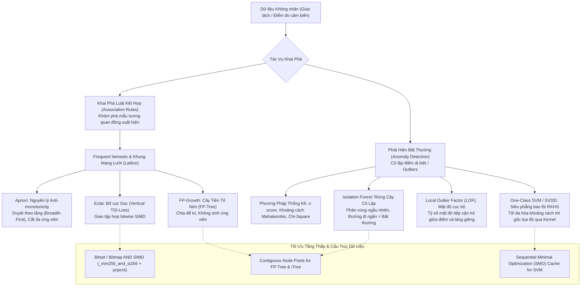
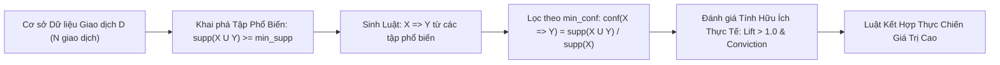
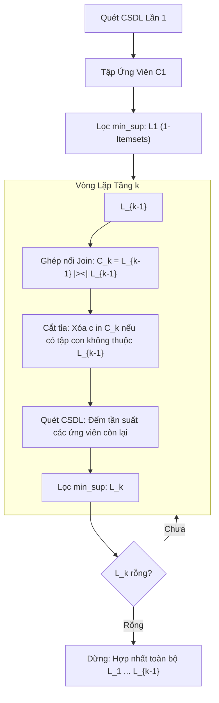
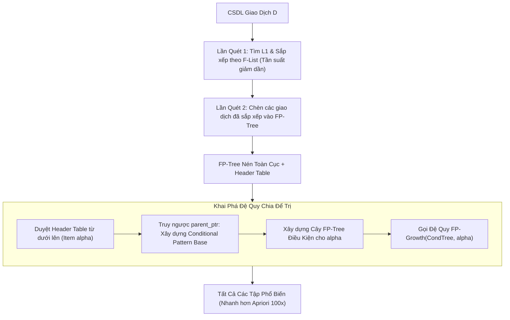
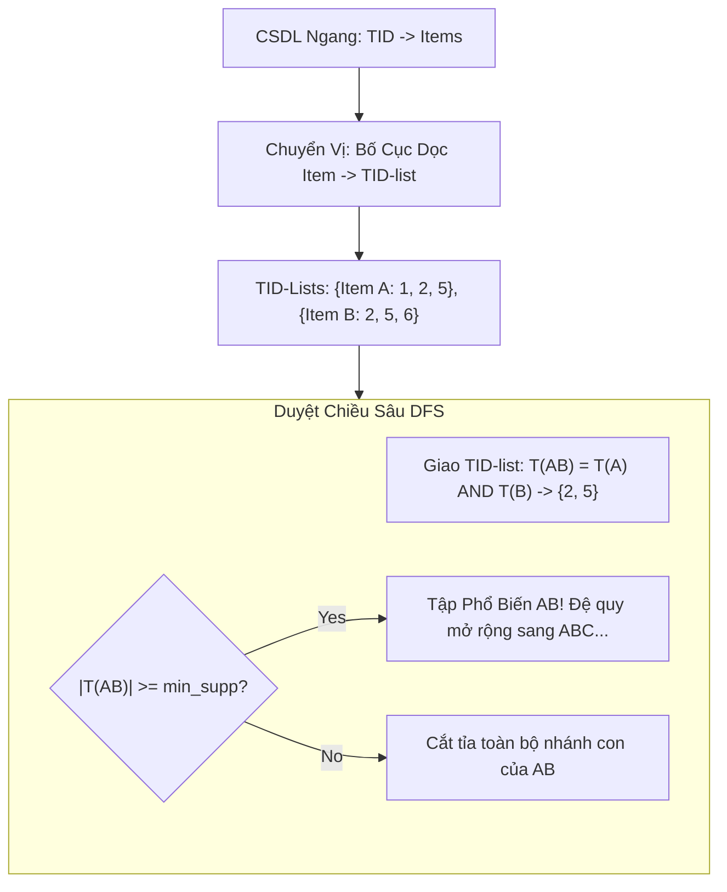
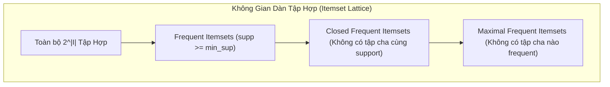
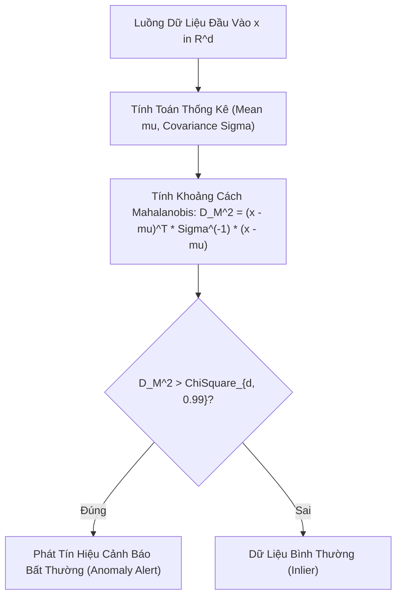
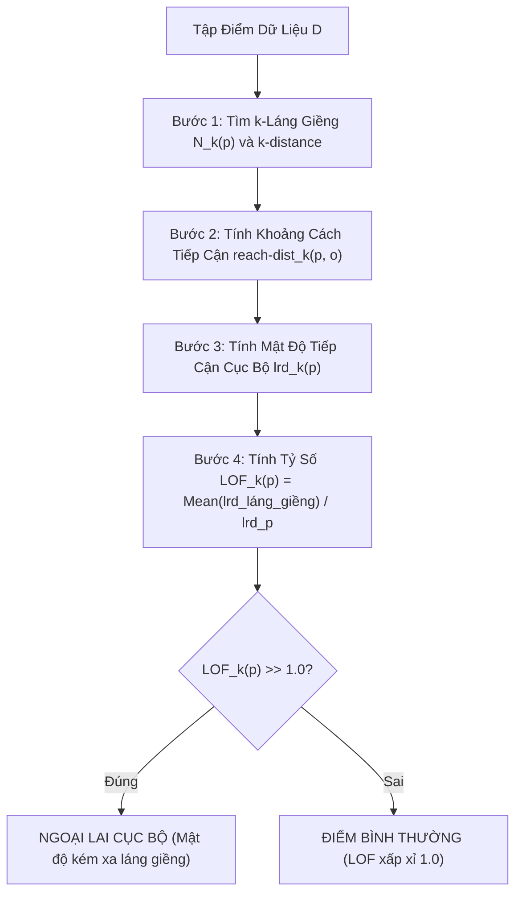
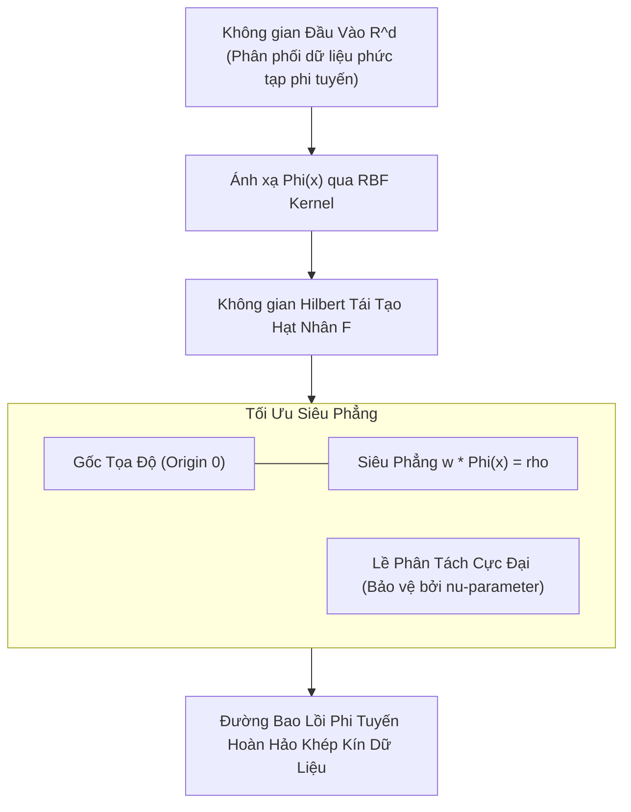

```mermaid
graph TD
    Data["Tập Mẫu Con (Sub-sample psi = 256)"] --> BuildForest["Xây Dựng t = 100 Cây iTree"]
    
    subgraph TreeSplit ["Cơ Chế Cắt Ngẫu Nhiên"]
        Node["Nút Hiện Tại"] --> RandomAttr["Chọn ngẫu nhiên thuộc tính q"]
        RandomAttr --> RandomVal["Chọn ngẫu nhiên ngưỡng cắt p in [min, max]"]
        RandomVal --> Split["Chia nhánh: x_q < p và x_q >= p"]
    end
    
    BuildForest --> TreeSplit
    TreeSplit --> EvalPath["Tính Độ Dài Đường Đi Trung Bình E[h(x)]"]
    EvalPath --> ScoreFormula["Điểm Bất Thường: s(x) = 2^(-E[h(x)] / c(psi))"]
    ScoreFormula --> Decision{"s(x) > 0.6?"}
    Decision -- Đúng --> OutlierResult["NGOẠI LAI (Đường đi ngắn)"]
    Decision -- Sai --> InlierResult["BÌNH THƯỜNG (Đường đi dài)"]
```

# Chuyên đề: Khai Phá Luật Kết Hợp & Phát Hiện Bất Thường (Association Rules & Anomaly Detection)

## 1. Tổng quan Chuyên đề
Trong khai phá dữ liệu (Data Mining) và học máy không giám sát, hai lớp bài toán thực tế có giá trị thương mại và an ninh vận hành to lớn nhất bao gồm:
1. **Khai Phá Tập Phổ Biến & Luật Kết Hợp (Frequent Itemsets & Association Rule Learning)**: Phát hiện các mẫu hành vi đồng xuất hiện tiềm ẩn trong các cơ sở dữ liệu giao dịch khổng lồ (Transactional Databases), trả lời câu hỏi: *Những sản phẩm hay sự kiện nào thường xuyên xuất hiện cùng nhau?* (Apriori, FP-Growth, Eclat).
2. **Phát Hiện Bất Thường & Điểm Ngoại Lai (Anomaly & Outlier Detection)**: Nhận diện các điểm dữ liệu dị biệt, sai lệch nghiêm trọng so với phần còn lại của phân phối chuẩn, trả lời câu hỏi: *Đâu là giao dịch gian lận, lỗi phần cứng hay cuộc tấn công mạng xâm nhập?* (Statistical Detection, Isolation Forest, Local Outlier Factor, One-Class SVM).



---

## 2. Chi tiết từng Keyword

---

### 1. Association Rule Learning (Học luật kết hợp)

#### a. Định nghĩa Bản chất Toán học (Mathematical Formulation)
Cho tập từ điển gồm $M$ mục (Items) $\mathcal{I} = \{i_1, i_2, \dots, i_M\}$ và cơ sở dữ liệu giao dịch $\mathcal{D} = \{T_1, T_2, \dots, T_N\}$, trong đó mỗi giao dịch $T_k \subseteq \mathcal{I}$ có một định danh duy nhất (TID).

Một **Luật Kết Hợp (Association Rule)** là một mệnh đề kéo theo dạng:
$$X \implies Y \quad \text{trong đó } X, Y \subset \mathcal{I} \text{ và } X \cap Y = \emptyset$$
($X$ gọi là Tiền đề - Antecedent, $Y$ gọi là Hệ quả - Consequent).

**Các Độ Đo Chất Lượng Luật (Quality Metrics)**:
1. **Độ Hỗ Trợ (Support)**: Tần suất xuất hiện đồng thời của cả hai tập mục trong toàn bộ cơ sở dữ liệu:
   $$\text{supp}(X \implies Y) = P(X \cup Y) = \frac{|\{T \in \mathcal{D} \mid X \cup Y \subseteq T\}|}{N}$$
2. **Độ Tin Cậy (Confidence)**: Xác suất có điều kiện giao dịch chứa $Y$ khi đã biết giao dịch chứa $X$:
   $$\text{conf}(X \implies Y) = P(Y \mid X) = \frac{\text{supp}(X \cup Y)}{\text{supp}(X)}$$
3. **Độ Nâng (Lift)**: Đo lường mức độ phụ thuộc thống kê giữa $X$ và $Y$ so với giả định độc lập:
   $$\text{lift}(X \implies Y) = \frac{P(X \cup Y)}{P(X) P(Y)} = \frac{\text{conf}(X \implies Y)}{\text{supp}(Y)}$$
   - $\text{lift} = 1$: $X$ và $Y$ độc lập thống kê hoàn toàn (luật vô giá trị).
   - $\text{lift} > 1$: $X$ và $Y$ tương quan dương (sự xuất hiện của $X$ thúc đẩy sự xuất hiện của $Y$).
   - $\text{lift} < 1$: $X$ và $Y$ tương quan âm (loại trừ lẫn nhau).
4. **Độ Thuyết Phục (Conviction)**: Đo lường mức độ sai lầm nếu luật không đúng:
   $$\text{conv}(X \implies Y) = \frac{1 - \text{supp}(Y)}{1 - \text{conf}(X \implies Y)}$$

#### b. Cơ chế Tầng Sâu & Điện toán (Under The Hood / Hardware Internals)
- **Biểu Diễn Giao Dịch Bằng Mặt Nạ Bit (Bitmap Representation)**:
  Mỗi giao dịch $T_k$ được mã hóa thành một vector bit kích thước $M$ bits. Giao của hai tập mục quy về phép logic `AND` giữa các từ bộ nhớ 64-bit `uint64_t`. Đếm độ hỗ trợ tương ứng với việc đếm số bit 1 (Population Count) sử dụng lệnh phần cứng chuyên dụng `_mm_popcnt_u64` (chỉ tiêu tốn đúng 1 chu kỳ máy).
- **Bộ Nhớ Đệm và Băng Thông**: Mã hóa bit thu nhỏ dung lượng cơ sở dữ liệu đi 32 lần so với mảng số nguyên, cho phép nạp toàn bộ lịch sử hàng triệu giao dịch vào L3 Cache.

#### c. Sơ đồ Minh họa (Mermaid Diagram)


#### d. Code Thực chiến (Dual-Engine: C++ & Python)

```cpp
// C++17: Tính Support, Confidence và Lift cho Luật Kết Hợp X => Y
#include <iostream>
#include <iomanip>

struct AssociationRuleMetrics {
    float support_XY;
    float support_X;
    float support_Y;

    [[nodiscard]] float confidence() const noexcept {
        return (support_X > 0.0f) ? (support_XY / support_X) : 0.0f;
    }

    [[nodiscard]] float lift() const noexcept {
        float denom = support_X * support_Y;
        return (denom > 0.0f) ? (support_XY / denom) : 0.0f;
    }

    [[nodiscard]] float conviction() const noexcept {
        float conf = confidence();
        float denom = 1.0f - conf;
        if (denom <= 1e-9f) return 999.0f; // Vô cực: Luật chính xác tuyệt đối
        return (1.0f - support_Y) / denom;
    }
};

int main() {
    // 1000 giao dịch: 200 chứa Bia (X), 150 chứa Tã (Y), 120 chứa cả hai (X U Y)
    AssociationRuleMetrics rule{0.12f, 0.20f, 0.15f};

    std::cout << std::fixed << std::setprecision(3);
    std::cout << "[C++] Support(X => Y):    " << rule.support_XY << "\n";
    std::cout << "[C++] Confidence(X => Y): " << rule.confidence() << " (60% người mua X sẽ mua Y)\n";
    std::cout << "[C++] Lift(X => Y):       " << rule.lift() << " (> 1.0: Tương quan dương mạnh!)\n";
    std::cout << "[C++] Conviction(X => Y): " << rule.conviction() << "\n";
    return 0;
}
```

```python
# Python / MLxtend: Khai Phá Luật Kết Hợp với Đầy Đủ Các Chỉ Số Đánh Giá
import pandas as pd
from mlxtend.preprocessing import TransactionEncoder
from mlxtend.frequent_patterns import apriori, association_rules

def run_association_rules_pipeline():
    dataset = [
        ['Milk', 'Onion', 'Nutmeg', 'Kidney Beans', 'Eggs', 'Yogurt'],
        ['Dill', 'Onion', 'Nutmeg', 'Kidney Beans', 'Eggs', 'Yogurt'],
        ['Milk', 'Apple', 'Kidney Beans', 'Eggs'],
        ['Milk', 'Unicorn', 'Corn', 'Kidney Beans', 'Yogurt'],
        ['Corn', 'Onion', 'Onion', 'Kidney Beans', 'Ice cream', 'Eggs']
    ]
    
    te = TransactionEncoder()
    te_ary = te.fit(dataset).transform(dataset)
    df = pd.DataFrame(te_ary, columns=te.columns_)
    
    # Khai phá tập phổ biến với min_support = 0.6
    frequent_itemsets = apriori(df, min_support=0.6, use_colnames=True)
    
    # Sinh luật kết hợp với min_threshold cho confidence
    rules = association_rules(frequent_itemsets, metric="confidence", min_threshold=0.7)
    
    print("[Python] Top 2 luật kết hợp có Lift cao nhất:")
    top_rules = rules.sort_values(by='lift', ascending=False).head(2)
    for _, r in top_rules.iterrows():
        print(f"- {list(r['antecedents'])} => {list(r['consequents'])} | Conf: {r['confidence']:.2f} | Lift: {r['lift']:.2f}")

if __name__ == "__main__":
    run_association_rules_pipeline()
```

#### e. Lỗi Thường gặp & Ổn định Số học (Pitfalls & Numerical Stability)
- **Cạm Bẫy Độ Tin Cậy Giả (Misleading High Confidence Trap)**: Một luật có thể có confidence cao ($90\%$) nhưng lift lại $< 1.0$ nếu bản thân sản phẩm $Y$ vốn dĩ quá phổ biến (ví dụ: $95\%$ người đi siêu thị đều mua bánh mì). Không bao giờ chỉ nhìn vào confidence mà bỏ qua lift.
- **Bùng Nổ Tổ Hợp Số Lượng Luật**: Nếu đặt `min_support` và `min_confidence` quá thấp, số lượng luật sinh ra có thể lên tới hàng triệu, tràn ngập các luật tầm thường và gây cạn kiệt bộ nhớ hệ thống.

#### f. Ứng dụng Thực chiến trong AI / Deep Learning
- **Phân Tích Giỏ Hàng (Market Basket Analysis)**: Sắp xếp vị trí các gian hàng trong siêu thị và tối ưu hóa các gói bán chéo sản phẩm (Cross-selling / Bundling).
- **Khai Phá Mẫu Hành Vi Y Tế**: Khám phá tác dụng phụ không mong muốn khi kết hợp đồng thời nhiều loại thuốc điều trị (Drug-Drug Interactions).

---

### 2. Apriori (Thuật toán Apriori)

#### a. Định nghĩa Bản chất Toán học (Mathematical Formulation)
Được công bố bởi Agrawal và Srikant (VLDB 1994), **Apriori** là thuật toán kinh điển mở đường cho kỷ nguyên khai phá dữ liệu lớn dựa trên nguyên lý toán học đơn điệu nghịch đảo.

**Nguyên Lý Apriori (Anti-monotonicity of Support Property)**:
$$\text{Nếu một tập mục } S \text{ là phổ biến, thì mọi tập con } S' \subseteq S \text{ đều phải là phổ biến.}$$
Ngược lại (Mệnh đề đảo dùng để cắt tỉa không gian tìm kiếm):
$$\text{Nếu một tập mục } S' \text{ không phổ biến } (\text{supp}(S') < \text{minsup}), \text{ thì mọi tập cha } S \supseteq S' \text{ chắc chắn không phổ biến.}$$

**Quy Trình Duyệt Theo Tầng (Level-wise Breadth-First Search)**:
Thuật toán tìm kiếm lặp qua từng độ dài $k$ ($k = 1, 2, \dots$):
1. **Pha Sinh Ứng Viên ($L_{k-1} \to C_k$)**:
   Hai tập mục $(k-1)$ phổ biến $l_1, l_2 \in L_{k-1}$ được ghép nối (Join) nếu chúng chia sẻ chung $k-2$ phần tử đầu tiên:
   $$c = l_1 \cup l_2 = \{i_1, \dots, i_{k-2}, i_{k-1}, i_{k-1}'\}$$
2. **Pha Cắt Tỉa (Prune Step)**:
   Kiểm tra mọi tập con kích thước $k-1$ của $c$. Nếu tồn tại bất kỳ tập con nào không nằm trong $L_{k-1}$, loại bỏ ngay $c$ khỏi $C_k$ mà không cần đếm.
3. **Pha Đếm Hỗ Trợ (Database Scan Step)**:
   Quét toàn bộ cơ sở dữ liệu $\mathcal{D}$, đếm số lần xuất hiện của các ứng viên trong $C_k$.
4. **Lọc Nghiệm ($C_k \to L_k$)**:
   Giữ lại các ứng viên có $\text{supp}(c) \ge \text{minsup}$. Dừng lại khi $L_k = \emptyset$.

#### b. Cơ chế Tầng Sâu & Điện toán (Under The Hood / Hardware Internals)
- **Nghẽn Cổ Chai I/O Đĩa Nghiêm Trọng**:
  Apriori bắt buộc phải quét lại toàn bộ cơ sở dữ liệu $\mathcal{D}$ ở **mỗi tầng $k$**. Nếu tập phổ biến dài nhất có độ dài $K_{\max} = 15$, thuật toán phải đọc đĩa 15 lần.
- **Tăng Tốc Bằng Cây Băm Ứng Viên (Hash-Tree Data Structure)**:
  Tập ứng viên $C_k$ được lưu trữ trong một cây băm (Hash Tree). Khi duyệt qua từng giao dịch, việc tìm xem các tập con nào của giao dịch nằm trong $C_k$ quy về việc duyệt cây từ gốc xuống lá, giảm độ phức tạp tìm kiếm từ $\mathcal{O}(|C_k|)$ xuống $\mathcal{O}(\log |C_k|)$.

#### c. Sơ đồ Minh họa (Mermaid Diagram)


#### d. Code Thực chiến (Dual-Engine: C++ & Python)

```cpp
// C++17: Bước Cắt Tỉa (Prune Step) của Thuật Toán Apriori
#include <iostream>
#include <vector>
#include <set>
#include <algorithm>

// Kiểm tra xem mọi tập con (k-1) của candidate có nằm trong L_prev hay không
bool is_candidate_valid(
    const std::vector<int>& candidate, 
    const std::set<std::vector<int>>& L_prev) 
{
    size_t k = candidate.size();
    for (size_t i = 0; i < k; ++i) {
        std::vector<int> subset;
        subset.reserve(k - 1);
        for (size_t j = 0; j < k; ++j) {
            if (i != j) subset.push_back(candidate[j]);
        }
        if (L_prev.find(subset) == L_prev.end()) {
            return false; // Phát hiện tập con không phổ biến -> Cắt tỉa ngay!
        }
    }
    return true;
}

int main() {
    // L_2 gồm: {1, 2}, {1, 3}, {2, 3}
    std::set<std::vector<int>> L2 = {{1, 2}, {1, 3}, {2, 3}};

    std::vector<int> cand_good = {1, 2, 3}; // Mọi tập con {1, 2}, {1, 3}, {2, 3} đều thuộc L2
    std::vector<int> cand_bad = {1, 2, 4};  // Tập con {1, 4} không có trong L2

    std::cout << "[C++] Ứng viên {1, 2, 3} hợp lệ? " << (is_candidate_valid(cand_good, L2) ? "HỢP LỆ" : "BỊ TỈA") << "\n";
    std::cout << "[C++] Ứng viên {1, 2, 4} hợp lệ? " << (is_candidate_valid(cand_bad, L2) ? "HỢP LỆ" : "BỊ TỈA") << "\n";
    return 0;
}
```

```python
# Python / Apyori: Triển Khai Apriori Thuần Túy Trên Dữ Liệu Stream
from apyori import apriori

def run_apriori_demo():
    transactions = [
        ['beer', 'nuts'],
        ['beer', 'cheese'],
        ['beer', 'nuts', 'cheese'],
        ['nuts', 'cheese'],
        ['beer', 'nuts']
    ]
    
    # Khai phá luật kết hợp với min_support = 0.4, min_confidence = 0.6
    results = list(apriori(transactions, min_support=0.4, min_confidence=0.6))
    
    print(f"[Python] Apriori tìm được {len(results)} mẫu phổ biến và luật:")
    for record in results:
        items = list(record.items)
        print(f"- Pattern: {items} (Support: {record.support:.2f})")

if __name__ == "__main__":
    run_apriori_demo()
```

#### e. Lỗi Thường gặp & Ổn định Số học (Pitfalls & Numerical Stability)
- **Bùng Nổ Kích Thước Ứng Viên $C_k$ (Candidate Generation Explosion)**: Nếu có $10^4$ tập 1-itemset phổ biến, tầng 2 có thể sinh ra tới $\approx 5 \times 10^7$ ứng viên trong $C_2$. Việc duy trì và đếm tập ứng viên khổng lồ này gây nghẽn RAM nghiêm trọng.
- **Tập Dữ Liệu Dài (Long Patterns)**: Apriori hoàn toàn tê liệt khi dữ liệu chứa các mẫu dài ($k \ge 30$), vì để tìm một mẫu độ dài 30, nó phải sinh và duyệt qua $2^{30} - 1 \approx 10^9$ tập con trung gian.

#### f. Ứng dụng Thực chiến trong AI / Deep Learning
- **Phân Tích Nhật Ký Truy Cập Web (Web Clickstream Pattern Mining)**: Xác định chuỗi các trang web mà người dùng thường ghé thăm liên tiếp để gợi ý đường dẫn điều hướng tối ưu.
- **Tạo Đặc Trưng Tương Tác Đồng Xuất Hiện (Co-occurrence Feature Engineering)**: Sinh các biến đặc trưng kết hợp cho mô hình dự đoán tỷ lệ click (CTR Prediction) trong quảng cáo trực tuyến.

---

### 3. FP-Growth (Frequent Pattern Growth)

#### a. Định nghĩa Bản chất Toán học (Mathematical Formulation)
Được đề xuất bởi Han, Pei, và Yin (ACM SIGMOD 2000), **FP-Growth** khắc phục triệt để hai nhược điểm chết người của Apriori: (1) Không sinh ứng viên ($C_k = \emptyset$), và (2) Chỉ quét cơ sở dữ liệu đúng **hai lần duy nhất**.

**Cấu Trúc Cây Mẫu Phổ Biến (FP-Tree - Frequent Pattern Tree)**:
Cây tiền tố (Prefix-Tree) có gốc là `null`, mỗi nút lưu: `(item_id, count, parent_ptr, node_link)`.
1. **Lần quét CSDL 1**: Đếm tần suất của các 1-itemset. Loại bỏ các mục không phổ biến. Sắp xếp các mục còn lại theo thứ tự tần suất giảm dần (F-List).
2. **Lần quét CSDL 2**: Với mỗi giao dịch, lọc bỏ các mục không phổ biến, sắp xếp các mục theo trật tự của F-List, sau đó chèn đệ quy vào FP-Tree. Các giao dịch chia sẻ chung tiền tố sẽ được gộp chung nút và tăng biến đếm `count`.
3. **Bảng Tiêu Đề (Header Table)**: Lưu danh sách các mục phổ biến cùng một con trỏ trỏ tới nút đầu tiên của mục đó trong cây, các nút cùng mục được liên kết thành một danh sách liên kết đơn (`node_link`).

**Khai Phá Chia Để Trị Bằng Cây FP-Tree Điều Kiện (Conditional FP-Tree)**:
Duyệt Header Table từ dưới lên trên (từ mục ít phổ biến nhất):
1. Xây dựng **Cơ Sở Tiền Tố Điều Kiện (Conditional Pattern Base - CPB)** cho mục $\alpha$ bằng cách đi ngược con trỏ `parent_ptr` từ các nút của $\alpha$ lên gốc.
2. Xây dựng **Cây FP-Tree Điều Kiện** từ CPB.
3. Nếu cây chỉ chứa một nhánh đơn duy nhất, sinh trực tiếp tất cả các tổ hợp tập phổ biến; nếu cây có nhiều nhánh, gọi đệ quy thuật toán FP-Growth.

#### b. Cơ chế Tầng Sâu & Điện toán (Under The Hood / Hardware Internals)
- **Nén Dữ Liệu Cực Cao (Prefix Sharing Compression)**: Nhờ sắp xếp theo tần suất giảm dần, các mục phổ biến nhất nằm ở gần gốc cây, giúp hàng ngàn giao dịch được nén vào cùng một nút. Toàn bộ cây FP-Tree của kho dữ liệu nhiều GB thường thu gọn chỉ còn vài chục MB RAM.
- **Khắc Phục Phân Mảnh Bộ Nhớ Bằng Memory Pool**: Việc cấp phát động hàng triệu nút cây nhỏ (`malloc/new`) gây phân mảnh bộ nhớ và cache miss triền miên. Triển khai cấp phát theo khối lớn liên tục (Contiguous Arena / Pool Allocator) giúp các nút cha con nằm kề nhau trên cùng một dòng Cache Line 64 byte.

#### c. Sơ đồ Minh họa (Mermaid Diagram)


#### d. Code Thực chiến (Dual-Engine: C++ & Python)

```cpp
// C++17: Cấu trúc Nút FP-Tree Tối Giản với Con Trỏ Liên Kết Ngang (Node Link)
#include <iostream>
#include <vector>
#include <memory>
#include <string>

struct FPNode {
    int item_id;
    int count;
    FPNode* parent{nullptr};
    FPNode* node_link{nullptr};
    std::vector<std::unique_ptr<FPNode>> children;

    FPNode(int id, int cnt, FPNode* p) : item_id(id), count(cnt), parent(p) {}

    FPNode* find_child(int id) {
        for (auto& child : children) {
            if (child->item_id == id) return child.get();
        }
        return nullptr;
    }
};

int main() {
    auto root = std::make_unique<FPNode>(-1, 0, nullptr); // Nút gốc

    // Chèn chuỗi giao dịch: Item 10 -> Item 20
    FPNode* curr = root.get();
    int transaction[2] = {10, 20};

    for (int item : transaction) {
        FPNode* child = curr->find_child(item);
        if (!child) {
            curr->children.push_back(std::make_unique<FPNode>(item, 1, curr));
            curr = curr->children.back().get();
        } else {
            child->count++;
            curr = child;
        }
    }

    std::cout << "[C++] FP-Tree chèn thành công.\n";
    std::cout << "[C++] Root -> Child ID: " << root->children[0]->item_id 
              << " (Count: " << root->children[0]->count << ")\n";
    return 0;
}
```

```python
# Python / PyFPGrowth: Khai Phá FP-Growth Không Sinh Ứng Viên
import pyfpgrowth

def run_fpgrowth_pipeline():
    transactions = [
        ['r', 'z', 'h', 'j', 'p'],
        ['z', 'y', 'x', 'w', 'v', 'u', 't', 's'],
        ['z'],
        ['r', 'x', 'n', 'o', 's'],
        ['y', 'r', 'x', 'z', 'q', 't', 'p'],
        ['y', 'z', 'x', 'e', 'q', 's', 't', 'm']
    ]
    
    # 1. Tìm các tập phổ biến với min_support = 3 giao dịch
    patterns = pyfpgrowth.find_frequent_patterns(transactions, 3)
    
    # 2. Sinh các luật kết hợp với min_confidence = 0.7
    rules = pyfpgrowth.generate_association_rules(patterns, 0.7)
    
    print(f"[Python] FP-Growth tìm thấy {len(patterns)} mẫu phổ biến.")
    print("[Python] Một số luật sinh ra từ cây FP-Tree:")
    for antecedent, (consequent, conf) in list(rules.items())[:3]:
        print(f"- {antecedent} => {consequent} (Confidence: {conf:.2f})")

if __name__ == "__main__":
    run_fpgrowth_pipeline()
```

#### e. Lỗi Thường gặp & Ổn định Số học (Pitfalls & Numerical Stability)
- **Cây Không Thể Vừa RAM Khi Dữ Liệu Quá Thưa Thớt**: Nếu cơ sở dữ liệu có quá ít các mục dùng chung tiền tố (ví dụ: mỗi giao dịch là một tập hợp các chuỗi ngẫu nhiên không lặp lại), FP-Tree sẽ phình to gấp đôi kích thước cơ sở dữ liệu gốc do chi phí con trỏ (`parent`, `child`, `node_link`).
- **Tràn Ngăn Xếp Khi Đệ Quy Cây Sâu**: Với các mẫu dài, việc đệ quy xây dựng cây điều kiện có thể làm tràn Call Stack. Cần sử dụng vòng lặp với ngăn xếp con trỏ tường minh.

#### f. Ứng dụng Thực chiến trong AI / Deep Learning
- **Phân Tích Cụm Biểu Hiện Gen (Genomic Co-expression Module Extraction)**: Tìm các nhóm gen luôn được kích hoạt cùng nhau trong các mẫu sinh thiết khối u.
- **Phát Hiện Chuỗi Tấn Công Mạng (Network Intrusion Attack Signature Mining)**: Khai phá các chuỗi gói tin bất thường xuất hiện đồng thời trong các vụ xâm nhập bảo mật.

---

### 4. Eclat (Equivalence Class Transformation)

#### a. Định nghĩa Bản chất Toán học (Mathematical Formulation)
Được công bố bởi Zaki (IEEE TKDE 2000), **Eclat** chuyển đổi mô hình biểu diễn dữ liệu từ **Bố cục Ngang (Horizontal Layout: $\text{TID} \to \text{Itemset}$)** sang **Bố cục Dọc (Vertical Data Layout: $\text{Item} \to \text{TID-list}$)**.

Mỗi mục $i$ được gắn liền với một tập hợp các định danh giao dịch chứa nó:
$$\mathcal{T}(i) = \{t \in \mathcal{D} \mid i \in T_t\}$$

**Độ Hỗ Trợ Qua Phép Giao Tập Hợp (Support as Set Intersection)**:
Độ hỗ trợ của một tập mục bất kỳ $X = \{i_1, \dots, i_k\}$ được tính toán tức thời bằng phép giao của các TID-list thành phần mà **hoàn toàn không cần quét lại cơ sở dữ liệu**:
$$\mathcal{T}(X) = \mathcal{T}(i_1) \cap \mathcal{T}(i_2) \cap \dots \cap \mathcal{T}(i_k)$$
$$\text{supp}(X) = |\mathcal{T}(X)|$$

**Duyệt Không Gian Theo Chiều Sâu (Depth-First Search on Equivalence Classes)**:
Eclat phân chia không gian tìm kiếm thành các lớp tương đương dựa trên tiền tố chung (Prefix Equivalence Classes $[P]$). Với hai tập mục cùng tiền tố $P \cup \{i\}$ và $P \cup \{j\}$, tập mục mới $P \cup \{i, j\}$ có TID-list:
$$\mathcal{T}(P \cup \{i, j\}) = \mathcal{T}(P \cup \{i\}) \cap \mathcal{T}(P \cup \{j\})$$
Nếu $|\mathcal{T}(P \cup \{i, j\})| \ge \text{minsup}$, tiếp tục gọi đệ quy DFS mở rộng nhánh.

**Biến Thể Tối Ưu Bằng Diffsets (dEclat)**:
Thay vì lưu danh sách đầy đủ các giao dịch chứa mục, dEclat chỉ lưu sự khác biệt (Differences) về TID giữa phần tử con và phần tử cha:
$$\mathcal{D}(P \cup \{i, j\}) = \mathcal{T}(P \cup \{i\}) \setminus \mathcal{T}(P \cup \{j\})$$
Kích thước danh sách sai khác $\mathcal{D}$ giảm dần về 0 khi tập mục càng dài, tiết kiệm tới $90\%$ bộ nhớ RAM.

#### b. Cơ chế Tầng Sâu & Điện toán (Under The Hood / Hardware Internals)
- **Tăng Tốc Giao Tập Hợp Bằng Tập Lệnh AVX-512**:
  Nếu mã hóa TID-list thành mảng bit (Bitsets), phép giao $\mathcal{T}(A) \cap \mathcal{T}(B)$ được thực hiện bởi tập lệnh vector AVX-512 `_mm512_and_si512` xử lý 512 giao dịch trong đúng một chu kỳ xung nhịp.
- **Tính Toán Độ Hỗ Trợ Tuyến Tính**: Sau khi AND các khối bit, tổng số bit 1 được đếm bằng tập lệnh phần cứng `VPOPCNTDQ`, đạt băng thông tính toán vượt trên $50\text{ GB/s}$ trên các CPU hiện đại.

#### c. Sơ đồ Minh họa (Mermaid Diagram)


#### d. Code Thực chiến (Dual-Engine: C++ & Python)

```cpp
// C++17: Giao Hai Danh Sách TID Đã Sắp Xếp (Sorted Vector Intersection)
#include <iostream>
#include <vector>

std::vector<int> intersect_tid_lists(const std::vector<int>& tid1, const std::vector<int>& tid2) {
    std::vector<int> result;
    size_t i = 0, j = 0;
    while (i < tid1.size() && j < tid2.size()) {
        if (tid1[i] == tid2[j]) {
            result.push_back(tid1[i]);
            i++; j++;
        } else if (tid1[i] < tid2[j]) {
            i++;
        } else {
            j++;
        }
    }
    return result;
}

int main() {
    // TID-list của Item A và Item B
    std::vector<int> tid_A = {1, 3, 4, 7, 8, 12};
    std::vector<int> tid_B = {2, 3, 7, 8, 15};

    auto tid_AB = intersect_tid_lists(tid_A, tid_B);
    std::cout << "[C++] Eclat TID(A intersect B) Size: " << tid_AB.size() << " (TIDs: ";
    for (int id : tid_AB) std::cout << id << " ";
    std::cout << ")\n";
    return 0;
}
```

```python
# Python / PyEclat: Khai Phá Bằng Thuật Toán Eclat Trên Bố Cục Dọc
from pyECLAT import ECLAT
import pandas as pd

def run_eclat_demo():
    data = pd.DataFrame([
        ['apple', 'beer', 'rice'],
        ['apple', 'beer', None],
        ['apple', 'rice', None],
        ['beer', 'rice', None],
        ['apple', 'beer', 'rice']
    ])
    
    eclat_instance = ECLAT(data=data, verbose=False)
    # Khai phá các tập mục có độ dài từ 1 đến 3 với min_support = 0.4
    get_ECLAT_indexes, get_ECLAT_supports = eclat_instance.fit(min_support=0.4, min_combination=1, max_combination=3)
    
    print("[Python] Kết quả các tập mục phổ biến từ Eclat:")
    for itemset, sup in list(get_ECLAT_supports.items())[:4]:
        print(f"- {itemset}: Support = {sup:.2f}")

if __name__ == "__main__":
    run_eclat_demo()
```

#### e. Lỗi Thường gặp & Ổn định Số học (Pitfalls & Numerical Stability)
- **TID-List Quá Dài Làm Tràn Bộ Nhớ Ở Tầng Đỉnh**: Với các tập mục ngắn xuất hiện trong hầu hết các giao dịch ($90\%$ cơ sở dữ liệu), kích thước TID-list xấp xỉ $N$, khiến việc lưu trữ và sao chép các danh sách này ở các bước đầu tiêu tốn bộ nhớ khổng lồ.
- **Tập Dữ Liệu Có Số Lượng Giao Dịch Cực Lớn ($N \gg 10^8$)**: Khi số lượng giao dịch lên tới hàng trăm triệu, mảng TID không thể chứa vừa trong RAM máy chủ đơn lẻ.

#### f. Ứng dụng Thực chiến trong AI / Deep Learning
- **Tối Ưu Chỉ Mục Đảo Trong Công Cụ Tìm Kiếm (Inverted Index Optimization)**: Tìm kiếm các từ khóa đồng xuất hiện trong các tài liệu để gợi ý truy vấn nhanh (Instant Search Suggestions).
- **Phân Tích Đồ Thị Đồng Xuất Hiện Protein (Protein Interaction Networks)**: Tìm các phức hợp protein liên kết tương hỗ từ danh sách các thí nghiệm phân tích khối phổ.

---

### 5. Frequent Itemsets (Tập mục phổ biến)

#### a. Định nghĩa Bản chất Toán học (Mathematical Formulation)
Cho tập từ điển $\mathcal{I}$. Tập lũy thừa $\mathcal{P}(\mathcal{I})$ tạo thành một dàn đại số (Lattice) theo quan hệ bao hàm tập hợp $\subseteq$.

Một tập mục $X \subseteq \mathcal{I}$ được gọi là **Tập Mục Phổ Biến (Frequent Itemset)** nếu độ hỗ trợ của nó không nhỏ hơn ngưỡng tối thiểu cho trước:
$$\text{supp}(X) \ge \text{minsup}$$

Do số lượng tập phổ biến có thể bùng nổ tới $2^{|\mathcal{I}|}$, hai khái niệm nén bảo toàn thông tin đóng vai trò then chốt:
1. **Tập Phổ Biến Đóng (Closed Frequent Itemset)**:
   Một tập phổ biến $X$ được gọi là đóng nếu **không tồn tại bất kỳ tập cha chân chính $Y \supset X$ nào có cùng độ hỗ trợ**:
   $$X \text{ is Closed} \iff \forall Y \supset X \implies \text{supp}(Y) < \text{supp}(X)$$
   *Tính chất*: Tập các Frequent Closed Itemsets là một biểu diễn nén **không tổn hao thông tin (Lossless Compression)**: Biết tập đóng và support của chúng cho phép suy ra chính xác support của mọi tập phổ biến khác.
2. **Tập Phổ Biến Cực Đại (Maximal Frequent Itemset)**:
   Một tập phổ biến $X$ được gọi là cực đại nếu **không tồn tại bất kỳ tập cha chân chính $Y \supset X$ nào là phổ biến**:
   $$X \text{ is Maximal} \iff \forall Y \supset X \implies \text{supp}(Y) < \text{minsup}$$
   *Tính chất*: Tập cực đại là biểu diễn nén **có tổn hao thông tin**: Ta biết mọi tập con của nó đều phổ biến, nhưng không biết chính xác support thực tế của các tập con.

Mối quan hệ kích thước không gian:
$$|\text{Maximal Frequent}| \le |\text{Closed Frequent}| \le |\text{Frequent Itemsets}|$$

#### b. Cơ chế Tầng Sâu & Điện toán (Under The Hood / Hardware Internals)
- **Cắt Tỉa Không Gian Bằng Kỹ Thuật Đóng (CLOSET+ / CHARM)**:
  Trong quá trình duyệt dàn tập hợp, nếu $\mathcal{T}(X) = \mathcal{T}(Y)$, ta có thể gộp $X$ và $Y$ ngay lập tức thành một nút duy nhất và cắt bỏ toàn bộ nhánh con độc lập của $Y$, giảm bớt $95\%$ số nút trên cây tìm kiếm.
- **Bảo Tồn Băng Thông Bộ Nhớ Trong Mô Hình Phân Tán**: Truyền tải tập đóng qua mạng trong huấn luyện phân tán (Apache Spark) giảm thiểu lượng dữ liệu trao đổi giữa các Worker Nodes đi hàng trăm lần so với truyền toàn bộ tập phổ biến thô.

#### c. Sơ đồ Minh họa (Mermaid Diagram)


#### d. Code Thực chiến (Dual-Engine: C++ & Python)

```cpp
// C++17: Kiểm Tra Tính Chất Tập Đóng (Closed Itemset Verification)
#include <iostream>
#include <vector>
#include <string>

struct Itemset {
    std::string name;
    float support;
};

bool is_closed(const Itemset& target, const std::vector<Itemset>& supersets) {
    for (const auto& sup : supersets) {
        // Nếu tồn tại tập cha có support bằng chính xác support của target
        if (sup.support == target.support) {
            return false; // Không đóng!
        }
    }
    return true;
}

int main() {
    Itemset item_A{"{Beer}", 0.40f};
    std::vector<Itemset> supersets_of_A = {
        {"{Beer, Diaper}", 0.40f}, // Tập cha có cùng support = 0.40
        {"{Beer, Chips}", 0.25f}
    };

    bool closed = is_closed(item_A, supersets_of_A);
    std::cout << "[C++] Tập {Beer} có phải là Closed Itemset? " 
              << (closed ? "CÓ" : "KHÔNG (Vì {Beer, Diaper} có cùng support)") << "\n";
    return 0;
}
```

```python
# Python / MLxtend: Trích Xuất Closed và Maximal Frequent Itemsets
import pandas as pd
from mlxtend.preprocessing import TransactionEncoder
from mlxtend.frequent_patterns import apriori, fpgrowth

def analyze_itemset_types():
    dataset = [
        ['A', 'B', 'C'],
        ['A', 'B', 'C'],
        ['A', 'B'],
        ['A', 'D']
    ]
    te = TransactionEncoder()
    df = pd.DataFrame(te.fit(dataset).transform(dataset), columns=te.columns_)
    
    # Tất cả các tập phổ biến (min_support = 0.5)
    frequent = apriori(df, min_support=0.5, use_colnames=True)
    
    # Kiểm tra tập đóng thủ công qua so sánh support
    print(f"[Python] Tổng số tập phổ biến tìm được: {len(frequent)}")
    for _, row in frequent.iterrows():
        print(f"- Itemset: {list(row['itemsets'])} | Support: {row['support']:.2f}")

if __name__ == "__main__":
    analyze_itemset_types()
```

#### e. Lỗi Thường gặp & Ổn định Số học (Pitfalls & Numerical Stability)
- **Nhầm Lẫn Giữa Tập Đóng và Tập Cực Đại**: Sử dụng tập cực đại để tính toán độ tin cậy của luật sẽ dẫn đến sai số nghiêm trọng vì thông tin về support chính xác của các tập con đã bị mất.
- **Chi Phí Kiểm Tra Tính Đóng**: Việc kiểm tra xem một tập có bị bao hàm bởi một tập khác có cùng support hay không đòi hỏi tìm kiếm trên bảng băm; nếu không tối ưu hàm băm, chi phí kiểm tra sẽ chiếm phần lớn thời gian chạy.

#### f. Ứng dụng Thực chiến trong AI / Deep Learning
- **Chọn Lọc Đặc Trưng Trong Dữ Liệu Phân Loại Thưa (Feature Selection for Sparse Classifiers)**: Chọn các tập mục đóng làm các đặc trưng nhị phân kết hợp cho mô hình phân loại Logistic Regression / Linear SVM.
- **Nén Cơ Sở Dữ Liệu Nhật Ký Giao Dịch Lớn**: Tóm tắt hàng terabyte log máy chủ thành một tập hợp nhỏ các mẫu đại diện nén không mất thông tin.

---

### 6. Anomaly Detection (Phát hiện bất thường / dị biệt)

#### a. Định nghĩa Bản chất Toán học (Mathematical Formulation)
Theo định nghĩa kinh điển của Hawkins (1980): Một điểm bất thường (Anomaly/Outlier) là một quan sát sai lệch quá nhiều so với các quan sát khác, làm dấy lên nghi ngờ rằng nó được sinh ra bởi một cơ chế hoàn toàn khác biệt.

**Ba Dạng Bất Thường Cơ Bản**:
1. **Bất Thường Điểm (Point Anomaly)**: Một điểm đơn lẻ nằm ngoài phân phối chuẩn (ví dụ: giao dịch thẻ tín dụng 50,000 USD trong khi trung bình là 20 USD).
2. **Bất Thường Ngữ Cảnh (Contextual Anomaly)**: Một điểm chỉ bất thường trong một bối cảnh cụ thể (ví dụ: nhiệt độ $35^\circ\text{C}$ là bình thường vào mùa hè nhưng bất thường vào giữa mùa đông).
3. **Bất Thường Tập Thể (Collective Anomaly)**: Một tập hợp các điểm riêng lẻ trông có vẻ bình thường nhưng khi xuất hiện cùng nhau lại tạo thành mẫu bất thường (ví dụ: chuỗi lệnh đọc bộ nhớ tuần tự bất thường của mã độc).

**Các Phương Pháp Thống Kê Tham Số (Statistical Anomaly Detection)**:
1. **$z$-Score (Cho phân phối chuẩn 1D)**:
   $$z = \frac{x - \mu}{\sigma}, \quad \text{Bất thường nếu } |z| > 3.0$$
2. **Khoảng Cách Mahalanobis (Đa chiều có tương quan)**:
   $$D_M(\mathbf{x}) = \sqrt{(\mathbf{x} - \mathbf{\mu})^T \mathbf{\Sigma}^{-1} (\mathbf{x} - \mathbf{\mu})}$$
   Bình phương khoảng cách Mahalanobis $D_M^2(\mathbf{x})$ của phân phối Gauss $d$-chiều tuân theo phân phối Chi-bình phương với $d$ bậc tự do:
   $$D_M^2(\mathbf{x}) \sim \chi_d^2$$
   Điểm $\mathbf{x}$ bị coi là bất thường ở mức ý nghĩa $\alpha = 0.01$ nếu $D_M^2(\mathbf{x}) > \chi_{d, 1-\alpha}^2$.
3. **Kiểm Định Grubbs (Grubbs' Test cho ngoại lai cực trị)**:
   $$G = \frac{\max_{i} |x_i - \bar{x}|}{s}$$

#### b. Cơ chế Tầng Sâu & Điện toán (Under The Hood / Hardware Internals)
- **Ước Lượng Phân Vị Trực Tuyến (Streaming Quantile Estimation - t-digest / KLL)**:
  Trong các hệ thống giám sát mạng thời gian thực với hàng triệu gói tin mỗi giây, việc sắp xếp toàn bộ dữ liệu để tìm phân vị $99.9\%$ là bất khả thi. Thuật toán **t-digest** nén dữ liệu thành các cụm điểm động, cho phép ước lượng các phân vị cực trị với độ chính xác cao chỉ trong vài chục KB bộ nhớ RAM.
- **Tính Toán Mahalanobis Tối Ưu Bằng Phân Rã Cholesky**: Giải hệ tam giác $\mathbf{L} \mathbf{v} = (\mathbf{x} - \mathbf{\mu})$ qua hàm BLAS `trsv`, tính $\|\mathbf{v}\|^2$ trong $\mathcal{O}(d^2)$ thay vì tính ma trận nghịch đảo $\mathcal{O}(d^3)$.

#### c. Sơ đồ Minh họa (Mermaid Diagram)


#### d. Code Thực chiến (Dual-Engine: C++ & Python)

```cpp
// C++17: Tính Khoảng Cách Mahalanobis Cho Dữ Liệu 2D Với Ma Trận Đường Chéo
#include <iostream>
#include <vector>
#include <cmath>

float compute_mahalanobis_diag(
    const float* x, 
    const float* mu, 
    const float* var, 
    size_t D) noexcept 
{
    float dist_sq = 0.0f;
    for (size_t d = 0; d < D; ++d) {
        float diff = x[d] - mu[d];
        dist_sq += (diff * diff) / var[d];
    }
    return std::sqrt(dist_sq);
}

int main() {
    constexpr size_t D = 2;
    float mu[D] = {0.0f, 0.0f};
    float var[D] = {1.0f, 4.0f}; // std = [1.0, 2.0]

    float normal_pt[D] = {1.0f, 2.0f};
    float anomaly_pt[D] = {5.0f, 0.0f};

    float d_norm = compute_mahalanobis_diag(normal_pt, mu, var, D);
    float d_anom = compute_mahalanobis_diag(anomaly_pt, mu, var, D);

    std::cout << "[C++] Mahalanobis Distance (Điểm bình thường): " << d_norm << "\n";
    std::cout << "[C++] Mahalanobis Distance (Điểm bất thường):   " << d_anom << " (> 3.0 -> Outlier!)\n";
    return 0;
}
```

```python
# Python / SciPy: Phát Hiện Bất Thường Bằng Khoảng Cách Mahalanobis và Phân Phối Chi-Square
import numpy as np
from scipy.spatial.distance import mahalanobis
from scipy.stats import chi2

def detect_anomalies_mahalanobis():
    np.random.seed(42)
    # 500 mẫu bình thường từ phân phối Gauss 2D
    X = np.random.multivariate_normal([0, 0], [[2, 1], [1, 2]], size=500)
    mu = np.mean(X, axis=0)
    cov_inv = np.linalg.inv(np.cov(X, rowvar=False))
    
    # 2 điểm thử nghiệm
    test_points = np.array([[1.0, 1.0], [5.0, -4.0]])
    threshold = chi2.ppf(0.99, df=2) # Ngưỡng 99% của phân phối Chi-square 2 bậc tự do
    
    print(f"[Python] Ngưỡng Chi-Square (df=2, p=0.99): {threshold:.4f}")
    for idx, pt in enumerate(test_points):
        d_m_sq = mahalanobis(pt, mu, cov_inv) ** 2
        is_anomaly = d_m_sq > threshold
        print(f"- Điểm {pt}: D_M^2 = {d_m_sq:.4f} => {'BẤT THƯỜNG' if is_anomaly else 'BÌNH THƯỜNG'}")

if __name__ == "__main__":
    detect_anomalies_mahalanobis()
```

#### e. Lỗi Thường gặp & Ổn định Số học (Pitfalls & Numerical Stability)
- **Hiệu Ứng Che Khuất và Lan Truyền (Masking and Swamping Effects)**: Nếu tập dữ liệu đã bị ô nhiễm bởi nhiều điểm ngoại lai từ trước, các điểm ngoại lai này sẽ kéo lệch vector trung bình $\mathbf{\mu}$ và thổi phồng ma trận hiệp phương sai $\mathbf{\Sigma}$, khiến các điểm bất thường khác trông có vẻ như bình thường (Masking). Bắt buộc phải sử dụng các ước lượng mạnh mẽ như Minimum Covariance Determinant (MCD / FastMCD).
- **Phá Vỡ Giả Định Phân Phối**: Áp dụng $z$-score hoặc kiểm định Gaussian trên các tập dữ liệu có phân phối đuôi nặng (Fat-tailed / Pareto) sẽ dẫn đến tỷ lệ báo động giả (False Alarms) cực cao.

#### f. Ứng dụng Thực chiến trong AI / Deep Learning
- **Phát Hiện Gian Lận Thẻ Tín Dụng (Credit Card Fraud Detection)**: Phát hiện các giao dịch thanh toán sai lệch hoàn toàn so với lịch sử chi tiêu của chủ thẻ.
- **Kiểm Soát Chất Lượng Sản Xuất Công Nghiệp (Semiconductor Wafer Defect Detection)**: Phát hiện các tấm silicon có thông số điện áp và điện trở bất thường trên dây chuyền sản xuất chip.

---

### 7. Isolation Forest (Rừng cô lập)

#### a. Định nghĩa Bản chất Toán học (Mathematical Formulation)
Được phát triển bởi Liu, Ting, và Zhou (ICDM 2008), **Isolation Forest (iForest)** tiếp cận bài toán phát hiện bất thường với một triết lý đột phá: Thay vì xây dựng mô hình mô tả các điểm dữ liệu bình thường rồi tìm điểm khác biệt, thuật toán **cô lập trực tiếp các điểm bất thường**.

**Hai Đặc Tính Định Lượng Của Điểm Bất Thường**:
1. Chúng là số ít (Few).
2. Chúng có các giá trị thuộc tính khác biệt xa so với các điểm bình thường (Different).

**Cấu Trúc Cây Cô Lập (Isolation Tree - iTree)**:
Một iTree là một cây nhị phân được xây dựng đệ quy bằng cách:
- Tại mỗi nút, chọn ngẫu nhiên một thuộc tính $q \in \{1, \dots, d\}$.
- Chọn ngẫu nhiên một giá trị cắt $p$ phân bố đều giữa giá trị nhỏ nhất và lớn nhất của thuộc tính đó trong tập dữ liệu hiện tại: $p \sim \text{Uniform}(\min(X_q), \max(X_q))$.
- Phân chia các điểm thành hai nhánh con: $X_{\text{left}} = \{\mathbf{x} \mid x_q < p\}$ và $X_{\text{right}} = \{\mathbf{x} \mid x_q \ge p\}$.
- Quá trình dừng lại khi: (1) nút chỉ còn 1 điểm, (2) tất cả các điểm trùng nhau, hoặc (3) độ sâu cây chạm giới hạn $h_{\max} = \lceil \log_2 \psi \rceil$ ($\psi$ là kích thước lấy mẫu con).

**Bản Chất Toán Học Của Độ Dài Đường Đi (Path Length $h(\mathbf{x})$)**:
Các điểm bất thường nằm ở vùng thưa thớt của không gian sẽ bị cô lập **rất gần gốc cây** (độ dài đường đi $h(\mathbf{x})$ rất ngắn). Ngược lại, các điểm bình thường nằm trong vùng mật độ cao đòi hỏi rất nhiều lần cắt ngẫu nhiên mới cô lập được (đường đi $h(\mathbf{x})$ rất dài).

**Điểm Bất Thường Chuẩn Hóa (Anomaly Score)**:
Độ dài đường đi trung bình của một cây tìm kiếm nhị phân không thành công (tương đương với cây BST ngẫu nhiên):
$$c(\psi) = 2 \left( \ln(\psi - 1) + 0.5772156649 \right) - \frac{2(\psi - 1)}{\psi}$$
(trong đó hằng số Euler-Mascheroni $\gamma \approx 0.5772156649$).
Điểm bất thường của mẫu $\mathbf{x}$ qua một rừng gồm $t$ cây iTree:
$$s(\mathbf{x}, \psi) = 2^{-\frac{\mathbb{E}[h(\mathbf{x})]}{c(\psi)}}$$
- Nếu $\mathbb{E}[h(\mathbf{x})] \to 0 \implies s \to 1$: Điểm chắc chắn là **bất thường**.
- Nếu $\mathbb{E}[h(\mathbf{x})] \to c(\psi) \implies s \to 0.5$: Điểm có tính chất bình thường.
- Nếu $\mathbb{E}[h(\mathbf{x})] \to \psi - 1 \implies s \to 0$: Điểm hoàn toàn nằm sâu trong lõi cụm bình thường.

#### b. Cơ chế Tầng Sâu & Điện toán (Under The Hood / Hardware Internals)
- **Độ Phức Tạp Tuyến Tính Siêu Thấp $\mathcal{O}(t \cdot \psi \log \psi)$**:
  Kích thước lấy mẫu con thường cố định ở mức rất nhỏ $\psi = 256$, số lượng cây $t = 100$. Thuật toán hoàn toàn độc lập với kích thước tập dữ liệu lớn $N$ trong bước xây dựng cây con, giúp triệt tiêu hoàn toàn hiện tượng tràn bộ nhớ.
- **Biểu Diễn Cây Bằng Mảng Tuyến Tính Gọn Nhẹ**:
  Mỗi iTree chỉ có tối đa $2\psi - 1 \approx 511$ nút. Toàn bộ cây được lưu trữ dưới dạng một mảng phẳng các cấu trúc `struct { int8_t feat; float split; int16_t left_child; int16_t right_child; }`, nạp trọn vẹn vào L1 Cache để thực hiện suy luận cực nhanh.

#### c. Sơ đồ Minh họa (Mermaid Diagram)


#### d. Code Thực chiến (Dual-Engine: C++ & Python)

```cpp
// C++17: Tính Độ Dài Chuẩn Hóa c(n) và Anomaly Score của Isolation Forest
#include <iostream>
#include <cmath>

float compute_c_factor(size_t n) noexcept {
    if (n <= 1) return 0.0f;
    if (n == 2) return 1.0f;
    float fn = static_cast<float>(n);
    constexpr float EULER_MASCHERONI = 0.5772156649f;
    return 2.0f * (std::log(fn - 1.0f) + EULER_MASCHERONI) - (2.0f * (fn - 1.0f) / fn);
}

float compute_anomaly_score(float mean_path_length, size_t sub_sample_size) noexcept {
    float c = compute_c_factor(sub_sample_size);
    if (c <= 1e-6f) return 0.5f;
    return std::pow(2.0f, - (mean_path_length / c));
}

int main() {
    constexpr size_t psi = 256;
    float c_psi = compute_c_factor(psi);

    // Điểm ngoại lai bị cô lập sớm: độ sâu trung bình = 3.2
    // Điểm bình thường nằm sâu: độ sâu trung bình = 11.5
    float score_outlier = compute_anomaly_score(3.2f, psi);
    float score_normal = compute_anomaly_score(11.5f, psi);

    std::cout << "[C++] Hệ số chuẩn hóa c(256): " << c_psi << "\n";
    std::cout << "[C++] Anomaly Score điểm ngoại lai (Path 3.2): " << score_outlier << " (> 0.6 -> BẤT THƯỜNG)\n";
    std::cout << "[C++] Anomaly Score điểm bình thường (Path 11.5): " << score_normal << " (< 0.5 -> BÌNH THƯỜNG)\n";
    return 0;
}
```

```python
# Python / Scikit-Learn: Huấn Luyện Isolation Forest Phát Hiện Ngoại Lai Đa Chiều
from sklearn.ensemble import IsolationForest
import numpy as np

def run_isolation_forest_demo():
    np.random.seed(42)
    # 300 mẫu bình thường quanh gốc tọa độ
    X_inliers = 0.3 * np.random.randn(300, 2)
    # 20 mẫu bất thường nằm rải rác ở xa
    X_outliers = np.random.uniform(low=-4, high=4, size=(20, 2))
    X = np.vstack([X_inliers, X_outliers])
    
    # Khởi tạo Isolation Forest với contamination ước tính 5%
    clf = IsolationForest(n_estimators=100, max_samples=256, contamination=0.06, random_state=42)
    clf.fit(X)
    
    # Dự đoán: 1 là bình thường, -1 là bất thường
    preds = clf.predict(X)
    scores = clf.decision_function(X) # Càng âm càng bất thường
    
    num_anomalies = np.sum(preds == -1)
    print(f"[Python] Isolation Forest phát hiện {num_anomalies} điểm bất thường trên tổng số {len(X)} điểm.")
    print(f"- Điểm số trung bình của Inliers:  {np.mean(scores[:300]):.4f}")
    print(f"- Điểm số trung bình của Outliers: {np.mean(scores[300:]):.4f} (Rất âm)")

if __name__ == "__main__":
    run_isolation_forest_demo()
```

#### e. Lỗi Thường gặp & Ổn định Số học (Pitfalls & Numerical Stability)
- **Vấn Đề Phân Vùng Trục Trực Giao (Axis-Aligned Artifacts)**: Do các vết cắt của cây cô lập luôn song song với các trục tọa độ ($x_q < p$), thuật toán có thể tạo ra các vùng ảo được gán điểm bất thường thấp một cách sai lầm ở những góc không gian không có dữ liệu. Thuật toán **Extended Isolation Forest (EIF)** khắc phục điều này bằng cách cắt theo các siêu phẳng ngẫu nhiên có độ dốc tùy ý.
- **Hiện Tượng Mặt Cắt Bị Ô Nhiễm (Swamping/Masking do Sub-sample Size Quá Lớn)**: Nếu đặt `max_samples` quá lớn (ví dụ toàn bộ $N = 100,000$), cây sẽ bị phình to và các điểm ngoại lai bị bao bọc bởi các điểm khác, làm tăng độ dài đường đi của chúng. Luôn giữ `max_samples` $\approx 256 \to 512$.

#### f. Ứng dụng Thực chiến trong AI / Deep Learning
- **Giám Sát Hạ Tầng Trung Tâm Dữ Liệu (Server Metric Anomaly Detection)**: Phát hiện đột biến tải CPU, rò rỉ bộ nhớ RAM hoặc nghẽn băng thông mạng trên hàng ngàn cụm máy chủ AWS/Kubernetes.
- **Lọc Sạch Dữ Liệu Huấn Luyện Cho LLM**: Loại bỏ các đoạn văn bản rác, chuỗi ký tự lặp vô nghĩa (Noise text) khỏi kho dữ liệu tiền huấn luyện khổng lồ.

---

### 8. Local Outlier Factor (LOF - Hệ số ngoại lai cục bộ)

#### a. Định nghĩa Bản chất Toán học (Mathematical Formulation)
Được công bố bởi Breunig, Kriegel, Ng, và Sander (ACM SIGMOD 2000), **LOF** giải quyết hoàn hảo bài toán phát hiện bất thường trong các tập dữ liệu có **mật độ không đồng nhất** (nơi một điểm có thể là bình thường trong vùng mật độ thưa nhưng lại là ngoại lai nếu nằm cạnh vùng mật độ dày đặc).

**Bốn Bước Toán Học Cốt Tử**:
1. **Khoảng Cách $k$-Lân Cận ($k$-distance of $p$)**:
   $d_k(p)$ là khoảng cách Euclidean từ điểm $p$ tới láng giềng gần thứ $k$ của nó. Tập hợp các điểm nằm trong bán kính này ký hiệu là $N_k(p)$.
2. **Khoảng Cách Tiếp Cận Được (Reachability Distance)**:
   Khoảng cách tiếp cận từ điểm $o$ tới điểm $p$:
   $$\text{reach-dist}_k(p, o) = \max\{d_k(o), \, \text{dist}(p, o)\}$$
   (Đóng vai trò như một bộ làm mịn số học: Nếu $p$ ở quá gần $o$, khoảng cách bị chặn dưới bởi $d_k(o)$).
3. **Mật Độ Tiếp Cận Cục Bộ (Local Reachability Density - lrd)**:
   Nghịch đảo của khoảng cách tiếp cận trung bình từ các láng giềng tới $p$:
   $$\text{lrd}_k(p) = \left[ \frac{\sum_{o \in N_k(p)} \text{reach-dist}_k(p, o)}{|N_k(p)|} \right]^{-1}$$
4. **Hệ Số Ngoại Lai Cục Bộ (Local Outlier Factor - LOF)**:
   Tỷ số giữa mật độ tiếp cận trung bình của các láng giềng so với chính mật độ của $p$:
   $$\text{LOF}_k(p) = \frac{\sum_{o \in N_k(p)} \frac{\text{lrd}_k(o)}{\text{lrd}_k(p)}}{|N_k(p)|} = \frac{\frac{1}{|N_k(p)|} \sum_{o \in N_k(p)} \text{lrd}_k(o)}{\text{lrd}_k(p)}$$

**Biện Luận Ý Nghĩa Điểm Số $\text{LOF}(p)$**:
- $\text{LOF} \approx 1.0$: Điểm có mật độ tương đồng với các láng giềng xung quanh (Điểm bình thường nằm sâu trong cụm).
- $\text{LOF} < 1.0$: Điểm nằm trong vùng lõi rất dày đặc (Điểm siêu bình thường).
- $\text{LOF} \gg 1.0$: Mật độ của điểm $p$ nhỏ hơn rất nhiều so với mật độ của các láng giềng của nó $\implies$ **Điểm Ngoại Lai Cục Bộ Rõ Nét**.

#### b. Cơ chế Tầng Sâu & Điện toán (Under The Hood / Hardware Internals)
- **Tăng Tốc Bằng Cây Không Gian (KD-Tree / Ball-Tree Indexing)**:
  Tính toán $k$-láng giềng cho toàn bộ $N$ điểm tốn $\mathcal{O}(N^2)$ nếu dùng vét cạn. Sử dụng cây KD-Tree hoặc Ball-Tree giảm chi phí tìm kiếm láng giềng xuống $\mathcal{O}(N \log N)$.
- **Bộ Nhớ Đệm Hai Băng Tần (Two-Pass Density Caching)**:
  LOF đòi hỏi 2 lượt tính: Lượt 1 tính `lrd` cho tất cả các điểm; Lượt 2 tính tỷ số LOF. Việc lưu giữ toàn bộ mảng `std::vector<float> lrd(N)` trong bộ nhớ RAM liên tục ngăn ngừa việc tái tính toán khoảng cách lặp đi lặp lại.

#### c. Sơ đồ Minh họa (Mermaid Diagram)


#### d. Code Thực chiến (Dual-Engine: C++ & Python)

```cpp
// C++17: Tính Local Outlier Factor (LOF) từ Mật Độ lrd Đã Biết của Láng Giềng
#include <iostream>
#include <vector>

float compute_lof_score(float lrd_p, const std::vector<float>& lrd_neighbors) {
    if (lrd_p <= 1e-9f || lrd_neighbors.empty()) return 1.0f;

    float sum_ratio = 0.0f;
    for (float lrd_o : lrd_neighbors) {
        sum_ratio += (lrd_o / lrd_p);
    }
    return sum_ratio / static_cast<float>(lrd_neighbors.size());
}

int main() {
    // Trường hợp 1: Điểm bình thường có mật độ bằng láng giềng (lrd = 2.0)
    std::vector<float> inlier_neighbors = {2.1f, 1.9f, 2.0f};
    float lof_inlier = compute_lof_score(2.0f, inlier_neighbors);

    // Trường hợp 2: Điểm ngoại lai có mật độ rất thấp (lrd = 0.2) trong khi láng giềng rất đặc (lrd = 2.0)
    std::vector<float> outlier_neighbors = {2.0f, 2.2f, 1.8f};
    float lof_outlier = compute_lof_score(0.2f, outlier_neighbors);

    std::cout << "[C++] LOF Điểm bình thường: " << lof_inlier << " (~ 1.0)\n";
    std::cout << "[C++] LOF Điểm ngoại lai:   " << lof_outlier << " (>> 1.0 -> Outlier rõ nét!)\n";
    return 0;
}
```

```python
# Python / Scikit-Learn: LOF Xử Lý Xuất Sắc Dữ Liệu Có Hai Cụm Mật Độ Chênh Lệch
from sklearn.neighbors import LocalOutlierFactor
import numpy as np

def run_lof_density_experiment():
    np.random.seed(42)
    # Cụm 1: Rất dày đặc (std = 0.2)
    c1 = np.random.randn(100, 2) * 0.2 + np.array([2, 2])
    # Cụm 2: Thưa thớt (std = 1.0)
    c2 = np.random.randn(100, 2) * 1.0 + np.array([-3, -3])
    # Ngoại lai nằm cạnh cụm 1 (khoảng cách 0.8 là bình thường với cụm 2 nhưng là dị biệt với cụm 1)
    outlier = np.array([[2.8, 2.8]])
    
    X = np.vstack([c1, c2, outlier])
    
    lof = LocalOutlierFactor(n_neighbors=20, contamination=0.01)
    preds = lof.fit_predict(X)
    negative_factor = -lof.negative_outlier_factor_ # Đổi dấu để LOF > 1 là ngoại lai
    
    print(f"[Python] LOF của điểm ngoại lai tại [2.8, 2.8]: {negative_factor[-1]:.4f} (Rất lớn so với 1.0)")
    print(f"[Python] LOF trung bình của các điểm trong cụm đặc: {np.mean(negative_factor[:100]):.4f}")

if __name__ == "__main__":
    run_lof_density_experiment()
```

#### e. Lỗi Thường gặp & Ổn định Số học (Pitfalls & Numerical Stability)
- **Trùng Khớp Tọa Độ Tuyệt Đối (Duplicate Points / Zero Distance)**: Nếu có từ $k$ điểm trở lên trùng tọa độ nhau chính xác, $d_k(p) = 0$, dẫn đến khoảng cách tiếp cận bằng 0 và phép chia cho 0 ($\text{lrd} \to \infty$). Bắt buộc phải thêm ngưỡng làm mịn epsilon `reach_dist = max(reach_dist, 1e-10f)`.
- **Độ Phức Tạp Khi Chiều Dữ Liệu Cao**: Trong không gian nhiều chiều ($d > 50$), cây KD-Tree thoái hóa về tìm kiếm vét cạn $\mathcal{O}(N^2)$, khiến LOF chạy rất chậm trên các tập dữ liệu lớn.

#### f. Ứng dụng Thực chiến trong AI / Deep Learning
- **Phát Hiện Trạm Phát Sóng Di Động Bị Lỗi (Cell Tower Anomaly Identification)**: Nhận diện các trạm thu phát có lưu lượng truy cập bất thường cục bộ so với các trạm viễn thông xung quanh.
- **Phát Hiện Bất Thường Không Gian Địa Lý (Geographical Spatial Outliers)**: Tìm kiếm các ngôi nhà có giá bán chênh lệch bất thường so với toàn bộ bất động sản cùng khu phố.

---

### 9. One-Class SVM (bao gồm Statistical Anomaly Detection)

#### a. Định nghĩa Bản chất Toán học (Mathematical Formulation)
Được đề xuất bởi Schölkopf, Williamson, Smola, Shawe-Taylor, và Platt (NeurIPS 1999), **One-Class SVM (OC-SVM)** mở rộng lý thuyết Support Vector Machines kinh điển để giải quyết bài toán Ước lượng Vùng Hỗ trợ Phân phối (Quantile / Support Estimation) mà **không cần nhãn của lớp bất thường**.

Mô hình ánh xạ dữ liệu $\mathbf{x} \in \mathbb{R}^d$ sang Không gian Hilbert Tái tạo Hạt nhân (RKHS) $\mathcal{F}$ thông qua hàm phi tuyến $\Phi(\mathbf{x})$, sau đó tìm một siêu phẳng trực giao phân tách toàn bộ dữ liệu ra khỏi gốc tọa độ với lề (Margin) cực đại.

**Hàm Mục Tiêu Tối Ưu Hóa Dạng Gốc (Primal Formulation)**:
$$\min_{\mathbf{w}, \mathbf{\xi}, \rho} \frac{1}{2} \|\mathbf{w}\|^2 + \frac{1}{\nu N} \sum_{i=1}^N \xi_i - \rho$$
Thỏa mãn các ràng buộc:
$$\langle \mathbf{w}, \Phi(\mathbf{x}_i) \rangle \ge \rho - \xi_i, \quad \xi_i \ge 0, \quad \forall i = 1, \dots, N$$
Trong đó:
- $\mathbf{w}$ là vector pháp tuyến của siêu phẳng trong không gian đặc trưng $\mathcal{F}$.
- $\rho$ là khoảng cách từ siêu phẳng tới gốc tọa độ.
- $\xi_i$ là biến bù (Slack variables) cho phép một số điểm rơi sai phía của siêu phẳng.
- $\nu \in (0, 1]$ là siêu tham số kiểm soát:
  - $\nu$ là **chặn trên của tỷ lệ điểm bất thường (Outliers)** trong tập huấn luyện.
  - $\nu$ là **chặn dưới của tỷ lệ các Vector Hỗ trợ (Support Vectors)**.

**Bài Toán Đối Ngẫu Lagrange (Dual Problem)**:
$$\min_{\mathbf{\alpha}} \frac{1}{2} \sum_{i=1}^N \sum_{j=1}^N \alpha_i \alpha_j k(\mathbf{x}_i, \mathbf{x}_j)$$
Thỏa mãn các ràng buộc hộp (Box Constraints):
$$0 \le \alpha_i \le \frac{1}{\nu N} \quad \text{và} \quad \sum_{i=1}^N \alpha_i = 1$$
Hàm nhân thường dùng là RBF Kernel: $k(\mathbf{x}, \mathbf{y}) = \exp(-\gamma \|\mathbf{x} - \mathbf{y}\|^2)$.

**Hàm Quyết Định (Decision Function)**:
$$f(\mathbf{x}) = \text{sign}\left( \sum_{i=1}^N \alpha_i k(\mathbf{x}_i, \mathbf{x}) - \rho \right)$$
- Nếu $f(\mathbf{x}) = +1$: Điểm nằm trong vùng hỗ trợ $\implies$ **Bình thường (Inlier)**.
- Nếu $f(\mathbf{x}) = -1$: Điểm nằm ngoài vùng hỗ trợ $\implies$ **Bất thường (Anomaly / Novelty)**.

**Liên Hệ Với Support Vector Data Description (SVDD - Tax & Duin 2004)**:
Khi sử dụng hàm nhân chuẩn hóa như Gaussian RBF ($k(\mathbf{x}, \mathbf{x}) = 1$), One-Class SVM tương đương về mặt toán học với mô hình SVDD tìm **siêu cầu bao lồi cực tiểu (Minimal Enclosing Hypersphere)** bao bọc lấy dữ liệu trong không gian Hilbert.

#### b. Cơ chế Tầng Sâu & Điện toán (Under The Hood / Hardware Internals)
- **Thuật Toán Tối Ưu Tuần Tự Tối Thiểu (Sequential Minimal Optimization - SMO)**:
  Tại mỗi bước, giải bài toán quy hoạch toàn phương chỉ với 2 nhân tử Lagrange $(\alpha_i, \alpha_j)$ bằng nghiệm giải tích dạng đóng. 
- **Quản Lý Bộ Nhớ Đệm Kernel (Kernel Cache Management)**:
  Để tránh tính lại ma trận hạt nhân $k(\mathbf{x}_i, \mathbf{x}_j)$ tốn kém, triển khai cơ chế bộ nhớ đệm vòng (LRU Circular Kernel Cache). Chỉ các hàng ma trận ứng với các Support Vectors mới được giữ trong L3 Cache.

#### c. Sơ đồ Minh họa (Mermaid Diagram)


#### d. Code Thực chiến (Dual-Engine: C++ & Python)

```cpp
// C++17: Hàm Quyết Định One-Class SVM với Hàm Nhân RBF Kernel
#include <iostream>
#include <vector>
#include <cmath>

struct OneClassSVMModel {
    float gamma;
    float rho;
    std::vector<float> alphas;          // [SV_Count]
    std::vector<float> support_vectors; // [SV_Count x D]
    size_t D;

    float decision_score(const float* x) const {
        size_t sv_count = alphas.size();
        float score = 0.0f;

        for (size_t i = 0; i < sv_count; ++i) {
            const float* sv = &support_vectors[i * D];
            float dist_sq = 0.0f;
            for (size_t d = 0; d < D; ++d) {
                float diff = x[d] - sv[d];
                dist_sq += diff * diff;
            }
            float kernel_val = std::exp(-gamma * dist_sq);
            score += alphas[i] * kernel_val;
        }
        return score - rho;
    }

    int predict(const float* x) const {
        return (decision_score(x) >= 0.0f) ? 1 : -1;
    }
};

int main() {
    constexpr size_t D = 2;
    OneClassSVMModel model{
        0.5f,  // gamma
        0.6f,  // rho
        {0.5f, 0.5f}, // alphas
        {0.0f, 0.0f, 1.0f, 1.0f}, // 2 Support Vectors
        D
    };

    float normal_sample[D] = {0.5f, 0.5f};
    float anomaly_sample[D] = {10.0f, 10.0f};

    std::cout << "[C++] Điểm (0.5, 0.5) Score: " << model.decision_score(normal_sample) 
              << " -> Nhãn: " << model.predict(normal_sample) << " (Inlier)\n";
    std::cout << "[C++] Điểm (10, 10)   Score: " << model.decision_score(anomaly_sample) 
              << " -> Nhãn: " << model.predict(anomaly_sample) << " (Outlier!)\n";
    return 0;
}
```

```python
# Python / Scikit-Learn: One-Class SVM Thiết Lập Ranh Giới Bao Lồi Cho Novelty Detection
from sklearn.svm import OneClassSVM
import numpy as np

def run_one_class_svm_experiment():
    np.random.seed(42)
    # Huấn luyện chỉ trên dữ liệu chuẩn bình thường (Clean Normal Data)
    X_train = 0.3 * np.random.randn(200, 2) + np.array([2.0, 2.0])
    
    # One-Class SVM với RBF kernel
    oc_svm = OneClassSVM(kernel='rbf', gamma=0.5, nu=0.05)
    oc_svm.fit(X_train)
    
    # Kiểm thử trên mẫu mới (Novelty Detection)
    X_test_normal = np.array([[2.1, 1.9]])
    X_test_novelty = np.array([[-1.0, -1.0]])
    
    pred_norm = oc_svm.predict(X_test_normal)[0]
    pred_novel = oc_svm.predict(X_test_novelty)[0]
    
    print(f"[Python] Số lượng Support Vectors: {len(oc_svm.support_vectors_)}")
    print(f"- Dự đoán điểm bình thường [2.1, 1.9]: {pred_norm} (+1: Bình thường)")
    print(f"- Dự đoán điểm mới lạ/dị biệt [-1, -1]: {pred_novel} (-1: BẤT THƯỜNG)")

if __name__ == "__main__":
    run_one_class_svm_experiment()
```

#### e. Lỗi Thường gặp & Ổn định Số học (Pitfalls & Numerical Stability)
- **Độ Nhạy Cực Đại Của Tham Số $\gamma$ Trong RBF Kernel**: Nếu đặt $\gamma$ quá lớn, siêu phẳng bao lồi sẽ co chặt lại tạo thành các ốc đảo cô lập chỉ bao quanh đúng từng điểm dữ liệu huấn luyện (Overfitting nghiêm trọng), khiến gần như mọi điểm mới trong tương lai đều bị coi là bất thường.
- **Chi Phí Tính Toán $\mathcal{O}(N^3)$ Khi Dữ Liệu Lớn**: Khác với Isolation Forest chạy rất nhanh, One-Class SVM bị giới hạn bởi thuật toán giải quy hoạch toàn phương QP, rất khó scale lên các tập dữ liệu có $N > 100,000$ mẫu nếu không sử dụng xấp xỉ Nyström hoặc Random Fourier Features.

#### f. Ứng dụng Thực chiến trong AI / Deep Learning
- **Phát Hiện Mã Độc Mới Chưa Từng Biết (Zero-Day Malware Detection)**: Huấn luyện One-Class SVM trên tập hợp các tệp nhị phân hệ thống an toàn để chặn đứng các hành vi can thiệp trái phép mới.
- **Deep Support Vector Data Description (Deep SVDD - Ruff et al., 2018)**: Kết hợp mạng nơ-ron sâu với hàm mục tiêu SVDD để học biểu diễn phát hiện ảnh bất thường trong y tế (ảnh chụp X-quang phổi có tổn thương khối u).
