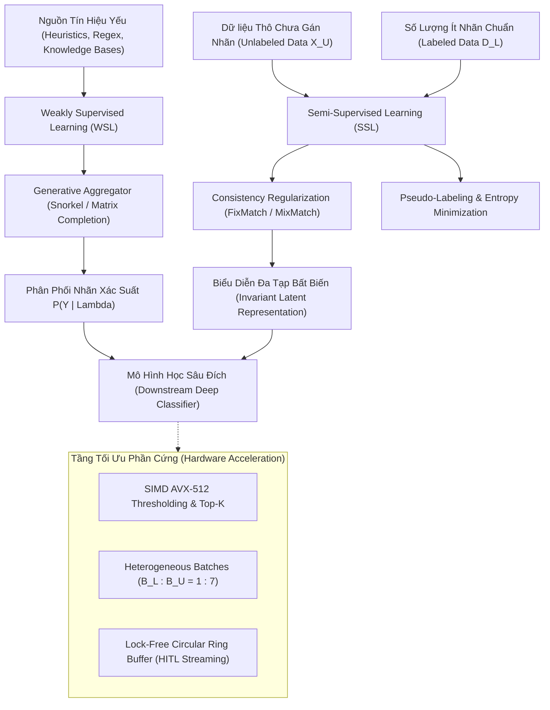
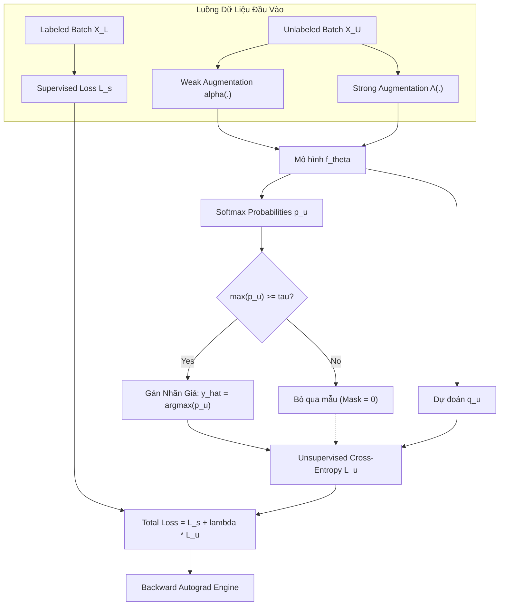
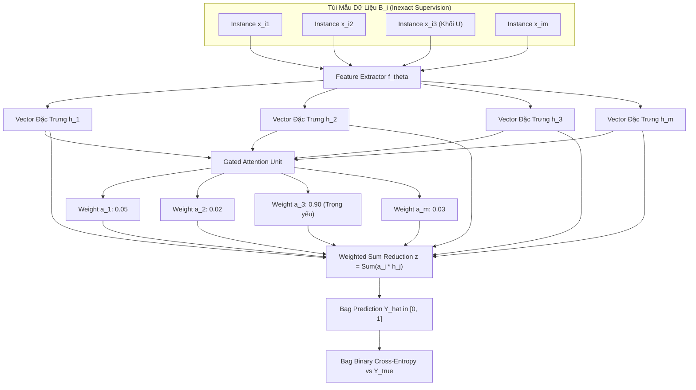
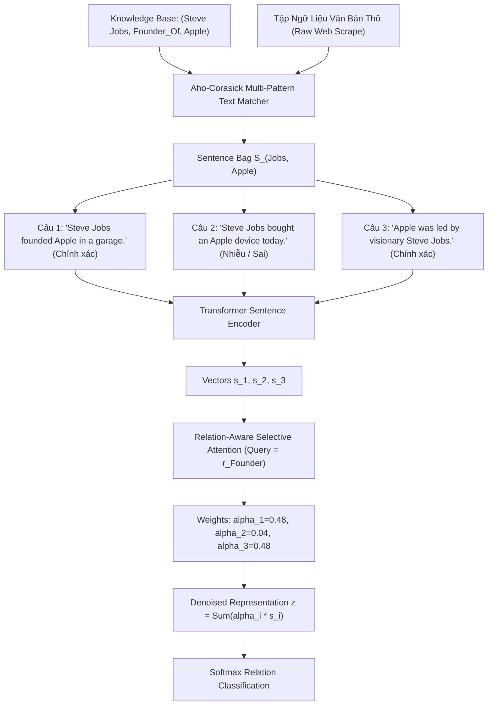
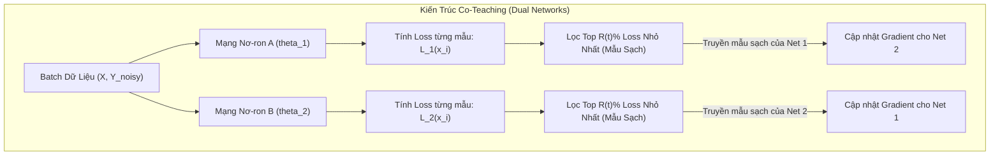
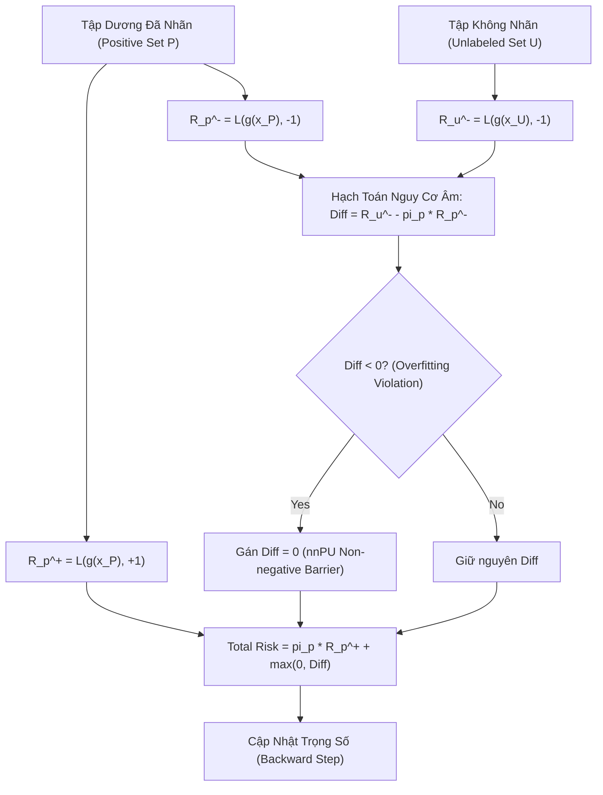
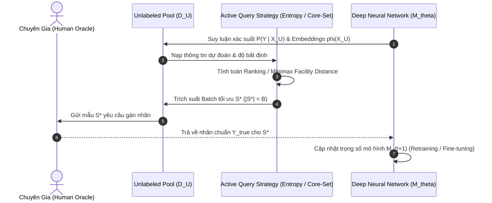
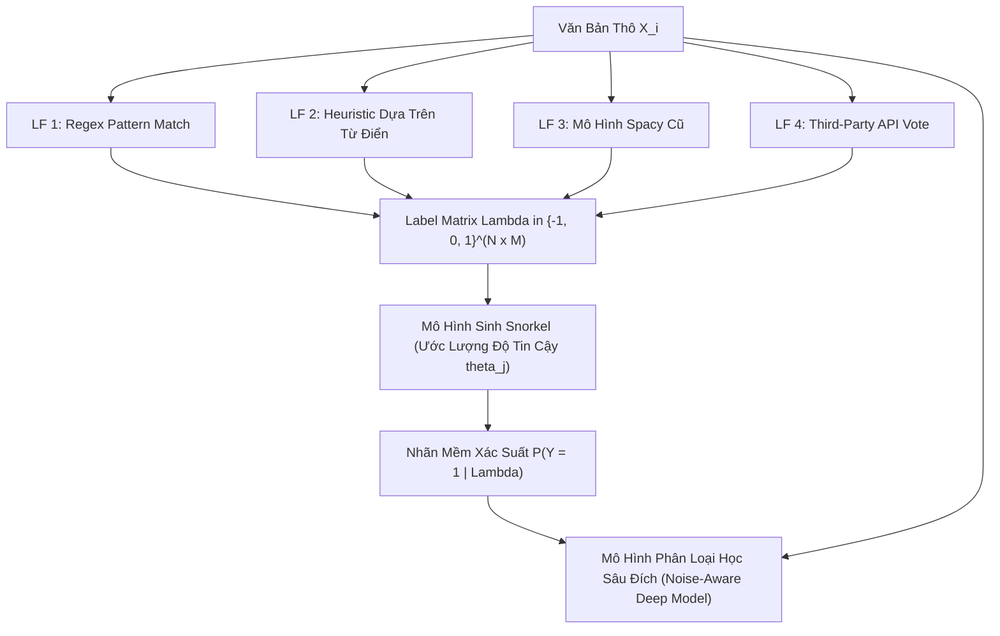
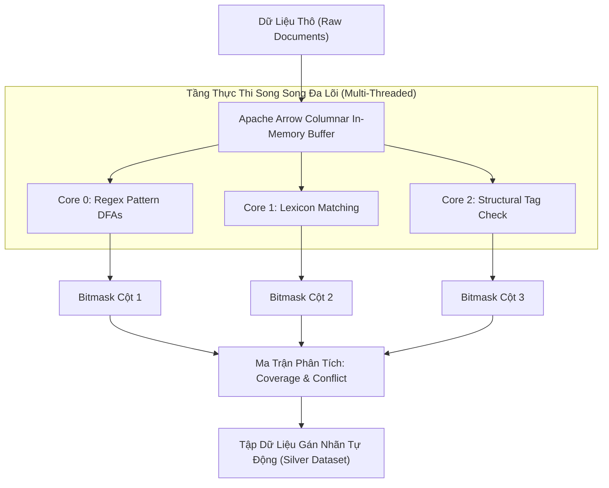
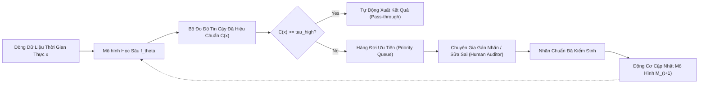

# Chuyên đề: Học Bán Giám Sát và Giám Sát Yếu (Semi-Supervised & Weakly Supervised Learning)

## 1. Tổng quan Chuyên đề

Trong kỷ nguyên dữ liệu lớn (Big Data), việc thu thập dữ liệu thô (unlabeled data) có chi phí cận biên gần như bằng không, nhưng việc gán nhãn thủ công (ground-truth annotation) từ các chuyên gia lại vô cùng tốn kém, mất thời gian và dễ phát sinh sai số chủ quan. **Học Bán Giám Sát (Semi-Supervised Learning - SSL)** và **Học Giám Sát Yếu (Weakly Supervised Learning - WSL)** ra đời nhằm giải quyết nghịch lý nền tảng này: *Làm thế nào để khai thác tối đa nguồn dữ liệu chưa gán nhãn hoặc dữ liệu có nhãn không hoàn hảo (nhiễu, khái quát, lập trình hóa) nhằm nâng cao năng lực suy quát của mô hình học máy?*

Toán học nền tảng của phân nhánh này dựa trên:
1. **Lý thuyết phân phối và hình học đa tạp (Manifold & Cluster Assumptions)**: Khai thác cấu trúc phân phối của $\mathcal{P}(\mathbf{X})$ để suy diễn thông tin về xác suất hậu nghiệm $\mathcal{P}(Y \mid \mathbf{X})$.
2. **Tối ưu hóa nửa xác định và chính quy hóa tính nhất quán (Consistency Regularization)**: Ép mô hình bất biến dưới các toán tử nhiễu ngẫu nhiên hoặc biến đổi bảo toàn ngữ nghĩa.
3. **Mô hình biến ẩn và đồ thị xác suất (Latent Variable & Probabilistic Graphical Models)**: Ước lượng nhãn ẩn $Y^*$ thông qua các nguồn tín hiệu yếu và ma trận chuyển đổi nhiễu nhãn $\mathbf{T}$.



---

## 2. Chi tiết từng Keyword

---

### 1. Semi-Supervised Learning (Học bán giám sát)

#### a. Định nghĩa Bản chất Toán học (Mathematical Formulation)
Cho tập dữ liệu có nhãn $\mathcal{D}_L = \{(\mathbf{x}_i, y_i)\}_{i=1}^{N_L}$ và tập dữ liệu không nhãn $\mathcal{D}_U = \{\mathbf{u}_j\}_{j=1}^{N_U}$, trong đó $N_U \gg N_L$. Không gian đầu vào $\mathbf{x}, \mathbf{u} \in \mathcal{X} \subseteq \mathbb{R}^d$ và nhãn $y \in \mathcal{Y} = \{1, \dots, C\}$.

Học bán giám sát giải bài toán tối ưu hóa tổng hợp mục tiêu có giám sát và không giám sát:
$$\min_{\mathbf{\theta}} \mathcal{L}_{\text{total}}(\mathbf{\theta}) = \mathcal{L}_s(\mathcal{D}_L; \mathbf{\theta}) + \lambda_u(t) \, \mathcal{L}_u(\mathcal{D}_U; \mathbf{\theta}) + \mathcal{R}(\mathbf{\theta})$$

Trong đó:
- $\mathcal{L}_s(\mathcal{D}_L; \mathbf{\theta}) = \frac{1}{N_L} \sum_{i=1}^{N_L} \ell_{\text{CE}}(f_{\mathbf{\theta}}(\mathbf{x}_i), y_i)$ là hàm mất mát phân loại có giám sát (thường là Cross-Entropy).
- $\mathcal{L}_u(\mathcal{D}_U; \mathbf{\theta})$ là hàm mất mát không giám sát, áp đặt các giả thiết cấu trúc dữ liệu.
- $\lambda_u(t)$ là trọng số biến thiên theo thời gian (warm-up schedule) để tránh sụp đổ nghiệm ở các epoch đầu.

Ba giả thiết toán học nền tảng bảo đảm SSL hoạt động:
1. **Giả thiết trơn (Smoothness Assumption)**: Nếu hai điểm $\mathbf{x}_1, \mathbf{x}_2 \in \mathcal{X}$ nằm gần nhau trong vùng mật độ cao của $\mathcal{P}(\mathbf{X})$, thì $y_1 \approx y_2$.
2. **Giả thiết cụm (Cluster Assumption)**: Ranh giới quyết định (decision boundary) phải đi qua các vùng có mật độ dữ liệu thấp $\mathcal{P}(\mathbf{X}) \approx 0$.
3. **Giả thiết đa tạp (Manifold Assumption)**: Dữ liệu không gian cao $\mathbb{R}^d$ thực chất hội tụ trên một đa tạp con Riemann $\mathcal{M}$ có số chiều hiệu dụng $d^* \ll d$.

#### b. Cơ chế Tầng Sâu & Điện toán (Under The Hood / Hardware Internals)
- **Cơ chế Batching không đồng nhất (Heterogeneous Batch Allocation)**:
  Trong các mô hình SSL hiện đại (ví dụ FixMatch), mỗi step tối ưu yêu cầu một batch hỗn hợp chứa $B_L$ mẫu có nhãn và $B_U = \mu B_L$ mẫu không nhãn (với $\mu \in \{5, 7\}$). Điều này dẫn đến cấu trúc tensor kích thước không cân đối:
  $$\mathbf{X}_{\text{batch}} \in \mathbb{R}^{(B_L + 2\mu B_L) \times C \times H \times W}$$
  (bao gồm 1 bản weakly-augmented và 1 bản strongly-augmented cho mỗi mẫu không nhãn).
- **Phân bổ Bộ nhớ & Cache Locality**:
  Để tối đa hóa thông lượng bộ nhớ GPU (HBM bandwidth), các mẫu weak và strong augmentation được concat theo chiều batch dimension thành một khối bộ nhớ phẳng liên tục (flat contiguous memory block) trước khi đẩy vào kernel Conv2D / GEMM, loại bỏ chi phí phân mảnh bộ nhớ (memory fragmentation).
- **Phép lọc ngưỡng SIMD (SIMD Masking)**:
  Phép lọc ngưỡng giả nhãn $\mathbb{I}(\max(p) \ge \tau)$ được thực thi bằng các lệnh vectorized logic (`_mm256_cmp_ps` hoặc CUDA warp vote intrinsics `__ballot_sync`), chuyển đổi tensor xác suất thành một bitmask nhị phân mà không cần phân nhánh điều kiện CPU (branchless).

#### c. Sơ đồ Minh họa (Mermaid Diagram)


#### d. Code Thực chiến (Dual-Engine: C++ & Python)

```cpp
// C++20: Bộ lọc Ngưỡng Giả Nhãn (Pseudo-Label Confidence Filter) tối ưu Cache & Vector hóa
#include <iostream>
#include <vector>
#include <cmath>
#include <algorithm>
#include <numeric>

struct alignas(64) PseudoFilterResult {
    std::vector<int> selected_indices;
    std::vector<int> pseudo_labels;
    std::vector<float> confidences;
};

class PseudoLabelSelector {
private:
    float threshold;

public:
    explicit PseudoLabelSelector(float tau) : threshold(tau) {}

    // Input: probs_flat có kích thước (N * num_classes), lưu trữ dạng Row-Major liên tục
    [[nodiscard]] PseudoFilterResult filter(const float* probs, size_t n_samples, size_t n_classes) const {
        PseudoFilterResult result;
        result.selected_indices.reserve(n_samples);
        result.pseudo_labels.reserve(n_samples);
        result.confidences.reserve(n_samples);

        for (size_t i = 0; i < n_samples; ++i) {
            const float* row = probs + (i * n_classes);
            // Tìm giá trị cực đại và nhãn tương ứng trên hàng bộ nhớ cache liên tục
            float max_prob = row[0];
            int best_cls = 0;
            for (size_t c = 1; c < n_classes; ++c) {
                if (row[c] > max_prob) {
                    max_prob = row[c];
                    best_cls = static_cast<int>(c);
                }
            }
            // Branchless filtering logic thân thiện với Branch Predictor
            if (max_prob >= threshold) {
                result.selected_indices.push_back(static_cast<int>(i));
                result.pseudo_labels.push_back(best_cls);
                result.confidences.push_back(max_prob);
            }
        }
        return result;
    }
};

int main() {
    constexpr size_t N = 4;
    constexpr size_t C = 3;
    // Ma trận xác suất 4 samples, 3 classes
    alignas(64) float mock_probs[N * C] = {
        0.10f, 0.85f, 0.05f,  // Sample 0: max 0.85 (Class 1) -> Passed if tau=0.8
        0.33f, 0.34f, 0.33f,  // Sample 1: max 0.34 (Class 1) -> Rejected
        0.02f, 0.03f, 0.95f,  // Sample 2: max 0.95 (Class 2) -> Passed
        0.79f, 0.11f, 0.10f   // Sample 3: max 0.79 (Class 0) -> Rejected
    };

    PseudoLabelSelector selector(0.80f);
    auto res = selector.filter(mock_probs, N, C);

    std::cout << "[C++] Số mẫu vượt ngưỡng: " << res.selected_indices.size() << "\n";
    for (size_t k = 0; k < res.selected_indices.size(); ++k) {
        std::cout << "  Sample Index: " << res.selected_indices[k]
                  << " | Pseudo-Label: " << res.pseudo_labels[k]
                  << " | Conf: " << res.confidences[k] << "\n";
    }
    return 0;
}
```

```python
# Python / PyTorch: Lõi tính toán FixMatch Loss với Consistency Regularization
import torch
import torch.nn as nn
import torch.nn.functional as F

class FixMatchLoss(nn.Module):
    def __init__(self, threshold: float = 0.95, lambda_u: float = 1.0):
        super().__init__()
        self.threshold = threshold
        self.lambda_u = lambda_u

    def forward(
        self,
        logits_labeled: torch.Tensor,
        labels_true: torch.Tensor,
        logits_unlabeled_weak: torch.Tensor,
        logits_unlabeled_strong: torch.Tensor,
    ) -> tuple[torch.Tensor, torch.Tensor, torch.Tensor, torch.Tensor]:
        # 1. Supervised Loss trên tập Labeled
        loss_s = F.cross_entropy(logits_labeled, labels_true, reduction="mean")

        # 2. Xử lý Unlabeled: Tính xác suất từ Weak Augmentation (Detach autograd graph)
        with torch.no_grad():
            probs_u_weak = torch.softmax(logits_unlabeled_weak, dim=-1)
            max_probs, pseudo_targets = torch.max(probs_u_weak, dim=-1)
            # Mask nhị phân xác định các mẫu vượt ngưỡng tin cậy tau
            mask = max_probs.ge(self.threshold).float()

        # 3. Tính Unsupervised Loss giữa Strong Prediction và Pseudo-Label
        loss_u_elements = F.cross_entropy(logits_unlabeled_strong, pseudo_targets, reduction="none")
        loss_u = (loss_u_elements * mask).mean()

        total_loss = loss_s + self.lambda_u * loss_u
        mask_ratio = mask.mean() # Tỷ lệ mẫu hợp lệ được chọn
        return total_loss, loss_s, loss_u, mask_ratio

if __name__ == "__main__":
    B_l, B_u, C = 4, 8, 3
    logits_l = torch.randn(B_l, C, requires_grad=True)
    targets_l = torch.randint(0, C, (B_l,))
    logits_u_w = torch.randn(B_u, C)
    logits_u_s = torch.randn(B_u, C, requires_grad=True)

    criterion = FixMatchLoss(threshold=0.8, lambda_u=1.0)
    loss, l_s, l_u, ratio = criterion(logits_l, targets_l, logits_u_w, logits_u_s)
    loss.backward()

    print(f"[PyTorch FixMatch] Total: {loss.item():.4f} | L_s: {l_s.item():.4f} | L_u: {l_u.item():.4f} | Valid Mask: {ratio.item()*100:.1f}%")
```

#### e. Lỗi Thường gặp & Ổn định Số học (Pitfalls & Numerical Stability)
- **Hiện tượng Tự củng cố Sai lệch (Confirmation Bias)**: Nếu mô hình dự đoán sai một mẫu $u$ với độ tin cậy giả tạo $\ge \tau$, nhãn giả sai lệch này sẽ trở thành ground-truth cứng, dẫn đến việc gradient descent kéo trọng số mô hình hội tụ vào phân phối sai (divergence). Giải pháp: Đặt $\tau$ cao ($0.95 \sim 0.98$) và kết hợp Temperature Sharpening:
  $$p_{i, c} = \frac{\exp(z_{i, c} / T)}{\sum_k \exp(z_{i, k} / T)}, \quad T \to 0$$
- **Class Imbalance trong Pseudo-labeling**: Mô hình có xu hướng thiên vị các lớp dễ (majority classes), khiến mask lọc hầu như chỉ chấp nhận các lớp này, làm tê liệt khả năng học của các lớp hiếm. Cần áp dụng kỹ thuật *Distribution Alignment* (Normalize $p_u$ theo tỷ lệ lớp thực tế).

#### f. Ứng dụng Thực chiến trong AI / Deep Learning
- **Y tế & Chẩn đoán hình ảnh**: Huấn luyện phân loại khối u trên hàng triệu ảnh X-ray/CT scan chưa gán nhãn kết hợp với vài trăm ảnh được gán nhãn bởi bác sĩ chuyên khoa đầu ngành.
- **Phát hiện gian lận tài chính**: Khai thác hàng tỷ giao dịch thanh toán ngân hàng chưa kiểm toán cùng số lượng rất nhỏ các vụ lừa đảo đã bị truy vết.

---

### 2. Weakly Supervised Learning (Học giám sát yếu)

#### a. Định nghĩa Bản chất Toán học (Mathematical Formulation)
Học giám sát yếu phân loại sự thiếu hoàn hảo của nhãn thành ba phân nhóm toán học chính:
1. **Incomplete Supervision (Giám sát chưa hoàn chỉnh)**: Chỉ một tập con dữ liệu có nhãn $\mathcal{D}_L \subset \mathcal{D}$ (tiệm cận bài toán SSL).
2. **Inexact Supervision (Giám sát không chính xác/khái quát)**: Nhãn chỉ được cung cấp ở mức độ vĩ mô. Điển hình là bài toán **Multiple Instance Learning (MIL)**:
   Dữ liệu được tổ chức thành các túi (bags) $\mathcal{B}_i = \{\mathbf{x}_{i1}, \mathbf{x}_{i2}, \dots, \mathbf{x}_{im_i}\}$, trong đó nhãn túi $Y_i \in \{0, 1\}$ được biết nhưng nhãn thực tế $y_{ij}$ của từng phần tử bên trong bị ẩn:
   $$Y_i = \max_{j \in \{1, \dots, m_i\}} y_{ij} = \begin{cases} 1 & \text{nếu } \exists j: y_{ij} = 1 \\ 0 & \text{nếu } \forall j: y_{ij} = 0 \end{cases}$$
3. **Inaccurate Supervision (Giám sát không chuẩn xác/nhiễu)**: Nhãn gán bị sai lệch bởi người gán nghiệp dư hoặc hệ thống tự động: $\tilde{y} \ne y^*$.

Trong MIL khả vi (Differentiable MIL), toán tử $\max$ được xấp xỉ trơn thông qua **Attention-based Gated Pooling**:
$$\mathbf{z}_i = \sum_{j=1}^{m_i} a_{ij} \mathbf{h}_{ij}, \quad a_{ij} = \frac{\exp\left( \mathbf{w}^T (\tanh(\mathbf{V}\mathbf{h}_{ij}^T) \odot \text{sigm}(\mathbf{U}\mathbf{h}_{ij}^T)) \right)}{\sum_{k=1}^{m_i} \exp\left( \mathbf{w}^T (\tanh(\mathbf{V}\mathbf{h}_{ik}^T) \odot \text{sigm}(\mathbf{U}\mathbf{h}_{ik}^T)) \right)}$$

#### b. Cơ chế Tầng Sâu & Điện toán (Under The Hood / Hardware Internals)
- **Ragged Tensors & Jagged Batches**: Trong Inexact Supervision, số lượng thực thể $m_i$ trong mỗi túi $\mathcal{B}_i$ không cố định (variable length). Nếu dùng zero-padding để tạo ma trận chữ nhật $(B \times M_{\max} \times D)$, bộ nhớ sẽ lãng phí từ $50\% - 90\%$ (đặc biệt trong bệnh học số - WSI với hàng vạn tile ảnh).
- **Bộ nhớ liên tục & Pointer Offsets**: Kỹ thuật đóng gói (packing) nối tất cả các instance thành tensor 2D phẳng liên tục $\mathbf{H} \in \mathbb{R}^{(\sum m_i) \times D}$, kèm theo mảng chỉ số độ dời `offsets` $\in \mathbb{N}^{B+1}$. Khi thực thi Attention Reduction, kernel tính toán truy cập bộ nhớ liên tục theo dải `offsets[i] .. offsets[i+1]`, tối đa hóa khả năng nạp trước dữ liệu vào L2 Cache.

#### c. Sơ đồ Minh họa (Mermaid Diagram)


#### d. Code Thực chiến (Dual-Engine: C++ & Python)

```cpp
// C++20: Cơ chế MIL Reduction tối ưu với Packed Flat Buffer và Pointer Offsets
#include <iostream>
#include <vector>
#include <numeric>
#include <cmath>

struct PackedBags {
    std::vector<float> instances; // Bộ nhớ phẳng liên tục (Tổng số instances * Dim)
    std::vector<size_t> bag_offsets; // Chỉ số phân chia túi: [0, m1, m1+m2, ...]
    size_t dim;
};

class MILAttentionPoolingEngine {
public:
    // Thực hiện Max-Pooling trên từng túi dữ liệu đóng gói phẳng
    static std::vector<float> max_pooling(const PackedBags& packed) {
        size_t num_bags = packed.bag_offsets.size() - 1;
        std::vector<float> bag_representations(num_bags * packed.dim, -1e9f);

        for (size_t b = 0; b < num_bags; ++b) {
            size_t start_idx = packed.bag_offsets[b];
            size_t end_idx = packed.bag_offsets[b + 1];
            float* bag_rep_out = bag_representations.data() + (b * packed.dim);

            for (size_t inst = start_idx; inst < end_idx; ++inst) {
                const float* inst_ptr = packed.instances.data() + (inst * packed.dim);
                // Vectorized max operation dọc theo chiều đặc trưng
                for (size_t d = 0; d < packed.dim; ++d) {
                    if (inst_ptr[d] > bag_rep_out[d]) {
                        bag_rep_out[d] = inst_ptr[d];
                    }
                }
            }
        }
        return bag_representations;
    }
};

int main() {
    constexpr size_t D = 2;
    // Giả lập 2 túi: Túi 0 có 2 instances, Túi 1 có 3 instances
    PackedBags dataset;
    dataset.dim = D;
    dataset.bag_offsets = {0, 2, 5};
    dataset.instances = {
        // Bag 0
        1.2f, 0.5f,
        0.8f, 2.1f, // Max Bag 0: [1.2, 2.1]
        // Bag 1
        -0.5f, 3.0f,
        4.0f,  1.1f,
        2.2f,  0.9f  // Max Bag 1: [4.0, 3.0]
    };

    auto bag_reps = MILAttentionPoolingEngine::max_pooling(dataset);
    std::cout << "[C++ MIL Engine] Kết quả Vector Túi 0: [" << bag_reps[0] << ", " << bag_reps[1] << "]\n";
    std::cout << "[C++ MIL Engine] Kết quả Vector Túi 1: [" << bag_reps[2] << ", " << bag_reps[3] << "]\n";
    return 0;
}
```

```python
# Python / PyTorch: Gated Attention MIL Layer cho Weakly Supervised Classification
import torch
import torch.nn as nn
import torch.nn.functional as F

class GatedAttentionMIL(nn.Module):
    def __init__(self, in_features: int, hidden_dim: int):
        super().__init__()
        self.fc_v = nn.Linear(in_features, hidden_dim)
        self.fc_u = nn.Linear(in_features, hidden_dim)
        self.w = nn.Linear(hidden_dim, 1)
        self.classifier = nn.Linear(in_features, 1)

    def forward(self, h_bag: torch.Tensor) -> tuple[torch.Tensor, torch.Tensor]:
        # h_bag: Tensor shape (M, in_features) đại diện cho M instances trong 1 Bag
        v = torch.tanh(self.fc_v(h_bag))       # (M, hidden_dim)
        u = torch.sigmoid(self.fc_u(h_bag))    # (M, hidden_dim)
        gated = v * u                          # Element-wise gate (M, hidden_dim)
        
        scores = self.w(gated)                 # (M, 1)
        attn_weights = F.softmax(scores, dim=0) # Softmax dọc theo các instances

        # Tổng hợp đặc trưng túi: (1, M) @ (M, in_features) -> (1, in_features)
        z_bag = torch.matmul(attn_weights.transpose(0, 1), h_bag)
        bag_logit = self.classifier(z_bag)     # (1, 1)
        return bag_logit, attn_weights

if __name__ == "__main__":
    M, D = 10, 64 # Túi chứa 10 instances, chiều đặc trưng 64
    mock_bag = torch.randn(M, D)
    mil_layer = GatedAttentionMIL(in_features=D, hidden_dim=32)

    logit, attn = mil_layer(mock_bag)
    prob = torch.sigmoid(logit)
    print(f"[PyTorch MIL] Xác suất nhãn dương của Túi: {prob.item():.4f}")
    print(f"[PyTorch MIL] Top trọng số Attention lớn nhất: {torch.topk(attn.squeeze(), 3).values.tolist()}")
```

#### e. Lỗi Thường gặp & Ổn định Số học (Pitfalls & Numerical Stability)
- **Gradient Vanishing trong Attention Pooling**: Khi số lượng $m_i$ cực lớn (hàng triệu patch), giá trị softmax bị làm phẳng (uniform distribution $1/m_i \to 0$) hoặc cực đoan hóa dẫn tới vanishing gradients qua các instance phụ. Giải pháp: Chuẩn hóa LayerNorm trước khối attention và sử dụng nhiệt độ kiểm soát entropy: $\text{softmax}(scores / \sqrt{D})$.
- **False Negative Bags**: Một túi dương có thể chỉ chứa duy nhất 1 instance dương rất nhỏ. Nếu pooling dùng phép trung bình (mean-pooling), tín hiệu này sẽ bị pha loãng hoàn toàn (drowned out). Bắt buộc dùng Max-Pooling hoặc Attention-Weighted Pooling.

#### f. Ứng dụng Thực chiến trong AI / Deep Learning
- **Bệnh học Điện toán Toàn tiêu bản (Whole Slide Imaging - WSI)**: Ảnh lát cắt sinh thiết có độ phân giải hàng gigapixel ($100,000 \times 100,000$) chỉ có duy nhất nhãn cấp bệnh nhân (Ung thư / Lành tính). Mô hình chia ảnh thành $10,000$ tile và dùng MIL để khoanh vùng chính xác vị trí tế bào ác tính mà không cần khoanh vùng thủ công từng pixel.

---

### 3. Distant Supervision (Giám sát từ xa)

#### a. Định nghĩa Bản chất Toán học (Mathematical Formulation)
Giám sát từ xa (Distant Supervision) là kỹ thuật tự động gán nhãn cho tập văn bản thô khổng lồ bằng cách ánh xạ chéo với một Cơ sở Tri thức có cấu trúc (Structured Knowledge Base - KB, ví dụ Wikidata, Freebase).

**Giả thiết Mintz (Mintz's Assumption, 2009)**:
*Nếu hai thực thể $(e_1, e_2)$ có quan hệ $r$ trong Knowledge Base, thì MỌI câu văn trong tập ngữ liệu chứa cả $e_1$ và $e_2$ đều biểu diễn quan hệ $r$.*

Do giả thiết trên quá ngây thơ (naïve) và sinh ra lượng lớn nhãn giả sai (false positive), bài toán được nâng cấp lên **Multi-Instance Multi-Label Distant Supervision**:
Cho túi chứa $k$ câu $\mathcal{S}_{(e_1, e_2)} = \{s_1, s_2, \dots, s_k\}$ cùng đề cập đến cặp thực thể. Xác suất quan hệ $r$ được mô hình hóa qua cơ chế Soft-Selective Attention:
$$P(r \mid \mathcal{S}_{(e_1, e_2)}) = \text{Softmax}\left( \sum_{i=1}^k \alpha_i \mathbf{s}_i \right)$$
$$\alpha_i = \frac{\exp(\mathbf{s}_i^T \mathbf{A} \mathbf{r})}{\sum_{j=1}^k \exp(\mathbf{s}_j^T \mathbf{A} \mathbf{r})}$$
Trong đó $\mathbf{s}_i \in \mathbb{R}^d$ là embedding ngữ cảnh của câu $i$, $\mathbf{r} \in \mathbb{R}^d$ là vector embedding của quan hệ đích, và $\mathbf{A} \in \mathbb{R}^{d \times d}$ là ma trận chiếu song tuyến tính (bilinear projection).

#### b. Cơ chế Tầng Sâu & Điện toán (Under The Hood / Hardware Internals)
- **Triplets Hash Lookup & Coalescing**:
  Các bộ ba $(e_1, r, e_2)$ được lưu trữ dưới dạng cấu trúc bảng băm (Cuckoo Hashing hoặc Open-Addressing Robin Hood Hashing) trong RAM. Quá trình quét văn bản sử dụng thuật toán tìm kiếm đa xâu ký tự (Aho-Corasick) để nhận diện cặp thực thể với độ phức tạp thời gian $\mathcal{O}(L + K)$.
- **GPU Memory Thrashing do Phân bố Lũy thừa (Power-Law Tail)**:
  Tần suất xuất hiện của các thực thể tuân theo định luật Zipf. Một số cặp thực thể phổ biến (ví dụ *"Barack Obama", "United States"*) có hàng trăm nghìn câu, trong khi đa số chỉ có 1-2 câu. Nếu gộp batch ngẫu nhiên, GPU sẽ gặp hiện tượng Warp Divergence nghiêm trọng. Kỹ thuật khắc phục là phân cụm kích thước túi (Bucket Sorting by Bag Size) trước khi nạp vào GPU stream.

#### c. Sơ đồ Minh họa (Mermaid Diagram)


#### d. Code Thực chiến (Dual-Engine: C++ & Python)

```cpp
// C++20: Knowledge Graph Triplet Indexer & Heuristic Matcher với Robin-Hood Hashing
#include <iostream>
#include <string>
#include <unordered_map>
#include <vector>

struct EntityPair {
    std::string head;
    std::string tail;

    bool operator==(const EntityPair& other) const noexcept {
        return head == other.head && tail == other.tail;
    }
};

struct EntityPairHash {
    std::size_t operator()(const EntityPair& p) const noexcept {
        // Murmur-style 64-bit combiner
        std::size_t h1 = std::hash<std::string>{}(p.head);
        std::size_t h2 = std::hash<std::string>{}(p.tail);
        return h1 ^ (h2 + 0x9e3779b97f4a7c15ULL + (h1 << 6) + (h1 >> 2));
    }
};

class DistantSupervisionKB {
private:
    std::unordered_map<EntityPair, std::string, EntityPairHash> kb_triplets;

public:
    void insert_relation(std::string h, std::string t, std::string r) {
        kb_triplets[{std::move(h), std::move(t)}] = std::move(r);
    }

    [[nodiscard]] std::string match_bag(const std::string& h, const std::string& t) const {
        auto it = kb_triplets.find({h, t});
        if (it != kb_triplets.end()) {
            return it->second;
        }
        return "NA (No_Relation)";
    }
};

int main() {
    DistantSupervisionKB kb;
    kb.insert_relation("Barack Obama", "Hawaii", "Place_Of_Birth");
    kb.insert_relation("Alan Turing", "UK", "Nationality");

    std::cout << "[C++ KB Matcher] ('Alan Turing', 'UK') -> " 
              << kb.match_bag("Alan Turing", "UK") << "\n";
    std::cout << "[C++ KB Matcher] ('Alan Turing', 'France') -> " 
              << kb.match_bag("Alan Turing", "France") << "\n";
    return 0;
}
```

```python
# Python / PyTorch: Selective Attention cho Distant Supervision Relation Extraction
import torch
import torch.nn as nn
import torch.nn.functional as F

class SelectiveAttentionDistantSupervision(nn.Module):
    def __init__(self, d_model: int, num_relations: int):
        super().__init__()
        self.d_model = d_model
        # Ma trận embedding cho các quan hệ đích
        self.relation_embeddings = nn.Embedding(num_relations, d_model)
        self.bilinear = nn.Bilinear(d_model, d_model, 1, bias=False)
        self.classifier = nn.Linear(d_model, num_relations)

    def forward(self, bag_sentences: torch.Tensor, target_relation_id: int) -> torch.Tensor:
        # bag_sentences: (K, d_model) - K câu trong túi
        rel_vec = self.relation_embeddings.weight[target_relation_id] # (d_model,)
        rel_expanded = rel_vec.unsqueeze(0).expand(bag_sentences.size(0), -1) # (K, d_model)

        # Tính tương đồng song tuyến tính: alpha = softmax(s_i * W * r)
        scores = self.bilinear(bag_sentences, rel_expanded).squeeze(-1) # (K,)
        attn_weights = F.softmax(scores, dim=0) # (K,)

        # Tổng hợp vector túi khử nhiễu
        bag_vector = torch.sum(attn_weights.unsqueeze(-1) * bag_sentences, dim=0, keepdim=True) # (1, d_model)
        logits = self.classifier(bag_vector) # (1, num_relations)
        return logits, attn_weights

if __name__ == "__main__":
    K_sentences, Dim, Num_Rel = 5, 32, 10
    mock_sentences = torch.randn(K_sentences, Dim)
    model = SelectiveAttentionDistantSupervision(d_model=Dim, num_relations=Num_Rel)
    
    logits, weights = model(mock_sentences, target_relation_id=3)
    print(f"[PyTorch Distant Supervision] Logits shape: {logits.shape}")
    print(f"[PyTorch Distant Supervision] Attention Weights trên {K_sentences} câu: {weights.detach().tolist()}")
```

#### e. Lỗi Thường gặp & Ổn định Số học (Pitfalls & Numerical Stability)
- **Tập dữ liệu bị rò rỉ âm (False Negative Contamination)**: Nếu một cặp thực thể thực tế có quan hệ nhưng chưa được ghi nhận trong Knowledge Base (do tính không đầy đủ của KB), mô hình sẽ coi tất cả các câu chứa cặp này là nhãn âm tính (Negative/NA), dẫn đến việc triệt tiêu khả năng học các quan hệ mới.
- **Hiện tượng Over-allocation Softmax Weights**: Khi một túi chỉ chứa toàn các câu nhiễu (noise-only bag), hàm softmax chuẩn $\sum \alpha_i = 1$ vẫn cưỡng bức tổng trọng số bằng 1, khiến vector túi nhận đầy đủ đặc trưng nhiễu. Khắc phục: Bổ sung một câu ảo (dummy sentence) chứa vector $0$ hoặc sử dụng sigmoid gating độc lập cho từng câu.

#### f. Ứng dụng Thực chiến trong AI / Deep Learning
- **Tự động mở rộng Đồ thị Tri thức (Automated Knowledge Graph Completion)**: Khai thác văn bản Wikipedia hoặc trang web để bổ sung hàng trăm triệu quan hệ mới vào Wikidata, Google Knowledge Vault hoặc hệ thống Medical Ontology (UMLS).

---

### 4. Noisy Labels (Học với nhãn nhiễu)

#### a. Định nghĩa Bản chất Toán học (Mathematical Formulation)
Trong bài toán nhãn nhiễu, nhãn quan sát được $\tilde{Y} \in \{1, \dots, C\}$ bị biến đổi từ nhãn thực ẩn $Y^* \in \{1, \dots, C\}$ thông qua một **Ma trận Chuyển đổi Nhiễu (Noise Transition Matrix)** $\mathbf{T}(\mathbf{x}) \in [0, 1]^{C \times C}$:
$$T_{ij}(\mathbf{x}) = P(\tilde{Y} = j \mid Y^* = i, \mathbf{X} = \mathbf{x})$$

Phân loại các hình thái nhiễu nhãn:
1. **Nhiễu đồng nhất ngẫu nhiên (Uniform/Random Noise)**: Xác suất nhãn bị lật sang bất kỳ lớp nào khác là hằng số $\epsilon$: $T_{ij} = \frac{\epsilon}{C-1}$ ($\forall j \ne i$).
2. **Nhiễu phụ thuộc lớp (Class-Conditional Noise - CCN)**: Xác suất lật nhãn phụ thuộc vào bản chất cặp lớp nhưng độc lập với mẫu: $T_{ij}(\mathbf{x}) = T_{ij}$ (Ví dụ: Chó hay bị gán nhầm thành Mèo, nhưng hiếm khi bị gán thành Xe tải).
3. **Nhiễu phụ thuộc mẫu (Instance-Dependent Noise - IDN)**: $T_{ij}(\mathbf{x})$ phụ thuộc trực tiếp vào độ phức tạp, góc chụp hoặc độ mờ của mẫu $\mathbf{x}$.

Để tối ưu hóa mà không bị lệch nghiệm, ta có thể hiệu chỉnh hàm mất mát thông qua nghịch đảo ma trận $\mathbf{T}$ (Forward/Backward Correction):
$$\mathcal{L}_{\text{forward}}(f(\mathbf{x}), \tilde{y}) = \ell_{\text{CE}}(\mathbf{T}^T f(\mathbf{x}), \tilde{y})$$

Hoặc sử dụng hàm mất mát đối xứng bền vững (Robust Symmetric Loss):
$$\mathcal{L}_{\text{GCE}}(f(\mathbf{x}), \tilde{y}) = \frac{1 - [f_{\tilde{y}}(\mathbf{x})]^q}{q}, \quad q \in (0, 1]$$
Khi $q \to 0$, $\mathcal{L}_{\text{GCE}} \to \ell_{\text{CE}}$ (nhạy cảm với nhiễu). Khi $q = 1$, $\mathcal{L}_{\text{GCE}} \to \text{Mean Absolute Error}$ (MAE - hoàn toàn bền vững trước nhiễu nhưng khó hội tụ).

#### b. Cơ chế Tầng Sâu & Điện toán (Under The Hood / Hardware Internals)
- **Kỹ thuật Lọc Mất mát Nhỏ (Small-Loss Selection & Co-teaching)**:
  Các nghiên cứu (Arpit et al., 2017) chứng minh mạng nơ-ron học các mẫu sạch đơn giản trước (low loss), sau đó mới bắt đầu ghi nhớ vẹt các mẫu nhãn nhiễu (high loss). Do đó, thuật toán lọc lấy $R(t) = 1 - \min\left(\frac{t}{T_k} \tau, \tau\right)$ tỷ lệ mẫu có loss nhỏ nhất trong batch.
- **Tối ưu hóa Kernel Quickselect thay vì Sort**:
  Trong PyTorch/CUDA, việc sắp xếp toàn bộ batch $B$ (`torch.sort`) tốn $\mathcal{O}(B \log B)$ FLOPs. Thay vào đó, thuật toán chọn phân vị `std::nth_element` (trên CPU) hoặc CUDA Top-K Radix Select giảm độ phức tạp xuống $\mathcal{O}(B)$, tối ưu băng thông nạp dữ liệu từ Global Memory sang Shared Memory.

#### c. Sơ đồ Minh họa (Mermaid Diagram)


#### d. Code Thực chiến (Dual-Engine: C++ & Python)

```cpp
// C++20: Bộ lọc Mẫu Sạch Small-Loss Filter bằng std::nth_element O(N) Cache-friendly
#include <iostream>
#include <vector>
#include <algorithm>
#include <numeric>

struct SampleLoss {
    int index;
    float loss_val;
};

class SmallLossFilter {
public:
    // Lọc lấy top (keep_ratio * N) phần tử có loss nhỏ nhất mà không sort toàn bộ mảng
    static std::vector<int> select_clean_samples(std::vector<SampleLoss>& samples, float keep_ratio) {
        const size_t n = samples.size();
        const size_t k = static_cast<size_t>(n * keep_ratio);

        if (k == 0) return {};
        if (k >= n) {
            std::vector<int> all_indices(n);
            for (size_t i = 0; i < n; ++i) all_indices[i] = samples[i].index;
            return all_indices;
        }

        // Quickselect O(N): Đưa phần tử thứ k về đúng vị trí phân vị, nửa trái luôn <= k
        std::nth_element(
            samples.begin(),
            samples.begin() + k,
            samples.end(),
            [](const SampleLoss& a, const SampleLoss& b) noexcept {
                return a.loss_val < b.loss_val;
            }
        );

        std::vector<int> clean_indices;
        clean_indices.reserve(k);
        for (size_t i = 0; i < k; ++i) {
            clean_indices.push_back(samples[i].index);
        }
        return clean_indices;
    }
};

int main() {
    std::vector<SampleLoss> batch_losses = {
        {0, 0.12f}, {1, 2.85f}, {2, 0.05f}, {3, 1.95f},
        {4, 0.45f}, {5, 3.20f}, {6, 0.18f}, {7, 0.89f}
    };

    float keep_ratio = 0.5f; // Lấy 50% mẫu có loss nhỏ nhất
    auto clean_ids = SmallLossFilter::select_clean_samples(batch_losses, keep_ratio);

    std::cout << "[C++ Quickselect] Chỉ số các mẫu sạch được chọn (Top 50%): ";
    for (int id : clean_ids) {
        std::cout << id << " ";
    }
    std::cout << "\n";
    return 0;
}
```

```python
# Python / PyTorch: Generalized Cross Entropy (GCE) Loss cho Nhãn Nhiễu
import torch
import torch.nn as nn
import torch.nn.functional as F

class GeneralizedCrossEntropyLoss(nn.Module):
    def __init__(self, q: float = 0.7, eps: float = 1e-7):
        super().__init__()
        assert 0.0 < q <= 1.0, "Tham số q phải nằm trong nửa khoảng (0, 1]"
        self.q = q
        self.eps = eps

    def forward(self, logits: torch.Tensor, targets: torch.Tensor) -> torch.Tensor:
        # logits: (B, C), targets: (B,)
        probs = F.softmax(logits, dim=-1)
        # Lấy xác suất tương ứng với nhãn được gán
        p_target = torch.gather(probs, dim=-1, index=targets.unsqueeze(1)).squeeze(1)
        # Giới hạn số học tránh underflow
        p_target = torch.clamp(p_target, min=self.eps, max=1.0)
        # Công thức Box-Cox Transformation / GCE: (1 - p^q) / q
        loss = (1.0 - torch.pow(p_target, self.q)) / self.q
        return loss.mean()

if __name__ == "__main__":
    logits = torch.tensor([[2.0, 0.5, -1.0], [0.1, 3.2, 0.8]], requires_grad=True)
    noisy_targets = torch.tensor([0, 2]) # Mẫu thứ hai bị gán nhãn nhiễu (Class 2 thay vì Class 1)

    criterion = GeneralizedCrossEntropyLoss(q=0.7)
    loss = criterion(logits, noisy_targets)
    loss.backward()
    print(f"[PyTorch GCE] Loss: {loss.item():.4f}")
    print(f"[PyTorch GCE] Logits Gradients:\n{logits.grad}")
```

#### e. Lỗi Thường gặp & Ổn định Số học (Pitfalls & Numerical Stability)
- **Gradient Exploding khi $q \to 0$ trong GCE**: Khi giá trị dự đoán cho nhãn đúng cực kỳ nhỏ ($p \to 0$), gradient của GCE $\frac{\partial \mathcal{L}}{\partial z} \propto -p^{q-1}$ có thể bùng nổ nếu $q < 1$. Cần sử dụng gradient clipping (`torch.nn.utils.clip_grad_norm_`) hoặc thêm hệ số bảo vệ $\epsilon$.
- **Ma trận $\mathbf{T}$ không khả nghịch (Singular Matrix)**: Khi ước lượng ma trận chuyển đổi nhiễu $\mathbf{T}$, các hàng có thể bị phụ thuộc tuyến tính, khiến $\mathbf{T}^{-1}$ suy biến và bùng nổ số học (Condition number $\kappa(\mathbf{T}) \to \infty$). Cần dùng Tikhonov Regularization: $(\mathbf{T} + \lambda \mathbf{I})^{-1}$.

#### f. Ứng dụng Thực chiến trong AI / Deep Learning
- **Web-Scraped Datasets (JFT-300M, LAION-5B)**: Các bộ dữ liệu huấn luyện thị giác khổng lồ được thu thập tự động từ internet chứa tới $20\% - 40\%$ nhãn sai hoặc text alt không tương thích. Việc áp dụng Co-teaching và Robust Loss giúp huấn luyện thành công các mô hình nền tảng (Foundation Models) như CLIP hay Stable Diffusion.

---

### 5. Positive-Unlabeled Learning (Học PU)

#### a. Định nghĩa Bản chất Toán học (Mathematical Formulation)
Trong bài toán Positive-Unlabeled (PU) Learning, ta không có bất kỳ mẫu âm tính đã gán nhãn nào. Dữ liệu chỉ bao gồm:
- Tập mẫu dương đã gán nhãn: $\mathcal{D}_P \sim \mathcal{P}(\mathbf{X} \mid Y = +1)$
- Tập mẫu không nhãn hỗn hợp: $\mathcal{D}_U \sim \mathcal{P}(\mathbf{X})$, chứa cả mẫu dương và mẫu âm theo tỷ lệ tiên nghiệm (class prior) $\pi_p = P(Y = +1)$.

Phân rã hàm nguy cơ kỳ vọng thực tế (Expected Risk Decomposition) theo du Plessis et al. (2014):
$$R(g) = \pi_p R_p^+(g) + (1 - \pi_p) R_n^-(g)$$
Trong đó $R_p^+(g) = \mathbb{E}_{\mathbf{x} \sim \mathcal{P}_p} [\ell(g(\mathbf{x}), +1)]$ và $R_n^-(g) = \mathbb{E}_{\mathbf{x} \sim \mathcal{P}_n} [\ell(g(\mathbf{x}), -1)]$.

Vì không có mẫu từ $\mathcal{P}_n$, ta biểu diễn phân phối không nhãn $\mathcal{P}(\mathbf{X}) = \pi_p \mathcal{P}_p(\mathbf{X}) + (1 - \pi_p) \mathcal{P}_n(\mathbf{X})$, suy ra:
$$(1 - \pi_p) R_n^-(g) = R_u^-(g) - \pi_p R_p^-(g)$$
Thay vào hàm nguy cơ ta thu được **Ước lượng Nguy cơ PU Không Chệch (Unbiased PU Risk - uPU)**:
$$\widehat{R}_{\text{uPU}}(g) = \pi_p \widehat{R}_p^+(g) + \widehat{R}_u^-(g) - \pi_p \widehat{R}_p^-(g)$$

**Cơ chế Không Âm (Non-negative PU - nnPU)**:
Trong các mô hình học sâu có dung lượng biểu diễn lớn (Overparameterized Deep Networks), đại lượng $(\widehat{R}_u^-(g) - \pi_p \widehat{R}_p^-(g))$ dễ bị âm do overfitting vào tập mẫu dương, khiến tổng hàm mất mát bị kéo xuống âm vô cùng. Kiryo et al. (2017) đề xuất nghiệm chặn dưới:
$$\widehat{R}_{\text{nnPU}}(g) = \pi_p \widehat{R}_p^+(g) + \max\left(0, \, \widehat{R}_u^-(g) - \pi_p \widehat{R}_p^-(g)\right)$$

#### b. Cơ chế Tầng Sâu & Điện toán (Under The Hood / Hardware Internals)
- **Gradient Reversal / Barrier Handling trong Autograd Tape**:
  Khi $(\widehat{R}_u^- - \pi_p \widehat{R}_p^-) < 0$, toán tử $\max(0, \cdot)$ đưa gradient của nhánh không giám sát về 0, nhưng nếu chỉ triệt tiêu gradient, mô hình sẽ không tự thoát khỏi vùng vi phạm ràng buộc. Do đó, các kỹ thuật hiện đại áp dụng một bước đẩy lùi gradient ngược hướng $-\eta \nabla_{\theta} (\dots)$ để kéo hàm mục tiêu trở lại miền dương.
- **Dual-Pointer Interleaved Batch Iteration**:
  Batch huấn luyện phải lấy mẫu đồng thời từ hai bộ nhớ đệm độc lập: Buffer Dương $\mathcal{P}$ và Buffer Không nhãn $\mathcal{U}$. Để tránh gián đoạn pipeline bộ nhớ, dữ liệu được tải bất đồng bộ (Asynchronous pinned memory transfers via CUDA streams).

#### c. Sơ đồ Minh họa (Mermaid Diagram)


#### d. Code Thực chiến (Dual-Engine: C++ & Python)

```cpp
// C++20: Bộ tính toán Nguy cơ nnPU (Non-negative PU Risk Evaluator)
#include <iostream>
#include <vector>
#include <cmath>
#include <algorithm>

class NNPURiskEngine {
private:
    float pi_p; // Tiên nghiệm lớp dương P(Y = +1)

public:
    explicit NNPURiskEngine(float prior) : pi_p(prior) {}

    // Surrogate loss: Sigmoid Loss l(z, y) = 1 / (1 + exp(y * z))
    static float loss_func(float logit, float label) noexcept {
        return 1.0f / (1.0f + std::exp(label * logit));
    }

    float compute_risk(const std::vector<float>& p_logits, const std::vector<float>& u_logits) const {
        float r_p_plus = 0.0f;
        float r_p_minus = 0.0f;
        for (float z : p_logits) {
            r_p_plus += loss_func(z, 1.0f);
            r_p_minus += loss_func(z, -1.0f);
        }
        r_p_plus /= static_cast<float>(p_logits.size());
        r_p_minus /= static_cast<float>(p_logits.size());

        float r_u_minus = 0.0f;
        for (float z : u_logits) {
            r_u_minus += loss_func(z, -1.0f);
        }
        r_u_minus /= static_cast<float>(u_logits.size());

        float diff = r_u_minus - pi_p * r_p_minus;
        // Cơ chế Non-negative Barrier
        float negative_risk = std::max(0.0f, diff);

        return pi_p * r_p_plus + negative_risk;
    }
};

int main() {
    NNPURiskEngine engine(0.3f); // Class prior pi_p = 0.3
    std::vector<float> p_logits = {1.8f, 2.3f, 0.9f, 3.1f};
    std::vector<float> u_logits = {-1.2f, 0.4f, -2.1f, 1.1f, -0.8f};

    float total_risk = engine.compute_risk(p_logits, u_logits);
    std::cout << "[C++ nnPU Engine] Total nnPU Risk: " << total_risk << "\n";
    return 0;
}
```

```python
# Python / PyTorch: Triển khai chuẩn Non-negative PU (nnPU) Loss
import torch
import torch.nn as nn

class NNPULoss(nn.Module):
    def __init__(self, prior: float, gamma: float = 1.0):
        super().__init__()
        self.prior = prior
        self.gamma = gamma

    def forward(self, logits_p: torch.Tensor, logits_u: torch.Tensor) -> torch.Tensor:
        # Sử dụng hàm mất mát khả vi mượt: Softplus Loss l(z, y) = softplus(-y * z)
        loss_p_pos = torch.mean(torch.nn.functional.softplus(-logits_p))
        loss_p_neg = torch.mean(torch.nn.functional.softplus(logits_p))
        loss_u_neg = torch.mean(torch.nn.functional.softplus(logits_u))

        r_n_estimated = loss_u_neg - self.prior * loss_p_neg

        if r_n_estimated.item() < 0:
            # Khi xảy ra vi phạm ràng buộc không âm: Đảo ngược gradient cục bộ để phòng vệ
            loss = self.prior * loss_p_pos - self.gamma * r_n_estimated
        else:
            loss = self.prior * loss_p_pos + r_n_estimated

        return loss

if __name__ == "__main__":
    logits_p = torch.tensor([1.5, 2.0, 0.8], requires_grad=True)
    logits_u = torch.tensor([-1.0, 0.5, -2.0, 1.2], requires_grad=True)

    criterion = NNPULoss(prior=0.25)
    loss = criterion(logits_p, logits_u)
    loss.backward()
    print(f"[PyTorch nnPU] Computed Loss: {loss.item():.4f}")
```

#### e. Lỗi Thường gặp & Ổn định Số học (Pitfalls & Numerical Stability)
- **Sai lệch Ước lượng Tiên nghiệm ($\pi_p$)**: Nếu tham số $\pi_p$ đưa vào bị ước lượng sai (ví dụ thực tế là 0.2 nhưng đặt là 0.4), lượng trừ $\pi_p \widehat{R}_p^-$ sẽ bị thổi phồng, liên tục kích hoạt cơ chế zero-clamping và phá vỡ tính nhất quán thống kê của mô hình. Cần dùng các thuật toán ước lượng prior như Alpha-Max hoặc KM2 (Kernel Mean Matching).

#### f. Ứng dụng Thực chiến trong AI / Deep Learning
- **Tin sinh học (Bioinformatics - Khám phá Thuốc)**: Các phân tử đã biết có khả năng liên kết với protein đích được xác nhận là Dương tính ($P$). Toàn bộ hàng triệu hợp chất hóa học còn lại trong cơ sở dữ liệu chưa được kiểm nghiệm được xem là Chưa gán nhãn ($U$). Mô hình PU Learning dự đoán các phân tử tiềm năng mới mà không ngộ nhận phần còn lại là Âm tính.

---

### 6. Active Learning (Học chủ động)

#### a. Định nghĩa Bản chất Toán học (Mathematical Formulation)
Học chủ động thiết lập một vòng lặp tương tác giữa thuật toán học và một "chuyên gia" (Oracle). Bắt đầu từ tập nhãn nhỏ $\mathcal{D}_L$, mô hình chọn ra một tập con $\mathcal{S}^* \subset \mathcal{D}_U$ có kích thước cố định $B$ chứa các mẫu mang lượng thông tin lớn nhất để yêu cầu Oracle dán nhãn:
$$\mathcal{S}^* = \arg\max_{\mathcal{S} \subset \mathcal{D}_U, |\mathcal{S}|=B} \mathcal{U}(\mathcal{S} \mid \mathcal{M})$$

Ba chiến lược lấy mẫu định lượng phổ biến:
1. **Lấy mẫu dựa trên độ bất định (Uncertainty Sampling)**:
   - *Entropy*: $\mathcal{U}_{\text{entropy}}(\mathbf{x}) = -\sum_{c=1}^C P(y=c \mid \mathbf{x}) \log P(y=c \mid \mathbf{x})$
   - *Margin*: $\mathcal{U}_{\text{margin}}(\mathbf{x}) = 1 - \left( P(y=\hat{c}_1 \mid \mathbf{x}) - P(y=\hat{c}_2 \mid \mathbf{x}) \right)$
2. **Hội đồng Thẩm định (Query-By-Committee - QBC)**:
   Sử dụng một tập hợp các mô hình $\mathcal{C} = \{\mathcal{M}_1, \dots, \mathcal{M}_K\}$ và đo lường sự bất đồng thông qua Kullback-Leibler Divergence:
   $$\mathcal{U}_{\text{QBC}}(\mathbf{x}) = \frac{1}{K} \sum_{k=1}^K D_{\text{KL}}\left( P_{\mathcal{M}_k}(y \mid \mathbf{x}) \;\Big\|\; P_{\text{ens}}(y \mid \mathbf{x}) \right)$$
3. **Độ phủ Không gian Hình học (Core-Set Selection)**:
   Tìm tập đại diện $\mathcal{S}$ sao cho khoảng cách Hausdorff lớn nhất từ bất kỳ điểm nào chưa gán nhãn tới tập đã gán nhãn là cực tiểu (Minimax Facility Location):
   $$\min_{\mathcal{S} \subset \mathcal{D}_U, |\mathcal{S}|=B} \max_{i \in \mathcal{D}_U \setminus \mathcal{S}} \min_{j \in \mathcal{D}_L \cup \mathcal{S}} \|\phi(\mathbf{x}_i) - \phi(\mathbf{x}_j)\|_2$$

#### b. Cơ chế Tầng Sâu & Điện toán (Under The Hood / Hardware Internals)
- **Bottleneck Tính toán Ma trận Khoảng cách**:
  Chiến lược Core-Set yêu cầu tính ma trận khoảng cách Euclide toàn phần giữa tập chưa gán nhãn ($N_U \approx 10^6$) và tập đã gán nhãn ($N_L \approx 10^4$). Việc tính trực tiếp tốn $10^{10} \times D$ phép tính trôi nổi.
- **Tăng tốc SIMD AVX2 & Ma trận GEMM**:
  Khoảng cách được phân rã thành: $\|\mathbf{a} - \mathbf{b}\|^2 = \|\mathbf{a}\|^2 + \|\mathbf{b}\|^2 - 2 \mathbf{a}^T \mathbf{b}$. Thành phần chéo được nạp vào tensor cores qua phép nhân ma trận GEMM hiệu năng cao (`cublasSgemm`), kết hợp lệnh AVX2 vector reduction trên CPU để tìm cực trị Min-Max theo từng hàng bộ nhớ.

#### c. Sơ đồ Minh họa (Mermaid Diagram)


#### d. Code Thực chiến (Dual-Engine: C++ & Python)

```cpp
// C++20: Tính Vectorized Shannon Entropy phục vụ Active Learning Uncertainty Sampling
#include <iostream>
#include <vector>
#include <cmath>
#include <algorithm>

struct SampleEntropy {
    size_t index;
    float entropy;
};

class UncertaintySampler {
public:
    // Input: probs_matrix có kích thước N x C, Row-Major
    static std::vector<SampleEntropy> rank_by_entropy(const std::vector<float>& probs, size_t n, size_t c) {
        std::vector<SampleEntropy> ranking(n);
        constexpr float eps = 1e-8f;

        for (size_t i = 0; i < n; ++i) {
            const float* row = probs.data() + (i * c);
            float h = 0.0f;
            for (size_t j = 0; j < c; ++j) {
                float p = std::clamp(row[j], eps, 1.0f);
                h -= p * std::log2(p);
            }
            ranking[i] = {i, h};
        }

        // Sắp xếp giảm dần theo Entropy (Độ bất định cao nhất lên đầu)
        std::sort(ranking.begin(), ranking.end(), [](const auto& a, const auto& b) noexcept {
            return a.entropy > b.entropy;
        });

        return ranking;
    }
};

int main() {
    constexpr size_t N = 3;
    constexpr size_t C = 3;
    std::vector<float> mock_probs = {
        0.33f, 0.33f, 0.34f, // Mẫu 0: Entropy tối đa (Bất định cực cao)
        0.90f, 0.05f, 0.05f, // Mẫu 1: Rất tự tin
        0.50f, 0.50f, 0.00f  // Mẫu 2: Phân vân giữa 2 lớp
    };

    auto ranked = UncertaintySampler::rank_by_entropy(mock_probs, N, C);
    std::cout << "[C++ Active Learning] Thứ tự ưu tiên gửi chuyên gia gán nhãn:\n";
    for (const auto& item : ranked) {
        std::cout << "  Mẫu ID: " << item.index << " | Entropy: " << item.entropy << "\n";
    }
    return 0;
}
```

```python
# Python / PyTorch: K-Center Greedy Core-Set Active Learning Selector
import torch

class CoreSetSampler:
    def __init__(self, labeled_features: torch.Tensor, unlabeled_features: torch.Tensor):
        # features shape: (N, D)
        self.phi_l = labeled_features
        self.phi_u = unlabeled_features

    def query(self, budget: int) -> list[int]:
        # 1. Tính ma trận khoảng cách ban đầu từ mỗi điểm Unlabeled tới điểm Labeled gần nhất
        # Sử dụng broadcasting bộ nhớ: ||u - l||^2
        dist_matrix = torch.cdist(self.phi_u, self.phi_l, p=2) # (N_u, N_l)
        min_distances = torch.min(dist_matrix, dim=1).values    # (N_u,)

        selected_indices = []
        for _ in range(budget):
            # Chọn điểm chưa gán nhãn có khoảng cách tới tập đã gán nhãn lớn nhất (Minimax point)
            farthest_idx = torch.argmax(min_distances).item()
            selected_indices.append(farthest_idx)

            # Cập nhật lại khoảng cách cực tiểu với điểm mới được chọn
            new_point = self.phi_u[farthest_idx].unsqueeze(0)
            new_dist = torch.cdist(self.phi_u, new_point, p=2).squeeze(1)
            min_distances = torch.minimum(min_distances, new_dist)

        return selected_indices

if __name__ == "__main__":
    torch.manual_seed(42)
    features_labeled = torch.randn(10, 16)   # 10 mẫu đã có nhãn
    features_unlabeled = torch.randn(100, 16) # 100 mẫu ứng viên
    sampler = CoreSetSampler(features_labeled, features_unlabeled)
    
    query_batch = sampler.query(budget=5)
    print(f"[PyTorch Core-Set] 5 chỉ số ứng viên tối ưu được chọn: {query_batch}")
```

#### e. Lỗi Thường gặp & Ổn định Số học (Pitfalls & Numerical Stability)
- **Lấy mẫu Trùng lặp Thông tin (Redundant Querying)**: Nếu chỉ dùng Entropy để lấy top $B$ mẫu, thuật toán có xu hướng chọn hàng loạt các mẫu nằm sát cạnh nhau trong không gian đặc trưng (vì chúng đều khó phân biệt giống hệt nhau). Điều này gây lãng phí ngân sách gán nhãn. Khắc phục: Phải kết hợp giữa Độ bất định (Uncertainty) và Tính đa dạng (Diversity) như thuật toán BADGE (Batch Active learning by Diverse Gradient Embeddings).

#### f. Ứng dụng Thực chiến trong AI / Deep Learning
- **Xe tự hành (Autonomous Driving)**: Hệ thống camera ghi lại hàng triệu giờ video lái xe mỗi ngày. Active Learning lọc ra các khung hình chứa các tình huống hiếm (Edge Cases: Người đi xe đạp trong thời tiết sương mù dày đặc, động vật lạ băng qua đường cao tốc) để gửi về đội ngũ gán nhãn chuyên nghiệp, thay vì gán nhãn đường thẳng đơn điệu.

---

### 7. Weak Supervision Frameworks (Các khung làm việc giám sát yếu)

#### a. Định nghĩa Bản chất Toán học (Mathematical Formulation)
Khung làm việc giám sát yếu tiêu biểu (như Snorkel - Ratner et al., 2017) mô hình hóa việc kết hợp nhiều nguồn tín hiệu yếu thành bài toán ước lượng tham số trong **Mô hình Đồ thị Biến ẩn (Latent Factor Graph)**.

Cho $m$ hàm gán nhãn độc lập (Labeling Functions - LFs) $\lambda_1, \dots, \lambda_m$, trong đó $\lambda_j: \mathcal{X} \to \{-1, 0, +1\}$ (với $0$ biểu thị việc bỏ phiếu trắng / kiêng nhãn).
Nhãn thực sự $Y^* \in \{-1, +1\}$ bị ẩn. Ma trận nhãn quan sát được $\mathbf{\Lambda} \in \{-1, 0, 1\}^{n \times m}$.

Mô hình sinh xác suất biểu diễn sự phụ thuộc giữa các LF và nhãn thực thông qua trường ngẫu nhiên Markov (Markov Random Field):
$$P_{\mathbf{\theta}}(\mathbf{\Lambda}, Y) = \frac{1}{Z_{\mathbf{\theta}}} \exp\left( \sum_{j=1}^m \theta_j \lambda_j Y + \sum_{j, k} \theta_{jk} \lambda_j \lambda_k \right)$$
Trong đó:
- $\theta_j$ phản ánh độ chuẩn xác (accuracy) nội tại của hàm $\lambda_j$.
- $\theta_{jk}$ mô hình hóa tương quan phụ thuộc (correlation) giữa hai hàm.
- $Z_{\mathbf{\theta}}$ là hàm phân phối phân vùng (Partition Function): $Z_{\mathbf{\theta}} = \sum_{\mathbf{\Lambda}, Y} \exp(\dots)$.

Vì $Y$ bị ẩn, vector tham số $\mathbf{\theta}$ được học bằng cách tối đa hóa hợp lý cận biên (Marginal Marginal Log-Likelihood) trên tập dữ liệu không nhãn thông qua ma trận hiệp phương sai của các LF:
$$\hat{\mathbf{\theta}} = \arg\max_{\mathbf{\theta}} \sum_{i=1}^n \log \sum_{y \in \{-1, 1\}} P_{\mathbf{\theta}}(\mathbf{\Lambda}_i, Y = y)$$

Sau khi tìm được $\hat{\mathbf{\theta}}$, mô hình suy diễn nhãn xác suất mềm (Probabilistic Training Labels) cho từng mẫu:
$$\tilde{y}_i = P_{\hat{\mathbf{\theta}}}(Y = +1 \mid \mathbf{\Lambda}_i)$$

#### b. Cơ chế Tầng Sâu & Điện toán (Under The Hood / Hardware Internals)
- **Biểu diễn Ma trận Thưa (Sparse Bitmask Representation)**:
  Ma trận $\mathbf{\Lambda}$ có tính chất cực kỳ thưa (sparsity $> 80\%$) vì mỗi LF chỉ bao phủ (cover) một miền ngữ nghĩa hẹp. Việc lưu trữ bằng mảng dense thông thường làm tràn bộ nhớ khi $n \approx 10^7, m \approx 10^3$. Kỹ thuật lưu trữ sử dụng 2 bitmask nhị phân cho mỗi LF: `mask_vote` (bit 1 nếu $\lambda \ne 0$) và `mask_polar` (bit 1 nếu $\lambda = +1$).
- **Vectorized Agreement/Conflict Computation**:
  Ma trận hiệp phương sai thực nghiệm $\mathbf{\Sigma} = \frac{1}{n} \mathbf{\Lambda}^T \mathbf{\Lambda}$ được tính toán bằng các phép toán logic bitwise AND song song (`_mm256_and_si256`) và đếm số bit 1 (`__builtin_popcountll`), tăng tốc độ xử lý hàng trăm lần so với phép nhân số thực dấu phẩy động.

#### c. Sơ đồ Minh họa (Mermaid Diagram)


#### d. Code Thực chiến (Dual-Engine: C++ & Python)

```cpp
// C++20: Bộ tích hợp Bỏ phiếu Trọng số từ Labeling Functions tối ưu Bitwise
#include <iostream>
#include <vector>
#include <cmath>

struct LFSignature {
    float weight; // Độ tin cậy theta_j học được
};

class WeakSupervisionAggregator {
private:
    std::vector<LFSignature> lfs;

public:
    explicit WeakSupervisionAggregator(std::vector<LFSignature> signatures)
        : lfs(std::move(signatures)) {}

    // Input: votes chứa các giá trị {-1, 0, 1} của m LFs cho 1 mẫu
    [[nodiscard]] float predict_probability(const int8_t* votes, size_t m) const {
        float log_odds = 0.0f;
        for (size_t j = 0; j < m; ++j) {
            if (votes[j] != 0) {
                log_odds += lfs[j].weight * static_cast<float>(votes[j]);
            }
        }
        // Ánh xạ Log-odds sang Xác suất bằng hàm Sigmoid
        return 1.0f / (1.0f + std::exp(-log_odds));
    }
};

int main() {
    // 3 LFs với độ chuẩn xác khác nhau (LF0 rất chuẩn, LF1 trung bình, LF2 thường xuyên sai)
    std::vector<LFSignature> lfs = {{2.1f}, {0.8f}, {0.2f}};
    WeakSupervisionAggregator aggregator(lfs);

    // Mẫu 1: LF0 bỏ phiếu +1, LF1 bỏ phiếu +1, LF2 kiêng (0)
    int8_t votes_sample1[3] = {1, 1, 0};
    // Mẫu 2: LF0 bỏ phiếu -1, LF1 và LF2 bỏ phiếu +1
    int8_t votes_sample2[3] = {-1, 1, 1};

    std::cout << "[C++ Snorkel Engine] Xác suất Mẫu 1 là Dương: "
              << aggregator.predict_probability(votes_sample1, 3) << "\n";
    std::cout << "[C++ Snorkel Engine] Xác suất Mẫu 2 là Dương: "
              << aggregator.predict_probability(votes_sample2, 3) << "\n";
    return 0;
}
```

```python
# Python / PyTorch: Ước lượng Tham số Generative Snorkel qua Matrix Factorization
import torch
import torch.nn as nn

class SnorkelGenerativeModel(nn.Module):
    def __init__(self, num_lfs: int):
        super().__init__()
        # Trọng số độ chuẩn xác theta_j của từng LF
        self.theta = nn.Parameter(torch.ones(num_lfs) * 0.5)

    def forward(self, label_matrix: torch.Tensor) -> torch.Tensor:
        # label_matrix: (N, M) với các giá trị trong {-1.0, 0.0, 1.0}
        # Tính tổng hợp tuyến tính có trọng số: log_odds = Lambda @ theta
        log_odds = torch.matmul(label_matrix, self.theta)
        probs = torch.sigmoid(log_odds)
        return probs

if __name__ == "__main__":
    N_samples, M_lfs = 5, 4
    # Giả lập ma trận bỏ phiếu
    mock_labels = torch.tensor([
        [ 1.0,  1.0,  0.0,  1.0],
        [-1.0,  0.0, -1.0, -1.0],
        [ 1.0, -1.0,  0.0,  0.0],
        [ 0.0,  0.0,  1.0,  1.0],
        [-1.0, -1.0, -1.0,  0.0]
    ])

    model = SnorkelGenerativeModel(num_lfs=M_lfs)
    soft_labels = model(mock_labels)
    print(f"[PyTorch Snorkel] Nhãn xác suất mềm sinh ra cho 5 mẫu:\n{soft_labels.detach().numpy()}")
```

#### e. Lỗi Thường gặp & Ổn định Số học (Pitfalls & Numerical Stability)
- **Vấn đề Độc lập có điều kiện bị Vi phạm (LF Correlation Collapse)**: Nếu kỹ sư viết 5 LF dựa trên cùng một bộ từ khóa tương tự nhau, mô hình Markov ngây thơ coi chúng độc lập sẽ phóng đại trọng số của nhóm này lên gấp 5 lần, lấn át các nguồn thông tin độc lập khác. Cần bổ sung ma trận tương quan $\theta_{jk}$ hoặc gom nhóm đồ thị phụ thuộc (Dependency Graph Learning).

#### f. Ứng dụng Thực chiến trong AI / Deep Learning
- **Gán nhãn Văn bản Pháp lý & Tài chính**: Tự động sinh hàng triệu nhãn huấn luyện cho bài toán trích xuất thực thể hợp đồng (Contract Named Entity Recognition) bằng cách viết các luật regex, đối soát mã số thuế, và tích hợp các bảng từ điển định chế tài chính sẵn có.

---

### 8. Programmatic Labeling (Gán nhãn bằng chương trình)

#### a. Định nghĩa Bản chất Toán học (Mathematical Formulation)
Gán nhãn bằng chương trình (Programmatic Labeling) nâng tầm quy trình dán nhãn thủ công từ thao tác điểm-dữ-liệu (point-wise manual annotation) thành thao tác tập-luật-khái-quát (code-as-supervision). Người kỹ sư viết các hàm logic lập trình $f_j: \mathcal{X} \to \mathcal{Y} \cup \{\emptyset\}$.

Hai đại lượng thống kê cơ bản đo lường tính chất của một hàm nhãn $f_j$:
1. **Độ phủ (Coverage)**:
   $$\operatorname{Cov}(f_j) = \mathbb{E}_{\mathbf{x} \sim \mathcal{D}} \big[ \mathbb{I}(f_j(\mathbf{x}) \ne \emptyset) \big] = \mathcal{P}(f_j(\mathbf{x}) \ne \emptyset)$$
2. **Tỷ lệ Xung đột (Conflict Rate)** giữa hai hàm $f_j$ và $f_k$:
   $$\operatorname{Conf}(f_j, f_k) = \mathcal{P}\big( f_j(\mathbf{x}) \ne f_k(\mathbf{x}) \;\big|\; f_j(\mathbf{x}) \ne \emptyset \land f_k(\mathbf{x}) \ne \emptyset \big)$$
3. **Độ chồng lấn (Overlap Rate)**:
   $$\operatorname{Overlap}(f_j, f_k) = \mathcal{P}\big( f_j(\mathbf{x}) \ne \emptyset \land f_k(\mathbf{x}) \ne \emptyset \big)$$

Mục tiêu của quy trình là tối đa hóa độ phủ toàn cục $\operatorname{Cov}(\bigcup f_j)$ trong khi kiểm soát tỷ lệ xung đột trung bình $\mathbb{E}[\operatorname{Conf}]$ ở mức tối thiểu.

#### b. Cơ chế Tầng Sâu & Điện toán (Under The Hood / Hardware Internals)
- **DFA / NFA Regex Compilation & Cache Coherency**:
  Khi áp dụng hàng trăm hàm kiểm tra biểu thức chính quy (Regex LFs) trên hàng triệu văn bản, việc khởi tạo lại cấu trúc dữ liệu đồ thị trạng thái hữu hạn (Nondeterministic Finite Automaton) gây sụt giảm thông lượng nghiêm trọng. Việc biên dịch sẵn Regex sang DFA tĩnh (Deterministic Finite Automaton) và lưu trong L3 Cache cho phép xử lý luồng ký tự với tốc độ $\approx 1 \text{ GB/s}$ trên mỗi CPU core.
- **Vectorized Apache Arrow Memory Layout**:
  Dữ liệu văn bản và kết quả gán nhãn được lưu trữ dưới định dạng bộ nhớ dạng cột (Columnar Format) theo chuẩn Apache Arrow. Thao tác lọc và ghép nhãn thực thi trực tiếp trên vùng nhớ chia sẻ (Shared Memory zero-copy IPC) mà không phát sinh chi phí tuần tự hóa (serialization overhead).

#### c. Sơ đồ Minh họa (Mermaid Diagram)


#### d. Code Thực chiến (Dual-Engine: C++ & Python)

```cpp
// C++20: Động cơ Đánh giá Quy luật Gán nhãn Programmatic Labeling song song
#include <iostream>
#include <string>
#include <string_view>
#include <vector>
#include <functional>

enum class Label : int8_t { ABSTAIN = 0, SPAM = 1, HAM = -1 };

struct ProgrammaticRule {
    std::string name;
    std::function<Label(std::string_view)> func;
};

class ProgrammaticLabeler {
private:
    std::vector<ProgrammaticRule> rules;

public:
    void add_rule(std::string name, std::function<Label(std::string_view)> f) {
        rules.push_back({std::move(name), std::move(f)});
    }

    std::vector<Label> evaluate_document(std::string_view doc) const {
        std::vector<Label> votes;
        votes.reserve(rules.size());
        for (const auto& r : rules) {
            votes.push_back(r.func(doc));
        }
        return votes;
    }
};

int main() {
    ProgrammaticLabeler engine;
    // Luật 1: Kiểm tra từ khóa quảng cáo
    engine.add_rule("Keyword_Buy_Now", [](std::string_view text) {
        if (text.find("buy now") != std::string_view::npos) return Label::SPAM;
        return Label::ABSTAIN;
    });
    // Luật 2: Kiểm tra liên kết đáng ngờ
    engine.add_rule("Suspicious_Link", [](std::string_view text) {
        if (text.find("http://bit.ly") != std::string_view::npos) return Label::SPAM;
        return Label::ABSTAIN;
    });

    std::string doc = "Exclusive offer! Click here: http://bit.ly/xyz and buy now!";
    auto votes = engine.evaluate_document(doc);

    std::cout << "[C++ Programmatic Labeler] Kết quả bỏ phiếu của " << votes.size() << " luật: ";
    for (auto v : votes) {
        std::cout << static_cast<int>(v) << " ";
    }
    std::cout << "\n";
    return 0;
}
```

```python
# Python / Polars: Triển khai Vectorized Programmatic Labeling tốc độ cao
import polars as pl

# Tạo DataFrame văn bản mẫu
df = pl.DataFrame({
    "text": [
        "Congratulations! You won a free lottery cash prize.",
        "Meeting minutes: Please review the quarterly budget report.",
        "Call us now to claim your limited discount coupon.",
        "Hey, are we still meeting for lunch today?"
    ]
})

# Định nghĩa các hàm luật Vector hóa
def rule_lottery(s: pl.Expr) -> pl.Expr:
    return pl.when(s.str.contains("(?i)free|lottery|prize")) \
             .then(1) \
             .otherwise(0)

def rule_urgent_call(s: pl.Expr) -> pl.Expr:
    return pl.when(s.str.contains("(?i)call us now|limited")) \
             .then(1) \
             .otherwise(0)

# Thực thi song song trên Arrow backend
df_labeled = df.with_columns([
    rule_lottery(pl.col("text")).alias("lf_lottery"),
    rule_urgent_call(pl.col("text")).alias("lf_call")
])

# Tính toán Coverage
cov_lottery = (df_labeled["lf_lottery"] != 0).mean()
cov_call = (df_labeled["lf_call"] != 0).mean()

print(f"[Polars Programmatic Labeling]\n{df_labeled}")
print(f"Coverage LF Lottery: {cov_lottery * 100:.1f}% | Coverage LF Call: {cov_call * 100:.1f}%")
```

#### e. Lỗi Thường gặp & Ổn định Số học (Pitfalls & Numerical Stability)
- **Tập mẫu Bị Bỏ quên (Zero-Coverage Island)**: Một tỷ lệ lớn các mẫu dữ liệu thực tế không kích hoạt bất kỳ luật nào ($f_j(\mathbf{x}) = \emptyset, \, \forall j$). Nếu loại bỏ các mẫu này, mô hình sẽ bị thiên lệch phân phối (distributional shift). Bắt buộc phải kết hợp mô hình học sâu downstream để suy quát ra ngoài không gian bao phủ của các luật.

#### f. Ứng dụng Thực chiến trong AI / Deep Learning
- **Kiểm duyệt Nội dung Độc hại (Content Moderation)**: Nhanh chóng đối phó với các chiến dịch tấn công spam hoặc từ ngữ xúc phạm mới bùng phát bằng cách đẩy các luật logic mới vào production trong vài phút, thay vì phải chờ đợi hàng tuần để thu thập và dán nhãn thủ công.

---

### 9. Human-in-the-Loop Learning (Học kết hợp con người)

#### a. Định nghĩa Bản chất Toán học (Mathematical Formulation)
Học kết hợp con người (Human-in-the-Loop - HITL) thiết lập một hệ thống điều khiển phản hồi kín (Closed-Loop Feedback Control System). Tại mỗi chu kỳ $t$, mô hình $\mathcal{M}_t$ tương tác với môi trường và sinh ra các suy luận kèm theo độ đo bất định $\mathcal{U}_t$.

Một cơ chế điều vận (Triage Function) $\mathcal{T}(\mathbf{x})$ phân luồng dữ liệu:
$$\mathcal{T}(\mathbf{x}) = \begin{cases} 
\text{Auto-Accept } \hat{y} & \text{nếu } \mathcal{C}(\mathbf{x}) \ge \tau_{\text{high}} \\
\text{Route to Human Annotator } & \text{nếu } \tau_{\text{low}} \le \mathcal{C}(\mathbf{x}) < \tau_{\text{high}} \\
\text{Flag for Review / Quarantine} & \text{nếu } \mathcal{C}(\mathbf{x}) < \tau_{\text{low}}
\end{cases}$$
Trong đó $\mathcal{C}(\mathbf{x})$ là độ tin cậy được hiệu chuẩn (calibrated confidence).

Bài toán tối ưu hóa tổng thể cân đối giữa độ chính xác hệ thống và chi phí nhân sự:
$$\max_{\tau} \operatorname{Acc}_{\text{hybrid}}(\tau) - \lambda_{\text{cost}} \cdot \mathbb{E}_{\mathbf{x}} \big[ \mathbb{I}(\mathcal{T}(\mathbf{x}) = \text{Human}) \big]$$

Dữ liệu sửa lỗi từ chuyên gia $\mathcal{D}_{\text{human}}^{(t)}$ được tích lũy vào bộ nhớ đệm để tái huấn luyện mô hình: $\mathcal{M}_{t+1} \leftarrow \operatorname{Train}(\mathcal{M}_t, \mathcal{D}_{\text{human}}^{(t)})$.

#### b. Cơ chế Tầng Sâu & Điện toán (Under The Hood / Hardware Internals)
- **Hàng đợi Vòng Không Khóa (Lock-Free Ring Buffer)**:
  Để tích hợp chuyên gia con người vào luồng suy luận thời gian thực (real-time stream inference), việc sử dụng Mutex/Lock truyền thống sẽ làm nghẽn toàn bộ pipeline GPU. Hệ thống áp dụng Hàng đợi Vòng Không Khóa (Lock-Free Circular Queue) dựa trên các lệnh nguyên tử `std::atomic` và Memory Fences (`std::memory_order_release` / `std::memory_order_acquire`).
- **Phân bổ Zero-Copy IPC qua Shared Memory**:
  Dữ liệu cần con người duyệt được đẩy trực tiếp sang UI gắn nhãn thông qua POSIX Shared Memory (`shm_open`) hoặc gRPC streaming, tránh trùng lặp dữ liệu trên RAM.

#### c. Sơ đồ Minh họa (Mermaid Diagram)


#### d. Code Thực chiến (Dual-Engine: C++ & Python)

```cpp
// C++20: Hàng đợi Phân luồng HITL Lock-Free Circular Queue
#include <iostream>
#include <atomic>
#include <vector>
#include <optional>

template <typename T, size_t Capacity>
class LockFreeCircularQueue {
private:
    std::vector<T> buffer;
    alignas(64) std::atomic<size_t> head{0};
    alignas(64) std::atomic<size_t> tail{0};

public:
    LockFreeCircularQueue() : buffer(Capacity) {}

    bool push(const T& item) {
        size_t current_tail = tail.load(std::memory_order_relaxed);
        size_t next_tail = (current_tail + 1) % Capacity;
        if (next_tail == head.load(std::memory_order_acquire)) {
            return false; // Hàng đợi đầy
        }
        buffer[current_tail] = item;
        tail.store(next_tail, std::memory_order_release);
        return true;
    }

    std::optional<T> pop() {
        size_t current_head = head.load(std::memory_order_relaxed);
        if (current_head == tail.load(std::memory_order_acquire)) {
            return std::nullopt; // Hàng đợi rỗng
        }
        T item = buffer[current_head];
        head.store((current_head + 1) % Capacity, std::memory_order_release);
        return item;
    }
};

struct TriagePayload {
    uint64_t sample_id;
    float confidence;
    int predicted_cls;
};

int main() {
    LockFreeCircularQueue<TriagePayload, 1024> hitl_queue;

    // Giả lập luồng inference đẩy mẫu có confidence thấp vào hàng đợi người duyệt
    TriagePayload ambiguous_case{10042, 0.54f, 2};
    if (hitl_queue.push(ambiguous_case)) {
        std::cout << "[C++ Lock-Free Queue] Đã phân luồng mẫu ID " 
                  << ambiguous_case.sample_id << " (Conf: " << ambiguous_case.confidence 
                  << ") sang chuyên gia nhân sự.\n";
    }

    auto item = hitl_queue.pop();
    if (item) {
        std::cout << "[C++ Worker] Chuyên gia tiếp nhận xử lý mẫu ID: " << item->sample_id << "\n";
    }
    return 0;
}
```

```python
# Python / PyTorch: Bộ Điều vận Phân luồng Triage Tự động trong Hệ thống HITL
import torch
import torch.nn.functional as F

class HITLTriageSystem:
    def __init__(self, tau_high: float = 0.90, tau_low: float = 0.50):
        self.tau_high = tau_high
        self.tau_low = tau_low

    def route_batch(self, logits: torch.Tensor) -> dict[str, list[int]]:
        probs = F.softmax(logits, dim=-1)
        confidences, predictions = torch.max(probs, dim=-1)

        routing_decision = {
            "auto_accept": [],
            "human_review": [],
            "quarantine": []
        }

        for idx, (conf, pred) in enumerate(zip(confidences, predictions)):
            c_val = conf.item()
            if c_val >= self.tau_high:
                routing_decision["auto_accept"].append(idx)
            elif c_val >= self.tau_low:
                routing_decision["human_review"].append(idx)
            else:
                routing_decision["quarantine"].append(idx)

        return routing_decision

if __name__ == "__main__":
    mock_logits = torch.tensor([
        [4.2, 0.1, -1.0],  # Conf rất cao (>0.95) -> Auto
        [1.1, 1.2, 0.9],   # Phân vân giữa 0 và 1 (Conf ~0.38) -> Quarantine
        [2.1, 1.2, -0.5]   # Conf vừa phải (~0.65) -> Human Review
    ])

    triage = HITLTriageSystem(tau_high=0.85, tau_low=0.50)
    decision = triage.route_batch(mock_logits)
    print(f"[PyTorch HITL Triage] Kết quả phân luồng các mẫu:\n{decision}")
```

#### e. Lỗi Thường gặp & Ổn định Số học (Pitfalls & Numerical Stability)
- **Độ tin cậy Kém Hiệu chuẩn (Miscalibration)**: Các mạng nơ-ron sâu hiện đại thường mắc lỗi quá tự tin (overconfident) ngay cả khi dự đoán sai hoàn toàn. Nếu sử dụng trực tiếp xác suất softmax thô làm độ đo $\mathcal{C}(\mathbf{x})$, các mẫu sai lệch nghiêm trọng vẫn bị tự động duyệt qua tầng Auto-Accept. Giải pháp: Bắt buộc áp dụng kỹ thuật *Platt Scaling* hoặc *Temperature Scaling* trên tập validation:
  $$\hat{q}_i = \max_k \text{Softmax}(\mathbf{z}_i / T)_k$$

#### f. Ứng dụng Thực chiến trong AI / Deep Learning
- **Thẩm định Hồ sơ Tín dụng & Bảo hiểm**: Tự động phê duyệt 80% hồ sơ vay vốn chuẩn hóa có điểm rủi ro rất rõ ràng, trong khi chuyển 20% hồ sơ có lịch sử phức tạp hoặc thu nhập không cố định sang các chuyên viên tín dụng thẩm định trực tiếp, đảm bảo cân đối giữa hiệu suất vận hành và an toàn tài chính.
