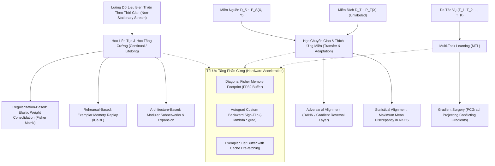
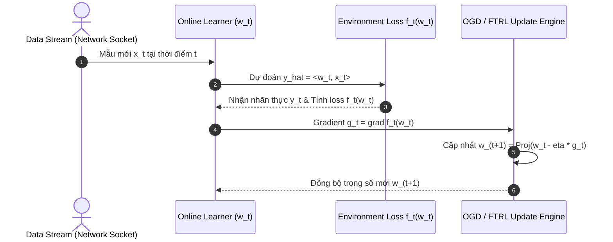
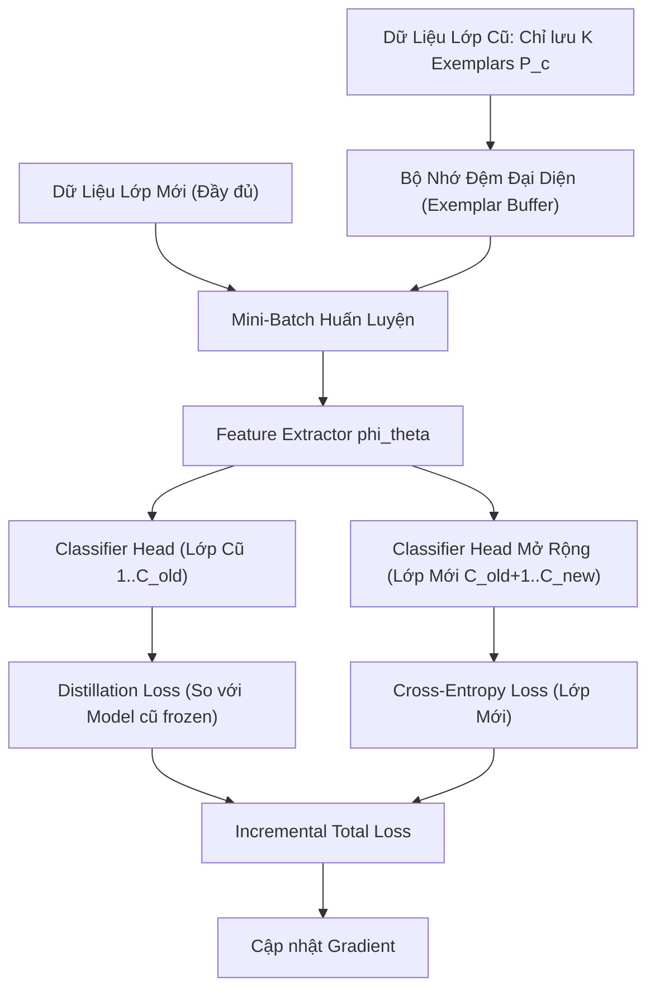
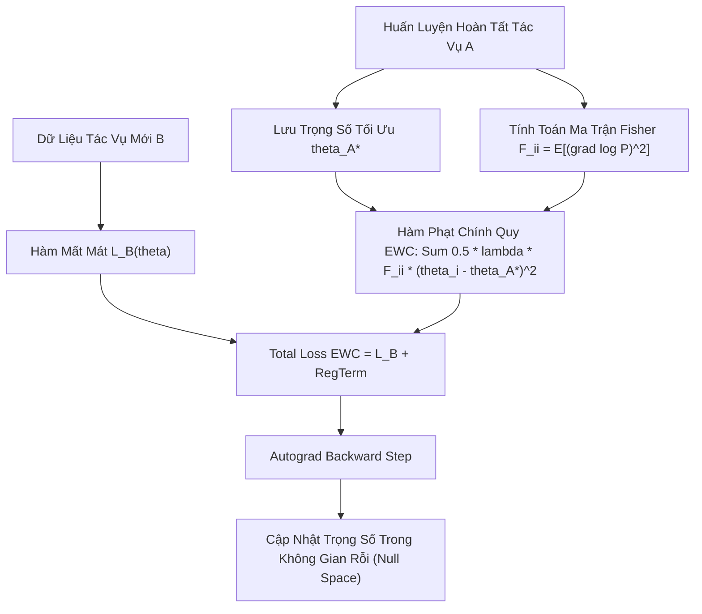
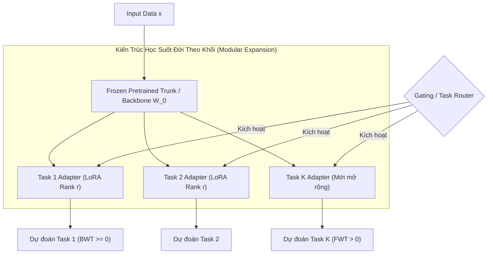
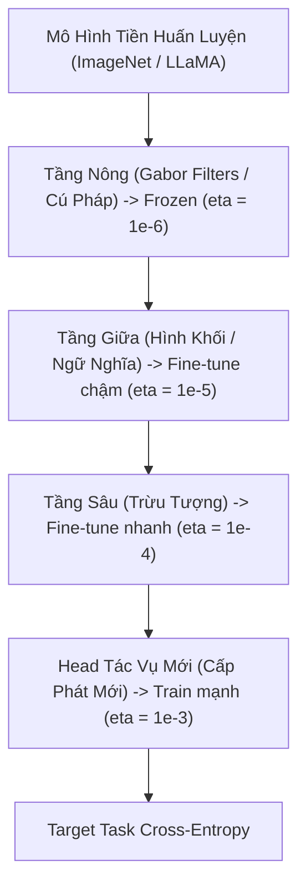
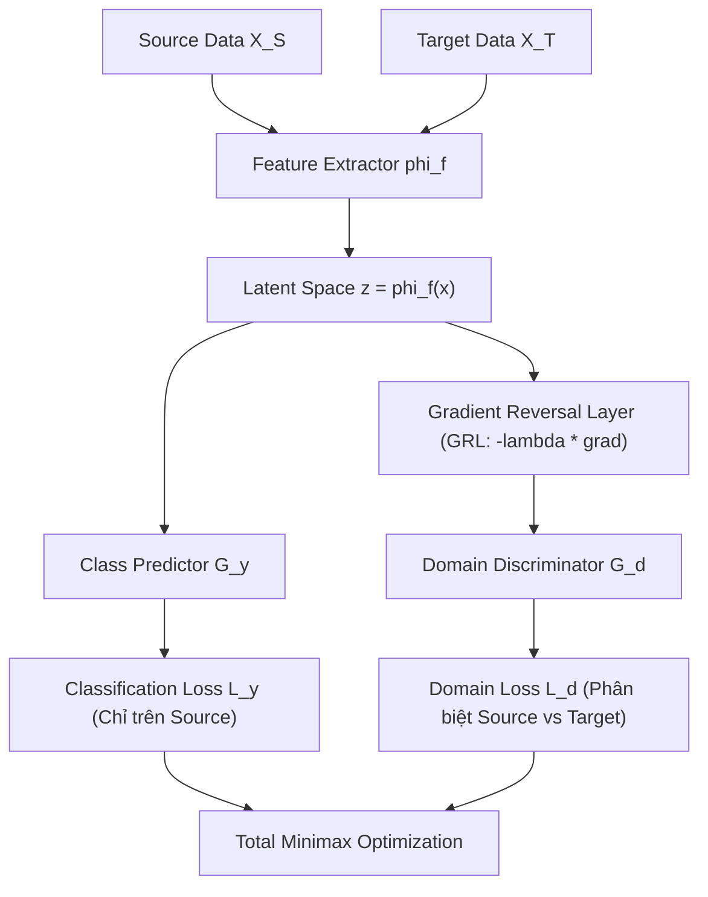
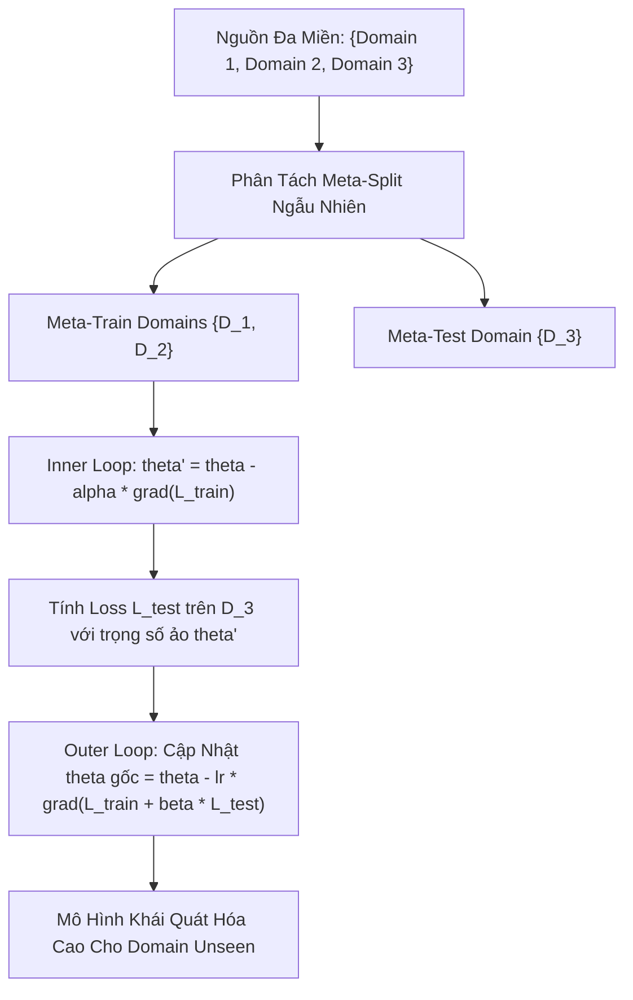
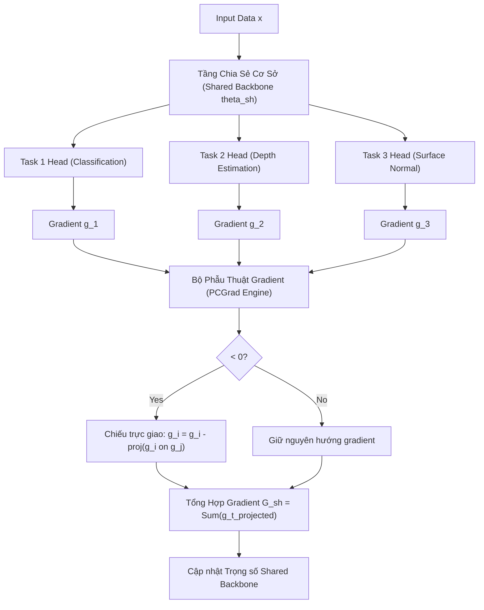
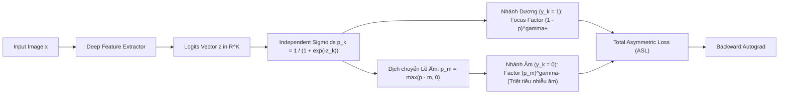

# Chuyên đề: Học Liên Tục, Thích Ứng Miền và Đa Tác Vụ (Continual, Lifelong & Domain Adaptation)

## 1. Tổng quan Chuyên đề

Hầu hết các hệ thống học máy truyền thống đều dựa trên giả định phân phối độc lập cùng phân phối (**i.i.d assumption**) và tính dừng (**stationarity**): Phân phối của dữ liệu huấn luyện và kiểm thử là bất biến theo thời gian ($P_{\text{train}}(\mathbf{X}, Y) = P_{\text{test}}(\mathbf{X}, Y)$). Tuy nhiên, trong thế giới thực, dữ liệu liên tục biến động (**Distribution Shift / Non-stationarity**), các tác vụ mới liên tục xuất hiện, và các môi trường vận hành luôn có sự sai khác (**Domain Shift**).

Chuyên đề này đi sâu vào ba trụ cột giải quyết thách thức này:
1. **Khắc phục Hiện tượng Đãng trí Thảm khốc (Catastrophic Forgetting)**: Làm thế nào để mô hình học tuần tự các tác vụ mới mà không làm suy giảm hiệu năng trên các tác vụ cũ (**Continual & Lifelong Learning**).
2. **Thu hẹp Khoảng cách Phân phối (Bridging Distributional Discrepancy)**: Ánh xạ đặc trưng từ miền nguồn (Source Domain) sang miền đích (Target Domain) sao cho biểu diễn thu được vừa giàu tính phân loại vừa bất biến theo miền (**Domain Adaptation & Domain Generalization**).
3. **Khai thác Tương quan Đa Tác vụ & Đa Nhãn (Multi-Task & Multi-Label Synergies)**: Tận dụng các biểu diễn chung để hỗ trợ lẫn nhau, xử lý xung đột gradient (**Gradient Surgery / PCGrad**) và mất cân bằng nhãn cực đoan.



---

## 2. Chi tiết từng Keyword

---

### 1. Online Learning (Học trực tuyến)

#### a. Định nghĩa Bản chất Toán học (Mathematical Formulation)
Học trực tuyến (Online Learning) diễn ra qua chuỗi các vòng lặp rời rạc $t = 1, 2, \dots, T$.
Tại mỗi vòng $t$:
1. Thuật toán chọn một điểm quyết định (trọng số mô hình) $\mathbf{w}_t \in \mathcal{W} \subseteq \mathbb{R}^d$.
2. Môi trường (có thể là đối kháng - adversarial) phản hồi một hàm mất mát lồi $f_t: \mathcal{W} \to \mathbb{R}$.
3. Thuật toán gánh chịu thiệt hại $f_t(\mathbf{w}_t)$ và nhận thông tin phản hồi (gradient $\nabla f_t(\mathbf{w}_t)$).
4. Thuật toán cập nhật trọng số thành $\mathbf{w}_{t+1}$.

Độ đo hiệu năng nền tảng là **Hối tiếc (Regret)** so với quyết định tĩnh tối ưu nhất trong quá khứ:
$$\operatorname{Regret}_T = \sum_{t=1}^T f_t(\mathbf{w}_t) - \min_{\mathbf{w}^* \in \mathcal{W}} \sum_{t=1}^T f_t(\mathbf{w}^*)$$

Thuật toán được coi là *học được* nếu nó đạt được **Sublinear Regret**: $\lim_{T \to \infty} \frac{\operatorname{Regret}_T}{T} = 0$, nghĩa là sai số trung bình tiệm cận 0.

Thuật toán **Online Mirror Descent (OMD)** tổng quát hóa Online Gradient Descent qua hàm phân kỳ Bregman $D_{\psi}(\mathbf{w}, \mathbf{u})$:
$$\mathbf{w}_{t+1} = \arg\min_{\mathbf{w} \in \mathcal{W}} \left\{ \langle \nabla f_t(\mathbf{w}_t), \mathbf{w} \rangle + \frac{1}{\eta_t} D_{\psi}(\mathbf{w}, \mathbf{w}_t) \right\}$$
Khi $\psi(\mathbf{w}) = \frac{1}{2} \|\mathbf{w}\|_2^2$, OMD trở thành Online Gradient Descent (OGD) với giới hạn hối tiếc $\mathcal{O}(\sqrt{T})$:
$$\mathbf{w}_{t+1} = \Pi_{\mathcal{W}}\left( \mathbf{w}_t - \eta_t \nabla f_t(\mathbf{w}_t) \right)$$

#### b. Cơ chế Tầng Sâu & Điện toán (Under The Hood / Hardware Internals)
- **Độ phức tạp Bộ nhớ Cố định $\mathcal{O}(1)$**:
  Khác với học batch yêu cầu lưu trữ toàn bộ tập dữ liệu trên DRAM/HBM, Online Learning chỉ yêu cầu lưu trữ vector trọng số $\mathbf{w} \in \mathbb{R}^d$ và trạng thái bộ tích lũy gradient (ví dụ AdaGrad/FTRL state).
- **Single-Pass Streaming & Cache Thrashes**:
  Dữ liệu đến từng mẫu hoặc mini-batch cực nhỏ qua socket mạng. Việc liên tục kích hoạt kernel CUDA với kích thước batch $B=1$ sẽ gây nghẽn nghiêm trọng do GPU Kernel Launch Overhead ($\approx 5-10\,\mu\text{s}$ mỗi lần gọi). Do đó, học trực tuyến tầng thấp thường được thực thi trực tiếp trên CPU SIMD AVX-512 hoặc gộp micro-batches ($B \approx 16-64$) trong L1 Cache.

#### c. Sơ đồ Minh họa (Mermaid Diagram)


#### d. Code Thực chiến (Dual-Engine: C++ & Python)

```cpp
// C++20: Online Gradient Descent (OGD) với L2 Projection và Streaming Processing
#include <iostream>
#include <vector>
#include <cmath>
#include <numeric>
#include <algorithm>

class OnlineLinearClassifier {
private:
    std::vector<float> weights;
    float lr;
    float radius; // Bán kính không gian lồi W = {w: ||w|| <= radius}

    void project_l2() {
        float norm_sq = 0.0f;
        for (float w : weights) norm_sq += w * w;
        float norm = std::sqrt(norm_sq);

        if (norm > radius) {
            float scale = radius / norm;
            for (float& w : weights) {
                w *= scale;
            }
        }
    }

public:
    OnlineLinearClassifier(size_t dim, float learning_rate, float max_norm)
        : weights(dim, 0.0f), lr(learning_rate), radius(max_norm) {}

    // Xử lý 1 mẫu streaming: x in R^d, y in {-1, +1}
    float update_sample(const float* x, float y) {
        // Dự đoán tích vô hướng <w, x>
        float pred = 0.0f;
        for (size_t i = 0; i < weights.size(); ++i) {
            pred += weights[i] * x[i];
        }

        // Hinge Loss: max(0, 1 - y * pred)
        float margin = y * pred;
        float loss = std::max(0.0f, 1.0f - margin);

        // Cập nhật OGD nếu margin < 1 (vi phạm biên)
        if (loss > 0.0f) {
            for (size_t i = 0; i < weights.size(); ++i) {
                weights[i] += lr * y * x[i]; // Gradient ascent trên reward = descent trên hinge
            }
            project_l2();
        }
        return loss;
    }

    [[nodiscard]] const std::vector<float>& get_weights() const noexcept {
        return weights;
    }
};

int main() {
    constexpr size_t D = 3;
    OnlineLinearClassifier model(D, 0.1f, 5.0f);

    float stream_x1[D] = {1.0f, -2.0f, 0.5f};
    float stream_y1 = 1.0f;

    float stream_x2[D] = {-0.5f, 1.5f, -1.0f};
    float stream_y2 = -1.0f;

    std::cout << "[C++ OGD] Loss Mẫu 1: " << model.update_sample(stream_x1, stream_y1) << "\n";
    std::cout << "[C++ OGD] Loss Mẫu 2: " << model.update_sample(stream_x2, stream_y2) << "\n";
    std::cout << "[C++ OGD] Trọng số sau cập nhật: [" 
              << model.get_weights()[0] << ", " 
              << model.get_weights()[1] << ", " 
              << model.get_weights()[2] << "]\n";
    return 0;
}
```

```python
# Python / PyTorch: Online Gradient Descent cho Streaming Stream
import torch
import torch.nn as nn

class OnlineLogisticRegression(nn.Module):
    def __init__(self, in_features: int, lr: float = 0.05):
        super().__init__()
        self.linear = nn.Linear(in_features, 1, bias=False)
        self.optimizer = torch.optim.SGD(self.linear.parameters(), lr=lr)
        self.criterion = nn.BCEWithLogitsLoss()

    def step_stream(self, x_t: torch.Tensor, y_t: torch.Tensor) -> float:
        # x_t: (1, D), y_t: (1, 1)
        self.optimizer.zero_grad(set_to_none=True)
        logit = self.linear(x_t)
        loss = self.criterion(logit, y_t)
        loss.backward()
        self.optimizer.step()
        return loss.item()

if __name__ == "__main__":
    D = 4
    model = OnlineLogisticRegression(in_features=D, lr=0.1)
    
    # Mô phỏng dữ liệu dòng chảy 3 thời điểm
    for t in range(3):
        x_t = torch.randn(1, D)
        y_t = torch.randint(0, 2, (1, 1)).float()
        loss_val = model.step_stream(x_t, y_t)
        print(f"[PyTorch Online Learning] Step {t+1} - Loss: {loss_val:.4f}")
```

#### e. Lỗi Thường gặp & Ổn định Số học (Pitfalls & Numerical Stability)
- **Tốc độ học không suy giảm gây phân kỳ (Divergence with Constant LR)**: Với hàm lồi tổng quát, việc cố định $\eta_t = \eta_0$ sẽ khiến thuật toán chỉ dao động quanh nghiệm tối ưu với bán kính lỗi phụ thuộc vào độ lớn của gradient mà không thể hội tụ (không đạt sublinear regret). Cần thiết lập bước nhảy suy giảm: $\eta_t = \frac{\eta_0}{\sqrt{t}}$.
- **Catastrophic Cancellation trong Trôi dạt Phân phối (Concept Drift)**: Khi phân phối $P(Y \mid \mathbf{X})$ đảo ngược đột ngột, bộ tích lũy gradient cũ trong các phương pháp như Adam sẽ cản trở mô hình quay đầu thích ứng nhanh.

#### f. Ứng dụng Thực chiến trong AI / Deep Learning
- **Đấu giá Quảng cáo Thời gian thực (Real-Time Bidding - RTB)**: Dự đoán tỷ lệ nhấp chuột (Click-Through Rate - CTR) cho hàng triệu phiên đấu thầu quảng cáo mỗi giây tại Google/Meta bằng thuật toán FTRL-Proximal (Follow-The-Regularized-Leader).

---

### 2. Incremental Learning (Học tăng dần)

#### a. Định nghĩa Bản chất Toán học (Mathematical Formulation)
Học tăng dần (Incremental Learning) xử lý bài toán khi dữ liệu xuất hiện theo từng khối phân mảnh hoặc các lớp mới xuất hiện tuần tự theo thời gian:
- **Class-Incremental Learning (CIL)**: Tại bước $t=1$, học các lớp $\{1, \dots, C_1\}$. Tại bước $t=2$, học các lớp mới $\{C_1+1, \dots, C_2\}$ mà không có quyền truy cập đầy đủ lại dữ liệu của các lớp cũ. Khi kiểm thử, mô hình phải phân loại trên toàn bộ không gian hợp $\{1, \dots, C_t\}$ mà không biết mẫu thuộc pha nào.

**Thuật toán Tuyển chọn Mẫu Đại diện (Herding Algorithm / Exemplar Selection)** trong iCaRL:
Mỗi lớp cũ được lưu giữ một ngân sách cố định $K$ mẫu đại diện (exemplars) $\mathcal{P} = \{\mathbf{p}_1, \dots, \mathbf{p}_K\}$ sao cho trọng tâm của tập đại diện xấp xỉ tối ưu trọng tâm thực tế trong không gian embedding:
$$\mathbf{p}_k = \arg\min_{\mathbf{x} \in \mathcal{X}_c} \left\| \frac{1}{|\mathcal{X}_c|} \sum_{i=1}^{|\mathcal{X}_c|} \phi(\mathbf{x}_i) - \frac{1}{k} \left( \phi(\mathbf{x}) + \sum_{j=1}^{k-1} \phi(\mathbf{p}_j) \right) \right\|_2$$

Hàm mất mát kết hợp chưng cất tri thức (Knowledge Distillation) để bảo tồn tri thức cũ:
$$\mathcal{L}_{\text{inc}}(\mathbf{\theta}) = \mathcal{L}_{\text{CE}}(\text{mới}) + \lambda_{\text{distill}} \sum_{c=1}^{C_{\text{old}}} q_c \log p_c(\mathbf{x}; \mathbf{\theta})$$

#### b. Cơ chế Tầng Sâu & Điện toán (Under The Hood / Hardware Internals)
- **Tái cấu trúc Ma trận Phân loại (Dynamic Classifier Head Resizing)**:
  Khi có lớp mới, kích thước ma trận trọng số tầng cuối cùng phải mở rộng từ $\mathbf{W}_{\text{old}} \in \mathbb{R}^{C_{\text{old}} \times D}$ sang $\mathbf{W}_{\text{new}} \in \mathbb{R}^{(C_{\text{old}} + \Delta C) \times D}$.
  Thao tác này trên GPU đòi hỏi cấp phát một vùng nhớ mới liên tục, sao chép trọng số cũ sang (`cudaMemcpyDeviceToDevice`), khởi tạo ngẫu nhiên khối trọng số mới, và giải phóng bộ nhớ cũ để tránh rò rỉ VRAM.
- **Hiện tượng Thiên lệch Lớp Mới (Task-Recency Bias)**:
  Tầng fully-connected có xu hướng sinh ra chuẩn vector trọng số $\|\mathbf{w}_c\|_2$ cho các lớp mới lớn hơn đáng kể so với các lớp cũ, do gradient của các lớp mới xuất hiện thường xuyên hơn. Kỹ thuật *Cosine Normalization* loại bỏ độ dài vector, chỉ giữ lại góc: $\frac{\mathbf{w}^T \mathbf{x}}{\|\mathbf{w}\| \|\mathbf{x}\|}$.

#### c. Sơ đồ Minh họa (Mermaid Diagram)


#### d. Code Thực chiến (Dual-Engine: C++ & Python)

```cpp
// C++20: Herding Exemplar Selection Engine (Tối ưu hóa Euclidean Distance trong Feature Space)
#include <iostream>
#include <vector>
#include <cmath>
#include <numeric>

class HerdingEngine {
public:
    // Input: features có shape (N x D), chọn ra K mẫu đại diện tối ưu
    static std::vector<size_t> select_exemplars(const std::vector<float>& features, size_t n, size_t d, size_t k) {
        // 1. Tính toán Mean Vector thực tế mu của toàn bộ N mẫu
        std::vector<float> mean_vec(d, 0.0f);
        for (size_t i = 0; i < n; ++i) {
            const float* row = features.data() + (i * d);
            for (size_t j = 0; j < d; ++j) {
                mean_vec[j] += row[j];
            }
        }
        for (size_t j = 0; j < d; ++j) mean_vec[j] /= static_cast<float>(n);

        // 2. Thuật toán tham lam Herding
        std::vector<size_t> selected_indices;
        selected_indices.reserve(k);
        std::vector<float> running_sum(d, 0.0f);

        for (size_t step = 1; step <= k; ++step) {
            float min_dist_sq = 1e9f;
            size_t best_idx = 0;

            for (size_t i = 0; i < n; ++i) {
                const float* candidate = features.data() + (i * d);
                float dist_sq = 0.0f;
                float inv_step = 1.0f / static_cast<float>(step);

                for (size_t j = 0; j < d; ++j) {
                    float current_center = (running_sum[j] + candidate[j]) * inv_step;
                    float diff = mean_vec[j] - current_center;
                    dist_sq += diff * diff;
                }

                if (dist_sq < min_dist_sq) {
                    min_dist_sq = dist_sq;
                    best_idx = i;
                }
            }

            selected_indices.push_back(best_idx);
            const float* best_candidate = features.data() + (best_idx * d);
            for (size_t j = 0; j < d; ++j) {
                running_sum[j] += best_candidate[j];
            }
        }
        return selected_indices;
    }
};

int main() {
    constexpr size_t N = 4;
    constexpr size_t D = 2;
    std::vector<float> mock_features = {
        1.0f, 1.0f, // Mẫu 0
        1.2f, 0.8f, // Mẫu 1
        5.0f, 5.0f, // Mẫu 2 (Outlier)
        1.1f, 1.1f  // Mẫu 3 (Gần sát tâm cụm)
    };

    auto exemplars = HerdingEngine::select_exemplars(mock_features, N, D, 2);
    std::cout << "[C++ Herding Engine] Top 2 Exemplars được chọn: ";
    for (size_t id : exemplars) std::cout << id << " ";
    std::cout << "\n";
    return 0;
}
```

```python
# Python / PyTorch: Mở rộng Đầu Phân Loại Động (Dynamic Classifier Expansion)
import torch
import torch.nn as nn

class IncrementalClassifier(nn.Module):
    def __init__(self, in_features: int, initial_classes: int):
        super().__init__()
        self.in_features = in_features
        self.head = nn.Linear(in_features, initial_classes)

    def expand_classes(self, num_new_classes: int):
        old_out = self.head.out_features
        new_out = old_out + num_new_classes

        # Khởi tạo Linear layer mới lớn hơn
        new_head = nn.Linear(self.in_features, new_out)

        # Sao chép trọng số cũ sang, bảo toàn bộ nhớ
        with torch.no_grad():
            new_head.weight[:old_out] = self.head.weight
            new_head.bias[:old_out] = self.head.bias
            # Khởi tạo trọng số mới bằng He-Initialization
            nn.init.kaiming_normal_(new_head.weight[old_out:], nonlinearity="linear")
            new_head.bias[old_out:].zero_()

        self.head = new_head

    def forward(self, x: torch.Tensor) -> torch.Tensor:
        return self.head(x)

if __name__ == "__main__":
    D = 16
    model = IncrementalClassifier(in_features=D, initial_classes=5)
    x = torch.randn(2, D)
    print(f"[PyTorch Incremental] Ban đầu (5 classes): Shape logits = {model(x).shape}")

    # Học thêm 3 lớp mới
    model.expand_classes(num_new_classes=3)
    print(f"[PyTorch Incremental] Sau khi mở rộng (8 classes): Shape logits = {model(x).shape}")
```

#### e. Lỗi Thường gặp & Ổn định Số học (Pitfalls & Numerical Stability)
- **Thiên lệch Chuẩn Logit (Logit Scale Drift)**: Do không có mẫu âm tính của lớp cũ trong batch mới, xác suất softmax của các lớp mới luôn áp đảo. Nếu không dùng cân bằng nhãn (Weight Aligning hoặc Cosine Classifier), tỷ lệ nhận diện sai nhãn cũ sang nhãn mới có thể lên tới $>90\%$.

#### f. Ứng dụng Thực chiến trong AI / Deep Learning
- **Hệ thống Nhận diện Khuôn mặt (Face Identification)**: Thêm nhân viên mới vào cơ sở dữ liệu khuôn mặt công ty định kỳ mà không cần huấn luyện lại toàn bộ mô hình backbone từ đầu.

---

### 3. Continual Learning (Học liên tục)

#### a. Định nghĩa Bản chất Toán học (Mathematical Formulation)
Học liên tục (Continual Learning) giải quyết bài toán chuỗi tác vụ liên tục $\mathcal{T}_1, \mathcal{T}_2, \dots, \mathcal{T}_K$. Khi chuyển sang học tác vụ $\mathcal{T}_B$, việc tối ưu hóa thông thường làm thay đổi các trọng số quan trọng của tác vụ $\mathcal{T}_A$, dẫn tới **Đãng trí Thảm khốc (Catastrophic Forgetting)**:
$$\Delta \mathcal{L}_A \approx \frac{1}{2} (\mathbf{\theta} - \mathbf{\theta}_A^*)^T \mathbf{H}_A (\mathbf{\theta} - \mathbf{\theta}_A^*)$$
Trong đó $\mathbf{H}_A = \nabla^2 \mathcal{L}_A(\mathbf{\theta}_A^*)$ là ma trận Hessian của tác vụ $A$.

**Elastic Weight Consolidation (EWC)** (Kirkpatrick et al., 2017) xấp xỉ ma trận Hessian bằng **Ma trận Thông tin Fisher (Fisher Information Matrix - FIM)**:
$$\mathbf{F} = \mathbb{E}_{\mathbf{x} \sim \mathcal{D}_A, y \sim P_{\mathbf{\theta}^*}(Y \mid \mathbf{x})} \left[ \nabla_{\mathbf{\theta}} \log P_{\mathbf{\theta}}(y \mid \mathbf{x}) \, \nabla_{\mathbf{\theta}} \log P_{\mathbf{\theta}}(y \mid \mathbf{x})^T \right]$$

EWC sử dụng đường chéo của ma trận Fisher (Diagonal Fisher) để tạo lực cản chính quy hóa bậc hai:
$$\mathcal{L}_{\text{EWC}}(\mathbf{\theta}) = \mathcal{L}_B(\mathbf{\theta}) + \sum_{i=1}^{|\mathbf{\theta}|} \frac{\lambda}{2} F_{ii} (\theta_i - \theta_{A, i}^*)^2$$
Các tham số nào có $F_{ii}$ lớn (nhạy cảm cao với tác vụ cũ) sẽ bị khóa chặt, buộc mô hình phải di chuyển trong các không gian con trực giao (orthogonal null-space) để học tác vụ mới.

#### b. Cơ chế Tầng Sâu & Điện toán (Under The Hood / Hardware Internals)
- **Bùng nổ Bộ nhớ cho Ma trận Hessian**:
  Ma trận Hessian toàn phần $\mathbf{H} \in \mathbb{R}^{P \times P}$ với mô hình $P = 10^8$ tham số đòi hỏi $10^{16} \times 4 \text{ bytes} \approx 40,000 \text{ Terabytes}$ VRAM (bất khả thi).
  Việc xấp xỉ bằng đường chéo Fisher (Diagonal Fisher Approximation) giảm độ phức tạp không gian về đúng $\mathcal{O}(P)$ bytes (chỉ cần thêm 1 tensor cùng kích thước trọng số trên GPU DRAM).
- **Tính toán Gradient Bình phương không dùng Loop**:
  Fisher đường chéo được tích lũy hiệu quả trên GPU bằng cách bình phương gradient của log-softmax:
  $$F_{ii} \leftarrow \frac{1}{N} \sum_{k=1}^N \left( \frac{\partial \log P(y_k \mid \mathbf{x}_k)}{\partial \theta_i} \right)^2$$

#### c. Sơ đồ Minh họa (Mermaid Diagram)


#### d. Code Thực chiến (Dual-Engine: C++ & Python)

```cpp
// C++20: Bộ tính toán Lực cản Elastic Weight Consolidation (EWC Penalty Engine)
#include <iostream>
#include <vector>

class EWCPenaltyCalculator {
private:
    std::vector<float> theta_star;  // Trọng số tối ưu của tác vụ cũ
    std::vector<float> fisher_diag; // Đường chéo ma trận Fisher
    float lambda_reg;

public:
    EWCPenaltyCalculator(std::vector<float> old_weights, std::vector<float> fisher, float lambda)
        : theta_star(std::move(old_weights)), fisher_diag(std::move(fisher)), lambda_reg(lambda) {}

    // Tính toán Penalty Loss và Gradient phạt bổ sung
    float compute_loss_and_grad(const std::vector<float>& current_weights, std::vector<float>& grad_out) const {
        float penalty_loss = 0.0f;
        const size_t n = current_weights.size();

        for (size_t i = 0; i < n; ++i) {
            float diff = current_weights[i] - theta_star[i];
            float f = fisher_diag[i];
            penalty_loss += 0.5f * lambda_reg * f * diff * diff;
            grad_out[i] += lambda_reg * f * diff; // Cộng dồn trực tiếp vào gradient tác vụ mới
        }
        return penalty_loss;
    }
};

int main() {
    std::vector<float> old_w = {1.5f, -0.8f, 2.0f};
    std::vector<float> fisher = {100.0f, 5.0f, 50.0f}; // Trọng số 0 và 2 rất quan trọng với Task A
    float lambda = 1.0f;

    EWCPenaltyCalculator ewc(old_w, fisher, lambda);

    std::vector<float> current_w = {1.6f, -0.4f, 1.9f};
    std::vector<float> grads = {0.0f, 0.0f, 0.0f};

    float penalty = ewc.compute_loss_and_grad(current_w, grads);

    std::cout << "[C++ EWC] Penalty Loss: " << penalty << "\n";
    std::cout << "[C++ EWC] Gradient điều chỉnh: [" 
              << grads[0] << ", " << grads[1] << ", " << grads[2] << "]\n";
    return 0;
}
```

```python
# Python / PyTorch: EWC Trainer với Fisher Information Accumulation
import torch
import torch.nn as nn

class EWCTrainer:
    def __init__(self, model: nn.Module, lambda_reg: float = 1000.0):
        self.model = model
        self.lambda_reg = lambda_reg
        self.fisher: dict[str, torch.Tensor] = {}
        self.optimal_weights: dict[str, torch.Tensor] = {}

    def register_task(self, dataloader: torch.utils.data.DataLoader, device: str = "cpu"):
        self.model.eval()
        self.model.zero_grad(set_to_none=True)

        # Lưu lại điểm tối ưu theta*
        for name, param in self.model.named_parameters():
            self.optimal_weights[name] = param.detach().clone()
            self.fisher[name] = torch.zeros_like(param)

        # Tính đường chéo Fisher thực nghiệm
        total_samples = 0
        for x, y in dataloader:
            x, y = x.to(device), y.to(device)
            self.model.zero_grad(set_to_none=True)
            logits = self.model(x)
            loss = nn.functional.cross_entropy(logits, y)
            loss.backward()

            with torch.no_grad():
                for name, param in self.model.named_parameters():
                    if param.grad is not None:
                        self.fisher[name] += param.grad.pow(2) * len(x)
            total_samples += len(x)

        for name in self.fisher:
            self.fisher[name] /= total_samples

    def compute_ewc_loss(self) -> torch.Tensor:
        loss = torch.tensor(0.0)
        for name, param in self.model.named_parameters():
            if name in self.fisher:
                diff = param - self.optimal_weights[name]
                loss += (self.fisher[name] * diff.pow(2)).sum()
        return 0.5 * self.lambda_reg * loss

if __name__ == "__main__":
    net = nn.Sequential(nn.Linear(4, 8), nn.ReLU(), nn.Linear(8, 2))
    ewc = EWCTrainer(net, lambda_reg=500.0)

    # Giả lập DataLoader cho Task A
    mock_x = torch.randn(10, 4)
    mock_y = torch.randint(0, 2, (10,))
    loader = [(mock_x, mock_y)]
    ewc.register_task(loader)

    # Khi huấn luyện Task B:
    penalty = ewc.compute_ewc_loss()
    print(f"[PyTorch EWC] Penalty ban đầu (khi chưa dịch chuyển trọng số): {penalty.item():.4f}")
```

#### e. Lỗi Thường gặp & Ổn định Số học (Pitfalls & Numerical Stability)
- **Vấn đề Dung lượng Quá tải (Capacity Saturation)**: Khi số lượng tác vụ $K$ tăng lên hàng chục hoặc hàng trăm, hầu hết các trọng số $\theta_i$ đều có Fisher tích lũy cao, khiến mô hình bị "đông cứng" hoàn toàn (zero plasticity) và không thể tiếp thu thêm tác vụ mới. Cần kết hợp mở rộng kiến trúc động (Dynamic Network Expansion).

#### f. Ứng dụng Thực chiến trong AI / Deep Learning
- **Trợ lý Ảo Cá nhân hóa Tuần tự**: Mô hình ngôn ngữ hoặc giọng nói trên điện thoại thông minh học thêm ngữ âm và từ vựng mới của người dùng theo thời gian mà không quên đi bộ ngữ pháp tiếng mẹ đẻ ban đầu.

---

### 4. Lifelong Learning (Học suốt đời)

#### a. Định nghĩa Bản chất Toán học (Mathematical Formulation)
Học suốt đời (Lifelong Learning) mở rộng Continual Learning với mục tiêu cao hơn: Không chỉ chống quên (**Zero Backward Transfer Degradation**), mà việc học các tác vụ tương lai phải hỗ trợ cải thiện các tác vụ quá khứ (**Positive Backward Transfer - BWT**), và tri thức quá khứ phải giúp học tác vụ mới nhanh hơn (**Positive Forward Transfer - FWT**).

Gọi ma trận hiệu năng $R \in \mathbb{R}^{K \times K}$, trong đó $R_{i, j}$ là độ đo hiệu năng trên tác vụ $j$ sau khi mô hình đã học xong tác vụ $i$.
1. **Average Accuracy (Độ chính xác trung bình)**:
   $$\operatorname{ACC} = \frac{1}{K} \sum_{j=1}^K R_{K, j}$$
2. **Backward Transfer (Chuyển giao ngược)**:
   $$\operatorname{BWT} = \frac{1}{K-1} \sum_{j=1}^{K-1} (R_{K, j} - R_{j, j})$$
   ($\text{BWT} < 0$: Đãng trí thảm khốc; $\text{BWT} > 0$: Học cái mới làm sáng tỏ và giỏi hơn ở cái cũ).
3. **Forward Transfer (Chuyển giao xuôi)**:
   $$\operatorname{FWT} = \frac{1}{K-1} \sum_{j=2}^K (R_{j-1, j} - b_j)$$
   Trong đó $b_j$ là độ chính xác của một mô hình ngẫu nhiên (chưa học gì) trên tác vụ $j$.

#### b. Cơ chế Tầng Sâu & Điện toán (Under The Hood / Hardware Internals)
- **Kiến trúc Mở rộng Module Động (Dynamic Modular Routing)**:
  Thay vì chia sẻ một khối trọng số duy nhất, Lifelong Learning hiện đại áp dụng cấu trúc Mixture of Experts (MoE) hoặc Adapter Hub. Mỗi tác vụ mới có thể kích hoạt một nhóm adapter module riêng biệt (ví dụ LoRA ranks).
- **Phân bổ Bộ nhớ Rời rạc & DMA Transfers**:
  Các adapter cũ được chuyển vào bộ nhớ Host RAM (hoặc NVMe SSD) và chỉ nạp qua bus PCIe (DMA Transfer) vào VRAM khi tác vụ tương ứng được truy vấn tại thời điểm suy luận, bảo đảm VRAM GPU không bao giờ bị vượt ngưỡng.

#### c. Sơ đồ Minh họa (Mermaid Diagram)


#### d. Code Thực chiến (Dual-Engine: C++ & Python)

```cpp
// C++20: Bộ Đánh giá Chỉ số Học Suốt đời (Lifelong Metrics Evaluator: ACC, BWT, FWT)
#include <iostream>
#include <vector>
#include <iomanip>

class LifelongMetrics {
public:
    // Ma trận R có kích thước K x K lưu trữ dưới dạng Row-Major
    // random_baselines có kích thước K
    static void evaluate(const std::vector<float>& R, const std::vector<float>& b, size_t K) {
        // 1. Average Accuracy
        float acc = 0.0f;
        for (size_t j = 0; j < K; ++j) {
            acc += R[(K - 1) * K + j];
        }
        acc /= static_cast<float>(K);

        // 2. Backward Transfer (BWT)
        float bwt = 0.0f;
        for (size_t j = 0; j < K - 1; ++j) {
            float r_kj = R[(K - 1) * K + j];
            float r_jj = R[j * K + j];
            bwt += (r_kj - r_jj);
        }
        bwt /= static_cast<float>(K - 1);

        // 3. Forward Transfer (FWT)
        float fwt = 0.0f;
        for (size_t j = 1; j < K; ++j) {
            float r_prev_j = R[(j - 1) * K + j];
            fwt += (r_prev_j - b[j]);
        }
        fwt /= static_cast<float>(K - 1);

        std::cout << std::fixed << std::setprecision(4);
        std::cout << "[C++ Lifelong Metrics Report]\n";
        std::cout << "  Average Accuracy (ACC): " << acc * 100.0f << "%\n";
        std::cout << "  Backward Transfer (BWT): " << bwt * 100.0f << "% " 
                  << (bwt >= 0 ? "(Tích cực: Hỗ trợ tri thức cũ)" : "(Tiêu cực: Đãng trí)") << "\n";
        std::cout << "  Forward Transfer (FWT) : " << fwt * 100.0f << "% (Chuyển giao xuôi)\n";
    }
};

int main() {
    constexpr size_t K = 3;
    // Ma trận R (3x3):
    // Sau Task 0: R[0,0]=0.85, R[0,1]=0.10, R[0,2]=0.10
    // Sau Task 1: R[1,0]=0.82, R[1,1]=0.88, R[1,2]=0.15
    // Sau Task 2: R[2,0]=0.84, R[2,1]=0.89, R[2,2]=0.91
    std::vector<float> R = {
        0.85f, 0.10f, 0.10f,
        0.82f, 0.88f, 0.15f,
        0.84f, 0.89f, 0.91f
    };
    std::vector<float> baselines = {0.10f, 0.10f, 0.10f};

    LifelongMetrics::evaluate(R, baselines, K);
    return 0;
}
```

```python
# Python / PyTorch: Kiến trúc Adapter Mở rộng Động cho Học Suốt đời
import torch
import torch.nn as nn

class LifelongModularAdapter(nn.Module):
    def __init__(self, in_features: int, adapter_dim: int = 4):
        super().__init__()
        self.in_features = in_features
        self.adapter_dim = adapter_dim
        # Cố định backbone cơ sở
        self.backbone = nn.Linear(in_features, in_features)
        self.backbone.weight.requires_grad = False
        self.backbone.bias.requires_grad = False

        # Danh sách adapter động mở rộng cho từng tác vụ
        self.task_adapters = nn.ModuleDict()

    def add_task(self, task_name: str):
        adapter = nn.Sequential(
            nn.Linear(self.in_features, self.adapter_dim, bias=False),
            nn.ReLU(),
            nn.Linear(self.adapter_dim, self.in_features, bias=False)
        )
        # Khởi tạo ma trận thứ hai bằng 0 để ban đầu adapter không ảnh hưởng kết quả
        adapter[2].weight.data.zero_()
        self.task_adapters[task_name] = adapter

    def forward(self, x: torch.Tensor, task_name: str) -> torch.Tensor:
        base_out = self.backbone(x)
        if task_name in self.task_adapters:
            delta = self.task_adapters[task_name](x)
            return base_out + delta
        return base_out

if __name__ == "__main__":
    model = LifelongModularAdapter(in_features=8, adapter_dim=2)
    model.add_task("task_nlp")
    model.add_task("task_vision")

    x = torch.randn(2, 8)
    out_nlp = model(x, "task_nlp")
    print(f"[PyTorch Lifelong Adapter] Tác vụ NLP Forward Output Shape: {out_nlp.shape}")
```

#### e. Lỗi Thường gặp & Ổn định Số học (Pitfalls & Numerical Stability)
- **Tích lũy Lỗi Gating (Router Misclassification)**: Nếu bộ định tuyến tác vụ (Task Identification Model) tại thời điểm suy luận phân loại nhầm tác vụ đích (chọn nhầm adapter), hiệu năng sẽ suy sụp về mức ngẫu nhiên. Trong thực tế, cần cơ chế Confidence Calibration hoặc nhúng Task ID tường minh vào prompt/đầu vào.

#### f. Ứng dụng Thực chiến trong AI / Deep Learning
- **Hệ thống AI Tự Hành Không Gian (Autonomous Space Exploration)**: Robot thăm dò sao Hỏa tự học cách thích nghi với các địa hình mới lạ qua nhiều năm mà không thể kết nối mạng về Trái Đất để huấn luyện lại.

---

### 5. Transfer Learning (Học chuyển giao)

#### a. Định nghĩa Bản chất Toán học (Mathematical Formulation)
Học chuyển giao (Transfer Learning) bao gồm:
- **Miền Nguồn (Source Domain)**: $\mathcal{D}_S = \{\mathcal{X}_S, P_S(\mathbf{X})\}$, tác vụ nguồn $\mathcal{T}_S = \{\mathcal{Y}_S, f_S(\cdot)\}$.
- **Miền Đích (Target Domain)**: $\mathcal{D}_T = \{\mathcal{X}_T, P_T(\mathbf{X})\}$, tác vụ đích $\mathcal{T}_T = \{\mathcal{Y}_T, f_T(\cdot)\}$.

Giả thiết cơ sở: Tri thức từ $\mathcal{D}_S, \mathcal{T}_S$ giúp tăng tốc và nâng cao độ chính xác học hàm mục tiêu $f_T(\cdot)$ khi dữ liệu $\mathcal{D}_T$ rất khan hiếm ($N_T \ll N_S$).

Hai chiến lược thực thi chính:
1. **Trích xuất Đặc trưng Cố định (Feature Extraction / Linear Probing)**:
   $$\mathbf{\theta}_{\text{backbone}}^* = \text{const}, \quad \min_{\mathbf{W}_{\text{head}}} \frac{1}{N_T} \sum_{i=1}^{N_T} \ell(f(\mathbf{x}_i; \mathbf{\theta}_{\text{backbone}}^*, \mathbf{W}_{\text{head}}), y_i)$$
2. **Tinh chỉnh Toàn phần có Kiểm soát (Discriminative Fine-Tuning)**:
   Áp dụng tốc độ học phân tầng (Layer-wise Adaptive Learning Rates):
   $$\eta_l = \eta_{L} \cdot \alpha^{L - l}, \quad \alpha \in (0, 1)$$
   Các tầng nông (nằm gần đầu vào) có tốc độ học rất nhỏ để bảo toàn các đặc trưng thị giác/ngữ pháp cơ bản, các tầng sâu có tốc độ học lớn hơn để thích nghi nhanh với ngữ nghĩa tác vụ đích.

#### b. Cơ chế Tầng Sâu & Điện toán (Under The Hood / Hardware Internals)
- **Tiết kiệm Bộ nhớ khi Đóng băng Trọng số (`requires_grad = False`)**:
  Khi đóng băng phần lớn các tầng (backbone), PyTorch Autograd Engine không cần cấp phát tensor đạo hàm $\frac{\partial \mathcal{L}}{\partial \mathbf{W}_l}$ trên VRAM.
  Quan trọng hơn, các bộ tối ưu hóa bậc nhất có trạng thái (như AdamW cần lưu trữ vector momentum $\mathbf{m}$ và phương sai $\mathbf{v}$) sẽ **tiết kiệm được gấp 2 lần dung lượng bộ nhớ tham số** đối với các trọng số bị đóng băng:
  $$\Delta \text{VRAM}_{\text{saved}} = 2 \times P_{\text{frozen}} \times \text{sizeof(FP32)}$$
- **Gradient Checkpointing trong Fine-Tuning**:
  Kỹ thuật tái tính toán (recomputation) loại bỏ việc lưu trữ activations trong forward pass, giảm bộ nhớ kích hoạt từ $\mathcal{O}(L)$ xuống $\mathcal{O}(\sqrt{L})$ với chi phí tăng thêm $33\%$ thời gian tính toán.

#### c. Sơ đồ Minh họa (Mermaid Diagram)


#### d. Code Thực chiến (Dual-Engine: C++ & Python)

```cpp
// C++20: Mô phỏng Pipeline Phân tầng Learning Rate (Layer-wise Differential LR Engine)
#include <iostream>
#include <vector>
#include <cmath>

struct LayerParameter {
    float weight;
    float grad;
    float lr;
};

class LayerwiseOptimizer {
private:
    std::vector<LayerParameter> layers;

public:
    void add_layer(float initial_w, float specific_lr) {
        layers.push_back({initial_w, 0.0f, specific_lr});
    }

    void set_grad(size_t layer_idx, float g) {
        if (layer_idx < layers.size()) {
            layers[layer_idx].grad = g;
        }
    }

    void step() {
        for (auto& l : layers) {
            l.weight -= l.lr * l.grad;
            l.grad = 0.0f; // Reset gradient
        }
    }

    void print_status() const {
        for (size_t i = 0; i < layers.size(); ++i) {
            std::cout << "  Layer " << i << " (LR: " << layers[i].lr 
                      << ") -> Weight mới: " << layers[i].weight << "\n";
        }
    }
};

int main() {
    LayerwiseOptimizer opt;
    // Tầng nông: LR rất nhỏ để giữ đặc trưng tổng quát
    opt.add_layer(1.0f, 0.0001f);
    // Tầng giữa: LR trung bình
    opt.add_layer(2.0f, 0.001f);
    // Tầng đầu ra mới: LR lớn để hội tụ nhanh
    opt.add_layer(0.5f, 0.05f);

    // Giả lập gradient truyền ngược về từ loss
    opt.set_grad(0, 2.5f);
    opt.set_grad(1, 2.5f);
    opt.set_grad(2, 2.5f);

    opt.step();
    std::cout << "[C++ Transfer Optimizer] Trạng thái trọng số sau 1 bước tối ưu:\n";
    opt.print_status();
    return 0;
}
```

```python
# Python / PyTorch: Thiết lập Discriminative Fine-Tuning với Tốc độ Học Phân tầng
import torch
import torch.nn as nn

class TransferModel(nn.Module):
    def __init__(self, num_classes: int):
        super().__init__()
        # Backbone giả lập 3 tầng
        self.stage1 = nn.Linear(10, 20)
        self.stage2 = nn.Linear(20, 20)
        self.head = nn.Linear(20, num_classes)

    def forward(self, x: torch.Tensor) -> torch.Tensor:
        x = torch.relu(self.stage1(x))
        x = torch.relu(self.stage2(x))
        return self.head(x)

if __name__ == "__main__":
    model = TransferModel(num_classes=2)

    # Đóng băng hoàn toàn stage1
    for param in model.stage1.parameters():
        param.requires_grad = False

    # Phân bổ nhóm tham số với learning rate khác nhau cho PyTorch Optimizer
    optimizer = torch.optim.AdamW([
        {"params": model.stage2.parameters(), "lr": 1e-4}, # Fine-tune nhẹ
        {"params": model.head.parameters(), "lr": 1e-2}     # Huấn luyện mạnh
    ], weight_decay=0.01)

    print("[PyTorch Transfer] Đã cấu hình phân tầng LR thành công:")
    for i, group in enumerate(optimizer.param_groups):
        print(f"  Group {i}: {len(group['params'])} tensors, LR = {group['lr']}")
```

#### e. Lỗi Thường gặp & Ổn định Số học (Pitfalls & Numerical Stability)
- **Chuyển giao Tiêu cực (Negative Transfer)**: Xảy ra khi miền nguồn và miền đích quá dị biệt (ví dụ: dùng mô hình ảnh xe hơi để fine-tune phát hiện vi khuẩn y sinh). Tri thức nguồn đóng vai trò như nhiễu đối kháng, làm mô hình hoạt động kém hơn cả việc khởi tạo ngẫu nhiên từ đầu.

#### f. Ứng dụng Thực chiến trong AI / Deep Learning
- **Mô hình Thị giác & Ngôn ngữ Lớn**: Nền tảng cốt lõi của công nghệ hiện đại. Mọi mô hình chuyên biệt (như Med-PaLM, CodeLlama) đều bắt đầu từ việc fine-tune các Foundation Models hàng trăm tỷ tham số.

---

### 6. Domain Adaptation (Thích ứng miền)

#### a. Định nghĩa Bản chất Toán học (Mathematical Formulation)
Trong bài toán Thích ứng miền không giám sát (Unsupervised Domain Adaptation - UDA), ta có dữ liệu có nhãn từ miền nguồn $\mathcal{D}_S = \{(\mathbf{x}_i^S, y_i^S)\}_{i=1}^{N_S}$ và dữ liệu không nhãn từ miền đích $\mathcal{D}_T = \{\mathbf{x}_j^T\}_{j=1}^{N_T}$.
Giả thiết dịch chuyển đồng biến (**Covariate Shift**):
$$P_S(\mathbf{X}) \ne P_T(\mathbf{X}) \quad \text{nhưng} \quad P(Y \mid \mathbf{X}) \text{ không đổi}$$

**Định lý Cận Sai số Khả quát Ben-David (Ben-David et al., 2010)**:
Sai số trên miền đích $\epsilon_T(h)$ bị chặn trên bởi:
$$\epsilon_T(h) \le \epsilon_S(h) + \frac{1}{2} d_{\mathcal{H}\Delta\mathcal{H}}(P_S, P_T) + \lambda^*$$
Trong đó:
- $\epsilon_S(h)$ là sai số trên miền nguồn.
- $d_{\mathcal{H}\Delta\mathcal{H}}(P_S, P_T) = 2 \sup_{h, h' \in \mathcal{H}} |\mathbb{E}_{P_S}[\mathbb{I}(h \ne h')] - \mathbb{E}_{P_T}[\mathbb{I}(h \ne h')]|$ là khoảng cách phân tán giữa hai miền.
- $\lambda^*$ là sai số của bộ phân loại tối ưu lý tưởng chung cho cả hai miền.

**Domain Adversarial Neural Networks (DANN)** (Ganin et al., 2016):
Mô hình đưa ra một hàm trích xuất đặc trưng $\phi(\mathbf{x})$ nhằm đánh lừa bộ phân loại miền $D(\cdot)$ thông qua **Tầng Đảo ngược Gradient (Gradient Reversal Layer - GRL)**:
$$\mathcal{R}(\mathbf{u}) = \mathbf{u}, \quad \frac{d\mathcal{R}}{d\mathbf{u}} = -\lambda \mathbf{I}$$
Hàm mục tiêu minimax:
$$\min_{\mathbf{\theta}_f, \mathbf{\theta}_y} \max_{\mathbf{\theta}_d} \mathcal{L}_y(G_y(\phi(\mathbf{X}_S)), Y_S) - \lambda \mathcal{L}_d(G_d(\phi(\mathbf{X})), D)$$

#### b. Cơ chế Tầng Sâu & Điện toán (Under The Hood / Hardware Internals)
- **Bản chất Điện toán của Gradient Reversal Layer**:
  GRL không tiêu tốn tài nguyên tính toán trong Forward Pass (chỉ đơn thuần là phép truyền thẳng con trỏ bộ nhớ: zero-copy pass-through).
  Trong Backward Pass, kernel CUDA của GRL thực hiện phép nhân phần tử vô hướng: $\mathbf{g}_{\text{in}} = -\lambda \cdot \mathbf{g}_{\text{out}}$. Thao tác này được hợp nhất trực tiếp vào kernel autograd để tránh ghi đệm thừa xuống bộ nhớ toàn cục (memory write fusion).
- **Maximum Mean Discrepancy (MMD) Kernel Optimization**:
  Thay vì adversarial, phương pháp MMD đo khoảng cách khoảng cách trung bình trong không gian Hilbert tái tạo (RKHS):
  $$\text{MMD}^2 = \frac{1}{N_S^2} \sum \sum k(\mathbf{x}_i^S, \mathbf{x}_j^S) - \frac{2}{N_S N_T} \sum \sum k(\mathbf{x}_i^S, \mathbf{x}_j^T) + \frac{1}{N_T^2} \sum \sum k(\mathbf{x}_i^T, \mathbf{x}_j^T)$$
  Phép tính ma trận Gram $\mathbf{K}_{ij} = \exp(-\gamma \|\mathbf{x}_i - \mathbf{x}_j\|^2)$ được tăng tốc bằng tích vô hướng ma trận GEMM: $\|\mathbf{a} - \mathbf{b}\|^2 = \|\mathbf{a}\|^2 + \|\mathbf{b}\|^2 - 2\mathbf{a}^T\mathbf{b}$.

#### c. Sơ đồ Minh họa (Mermaid Diagram)


#### d. Code Thực chiến (Dual-Engine: C++ & Python)

```cpp
// C++20: Tính toán Maximum Mean Discrepancy (MMD) với RBF Kernel trên CPU AVX-friendly
#include <iostream>
#include <vector>
#include <cmath>

class MMDEngine {
private:
    float gamma;

    [[nodiscard]] float rbf_kernel(const float* a, const float* b, size_t d) const noexcept {
        float dist_sq = 0.0f;
        for (size_t i = 0; i < d; ++i) {
            float diff = a[i] - b[i];
            dist_sq += diff * diff;
        }
        return std::exp(-gamma * dist_sq);
    }

public:
    explicit MMDEngine(float rbf_gamma) : gamma(rbf_gamma) {}

    // Tính khoảng cách MMD^2 giữa 2 tập đặc trưng Source và Target
    float compute_mmd_sq(const std::vector<float>& src, size_t n_s,
                         const std::vector<float>& tgt, size_t n_t, size_t d) const {
        // 1. K_ss
        float k_ss = 0.0f;
        for (size_t i = 0; i < n_s; ++i) {
            for (size_t j = 0; j < n_s; ++j) {
                k_ss += rbf_kernel(src.data() + i * d, src.data() + j * d, d);
            }
        }
        k_ss /= static_cast<float>(n_s * n_s);

        // 2. K_tt
        float k_tt = 0.0f;
        for (size_t i = 0; i < n_t; ++i) {
            for (size_t j = 0; j < n_t; ++j) {
                k_tt += rbf_kernel(tgt.data() + i * d, tgt.data() + j * d, d);
            }
        }
        k_tt /= static_cast<float>(n_t * n_t);

        // 3. K_st
        float k_st = 0.0f;
        for (size_t i = 0; i < n_s; ++i) {
            for (size_t j = 0; j < n_t; ++j) {
                k_st += rbf_kernel(src.data() + i * d, tgt.data() + j * d, d);
            }
        }
        k_st /= static_cast<float>(n_s * n_t);

        return k_ss - 2.0f * k_st + k_tt;
    }
};

int main() {
    constexpr size_t D = 2;
    // Source: 2 mẫu quanh (0, 0)
    std::vector<float> source = {0.0f, 0.1f, -0.1f, 0.0f};
    // Target: 2 mẫu bị dịch chuyển quanh (2, 2)
    std::vector<float> target = {2.0f, 2.1f, 1.9f, 2.0f};

    MMDEngine mmd(0.5f);
    float discrepancy = mmd.compute_mmd_sq(source, 2, target, 2, D);
    std::cout << "[C++ MMD Engine] Độ lệch phân phối MMD^2: " << discrepancy << "\n";
    return 0;
}
```

```python
# Python / PyTorch: Triển khai Gradient Reversal Layer (GRL) và Kiến trúc DANN
import torch
import torch.nn as nn
from torch.autograd import Function

class GradientReversalFunction(Function):
    @staticmethod
    def forward(ctx, x: torch.Tensor, alpha: float) -> torch.Tensor:
        ctx.alpha = alpha
        return x.view_as(x)

    @staticmethod
    def backward(ctx, grad_output: torch.Tensor) -> tuple[torch.Tensor, None]:
        # Nhân đảo dấu gradient ngược hướng đi kèm trọng số alpha
        return -ctx.alpha * grad_output, None

class DANNModel(nn.Module):
    def __init__(self, in_features: int, hidden_dim: int, num_classes: int):
        super().__init__()
        self.feature_extractor = nn.Sequential(
            nn.Linear(in_features, hidden_dim),
            nn.BatchNorm1d(hidden_dim),
            nn.ReLU()
        )
        self.class_classifier = nn.Linear(hidden_dim, num_classes)
        self.domain_discriminator = nn.Sequential(
            nn.Linear(hidden_dim, hidden_dim // 2),
            nn.ReLU(),
            nn.Linear(hidden_dim // 2, 1) # Dự đoán 0 = Source, 1 = Target
        )

    def forward(self, x: torch.Tensor, alpha: float = 1.0) -> tuple[torch.Tensor, torch.Tensor]:
        features = self.feature_extractor(x)
        class_logits = self.class_classifier(features)
        
        # Đưa qua GRL trước khi vào bộ phân biệt miền
        reversed_features = GradientReversalFunction.apply(features, alpha)
        domain_logits = self.domain_discriminator(reversed_features)
        return class_logits, domain_logits

if __name__ == "__main__":
    model = DANNModel(in_features=16, hidden_dim=32, num_classes=3)
    x = torch.randn(4, 16)
    c_logits, d_logits = model(x, alpha=0.5)
    print(f"[PyTorch DANN] Class Logits Shape: {c_logits.shape} | Domain Logits Shape: {d_logits.shape}")
```

#### e. Lỗi Thường gặp & Ổn định Số học (Pitfalls & Numerical Stability)
- **Sụp đổ Mode Đối kháng (Adversarial Mode Collapse)**: Bộ phân loại miền $D$ học quá nhanh, đạt độ chính xác $100\%$ ngay từ các epoch đầu khiến gradient truyền ngược qua GRL bị bão hòa hoặc quá mạnh, phá hủy hoàn toàn đặc trưng phân loại của backbone. Cần lịch trình tăng dần $\alpha$:
  $$\alpha(p) = \frac{2}{1 + \exp(-10p)} - 1, \quad p \in [0, 1]$$

#### f. Ứng dụng Thực chiến trong AI / Deep Learning
- **Chuyển giao từ Mô phỏng sang Thực tế (Sim-to-Real Transfer)**: Huấn luyện xe tự hành hoặc cánh tay robot trong môi trường đồ họa game ảo (GTA-V / MuJoCo) với chi phí thấp, sau đó áp dụng Domain Adaptation để mô hình hoạt động tin cậy trên đường phố thực tế mà không cần gán nhãn lại.

---

### 7. Domain Generalization (Khái quát hóa miền)

#### a. Định nghĩa Bản chất Toán học (Mathematical Formulation)
Khái quát hóa miền (Domain Generalization - DG) đặt ra thách thức khắt khe hơn: Mô hình được huấn luyện trên $M$ miền nguồn khác nhau $\mathcal{S} = \{\mathcal{D}_1, \dots, \mathcal{D}_M\}$, nhưng **hoàn toàn không được tiếp cận bất kỳ mẫu nào (kể cả không nhãn)** từ miền kiểm thử đích $\mathcal{D}_{\text{unseen}}$.

Mục tiêu là tìm ánh xạ biểu diễn $\Phi: \mathcal{X} \to \mathcal{Z}$ sao cho mối quan hệ nguyên nhân - kết quả giữa đặc trưng tiềm ẩn $\mathbf{z}$ và nhãn $Y$ là bất biến trên mọi môi trường khả dĩ $e \in \mathcal{E}$:
$$P(Y \mid \Phi(\mathbf{X}), E = e) = P(Y \mid \Phi(\mathbf{X})) \quad \forall e \in \mathcal{E}$$

Thuật toán **Meta-Learning for Domain Generalization (MLDG)** (Li et al., 2018):
Mỗi step huấn luyện chia ngẫu nhiên $M$ miền thành:
- Tập Meta-Train Domains: $\mathcal{S}_{\text{tr}} = \{\mathcal{D}_1, \dots, \mathcal{D}_{M-1}\}$
- Tập Meta-Test Domain: $\mathcal{S}_{\text{te}} = \{\mathcal{D}_M\}$

Thực hiện bước cập nhật ảo (Virtual Gradient Step):
$$\mathbf{\theta}' = \mathbf{\theta} - \alpha \nabla_{\mathbf{\theta}} \mathcal{L}_{\mathcal{S}_{\text{tr}}}(\mathbf{\theta})$$
Tối ưu hóa tổng hợp mục tiêu thích ứng:
$$\min_{\mathbf{\theta}} \mathcal{L}_{\mathcal{S}_{\text{tr}}}(\mathbf{\theta}) + \beta \mathcal{L}_{\mathcal{S}_{\text{te}}}(\mathbf{\theta}')$$

#### b. Cơ chế Tầng Sâu & Điện toán (Under The Hood / Hardware Internals)
- **Higher-Order Derivatives & Memory Graph Overhead**:
  Biểu thức $\nabla_{\mathbf{\theta}} \mathcal{L}_{\mathcal{S}_{\text{te}}}(\mathbf{\theta} - \alpha \nabla_{\mathbf{\theta}} \mathcal{L}_{\mathcal{S}_{\text{tr}}}(\mathbf{\theta}))$ chứa đạo hàm bậc hai (Hessian-Vector Product: $\mathbf{H} \cdot \mathbf{v}$).
  Để thực thi phép toán này trong PyTorch, bắt buộc phải truyền cờ `create_graph=True` trong bước backward đầu tiên. Điều này giữ lại toàn bộ cây tính toán (autograd computation tape) trong bộ nhớ GPU, làm dung lượng VRAM tiêu hao tăng gấp 2 đến 3 lần so với huấn luyện thông thường.

#### c. Sơ đồ Minh họa (Mermaid Diagram)


#### d. Code Thực chiến (Dual-Engine: C++ & Python)

```cpp
// C++20: Đo lường Độ phân tán Đặc trưng giữa các Miền (Cross-Domain Feature Variance)
#include <iostream>
#include <vector>
#include <cmath>

class DomainVarianceEvaluator {
public:
    // Tính toán phương sai trọng tâm giữa các miền (giá trị càng nhỏ -> biểu diễn càng bất biến)
    static float compute_domain_divergence(const std::vector<std::vector<float>>& domain_centroids, size_t d) {
        size_t m = domain_centroids.size();
        if (m <= 1) return 0.0f;

        // Tính trọng tâm toàn cục (Global Mean)
        std::vector<float> global_mean(d, 0.0f);
        for (const auto& c : domain_centroids) {
            for (size_t j = 0; j < d; ++j) {
                global_mean[j] += c[j];
            }
        }
        for (size_t j = 0; j < d; ++j) global_mean[j] /= static_cast<float>(m);

        // Tính tổng phương sai khoảng cách Euclide
        float variance = 0.0f;
        for (const auto& c : domain_centroids) {
            float dist_sq = 0.0f;
            for (size_t j = 0; j < d; ++j) {
                float diff = c[j] - global_mean[j];
                dist_sq += diff * diff;
            }
            variance += dist_sq;
        }
        return variance / static_cast<float>(m);
    }
};

int main() {
    constexpr size_t D = 2;
    // Trọng tâm của 3 miền trong không gian embedding
    std::vector<std::vector<float>> centroids = {
        {1.0f, 1.0f}, // Domain 1
        {1.1f, 0.9f}, // Domain 2
        {0.9f, 1.2f}  // Domain 3
    };

    float div = DomainVarianceEvaluator::compute_domain_divergence(centroids, D);
    std::cout << "[C++ DG Evaluator] Độ phân tán giữa các miền nguồn: " << div << "\n";
    return 0;
}
```

```python
# Python / PyTorch: Triển khai Tối giản Thuật toán MLDG (Meta-Learning Domain Generalization)
import torch
import torch.nn as nn

class MLDGTrainer:
    def __init__(self, model: nn.Module, alpha: float = 0.01, beta: float = 1.0):
        self.model = model
        self.alpha = alpha
        self.beta = beta
        self.optimizer = torch.optim.SGD(self.model.parameters(), lr=0.01)

    def train_step(self, x_train: torch.Tensor, y_train: torch.Tensor,
                   x_val: torch.Tensor, y_val: torch.Tensor):
        self.optimizer.zero_grad(set_to_none=True)

        # 1. Meta-Train Forward & Virtual Update
        logits_tr = self.model(x_train)
        loss_tr = nn.functional.cross_entropy(logits_tr, y_train)

        # Tính gradient cho bước nhảy ảo (create_graph=True để cho phép tính đạo hàm bậc 2)
        grads = torch.autograd.grad(loss_tr, self.model.parameters(), create_graph=True)

        # Tạo trọng số ảo theta' thủ công
        virtual_weights = {}
        for (name, param), g in zip(self.model.named_parameters(), grads):
            virtual_weights[name] = param - self.alpha * g

        # 2. Meta-Test Forward trên trọng số ảo
        # Dùng functional call của PyTorch
        logits_val = torch.func.functional_call(self.model, virtual_weights, x_val)
        loss_val = nn.functional.cross_entropy(logits_val, y_val)

        # 3. Tổng hợp mục tiêu tối ưu
        total_loss = loss_tr + self.beta * loss_val
        total_loss.backward()
        self.optimizer.step()

        return loss_tr.item(), loss_val.item()

if __name__ == "__main__":
    net = nn.Sequential(nn.Linear(8, 16), nn.ReLU(), nn.Linear(16, 2))
    trainer = MLDGTrainer(net)

    x_meta_tr, y_meta_tr = torch.randn(4, 8), torch.tensor([0, 1, 0, 1])
    x_meta_te, y_meta_te = torch.randn(4, 8), torch.tensor([1, 1, 0, 0])

    l_tr, l_te = trainer.train_step(x_meta_tr, y_meta_tr, x_meta_te, y_meta_te)
    print(f"[PyTorch MLDG] Meta-Train Loss: {l_tr:.4f} | Meta-Test Loss: {l_te:.4f}")
```

#### e. Lỗi Thường gặp & Ổn định Số học (Pitfalls & Numerical Stability)
- **Tương quan Giả tạo (Spurious Correlation Overfitting)**: Trong nhiều bộ dữ liệu, nền ảnh (background context) có thể vô tình tương quan chặt với nhãn ở mọi miền nguồn (ví dụ: ảnh bò luôn ở trên đồng cỏ xanh, lạc đà luôn ở bãi cát). Khi gặp miền đích với bối cảnh đối nghịch (bò ở bãi biển), mô hình suy sụp hoàn toàn nếu không loại bỏ được đặc trưng nền.

#### f. Ứng dụng Thực chiến trong AI / Deep Learning
- **Chẩn đoán Y tế Liên Bệnh viện (Cross-Hospital Medical Diagnostics)**: Huấn luyện mô hình phân loại tổn thương phổi trên dữ liệu từ 5 bệnh viện với máy quét CT khác nhau, đảm bảo mô hình vận hành chính xác tại bệnh viện thứ 6 hoàn toàn mới mà không cần tinh chỉnh lại.

---

### 8. Multi-Task Learning (Học đa tác vụ)

#### a. Định nghĩa Bản chất Toán học (Mathematical Formulation)
Học đa tác vụ (Multi-Task Learning - MTL) giải quyết $T$ bài toán đồng thời bằng cách chia sẻ không gian biểu diễn cơ sở $\mathbf{\theta}_{\text{sh}}$ cùng các đầu ra chuyên biệt cho từng tác vụ $\mathbf{\theta}_t$:
$$\min_{\mathbf{\theta}_{\text{sh}}, \{\mathbf{\theta}_t\}_{t=1}^T} \sum_{t=1}^T w_t \mathcal{L}_t(f_t(\mathbf{x}_t; \mathbf{\theta}_{\text{sh}}, \mathbf{\theta}_t), y_t)$$

Thách thức cốt tử trong MTL là **Xung đột Gradient (Gradient Conflict / Destructive Interference)**:
Gọi $\mathbf{g}_i = \nabla_{\mathbf{\theta}_{\text{sh}}} \mathcal{L}_i$ và $\mathbf{g}_j = \nabla_{\mathbf{\theta}_{\text{sh}}} \mathcal{L}_j$ là gradient của hai tác vụ khác nhau tác động lên tầng chia sẻ.
Nếu góc giữa hai gradient tù:
$$\langle \mathbf{g}_i, \mathbf{g}_j \rangle < 0$$
thì việc cập nhật theo hướng của tác vụ này sẽ trực tiếp làm tăng hàm mất mát và suy giảm hiệu năng của tác vụ kia.

**Thuật toán Phẫu thuật Gradient (Projecting Conflicting Gradients - PCGrad)** (Yu et al., 2020):
Nếu $\mathbf{g}_i \cdot \mathbf{g}_j < 0$, ta chiếu trực giao vector $\mathbf{g}_i$ lên mặt phẳng chuẩn của $\mathbf{g}_j$:
$$\mathbf{g}_i \leftarrow \mathbf{g}_i - \frac{\langle \mathbf{g}_i, \mathbf{g}_j \rangle}{\|\mathbf{g}_j\|_2^2} \mathbf{g}_j$$
Quy trình được thực hiện tuần tự theo thứ tự ngẫu nhiên cho mọi cặp tác vụ để loại bỏ hoàn toàn thành phần cản trở lẫn nhau.

#### b. Cơ chế Tầng Sâu & Điện toán (Under The Hood / Hardware Internals)
- **Đồng bộ Đa Luồng CUDA và Bộ Nhớ Gradient**:
  Để áp dụng PCGrad, hệ thống phải lưu trữ $T$ bản sao độc lập của tensor gradient $\mathbf{g}_t \in \mathbb{R}^{P_{\text{shared}}}$.
  Với mô hình lớn, việc này làm tăng đáng kể dung lượng bộ nhớ. Phép chiếu $\mathbf{g}_i \cdot \mathbf{g}_j$ được tối ưu thông qua các hàm tính tích vô hướng reduction trên GPU (`cublasSdot`), sau đó thực hiện axpy (`cublasSaxpy`) để trừ thành phần chiếu trực giao.

#### c. Sơ đồ Minh họa (Mermaid Diagram)


#### d. Code Thực chiến (Dual-Engine: C++ & Python)

```cpp
// C++20: Động cơ Chiếu Trực giao Gradient PCGrad (Gradient Surgery Engine)
#include <iostream>
#include <vector>
#include <cmath>
#include <numeric>

class PCGradEngine {
public:
    // Thực hiện phép chiếu PCGrad giữa 2 vector gradient g1 và g2
    static void project_gradients(std::vector<float>& g1, const std::vector<float>& g2) {
        float dot = 0.0f;
        float norm_sq2 = 0.0f;
        const size_t n = g1.size();

        for (size_t i = 0; i < n; ++i) {
            dot += g1[i] * g2[i];
            norm_sq2 += g2[i] * g2[i];
        }

        // Xung đột xảy ra khi góc tù: dot < 0
        if (dot < 0.0f && norm_sq2 > 1e-12f) {
            float scale = dot / norm_sq2;
            for (size_t i = 0; i < n; ++i) {
                g1[i] -= scale * g2[i]; // Loại bỏ thành phần ngược hướng với g2
            }
        }
    }
};

int main() {
    // Hai vector gradient xung đột nhau (góc tù)
    std::vector<float> g1 = {1.0f, -2.0f, 0.5f};
    std::vector<float> g2 = {-1.5f, 1.0f, 0.0f};

    float initial_dot = g1[0]*g2[0] + g1[1]*g2[1] + g1[2]*g2[2];
    std::cout << "[C++ PCGrad] Tích vô hướng ban đầu: " << initial_dot << " (Xung đột!)\n";

    PCGradEngine::project_gradients(g1, g2);

    float new_dot = g1[0]*g2[0] + g1[1]*g2[1] + g1[2]*g2[2];
    std::cout << "[C++ PCGrad] Tích vô hướng sau khi chiếu: " << new_dot << " (Đã khử xung đột!)\n";
    std::cout << "[C++ PCGrad] Vector g1 mới: [" << g1[0] << ", " << g1[1] << ", " << g1[2] << "]\n";
    return 0;
}
```

```python
# Python / PyTorch: PCGrad Optimizer Wrapper cho Multi-Task Learning
import torch

class PCGrad:
    def __init__(self, optimizer: torch.optim.Optimizer):
        self.optimizer = optimizer

    def project_conflicting(self, task_gradients: list[list[torch.Tensor]]) -> list[torch.Tensor]:
        # task_gradients: Danh sách chứa gradient của từng task
        num_tasks = len(task_gradients)
        # Nối phẳng gradient của từng task để tính tích vô hướng nhanh
        flat_grads = [torch.cat([g.flatten() for g in grads]) for grads in task_gradients]

        projected_flat = [g.clone() for g in flat_grads]
        for i in range(num_tasks):
            for j in range(num_tasks):
                if i != j:
                    dot = torch.dot(projected_flat[i], flat_grads[j])
                    if dot < 0:
                        projected_flat[i] -= (dot / (flat_grads[j].norm().pow(2) + 1e-8)) * flat_grads[j]

        # Tính tổng gradient đã khử xung đột
        merged_flat = torch.stack(projected_flat).sum(dim=0)
        return merged_flat

if __name__ == "__main__":
    param = torch.nn.Parameter(torch.tensor([1.0, 2.0]))
    opt = torch.optim.SGD([param], lr=0.1)
    pcgrad = PCGrad(opt)

    # Giả lập 2 task với gradient xung đột ngược chiều nhau
    grad_task1 = [torch.tensor([2.0, -1.0])]
    grad_task2 = [torch.tensor([-3.0, 0.5])]

    final_merged = pcgrad.project_conflicting([grad_task1, grad_task2])
    print(f"[PyTorch PCGrad] Gradient tổng hợp cuối cùng an toàn: {final_merged}")
```

#### e. Lỗi Thường gặp & Ổn định Số học (Pitfalls & Numerical Stability)
- **Tác vụ Thống trị (Task Dominance)**: Nếu quy mô gradient của một tác vụ quá lớn so với các tác vụ khác (ví dụ L2 norm của $\mathbf{g}_1$ gấp 100 lần $\mathbf{g}_2$), tác vụ nhỏ sẽ bị lấn át hoàn toàn. Cần áp dụng cơ chế tự động cân bằng trọng số tổn thất như **GradNorm** (Chen et al., 2018).

#### f. Ứng dụng Thực chiến trong AI / Deep Learning
- **Hệ thống Lái xe Tự hành Đa Tác vụ (Autonomous Driving Perception)**: Một mô hình xương sống duy nhất thực hiện đồng thời: Nhận diện làn đường, phân loại vật cản, ước tính bản đồ chiều sâu (depth map) và phân đoạn ngữ nghĩa (semantic segmentation) trong thời gian thực với độ trễ $< 15\,\text{ms}$.

---

### 9. Multi-Label Learning (Học đa nhãn)

#### a. Định nghĩa Bản chất Toán học (Mathematical Formulation)
Trong học đa nhãn (Multi-Label Classification), vector nhãn đích $\mathbf{y} \in \{0, 1\}^K$ không mang tính loại trừ lẫn nhau (non-mutually exclusive). Một mẫu có thể thuộc nhiều lớp cùng lúc hoặc không thuộc lớp nào.

Hàm mất mát chuẩn tắc là tổng nhị phân Binary Cross-Entropy (BCE):
$$\mathcal{L}_{\text{BCE}} = -\frac{1}{K} \sum_{k=1}^K \left[ y_k \log p_k + (1 - y_k) \log(1 - p_k) \right]$$
Trong đó $p_k = \sigma(z_k) = \frac{1}{1 + \exp(-z_k)}$.

**Thách thức Mất cân bằng Cực đoan (Extreme Negative-to-Positive Imbalance)**:
Trong các bài toán thực tế (ví dụ phân loại bệnh lý hoặc gán nhãn ảnh), số nhãn dương cho mỗi mẫu thường rất ít ($< 1\%$), trong khi $99\%$ còn lại là nhãn âm. BCE thông thường bị thống trị hoàn toàn bởi gradient của các mẫu âm tính dễ phân loại.

**Asymmetric Loss (ASL)** (Ridnik et al., 2021):
Áp dụng cơ chế phân rã bất đối xứng với hệ số điều chế và lề xác suất (probability margin $m \ge 0$):
$$\mathcal{L}_{\text{ASL}} = -\sum_{k=1}^K \left[ y_k (1 - p_k)^{\gamma_+} \log(p_k) + (1 - y_k) (p_{m, k})^{\gamma_-} \log(1 - p_{m, k}) \right]$$
Trong đó $p_{m, k} = \max(p_k - m, 0)$. Lề $m$ triệt tiêu hoàn toàn gradient của các mẫu âm tính có độ tự tin cao ($p_k < m$), giải phóng năng lực tối ưu tập trung cho các nhãn dương hiếm hoi.

#### b. Cơ chế Tầng Sâu & Điện toán (Under The Hood / Hardware Internals)
- **Ổn định Số học trong Phép tính Sigmoid + Logarithm**:
  Việc tính $\log(\sigma(z))$ và $\log(1 - \sigma(z))$ trực tiếp trong dấu phẩy động FP16 dễ dẫn tới hiện tượng Underflow khi $z \ll 0$ hoặc $z \gg 0$. Biểu diễn an toàn số học dựa trên hàm `log1p` và `softplus`:
  $$\log(\sigma(z)) = -\operatorname{softplus}(-z), \quad \log(1 - \sigma(z)) = -\operatorname{softplus}(z)$$
- **Nén Bitwise cho Sparse Multi-Hot Labels**:
  Khi số lượng nhãn lên tới hàng triệu (Extreme Multi-Label - XML), lưu trữ vector nhãn $\mathbf{y}$ dưới dạng mảng float 32-bit gây lãng phí trầm trọng. Kỹ thuật đóng gói nhị phân (64 nhãn nhị phân đóng trong một số nguyên `uint64_t`) cho phép tính toán độ chính xác Hamming Loss bằng các lệnh vi xử lý `popcount` chỉ trong một chu kỳ xung nhịp CPU.

#### c. Sơ đồ Minh họa (Mermaid Diagram)


#### d. Code Thực chiến (Dual-Engine: C++ & Python)

```cpp
// C++20: Đo lường Nhanh Multi-Label Hamming Loss & Subset Accuracy tối ưu Bitwise
#include <iostream>
#include <vector>
#include <cstdint>

class MultiLabelEvaluator {
public:
    // Mỗi mẫu được mã hóa dưới dạng số nguyên uint64_t (tối đa 64 nhãn)
    static void evaluate_hamming(const std::vector<uint64_t>& y_true,
                                 const std::vector<uint64_t>& y_pred,
                                 size_t total_classes) {
        size_t n = y_true.size();
        size_t total_bit_errors = 0;
        size_t exact_matches = 0;

        for (size_t i = 0; i < n; ++i) {
            uint64_t diff = y_true[i] ^ y_pred[i]; // Bit 1 đại diện cho vị trí đoán sai
            int errors = __builtin_popcountll(diff);
            total_bit_errors += errors;
            if (diff == 0) {
                exact_matches++;
            }
        }

        float hamming_loss = static_cast<float>(total_bit_errors) / static_cast<float>(n * total_classes);
        float subset_acc = static_cast<float>(exact_matches) / static_cast<float>(n);

        std::cout << "[C++ Multi-Label Evaluator]\n";
        std::cout << "  Hamming Loss: " << hamming_loss << " (Càng gần 0 càng tốt)\n";
        std::cout << "  Subset Exact Accuracy: " << subset_acc * 100.0f << "%\n";
    }
};

int main() {
    // 3 mẫu, 8 nhãn (dùng byte nhị phân)
    // Sample 0: true = 0b00000101, pred = 0b00000101 (Khớp hoàn toàn)
    // Sample 1: true = 0b00001100, pred = 0b00001000 (Sai 1 nhãn)
    std::vector<uint64_t> y_true = {0b00000101, 0b00001100};
    std::vector<uint64_t> y_pred = {0b00000101, 0b00001000};

    MultiLabelEvaluator::evaluate_hamming(y_true, y_pred, 8);
    return 0;
}
```

```python
# Python / PyTorch: Triển khai Chuẩn Asymmetric Loss (ASL) cho Đa Nhãn Cực Đoan
import torch
import torch.nn as nn

class AsymmetricLoss(nn.Module):
    def __init__(self, gamma_neg: float = 4.0, gamma_pos: float = 1.0,
                 clip_margin: float = 0.05, eps: float = 1e-8):
        super().__init__()
        self.gamma_neg = gamma_neg
        self.gamma_pos = gamma_pos
        self.clip = clip_margin
        self.eps = eps

    def forward(self, logits: torch.Tensor, targets: torch.Tensor) -> torch.Tensor:
        # logits: (B, K), targets: (B, K)
        probs = torch.sigmoid(logits)

        # 1. Nhánh nhãn dương y = 1
        pos_probs = probs
        pos_loss = targets * torch.log(torch.clamp(pos_probs, min=self.eps)) * ((1.0 - pos_probs) ** self.gamma_pos)

        # 2. Nhánh nhãn âm y = 0 kết hợp Margin Hard-Thresholding
        neg_probs = probs
        if self.clip > 0:
            neg_probs = torch.clamp(neg_probs - self.clip, min=0.0)

        neg_loss = (1.0 - targets) * torch.log(torch.clamp(1.0 - neg_probs, min=self.eps)) * (neg_probs ** self.gamma_neg)

        total_loss = - (pos_loss + neg_loss).sum(dim=-1).mean()
        return total_loss

if __name__ == "__main__":
    logits = torch.tensor([[3.0, -4.0, -5.0], [-2.0, 4.0, -1.0]], requires_grad=True)
    targets = torch.tensor([[1.0, 0.0, 0.0], [0.0, 1.0, 0.0]]) # Đa nhãn nhị phân

    asl = AsymmetricLoss(gamma_neg=4.0, gamma_pos=1.0, clip_margin=0.05)
    loss = asl(logits, targets)
    loss.backward()
    print(f"[PyTorch ASL] Computed Loss: {loss.item():.4f}")
```

#### e. Lỗi Thường gặp & Ổn định Số học (Pitfalls & Numerical Stability)
- **Sử dụng Nhầm Softmax cho Đa Nhãn**: Áp dụng hàm Softmax toàn cục cưỡng bức $\sum p_k = 1$, khiến các nhãn dương cạnh tranh triệt tiêu lẫn nhau. Bắt buộc phải áp dụng hàm Sigmoid độc lập cho từng vị trí phân loại nhãn.

#### f. Ứng dụng Thực chiến trong AI / Deep Learning
- **Gán Thẻ Ảnh Tự Động & Chẩn đoán X-Ray Đa Bệnh lý (ChestX-ray14)**: Một bức ảnh chụp X-quang lồng ngực của một bệnh nhân có thể đồng thời hiển thị 3 bệnh lý khác nhau: Tràn dịch màng phổi (Effusion), Viêm phổi (Pneumonia) và Xẹp phổi (Atelectasis).
