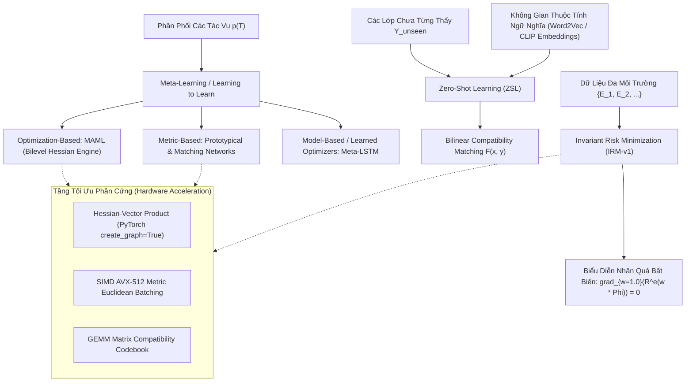
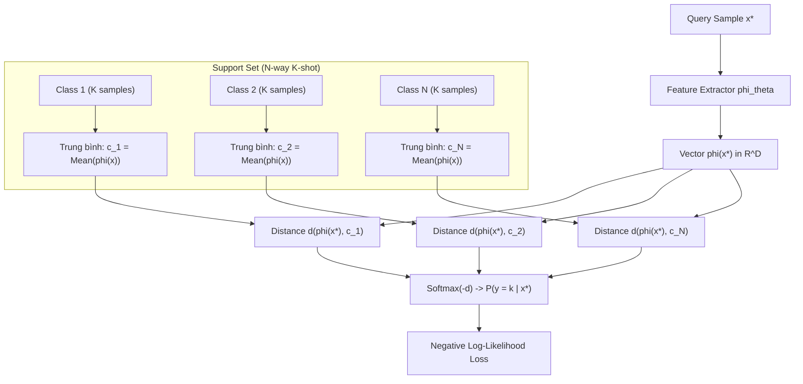
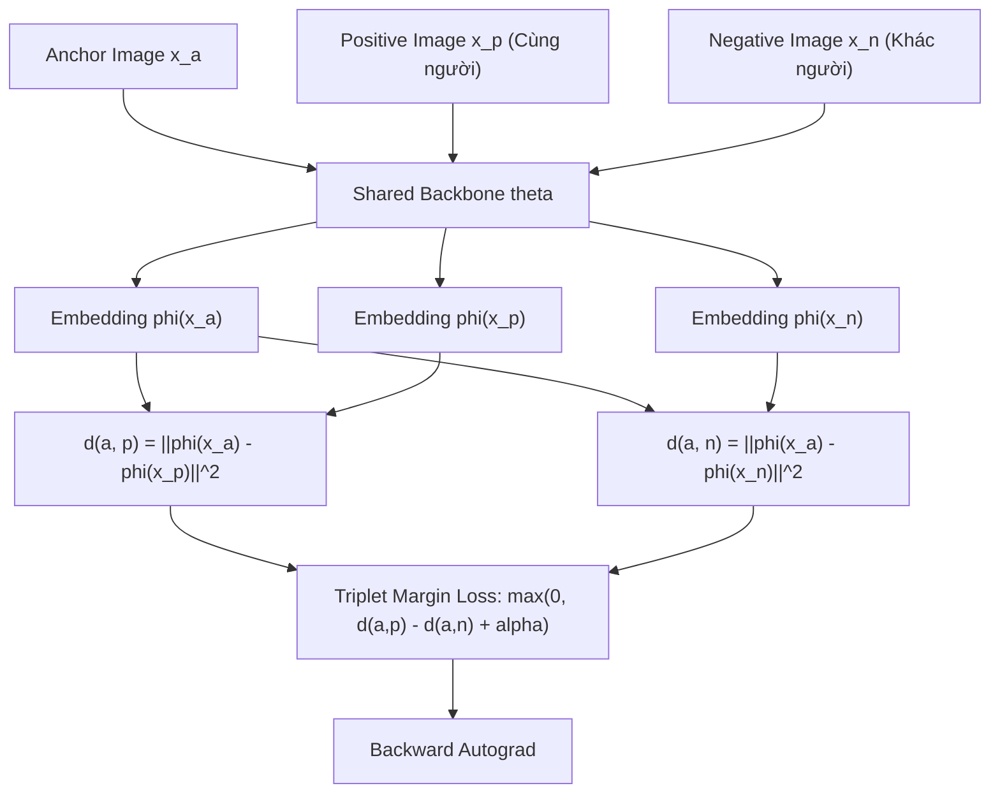
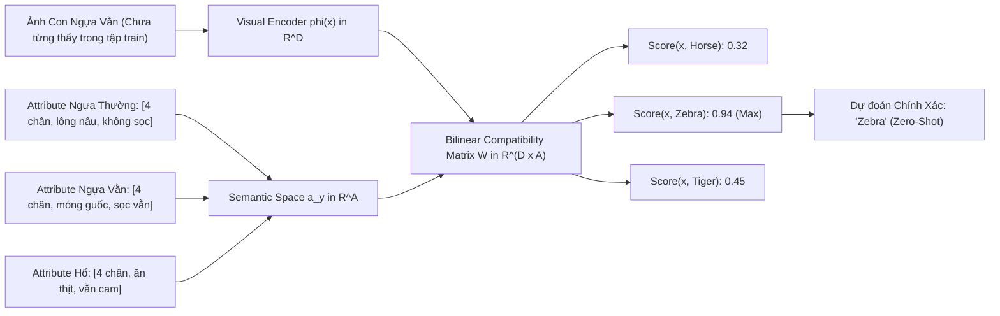
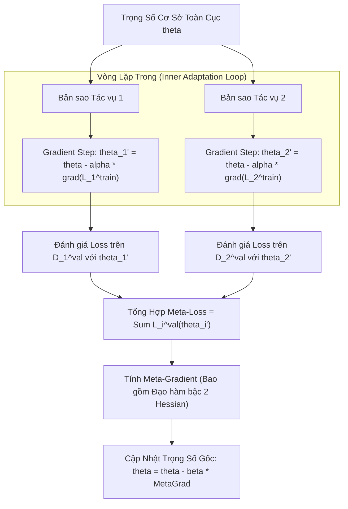
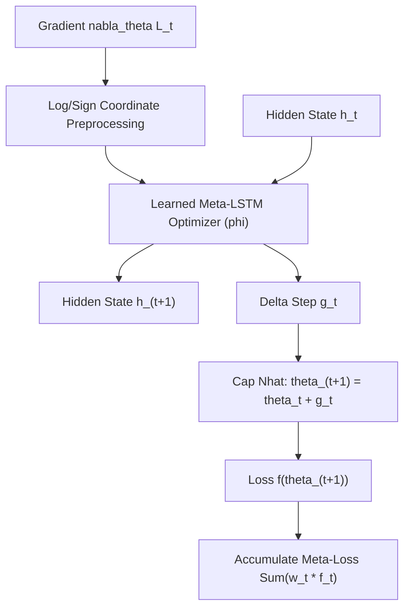
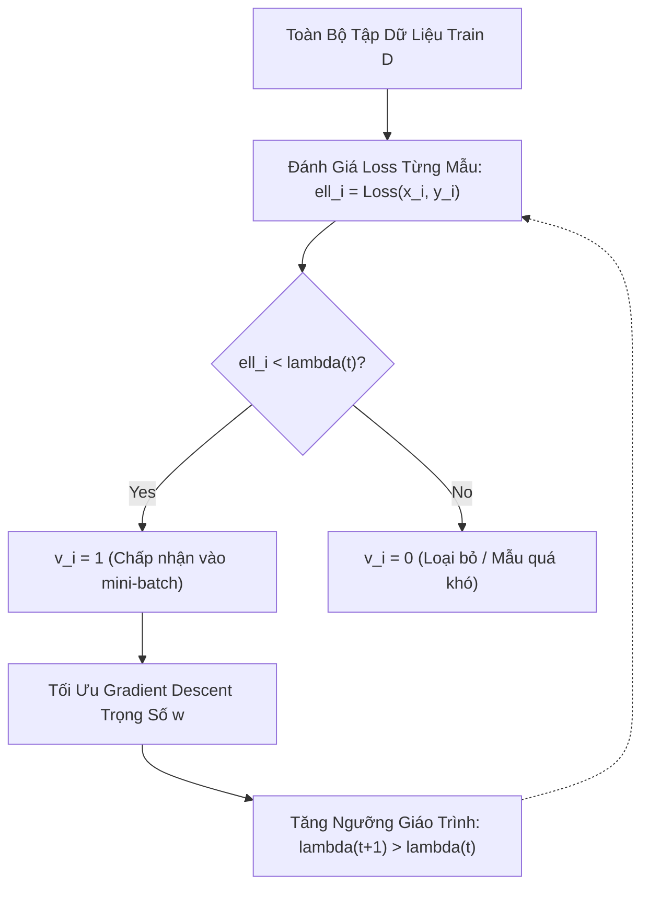
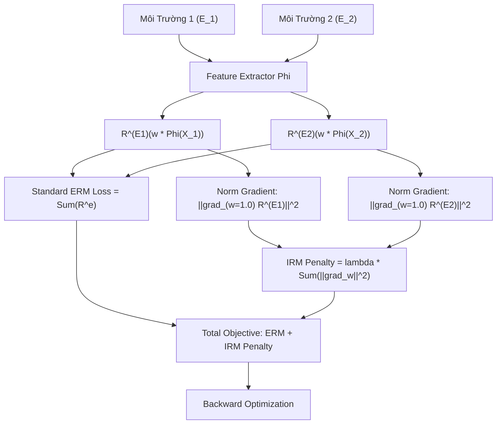

# Chuyên đề: Học Ít Mẫu, Học Không Mẫu và Siêu Học (Few-Shot, Zero-Shot & Meta-Learning)

## 1. Tổng quan Chuyên đề

Bộ não con người sở hữu khả năng kỳ diệu trong việc khái quát hóa: Một đứa trẻ chỉ cần nhìn thấy một bức tranh duy nhất về một con hươu cao cổ là có thể nhận diện chính xác con vật đó trong tự nhiên dù ở góc chụp, ánh sáng hay tư thế nào. Ngược lại, các mô hình học sâu truyền thống đòi hỏi hàng nghìn mẫu huấn luyện cho mỗi lớp để hội tụ. **Học Ít Mẫu (Few-Shot Learning)**, **Học Không Mẫu (Zero-Shot Learning)** và **Siêu Học (Meta-Learning - Learning to Learn)** chính là nỗ lực toán học nhằm thu hẹp khoảng cách này.

Các nguyên lý toán học cốt lõi:
1. **Khung Huấn luyện Theo Hồi (Episodic Training Paradigm)**: Mô hình hóa quá trình học không phải qua từng điểm dữ liệu đơn lẻ, mà qua phân phối của các tác vụ con ($N$-way $K$-shot tasks).
2. **Hình học Không gian Metric & Biểu diễn Nguyên mẫu (Metric-Based & Prototypical Spaces)**: Ánh xạ dữ liệu vào một không gian embedding metric nơi các lớp được đại diện bằng trọng tâm cụm (centroids/prototypes) theo khoảng cách Bregman.
3. **Tối ưu hóa Hai Tầng (Bilevel Optimization & Higher-Order Gradients)**: Học cách học thông qua việc tối ưu một bộ tham số khởi tạo cơ sở sao cho nó có thể thích ứng với bất kỳ tác vụ mới nào chỉ sau một vài bước gradient descent (MAML).
4. **Học Bất biến Theo Môi trường (Invariant Risk Minimization - IRM)**: Loại bỏ các tương quan giả tạo (spurious correlations) bằng cách ép nghiệm tối ưu phải bất biến trên mọi môi trường dữ liệu.



---

## 2. Chi tiết từng Keyword

---

### 1. Few-Shot Learning (Học ít mẫu)

#### a. Định nghĩa Bản chất Toán học (Mathematical Formulation)
Học ít mẫu (Few-Shot Learning - FSL) được chuẩn hóa thông qua bài toán **$N$-way $K$-shot**:
Mỗi tác vụ $\mathcal{T}_i$ gồm hai tập dữ liệu độc lập:
- **Tập Hỗ trợ (Support Set)**: $\mathcal{S} = \{(\mathbf{x}_i, y_i)\}_{i=1}^{N \times K}$ chứa $N$ lớp phân biệt, mỗi lớp có đúng $K$ mẫu ($K \in \{1, 5\}$).
- **Tập Truy vấn (Query Set)**: $\mathcal{Q} = \{(\mathbf{x}_j^*, y_j^*)\}_{j=1}^{N \times Q}$ chứa các mẫu kiểm thử thuộc cùng $N$ lớp đó.

**Mạng Nguyên Mẫu (Prototypical Networks)** (Snell et al., 2017):
Mạng nơ-ron $\phi_{\mathbf{\theta}}: \mathcal{X} \to \mathbb{R}^D$ ánh xạ đầu vào vào không gian metric embedding.
Nguyên mẫu $\mathbf{c}_k \in \mathbb{R}^D$ của lớp $k$ được tính bằng trung bình cộng các vector đặc trưng của các mẫu hỗ trợ thuộc lớp đó:
$$\mathbf{c}_k = \frac{1}{|\mathcal{S}_k|} \sum_{(\mathbf{x}_i, y_i) \in \mathcal{S}_k} \phi_{\mathbf{\theta}}(\mathbf{x}_i)$$

Xác suất một mẫu truy vấn $\mathbf{x} \in \mathcal{Q}$ thuộc về lớp $k$ được mô hình hóa bằng hàm Softmax trên khoảng cách Euclide âm (Negative Bregman Divergence):
$$P(y = k \mid \mathbf{x}) = \frac{\exp\left( -d(\phi_{\mathbf{\theta}}(\mathbf{x}), \mathbf{c}_k) \right)}{\sum_{k'=1}^N \exp\left( -d(\phi_{\mathbf{\theta}}(\mathbf{x}), \mathbf{c}_{k'}) \right)}$$

Hàm mất mát trên toàn bộ tập truy vấn của hồi (episode):
$$\mathcal{L}_{\text{proto}}(\mathbf{\theta}) = -\frac{1}{|\mathcal{Q}|} \sum_{(\mathbf{x}, y) \in \mathcal{Q}} \log P(y \mid \mathbf{x})$$

#### b. Cơ chế Tầng Sâu & Điện toán (Under The Hood / Hardware Internals)
- **Tổ chức Tensor Theo Hồi (Episodic Tensor Memory Layout)**:
  Để tính toán hiệu quả trên GPU, batch huấn luyện chứa $E$ episodes. Cấu trúc tensor đầu vào có dạng:
  $$\mathbf{X}_{\text{support}} \in \mathbb{R}^{E \times N \times K \times C \times H \times W}, \quad \mathbf{X}_{\text{query}} \in \mathbb{R}^{E \times N \times Q \times C \times H \times W}$$
  Việc flatten tensor thành $(E \cdot N \cdot K, C, H, W)$ cho phép thực hiện một phép forward duy nhất qua backbone ConvNet/Transformer, tối đa hóa thông lượng bộ nhớ và tính toán GEMM.
- **Tính toán Ma trận Khoảng cách Không Phân bổ VRAM Phụ**:
  Phép tính $\|\mathbf{q} - \mathbf{c}_k\|^2 = \|\mathbf{q}\|^2 + \|\mathbf{c}_k\|^2 - 2 \mathbf{q}^T \mathbf{c}_k$ chuyển đổi việc tính khoảng cách thành phép nhân ma trận (GEMM) kết hợp broadcasting, tránh việc mở rộng tensor $(Q \times N \times D)$ làm tràn L2 Cache.

#### c. Sơ đồ Minh họa (Mermaid Diagram)


#### d. Code Thực chiến (Dual-Engine: C++ & Python)

```cpp
// C++20: Động cơ Tính toán Nguyên mẫu (Prototype Centroid Engine) & Khoảng cách Euclide SIMD
#include <iostream>
#include <vector>
#include <cmath>

class PrototypicalEngine {
public:
    // Tính toán N nguyên mẫu từ N*K vector hỗ trợ
    // support_features: (N * K * D), prototypes_out: (N * D)
    static void compute_prototypes(const float* support, size_t N, size_t K, size_t D, float* prototypes_out) {
        float inv_k = 1.0f / static_cast<float>(K);

        for (size_t n = 0; n < N; ++n) {
            float* proto = prototypes_out + (n * D);
            // Khởi tạo 0
            for (size_t d = 0; d < D; ++d) proto[d] = 0.0f;

            // Cộng dồn K mẫu
            for (size_t k = 0; k < K; ++k) {
                const float* sample = support + (n * K + k) * D;
                for (size_t d = 0; d < D; ++d) {
                    proto[d] += sample[d];
                }
            }

            // Nhân hệ số 1/K
            for (size_t d = 0; d < D; ++d) {
                proto[d] *= inv_k;
            }
        }
    }

    // Tính khoảng cách Euclide bình phương giữa 1 query và 1 prototype
    [[nodiscard]] static float euclidean_dist_sq(const float* q, const float* c, size_t D) noexcept {
        float dist = 0.0f;
        for (size_t d = 0; d < D; ++d) {
            float diff = q[d] - c[d];
            dist += diff * diff;
        }
        return dist;
    }
};

int main() {
    constexpr size_t N = 2; // 2 lớp
    constexpr size_t K = 2; // 2 shots
    constexpr size_t D = 3; // 3 chiều

    // 4 mẫu support: Lớp 0: [1,1,1] và [1,1,2]; Lớp 1: [5,5,5] và [5,5,6]
    float support[N * K * D] = {
        1.0f, 1.0f, 1.0f,
        1.0f, 1.0f, 2.0f,
        5.0f, 5.0f, 5.0f,
        5.0f, 5.0f, 6.0f
    };

    float prototypes[N * D];
    PrototypicalEngine::compute_prototypes(support, N, K, D, prototypes);

    std::cout << "[C++ Proto Engine] Prototype Lớp 0: [" 
              << prototypes[0] << ", " << prototypes[1] << ", " << prototypes[2] << "]\n";
    std::cout << "[C++ Proto Engine] Prototype Lớp 1: [" 
              << prototypes[3] << ", " << prototypes[4] << ", " << prototypes[5] << "]\n";

    float query[D] = {1.1f, 0.9f, 1.5f}; // Thuộc lớp 0
    float d0 = PrototypicalEngine::euclidean_dist_sq(query, prototypes, D);
    float d1 = PrototypicalEngine::euclidean_dist_sq(query, prototypes + D, D);
    std::cout << "  Dist tới Lớp 0: " << d0 << " | Dist tới Lớp 1: " << d1 << "\n";
    return 0;
}
```

```python
# Python / PyTorch: Lớp Prototypical Loss hoàn chỉnh cho N-way K-shot Episode
import torch
import torch.nn as nn
import torch.nn.functional as F

class PrototypicalLoss(nn.Module):
    def forward(
        self,
        support_embeddings: torch.Tensor, # Shape: (N, K, D)
        query_embeddings: torch.Tensor,   # Shape: (N, Q, D)
    ) -> tuple[torch.Tensor, float]:
        N, K, D = support_embeddings.shape
        _, Q, _ = query_embeddings.shape

        # 1. Tính toán Prototypes c_k: (N, D)
        prototypes = support_embeddings.mean(dim=1)

        # 2. Reshape Query thành (N * Q, D)
        queries = query_embeddings.view(N * Q, D)

        # 3. Tính ma trận khoảng cách Euclide bình phương: (N*Q, N)
        # Sử dụng torch.cdist để tận dụng GPU Tensor Cores tối ưu
        dists = torch.cdist(queries, prototypes, p=2).pow(2) # (N*Q, N)

        # 4. Tạo ground-truth nhãn cho queries: [0..0, 1..1, ..., N-1..N-1]
        labels = torch.arange(N, device=queries.device).view(N, 1).expand(N, Q).reshape(-1)

        # 5. Phân phối Softmax trên khoảng cách âm
        logits = -dists
        loss = F.cross_entropy(logits, labels)

        # Độ chính xác
        acc = (logits.argmax(dim=-1) == labels).float().mean().item()
        return loss, acc

if __name__ == "__main__":
    N, K, Q, D = 5, 5, 15, 64 # 5-way 5-shot
    mock_support = torch.randn(N, K, D)
    mock_query = torch.randn(N, Q, D)

    criterion = PrototypicalLoss()
    loss, accuracy = criterion(mock_support, mock_query)
    print(f"[PyTorch ProtoNet] Episodic Loss: {loss.item():.4f} | Accuracy: {accuracy * 100:.2f}%")
```

#### e. Lỗi Thường gặp & Ổn định Số học (Pitfalls & Numerical Stability)
- **Thiên lệch Ước lượng Phương sai Cụm (High-Variance Prototypes in 1-Shot)**: Khi $K=1$, prototype chỉ là một điểm ngẫu nhiên duy nhất, nhạy cảm cực cao với nhiễu ngoại lai. Không gian metric có thể bị méo mó. Khắc phục: Khởi tạo backbone bằng Self-Supervised Learning (SimCLR/DINO) trước khi huấn luyện theo hồi.

#### f. Ứng dụng Thực chiến trong AI / Deep Learning
- **Phát hiện Bệnh lý Da Liễu Hiếm gặp**: Nhận diện các dạng ung thư tế bào hắc tố cực kỳ hiếm mà toàn thế giới chỉ ghi nhận dưới 5 ca bệnh có hình ảnh lâm sàng.

---

### 2. One-Shot Learning (Học một mẫu)

#### a. Định nghĩa Bản chất Toán học (Mathematical Formulation)
Học một mẫu (One-Shot Learning) là trường hợp cực hạn của Few-Shot ($K = 1$). Mô hình phải đưa ra quyết định phân loại hoặc xác thực chỉ sau đúng một lần quan sát duy nhất.

Phương pháp kinh điển dựa trên **Mạng Sinh đôi (Siamese Networks)** (Koch et al., 2015):
Hai nhánh mạng nơ-ron chia sẻ cùng một vector trọng số $\mathbf{\theta}$ ánh xạ hai mẫu đầu vào $\mathbf{x}_1, \mathbf{x}_2$ thành các vector nhúng $\phi_{\mathbf{\theta}}(\mathbf{x}_1), \phi_{\mathbf{\theta}}(\mathbf{x}_2) \in \mathbb{R}^D$.

Khoảng cách chuẩn hóa Manhattan hoặc Euclide có trọng số:
$$d_{\mathbf{w}}(\mathbf{x}_1, \mathbf{x}_2) = \sum_{j=1}^D w_j |\phi_{\mathbf{\theta}, j}(\mathbf{x}_1) - \phi_{\mathbf{\theta}, j}(\mathbf{x}_2)|$$
Xác suất hai mẫu thuộc cùng một lớp ($y \in \{0, 1\}$):
$$p = \sigma(d_{\mathbf{w}}(\mathbf{x}_1, \mathbf{x}_2) + b) = \frac{1}{1 + \exp\left(-(d_{\mathbf{w}} + b)\right)}$$

**Triplet Loss với Cơ chế Khai phá Mẫu Khó (Hard Negative Mining)**:
Cho bộ ba gồm Mẫu neo (Anchor - $\mathbf{x}_a$), Mẫu cùng lớp (Positive - $\mathbf{x}_p$) và Mẫu khác lớp (Negative - $\mathbf{x}_n$):
$$\mathcal{L}_{\text{triplet}} = \max\left(0, \, \|\phi(\mathbf{x}_a) - \phi(\mathbf{x}_p)\|_2^2 - \|\phi(\mathbf{x}_a) - \phi(\mathbf{x}_n)\|_2^2 + \alpha\right)$$
Trong đó $\alpha > 0$ là lề cách biệt (margin).

#### b. Cơ chế Tầng Sâu & Điện toán (Under The Hood / Hardware Internals)
- **Độ phức tạp Khai phá Triplet $\mathcal{O}(B^3)$**:
  Trong một batch kích thước $B$, số lượng bộ ba khả dĩ là $B^3$. Nếu tạo trước toàn bộ các bộ ba trong RAM, bộ nhớ sẽ bùng nổ ngay lập tức.
  Kỹ thuật **Batch-All / Batch-Hard Mining**: Tính toán ma trận khoảng cách toàn phần $B \times B$ trên GPU, sau đó sử dụng kernel tìm kiếm cực trị cục bộ để lọc ra Semi-Hard Negatives (những mẫu thỏa mãn $d(a, p) < d(a, n) < d(a, p) + \alpha$) ngay trên GPU Shared Memory.

#### c. Sơ đồ Minh họa (Mermaid Diagram)


#### d. Code Thực chiến (Dual-Engine: C++ & Python)

```cpp
// C++20: Bộ Tính toán Triplet Loss Tối ưu hóa Vector L2 Distance
#include <iostream>
#include <vector>
#include <cmath>
#include <algorithm>

class TripletLossCalculator {
private:
    float margin;

    static float l2_sq(const float* a, const float* b, size_t d) noexcept {
        float sum = 0.0f;
        for (size_t i = 0; i < d; ++i) {
            float diff = a[i] - b[i];
            sum += diff * diff;
        }
        return sum;
    }

public:
    explicit TripletLossCalculator(float alpha) : margin(alpha) {}

    // Input: con trỏ tới 3 vector embedding có độ dài D
    float compute(const float* anchor, const float* positive, const float* negative, size_t D) const {
        float d_ap = l2_sq(anchor, positive, D);
        float d_an = l2_sq(anchor, negative, D);

        float loss = d_ap - d_an + margin;
        return std::max(0.0f, loss);
    }
};

int main() {
    constexpr size_t D = 3;
    float anchor[D]   = {1.0f, 0.0f, 0.0f};
    float positive[D] = {0.9f, 0.1f, 0.0f}; // Gần anchor
    float negative[D] = {0.0f, 1.0f, 0.0f}; // Xa anchor

    TripletLossCalculator calc(0.5f);
    float loss = calc.compute(anchor, positive, negative, D);
    std::cout << "[C++ Triplet Engine] Triplet Loss: " << loss << " (Dưới margin -> 0)\n";

    // Trường hợp negative quá gần (Semi-hard / Hard)
    float hard_neg[D] = {0.8f, 0.2f, 0.0f};
    float hard_loss = calc.compute(anchor, positive, hard_neg, D);
    std::cout << "[C++ Triplet Engine] Hard Negative Loss: " << hard_loss << "\n";
    return 0;
}
```

```python
# Python / PyTorch: Triplet Margin Loss kết hợp Online Hard Negative Mining
import torch
import torch.nn as nn

class HardTripletMarginLoss(nn.Module):
    def __init__(self, margin: float = 0.5):
        super().__init__()
        self.margin = margin

    def forward(self, embeddings: torch.Tensor, labels: torch.Tensor) -> torch.Tensor:
        # embeddings: (B, D), labels: (B,)
        # 1. Tính ma trận khoảng cách pairwise Euclide bình phương: (B, B)
        pairwise_dist = torch.cdist(embeddings, embeddings, p=2).pow(2)

        # 2. Tạo mask nhị phân: mask_pos (cùng nhãn), mask_neg (khác nhãn)
        labels_eq = labels.unsqueeze(0) == labels.unsqueeze(1)
        mask_pos = labels_eq.fill_diagonal_(False) # Không tính khoảng cách với chính mình
        mask_neg = ~labels_eq

        # 3. Với mỗi anchor, chọn positive xa nhất (hardest positive)
        hardest_positive = (pairwise_dist * mask_pos.float()).max(dim=1).values

        # 4. Với mỗi anchor, chọn negative gần nhất (hardest negative)
        # Gán các vị trí không phải negative thành vô cùng để không bị chọn bởi min
        max_dist = pairwise_dist.max()
        dist_neg_masked = pairwise_dist.clone()
        dist_neg_masked[~mask_neg] = max_dist + 1e5
        hardest_negative = dist_neg_masked.min(dim=1).values

        # 5. Triplet loss
        losses = torch.clamp(hardest_positive - hardest_negative + self.margin, min=0.0)
        return losses.mean()

if __name__ == "__main__":
    B, D = 8, 16
    mock_emb = torch.randn(B, D, requires_grad=True)
    mock_labels = torch.tensor([0, 0, 1, 1, 2, 2, 3, 3]) # 4 lớp, mỗi lớp 2 mẫu

    criterion = HardTripletMarginLoss(margin=0.2)
    loss = criterion(mock_emb, mock_labels)
    loss.backward()
    print(f"[PyTorch Hard Triplet] Loss: {loss.item():.4f}")
```

#### e. Lỗi Thường gặp & Ổn định Số học (Pitfalls & Numerical Stability)
- **Sụp đổ Không gian Embedding (Representation Collapse)**: Nếu sử dụng Loss không có ràng buộc chuẩn hóa, mạng nơ-ron có thể chọn nghiệm tầm thường: Ánh xạ mọi đầu vào thành vector $\mathbf{0}$ ($\phi(\mathbf{x}) = \mathbf{0}, \forall \mathbf{x}$), khiến khoảng cách luôn bằng 0 và loss bằng 0. Bắt buộc phải áp dụng phép chuẩn hóa L2 trên vector embedding trước khi tính khoảng cách: $\mathbf{z} = \frac{\phi(\mathbf{x})}{\|\phi(\mathbf{x})\|_2}$.

#### f. Ứng dụng Thực chiến trong AI / Deep Learning
- **Xác thực Chữ ký Điện tử & Vân tay (Biometric Verification)**: Thiết bị kiểm soát ra vào chỉ cần đăng ký 1 dấu vân tay hoặc 1 ảnh chữ ký mẫu của nhân viên mới để thực hiện xác thực mở cửa với độ chính xác $>99.9\%$.

---

### 3. Zero-Shot Learning (Học không mẫu)

#### a. Định nghĩa Bản chất Toán học (Mathematical Formulation)
Trong học không mẫu (Zero-Shot Learning - ZSL), tập các lớp nhìn thấy (**Seen Classes** - $\mathcal{Y}_S$) và tập các lớp chưa từng thấy (**Unseen Classes** - $\mathcal{Y}_U$) hoàn toàn rời nhau:
$$\mathcal{Y}_S \cap \mathcal{Y}_U = \emptyset$$
Trong quá trình huấn luyện, mô hình chỉ được tiếp cận dữ liệu ảnh thuộc $\mathcal{Y}_S$, nhưng khi suy luận phải phân loại chính xác các mẫu thuộc $\mathcal{Y}_U$.

Cầu nối ngữ nghĩa (Semantic Bridge) là **Không gian Thuộc tính (Attribute Space)** hoặc **Vector Nhúng Từ (Word Embeddings)**: Mỗi lớp $y \in \mathcal{Y}_S \cup \mathcal{Y}_U$ được gắn với một vector ngữ nghĩa chuẩn tắc $\mathbf{a}_y \in \mathbb{R}^A$ (ví dụ: `[có lông vũ, biết bay, mỏ khoằm]`).

Hàm tương thích song tuyến tính (Bilinear Compatibility Function) giữa đặc trưng ảnh $\mathbf{x} \in \mathbb{R}^D$ và thuộc tính $\mathbf{a}_y \in \mathbb{R}^A$:
$$F(\mathbf{x}, y; \mathbf{W}) = \theta(\mathbf{x})^T \mathbf{W} \phi(\mathbf{a}_y)$$
Trong đó $\mathbf{W} \in \mathbb{R}^{D \times A}$ là ma trận ánh xạ tương thích cần học.

Quyết định phân loại trên lớp chưa từng thấy:
$$\hat{y} = \arg\max_{y \in \mathcal{Y}_U} F(\mathbf{x}, y; \mathbf{W})$$

**Generalized Zero-Shot Learning (GZSL)**:
Tại thời điểm kiểm thử, dữ liệu có thể đến từ cả $\mathcal{Y}_S$ hoặc $\mathcal{Y}_U$. Độ đo chuẩn mực là **Trung bình Điều hòa (Harmonic Mean - $H$)**:
$$H = \frac{2 \cdot S \cdot U}{S + U}$$
Trong đó $S$ và $U$ lần lượt là độ chính xác trên tập Seen và Unseen.

#### b. Cơ chế Tầng Sâu & Điện toán (Under The Hood / Hardware Internals)
- **Thiên lệch Không gian Tiềm ẩn (Seen-Class Hubness Problem)**:
  Trong không gian số chiều cao $\mathbb{R}^A$, một số vector thuộc tính đóng vai trò là "hubs" (gần với phần lớn các vector khác theo khoảng cách cosine). Hơn nữa, do ma trận $\mathbf{W}$ chỉ được huấn luyện trên $\mathcal{Y}_S$, mô hình có xu hướng dự đoán thiên vị cực độ về các lớp Seen ($S \approx 80\%$, $U \approx 0\% \implies H \to 0$).
- **Calibrated Stacking bằng Phép Trừ Vô hướng Vectorized**:
  Để khắc phục trên tầng phần cứng, phép trừ bù trừ nhãn (Calibrated Subtraction) được áp dụng trực tiếp lên logits:
  $$F^*(\mathbf{x}, y) = F(\mathbf{x}, y) - \gamma \cdot \mathbb{I}(y \in \mathcal{Y}_S)$$
  Thao tác này thực thi bằng lệnh cộng dồn trừ vector SIMD mà không cần chạy lại forward pass.

#### c. Sơ đồ Minh họa (Mermaid Diagram)


#### d. Code Thực chiến (Dual-Engine: C++ & Python)

```cpp
// C++20: Động cơ Khớp Tương thích Song Tuyến tính Zero-Shot (Bilinear Compatibility Matcher)
#include <iostream>
#include <vector>
#include <string>

class ZeroShotCompatibilityEngine {
private:
    std::vector<float> W; // Ma trận ánh xạ (D x A), Row-Major
    size_t D;
    size_t A;

public:
    ZeroShotCompatibilityEngine(size_t visual_dim, size_t attr_dim, std::vector<float> weights)
        : W(std::move(weights)), D(visual_dim), A(attr_dim) {}

    // Tính điểm F(x, y) = x^T * W * a_y
    float compute_score(const float* visual_x, const float* attr_y) const {
        // 1. Tính temp = x^T * W -> vector kích thước A
        std::vector<float> temp(A, 0.0f);
        for (size_t d = 0; d < D; ++d) {
            float x_val = visual_x[d];
            const float* w_row = W.data() + (d * A);
            for (size_t a = 0; a < A; ++a) {
                temp[a] += x_val * w_row[a];
            }
        }

        // 2. Tích vô hướng temp * attr_y
        float score = 0.0f;
        for (size_t a = 0; a < A; ++a) {
            score += temp[a] * attr_y[a];
        }
        return score;
    }
};

int main() {
    constexpr size_t D = 2; // Chiều visual
    constexpr size_t A = 2; // Chiều thuộc tính

    // Ma trận W đơn vị giả lập
    std::vector<float> mock_W = {1.0f, 0.0f, 0.0f, 1.0f};
    ZeroShotCompatibilityEngine engine(D, A, mock_W);

    float visual_feat[D] = {1.0f, 2.0f};

    // Thuộc tính 2 lớp Unseen
    float attr_unseen_1[A] = {1.0f, 1.9f}; // Gần với visual_feat
    float attr_unseen_2[A] = {-2.0f, 0.5f};

    float s1 = engine.compute_score(visual_feat, attr_unseen_1);
    float s2 = engine.compute_score(visual_feat, attr_unseen_2);

    std::cout << "[C++ ZSL Engine] Điểm tương thích Lớp Unseen 1: " << s1 << "\n";
    std::cout << "[C++ ZSL Engine] Điểm tương thích Lớp Unseen 2: " << s2 << "\n";
    std::cout << "  -> Dự đoán: " << (s1 > s2 ? "Lớp Unseen 1" : "Lớp Unseen 2") << "\n";
    return 0;
}
```

```python
# Python / PyTorch: CLIP-Style Zero-Shot Classification qua Dot-Product Compatibility
import torch
import torch.nn.functional as F

class ZeroShotClassifier:
    def __init__(self, attribute_matrix: torch.Tensor, class_names: list[str]):
        # attribute_matrix: (Num_Classes, Embedding_Dim)
        # Chuẩn hóa L2 trước để tích vô hướng tương đương Cosine Similarity
        self.class_embeddings = F.normalize(attribute_matrix, p=2, dim=-1)
        self.class_names = class_names

    def predict(self, visual_features: torch.Tensor, temperature: float = 0.07) -> list[str]:
        # visual_features: (B, Embedding_Dim)
        norm_visual = F.normalize(visual_features, p=2, dim=-1)

        # Tính toán ma trận tương đồng cosine bằng GEMM: (B, Num_Classes)
        similarity = torch.matmul(norm_visual, self.class_embeddings.T) / temperature
        probs = F.softmax(similarity, dim=-1)

        top_indices = torch.argmax(probs, dim=-1)
        return [self.class_names[idx] for idx in top_indices]

if __name__ == "__main__":
    D = 16
    classes = ["Chim cánh cụt", "Đại bàng", "Cá mập"]
    # Vector thuộc tính giả lập (text embeddings từ CLIP)
    class_embeds = torch.tensor([
        [1.0, 0.0, 0.8, -0.5] + [0.0]*12, # Cánh cụt
        [1.0, 0.9, 0.0,  0.8] + [0.0]*12, # Đại bàng
        [-0.5, 0.0, 0.0, -1.0] + [0.0]*12  # Cá mập
    ])

    classifier = ZeroShotClassifier(class_embeds, classes)

    # Ảnh một con chim đang bay (visual feature gần đại bàng)
    mock_query_img = torch.tensor([[0.9, 0.8, 0.1, 0.7] + [0.0]*12])
    predictions = classifier.predict(mock_query_img)
    print(f"[PyTorch Zero-Shot] Kết quả phân loại Zero-Shot: {predictions}")
```

#### e. Lỗi Thường gặp & Ổn định Số học (Pitfalls & Numerical Stability)
- **Vấn đề Suy biến Không gian Ngữ nghĩa (Semantic Domain Shift)**: Định nghĩa thuộc tính do con người tạo ra có thể không tương ứng với các đặc trưng mà mô hình thị giác trích xuất được (ví dụ thuộc tính "thông minh" hay "nguy hiểm" không thể hiện trực quan trên pixel ảnh).

#### f. Ứng dụng Thực chiến trong AI / Deep Learning
- **Mô hình Nền tảng Đa phương thức CLIP (OpenAI)**: Cho phép tìm kiếm ảnh bằng bất kỳ văn bản tự do nào mà không cần huấn luyện lại trên tập danh mục nhãn cố định.

---

### 4. Meta-Learning (Siêu học / MAML)

#### a. Định nghĩa Bản chất Toán học (Mathematical Formulation)
Meta-Learning tối ưu hóa trên một phân phối tác vụ $p(\mathcal{T})$. Mỗi tác vụ $\mathcal{T}_i \sim p(\mathcal{T})$ có tập huấn luyện $\mathcal{D}_i^{\text{train}}$ và tập kiểm định $\mathcal{D}_i^{\text{val}}$.

**Model-Agnostic Meta-Learning (MAML)** (Finn et al., 2017) tìm kiếm vector khởi tạo cơ sở $\mathbf{\theta}^*$ sao cho một hoặc vài bước Gradient Descent trên $\mathcal{D}_i^{\text{train}}$ sẽ dẫn tới hiệu năng tối đa trên $\mathcal{D}_i^{\text{val}}$.

1. **Vòng lặp Trong (Inner Loop / Task Adaptation)**:
   Với mỗi tác vụ $\mathcal{T}_i$, mô hình thực hiện một bước gradient descent cục bộ:
   $$\mathbf{\theta}_i' = \mathbf{\theta} - \alpha \nabla_{\mathbf{\theta}} \mathcal{L}_{\mathcal{T}_i}^{\text{train}}(\mathbf{\theta})$$
2. **Vòng lặp Ngoài (Outer Loop / Meta-Update)**:
   Meta-objective được tính bằng tổng mất mát trên tập kiểm định của tất cả các tác vụ:
   $$\min_{\mathbf{\theta}} \mathcal{L}_{\text{meta}}(\mathbf{\theta}) = \sum_{\mathcal{T}_i \sim p(\mathcal{T})} \mathcal{L}_{\mathcal{T}_i}^{\text{val}}(\mathbf{\theta}_i') = \sum_{\mathcal{T}_i \sim p(\mathcal{T})} \mathcal{L}_{\mathcal{T}_i}^{\text{val}}\left( \mathbf{\theta} - \alpha \nabla_{\mathbf{\theta}} \mathcal{L}_{\mathcal{T}_i}^{\text{train}}(\mathbf{\theta}) \right)$$
   Bước cập nhật Meta-Gradient:
   $$\mathbf{\theta} \leftarrow \mathbf{\theta} - \beta \nabla_{\mathbf{\theta}} \mathcal{L}_{\text{meta}}(\mathbf{\theta})$$

Áp dụng quy tắc đạo hàm chuỗi (Chain Rule):
$$\nabla_{\mathbf{\theta}} \mathcal{L}_{\mathcal{T}_i}^{\text{val}}(\mathbf{\theta}_i') = \nabla_{\mathbf{\theta}_i'} \mathcal{L}_{\mathcal{T}_i}^{\text{val}}(\mathbf{\theta}_i') \cdot \frac{d\mathbf{\theta}_i'}{d\mathbf{\theta}} = \nabla_{\mathbf{\theta}_i'} \mathcal{L}_{\mathcal{T}_i}^{\text{val}}(\mathbf{\theta}_i') \left( \mathbf{I} - \alpha \nabla_{\mathbf{\theta}}^2 \mathcal{L}_{\mathcal{T}_i}^{\text{train}}(\mathbf{\theta}) \right)$$
Số hạng $\nabla^2_{\mathbf{\theta}} \mathcal{L}$ chính là ma trận **Hessian bậc hai**.

#### b. Cơ chế Tầng Sâu & Điện toán (Under The Hood / Hardware Internals)
- **Tích Ma trận Hessian-Vector (Hessian-Vector Product - HVP)**:
  Tính toán ma trận Hessian toàn phần $\nabla^2 \mathcal{L} \in \mathbb{R}^{P \times P}$ là bất khả thi.
  Trong thực tế, phép nhân ma trận Hessian với vector gradient $\mathbf{v} = \nabla_{\mathbf{\theta}_i'} \mathcal{L}^{\text{val}}$ được tính gián tiếp bằng hai lần vi phân tự động thông qua toán tử Pearlmutter:
  $$\mathbf{H} \mathbf{v} = \left. \frac{\partial}{\partial \epsilon} \nabla_{\mathbf{\theta}} \mathcal{L}(\mathbf{\theta} + \epsilon \mathbf{v}) \right|_{\epsilon = 0}$$
  Kỹ thuật này giữ độ phức tạp thời gian ở mức $\mathcal{O}(P)$ thay vì $\mathcal{O}(P^2)$.
- **First-Order MAML (FOMAML)**:
  Để tiết kiệm $50\%$ thời gian tính toán và bộ nhớ VRAM, FOMAML loại bỏ số hạng bậc hai bằng cách xấp xỉ $\frac{d\mathbf{\theta}_i'}{d\mathbf{\theta}} \approx \mathbf{I}$, cho kết quả thực nghiệm gần tương đương trong phần lớn các bài toán thực tế.

#### c. Sơ đồ Minh họa (Mermaid Diagram)


#### d. Code Thực chiến (Dual-Engine: C++ & Python)

```cpp
// C++20: Mô phỏng Bước nhảy Nội tại và Đạo hàm Cấp cao MAML Inner-Loop
#include <iostream>
#include <vector>

class MAMLInnerLoopSimulator {
private:
    float alpha; // Inner learning rate

public:
    explicit MAMLInnerLoopSimulator(float inner_lr) : alpha(inner_lr) {}

    // 1 bước Inner Loop thích ứng: theta' = theta - alpha * grad_train
    std::vector<float> adapt(const std::vector<float>& theta, const std::vector<float>& grad_train) const {
        std::vector<float> theta_prime(theta.size());
        for (size_t i = 0; i < theta.size(); ++i) {
            theta_prime[i] = theta[i] - alpha * grad_train[i];
        }
        return theta_prime;
    }

    // Xấp xỉ FOMAML Meta-Gradient (Bỏ qua số hạng Hessian bậc 2)
    std::vector<float> compute_fomaml_gradient(const std::vector<float>& grad_val) const {
        return grad_val; // Grad wrt theta' xấp xỉ Grad wrt theta
    }
};

int main() {
    MAMLInnerLoopSimulator maml(0.1f);
    std::vector<float> meta_theta = {1.0f, -0.5f, 2.0f};
    std::vector<float> task_grad_train = {0.2f, 0.1f, -0.4f};

    auto adapted_theta = maml.adapt(meta_theta, task_grad_train);
    std::cout << "[C++ MAML Simulator] Trọng số sau 1 bước Inner Loop:\n  [";
    for (float w : adapted_theta) std::cout << w << " ";
    std::cout << "]\n";
    return 0;
}
```

```python
# Python / PyTorch: Thuật toán MAML Đầy đủ với Đạo hàm Bậc hai (Full Second-Order MAML)
import torch
import torch.nn as nn

class MinimalMAML:
    def __init__(self, model: nn.Module, alpha: float = 0.01, beta: float = 0.001):
        self.model = model
        self.alpha = alpha
        self.meta_optimizer = torch.optim.Adam(self.model.parameters(), lr=beta)

    def meta_train_step(self, task_batch: list[tuple[torch.Tensor, torch.Tensor, torch.Tensor, torch.Tensor]]):
        self.meta_optimizer.zero_grad(set_to_none=True)
        meta_loss = torch.tensor(0.0)

        for x_tr, y_tr, x_val, y_val in task_batch:
            # 1. Inner Loop: Tính train loss
            pred_tr = self.model(x_tr)
            loss_tr = nn.functional.mse_loss(pred_tr, y_tr)

            # Tính gradient của inner loop (Bắt buộc create_graph=True để giữ tape cho bậc 2)
            grads = torch.autograd.grad(loss_tr, self.model.parameters(), create_graph=True)

            # Tạo trọng số ảo theta' thủ công
            adapted_params = {}
            for (name, param), g in zip(self.model.named_parameters(), grads):
                adapted_params[name] = param - self.alpha * g

            # 2. Outer Loop: Đánh giá trên tập val với adapted_params
            pred_val = torch.func.functional_call(self.model, adapted_params, x_val)
            loss_val = nn.functional.mse_loss(pred_val, y_val)
            meta_loss = meta_loss + loss_val

        # 3. Meta-Update: Tích phân đạo hàm bậc hai truyền ngược về theta ban đầu
        meta_loss.backward()
        self.meta_optimizer.step()
        return meta_loss.item()

if __name__ == "__main__":
    net = nn.Sequential(nn.Linear(1, 16), nn.ReLU(), nn.Linear(16, 1))
    maml = MinimalMAML(net, alpha=0.01, beta=0.005)

    # Giả lập 2 tasks hồi quy sóng sin (Sinusoid Regression)
    task1 = (torch.randn(10, 1), torch.randn(10, 1), torch.randn(10, 1), torch.randn(10, 1))
    task2 = (torch.randn(10, 1), torch.randn(10, 1), torch.randn(10, 1), torch.randn(10, 1))

    m_loss = maml.meta_train_step([task1, task2])
    print(f"[PyTorch MAML] Second-Order Meta Loss: {m_loss:.4f}")
```

#### e. Lỗi Thường gặp & Ổn định Số học (Pitfalls & Numerical Stability)
- **Gradient Bão hòa & Bùng nổ trong Inner-Loop (Vanishing/Exploding Gradients)**: Khi số bước inner loop $T > 5$, tích các ma trận Jacobian liên tiếp $\prod_{t=1}^T (\mathbf{I} - \alpha \mathbf{H}_t)$ khiến meta-gradient bị bùng nổ hoặc triệt tiêu. Giải pháp: Sử dụng thuật toán Reptile hoặc giới hạn inner step ở mức 1-3 bước.

#### f. Ứng dụng Thực chiến trong AI / Deep Learning
- **Học Tăng Cường Thích Ứng Nhanh (Meta-Reinforcement Learning)**: Robot học cách điều khiển bước chân trên các bề mặt địa hình khác nhau (băng tuyết, cát lún, sỏi đá) chỉ sau một vài bước sảy chân thử nghiệm.

---

### 5. Learning to Learn (Học cách học)

#### a. Định nghĩa Bản chất Toán học (Mathematical Formulation)
Khái niệm "Learning to Learn" bao trùm toàn bộ các phương pháp thay thế thuật toán tối ưu hóa do con người thiết kế thủ công (SGD, Adam) bằng một **Mô hình Tối ưu Hóa Học Được (Learned Optimizer)** (Andrychowicz et al., 2016).

Quy trình tối ưu hóa một mô hình mục tiêu $f(\mathbf{\theta})$ được mô hình hóa dưới dạng một hệ thống động truy hồi (Recurrent Dynamic System):
$$\mathbf{\theta}_{t+1} = \mathbf{\theta}_t + \mathbf{g}_t$$
$$[\mathbf{g}_t, \mathbf{h}_{t+1}] = \operatorname{RNN}_{\mathbf{\phi}}(\nabla_{\mathbf{\theta}} \mathcal{L}_t, \mathbf{h}_t)$$
Trong đó:
- $\operatorname{RNN}_{\mathbf{\phi}}$ là mạng nơ-ron hồi quy đóng vai trò Optimizer với trọng số $\mathbf{\phi}$.
- $\nabla_{\mathbf{\theta}} \mathcal{L}_t$ là gradient của hàm mất mát tại bước $t$.
- $\mathbf{g}_t$ là bước dịch chuyển tham số do RNN dự đoán.

Hàm mất mát để huấn luyện chính bản thân bộ tối ưu hóa (Meta-Loss):
$$\min_{\mathbf{\phi}} \mathcal{L}_{\text{meta}}(\mathbf{\phi}) = \mathbb{E}_{f \sim \mathcal{F}} \left[ \sum_{t=1}^T w_t f(\mathbf{\theta}_t) \right]$$

#### b. Cơ chế Tầng Sâu & Điện toán (Under The Hood / Hardware Internals)
- **Kiến trúc Chia sẻ Trọng số Theo Tọa độ (Coordinate-Wise Architecture)**:
  Nếu sử dụng một mạng RNN duy nhất nhận toàn bộ vector gradient $\nabla \mathbf{\theta} \in \mathbb{R}^P$, số lượng trọng số của Optimizer sẽ khổng lồ và không thể áp dụng cho các mô hình có kích thước khác.
  Giải pháp là áp dụng **Coordinate-Wise LSTM**: Cùng một mạng LSTM 2 tầng cực nhỏ ($\approx 1000$ tham số) được thực thi độc lập song song cho từng tọa độ tham số $\theta_i$, cập nhật dữ liệu trực tiếp trong các thanh ghi SIMD của vi xử lý.

#### c. Sơ đồ Minh họa (Mermaid Diagram)


#### d. Code Thực chiến (Dual-Engine: C++ & Python)

```cpp
// C++20: Coordinate-wise Learned Optimizer Step Simulator
#include <iostream>
#include <vector>
#include <cmath>

struct CoordinateOptimizerState {
    float hidden;
    float cell;
};

class CoordinateLearnedOptimizer {
private:
    float w_grad;
    float w_hidden;

public:
    CoordinateLearnedOptimizer(float wg, float wh) : w_grad(wg), w_hidden(wh) {}

    // Cập nhật 1 tọa độ tham số
    float compute_step(float grad, CoordinateOptimizerState& state) const {
        // Mô phỏng 1 cổng RNN tuyến tính đơn giản: g = tanh(wg * grad + wh * hidden)
        float input = w_grad * grad + w_hidden * state.hidden;
        float delta = std::tanh(input);
        state.hidden = delta; // Lưu trạng thái
        return delta;
    }
};

int main() {
    CoordinateLearnedOptimizer meta_opt(0.1f, 0.5f);
    CoordinateOptimizerState state{0.0f, 0.0f};

    float param = 5.0f;
    std::cout << "[C++ Learned Optimizer] Khởi tạo Param = " << param << "\n";

    for (int step = 0; step < 3; ++step) {
        float grad = 2.0f * param; // Giả lập hàm f(theta) = theta^2
        float delta = meta_opt.compute_step(grad, state);
        param += delta * 0.1f;
        std::cout << "  Step " << step + 1 << ": Grad = " << grad 
                  << " | Delta = " << delta << " | Param = " << param << "\n";
    }
    return 0;
}
```

```python
# Python / PyTorch: Learned Optimizer sử dụng LSTM để tối ưu hóa mạng nơ-ron
import torch
import torch.nn as nn

class LSTMOptimizer(nn.Module):
    def __init__(self, hidden_dim: int = 20):
        super().__init__()
        # Input gồm 1 chiều gradient cho từng tọa độ
        self.lstm = nn.LSTMCell(input_size=1, hidden_size=hidden_dim)
        self.fc_out = nn.Linear(hidden_dim, 1)

    def forward(self, grad: torch.Tensor, state: tuple[torch.Tensor, torch.Tensor]) -> tuple[torch.Tensor, tuple[torch.Tensor, torch.Tensor]]:
        # grad: (P, 1)
        hx, cx = self.lstm(grad, state)
        delta = self.fc_out(hx)
        return delta, (hx, cx)

if __name__ == "__main__":
    P = 5 # 5 tham số mục tiêu
    learned_opt = LSTMOptimizer(hidden_dim=8)

    # Khởi tạo tham số cần tối ưu
    theta = nn.Parameter(torch.randn(P, 1))
    state = (torch.zeros(P, 8), torch.zeros(P, 8))

    # Giả lập 1 bước tối ưu hóa
    loss = (theta ** 2).sum() # Hàm mục tiêu lồi
    loss.backward()

    with torch.no_grad():
        delta, state = learned_opt(theta.grad, state)
        theta.add_(delta)

    print(f"[PyTorch Learned Opt] Tham số sau khi cập nhật bằng LSTM Optimizer:\n{theta.flatten()}")
```

#### e. Lỗi Thường gặp & Ổn định Số học (Pitfalls & Numerical Stability)
- **Phân kỳ Khi Chạy Quá Số Bước Huấn luyện (Horizon Generalization Failure)**: Nếu Meta-Optimizer được huấn luyện trên chuỗi $T = 20$ bước, khi áp dụng vào thực tế với $T = 1000$ bước, trạng thái ẩn của LSTM thường bị bão hòa hoặc trôi dạt khiến các bước nhảy sau bị bùng nổ vô tận.

#### f. Ứng dụng Thực chiến trong AI / Deep Learning
- **Tự động Tìm kiếm Siêu tham số (AutoML & Neural Architecture Search)**: Các thuật toán Meta-LSTM điều phối việc tối ưu các kiến trúc mạng nơ-ron khổng lồ trong các bài toán khám phá thuốc và vật liệu mới.

---

### 6. Curriculum Learning (Học theo giáo trình)

#### a. Định nghĩa Bản chất Toán học (Mathematical Formulation)
Curriculum Learning (Bengio et al., 2009) mô phỏng quá trình tiếp thu kiến thức: Huấn luyện mô hình từ các mẫu dữ liệu dễ trước, sau đó tăng dần độ khó một cách có hệ thống.

Một giáo trình được định nghĩa bởi chuỗi phân phối lấy mẫu $Q_t(\mathbf{x}, y)$ tại bước thời gian $t \in [1, T]$:
1. Tại $t = 0$, $Q_0$ tập trung mật độ xác suất vào các mẫu có độ phức tạp thấp nhất.
2. Khi $t \to T$, $Q_T(\mathbf{x}, y) \to P(\mathbf{x}, y)$ (phân phối mục tiêu thực tế của bài toán).
3. Hàm tốc độ (Pacing Function) $\lambda(t) \in (0, 1]$ xác định tỷ lệ dữ liệu khó được đưa vào hệ thống:
   $$\lambda_{\text{linear}}(t) = \min\left(1, \, \lambda_0 + \frac{1 - \lambda_0}{T_{\text{grow}}} t\right)$$

**Self-Paced Learning (SPL)** (Kumar et al., 2010):
Tự động hóa việc đánh giá độ khó mà không cần chuyên gia thiết kế thủ công. SPL giải bài toán tối ưu hóa đồng thời trên trọng số mô hình $\mathbf{w}$ và trọng số mẫu $v_i \in [0, 1]$:
$$\min_{\mathbf{w}, \mathbf{v} \in [0, 1]^N} \sum_{i=1}^N v_i \ell(y_i, f(\mathbf{x}_i; \mathbf{w})) - \lambda(t) \sum_{i=1}^N v_i$$
Nghiệm giải tích đóng cho trọng số mẫu $v_i^*$:
$$v_i^* = \begin{cases} 1 & \text{nếu } \ell(y_i, f(\mathbf{x}_i; \mathbf{w})) < \lambda(t) \\ 0 & \text{nếu } \ell(y_i, f(\mathbf{x}_i; \mathbf{w})) \ge \lambda(t) \end{cases}$$
Tham số $\lambda(t)$ đóng vai trò là "ngưỡng tuổi" tăng dần: Mẫu nào có loss nhỏ hơn $\lambda$ được coi là "đủ dễ" để học.

#### b. Cơ chế Tầng Sâu & Điện toán (Under The Hood / Hardware Internals)
- **Động Thái Chỉ Số Dynamic Index Shuffling**:
  Nếu liên tục lọc mảng dữ liệu trên CPU rồi chuyển sang GPU mỗi epoch, bus giao tiếp PCIe sẽ bị nghẽn (PCIe Transfer Bottleneck).
  Thay vào đó, toàn bộ tập dữ liệu được giữ cố định trên bộ nhớ; chỉ có mảng chỉ số nhị phân `active_indices` được tính toán lại và truyền dưới dạng một mảng compact integer 32-bit.

#### c. Sơ đồ Minh họa (Mermaid Diagram)


#### d. Code Thực chiến (Dual-Engine: C++ & Python)

```cpp
// C++20: Bộ Lọc Giáo Trình Tự Động Self-Paced Learning Sample Masking Engine
#include <iostream>
#include <vector>

class SelfPacedSampler {
private:
    float lambda_threshold;

public:
    explicit SelfPacedSampler(float lambda_val) : lambda_threshold(lambda_val) {}

    void set_age(float new_lambda) noexcept {
        lambda_threshold = new_lambda;
    }

    // Trả về vector nhị phân v_i in {0, 1}
    std::vector<uint8_t> filter_samples(const std::vector<float>& sample_losses) const {
        std::vector<uint8_t> mask(sample_losses.size(), 0);
        for (size_t i = 0; i < sample_losses.size(); ++i) {
            if (sample_losses[i] < lambda_threshold) {
                mask[i] = 1; // Chọn mẫu đủ dễ
            }
        }
        return mask;
    }
};

int main() {
    std::vector<float> losses = {0.15f, 2.50f, 0.42f, 1.80f, 0.05f};
    SelfPacedSampler spl(0.50f); // Giai đoạn đầu: Chỉ nhận loss < 0.50

    auto mask = spl.filter_samples(losses);
    std::cout << "[C++ SPL Engine] Các mẫu được chọn trong giai đoạn 1 (lambda = 0.5): ";
    for (size_t i = 0; i < mask.size(); ++i) {
        if (mask[i]) std::cout << "Mẫu_" << i << "(loss=" << losses[i] << ") ";
    }
    std::cout << "\n";
    return 0;
}
```

```python
# Python / PyTorch: DataLoader Giáo Trình với Hàm Pacing Tuyến Tính Tự Động
import torch
from torch.utils.data import Sampler

class CurriculumSampler(Sampler):
    def __init__(self, sample_difficulties: torch.Tensor, total_epochs: int):
        # sample_difficulties: Độ khó được đánh giá trước của từng mẫu (giá trị càng nhỏ càng dễ)
        self.sorted_indices = torch.argsort(sample_difficulties)
        self.total_samples = len(sample_difficulties)
        self.total_epochs = total_epochs
        self.current_epoch = 0

    def set_epoch(self, epoch: int):
        self.current_epoch = epoch

    def __iter__(self):
        # Tính tỷ lệ dữ liệu được phép học tại epoch hiện tại
        ratio = min(1.0, (self.current_epoch + 1) / self.total_epochs)
        num_allowed = int(self.total_samples * ratio)
        # Lấy num_allowed mẫu dễ nhất và xáo trộn ngẫu nhiên
        active_indices = self.sorted_indices[:num_allowed]
        perm = torch.randperm(len(active_indices))
        return iter(active_indices[perm].tolist())

    def __len__(self):
        ratio = min(1.0, (self.current_epoch + 1) / self.total_epochs)
        return int(self.total_samples * ratio)

if __name__ == "__main__":
    diffs = torch.tensor([0.9, 0.1, 0.4, 0.2, 0.8, 0.3]) # 6 mẫu
    sampler = CurriculumSampler(diffs, total_epochs=3)

    for ep in range(3):
        sampler.set_epoch(ep)
        indices = list(iter(sampler))
        print(f"[PyTorch Curriculum] Epoch {ep+1}: Sử dụng {len(indices)} mẫu -> Chỉ số: {indices}")
```

#### e. Lỗi Thường gặp & Ổn định Số học (Pitfalls & Numerical Stability)
- **Đóng Băng Học Tập (Premature Saturation)**: Nếu tốc độ tăng pacing $\lambda(t)$ quá chậm, mô hình sẽ học quá khớp (overfit) vào tập mẫu dễ ban đầu và mất đi khả năng thích ứng khi các mẫu khó đột ngột xuất hiện.

#### f. Ứng dụng Thực chiến trong AI / Deep Learning
- **Huấn luyện Mô hình Dịch Máy Tự động (Neural Machine Translation)**: Huấn luyện các câu ngắn, ngữ pháp đơn giản trước ($< 10$ từ), sau đó tăng dần lên các đoạn văn dài có cấu trúc đảo ngữ phức tạp.

---

### 7. Invariant Risk Minimization (Giảm thiểu nguy cơ bất biến)

#### a. Định nghĩa Bản chất Toán học (Mathematical Formulation)
Giảm thiểu nguy cơ thực nghiệm truyền thống (Empirical Risk Minimization - ERM) có xu hướng nắm bắt các **tương quan giả tạo (spurious correlations)** thay vì mối quan hệ nhân quả (ví dụ: mô hình nhận diện lạc đà dựa vào bãi cát thay vì cấu trúc sinh học).

**Invariant Risk Minimization (IRM)** (Arjovsky et al., 2019) giả định dữ liệu thu thập từ nhiều môi trường huấn luyện $e \in \mathcal{E}_{\text{tr}}$.
Mục tiêu là tìm hàm biểu diễn $\Phi: \mathcal{X} \to \mathcal{H}$ sao cho có một bộ phân loại tối ưu tuyến tính $w$ duy nhất hoạt động tối ưu đồng thời trên **MỌI** môi trường:
$$\min_{\Phi, w} \sum_{e \in \mathcal{E}_{\text{tr}}} R^e(w \circ \Phi) \quad \text{s.t.} \quad w \in \arg\min_{\bar{w}} R^e(\bar{w} \circ \Phi), \quad \forall e \in \mathcal{E}_{\text{tr}}$$

**Xấp xỉ Bậc một Khả thi (IRM-v1)**:
Do bài toán tối ưu hai tầng trên là NP-hard, Arjovsky et al. cố định $w = 1.0$ (dưới dạng một hệ số vô hướng dummy multiplier) và phạt độ lớn gradient của hàm mất mát theo $w$ tại điểm $1.0$:
$$\min_{\Phi} \mathcal{L}_{\text{IRM}}(\Phi) = \sum_{e \in \mathcal{E}_{\text{tr}}} R^e(\Phi) + \lambda \sum_{e \in \mathcal{E}_{\text{tr}}} \left\| \nabla_{w \mid w=1.0} R^e(w \cdot \Phi) \right\|_2^2$$
Khi số hạng phạt gradient tiệm cận 0: $\left\| \nabla_w R^e(w \cdot \Phi) \right\| \to 0$, chứng minh rằng vector biểu diễn $\Phi$ đã tự nó hoàn toàn tối ưu trên môi trường $e$ mà không cần bất kỳ sự điều chỉnh nào khác.

#### b. Cơ chế Tầng Sâu & Điện toán (Under The Hood / Hardware Internals)
- **Tính toán Gradient Norm Riêng Biệt Theo Từng Môi Trường**:
  Không thể gộp chung mini-batch của tất cả các môi trường vào một hàm mất mát duy nhất, vì số hạng phạt $\left\| \nabla_{w \mid w=1.0} R^e \right\|^2$ yêu cầu tính đạo hàm riêng cho từng môi trường $e$.
  Kernel thực thi chia mini-batch thành các dải bộ nhớ độc lập theo Environment ID, tính toán gradient vô hướng $g_e = \frac{\partial R^e}{\partial w}$, sau đó bình phương $g_e^2$ trước khi cộng dồn vào tổng hàm mục tiêu autograd.

#### c. Sơ đồ Minh họa (Mermaid Diagram)


#### d. Code Thực chiến (Dual-Engine: C++ & Python)

```cpp
// C++20: Bộ Đánh Giá Hình Phạt Bất Biến IRM-v1 Penalty Calculator
#include <iostream>
#include <vector>
#include <cmath>

class IRMPenaltyEngine {
public:
    // Tính đạo hàm vô hướng của BCE Loss theo dummy scalar w tại w = 1.0
    // logits: z_i = Phi(x_i), targets: y_i in {0, 1}
    static float compute_env_gradient_norm_sq(const std::vector<float>& logits,
                                             const std::vector<float>& targets) {
        float grad_w = 0.0f;
        const size_t n = logits.size();

        for (size_t i = 0; i < n; ++i) {
            float z = logits[i]; // Tại w = 1.0, w * z = z
            float p = 1.0f / (1.0f + std::exp(-z)); // Sigmoid
            float y = targets[i];
            // Đạo hàm d(Loss)/dw = (p - y) * z
            grad_w += (p - y) * z;
        }
        grad_w /= static_cast<float>(n);

        // Trả về bình phương chuẩn L2 của gradient
        return grad_w * grad_w;
    }
};

int main() {
    // Môi trường 1: Dự đoán khớp nhãn tốt
    std::vector<float> logits_e1 = {2.5f, -2.1f, 1.8f};
    std::vector<float> labels_e1 = {1.0f, 0.0f, 1.0f};

    float penalty_e1 = IRMPenaltyEngine::compute_env_gradient_norm_sq(logits_e1, labels_e1);
    std::cout << "[C++ IRM Engine] Hình phạt bất biến Môi trường 1: " << penalty_e1 
              << " (Gần 0 -> Biểu diễn đạt tính bất biến)\n";
    return 0;
}
```

```python
# Python / PyTorch: Triển khai Chuẩn Thuật toán IRM-v1 Loss Module
import torch
import torch.nn as nn

class IRMv1Loss(nn.Module):
    def __init__(self, penalty_weight: float = 1e4):
        super().__init__()
        self.penalty_weight = penalty_weight

    def forward(
        self,
        env_logits: list[torch.Tensor],  # Danh sách logits của từng môi trường
        env_targets: list[torch.Tensor], # Danh sách nhãn tương ứng
    ) -> tuple[torch.Tensor, torch.Tensor, torch.Tensor]:
        total_erm_loss = torch.tensor(0.0, device=env_logits[0].device)
        total_penalty = torch.tensor(0.0, device=env_logits[0].device)

        dummy_w = torch.tensor(1.0, requires_grad=True, device=env_logits[0].device)

        for logits, targets in zip(env_logits, env_targets):
            # Tính loss với trọng số vô hướng dummy_w
            scaled_logits = logits * dummy_w
            env_loss = nn.functional.binary_cross_entropy_with_logits(scaled_logits, targets)
            total_erm_loss = total_erm_loss + env_loss

            # Tính đạo hàm theo dummy_w tại điểm 1.0
            grad = torch.autograd.grad(env_loss, [dummy_w], create_graph=True)[0]
            total_penalty = total_penalty + grad.pow(2)

        total_loss = total_erm_loss + self.penalty_weight * total_penalty
        return total_loss, total_erm_loss, total_penalty

if __name__ == "__main__":
    # 2 Môi trường
    logits_e1 = torch.randn(4, 1, requires_grad=True)
    labels_e1 = torch.tensor([[1.0], [0.0], [1.0], [0.0]])
    logits_e2 = torch.randn(4, 1, requires_grad=True)
    labels_e2 = torch.tensor([[0.0], [1.0], [0.0], [1.0]])

    irm_criterion = IRMv1Loss(penalty_weight=100.0)
    loss, erm, pen = irm_criterion([logits_e1, logits_e2], [labels_e1, labels_e2])
    loss.backward()

    print(f"[PyTorch IRM-v1] Total Loss: {loss.item():.4f} | ERM: {erm.item():.4f} | Penalty: {pen.item():.4f}")
```

#### e. Lỗi Thường gặp & Ổn định Số học (Pitfalls & Numerical Stability)
- **Tập Nghiệm Tầm Thường (Degenerate Invariant Solutions)**: IRM có thể hội tụ vào giải pháp tầm thường $\Phi(\mathbf{x}) = 0$, khi đó gradient luôn bằng 0 và penalty bị triệt tiêu nhưng mô hình không học được bất kỳ thông tin hữu ích nào. Cần áp dụng lịch trình tăng dần tham số $\lambda$ sau khi đã huấn luyện ERM cơ bản ổn định.

#### f. Ứng dụng Thực chiến trong AI / Deep Learning
- **Phát hiện Gian lận Tài chính Đa Quốc gia**: Xây dựng mô hình phát hiện giao dịch rửa tiền bất biến trước sự thay đổi của luật pháp và văn hóa tiêu dùng giữa các quốc gia khác nhau.
