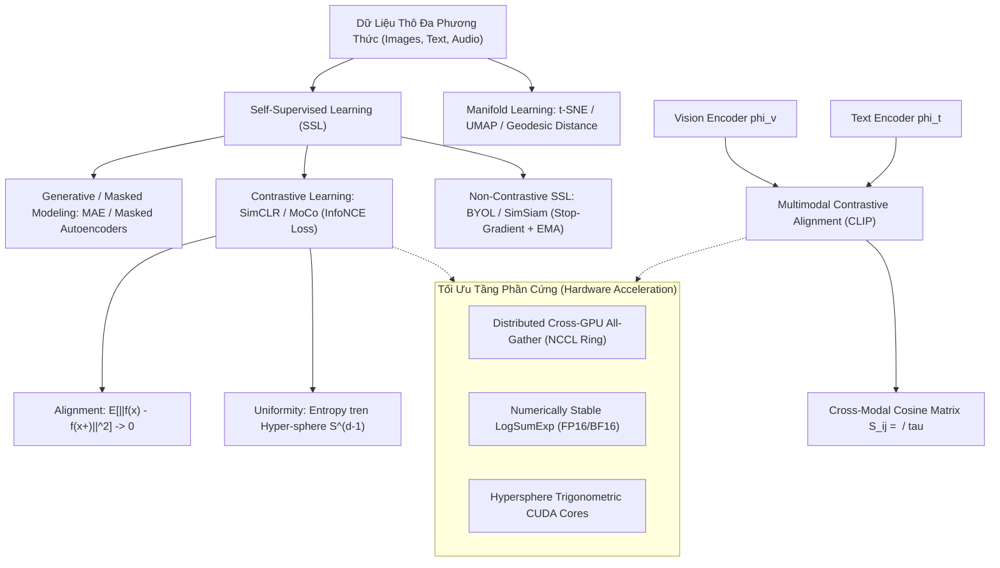
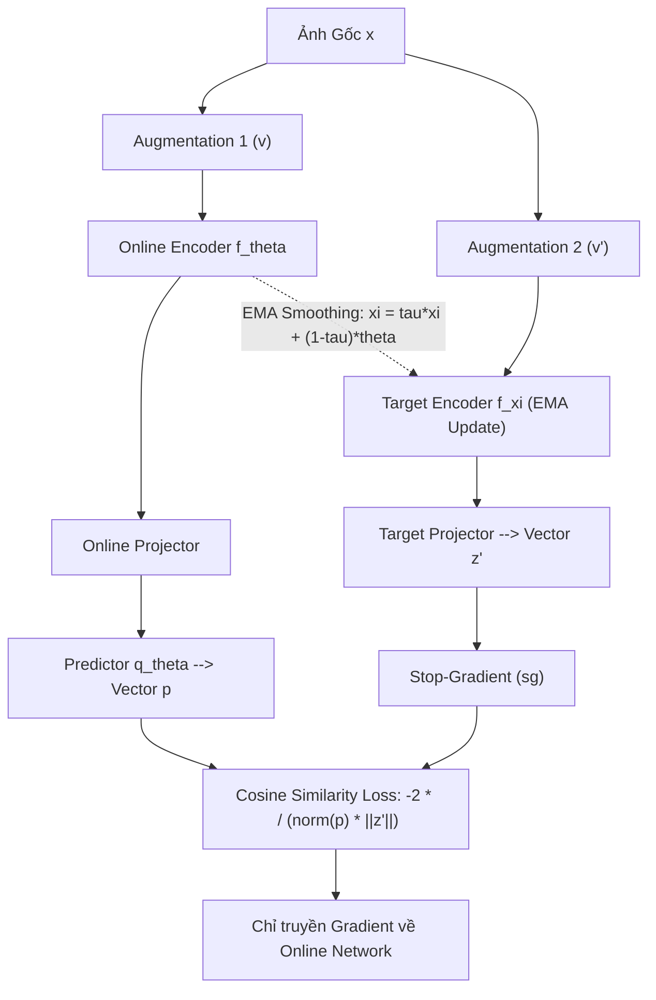
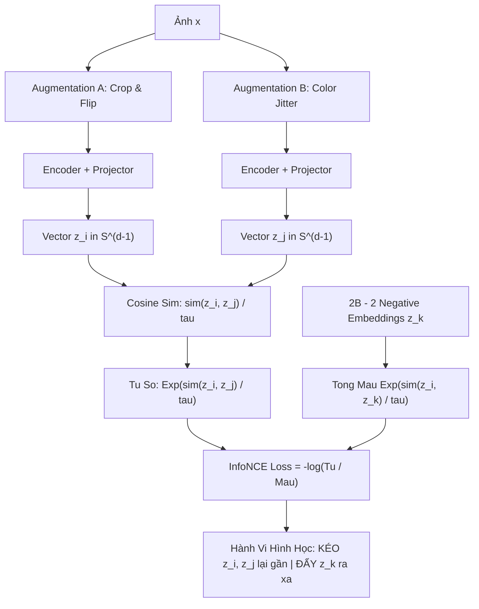
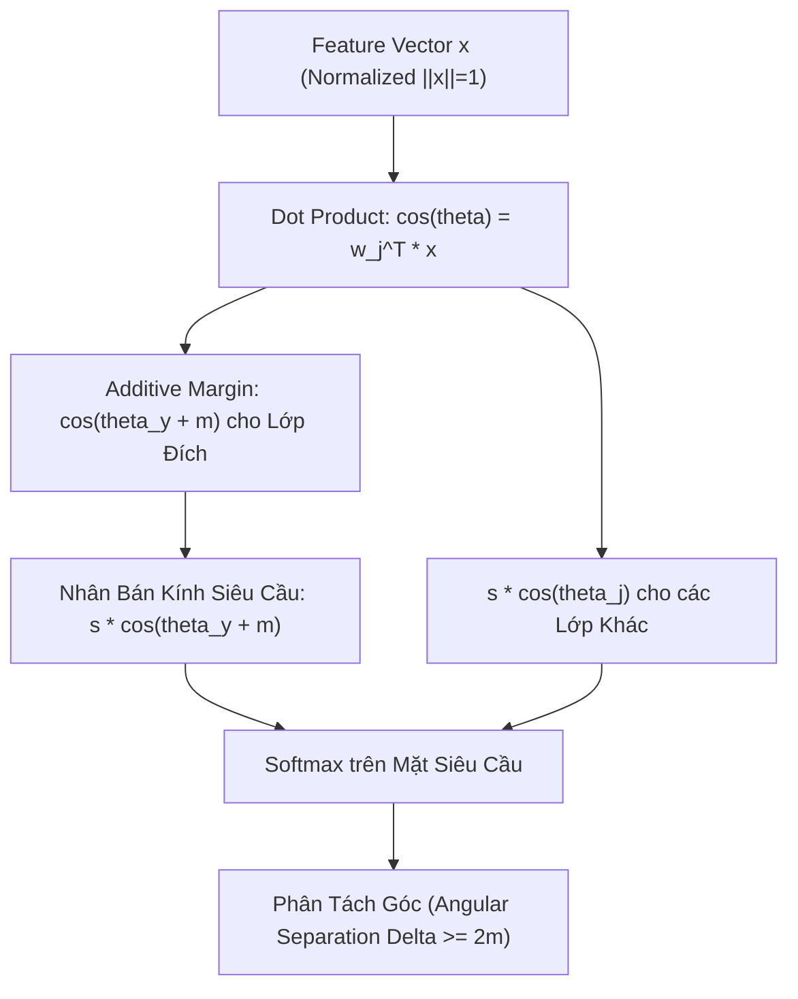
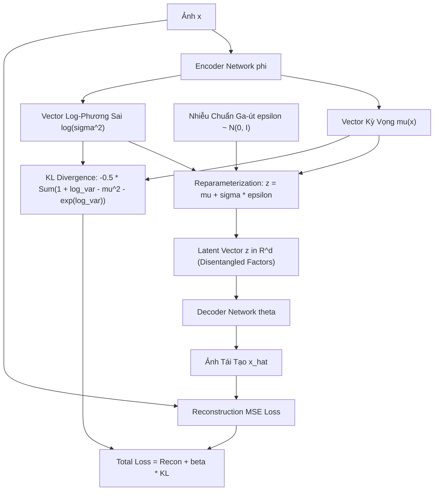
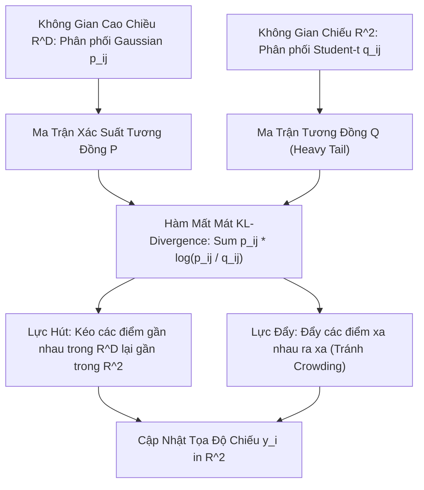
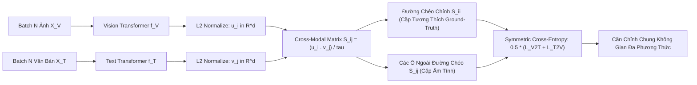

# Chuyên đề: Biểu Diễn Đặc Trưng và Học Đối Tương (Representation & Contrastive Learning)

## 1. Tổng quan Chuyên đề

Trong học máy cổ điển, chất lượng của mô hình phụ thuộc phần lớn vào kỹ nghệ trích xuất đặc trưng thủ công (Feature Engineering). **Học Biểu Diễn (Representation Learning)** và **Học Tự Giám Sát (Self-Supervised Learning - SSL)** đánh dấu cuộc cách mạng triệt để: Cho phép mạng nơ-ron tự động khám phá các cấu trúc hình học tiềm ẩn, các quy luật phân phối và các thuộc tính bất biến từ dữ liệu thô khổng lồ mà không cần bất kỳ nhãn thủ công nào của con người.

Các nguyên lý toán học then chốt:
1. **Tối đa hóa Thông tin Hỗ quan (Mutual Information Maximization)**: Thiết lập cận dưới InfoNCE trên thông tin tương hỗ $I(X; Y) \ge \log(K) - \mathcal{L}_{\text{InfoNCE}}$, ép biểu diễn của các góc nhìn khác nhau (views) của cùng một thực thể phải hội tụ.
2. **Hình học Đa tạp và Khoảng cách Metric (Manifold & Metric Spaces)**: Dữ liệu không gian cao $\mathbb{R}^D$ nằm trên một đa tạp con Riemann $\mathcal{M}$ có số chiều thực $d \ll D$. Metric Learning biến đổi không gian Euclidean thành không gian góc (Angular/Hyperspherical) để phân tách tối đa các lớp.
3. **Phòng chống Sụp đổ Nghiệm (Collapse Prevention Mechanics)**: Cơ chế toán học ngăn chặn mạng nơ-ron rơi vào nghiệm tầm thường (toàn bộ dữ liệu bị ánh xạ thành một điểm hằng số) thông qua Stop-Gradient, Exponential Moving Average (EMA), hoặc Phân rã Phương sai - Hiệp phương sai (VICReg).
4. **Hợp nhất Đa phương thức (Multimodal Alignment)**: Căn chỉnh các không gian vector từ các giác quan khác nhau (Văn bản, Hình ảnh, Âm thanh) vào cùng một hệ tọa độ ngữ nghĩa chung.



---

## 2. Chi tiết từng Keyword

---

### 1. Self-Supervised Learning (Học tự giám sát)

#### a. Định nghĩa Bản chất Toán học (Mathematical Formulation)
Học tự giám sát (Self-Supervised Learning - SSL) tự động thiết lập các tác vụ dẫn xuất (pretext tasks) từ chính cấu trúc nội tại của dữ liệu $\mathbf{x} \sim \mathcal{D}$ để học hàm trích xuất biểu diễn $f_{\mathbf{\theta}}: \mathcal{X} \to \mathbb{R}^d$.

Hai trường phái toán học chính:
1. **Mô hình Khôi phục / Tái tạo Mặt nạ (Masked Autoencoding - MAE)** (He et al., 2022):
   Dữ liệu được chia thành các patch $\mathbf{x} = \{\mathbf{x}_1, \dots, \mathbf{x}_P\}$. Một tập con ngẫu nhiên các patch $\mathcal{M} \subset \{1, \dots, P\}$ với tỷ lệ lớn (ví dụ $75\%$) bị che giấu.
   Mạng nơ-ron chỉ nhận các patch nhìn thấy $\mathbf{x}_{\bar{\mathcal{M}}}$ và phải tái tạo lại các pixel của patch bị che:
   $$\min_{\mathbf{\theta}, \mathbf{\phi}} \mathcal{L}_{\text{MAE}} = \frac{1}{|\mathcal{M}|} \sum_{i \in \mathcal{M}} \|\mathbf{x}_i - g_{\mathbf{\phi}}(f_{\mathbf{\theta}}(\mathbf{x}_{\bar{\mathcal{M}}}))_i\|_2^2$$
2. **Học Phi Đối Tương (Non-Contrastive SSL - BYOL / SimSiam)** (Grill et al., 2020; Chen & He, 2021):
   Không sử dụng mẫu âm (negative samples). Hai góc nhìn tăng cường $\mathbf{v} = t(\mathbf{x})$ và $\mathbf{v}' = t'(\mathbf{x})$ được đưa vào hai mạng:
   - Mạng Online $\mathbf{\theta}$: Trích xuất $z_{\mathbf{\theta}} = f_{\mathbf{\theta}}(\mathbf{v})$ và dự đoán $p_{\mathbf{\theta}} = q_{\mathbf{\theta}}(z_{\mathbf{\theta}})$.
   - Mạng Target $\mathbf{\xi}$: Trích xuất $z_{\mathbf{\xi}}' = f_{\mathbf{\xi}}(\mathbf{v}')$ với trọng số được cập nhật theo trung bình động hàm mũ (Exponential Moving Average - EMA):
     $$\mathbf{\xi} \leftarrow \tau \mathbf{\xi} + (1 - \tau) \mathbf{\theta}, \quad \tau \in [0.99, 1.0]$$
   Hàm mất mát Mean Squared Error trên vector chuẩn hóa L2, kết hợp toán tử chặn gradient (**Stop-Gradient** $\operatorname{sg}(\cdot)$):
   $$\mathcal{L}_{\text{BYOL}} = 2 - 2 \frac{\langle p_{\mathbf{\theta}}, \operatorname{sg}(z_{\mathbf{\xi}}') \rangle}{\|p_{\mathbf{\theta}}\|_2 \|z_{\mathbf{\xi}}'\|_2}$$

Toán tử Stop-Gradient đóng vai trò sống còn: Nó phá vỡ tính đối xứng của phương trình đạo hàm, ngăn chặn hiện tượng sụp đổ nghiệm tầm thường ($z = \text{const}$).

#### b. Cơ chế Tầng Sâu & Điện toán (Under The Hood / Hardware Internals)
- **Tối ưu hóa Băng thông Tính toán MAE (Asymmetric Encoder-Decoder)**:
  Vì $75\%$ số patch bị loại bỏ ngay từ đầu, Encoder nặng ký (ViT-Large) chỉ cần xử lý $25\%$ số token còn lại.
  Điều này giảm độ phức tạp tính toán của Self-Attention từ $\mathcal{O}(P^2)$ xuống $\mathcal{O}((0.25P)^2) = \mathcal{O}(0.0625 P^2)$ — **tăng tốc tính toán gấp 16 lần** và tiết kiệm dung lượng VRAM khổng lồ. Decoder nhẹ chỉ được ghép vào ở tầng cuối cùng để tái tạo pixel.
- **Cập nhật EMA Trực tiếp trên Con trỏ VRAM**:
  Phép cập nhật EMA $\mathbf{\xi} = \tau \mathbf{\xi} + (1-\tau)\mathbf{\theta}$ được thực thi bằng kernel CUDA phần tử `lerp` (`linear interpolation`) trực tiếp trên bộ nhớ GPU, không đưa qua đồ thị Autograd, tránh cấp phát bộ nhớ phụ.

#### c. Sơ đồ Minh họa (Mermaid Diagram)


#### d. Code Thực chiến (Dual-Engine: C++ & Python)

```cpp
// C++20: Động cơ Cập nhật EMA (Exponential Moving Average) tối ưu Cache & SIMD
#include <iostream>
#include <vector>

class ParameterEMAEngine {
private:
    float tau; // Hệ số suy giảm (thường là 0.996)

public:
    explicit ParameterEMAEngine(float decay_rate) : tau(decay_rate) {}

    // Cập nhật: target_param = tau * target_param + (1 - tau) * online_param
    void update_weights(float* target, const float* online, size_t n_elements) const {
        float one_minus_tau = 1.0f - tau;

        // Vòng lặp tối ưu hóa cho trình biên dịch vector hóa (Auto-vectorization / AVX)
        for (size_t i = 0; i < n_elements; ++i) {
            target[i] = tau * target[i] + one_minus_tau * online[i];
        }
    }
};

int main() {
    constexpr size_t N = 4;
    float online_weights[N] = {1.2f, -0.5f, 3.0f, 0.8f};
    float target_weights[N] = {1.0f, -0.4f, 2.8f, 0.7f};

    ParameterEMAEngine ema(0.99f);
    ema.update_weights(target_weights, online_weights, N);

    std::cout << "[C++ EMA Engine] Trọng số Target sau cập nhật EMA:\n  [";
    for (size_t i = 0; i < N; ++i) std::cout << target_weights[i] << " ";
    std::cout << "]\n";
    return 0;
}
```

```python
# Python / PyTorch: SimSiam Architecture với Stop-Gradient ngăn chặn Sụp đổ Nghiệm
import torch
import torch.nn as nn
import torch.nn.functional as F

class SimSiam(nn.Module):
    def __init__(self, in_features: int, hidden_dim: int, out_dim: int):
        super().__init__()
        # Backbone + Projector
        self.encoder = nn.Sequential(
            nn.Linear(in_features, hidden_dim, bias=False),
            nn.BatchNorm1d(hidden_dim),
            nn.ReLU(),
            nn.Linear(hidden_dim, out_dim, bias=False),
            nn.BatchNorm1d(out_dim, affine=False)
        )
        # Predictor q
        self.predictor = nn.Sequential(
            nn.Linear(out_dim, hidden_dim // 2, bias=False),
            nn.BatchNorm1d(hidden_dim // 2),
            nn.ReLU(),
            nn.Linear(hidden_dim // 2, out_dim)
        )

    def compute_loss(self, p: torch.Tensor, z: torch.Tensor) -> torch.Tensor:
        # z được detach (Stop-Gradient) để chặn gradient
        z_detached = z.detach()
        p_norm = F.normalize(p, p=2, dim=-1)
        z_norm = F.normalize(z_detached, p=2, dim=-1)
        # Cosine similarity âm
        return - (p_norm * z_norm).sum(dim=-1).mean()

    def forward(self, x1: torch.Tensor, x2: torch.Tensor) -> torch.Tensor:
        z1 = self.encoder(x1)
        z2 = self.encoder(x2)

        p1 = self.predictor(z1)
        p2 = self.predictor(z2)

        # Mất mát đối xứng 2 chiều
        loss = 0.5 * self.compute_loss(p1, z2) + 0.5 * self.compute_loss(p2, z1)
        return loss

if __name__ == "__main__":
    B, D = 4, 16
    x_view1 = torch.randn(B, D)
    x_view2 = torch.randn(B, D)

    model = SimSiam(in_features=D, hidden_dim=32, out_dim=16)
    loss = model(x_view1, x_view2)
    loss.backward()
    print(f"[PyTorch SimSiam] Loss (Negative Cosine Similarity): {loss.item():.4f}")
```

#### e. Lỗi Thường gặp & Ổn định Số học (Pitfalls & Numerical Stability)
- **Quên Toán tử Stop-Gradient (Gradient Leakage Collapse)**: Nếu bỏ qua hàm `detach()` trong nhánh target của SimSiam/BYOL, hàm mất mát sẽ nhanh chóng kéo toàn bộ activations về một vector hằng số tối ưu tầm thường, làm phương sai biểu diễn $\operatorname{Var}(z) \to 0$.

#### f. Ứng dụng Thực chiến trong AI / Deep Learning
- **Tiền huấn luyện Mô hình Thị giác ViT (Vision Transformers)**: MAE và DINOv2 là công nghệ xương sống huấn luyện các mô hình nền tảng thị giác lớn nhất thế giới của Meta AI và Apple.

---

### 2. Contrastive Learning (Học đối tương)

#### a. Định nghĩa Bản chất Toán học (Mathematical Formulation)
Học đối tương (Contrastive Learning) tối ưu hóa biểu diễn dựa trên nguyên tắc: Kéo gần các cặp mẫu tương đồng (**Positive Pairs**) và đẩy xa các cặp mẫu khác biệt (**Negative Pairs**).

**Hàm Mất mát InfoNCE (Information Noise-Contrastive Estimation)** (Oord et al., 2018; SimCLR):
Cho batch chứa $B$ mẫu dữ liệu. Sau khi áp dụng 2 phép tăng cường ngẫu nhiên, ta có $2B$ mẫu. Với mỗi mẫu $\mathbf{x}_i$, gọi $\mathbf{x}_{j(i)}$ là bản tăng cường còn lại của nó (positive pair), và $2B - 2$ mẫu còn lại là negative pairs.
$$\mathcal{L}_{\text{InfoNCE}} = -\sum_{i=1}^{2B} \log \frac{\exp\left( \frac{\operatorname{sim}(\mathbf{z}_i, \mathbf{z}_j)}{\tau} \right)}{\sum_{k=1}^{2B} \mathbb{I}_{[k \ne i]} \exp\left( \frac{\operatorname{sim}(\mathbf{z}_i, \mathbf{z}_k)}{\tau} \right)}$$
Trong đó $\operatorname{sim}(\mathbf{u}, \mathbf{v}) = \frac{\mathbf{u}^T \mathbf{v}}{\|\mathbf{u}\|_2 \|\mathbf{v}\|_2}$ là độ đo tương đồng cosine, và $\tau > 0$ là tham số nhiệt độ (temperature).

**Định lý Phân rã Alignment & Uniformity (Wang & Isola, 2020)**:
Khi kích thước tập mẫu âm tiệm cận vô cùng ($B \to \infty$), hàm InfoNCE tiệm cận việc tối ưu đồng thời hai thuộc tính hình học trên mặt siêu cầu đơn vị $\mathcal{S}^{d-1}$:
1. **Tính Căn chỉnh (Alignment)**: Các biểu diễn của cùng một thực thể phải nằm sát nhau:
   $$\mathcal{L}_{\text{align}} \triangleq \mathbb{E}_{(\mathbf{x}, \mathbf{x}^+) \sim p_{\text{pos}}} \left[ \|\mathbf{z} - \mathbf{z}^+\|_2^2 \right] \to 0$$
2. **Tính Đồng đều (Uniformity)**: Các vector biểu diễn phải phân bố đều khắp mặt siêu cầu để tối đa hóa entropy thông tin (tránh cụm đặc trưng):
   $$\mathcal{L}_{\text{uniform}} \triangleq \log \mathbb{E}_{\mathbf{x}, \mathbf{y} \overset{i.i.d.}{\sim} p_{\text{data}}} \left[ \exp\left(-2 \|\mathbf{z} - \mathbf{z}'\|_2^2\right) \right]$$

#### b. Cơ chế Tầng Sâu & Điện toán (Under The Hood / Hardware Internals)
- **Độ Lớn Batch Cực Đại & Thuật toán All-Gather NCCL**:
  SimCLR yêu cầu kích thước batch khổng lồ ($B = 4096$) để có đủ lượng mẫu âm tính đa dạng ($2B - 2 = 8190$ negatives).
  Để huấn luyện trên cụm đa GPU (ví dụ 8 x A100), mỗi GPU chỉ giữ cục bộ một micro-batch $b = 512$. Trước khi tính InfoNCE, thao tác giao tiếp phân tán `dist.all_gather` truyền đồng bộ tensor embedding giữa các GPU qua kết nối mạng tốc độ cao NVLink/NCCL Ring, tái tạo ma trận $(4096 \times D)$ trong VRAM của từng thiết bị.
- **Ổn định Số học LogSumExp trong FP16**:
  Phép tính $\exp(\text{sim} / \tau)$ khi $\tau = 0.07$ có thể sinh ra số mũ lên tới $\exp(1.0 / 0.07) \approx \exp(14.28) \approx 1.6 \times 10^6$. Trong kiểu dữ liệu nửa chính xác FP16 (giới hạn tối đa $65,504$), phép tính này sẽ bị **Tràn số Dương (Overflow $\to +\infty$)**.
  Bắt buộc phải áp dụng kỹ thuật trừ cực đại LogSumExp: $\log \sum \exp(s_i) = m + \log \sum \exp(s_i - m)$, với $m = \max(s_i)$.

#### c. Sơ đồ Minh họa (Mermaid Diagram)


#### d. Code Thực chiến (Dual-Engine: C++ & Python)

```cpp
// C++20: Bộ Tính toán InfoNCE LogSumExp Bền vững Số học (Numerically Stable InfoNCE)
#include <iostream>
#include <vector>
#include <cmath>
#include <numeric>
#include <algorithm>

class ContrastiveInfoNCEEngine {
private:
    float temperature;

public:
    explicit ContrastiveInfoNCEEngine(float tau) : temperature(tau) {}

    // Input: similarities là mảng độ dài K chứa tích vô hướng cosine giữa anchor và K ứng viên
    // Phần tử similarities[pos_idx] là cặp positive, các phần tử còn lại là negatives
    float compute_loss(const std::vector<float>& similarities, size_t pos_idx) const {
        const size_t k = similarities.size();
        std::vector<float> scaled_sims(k);

        // 1. Chia nhiệt độ tau
        float max_s = -1e9f;
        for (size_t i = 0; i < k; ++i) {
            scaled_sims[i] = similarities[i] / temperature;
            if (scaled_sims[i] > max_s) {
                max_s = scaled_sims[i];
            }
        }

        // 2. Kỹ thuật LogSumExp chống tràn số: Log(Sum exp(s_i)) = max_s + Log(Sum exp(s_i - max_s))
        float sum_exp = 0.0f;
        for (size_t i = 0; i < k; ++i) {
            sum_exp += std::exp(scaled_sims[i] - max_s);
        }
        float log_denom = max_s + std::log(sum_exp);

        // 3. Loss = - (s_pos - log_denom)
        return -(scaled_sims[pos_idx] - log_denom);
    }
};

int main() {
    ContrastiveInfoNCEEngine engine(0.1f); // tau = 0.1

    // 4 ứng viên: Index 0 là Positive (sim = 0.95), các phần tử sau là Negatives
    std::vector<float> mock_similarities = {0.95f, 0.10f, -0.20f, 0.35f};

    float loss = engine.compute_loss(mock_similarities, 0);
    std::cout << "[C++ InfoNCE Engine] InfoNCE Loss: " << loss << " (Giá trị nhỏ thể hiện Positive vượt trội)\n";
    return 0;
}
```

```python
# Python / PyTorch: SimCLR Vectorized InfoNCE Loss trên Toàn Bộ Mini-Batch
import torch
import torch.nn as nn
import torch.nn.functional as F

class SimCLRInfoNCELoss(nn.Module):
    def __init__(self, temperature: float = 0.07):
        super().__init__()
        self.temperature = temperature

    def forward(self, z_i: torch.Tensor, z_j: torch.Tensor) -> torch.Tensor:
        # z_i, z_j: (B, D) đại diện cho 2 views
        batch_size = z_i.size(0)

        # 1. Chuẩn hóa L2 trên mặt siêu cầu
        z_i_norm = F.normalize(z_i, p=2, dim=-1)
        z_j_norm = F.normalize(z_j, p=2, dim=-1)

        # 2. Ghép 2 views thành tensor (2B, D)
        representations = torch.cat([z_i_norm, z_j_norm], dim=0) # (2B, D)

        # 3. Tính toán toàn bộ ma trận tương đồng cosine bằng GEMM: (2B, 2B)
        similarity_matrix = torch.matmul(representations, representations.T) / self.temperature

        # 4. Mặt nạ loại bỏ độ tương đồng của một vector với chính nó (đường chéo chính)
        diag_mask = torch.eye(2 * batch_size, dtype=torch.bool, device=z_i.device)
        similarity_matrix.masked_fill_(diag_mask, -1e9)

        # 5. Xác định vị trí của các cặp Positive:
        # Với i in [0..B-1], positive là i + B
        # Với i in [B..2B-1], positive là i - B
        pos_targets = torch.cat([
            torch.arange(batch_size, 2 * batch_size, device=z_i.device),
            torch.arange(0, batch_size, device=z_i.device)
        ])

        # 6. Cross Entropy Loss tương đương hoàn toàn công thức InfoNCE
        loss = F.cross_entropy(similarity_matrix, pos_targets)
        return loss

if __name__ == "__main__":
    B, D = 4, 32
    view_a = torch.randn(B, D, requires_grad=True)
    view_b = torch.randn(B, D, requires_grad=True)

    criterion = SimCLRInfoNCELoss(temperature=0.1)
    loss = criterion(view_a, view_b)
    loss.backward()
    print(f"[PyTorch SimCLR] Vectorized InfoNCE Loss: {loss.item():.4f}")
```

#### e. Lỗi Thường gặp & Ổn định Số học (Pitfalls & Numerical Stability)
- **Mẫu Âm Giả mạo (False Negative Elimination)**: Trong không gian tự giám sát, hai ảnh hoàn toàn khác nhau về mặt dữ liệu số nhưng có thể cùng chứa một con chó. Thuật toán InfoNCE ngây thơ vẫn coi chúng là negative pair và cưỡng bức đẩy xa nhau, phá vỡ cấu trúc ngữ nghĩa tự nhiên. Giải pháp: Sử dụng De-biased Contrastive Learning (Chuang et al., 2020).

#### f. Ứng dụng Thực chiến trong AI / Deep Learning
- **Hệ thống Tìm kiếm Hình ảnh & Âm nhạc (Image/Audio Retrieval)**: Khởi tạo các vector nhúng (embeddings) cho hàng tỷ bài hát trên Spotify để nhận diện các bản phối lại (remix) hoặc tìm kiếm theo giai điệu chỉ trong vài mili-giây.

---

### 3. Metric Learning (Học khoảng cách đo lường)

#### a. Định nghĩa Bản chất Toán học (Mathematical Formulation)
Học khoảng cách đo lường (Metric Learning) xây dựng một hàm khoảng cách $d_{\mathbf{M}}(\mathbf{x}_i, \mathbf{x}_j)$ thỏa mãn 4 tiên đề khoảng cách metric (Tính không âm, Tính đồng nhất, Tính đối xứng, và Bất đẳng thức tam giác).

Khoảng cách **Mahalanobis** tham số hóa:
$$d_{\mathbf{M}}(\mathbf{x}_i, \mathbf{x}_j) = \sqrt{(\mathbf{x}_i - \mathbf{x}_j)^T \mathbf{M} (\mathbf{x}_i - \mathbf{x}_j)}$$
Trong đó $\mathbf{M} \in \mathbb{R}^{D \times D}$ là ma trận nửa xác định dương ($\mathbf{M} \succeq 0$). Phân rã Cholesky $\mathbf{M} = \mathbf{L}^T \mathbf{L}$ đưa bài toán về phép biến đổi tuyến tính chiếu không gian:
$$d_{\mathbf{M}}(\mathbf{x}_i, \mathbf{x}_j) = \|\mathbf{L}\mathbf{x}_i - \mathbf{L}\mathbf{x}_j\|_2$$

**Additive Angular Margin Loss (ArcFace)** (Deng et al., 2019):
Trong không gian học sâu hiện đại, Metric Learning đạt đỉnh cao với việc ánh xạ đặc trưng lên mặt cầu góc (Angular Hypersphere).
Chuẩn hóa vector đặc trưng $\|\mathbf{x}\| = 1$ và vector trọng số lớp $\|\mathbf{w}_j\| = 1$, tích vô hướng trở thành $\mathbf{w}_j^T \mathbf{x} = \cos \theta_j$.
ArcFace cộng thêm một lề góc (angular margin $m > 0$) trực tiếp vào góc của lớp chuẩn $\theta_{y_i}$:
$$\mathcal{L}_{\text{ArcFace}} = -\log \frac{\exp(s \cdot \cos(\theta_{y_i} + m))}{\exp(s \cdot \cos(\theta_{y_i} + m)) + \sum_{j \ne y_i} \exp(s \cdot \cos \theta_j)}$$
Trong đó $s$ là hệ số tỷ lệ bán kính mặt cầu (scale factor). Việc cộng lề góc $m$ ép biên giới quyết định giữa các lớp phải cách nhau một khoảng góc tối thiểu $\Delta \theta \ge 2m$.

#### b. Cơ chế Tầng Sâu & Điện toán (Under The Hood / Hardware Internals)
- **Tối ưu hóa Lượng giác bằng Phép Khai triển Toán học**:
  Thay vì gọi hàm lượng giác ngược `acos` tốn nhiều chu kỳ xung nhịp GPU (`acos` chậm hơn các phép toán đại số gấp 10 lần), ArcFace khai triển:
  $$\cos(\theta + m) = \cos \theta \cos m - \sin \theta \sin m = \cos \theta \cos m - \sqrt{1 - \cos^2 \theta} \sin m$$
  Vì $\cos m$ và $\sin m$ là các hằng số được tính trước, kernel CUDA chỉ cần thực hiện phép nhân ma trận và căn bậc hai (`__fsqrt_rn`), đẩy tốc độ xử lý lên mức tối đa.

#### c. Sơ đồ Minh họa (Mermaid Diagram)


#### d. Code Thực chiến (Dual-Engine: C++ & Python)

```cpp
// C++20: Động cơ Khoảng cách Mahalanobis qua Phân rã Cholesky L^T * L
#include <iostream>
#include <vector>
#include <cmath>

class MahalanobisMetricEngine {
private:
    std::vector<float> L; // Ma trận tam giác dưới Cholesky (D x D), Row-Major
    size_t D;

public:
    MahalanobisMetricEngine(size_t dim, std::vector<float> cholesky_L)
        : L(std::move(cholesky_L)), D(dim) {}

    // Tính khoảng cách: d_M(x1, x2) = || L * (x1 - x2) ||_2
    float compute_distance(const float* x1, const float* x2) const {
        std::vector<float> diff(D);
        for (size_t i = 0; i < D; ++i) diff[i] = x1[i] - x2[i];

        // Biến đổi L * diff
        float norm_sq = 0.0f;
        for (size_t i = 0; i < D; ++i) {
            float transformed_val = 0.0f;
            const float* l_row = L.data() + (i * D);
            for (size_t j = 0; j <= i; ++j) { // Ma trận tam giác dưới
                transformed_val += l_row[j] * diff[j];
            }
            norm_sq += transformed_val * transformed_val;
        }

        return std::sqrt(norm_sq);
    }
};

int main() {
    constexpr size_t D = 2;
    // Ma trận L tam giác dưới giả lập:
    // [2.0, 0.0]
    // [1.0, 3.0]
    std::vector<float> mock_L = {2.0f, 0.0f, 1.0f, 3.0f};

    MahalanobisMetricEngine engine(D, mock_L);

    float p1[D] = {1.0f, 2.0f};
    float p2[D] = {2.0f, 1.0f};

    float dist = engine.compute_distance(p1, p2);
    std::cout << "[C++ Mahalanobis Engine] Khoảng cách Metric Mahalanobis: " << dist << "\n";
    return 0;
}
```

```python
# Python / PyTorch: ArcFace (Additive Angular Margin Loss) Module
import math
import torch
import torch.nn as nn
import torch.nn.functional as F

class ArcFaceLoss(nn.Module):
    def __init__(self, in_features: int, num_classes: int, s: float = 64.0, m: float = 0.50):
        super().__init__()
        self.in_features = in_features
        self.num_classes = num_classes
        self.s = s
        self.m = m

        # Trọng số đại diện các lớp trên siêu cầu
        self.weight = nn.Parameter(torch.FloatTensor(num_classes, in_features))
        nn.init.xavier_uniform_(self.weight)

        # Các hằng số lượng giác tính trước
        self.cos_m = math.cos(m)
        self.sin_m = math.sin(m)
        self.th = math.cos(math.pi - m)
        self.mm = math.sin(math.pi - m) * m

    def forward(self, features: torch.Tensor, labels: torch.Tensor) -> torch.Tensor:
        # features: (B, in_features), labels: (B,)
        # 1. Chuẩn hóa L2 vector đặc trưng và ma trận trọng số
        x_norm = F.normalize(features, p=2, dim=-1)
        w_norm = F.normalize(self.weight, p=2, dim=-1)

        # 2. Tính cos(theta) = x * w^T
        cosine = F.linear(x_norm, w_norm) # (B, num_classes)
        sine = torch.sqrt(torch.clamp(1.0 - torch.pow(cosine, 2), min=1e-7, max=1.0))

        # 3. Khai triển cos(theta + m) = cos*cos_m - sin*sin_m
        phi = cosine * self.cos_m - sine * self.sin_m

        # Bảo vệ số học khi góc theta > pi - m
        phi = torch.where(cosine > self.th, phi, cosine - self.mm)

        # 4. Tạo one-hot mask để chỉ cộng margin vào đúng lớp mục tiêu
        one_hot = torch.zeros_like(cosine)
        one_hot.scatter_(1, labels.view(-1, 1).long(), 1.0)

        # 5. Nhân hệ số bán kính s và tính Cross-Entropy
        output = (one_hot * phi) + ((1.0 - one_hot) * cosine)
        output *= self.s
        loss = F.cross_entropy(output, labels)
        return loss

if __name__ == "__main__":
    B, D, C = 4, 16, 5
    mock_feats = torch.randn(B, D)
    mock_targets = torch.tensor([0, 2, 4, 1])

    arcface = ArcFaceLoss(in_features=D, num_classes=C, s=30.0, m=0.3)
    loss_val = arcface(mock_feats, mock_targets)
    loss_val.backward()
    print(f"[PyTorch ArcFace] Angular Margin Loss: {loss_val.item():.4f}")
```

#### e. Lỗi Thường gặp & Ổn định Số học (Pitfalls & Numerical Stability)
- **Vấn đề Góc Vượt Ngưỡng (Angle Boundary Overflow)**: Khi $\theta + m > \pi$, hàm cosin bị nghịch đảo tính đơn điệu (bắt đầu tăng thay vì giảm), khiến mạng nơ-ron nhận gradient dương sai lệch. Đoạn mã PyTorch bắt buộc phải áp dụng điều kiện `torch.where(cosine > self.th, ...)` để chuyển tiếp trơn tuyến tính.

#### f. Ứng dụng Thực chiến trong AI / Deep Learning
- **Hệ thống Nhận diện Khuôn mặt Quy mô Quốc gia (MegaFace / FaceID)**: Huấn luyện các mô hình nhận diện khuôn mặt hàng trăm triệu người với tỷ lệ nhận diện sai (False Acceptance Rate - FAR) dưới $1 / 1,000,000$.

---

### 4. Representation Learning (Học biểu diễn)

#### a. Định nghĩa Bản chất Toán học (Mathematical Formulation)
Mục tiêu tối thượng của học biểu diễn (Representation Learning) là phân rã các yếu tố biến thiên độc lập (Disentangled Factors of Variation) của thế giới thực vào các chiều tọa độ độc lập của không gian tiềm ẩn $\mathbf{z} \in \mathbb{R}^d$.

Một biểu diễn được coi là **Hoàn toàn Phân rã (Disentangled)** nếu:
$$p(\mathbf{z}) = \prod_{j=1}^d p(z_j)$$
nghĩa là mỗi chiều tọa độ $z_j$ kiểm soát duy nhất một thuộc tính vật lý (ví dụ: $z_1$ là góc quay khuôn mặt, $z_2$ là độ mở miệng, $z_3$ là ánh sáng).

**Khung Khái niệm $\beta$-VAE** (Higgins et al., 2017):
Hàm mục tiêu cận dưới biến phân ELBO có trọng số phạt $\beta > 1$:
$$\mathcal{L}_{\beta\text{-VAE}} = \mathbb{E}_{q_{\mathbf{\phi}}(\mathbf{z} \mid \mathbf{x})} [\log p_{\mathbf{\theta}}(\mathbf{x} \mid \mathbf{z})] - \beta D_{\text{KL}}\left( q_{\mathbf{\phi}}(\mathbf{z} \mid \mathbf{x}) \;\big\|\; p(\mathbf{z}) \right)$$

Phân rã toán học của số hạng Kullback-Leibler Divergence (Kim & Mnih, 2018):
$$\mathbb{E}_{\mathbf{x}}[D_{\text{KL}}] = I(\mathbf{x}; \mathbf{z}) + \beta \cdot \operatorname{TC}(\mathbf{z}) + \sum_{j=1}^d D_{\text{KL}}(q(z_j) \| p(z_j))$$
Trong đó:
$$\operatorname{TC}(\mathbf{z}) = D_{\text{KL}}\left( q(\mathbf{z}) \;\Big\|\; \prod_{j=1}^d q(z_j) \right)$$
chính là đại lượng **Tương quan Toàn phần (Total Correlation)**. Việc ép $\beta > 1$ trừng phạt nặng nề $\operatorname{TC}(\mathbf{z})$, cưỡng bức các chiều $z_j$ phải độc lập thống kê với nhau.

#### b. Cơ chế Tầng Sâu & Điện toán (Under The Hood / Hardware Internals)
- **Kỹ xảo Tái tham số hóa (Reparameterization Trick) & Autograd Graph**:
  Không thể truyền gradient qua một biến ngẫu nhiên $\mathbf{z} \sim \mathcal{N}(\mathbf{\mu}, \mathbf{\Sigma})$ vì phép lấy mẫu là không khả vi.
  Kỹ xảo tái tham số hóa tách rời tính ngẫu nhiên ra khỏi đồ thị tính toán:
  $$\mathbf{z} = \mathbf{\mu}(\mathbf{x}) + \mathbf{\sigma}(\mathbf{x}) \odot \mathbf{\epsilon}, \quad \mathbf{\epsilon} \sim \mathcal{N}(\mathbf{0}, \mathbf{I})$$
  Vector nhiễu ngẫu nhiên $\mathbf{\epsilon}$ được sinh bởi phần cứng sinh số ngẫu nhiên của GPU (cuRAND) và đưa vào như một hằng số độc lập, cho phép đạo hàm truyền thẳng mượt mà về $\mathbf{\mu}$ và $\mathbf{\sigma}$.

#### c. Sơ đồ Minh họa (Mermaid Diagram)


#### d. Code Thực chiến (Dual-Engine: C++ & Python)

```cpp
// C++20: Động cơ Reparameterization Trick & Tính toán Phân kỳ KL Ga-út
#include <iostream>
#include <vector>
#include <cmath>

class GaussianReparameterizationEngine {
public:
    // z = mu + exp(0.5 * log_var) * epsilon
    static void sample(const float* mu, const float* log_var, const float* epsilon,
                       float* z_out, size_t dim) {
        for (size_t i = 0; i < dim; ++i) {
            float sigma = std::exp(0.5f * log_var[i]);
            z_out[i] = mu[i] + sigma * epsilon[i];
        }
    }

    // KL(N(mu, sigma^2) || N(0, 1)) = -0.5 * sum(1 + log_var - mu^2 - exp(log_var))
    static float compute_kl_divergence(const float* mu, const float* log_var, size_t dim) {
        float kl = 0.0f;
        for (size_t i = 0; i < dim; ++i) {
            float m = mu[i];
            float lv = log_var[i];
            kl += 1.0f + lv - (m * m) - std::exp(lv);
        }
        return -0.5f * kl;
    }
};

int main() {
    constexpr size_t D = 2;
    float mu[D] = {0.5f, -0.2f};
    float log_var[D] = {0.0f, -0.5f}; // sigma^2 = [1.0, 0.606]
    float eps[D] = {1.2f, -0.8f};     // Nhiễu ngẫu nhiên

    float z[D];
    GaussianReparameterizationEngine::sample(mu, log_var, eps, z, D);

    float kl = GaussianReparameterizationEngine::compute_kl_divergence(mu, log_var, D);

    std::cout << "[C++ Reparameterization Engine]\n";
    std::cout << "  Sampled Latent z: [" << z[0] << ", " << z[1] << "]\n";
    std::cout << "  Gaussian KL Divergence: " << kl << "\n";
    return 0;
}
```

```python
# Python / PyTorch: Kiến trúc Beta-VAE cho Học Biểu Diễn Phân Rã
import torch
import torch.nn as nn

class BetaVAE(nn.Module):
    def __init__(self, in_dim: int, latent_dim: int, beta: float = 4.0):
        super().__init__()
        self.latent_dim = latent_dim
        self.beta = beta

        self.encoder = nn.Sequential(
            nn.Linear(in_dim, 64),
            nn.ReLU(),
            nn.Linear(64, latent_dim * 2) # Nửa đầu là mu, nửa sau là log_var
        )

        self.decoder = nn.Sequential(
            nn.Linear(latent_dim, 64),
            nn.ReLU(),
            nn.Linear(64, in_dim)
        )

    def reparameterize(self, mu: torch.Tensor, log_var: torch.Tensor) -> torch.Tensor:
        std = torch.exp(0.5 * log_var)
        eps = torch.randn_like(std)
        return mu + eps * std

    def forward(self, x: torch.Tensor) -> tuple[torch.Tensor, torch.Tensor, torch.Tensor]:
        enc_out = self.encoder(x)
        mu, log_var = torch.chunk(enc_out, 2, dim=-1)

        z = self.reparameterize(mu, log_var)
        recon_x = self.decoder(z)

        # 1. Reconstruction Loss (MSE)
        recon_loss = nn.functional.mse_loss(recon_x, x, reduction="sum") / x.size(0)

        # 2. KL Divergence
        kl_loss = -0.5 * torch.sum(1 + log_var - mu.pow(2) - log_var.exp(), dim=-1).mean()

        total_loss = recon_loss + self.beta * kl_loss
        return total_loss, recon_loss, kl_loss

if __name__ == "__main__":
    vae = BetaVAE(in_dim=16, latent_dim=4, beta=4.0)
    mock_data = torch.randn(8, 16)
    tot, recon, kl = vae(mock_data)
    tot.backward()
    print(f"[PyTorch Beta-VAE] Total: {tot.item():.4f} | Recon: {recon.item():.4f} | KL: {kl.item():.4f}")
```

#### e. Lỗi Thường gặp & Ổn định Số học (Pitfalls & Numerical Stability)
- **Hiện tượng Sụp đổ Hậu nghiệm (Posterior Collapse)**: Nếu hệ số $\beta$ quá lớn, mô hình sẽ ưu tiên triệt tiêu toàn bộ $D_{\text{KL}} \to 0$ bằng cách đặt $\mathbf{\mu} = 0, \mathbf{\sigma} = 1$, hoàn toàn bỏ qua tín hiệu đầu vào $\mathbf{x}$. Latent $\mathbf{z}$ trở thành nhiễu thuần túy và Decoder học phân phối trung bình. Cần dùng kỹ thuật KL-Annealing (tăng dần $\beta$ từ 0).

#### f. Ứng dụng Thực chiến trong AI / Deep Learning
- **Chỉnh sửa Ảnh Trực quan Khả giải thích (Generative Disentangled Editing)**: Cho phép người dùng trượt thanh điều khiển để thay đổi góc chiếu sáng hoặc thêm kính râm cho một khuôn mặt trong các mô hình sinh hình ảnh (StyleGAN).

---

### 5. Manifold Learning (Học đa tạp)

#### a. Định nghĩa Bản chất Toán học (Mathematical Formulation)
Giả thuyết Đa tạp (Manifold Hypothesis) phát biểu rằng: Dữ liệu thực tế phân bố trong không gian quan sát có số chiều cực cao $\mathbb{R}^D$ (ví dụ ảnh $256 \times 256 = 65,536$ chiều) thực chất hội tụ trên một đa tạp Riemann $\mathcal{M}$ có số chiều nội tại hiệu dụng $d \ll D$.

Khoảng cách Euclide đường thẳng $\|\mathbf{x}_i - \mathbf{x}_j\|$ không phản ánh chính xác cấu trúc hình học nếu hai điểm nằm ở hai nếp gấp khác nhau của đa tạp (ví dụ bề mặt cuộn Swiss Roll). Thay vào đó, khoảng cách thực sự là **Khoảng cách Trắc địa (Geodesic Distance)**: Độ dài đường cong ngắn nhất nối hai điểm nằm hoàn toàn trên bề mặt đa tạp $\mathcal{M}$.

**t-Distributed Stochastic Neighbor Embedding (t-SNE)** (van der Maaten & Hinton, 2008):
Ánh xạ từ $\mathbf{x}_i \in \mathbb{R}^D$ sang $\mathbf{y}_i \in \mathbb{R}^d$ ($d \in \{2, 3\}$).
1. Phân phối xác suất trong không gian gốc (Gaussian):
   $$p_{j \mid i} = \frac{\exp(-\|\mathbf{x}_i - \mathbf{x}_j\|^2 / 2\sigma_i^2)}{\sum_{k \ne i} \exp(-\|\mathbf{x}_i - \mathbf{x}_k\|^2 / 2\sigma_i^2)}, \quad p_{ij} = \frac{p_{j \mid i} + p_{i \mid j}}{2N}$$
2. Phân phối xác suất trong không gian thấp chiều (Phân phối Student-t với 1 bậc tự do - Cauchy):
   $$q_{ij} = \frac{(1 + \|\mathbf{y}_i - \mathbf{y}_j\|_2^2)^{-1}}{\sum_{k} \sum_{l \ne k} (1 + \|\mathbf{y}_k - \mathbf{y}_l\|_2^2)^{-1}}$$
   Đuôi nặng (heavy tail) của phân phối Student giải quyết triệt để vấn đề "chật chội" (**Crowding Problem**) của Gaussian.
3. Hàm mục tiêu tối thiểu hóa phân kỳ Kullback-Leibler:
   $$\min_{\{\mathbf{y}_i\}} \mathcal{L}_{\text{t-SNE}} = D_{\text{KL}}(P \| Q) = \sum_{i \ne j} p_{ij} \log \frac{p_{ij}}{q_{ij}}$$

#### b. Cơ chế Tầng Sâu & Điện toán (Under The Hood / Hardware Internals)
- **Độ phức tạp Tính toán $\mathcal{O}(N^2)$ & Thuật toán Barnes-Hut**:
  Việc tính mẫu số của $q_{ij}$ yêu cầu tương tác giữa mọi cặp điểm ($N^2$). Khi $N \approx 10^5$, phép tính này làm tê liệt bộ nhớ.
  Thuật toán **Barnes-Hut t-SNE** xây dựng cây tứ phân (Quad-Tree / Oct-Tree) để gom cụm các điểm ở xa thành một siêu điểm (center of mass), giảm độ phức tạp xuống $\mathcal{O}(N \log N)$ và tối ưu khả năng nạp dữ liệu tuần tự vào L2 Cache.

#### c. Sơ đồ Minh họa (Mermaid Diagram)


#### d. Code Thực chiến (Dual-Engine: C++ & Python)

```cpp
// C++20: Động cơ Tính toán Lực Gradient t-SNE trong Không gian Chiếu 2D
#include <iostream>
#include <vector>
#include <cmath>

class TSNEGradientEngine {
public:
    // Tính gradient d(KL)/dy_i trong không gian 2D
    // y có kích thước N x 2, P và Q có kích thước N x N
    static void compute_gradients(const std::vector<float>& y,
                                  const std::vector<float>& P,
                                  const std::vector<float>& Q,
                                  size_t N,
                                  std::vector<float>& grad_out) {
        for (size_t i = 0; i < N; ++i) {
            float grad_x = 0.0f;
            float grad_y = 0.0f;
            float y_i0 = y[i * 2 + 0];
            float y_i1 = y[i * 2 + 1];

            for (size_t j = 0; j < N; ++j) {
                if (i == j) continue;

                float diff0 = y_i0 - y[j * 2 + 0];
                float diff1 = y_i1 - y[j * 2 + 1];
                float dist_sq = diff0 * diff0 + diff1 * diff1;

                // Trọng số Student-t: q_ij_unnorm = 1 / (1 + dist_sq)
                float student_factor = 1.0f / (1.0f + dist_sq);
                float p_val = P[i * N + j];
                float q_val = Q[i * N + j];

                // Công thức gradient: 4 * sum (p_ij - q_ij) * student_factor * (y_i - y_j)
                float mult = 4.0f * (p_val - q_val) * student_factor;
                grad_x += mult * diff0;
                grad_y += mult * diff1;
            }

            grad_out[i * 2 + 0] = grad_x;
            grad_out[i * 2 + 1] = grad_y;
        }
    }
};

int main() {
    constexpr size_t N = 3;
    // Giả lập tọa độ 3 điểm trong 2D
    std::vector<float> y = {0.0f, 0.0f, 1.0f, 1.0f, -1.0f, 0.5f};
    std::vector<float> P = {
        0.0f, 0.4f, 0.1f,
        0.4f, 0.0f, 0.05f,
        0.1f, 0.05f, 0.0f
    };
    std::vector<float> Q = {
        0.0f, 0.3f, 0.2f,
        0.3f, 0.0f, 0.1f,
        0.2f, 0.1f, 0.0f
    };

    std::vector<float> grads(N * 2, 0.0f);
    TSNEGradientEngine::compute_gradients(y, P, Q, N, grads);

    std::cout << "[C++ t-SNE Engine] Gradient tọa độ điểm 0: [" 
              << grads[0] << ", " << grads[1] << "]\n";
    return 0;
}
```

```python
# Python / PyTorch: Trực quan hóa Đa tạp bằng t-SNE Gradient Optimization
import torch

class PyTorchTSNE:
    def __init__(self, n_points: int, lr: float = 10.0):
        self.y = torch.randn(n_points, 2, requires_grad=True)
        self.optimizer = torch.optim.Adam([self.y], lr=lr)

    def step(self, P: torch.Tensor) -> float:
        self.optimizer.zero_grad(set_to_none=True)

        # 1. Tính toán ma trận khoảng cách pairwise trong không gian 2D
        dists = torch.cdist(self.y, self.y, p=2).pow(2)

        # 2. Phân phối Student-t: q_ij = (1 + ||y_i - y_j||^2)^(-1)
        inv_dist = 1.0 / (1.0 + dists)
        inv_dist.fill_diagonal_(0.0)
        Q = inv_dist / inv_dist.sum()
        Q = torch.clamp(Q, min=1e-12)

        # 3. KL Divergence: Sum P * log(P / Q)
        loss = (P * (torch.log(P + 1e-12) - torch.log(Q))).sum()
        loss.backward()
        self.optimizer.step()
        return loss.item()

if __name__ == "__main__":
    N = 5
    P_mock = torch.rand(N, N)
    P_mock = (P_mock + P_mock.T) / 2.0
    P_mock.fill_diagonal_(0.0)
    P_mock /= P_mock.sum()

    tsne = PyTorchTSNE(n_points=N)
    loss_val = tsne.step(P_mock)
    print(f"[PyTorch t-SNE] Step 1 KL-Divergence Loss: {loss_val:.4f}")
```

#### e. Lỗi Thường gặp & Ổn định Số học (Pitfalls & Numerical Stability)
- **Giải thích Sai Khoảng cách Toàn cục (Misinterpreting Global Geometry)**: t-SNE chỉ bảo tồn cấu trúc lân cận cục bộ (local neighborhoods). Khoảng cách giữa các cụm tách biệt trên đồ thị 2D của t-SNE hoàn toàn vô nghĩa và không phản ánh khoảng cách thực sự trong không gian gốc $\mathbb{R}^D$. Nếu muốn bảo tồn hình học toàn cục, nên dùng UMAP.

#### f. Ứng dụng Thực chiến trong AI / Deep Learning
- **Phân tích Tế bào Đơn Sinh học (Single-Cell RNA Sequencing - scRNA-seq)**: Chiếu biểu hiện của $20,000$ gen của hàng triệu tế bào ung thư xuống không gian 2D để phát hiện các phân lớp tế bào hiếm.

---

### 6. Multimodal Learning (Học đa phương thức)

#### a. Định nghĩa Bản chất Toán học (Mathematical Formulation)
Học đa phương thức (Multimodal Learning) xử lý và kết hợp các luồng dữ liệu từ các giác quan dị biệt: Thị giác $\mathcal{X}_V$, Ngôn ngữ $\mathcal{X}_T$, và Âm thanh $\mathcal{X}_A$.

**Khung Căn chỉnh Đối tương Đa Phương thức CLIP** (Contrastive Language-Image Pre-training - Radford et al., 2021):
Cho một batch chứa $N$ cặp ảnh - chú thích văn bản $\{(\mathbf{x}_i^V, \mathbf{x}_i^T)\}_{i=1}^N$.
Hai mạng mã hóa độc lập (Image Encoder $f_V$ và Text Encoder $f_T$) sinh ra các vector chuẩn hóa L2 trên mặt siêu cầu:
$$\mathbf{u}_i = \frac{f_V(\mathbf{x}_i^V)}{\|f_V(\mathbf{x}_i^V)\|_2}, \quad \mathbf{v}_i = \frac{f_T(\mathbf{x}_i^T)}{\|f_T(\mathbf{x}_i^T)\|_2} \in \mathbb{R}^d$$

Ma trận tương đồng chéo $\mathbf{S} \in \mathbb{R}^{N \times N}$ với $S_{ij} = \frac{\mathbf{u}_i \cdot \mathbf{v}_j}{\tau}$.
Hàm mất mát là trung bình cộng của hai hàm mất mát Cross-Entropy đối xứng (Image-to-Text và Text-to-Image):
$$\mathcal{L}_{\text{CLIP}} = \frac{1}{2} (\mathcal{L}_{V \to T} + \mathcal{L}_{T \to V})$$
$$\mathcal{L}_{V \to T} = -\frac{1}{N} \sum_{i=1}^N \log \frac{\exp(S_{ii})}{\sum_{j=1}^N \exp(S_{ij})}, \quad \mathcal{L}_{T \to V} = -\frac{1}{N} \sum_{i=1}^N \log \frac{\exp(S_{ii})}{\sum_{j=1}^N \exp(S_{ji})}$$

**Cơ chế Chú ý Chéo Đa Phương thức (Cross-Attention Fusion)**:
$$\operatorname{CrossAttn}(\mathbf{Q}_V, \mathbf{K}_T, \mathbf{V}_T) = \operatorname{Softmax}\left( \frac{\mathbf{Q}_V \mathbf{K}_T^T}{\sqrt{d_k}} \right) \mathbf{V}_T$$
Cho phép luồng thị giác truy vấn trực tiếp thông tin từ các từ khóa ngữ nghĩa của văn bản.

#### b. Cơ chế Tầng Sâu & Điện toán (Under The Hood / Hardware Internals)
- **Đồng bộ Đa Luồng CUDA Không Đồng bộ (Asynchronous Dual-Stream Pipelines)**:
  Image Encoder (thường là Vision Transformer lớn) và Text Encoder (Transformer nhỏ hơn) có độ trễ forward khác biệt nhau.
  Để không làm nghẽn GPU, hai encoder được đẩy vào hai CUDA Streams độc lập chạy song song, cho phép thực thi đồng thời trên các Streaming Multiprocessors (SM) khác nhau.
- **Tối ưu hóa Băng thông Ma trận Tương quan Chéo**:
  Ma trận $N \times N$ được tính bằng một phép GEMM duy nhất: $\mathbf{S} = \frac{1}{\tau} \mathbf{U} \mathbf{V}^T$. Với batch lớn ($N = 32,768$), việc giữ toàn bộ ma trận logits trong FP32 tiêu tốn 4.29 GB VRAM. Sử dụng FlashCrossAttention và FP16 GEMM giúp giảm 75% bộ nhớ đệm trung gian.

#### c. Sơ đồ Minh họa (Mermaid Diagram)


#### d. Code Thực chiến (Dual-Engine: C++ & Python)

```cpp
// C++20: Động cơ Xây dựng Ma trận Tương đồng Chéo Đa phương thức (Cross-Modal Similarity Matrix)
#include <iostream>
#include <vector>
#include <numeric>

class CrossModalSimilarityEngine {
private:
    float temperature;

public:
    explicit CrossModalSimilarityEngine(float tau) : temperature(tau) {}

    // Input: U có kích thước (N x D), V có kích thước (N x D)
    // Output: S có kích thước (N x N), lưu trữ dạng Row-Major
    void build_similarity_matrix(const float* U, const float* V, size_t N, size_t D, float* S_out) const {
        float inv_tau = 1.0f / temperature;

        for (size_t i = 0; i < N; ++i) {
            const float* u_row = U + (i * D);
            for (size_t j = 0; j < N; ++j) {
                const float* v_row = V + (j * D);

                // Tích vô hướng <u_i, v_j>
                float dot = 0.0f;
                for (size_t d = 0; d < D; ++d) {
                    dot += u_row[d] * v_row[d];
                }

                S_out[i * N + j] = dot * inv_tau;
            }
        }
    }
};

int main() {
    constexpr size_t N = 2; // 2 cặp
    constexpr size_t D = 2; // Chiều vector

    // 2 vector ảnh đã chuẩn hóa
    float U[N * D] = {1.0f, 0.0f, 0.0f, 1.0f};
    // 2 vector văn bản đã chuẩn hóa
    float V[N * D] = {0.9f, 0.1f, 0.1f, 0.9f};

    float S[N * N];
    CrossModalSimilarityEngine engine(0.1f); // tau = 0.1
    engine.build_similarity_matrix(U, V, N, D, S);

    std::cout << "[C++ Multimodal Engine] Ma trận tương đồng S (chia tau=0.1):\n";
    std::cout << "  S[0,0] (Match): " << S[0] << " | S[0,1] (Mismatch): " << S[1] << "\n";
    std::cout << "  S[1,0] (Mismatch): " << S[2] << " | S[1,1] (Match): " << S[3] << "\n";
    return 0;
}
```

```python
# Python / PyTorch: Triển khai Đầy đủ Hàm Mất Mát CLIP Đối xứng Hai chiều
import torch
import torch.nn as nn
import torch.nn.functional as F

class CLIPLoss(nn.Module):
    def __init__(self, initial_tau: float = 0.07):
        super().__init__()
        # Tham số nhiệt độ học được (Learnable log-temperature)
        self.log_temperature = nn.Parameter(torch.tensor(initial_tau).log())

    def forward(self, image_features: torch.Tensor, text_features: torch.Tensor) -> torch.Tensor:
        # image_features: (N, D), text_features: (N, D)
        # 1. Chuẩn hóa L2
        u = F.normalize(image_features, p=2, dim=-1)
        v = F.normalize(text_features, p=2, dim=-1)

        # 2. Giới hạn nhiệt độ tránh tràn số học: clamp tau in [0.01, 100]
        tau = torch.clamp(self.log_temperature.exp(), min=0.01, max=100.0)

        # 3. Tính ma trận Logits: (N, N)
        logits_per_image = torch.matmul(u, v.T) / tau
        logits_per_text = logits_per_image.T

        # 4. Nhãn ground-truth là đường chéo chính: [0, 1, ..., N-1]
        labels = torch.arange(image_features.size(0), device=image_features.device)

        # 5. Mất mát đối xứng
        loss_i2t = F.cross_entropy(logits_per_image, labels)
        loss_t2i = F.cross_entropy(logits_per_text, labels)
        total_loss = 0.5 * (loss_i2t + loss_t2i)
        return total_loss

if __name__ == "__main__":
    N, D = 4, 16
    img_feats = torch.randn(N, D, requires_grad=True)
    txt_feats = torch.randn(N, D, requires_grad=True)

    criterion = CLIPLoss()
    loss = criterion(img_feats, txt_feats)
    loss.backward()
    print(f"[PyTorch CLIP Loss] Symmetric Multimodal Loss: {loss.item():.4f}")
```

#### e. Lỗi Thường gặp & Ổn định Số học (Pitfalls & Numerical Stability)
- **Thiên lệch Ưu tiên Một Phương thức (Modality Competition / Dominance)**: Trong các mạng hợp nhất sâu (Deep Fusion), phương thức văn bản thường có mật độ thông tin cao hơn và dễ học hơn hình ảnh, dẫn đến việc mạng phụ thuộc 90% vào văn bản và "bỏ rơi" các đặc trưng hình ảnh. Cần áp dụng kỹ thuật cân bằng gradient (Modality-Dropout hoặc Gradient Blending).

#### f. Ứng dụng Thực chiến trong AI / Deep Learning
- **Mô hình AI Đa phương thức Thị giác Lớn (Vision-Language LLMs - GPT-4V, Gemini)**: Khả năng nhìn ảnh chụp sơ đồ mạch điện hoặc chụp trang sách bài tập toán và giải thích chi tiết từng bước bằng ngôn ngữ tự nhiên.
