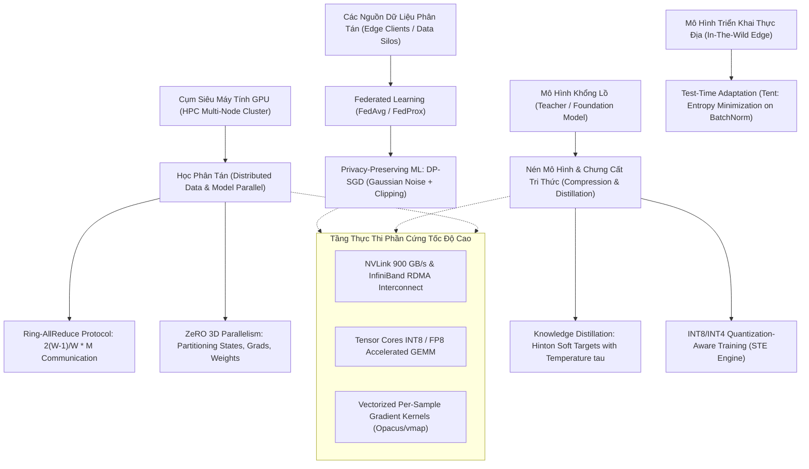
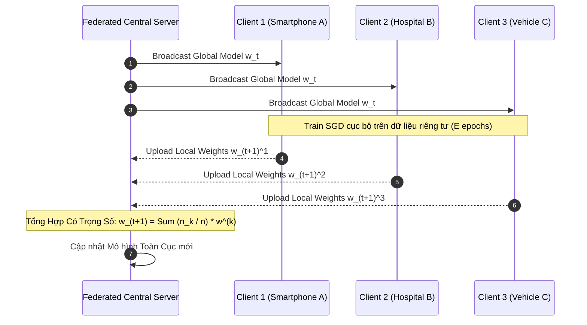
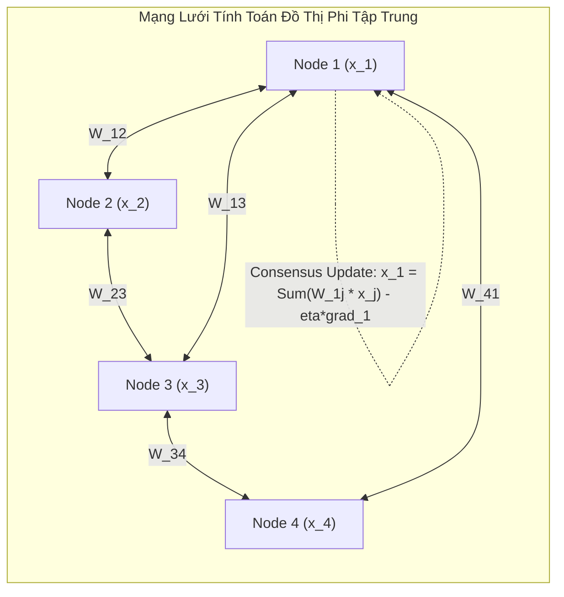
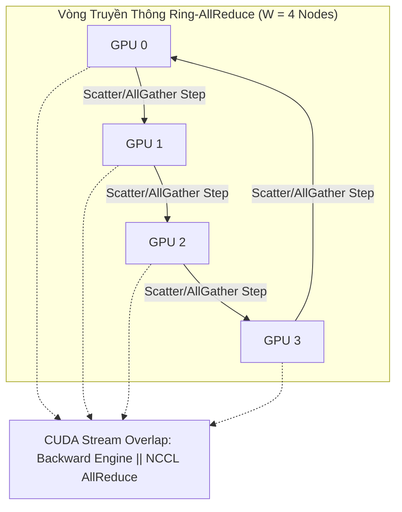
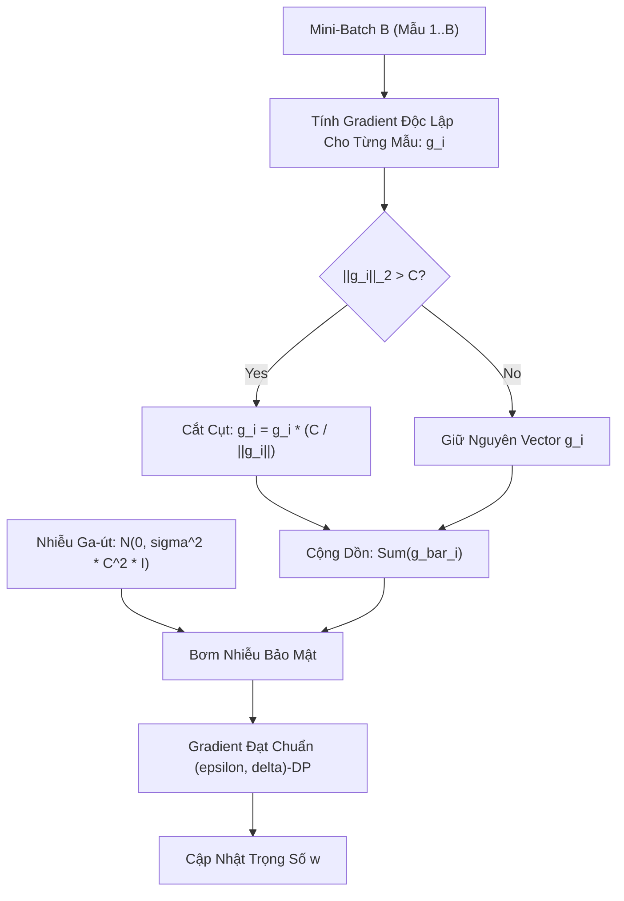
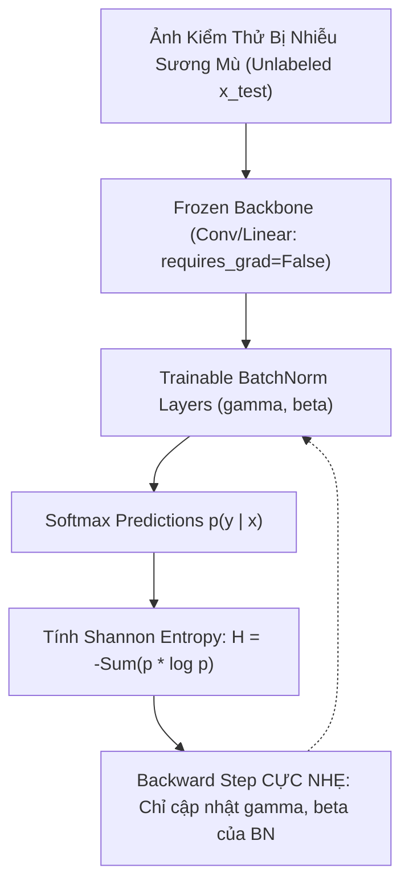
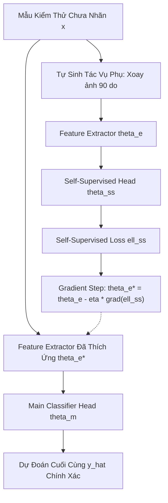
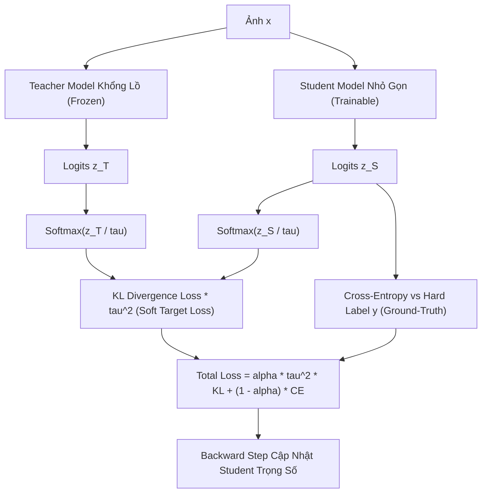
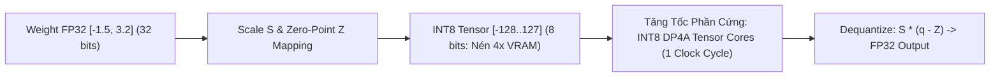

# Chuyên đề: Học Liên Bang, Phân Tán và Tối Ưu Hóa Hiệu Năng (Federated, Distributed & Efficient Learning)

## 1. Tổng quan Chuyên đề

Sự bùng nổ về quy mô của các mô hình học sâu hiện đại (với hàng chục đến hàng trăm tỷ tham số) đặt ra ba rào cản vật lý và kỹ thuật cốt tử:
1. **Rào cản Phần cứng và Dung lượng (Memory & Compute Wall)**: Một GPU đơn lẻ không thể chứa hoặc huấn luyện các mô hình khổng lồ trong thời gian khả thi.
2. **Rào cản Quyền riêng tư và Phân tán Dữ liệu (Privacy & Data Silos)**: Dữ liệu nhạy cảm của người dùng (y tế, tài chính, bàn phím di động) không được phép truyền về máy chủ trung tâm theo các đạo luật bảo vệ dữ liệu (GDPR, HIPAA).
3. **Rào cản Băng thông và Triển khai Biên (Bandwidth & Edge Deployment)**: Các thiết bị cận biên (Edge devices / IoT) có tài nguyên tính toán và dung lượng pin rất hạn chế, đòi hỏi mô hình phải được nén tối đa mà không làm suy giảm độ chính xác.

Chuyên đề này phân tích toàn diện các giải pháp toán học và kỹ thuật phần cứng:
- **Học Liên Bang & Học Phi Tập Trung (Federated & Decentralized Learning)**: Tối ưu hóa phân tán bảo toàn quyền riêng tư qua thuật toán FedAvg, ma trận trộn ngẫu nhiên kép (Doubly Stochastic Mixing) và quyền riêng tư vi sai (Differential Privacy).
- **Học Phân Tán Quy Mô Lớn (Large-Scale Distributed Learning)**: Khử nút thắt cổ chai truyền thông qua thuật toán Ring-AllReduce và phân vùng song song 3 chiều (ZeRO / Megatron-LM).
- **Thích Ứng Thời Điểm Kiểm Thử & Nén Mô Hình (Test-Time Adaptation, Knowledge Distillation & Model Compression)**: Chuyển giao tri thức thầy - trò (Hinton KD), lượng tử hóa INT8/INT4 (Quantization-Aware Training) và cắt tỉa trọng số (Pruning).



---

## 2. Chi tiết từng Keyword

---

### 1. Federated Learning (Học liên bang)

#### a. Định nghĩa Bản chất Toán học (Mathematical Formulation)
Học liên bang (Federated Learning - FL) tối ưu hóa một mô hình toàn cục trên $K$ thiết bị phân tán (clients). Mỗi client $k$ sở hữu tập dữ liệu cục bộ $\mathcal{D}_k$ với $n_k = |\mathcal{D}_k|$ mẫu ($n = \sum_{k=1}^K n_k$).

Bài toán tối ưu hóa phân tán:
$$\min_{\mathbf{w}} f(\mathbf{w}) = \sum_{k=1}^K \frac{n_k}{n} F_k(\mathbf{w}), \quad \text{trong đó } F_k(\mathbf{w}) = \frac{1}{n_k} \sum_{i \in \mathcal{D}_k} \ell(\mathbf{w}; \mathbf{x}_i, y_i)$$

**Thuật toán Federated Averaging (FedAvg)** (McMahan et al., 2017):
Tại mỗi vòng giao tiếp $t = 1, \dots, T$:
1. Máy chủ chọn ngẫu nhiên một tập con các client $S_t \subseteq \{1, \dots, K\}$ với tỷ lệ tham gia $C = |S_t| / K$.
2. Máy chủ phát tán trọng số hiện tại $\mathbf{w}_t$ tới các client trong $S_t$.
3. Mỗi client $k \in S_t$ thực hiện $E$ epochs huấn luyện SGD cục bộ:
   $$\mathbf{w}_{t+1}^k = \mathbf{w}_t - \eta \sum_{\tau=1}^E \nabla F_k(\mathbf{w})$$
4. Các client gửi trọng số cập nhật $\mathbf{w}_{t+1}^k$ về máy chủ.
5. Máy chủ tổng hợp theo tỷ lệ trọng số mẫu:
   $$\mathbf{w}_{t+1} = \sum_{k \in S_t} \frac{n_k}{\sum_{j \in S_t} n_j} \mathbf{w}_{t+1}^k$$

**Thách thức Non-IID & Trôi Dạt Client (Client Drift)**:
Khi dữ liệu giữa các client không độc lập cùng phân phối ($P_i(\mathbf{X}, Y) \ne P_j(\mathbf{X}, Y)$), nghiệm tối ưu cục bộ $\mathbf{w}_i^*$ sẽ cách xa nghiệm toàn cục $\mathbf{w}^*$.
Thuật toán **FedProx** bổ sung số hạng cản tiệm cận (Proximal Term) để kiểm soát độ lệch:
$$\min_{\mathbf{w}} F_k(\mathbf{w}) + \frac{\mu}{2} \|\mathbf{w} - \mathbf{w}_t\|_2^2$$

#### b. Cơ chế Tầng Sâu & Điện toán (Under The Hood / Hardware Internals)
- **Bất đồng bộ Truyền thông và Nút thắt Băng thông Uplink**:
  Băng thông tải lên (Uplink) của các thiết bị di động thường thấp hơn 10 đến 50 lần so với băng thông tải xuống.
  Để truyền mô hình $100 \text{ MB}$ qua mạng di động, các kỹ thuật nén gradient được áp dụng: Lượng tử hóa trọng số (1-bit SGD / Ternary FL) kết hợp mã hóa Top-K thưa hóa (Top-$k$ Sparsification: chỉ gửi $1\%$ trọng số có độ thay đổi lớn nhất).
- **Xử lý Thiết bị Rớt Mạng (Straggler Mitigation)**:
  Máy chủ không chờ đợi tất cả các client hoàn thành (tránh hiệu ứng nút cổ chai của máy chậm). Một ngưỡng thời gian timeout được thiết lập; máy chủ tổng hợp ngay khi nhận đủ $M$ phản hồi đầu tiên.

#### c. Sơ đồ Minh họa (Mermaid Diagram)


#### d. Code Thực chiến (Dual-Engine: C++ & Python)

```cpp
// C++20: Động cơ Tổng hợp Trọng số Liên bang FedAvg Tối ưu SIMD
#include <iostream>
#include <vector>
#include <numeric>

struct ClientUpdate {
    std::vector<float> weights;
    size_t num_samples;
};

class FedAvgAggregator {
public:
    // Tổng hợp: w_global = sum( (n_k / total_n) * w_k )
    static std::vector<float> aggregate(const std::vector<ClientUpdate>& updates) {
        if (updates.empty()) return {};

        const size_t num_params = updates[0].weights.size();
        size_t total_samples = 0;
        for (const auto& u : updates) {
            total_samples += u.num_samples;
        }

        std::vector<float> global_weights(num_params, 0.0f);
        float inv_total = 1.0f / static_cast<float>(total_samples);

        for (const auto& u : updates) {
            float weight_factor = static_cast<float>(u.num_samples) * inv_total;
            // Vectorized Fused Multiply-Add
            for (size_t i = 0; i < num_params; ++i) {
                global_weights[i] += weight_factor * u.weights[i];
            }
        }
        return global_weights;
    }
};

int main() {
    // 2 client: Client 0 có 100 mẫu, Client 1 có 300 mẫu (tỷ lệ 1:3)
    std::vector<ClientUpdate> client_updates = {
        {{1.0f, 2.0f, 3.0f}, 100},
        {{2.0f, 4.0f, 5.0f}, 300}
    };

    auto global_w = FedAvgAggregator::aggregate(client_updates);
    std::cout << "[C++ FedAvg Aggregator] Trọng số toàn cục sau tổng hợp:\n  [";
    for (float w : global_w) std::cout << w << " ";
    std::cout << "]\n"; // Kỳ vọng: 1.0*0.25 + 2.0*0.75 = 1.75; 2*0.25 + 4*0.75 = 3.5; 3*0.25 + 5*0.75 = 4.5
    return 0;
}
```

```python
# Python / PyTorch: Mô phỏng Vòng lặp Huấn luyện Liên bang FedAvg
import copy
import torch
import torch.nn as nn

class FederatedServer:
    def __init__(self, global_model: nn.Module):
        self.global_model = global_model

    def aggregate(self, client_models: list[nn.Module], sample_counts: list[int]):
        total_samples = sum(sample_counts)
        global_state = copy.deepcopy(self.global_model.state_dict())

        # Reset các tensor tham số về 0
        for key in global_state:
            global_state[key] = torch.zeros_like(global_state[key], dtype=torch.float32)

        # Tổng hợp có trọng số
        for client_net, count in zip(client_models, sample_counts):
            weight = count / total_samples
            client_state = client_net.state_dict()
            for key in global_state:
                global_state[key] += client_state[key].float() * weight

        self.global_model.load_state_dict(global_state)

if __name__ == "__main__":
    base_model = nn.Linear(4, 2)
    server = FederatedServer(base_model)

    # Giả lập 2 client huấn luyện cục bộ
    client1 = copy.deepcopy(base_model)
    client2 = copy.deepcopy(base_model)

    with torch.no_grad():
        client1.weight.add_(torch.ones_like(client1.weight) * 0.5)
        client2.weight.add_(torch.ones_like(client2.weight) * 2.0)

    server.aggregate([client1, client2], sample_counts=[200, 800])
    print(f"[PyTorch FedAvg] Trọng số sau tổng hợp (Client 2 chiếm 80%):\n{server.global_model.weight}")
```

#### e. Lỗi Thường gặp & Ổn định Số học (Pitfalls & Numerical Stability)
- **Tấn công Đảo ngược Dữ liệu (Gradient Inversion Attack)**: Mặc dù không gửi trực tiếp dữ liệu thô, một kẻ tấn công nghe lén (Man-in-the-Middle) có thể tái tạo lại hình ảnh gốc từ gradient bằng cách tối ưu hóa nghịch đảo pixel. Giải pháp: Bắt buộc kết hợp Học Liên bang với Mã hóa Đồng hình (Homomorphic Encryption) hoặc Quyền riêng tư Vi sai (DP-SGD).

#### f. Ứng dụng Thực chiến trong AI / Deep Learning
- **Dự đoán Từ tiếp theo trên Bàn phím Di động (Gboard)**: Google huấn luyện mô hình dự đoán từ tiếp theo trên hàng triệu điện thoại Android mà tin nhắn riêng tư của người dùng không bao giờ rời khỏi thiết bị.

---

### 2. Decentralized Learning (Học phi tập trung)

#### a. Định nghĩa Bản chất Toán học (Mathematical Formulation)
Khác với Học liên bang phụ thuộc vào máy chủ trung tâm (Single Point of Failure), Học phi tập trung (Decentralized Learning) tổ chức mạng lưới tính toán thành một đồ thị vô hướng $G = (V, E)$, trong đó các node chỉ giao tiếp với các nút lân cận trực tiếp của chúng $\mathcal{N}_i$.

Cấu trúc topo được mô hình hóa bằng **Ma trận Trộn Ngẫu nhiên Kép (Doubly Stochastic Mixing Matrix)** $\mathbf{W} \in [0, 1]^{N \times N}$ thỏa mãn:
$$\mathbf{W} \mathbf{1} = \mathbf{1}, \quad \mathbf{1}^T \mathbf{W} = \mathbf{1}^T, \quad W_{ij} = 0 \text{ nếu } (i, j) \notin E \text{ và } i \ne j$$

**Thuật toán Decentralized SGD (D-SGD)** (Lian et al., 2017):
Tại mỗi bước $t$, mỗi node $i$ thực hiện đồng thời bước trộn trọng số lân cận và bước trừ gradient:
$$\mathbf{x}_i^{(t+1)} = \sum_{j \in \mathcal{N}_i \cup \{i\}} W_{ij} \mathbf{x}_j^{(t)} - \eta \nabla F_i(\mathbf{x}_i^{(t)})$$

Tốc độ hội tụ và độ sai lệch đồng thuận (Consensus Error) được quyết định trực tiếp bởi **Khoảng cách Phổ (Spectral Gap)** của ma trận $\mathbf{W}$:
$$\rho = 1 - |\lambda_2(\mathbf{W})|$$
Trong đó $\lambda_2(\mathbf{W})$ là giá trị riêng lớn thứ hai của ma trận trộn. Khoảng cách phổ càng lớn ($\rho \to 1$), mạng lưới đạt đồng thuận càng nhanh.

#### b. Cơ chế Tầng Sâu & Điện toán (Under The Hood / Hardware Internals)
- **Giao thức Gossip Asynchronous & Tránh Nghẽn Băng thông Trung tâm**:
  Không một node nào phải tiếp nhận cùng lúc lưu lượng dữ liệu từ toàn mạng. Mỗi thiết bị chỉ duy trì socket P2P với 2 đến 4 láng giềng trực tiếp.
  Việc gửi và nhận thông điệp được thực hiện phi đồng bộ bằng cơ chế Non-blocking I/O (`MPI_Isend` / `MPI_Irecv` hoặc libuv), cho phép luồng tính toán GPU tiếp tục forward/backward mà không phải chờ đợi gói tin mạng cập bến.

#### c. Sơ đồ Minh họa (Mermaid Diagram)


#### d. Code Thực chiến (Dual-Engine: C++ & Python)

```cpp
// C++20: Động cơ Đồng thuận Đồ thị Phân tán (Decentralized Consensus Step)
#include <iostream>
#include <vector>

class DecentralizedConsensusEngine {
public:
    // Thực hiện bước trộn: x_new = W * x
    // x: (N x D), W: (N x N)
    static void consensus_step(const std::vector<float>& x_current,
                               const std::vector<float>& W,
                               size_t N, size_t D,
                               std::vector<float>& x_next) {
        for (size_t i = 0; i < N; ++i) {
            float* out_node = x_next.data() + (i * D);
            // Reset 0
            for (size_t d = 0; d < D; ++d) out_node[d] = 0.0f;

            // Tổng có trọng số từ các láng giềng
            for (size_t j = 0; j < N; ++j) {
                float w_ij = W[i * N + j];
                if (w_ij > 0.0f) {
                    const float* neighbor = x_current.data() + (j * D);
                    for (size_t d = 0; d < D; ++d) {
                        out_node[d] += w_ij * neighbor[d];
                    }
                }
            }
        }
    }
};

int main() {
    constexpr size_t N = 3; // 3 nodes
    constexpr size_t D = 2; // 2 tham số

    // Trọng số ban đầu của 3 nodes
    std::vector<float> x = {
        1.0f, 0.0f,  // Node 0
        3.0f, 2.0f,  // Node 1
        5.0f, 4.0f   // Node 2
    };

    // Ma trận trộn Doubly Stochastic (Vòng tròn)
    std::vector<float> W = {
        0.5f, 0.25f, 0.25f,
        0.25f, 0.5f, 0.25f,
        0.25f, 0.25f, 0.5f
    };

    std::vector<float> x_next(N * D, 0.0f);
    DecentralizedConsensusEngine::consensus_step(x, W, N, D, x_next);

    std::cout << "[C++ Decentralized Engine] Trọng số Node 0 sau 1 bước Consensus:\n";
    std::cout << "  [" << x_next[0] << ", " << x_next[1] << "] (Đã tiệm cận trung bình toàn mạng)\n";
    return 0;
}
```

```python
# Python / PyTorch: Triển khai Mô phỏng Decentralized SGD trên Topology Vòng (Ring Mesh)
import torch

class DecentralizedRingSGD:
    def __init__(self, num_nodes: int, dim: int, lr: float = 0.01):
        self.num_nodes = num_nodes
        # Trọng số của từng node: (Num_Nodes, Dim)
        self.weights = torch.randn(num_nodes, dim)
        self.lr = lr

        # Xây dựng ma trận trộn dạng vòng (Ring Topology: Mỗi node kết nối với chính nó và 2 láng giềng)
        self.W = torch.zeros(num_nodes, num_nodes)
        for i in range(num_nodes):
            self.W[i, i] = 0.5
            self.W[i, (i - 1) % num_nodes] = 0.25
            self.W[i, (i + 1) % num_nodes] = 0.25

    def step(self, local_gradients: torch.Tensor):
        # local_gradients: (Num_Nodes, Dim)
        # 1. Bước trộn láng giềng: W @ weights
        mixed_weights = torch.matmul(self.W, self.weights)
        # 2. Bước trừ gradient cục bộ
        self.weights = mixed_weights - self.lr * local_gradients

if __name__ == "__main__":
    N, D = 4, 3
    ring_net = DecentralizedRingSGD(num_nodes=N, dim=D)
    mock_grads = torch.ones(N, D) * 0.1

    print(f"[PyTorch Decentralized] Trọng số Node 0 ban đầu: {ring_net.weights[0]}")
    ring_net.step(mock_grads)
    print(f"[PyTorch Decentralized] Trọng số Node 0 sau 1 bước D-SGD: {ring_net.weights[0]}")
```

#### e. Lỗi Thường gặp & Ổn định Số học (Pitfalls & Numerical Stability)
- **Đồ thị Bị Phân Mảnh (Disconnected Graph Failure)**: Nếu mạng gặp sự cố làm đồ thị bị phân rã thành hai thành phần liên thông riêng biệt, giá trị riêng $\lambda_2(\mathbf{W}) = 1$, khiến thông tin không thể truyền qua lại và mô hình phân kỳ thành hai thực thể độc lập.

#### f. Ứng dụng Thực chiến trong AI / Deep Learning
- **Hệ thống Xe Tự Hành Liên lạc P2P (Connected Autonomous Fleets - V2V)**: Các xe tự hành trao đổi các mẫu vật cản nguy hiểm trực tiếp qua sóng DSRC/5G mà không cần phụ thuộc vào trạm thu phát sóng di động khi đi qua vùng núi hẻo lánh.

---

### 3. Distributed Learning (Học phân tán quy mô lớn)

#### a. Định nghĩa Bản chất Toán học (Mathematical Formulation)
Trong học phân tán quy mô lớn trên các siêu máy tính (HPC Cluster), dữ liệu hoặc mô hình được chia nhỏ cho $W$ công nhân (workers).

**Thuật toán Ring-AllReduce** (Gibiansky, 2017):
Cho $W$ GPU được sắp xếp theo một vòng tròn logic. Mỗi GPU sở hữu một mảng dữ liệu kích thước $M$ phần tử.
Mảng được chia thành $W$ khối nhỏ kích thước $S = M / W$.
Quá trình diễn ra qua hai pha liên tiếp:
1. **Pha Scatter-Reduce ($W - 1$ bước)**:
   Tại mỗi bước, mỗi GPU gửi 1 khối và nhận 1 khối từ láng giềng, sau đó thực hiện phép cộng tích lũy. Sau $W-1$ bước, mỗi GPU sẽ nắm giữ tổng chính xác của 1 khối duy nhất.
2. **Pha AllGather ($W - 1$ bước)**:
   Mỗi GPU phát tán khối đã hoàn thiện của mình vòng quanh chuỗi. Sau $W-1$ bước, tất cả các GPU đều có đầy đủ toàn bộ mảng dữ liệu đã được cộng tổng.

**Định lý Băng thông Truyền thông Tối ưu**:
Tổng lượng dữ liệu truyền qua mạng của mỗi GPU:
$$\text{Data}_{\text{sent}} = 2 \times \frac{W - 1}{W} \times M \text{ bytes}$$
Đại lượng này **hoàn toàn độc lập với số lượng node $W$** khi $W \to \infty$ ($\approx 2M$), loại bỏ hoàn toàn nút thắt cổ chai tập trung của kiến trúc Parameter Server cổ điển.

**Kỹ thuật Phân vùng ZeRO (Zero Redundancy Optimizer)** (Rajbhandari et al., 2020):
- **ZeRO-Stage 1**: Phân vùng trạng thái bộ tối ưu (Optimizer States - $16 \times$ dung lượng tham số đối với Adam FP32) $\implies$ Giảm $4\times$ VRAM.
- **ZeRO-Stage 2**: Phân vùng thêm Gradient $\implies$ Giảm $8\times$ VRAM.
- **ZeRO-Stage 3**: Phân vùng cả tham số mô hình $\implies$ Giảm tuyến tính theo số lượng GPU ($W \times$).

#### b. Cơ chế Tầng Sâu & Điện toán (Under The Hood / Hardware Internals)
- **Giao thức GPUDirect RDMA & NVLink Ring**:
  Dữ liệu tensor được truyền trực tiếp từ VRAM của GPU này sang VRAM của GPU khác thông qua giao thức GPUDirect Remote Direct Memory Access (RDMA) qua mạng InfiniBand hoặc cầu nối NVLink ($900 \text{ GB/s}$), hoàn toàn không đi qua CPU Host RAM, loại bỏ chi phí sao chép bộ nhớ (zero-copy memory bus).
- **Gối đầu Truyền thông và Tính toán (Compute-Communication Overlapping)**:
  Trong quá trình tính Backward cho tầng $L-1$, thao tác AllReduce cho gradient của tầng $L$ đã được kích hoạt đồng thời trên một CUDA Stream nền, triệt tiêu thời gian chờ mạng.

#### c. Sơ đồ Minh họa (Mermaid Diagram)


#### d. Code Thực chiến (Dual-Engine: C++ & Python)

```cpp
// C++20: Mô phỏng Thuật toán Ring-AllReduce Scatter-Reduce logic
#include <iostream>
#include <vector>
#include <numeric>

class RingAllReduceSimulator {
public:
    // Mô phỏng pha Scatter-Reduce trên 3 GPU, mỗi GPU có 3 khối dữ liệu
    static void scatter_reduce(std::vector<std::vector<float>>& buffers, size_t W, size_t chunk_size) {
        // W - 1 bước truyền thông
        for (size_t step = 0; step < W - 1; ++step) {
            std::vector<std::vector<float>> send_data(W, std::vector<float>(chunk_size));
            for (size_t rank = 0; rank < W; ++rank) {
                size_t send_chunk = (rank - step + W) % W;
                for (size_t i = 0; i < chunk_size; ++i) {
                    send_data[rank][i] = buffers[rank][send_chunk * chunk_size + i];
                }
            }

            // Nhận và cộng dồn vào láng giềng kế tiếp (rank + 1) % W
            for (size_t rank = 0; rank < W; ++rank) {
                size_t recv_chunk = (rank - step - 1 + W) % W;
                size_t from_rank = (rank - 1 + W) % W;
                for (size_t i = 0; i < chunk_size; ++i) {
                    buffers[rank][recv_chunk * chunk_size + i] += send_data[from_rank][i];
                }
            }
        }
    }
};

int main() {
    constexpr size_t W = 3; // 3 GPUs
    constexpr size_t Chunk = 1;
    // Mỗi GPU có 3 phần tử (1 phần tử mỗi chunk)
    std::vector<std::vector<float>> gpu_buffers = {
        {1.0f, 1.0f, 1.0f}, // GPU 0
        {2.0f, 2.0f, 2.0f}, // GPU 1
        {3.0f, 3.0f, 3.0f}  // GPU 2
    };

    RingAllReduceSimulator::scatter_reduce(gpu_buffers, W, Chunk);
    std::cout << "[C++ Ring-AllReduce] Kết quả phân tán sau pha Scatter-Reduce:\n";
    for (size_t i = 0; i < W; ++i) {
        std::cout << "  GPU " << i << " lưu trữ tổng khối " << (i + 1) % W 
                  << ": " << gpu_buffers[i][((i + 1) % W)] << " (Kỳ vọng: 1+2+3 = 6.0)\n";
    }
    return 0;
}
```

```python
# Python / PyTorch: Thiết lập Khung Giao tiếp Phân tán DDP (Mocking Distributed AllReduce)
import torch
import torch.nn as nn

class MockDistributedDataParallel:
    def __init__(self, model: nn.Module, world_size: int):
        self.model = model
        self.world_size = world_size

    def all_reduce_gradients(self):
        # Mô phỏng AllReduce trung bình gradient qua mạng NCCL
        with torch.no_grad():
            for param in self.model.parameters():
                if param.grad is not None:
                    # Giả lập phép chia trung bình qua world_size
                    param.grad.div_(self.world_size)

if __name__ == "__main__":
    net = nn.Linear(3, 1)
    ddp = MockDistributedDataParallel(net, world_size=4)

    x = torch.randn(2, 3)
    out = net(x).sum()
    out.backward()

    print(f"[PyTorch DDP] Gradient trước All-Reduce:\n{net.weight.grad}")
    ddp.all_reduce_gradients()
    print(f"[PyTorch DDP] Gradient sau All-Reduce (chia đều 4 GPUs):\n{net.weight.grad}")
```

#### e. Lỗi Thường gặp & Ổn định Số học (Pitfalls & Numerical Stability)
- **Tích Lũy Gradient Tràn Số (Gradient Accumulation Overflow in FP16)**: Khi tính tổng gradient của hàng nghìn GPU, giá trị cộng dồn có thể vượt ngưỡng $65,504$ của chuẩn FP16. Bắt buộc phải duy trì bộ tích lũy AllReduce trong định dạng số thực 32-bit (FP32 AllReduce Communication) hoặc chuẩn BF16 (Brain Floating Point).

#### f. Ứng dụng Thực chiến trong AI / Deep Learning
- **Huấn luyện Mô hình Ngôn ngữ Siêu Lớn (LLaMA, GPT-4)**: Phân bổ quá trình huấn luyện trên cụm $16,384$ GPU H100 kết nối song song 3 chiều (ZeRO-3 + Tensor Parallelism + Pipeline Parallelism).

---

### 4. Privacy-Preserving Machine Learning (Học máy bảo toàn quyền riêng tư)

#### a. Định nghĩa Bản chất Toán học (Mathematical Formulation)
**Quyền Riêng Tư Vi Sai (Differential Privacy - DP)** (Dwork et al., 2006):
Một thuật toán ngẫu nhiên $\mathcal{M}$ được gọi là thỏa mãn $(\epsilon, \delta)$-Differential Privacy nếu với mọi cặp tập dữ liệu láng giềng $D, D'$ (chỉ sai khác nhau duy nhất 1 mẫu dữ liệu, $\|D - D'\|_1 = 1$) và với mọi tập kết quả khả dĩ $\mathcal{S} \subseteq \operatorname{Range}(\mathcal{M})$:
$$\mathbb{P}(\mathcal{M}(D) \in \mathcal{S}) \le e^{\epsilon} \cdot \mathbb{P}(\mathcal{M}(D') \in \mathcal{S}) + \delta$$
Trong đó:
- $\epsilon > 0$ là ngân sách riêng tư (Privacy Budget - $\epsilon$ càng nhỏ, độ bảo mật càng cao).
- $\delta \in [0, 1)$ là xác suất rò rỉ thông tin ngoại lệ (thường đặt $\delta \ll 1/|D|$).

**Thuật toán DP-SGD (Differentially Private SGD)** (Abadi et al., 2016):
Tại mỗi bước tối ưu, với mini-batch $B$:
1. **Cắt cụt Gradient Từng Mẫu (Per-Sample Gradient Clipping)** với ngưỡng $C$:
   $$\bar{\mathbf{g}}_i = \frac{\mathbf{g}_i(\mathbf{x}_i, y_i)}{\max\left(1, \, \frac{\|\mathbf{g}_i(\mathbf{x}_i, y_i)\|_2}{C}\right)}, \quad \forall i \in B$$
   Thao tác này khống chế độ nhạy cảm (Sensitivity) tối đa của gradient ở mức $S \le C$.
2. **Bơm Nhiễu Chuẩn Ga-út (Gaussian Noise Injection)**:
   $$\tilde{\mathbf{g}} = \frac{1}{|B|} \left( \sum_{i \in B} \bar{\mathbf{g}}_i + \mathcal{N}\left(\mathbf{0}, \, \sigma^2 C^2 \mathbf{I}\right) \right)$$
3. Cập nhật bước nhảy: $\mathbf{\theta}_{t+1} = \mathbf{\theta}_t - \eta \tilde{\mathbf{g}}$.

#### b. Cơ chế Tầng Sâu & Điện toán (Under The Hood / Hardware Internals)
- **Nút Thắt Tính Gradient Từng Mẫu (Per-Sample Gradient Bottleneck)**:
  Công cụ Autograd thông thường chỉ tính tổng gradient của cả batch $\sum \nabla \ell_i$, lưu thành một tensor duy nhất.
  Để cắt cụt độc lập từng mẫu $\|\mathbf{g}_i\|_2 \le C$, PyTorch truyền thống buộc phải chạy loop từng mẫu (làm chậm tốc độ huấn luyện từ 10 đến 100 lần!).
  Giải pháp hiện đại sử dụng **Vectorized Jacobian Engine** thông qua `torch.func.vmap` kết hợp FlashAttention, thực hiện phép vi phân tự động song song trên các warp GPU mà không làm vỡ kiến trúc batch.

#### c. Sơ đồ Minh họa (Mermaid Diagram)


#### d. Code Thực chiến (Dual-Engine: C++ & Python)

```cpp
// C++20: Động cơ Cắt cụt Gradient Từng Mẫu (Per-Sample Gradient Clipping) & Bơm Nhiễu
#include <iostream>
#include <vector>
#include <cmath>
#include <random>

class DPSGDProcessor {
private:
    float clip_norm;
    float noise_std;
    std::mt19937 rng{42};

public:
    DPSGDProcessor(float C, float sigma) : clip_norm(C), noise_std(sigma * C) {}

    // Input: grads_flat chứa B vector gradient, kích thước (B x D)
    std::vector<float> process_batch(const std::vector<float>& per_sample_grads, size_t B, size_t D) {
        std::vector<float> aggregated_grad(D, 0.0f);

        // 1. Cắt cụt từng mẫu
        for (size_t b = 0; b < B; ++b) {
            const float* g_i = per_sample_grads.data() + (b * D);
            float norm_sq = 0.0f;
            for (size_t d = 0; d < D; ++d) norm_sq += g_i[d] * g_i[d];
            float norm = std::sqrt(norm_sq);

            float scale = (norm > clip_norm) ? (clip_norm / norm) : 1.0f;
            for (size_t d = 0; d < D; ++d) {
                aggregated_grad[d] += g_i[d] * scale;
            }
        }

        // 2. Bơm nhiễu Ga-út
        std::normal_distribution<float> dist(0.0f, noise_std);
        float inv_b = 1.0f / static_cast<float>(B);

        for (size_t d = 0; d < D; ++d) {
            float noise = dist(rng);
            aggregated_grad[d] = (aggregated_grad[d] + noise) * inv_b;
        }

        return aggregated_grad;
    }
};

int main() {
    constexpr size_t B = 2; // 2 mẫu
    constexpr size_t D = 2; // 2 chiều

    // Mẫu 0 có norm = 5.0 (vượt C=1.0), Mẫu 1 có norm = 0.5 (dưới C)
    std::vector<float> sample_grads = {
        3.0f, 4.0f,  // Sample 0: norm = 5.0 -> Cắt về [0.6, 0.8]
        0.3f, 0.4f   // Sample 1: norm = 0.5 -> Giữ nguyên
    };

    DPSGDProcessor dp(1.0f, 0.01f);
    auto safe_g = dp.process_batch(sample_grads, B, D);

    std::cout << "[C++ DP-SGD Engine] Gradient bảo toàn riêng tư cuối cùng:\n";
    std::cout << "  [" << safe_g[0] << ", " << safe_g[1] << "]\n";
    return 0;
}
```

```python
# Python / PyTorch: Triển khai Cắt cụt Per-Sample Gradient bằng torch.func.vmap
import torch
import torch.nn as nn
from torch.func import grad, vmap, functional_call

class PrivateLinearTrainer:
    def __init__(self, in_features: int, clip_norm: float = 1.0, noise_multiplier: float = 0.5):
        self.weights = torch.randn(1, in_features, requires_grad=True)
        self.clip_norm = clip_norm
        self.sigma = noise_multiplier

    def compute_loss_single(self, params: dict, x: torch.Tensor, y: torch.Tensor) -> torch.Tensor:
        # Hàm tính loss cho duy nhất 1 mẫu
        pred = torch.matmul(params["w"], x)
        return (pred - y).pow(2).squeeze()

    def dp_step(self, x_batch: torch.Tensor, y_batch: torch.Tensor, lr: float = 0.1):
        # x_batch: (B, D), y_batch: (B, 1)
        params = {"w": self.weights}

        # 1. Tính toán song song per-sample gradient bằng vmap
        grad_fn = grad(self.compute_loss_single)
        per_sample_grads = vmap(grad_fn, in_dims=(None, 0, 0))(params, x_batch, y_batch)["w"] # (B, 1, D)

        # 2. Cắt cụt chuẩn L2 từng mẫu
        norms = per_sample_grads.norm(2, dim=-1, keepdim=True) # (B, 1, 1)
        clip_factors = torch.clamp(self.clip_norm / (norms + 1e-6), max=1.0)
        clipped_grads = per_sample_grads * clip_factors

        # 3. Tính tổng và bơm nhiễu Ga-út
        total_grad = clipped_grads.sum(dim=0)
        noise = torch.randn_like(total_grad) * (self.sigma * self.clip_norm)
        final_grad = (total_grad + noise) / len(x_batch)

        with torch.no_grad():
            self.weights -= lr * final_grad

if __name__ == "__main__":
    trainer = PrivateLinearTrainer(in_features=3, clip_norm=1.0, noise_multiplier=0.1)
    bx = torch.randn(4, 3)
    by = torch.randn(4, 1)
    trainer.dp_step(bx, by)
    print(f"[PyTorch DP-SGD] Trọng số sau 1 bước cập nhật DP:\n{trainer.weights}")
```

#### e. Lỗi Thường gặp & Ổn định Số học (Pitfalls & Numerical Stability)
- **Sự Đánh Đổi Hiệu Năng / Riêng Tư (Privacy-Utility Tradeoff)**: Nếu đặt $\epsilon$ quá nhỏ ($\epsilon < 0.5$) hoặc mức nhiễu $\sigma > 2.0$, tín hiệu gradient thực sự sẽ bị chôn vùi hoàn toàn dưới lớp nhiễu ngẫu nhiên, khiến mô hình học không thể hội tụ (mất tính khả dụng thực tế).

#### f. Ứng dụng Thực chiến trong AI / Deep Learning
- **Huấn luyện Mô hình Y tế Dự đoán Bệnh Ung thư**: Bệnh viện khai thác hồ sơ bệnh án điện tử (EHR) của bệnh nhân để huấn luyện AI mà vẫn đảm bảo vượt qua các đợt kiểm toán khắt khe nhất về đạo luật HIPAA và bảo mật thông tin cá nhân.

---

### 5. Test-Time Adaptation (Thích ứng thời điểm kiểm thử)

#### a. Định nghĩa Bản chất Toán học (Mathematical Formulation)
Thích ứng thời điểm kiểm thử (Test-Time Adaptation - TTA) điều chỉnh mô hình trong lúc đang suy luận trên các dữ liệu thực tế bị trôi dạt phân phối (distribution shift), **hoàn toàn không có nhãn giám sát ground-truth $Y$**.

**Phương pháp TENT (Test-Time Entropy Minimization)** (Wang et al., 2021):
Dựa trên nguyên lý: Dưới sự dịch chuyển phân phối, độ bất định của dự đoán tăng vọt (entropy cao).
TENT tối thiểu hóa Shannon Entropy của phân phối xác suất dự đoán $\hat{y}$:
$$\min_{\mathbf{\theta}_{\text{BN}}} \mathcal{H}(\hat{y}) = -\sum_{c=1}^C p_c(\mathbf{x}) \log p_c(\mathbf{x})$$

**Quy tắc Đóng băng Bộ nhớ Cực đoan**:
TENT **đóng băng toàn bộ ma trận trọng số tích chập và tuyến tính** $\mathbf{W}_{\text{conv}}, \mathbf{W}_{\text{linear}}$.
Mô hình **chỉ cập nhật duy nhất các hệ số biến đổi affine (scale $\gamma$ và shift $\beta$)** của các tầng Chuẩn hóa Lô (Batch Normalization):
$$y = \gamma \cdot \frac{x - \mu_{\text{test}}}{\sqrt{\sigma^2_{\text{test}} + \epsilon}} + \beta$$
Số lượng tham số cần cập nhật chỉ chiếm chưa đầy $0.1\%$ tổng số tham số mô hình, bảo toàn tri thức nền tảng và triệt tiêu nguy cơ đãng trí thảm khốc.

#### b. Cơ chế Tầng Sâu & Điện toán (Under The Hood / Hardware Internals)
- **Tối ưu hóa VRAM và Tốc độ Cận biên (Edge Execution)**:
  Vì $99.9\%$ tham số bị đóng băng, đồ thị Autograd không cần lưu giữ các tensor đạo hàm bậc cao.
  Quá trình lan truyền ngược Backward Pass chỉ diễn ra cục bộ tại các tầng Normalization, cho phép thuật toán chạy với tần số $60 \text{ FPS}$ ngay trên các chip nhúng (NVIDIA Jetson / Apple Neural Engine).

#### c. Sơ đồ Minh họa (Mermaid Diagram)


#### d. Code Thực chiến (Dual-Engine: C++ & Python)

```cpp
// C++20: Cập nhật Trực tiếp Thống kê Batch Normalization Thời điểm Kiểm thử
#include <iostream>
#include <vector>
#include <cmath>

class TestTimeBatchNormAdapter {
public:
    // Cập nhật thống kê test mean và test variance trực tiếp trên micro-batch
    static void adapt_and_normalize(const float* x_in, float* x_out, size_t B, size_t C,
                                    const float* gamma, const float* beta, float eps = 1e-5f) {
        // x_in: (B x C), Row-Major
        for (size_t c = 0; c < C; ++c) {
            // 1. Tính mean kênh c
            float mean = 0.0f;
            for (size_t b = 0; b < B; ++b) {
                mean += x_in[b * C + c];
            }
            mean /= static_cast<float>(B);

            // 2. Tính variance kênh c
            float var = 0.0f;
            for (size_t b = 0; b < B; ++b) {
                float diff = x_in[b * C + c] - mean;
                var += diff * diff;
            }
            var /= static_cast<float>(B);

            // 3. Chuẩn hóa và áp dụng affine gamma, beta
            float inv_std = 1.0f / std::sqrt(var + eps);
            for (size_t b = 0; b < B; ++b) {
                float norm_val = (x_in[b * C + c] - mean) * inv_std;
                x_out[b * C + c] = gamma[c] * norm_val + beta[c];
            }
        }
    }
};

int main() {
    constexpr size_t B = 2;
    constexpr size_t C = 2;

    float x_test[B * C] = {
        10.0f, -5.0f,  // Mẫu 1 (Bị lệch phân phối cực mạnh)
        12.0f, -3.0f   // Mẫu 2
    };

    float gamma[C] = {1.0f, 1.0f};
    float beta[C]  = {0.0f, 0.0f};
    float x_adapted[B * C];

    TestTimeBatchNormAdapter::adapt_and_normalize(x_test, x_adapted, B, C, gamma, beta);

    std::cout << "[C++ TTA Engine] Đầu ra sau khi chuẩn hóa thích ứng tại chỗ:\n";
    std::cout << "  Mẫu 0: [" << x_adapted[0] << ", " << x_adapted[1] << "]\n";
    std::cout << "  Mẫu 1: [" << x_adapted[2] << ", " << x_adapted[3] << "]\n";
    return 0;
}
```

```python
# Python / PyTorch: Triển khai Chuẩn Thuật toán TENT (Test-Time Entropy Minimization)
import torch
import torch.nn as nn
import torch.nn.functional as F

class TentAdapter:
    def __init__(self, model: nn.Module, lr: float = 1e-3):
        self.model = model
        # 1. Đóng băng toàn bộ trọng số
        self.model.requires_grad_(False)

        # 2. Chỉ kích hoạt gradient cho tham số affine của BatchNorm
        params_to_update = []
        for m in self.model.modules():
            if isinstance(m, (nn.BatchNorm1d, nn.BatchNorm2d)):
                m.requires_grad_(True)
                # Bắt buộc chuyển sang dùng thống kê của mẻ kiểm thử hiện tại
                m.track_running_stats = False
                params_to_update.extend([m.weight, m.bias])

        self.optimizer = torch.optim.SGD(params_to_update, lr=lr)

    def adapt_and_predict(self, x_test: torch.Tensor) -> torch.Tensor:
        # Bước thích ứng: Forward -> Compute Entropy -> Backward -> Step
        self.optimizer.zero_grad()
        logits = self.model(x_test)

        probs = F.softmax(logits, dim=-1)
        entropy = - (probs * torch.log(probs + 1e-6)).sum(dim=-1).mean()

        entropy.backward()
        self.optimizer.step()

        # Suy luận chính xác sau khi đã thích ứng
        with torch.no_grad():
            final_logits = self.model(x_test)
        return final_logits

if __name__ == "__main__":
    net = nn.Sequential(
        nn.Linear(8, 16),
        nn.BatchNorm1d(16),
        nn.ReLU(),
        nn.Linear(16, 2)
    )

    tent = TentAdapter(net, lr=0.01)
    mock_shifted_test = torch.randn(10, 8) * 5.0 + 3.0 # Dữ liệu kiểm thử bị drift

    adapted_logits = tent.adapt_and_predict(mock_shifted_test)
    print(f"[PyTorch TENT] Shape Logits sau thích ứng Test-Time: {adapted_logits.shape}")
```

#### e. Lỗi Thường gặp & Ổn định Số học (Pitfalls & Numerical Stability)
- **Sụp đổ Dự đoán Sang Một Lớp (Trivial Collapse to Single Class)**: Hàm Entropy Minimization đạt cực tiểu tuyệt đối $\mathcal{H} = 0$ khi mô hình dự đoán xác suất $1.0$ cho một lớp duy nhất cho toàn bộ batch. Để tránh lỗi này, cần thêm ràng buộc đa dạng (Diversity Regularizer): Tối đa hóa entropy của phân phối trung bình lô $\mathcal{H}(\mathbb{E}[p])$.

#### f. Ứng dụng Thực chiến trong AI / Deep Learning
- **Thị giác Máy tính trong Thời tiết Khắc nghiệt**: Camera hành trình tự động cân chỉnh lại bộ lọc hình ảnh khi xe đột ngột đi vào hầm tối hoặc gặp trời mưa bão dữ dội mà không cần mạng internet để tải model mới.

---

### 6. Test-Time Training (Huấn luyện thời điểm kiểm thử - TTT)

#### a. Định nghĩa Bản chất Toán học (Mathematical Formulation)
Khác với TTA chỉ tối ưu hóa dựa trên đầu ra, Huấn luyện thời điểm kiểm thử (Test-Time Training - TTT) (Sun et al., 2020) thiết lập một **Tác vụ Tự giám sát Bổ trợ (Auxiliary Self-Supervised Task)** chạy song hành.

Kiến trúc gồm ba thành phần:
- Bộ trích xuất đặc trưng chung (Shared Feature Extractor): $\theta_e$.
- Đầu ra tác vụ chính (Main Task Head): $\theta_m$ (ví dụ: Phân loại).
- Đầu ra tác vụ tự giám sát (Self-Supervised Head): $\theta_{ss}$ (ví dụ: Dự đoán góc xoay ảnh $0^\circ, 90^\circ, 180^\circ, 270^\circ$, hoặc Tái tạo Mặt nạ).

**Quy trình Suy luận Đơn mẫu TTT**:
Khi một mẫu kiểm thử chưa có nhãn $\mathbf{x}$ xuất hiện:
1. Mô hình tự động tạo ra bài toán tự giám sát từ $\mathbf{x}$ và tính hàm mất mát $\ell_{ss}(\mathbf{x}; \theta_e, \theta_{ss})$.
2. Thực hiện cập nhật gradient nhanh trên bộ trích xuất đặc trưng $\theta_e$:
   $$\theta_e^* = \theta_e - \eta \nabla_{\theta_e} \ell_{ss}(\mathbf{x}; \theta_e, \theta_{ss})$$
3. Đưa mẫu $\mathbf{x}$ qua bộ trích xuất đặc trưng đã thích ứng $\theta_e^*$ để lấy dự đoán cuối cùng:
   $$\hat{y} = f(\mathbf{x}; \theta_e^*, \theta_m)$$

Sau khi suy luận xong mẫu đó, trọng số $\theta_e$ được hoàn trả về trạng thái gốc (stateless) hoặc tích lũy tuần tự (stateful).

#### b. Cơ chế Tầng Sâu & Điện toán (Under The Hood / Hardware Internals)
- **Tầng Ẩn TTT-Linear / TTT-MLP (Sun et al., 2024)**:
  Trong các kiến trúc mới nhất thay thế Transformer, TTT được mô hình hóa như một tầng mạng truy hồi trong đó vector trạng thái ẩn (hidden state) chính là **một ma trận trọng số $\mathbf{W}_t$ tự học qua từng token bằng Gradient Descent thời gian thực**.
  Thao tác này được viết thành các custom CUDA kernels tối ưu hóa băng thông SRAM của GPU, đạt độ phức tạp tính toán tuyến tính $\mathcal{O}(T)$ theo độ dài chuỗi context.

#### c. Sơ đồ Minh họa (Mermaid Diagram)


#### d. Code Thực chiến (Dual-Engine: C++ & Python)

```cpp
// C++20: Mô phỏng Bước nhảy Huấn luyện Thời điểm Kiểm thử (TTT Single-Sample Step)
#include <iostream>
#include <vector>

class TTTSimulator {
private:
    float eta; // Tốc độ thích ứng

public:
    explicit TTTSimulator(float lr) : eta(lr) {}

    // Cập nhật theta_e* = theta_e - eta * grad_ss
    std::vector<float> adapt_feature_extractor(const std::vector<float>& theta_e,
                                               const std::vector<float>& grad_ss) const {
        std::vector<float> adapted_theta(theta_e.size());
        for (size_t i = 0; i < theta_e.size(); ++i) {
            adapted_theta[i] = theta_e[i] - eta * grad_ss[i];
        }
        return adapted_theta;
    }
};

int main() {
    TTTSimulator ttt(0.05f);
    std::vector<float> base_backbone = {1.5f, -0.8f, 2.2f};
    std::vector<float> self_sup_gradient = {0.4f, -0.2f, 0.6f};

    auto adapted_backbone = ttt.adapt_feature_extractor(base_backbone, self_sup_gradient);

    std::cout << "[C++ TTT Simulator] Trọng số Backbone sau 1 bước TTT:\n  [";
    for (float w : adapted_backbone) std::cout << w << " ";
    std::cout << "]\n";
    return 0;
}
```

```python
# Python / PyTorch: Kiến trúc Test-Time Training (TTT) với Tác vụ Tự Giám sát Tái tạo
import copy
import torch
import torch.nn as nn

class TTTModel(nn.Module):
    def __init__(self, in_features: int, hidden_dim: int, num_classes: int):
        super().__init__()
        self.feature_extractor = nn.Linear(in_features, hidden_dim)
        self.main_head = nn.Linear(hidden_dim, num_classes)
        # Đầu tự giám sát: Tự tái tạo lại đầu vào (Autoencoder task)
        self.ss_head = nn.Linear(hidden_dim, in_features)

    def test_time_predict(self, x_single: torch.Tensor, ttt_lr: float = 0.05) -> torch.Tensor:
        # x_single: (1, in_features)
        # 1. Tạo bản sao tạm thời của feature extractor để không làm hỏng mô hình gốc
        adapted_extractor = copy.deepcopy(self.feature_extractor)
        opt = torch.optim.SGD(adapted_extractor.parameters(), lr=ttt_lr)

        # 2. Tự thích ứng trên tác vụ tự giám sát (Tái tạo x)
        opt.zero_grad()
        feat = adapted_extractor(x_single)
        recon = self.ss_head(feat)
        ss_loss = nn.functional.mse_loss(recon, x_single)
        ss_loss.backward()
        opt.step()

        # 3. Dự đoán nhãn chính bằng feature extractor đã được tối ưu
        with torch.no_grad():
            adapted_feat = adapted_extractor(x_single)
            pred_logit = self.main_head(adapted_feat)
        return pred_logit

if __name__ == "__main__":
    model = TTTModel(in_features=4, hidden_dim=8, num_classes=2)
    mock_x = torch.randn(1, 4)

    out = model.test_time_predict(mock_x)
    print(f"[PyTorch TTT] Output Logit sau 1 bước TTT trực tiếp: {out}")
```

#### e. Lỗi Thường gặp & Ổn định Số học (Pitfalls & Numerical Stability)
- **Tác vụ Bổ trợ Không Tương quan (Task Misalignment)**: Nếu tác vụ tự giám sát ($\ell_{ss}$) học một đặc trưng mâu thuẫn với tác vụ chính ($\ell_m$), việc tối ưu hóa $\ell_{ss}$ ở thời điểm kiểm thử sẽ trực tiếp làm suy giảm độ chính xác của bộ phân loại chính.

#### f. Ứng dụng Thực chiến trong AI / Deep Learning
- **Mô hình Ngôn ngữ Bối cảnh Vô hạn (Long-Context Transformers - TTT-LLM)**: Thay thế cơ chế lưu trữ KV-Cache cồng kềnh bằng cách nén ngữ cảnh hàng triệu token trực tiếp vào các trọng số ẩn của mạng thông qua Test-Time Training.

---

### 7. Knowledge Distillation (Chưng cất tri thức)

#### a. Định nghĩa Bản chất Toán học (Mathematical Formulation)
Chưng cất tri thức (Knowledge Distillation - KD) (Hinton et al., 2015) chuyển giao tri thức từ một mô hình cồng kềnh có độ chính xác cao (**Teacher**) sang một mô hình gọn nhẹ (**Student**).

Xác suất mềm (Soft Targets) được kiểm soát bởi tham số **Nhiệt độ (Temperature $\tau \ge 1$)**:
$$p_i(z, \tau) = \frac{\exp(z_i / \tau)}{\sum_j \exp(z_j / \tau)}$$
Khi $\tau \to \infty$, phân phối xác suất trở nên phẳng dần, làm lộ ra **Tri thức Ẩn (Dark Knowledge)** — tức là tỷ lệ xác suất tương đối giữa các lớp sai (ví dụ: mô hình nhận diện một con chó có $0.001\%$ giống mèo, nhưng chỉ có $0.000001\%$ giống xe tải).

Hàm mất mát chưng cất toàn phần:
$$\mathcal{L}_{\text{KD}} = (1 - \alpha) \mathcal{L}_{\text{CE}}(S(\mathbf{x}), \mathbf{y}_{\text{hard}}) + \alpha \, \tau^2 \, D_{\text{KL}}\big( p(z_T, \tau) \;\big\|\; p(z_S, \tau) \big)$$

Hệ số bù trừ $\tau^2$ đóng vai trò cốt tử: Khi tính đạo hàm theo logit của Student:
$$\frac{\partial D_{\text{KL}}}{\partial z_{S, i}} \approx \frac{1}{\tau} \left( p_i(z_S, \tau) - p_i(z_T, \tau) \right) \approx \frac{1}{\tau^2} (z_{S, i} - z_{T, i})$$
Do gradient bị suy giảm tỷ lệ thuận với $1/\tau^2$, việc nhân thêm $\tau^2$ đảm bảo quy mô gradient của nhánh Soft Target cân bằng với nhánh Hard Label.

#### b. Cơ chế Tầng Sâu & Điện toán (Under The Hood / Hardware Internals)
- **Suy Luận Bất Đồng Bộ và Tiền Tính Toán Logits Teacher**:
  Mô hình Teacher thường lớn gấp hàng chục lần Student. Việc chạy đồng thời cả hai mô hình trên cùng một GPU sẽ gây nghẽn bộ nhớ.
  Kỹ thuật **Offline Distillation**: Cho Teacher chạy một lần trên toàn bộ tập dữ liệu và lưu trước toàn bộ ma trận logits vào đĩa NVMe SSD tốc độ cao dưới định dạng nhị phân mmap (`.npy` / HDF5). Khi huấn luyện Student, chỉ cần nạp trực tiếp logits từ đĩa với độ trễ cực thấp.

#### c. Sơ đồ Minh họa (Mermaid Diagram)


#### d. Code Thực chiến (Dual-Engine: C++ & Python)

```cpp
// C++20: Động cơ Softmax Nhiệt độ & Tính Đạo hàm Chưng cất Tri thức Hinton
#include <iostream>
#include <vector>
#include <cmath>

class KnowledgeDistillationEngine {
public:
    // Tính Softmax với nhiệt độ tau
    static void softmax_temperature(const float* logits, float* probs, size_t C, float tau) {
        float max_l = logits[0];
        for (size_t c = 1; c < C; ++c) {
            if (logits[c] > max_l) max_l = logits[c];
        }

        float sum_exp = 0.0f;
        for (size_t c = 0; c < C; ++c) {
            probs[c] = std::exp((logits[c] - max_l) / tau);
            sum_exp += probs[c];
        }

        float inv_sum = 1.0f / sum_exp;
        for (size_t c = 0; c < C; ++c) {
            probs[c] *= inv_sum;
        }
    }

    // Tính gradient chưng cất d(L_KD)/dz_S = (p_S - p_T) * tau
    static void compute_distill_gradient(const float* p_S, const float* p_T, float* grad_out, size_t C, float tau) {
        for (size_t c = 0; c < C; ++c) {
            // Khi nhân với tau^2 ở hàm loss, đạo hàm rút gọn thành: (p_S - p_T) * tau
            grad_out[c] = (p_S[c] - p_T[c]) * tau;
        }
    }
};

int main() {
    constexpr size_t C = 3;
    float tau = 4.0f;

    float teacher_logits[C] = {6.0f, 2.0f, -1.0f};
    float student_logits[C] = {2.0f, 1.0f, 0.0f};

    float p_T[C], p_S[C], grads[C];
    KnowledgeDistillationEngine::softmax_temperature(teacher_logits, p_T, C, tau);
    KnowledgeDistillationEngine::softmax_temperature(student_logits, p_S, C, tau);
    KnowledgeDistillationEngine::compute_distill_gradient(p_S, p_T, grads, C, tau);

    std::cout << "[C++ Distill Engine] Soft Target Teacher (tau=4.0): [" 
              << p_T[0] << ", " << p_T[1] << ", " << p_T[2] << "]\n";
    std::cout << "[C++ Distill Engine] Gradient truyền về Student: [" 
              << grads[0] << ", " << grads[1] << ", " << grads[2] << "]\n";
    return 0;
}
```

```python
# Python / PyTorch: Hinton Knowledge Distillation Loss Module Hoàn chỉnh
import torch
import torch.nn as nn
import torch.nn.functional as F

class KnowledgeDistillationLoss(nn.Module):
    def __init__(self, temperature: float = 4.0, alpha: float = 0.7):
        super().__init__()
        self.temperature = temperature
        self.alpha = alpha

    def forward(self, student_logits: torch.Tensor, teacher_logits: torch.Tensor, labels: torch.Tensor) -> torch.Tensor:
        # 1. Hard Cross Entropy Loss
        loss_ce = F.cross_entropy(student_logits, labels)

        # 2. Soft KL Divergence Loss với Temperature
        tau = self.temperature
        p_s = F.log_softmax(student_logits / tau, dim=-1)
        p_t = F.softmax(teacher_logits / tau, dim=-1)

        loss_kd = F.kl_div(p_s, p_t, reduction="batchmean") * (tau ** 2)

        total_loss = (1.0 - self.alpha) * loss_ce + self.alpha * loss_kd
        return total_loss

if __name__ == "__main__":
    logits_s = torch.tensor([[2.0, 1.0, 0.1]], requires_grad=True)
    logits_t = torch.tensor([[5.0, 2.0, -1.0]]) # Teacher tự tin hơn
    targets = torch.tensor([0])

    kd_criterion = KnowledgeDistillationLoss(temperature=3.0, alpha=0.5)
    loss = kd_criterion(logits_s, logits_t, targets)
    loss.backward()
    print(f"[PyTorch Distillation] Total Loss: {loss.item():.4f}")
```

#### e. Lỗi Thường gặp & Ổn định Số học (Pitfalls & Numerical Stability)
- **Sử dụng `F.softmax` thay vì `F.log_softmax` trong PyTorch `kl_div`**: Hàm `F.kl_div` của PyTorch mặc định yêu cầu đầu vào thứ nhất phải ở miền log-probability. Nếu truyền `softmax` thông thường, kết quả toán học sẽ sai lệch hoàn toàn và gradient bị triệt tiêu.

#### f. Ứng dụng Thực chiến trong AI / Deep Learning
- **Nén Mô hình Ngôn ngữ Lớn (DistilBERT, MobileLLM)**: Chuyển giao tri thức từ mô hình BERT khổng lồ sang một mô hình nhỏ gọn hơn 40%, chạy nhanh hơn 60% mà vẫn giữ được 97% năng lực hiểu ngôn ngữ.

---

### 8. Model Compression (Nén mô hình: Lượng tử hóa & Cắt tỉa)

#### a. Định nghĩa Bản chất Toán học (Mathematical Formulation)
Nén mô hình giảm dung lượng lưu trữ và số lượng phép tính FLOPs thông qua hai kỹ thuật trụ cột:

1. **Lượng Tử Hóa Đồng Nhất Tuyến Tính (Uniform Affine Quantization)**:
   Ánh xạ số thực dấu phẩy động $x \in [\alpha, \beta]$ (FP32) sang số nguyên $q \in [q_{\min}, q_{\max}]$ ($b$-bit integer, ví dụ INT8 có miền $[-128, 127]$):
   $$q = \operatorname{clip}\left( \left\lfloor \frac{x}{S} \right\rceil + Z, \; q_{\min}, \; q_{\max} \right)$$
   Trong đó:
   - Hệ số tỷ lệ (Scale): $S = \frac{\beta - \alpha}{q_{\max} - q_{\min}}$
   - Điểm không (Zero-point): $Z = \left\lfloor \frac{-\alpha}{S} \right\rceil$
   - $\lfloor \cdot \rceil$ là phép làm tròn số nguyên gần nhất.

   **Giải lượng tử hóa (Dequantization)**:
   $$\hat{x} = S \cdot (q - Z)$$

   **Ước lượng Truyền thẳng (Straight-Through Estimator - STE)** trong QAT:
   Vì hàm làm tròn số nguyên có đạo hàm bằng 0 ở mọi nơi ($\frac{d\lfloor x \rceil}{dx} = 0$), backpropagation thông thường sẽ bị tê liệt hoàn toàn. STE xấp xỉ đạo hàm của phép làm tròn bằng hàm đồng nhất:
   $$\frac{\partial \lfloor x \rceil}{\partial x} \approx 1$$

2. **Cắt Tỉa Trọng Số (Magnitude-Based Pruning)**:
   Loại bỏ các kết nối có giá trị tuyệt đối nhỏ nhất dựa trên ngưỡng $\tau$:
   $$w_{ij} \leftarrow 0 \quad \text{nếu } |w_{ij}| < \tau$$

#### b. Cơ chế Tầng Sâu & Điện toán (Under The Hood / Hardware Internals)
- **Tăng Tốc Phần Cứng bằng Lệnh INT8 Tensor Cores (DP4A)**:
  Phép nhân số thực FP32 tiêu tốn nhiều diện tích bán dẫn và năng lượng.
  Các nhân Tensor Cores trên GPU và NPU hỗ trợ tập lệnh phần cứng `DP4A` (Dot Product 4 Elements and Accumulate): Thực hiện 4 phép nhân số nguyên 8-bit và cộng dồn vào thanh ghi 32-bit chỉ trong **1 chu kỳ xung nhịp duy nhất**, tăng thông lượng tính toán gấp $4\times$ và giảm $75\%$ băng thông bộ nhớ DRAM.

#### c. Sơ đồ Minh họa (Mermaid Diagram)


#### d. Code Thực chiến (Dual-Engine: C++ & Python)

```cpp
// C++20: Động cơ Lượng tử hóa và Giải lượng tử hóa INT8 SIMD với Fast Clamping
#include <iostream>
#include <vector>
#include <cmath>
#include <algorithm>
#include <cstdint>

class INT8Quantizer {
private:
    float scale;
    int32_t zero_point;

public:
    INT8Quantizer(float alpha, float beta) {
        constexpr float q_min = -128.0f;
        constexpr float q_max = 127.0f;
        scale = (beta - alpha) / (q_max - q_min);
        zero_point = static_cast<int32_t>(std::round(-alpha / scale)) - 128;
    }

    [[nodiscard]] int8_t quantize(float x) const noexcept {
        float val = std::round(x / scale) + static_cast<float>(zero_point);
        float clamped = std::clamp(val, -128.0f, 127.0f);
        return static_cast<int8_t>(clamped);
    }

    [[nodiscard]] float dequantize(int8_t q) const noexcept {
        return scale * (static_cast<float>(q) - static_cast<float>(zero_point));
    }
};

int main() {
    // Miền giá trị FP32: [-2.0, 2.0]
    INT8Quantizer q_engine(-2.0f, 2.0f);

    float original_val = 1.25f;
    int8_t q_val = q_engine.quantize(original_val);
    float recon_val = q_engine.dequantize(q_val);

    std::cout << "[C++ INT8 Quantizer Engine]\n";
    std::cout << "  Giá trị ban đầu (FP32) : " << original_val << "\n";
    std::cout << "  Sau lượng tử hóa (INT8): " << static_cast<int>(q_val) << "\n";
    std::cout << "  Sau giải lượng tử hóa  : " << recon_val << " (Lỗi số học: " 
              << std::abs(original_val - recon_val) << ")\n";
    return 0;
}
```

```python
# Python / PyTorch: Triển khai Lớp Lượng tử hóa với Straight-Through Estimator (STE)
import torch
import torch.nn as nn

class STEQuantizeFunction(torch.autograd.Function):
    @staticmethod
    def forward(ctx, x: torch.Tensor, scale: float, zero_point: int) -> torch.Tensor:
        # q = clip(round(x / S) + Z, -128, 127)
        q = torch.clamp(torch.round(x / scale) + zero_point, min=-128, max=127)
        # Dequantize ngay trong forward để duy trì luồng tính toán liên tục
        x_recon = scale * (q - zero_point)
        return x_recon

    @staticmethod
    def backward(ctx, grad_output: torch.Tensor) -> tuple[torch.Tensor, None, None]:
        # Straight-Through Estimator: Cho gradient truyền thẳng qua phép làm tròn
        return grad_output, None, None

class QuantizedLinear(nn.Module):
    def __init__(self, in_features: int, out_features: int):
        super().__init__()
        self.weight = nn.Parameter(torch.randn(out_features, in_features))
        self.bias = nn.Parameter(torch.zeros(out_features))

    def forward(self, x: torch.Tensor) -> torch.Tensor:
        # Ước lượng động Scale và Zero-point của ma trận trọng số
        w_min = self.weight.min()
        w_max = self.weight.max()
        scale = (w_max - w_min) / 255.0
        zero_point = int(torch.round(-w_min / scale).item()) - 128

        # Áp dụng lượng tử hóa giả lập với STE
        w_q = STEQuantizeFunction.apply(self.weight, scale, zero_point)
        return nn.functional.linear(x, w_q, self.bias)

if __name__ == "__main__":
    layer = QuantizedLinear(4, 2)
    x = torch.randn(2, 4)
    out = layer(x).sum()
    out.backward()

    print(f"[PyTorch QAT STE] Gradient của trọng số vẫn tồn tại nhờ STE:\n{layer.weight.grad}")
```

#### e. Lỗi Thường gặp & Ổn định Số học (Pitfalls & Numerical Stability)
- **Vấn đề Kênh Ngoại Lai (Weight Outlier Explosion trong LLM)**: Trong các mô hình ngôn ngữ lớn ($> 6\text{B}$ tham số), một số kênh kích hoạt (activation channels) xuất hiện các giá trị ngoại lai cực lớn (gấp 100 lần bình thường). Nếu lượng tử hóa toàn ma trận (per-tensor quantization), các giá trị nhỏ khác sẽ bị làm tròn về 0. Bắt buộc phải áp dụng lượng tử hóa theo từng khối nhỏ (**Per-Channel / Group-wise Quantization** hoặc thuật toán AWQ / SmoothQuant).

#### f. Ứng dụng Thực chiến trong AI / Deep Learning
- **Chạy Mô hình Ngôn ngữ Lớn Trên Thiết Bị Di Động (Llama.cpp & Ollama)**: Lượng tử hóa mô hình LLaMA-3 từ FP16 ($16 \text{ GB}$) xuống định dạng INT4/GGUF ($4 \text{ GB}$), cho phép chạy mượt mà trên iPhone và máy tính xách tay cá nhân với tốc độ $>30 \text{ tokens/s}$.
