# Chuyên đề: Nền tảng Học tăng cường, MDP & Phương trình Bellman (Foundations, MDP & Bellman Equations)

## 1. Tổng quan Chuyên đề

Học tăng cường (Reinforcement Learning - RL) là một nhánh của Học máy nghiên cứu cách một thực thể tự hành (Agent) học cách đưa ra chuỗi quyết định tối ưu thông qua tương tác thử - sai (trial-and-error) với môi trường (Environment) nhằm tối đa hóa phần thưởng tích lũy (Cumulative Reward).

Khác biệt với Học có giám sát (Supervised Learning - có nhãn đúng sai ngay lập tức) và Học không giám sát (Unsupervised Learning - khám phá cấu trúc ẩn không nhãn), RL đối mặt với hai thách thức đặc thù:
1. **Phản hồi trễ (Delayed Feedback)**: Một hành động ở hiện tại có thể đem lại phần thưởng rất lâu sau đó (Credit Assignment Problem).
2. **Đánh đổi Thăm dò - Khai thác (Exploration vs. Exploitation Tradeoff)**: Cần cân bằng giữa việc khai thác hành động đã biết là tốt và thăm dò những hành động chưa thử để tìm kiếm phương án ưu việt hơn.

Toàn bộ lý thuyết toán học của RL cổ điển và hiện đại đều được xây dựng trên nền tảng của Quá trình Ra quyết định Markov (Markov Decision Process - MDP) và các phương trình quy hoạch động Bellman.

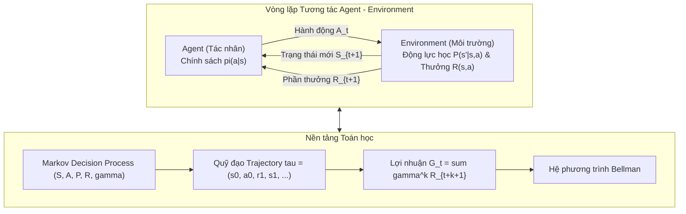

---

## 2. Chi tiết từng Keyword

---

### 1. Reinforcement Learning (Học tăng cường)

#### a. Định nghĩa Bản chất Toán học (Mathematical Formulation)
Học tăng cường được mô hình hóa như một bài toán tối ưu hóa ngẫu nhiên (Stochastic Optimization) trên một Quá trình Ra quyết định Markov rời rạc theo thời gian $t \in \{0, 1, 2, \dots\}$.

Mục tiêu cốt lõi của RL là tìm kiếm chính sách tối ưu $\pi^*$ nhằm cực đại hóa giá trị kỳ vọng của tổng lợi nhuận chiết khấu (Expected Discounted Return):
$$\pi^* = \arg\max_\pi J(\pi) = \arg\max_\pi \mathbb{E}_{\tau \sim \pi} \left[ R(\tau) \right] = \arg\max_\pi \mathbb{E}_{\tau \sim \pi} \left[ \sum_{t=0}^{T} \gamma^t R(S_t, A_t, S_{t+1}) \right]$$
Trong đó:
- $\tau = (S_0, A_0, S_1, A_1, \dots, S_T)$ là quỹ đạo trạng thái - hành động.
- Xác suất của một quỹ đạo $\tau$ dưới chính sách $\pi$ được phân rã theo tính chất Markov:
$$P(\tau; \pi) = \rho_0(S_0) \prod_{t=0}^{T-1} \pi(A_t \mid S_t) P(S_{t+1} \mid S_t, A_t)$$
- $\rho_0(S_0)$ là phân phối trạng thái khởi tạo.
- $\gamma \in [0, 1)$ là hệ số chiết khấu.

#### b. Cơ chế Tầng Sâu & Điện toán (Under The Hood / Hardware Internals)
- **Vectorized Environments (Hóa vector Môi trường)**: Trong Deep RL hiện đại (như Isaac Gym, EnvPool, Brax), việc chạy một môi trường đơn lẻ trên CPU tạo ra nút thắt cổ chai về truyền dữ liệu (PCIe bottleneck) khi chuyển mẫu $(S_t, A_t, R_t, S_{t+1})$ sang GPU. Kỹ thuật hiện đại tạo $N$ môi trường song song trực tiếp trên VRAM của GPU ($N \in [1024, 65536]$). Toàn bộ trạng thái của $N$ môi trường được biểu diễn dưới dạng Ten-xơ 2D `[N, state_dim]` nằm liền kề trên bộ nhớ HBM/GDDR.
- **Cache Contiguity**: Khi Agent tương tác tuần tự trên CPU, việc lưu trữ bộ đệm chuyển trạng thái (Transition Buffer) theo cấu trúc Struct-of-Arrays (SoA) giúp tăng tỉ lệ L1 Data Cache Hit so với Array-of-Structs (AoS), bởi các phép tính vector hóa SIMD (AVX-512) có thể nạp liên tục 16 giá trị float cùng lúc.

#### c. Sơ đồ Minh họa (Mermaid Diagram)
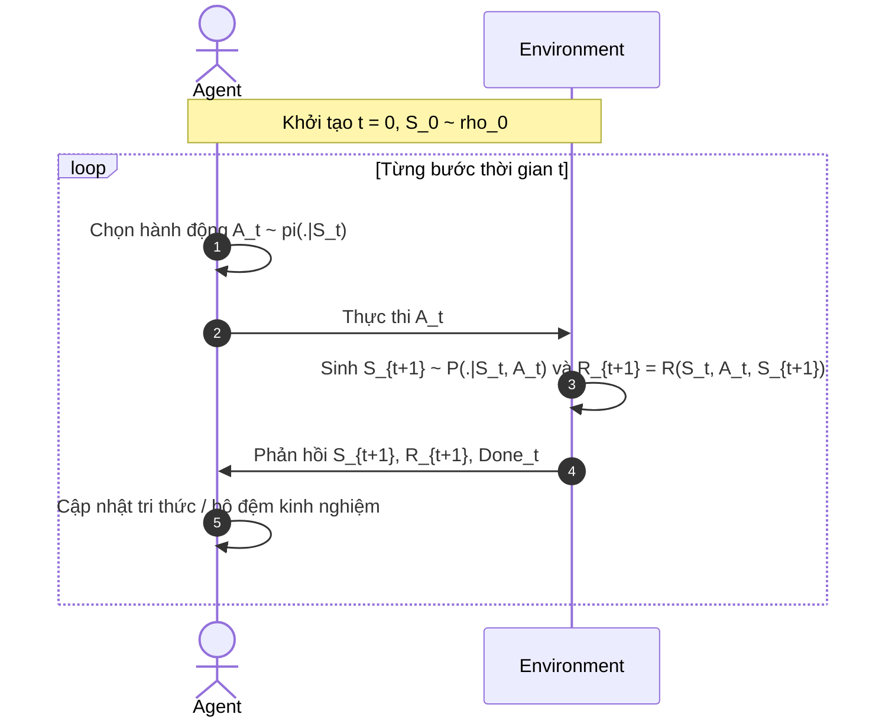

#### d. Code Thực chiến (Dual-Engine: C++ & Python)

```cpp
// C++20: Mô phỏng vòng lặp RL trừu tượng với SIMD-friendly Buffer Layout
#include <iostream>
#include <vector>
#include <numeric>
#include <random>

struct RLStepResult {
    float reward;
    int next_state;
    bool done;
};

class DummyEnvironment {
private:
    int current_state{0};
    const int max_steps{10};
    int step_count{0};

public:
    int reset() {
        current_state = 0;
        step_count = 0;
        return current_state;
    }

    RLStepResult step(int action) {
        step_count++;
        current_state += action;
        float reward = (action == 1) ? 1.0f : -0.5f;
        bool done = (step_count >= max_steps);
        return {reward, current_state, done};
    }
};

class RandomAgent {
private:
    std::mt19937 rng{42};
    std::uniform_int_distribution<int> dist{0, 1};

public:
    int select_action(int state) {
        return dist(rng);
    }
};

int main() {
    DummyEnvironment env;
    RandomAgent agent;
    
    int state = env.reset();
    float total_return = 0.0f;
    float gamma = 0.95f;
    float current_discount = 1.0f;

    while (true) {
        int action = agent.select_action(state);
        auto [reward, next_state, done] = env.step(action);
        
        total_return += current_discount * reward;
        current_discount *= gamma;
        state = next_state;

        if (done) break;
    }

    std::cout << "[C++] Episode Hoan tat. Tong return chiet khau: " << total_return << "\n";
    return 0;
}
```

```python
# Python: Vectorized Interaction Loop chuẩn Gymnasium & PyTorch
import torch
import numpy as np

class VectorizedToyEnv:
    def __init__(self, num_envs: int = 4, horizon: int = 10):
        self.num_envs = num_envs
        self.horizon = horizon
        self.states = torch.zeros(num_envs, dtype=torch.float32)
        self.steps = torch.zeros(num_envs, dtype=torch.int64)

    def reset(self) -> torch.Tensor:
        self.states.zero_()
        self.steps.zero_()
        return self.states.clone()

    def step(self, actions: torch.Tensor):
        self.steps += 1
        self.states += actions.float()
        rewards = torch.where(actions == 1, 1.0, -0.5)
        dones = self.steps >= self.horizon
        return self.states.clone(), rewards, dones

env = VectorizedToyEnv(num_envs=4, horizon=5)
states = env.reset()
gamma = 0.99
returns = torch.zeros(4)
discount = 1.0

for t in range(5):
    # Agent lua chon hanh dong ngau nhien
    actions = torch.randint(0, 2, (4,))
    next_states, rewards, dones = env.step(actions)
    returns += discount * rewards
    discount *= gamma
    states = next_states

print(f"[PyTorch] Vectorized Episode Returns: {returns.numpy()}")
```

#### e. Lỗi Thường gặp & Ổn định Số học (Pitfalls & Numerical Stability)
- **High Variance in Return Estimation**: Tổng chiết khấu $G_t$ có phương sai rất lớn do sự tích lũy ngẫu nhiên của các bước trạng thái - hành động kéo dài.
- **Credit Assignment Delay**: Khi phần thưởng chỉ xuất hiện ở bước cuối cùng (Sparse Reward), việc phân bổ tín hiệu lỗi ngược về các hành động trước đó gặp hiện tượng phân rã thông tin nghiêm trọng.

#### f. Ứng dụng Thực chiến trong AI / Deep Learning
- **Robotics & Control**: Điều khiển tay máy đa khớp, thăng bằng robot hình người (Humanoid Locomotion).
- **Game AI**: AlphaGo, OpenAI Five (Dota 2), AlphaStar (StarCraft II).
- **LLM Alignment**: Kỹ thuật RLHF (Reinforcement Learning from Human Feedback) dùng thuật toán PPO căn chỉnh mô hình ngôn ngữ lớn theo giá trị con người.

---

### 2. Agent (Tác nhân)

#### a. Định nghĩa Bản chất Toán học (Mathematical Formulation)
Agent là thực thể đưa ra quyết định dựa trên lịch sử quan sát hoặc trạng thái hiện tại. Về mặt toán học, Agent được đại diện bởi một hoặc nhiều thành phần sau:
1. **Chính sách (Policy)**: $\pi(a \mid s) = \mathbb{P}(A_t = a \mid S_t = s)$
2. **Hàm giá trị (Value Function)**: $V^\pi(s) = \mathbb{E}_\pi [G_t \mid S_t = s]$ hoặc $Q^\pi(s, a) = \mathbb{E}_\pi [G_t \mid S_t = s, A_t = a]$
3. **Mô hình nội tại (Internal World Model)**: Ánh xạ chuyển trạng thái $\hat{P}(s' \mid s, a)$ và hàm thưởng nội tại $\hat{R}(s, a)$.

Agent cập nhật các tham số nội tại $\mathbf{\theta} \in \mathbb{R}^d$ thông qua quy tắc học gradient hoặc giá trị:
$$\mathbf{\theta}_{k+1} = \mathbf{\theta}_k + \alpha \nabla_{\mathbf{\theta}} \mathcal{J}(\mathbf{\theta}_k)$$

#### b. Cơ chế Tầng Sâu & Điện toán (Under The Hood / Hardware Internals)
- **Mạng nơ-ron Actor / Critic**: Trong deep RL, Agent thường chứa mạng Actor (đưa ra hành động) và Critic (đánh giá trạng thái). Hai mạng này có thể chia sẻ các tầng đặc trưng ban đầu (Feature Extractor) để tiết kiệm băng thông tính toán và bộ nhớ đệm L2/L3.
- **Inference Latency**: Với các hệ thống tương tác thời gian thực (robotics 1000Hz), độ trễ suy luận của Agent qua TensorRT hoặc ONNX Runtime trên GPU/FPGA bắt buộc phải dưới $1\text{ms}$. Việc batch hóa quan sát từ nhiều luồng môi trường giúp đẩy hiệu suất tính toán đạt ngưỡng bão hòa của Tensor Cores (GEMM operations).

#### c. Sơ đồ Minh họa (Mermaid Diagram)
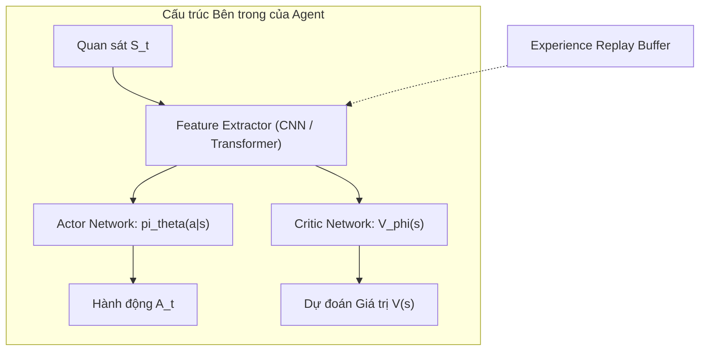

#### d. Code Thực chiến (Dual-Engine: C++ & Python)

```cpp
// C++20: Agent trừu tượng đa luồng với bộ đệm trạng thái tối ưu hóa Cache
#include <iostream>
#include <vector>
#include <memory>
#include <cmath>

class BaseAgent {
public:
    virtual ~BaseAgent() = default;
    virtual int act(const std::vector<float>& state) = 0;
};

class LinearPolicyAgent : public BaseAgent {
private:
    std::vector<float> weights; // 1D Flat array tối ưu hóa cache line 64 bytes
    float bias{0.0f};

public:
    explicit LinearPolicyAgent(size_t state_dim) : weights(state_dim, 0.5f) {}

    int act(const std::vector<float>& state) override {
        // Tinh tich vo huong dot product: a = sign(w^T s + b)
        float dot = bias;
        const size_t n = state.size();
        const float* __restrict w_ptr = weights.data();
        const float* __restrict s_ptr = state.data();

        #pragma omp simd reduction(+:dot)
        for (size_t i = 0; i < n; ++i) {
            dot += w_ptr[i] * s_ptr[i];
        }
        return (dot >= 0.0f) ? 1 : 0;
    }
};

int main() {
    LinearPolicyAgent agent(4);
    std::vector<float> sample_state = {0.1f, -0.4f, 1.2f, 0.05f};
    int action = agent.act(sample_state);
    std::cout << "[C++] Agent quyet dinh hanh dong: " << action << "\n";
    return 0;
}
```

```python
# Python / PyTorch: Agent Actor-Critic chia sẻ Backbone
import torch
import torch.nn as nn
from torch.distributions import Categorical

class ActorCriticAgent(nn.Module):
    def __init__(self, state_dim: int, action_dim: int, hidden_dim: int = 64):
        super().__init__()
        self.shared_backbone = nn.Sequential(
            nn.Linear(state_dim, hidden_dim),
            nn.Tanh()
        )
        self.actor = nn.Linear(hidden_dim, action_dim)
        self.critic = nn.Linear(hidden_dim, 1)

    def forward(self, state: torch.Tensor):
        features = self.shared_backbone(state)
        logits = self.actor(features)
        value = self.critic(features)
        dist = Categorical(logits=logits)
        return dist, value

agent = ActorCriticAgent(state_dim=4, action_dim=2)
dummy_state = torch.tensor([[1.0, 0.5, -0.2, 0.8]])
dist, value = agent(dummy_state)
action = dist.sample()
print(f"[PyTorch] Action: {action.item()}, Value Est: {value.item():.4f}")
```

#### e. Lỗi Thường gặp & Ổn định Số học (Pitfalls & Numerical Stability)
- **Policy Collapse**: Phân phối chính sách trở nên quá tự tin (entropy tiến tới 0 quá nhanh), khiến Agent sa vào cực tiểu cục bộ và ngừng khám phá. Cần cộng thêm số hạng entropy regularization $H(\pi)$ vào hàm mục tiêu.

#### f. Ứng dụng Thực chiến trong AI / Deep Learning
- **Hệ thống giao dịch tài chính tần suất cao (HFT)**: Agent đưa ra các lệnh Buy/Sell/Hold căn cứ vào sổ lệnh (Order Book).
- **Hệ khuyến nghị thông minh**: Agent chọn gợi ý video hoặc sản phẩm để tối ưu thời gian xem và tỷ lệ nhấp chuột (CTR) dài hạn.

---

### 3. Environment (Môi trường)

#### a. Định nghĩa Bản chất Toán học (Mathematical Formulation)
Môi trường là hệ thống động học bên ngoài đối với Agent, tiếp nhận hành động $A_t$ và phản hồi trạng thái kế tiếp $S_{t+1}$ cùng phần thưởng $R_{t+1}$. Về mặt toán học, môi trường được đặc trưng bởi hàm xác suất chuyển trạng thái (Transition Probability):
$$\mathcal{P}(s' \mid s, a) = \mathbb{P}(S_{t+1} = s' \mid S_t = s, A_t = a)$$
và hàm phân phối phần thưởng:
$$\mathcal{R}(r \mid s, a) = \mathbb{P}(R_{t+1} = r \mid S_t = s, A_t = a)$$
Nếu môi trường là tất định (Deterministic Environment), quan hệ này suy biến thành các hàm toán học xác định:
$$s_{t+1} = f(s_t, a_t), \quad r_{t+1} = R(s_t, a_t, s_{t+1})$$

#### b. Cơ chế Tầng Sâu & Điện toán (Under The Hood / Hardware Internals)
- **Step Overhead**: Trong môi trường viết bằng Python thuần túy, overhead gọi hàm `env.step()` chịu chi phí chuyển giao con trỏ của CPython (GIL, boxing/unboxing PyObject).
- **Physics Simulators (PhysX, MuJoCo, Warp)**: Các bộ mô phỏng vật lý giải các phương trình vi phân chuyển động (LCP - Linear Complementarity Problem) bằng cách tối ưu hóa ma trận Jacobian quán tính. Việc giữ toàn bộ state của hàng nghìn robot trong các mảng liên tục trên GPU giúp tận dụng trọn vẹn băng thông bộ nhớ HBM3 lên tới $3.35\text{ TB/s}$.

#### c. Sơ đồ Minh họa (Mermaid Diagram)
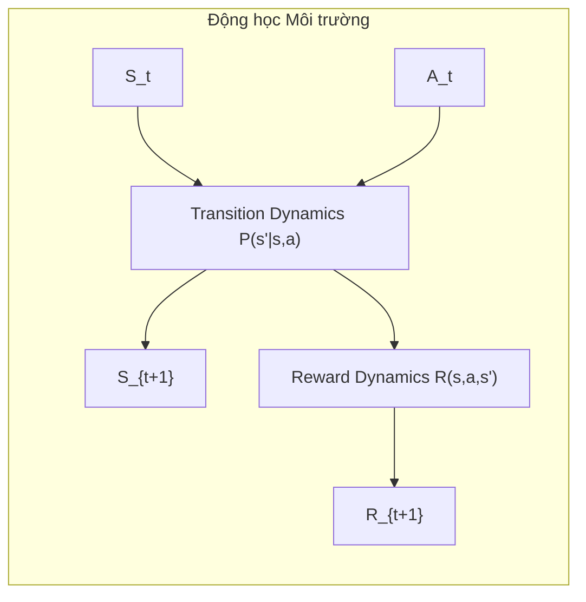

#### d. Code Thực chiến (Dual-Engine: C++ & Python)

```cpp
// C++20: Con trỏ con lắc ngược (Inverted Pendulum / CartPole) vi phân cấp 1
#include <iostream>
#include <cmath>
#include <tuple>

class CartPoleEnv {
private:
    float gravity{9.8f};
    float masscart{1.0f};
    float masspole{0.1f};
    float total_mass{1.1f};
    float length{0.5f}; // nua chieu dai con lac
    float polemass_length{0.05f};
    float force_mag{10.0f};
    float tau{0.02f}; // buoc thoi gian tich phan Euler

    float x{0.0f};
    float x_dot{0.0f};
    float theta{0.0f};
    float theta_dot{0.0f};

public:
    void reset() {
        x = x_dot = theta = theta_dot = 0.0f;
    }

    std::tuple<float, float, float, float, float, bool> step(int action) {
        float force = (action == 1) ? force_mag : -force_mag;
        float costheta = std::cos(theta);
        float sintheta = std::sin(theta);

        float temp = (force + polemass_length * theta_dot * theta_dot * sintheta) / total_mass;
        float thetaacc = (gravity * sintheta - costheta * temp) / 
                         (length * (4.0f / 3.0f - masspole * costheta * costheta / total_mass));
        float xacc = temp - polemass_length * thetaacc * costheta / total_mass;

        // Tich phan Euler ban an toan
        x += tau * x_dot;
        x_dot += tau * xacc;
        theta += tau * theta_dot;
        theta_dot += tau * thetaacc;

        bool done = (x < -2.4f || x > 2.4f || theta < -0.2095f || theta > 0.2095f);
        float reward = done ? 0.0f : 1.0f;
        return {x, x_dot, theta, theta_dot, reward, done};
    }
};

int main() {
    CartPoleEnv env;
    env.reset();
    auto [x, x_d, th, th_d, r, d] = env.step(1);
    std::cout << "[C++] Env Step -> theta: " << th << ", reward: " << r << ", done: " << d << "\n";
    return 0;
}
```

```python
# Python: Môi trường tùy biến kế thừa chuẩn Gymnasium API
import gymnasium as gym
from gymnasium import spaces
import numpy as np

class CustomGridWorld(gym.Env):
    def __init__(self, size: int = 5):
        super().__init__()
        self.size = size
        self.action_space = spaces.Discrete(4) # 0: Len, 1: Xuong, 2: Trai, 3: Phai
        self.observation_space = spaces.Box(low=0, high=size-1, shape=(2,), dtype=np.int32)
        self.agent_pos = np.array([0, 0], dtype=np.int32)
        self.target_pos = np.array([size-1, size-1], dtype=np.int32)

    def reset(self, seed=None, options=None):
        super().reset(seed=seed)
        self.agent_pos = np.array([0, 0], dtype=np.int32)
        return self.agent_pos.copy(), {}

    def step(self, action: int):
        moves = {0: [-1, 0], 1: [1, 0], 2: [0, -1], 3: [0, 1]}
        self.agent_pos = np.clip(self.agent_pos + moves[action], 0, self.size - 1)
        terminated = np.array_equal(self.agent_pos, self.target_pos)
        reward = 10.0 if terminated else -0.1
        return self.agent_pos.copy(), reward, terminated, False, {}

env = CustomGridWorld()
obs, _ = env.reset()
obs, r, term, _, _ = env.step(1)
print(f"[Python Env] Position: {obs}, Reward: {r}, Terminated: {term}")
```

#### e. Lỗi Thường gặp & Ổn định Số học (Pitfalls & Numerical Stability)
- **Integration Error**: Tích phân Euler cấp 1 ($x_{t+1} = x_t + v_t \Delta t$) tích lũy sai số cắt cụt (truncation error) lớn khi $\Delta t$ lớn, làm vi phạm định luật bảo toàn năng lượng trong môi trường vật lý. Nên chuyển sang Runge-Kutta 4 (RK4) hoặc Verlet Integration.

#### f. Ứng dụng Thực chiến trong AI / Deep Learning
- Thiết kế hệ thống giả lập kiểm thử tự hành (CARLA, AirSim) trước khi đưa mạng nơ-ron ra thử nghiệm trên đường thực tế.

---

### 4. State (Trạng thái)

#### a. Định nghĩa Bản chất Toán học (Mathematical Formulation)
Trạng thái $S_t \in \mathcal{S}$ là bản tóm tắt đầy đủ mọi thông tin cần thiết về môi trường tại thời điểm $t$ để xác định phân phối xác suất của các biến cố trong tương lai.

Đặc tính quan trọng nhất của State là **Tính chất Markov (Markov Property)**:
$$\mathbb{P}(S_{t+1} = s_{t+1}, R_{t+1} = r_{t+1} \mid S_t = s_t, A_t = a_t, S_{t-1} = s_{t-1}, A_{t-1} = a_{t-1}, \dots, S_0 = s_0, A_0 = a_0)$$
$$= \mathbb{P}(S_{t+1} = s_{t+1}, R_{t+1} = r_{t+1} \mid S_t = s_t, A_t = a_t)$$

Nói cách khác: *"Tương lai độc lập có điều kiện với quá khứ khi biết hiện tại"*.
Nếu Agent chỉ nhận được thông tin không hoàn hảo $O_t \in \Omega$ thay vì trạng thái toàn phần $S_t$, bài toán trở thành Quá trình Ra quyết định Markov Quan sát Một phần (Partially Observable MDP - POMDP). Khi đó, trạng thái niềm tin (Belief State) $b(s) = \mathbb{P}(S_t = s \mid O_0, A_0, \dots, O_t)$ phục hồi lại tính chất Markov.

#### b. Cơ chế Tầng Sâu & Điện toán (Under The Hood / Hardware Internals)
- **Frame Stacking**: Trong xử lý ảnh từ game Atari (DQN), một khung hình đơn $O_t$ không thể hiện được vận tốc hay gia tốc của quả bóng (vi phạm tính Markov). Kỹ thuật xếp chồng $k=4$ khung hình liên tiếp `(4, 84, 84)` tạo thành trạng thái xấp xỉ Markov.
- **Memory Footprint**: Lưu trữ 4 frames dạng `uint8` (`[4, 84, 84]` $\approx 28\text{ KB}$) thay vì chuyển đổi sang `float32` sớm trong Replay Buffer giúp giảm dung lượng RAM tới 4 lần.

#### c. Sơ đồ Minh họa (Mermaid Diagram)
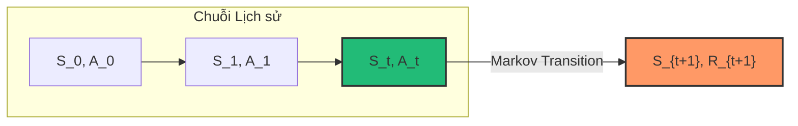

#### d. Code Thực chiến (Dual-Engine: C++ & Python)

```cpp
// C++20: Cấu trúc biểu diễn State phẳng (Flat Contiguous Buffer) với Alignment
#include <iostream>
#include <array>
#include <cstring>

// Can le 64 bytes de khop voi mot dong Cache Line (Cache Line Alignment)
struct alignas(64) MarkovState {
    float position{0.0f};
    float velocity{0.0f};
    float angle{0.0f};
    float angular_velocity{0.0f};

    void print() const {
        std::cout << "[C++ State] Pos: " << position 
                  << " | Vel: " << velocity 
                  << " | Angle: " << angle 
                  << " | AngVel: " << angular_velocity << "\n";
    }
};

int main() {
    MarkovState s{1.0f, -0.5f, 0.02f, 0.1f};
    s.print();
    std::cout << "Kich thuoc MarkovState can le: " << sizeof(MarkovState) << " bytes\n";
    return 0;
}
```

```python
# Python: Frame Stacking biến quan sát phi Markov thành Markov State
import collections
import numpy as np
import torch

class FrameStacker:
    def __init__(self, k: int = 4, shape: tuple = (84, 84)):
        self.k = k
        self.frames = collections.deque(maxlen=k)
        for _ in range(k):
            self.frames.append(np.zeros(shape, dtype=np.uint8))

    def append(self, frame: np.ndarray) -> torch.Tensor:
        self.frames.append(frame)
        stacked = np.stack(self.frames, axis=0) # Shape: (k, H, W)
        return torch.from_numpy(stacked).float() / 255.0 # Chuan hoa sang float32 [0, 1]

stacker = FrameStacker(k=4)
fake_frame = np.ones((84, 84), dtype=np.uint8) * 128
state_tensor = stacker.append(fake_frame)
print(f"[PyTorch] Stacked State Shape: {state_tensor.shape}, Range: [{state_tensor.min()}, {state_tensor.max()}]")
```

#### e. Lỗi Thường gặp & Ổn định Số học (Pitfalls & Numerical Stability)
- **State Aliasing**: Khi hai trạng thái vật lý khác nhau tạo ra cùng một giá trị quan sát $O_t$, Agent không thể học được hàm giá trị nhất quán, dẫn đến dao động chính sách (policy oscillation).
- **Trôi chuẩn hóa (Normalization Drift)**: Các giá trị state có scale quá lớn (vị trí hàng nghìn mét so với góc xoay vài radian) khiến gradient của mạng nơ-ron bị chi phối hoàn toàn bởi chiều có độ lớn áp đảo. Cần dùng Running Mean/Std Normalizer.

#### f. Ứng dụng Thực chiến trong AI / Deep Learning
- Biểu diễn trạng thái trong xe tự hành gồm vị trí xe, vector vận tốc các xe lân cận, làn đường hiện tại và thông tin từ cảm biến LiDAR.

---

### 5. Action (Hành động)

#### a. Định nghĩa Bản chất Toán học (Mathematical Formulation)
Hành động $A_t \in \mathcal{A}$ là quyết định được đưa ra bởi Agent tại thời điểm $t$. Không gian hành động $\mathcal{A}$ có thể phân thành hai dạng chính:
1. **Không gian Rời rạc (Discrete Action Space)**:
$$\mathcal{A} = \{a_1, a_2, \dots, a_K\}$$
Chính sách thường được tham số hóa thông qua phân phối xác suất phân loại (Categorical Distribution):
$$\pi_\theta(a_k \mid s) = \frac{\exp(z_k)}{\sum_{j=1}^K \exp(z_j)}, \quad \mathbf{z} = f_\theta(s)$$

2. **Không gian Liên tục (Continuous Action Space)**:
$$\mathcal{A} \subseteq \mathbb{R}^d$$
Chính sách thường được mô hình hóa bằng phân phối Gauss đa biến với kỳ vọng và ma trận hiệp phương sai đường chéo:
$$\pi_\theta(a \mid s) = \mathcal{N}\big(\mu_\theta(s), \text{diag}(\sigma_\theta^2(s))\big)$$
Hành động được lấy mẫu theo quy tắc tái tham số hóa (Reparameterization Trick):
$$A_t = \mu_\theta(S_t) + \sigma_\theta(S_t) \odot \epsilon, \quad \epsilon \sim \mathcal{N}(0, I)$$

#### b. Cơ chế Tầng Sâu & Điện toán (Under The Hood / Hardware Internals)
- **Squashing Function (Tanh vs Box Constraints)**: Với hành động liên tục bị chặn trong khoảng $[-a_{\max}, a_{\max}]$, hàm $\tanh$ được dùng làm tầng kích hoạt cuối cùng. Việc tính log-likelihood của hành động sau phép biến đổi không tuyến tính này đòi hỏi hiệu chỉnh đạo hàm Jacobian (Change of Variables Formula):
$$\log \pi(a \mid s) = \log \pi(u \mid s) - \sum_{i=1}^d \log(1 - \tanh^2(u_i) + \epsilon)$$
với $a = \tanh(u)$. Phép tính này cần cộng hằng số $\epsilon \approx 10^{-6}$ để tránh tính $\log(0)$ khi $\tanh(u) = \pm 1$.

#### c. Sơ đồ Minh họa (Mermaid Diagram)
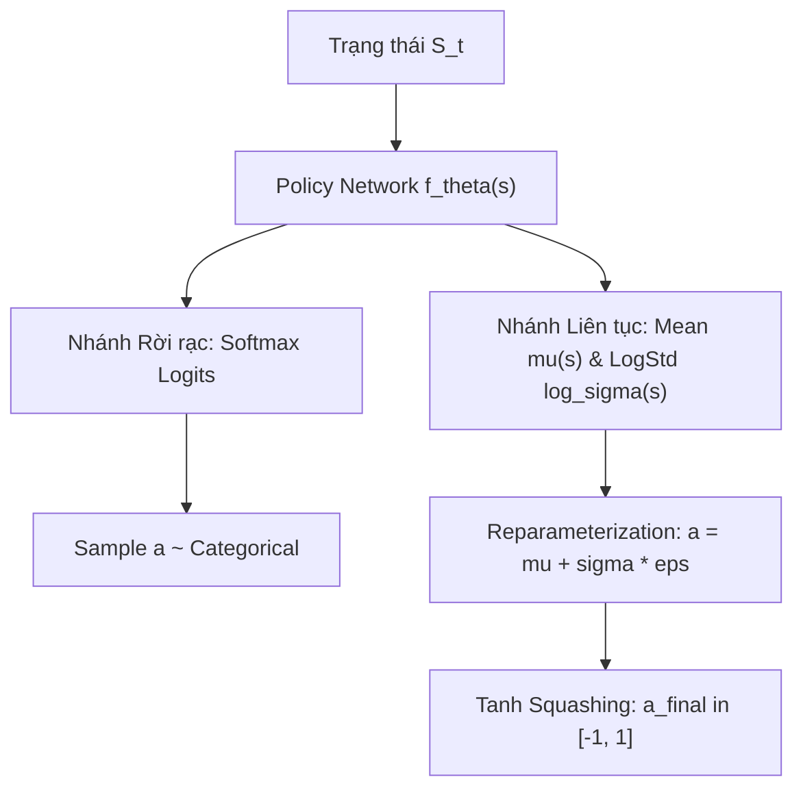

#### d. Code Thực chiến (Dual-Engine: C++ & Python)

```cpp
// C++20: Lấy mẫu hành động liên tục chuẩn hóa Gauss sử dụng Box-Muller Transform
#include <iostream>
#include <cmath>
#include <random>

class GaussianPolicySampler {
private:
    std::mt19937 rng{1337};
    std::normal_distribution<float> std_norm{0.0f, 1.0f};

public:
    float sample_and_squash(float mean, float log_std, float& log_prob) {
        float std_dev = std::exp(log_std);
        float eps = std_norm(rng);
        float pre_squash = mean + std_dev * eps;
        float action = std::tanh(pre_squash);

        // Tinh log prob voi hieu chinh Jacobian
        float base_log_prob = -0.5f * (eps * eps + std::log(2.0f * M_PI)) - log_std;
        float jacobian_correction = std::log(std::clamp(1.0f - action * action, 1e-6f, 1.0f));
        log_prob = base_log_prob - jacobian_correction;

        return action;
    }
};

int main() {
    GaussianPolicySampler sampler;
    float log_prob = 0.0f;
    float action = sampler.sample_and_squash(0.5f, -0.2f, log_prob);
    std::cout << "[C++] Action (Tanh): " << action << ", Log-Prob: " << log_prob << "\n";
    return 0;
}
```

```python
# Python / PyTorch: Phân phối Squashed Gaussian Policy chuẩn dùng trong SAC
import torch
import torch.nn as nn
from torch.distributions import Normal

class SquashedGaussianPolicy(nn.Module):
    def __init__(self, state_dim: int, action_dim: int):
        super().__init__()
        self.net = nn.Sequential(nn.Linear(state_dim, 64), nn.ReLU())
        self.mu_layer = nn.Linear(64, action_dim)
        self.log_std_layer = nn.Linear(64, action_dim)

    def forward(self, state: torch.Tensor):
        x = self.net(state)
        mu = self.mu_layer(x)
        log_std = torch.clamp(self.log_std_layer(x), min=-20, max=2)
        std = torch.exp(log_std)

        dist = Normal(mu, std)
        x_t = dist.rsample() # Reparameterization
        y_t = torch.tanh(x_t)
        
        # Hieu chinh Jacobian cho log prob
        log_prob = dist.log_prob(x_t) - torch.log(torch.clamp(1.0 - y_t.pow(2), min=1e-6))
        log_prob = log_prob.sum(dim=-1, keepdim=True)
        return y_t, log_prob

policy = SquashedGaussianPolicy(state_dim=4, action_dim=1)
dummy_s = torch.randn(1, 4)
action, lp = policy(dummy_s)
print(f"[PyTorch] Sampled Continuous Action: {action.detach().numpy()}, Log-prob: {lp.item():.4f}")
```

#### e. Lỗi Thường gặp & Ổn định Số học (Pitfalls & Numerical Stability)
- **Gradient Saturation tại Tanh**: Khi giá trị $|u| > 5$, $\tanh(u) \to \pm 1$ khiến $\nabla_u \tanh(u) = 1 - \tanh^2(u) \to 0$. Đạo hàm bị bão hòa triệt để và mạng nơ-ron ngừng cập nhật. Khắc phục bằng cách kẹp (clamp) `log_std` trong khoảng $[-20, 2]$.

#### f. Ứng dụng Thực chiến trong AI / Deep Learning
- **Mô men lực động cơ (Torque Control)**: Điều khiển góc xoay và dòng điện cung cấp cho các khớp của cánh tay robot công nghiệp.

---

### 6. Reward (Phần thưởng)

#### a. Định nghĩa Bản chất Toán học (Mathematical Formulation)
Phần thưởng $R_{t+1} \in \mathbb{R}$ là đại lượng vô hướng ngẫu nhiên được môi trường gửi về cho Agent ngay sau khi thực thi hành động $A_t$ tại trạng thái $S_t$.

Hàm kỳ vọng phần thưởng (Expected Reward Function) được biểu diễn bởi:
$$r(s, a) = \mathbb{E}[R_{t+1} \mid S_t = s, A_t = a] = \sum_{r \in \mathcal{R}} r \sum_{s' \in \mathcal{S}} \mathbb{P}(S_{t+1} = s', R_{t+1} = r \mid S_t = s, A_t = a)$$

**Giả thuyết Phần thưởng (Reward Hypothesis - Sutton & Barto)**:
*"Mọi mục tiêu và ý định của một trí tuệ nhân tạo đều có thể được mô tả bằng việc tối đa hóa giá trị kỳ vọng của tổng tích lũy một tín hiệu vô hướng (phần thưởng)."*

#### b. Cơ chế Tầng Sâu & Điện toán (Under The Hood / Hardware Internals)
- **Reward Scaling & Clipping**: Nếu hàm thưởng trả về các giá trị quá chênh lệch (ví dụ điểm số Atari từ 1 đến hàng triệu), hàm mất mát Bellman $(\delta_t)^2$ sẽ bùng nổ vượt quá phạm vi biểu diễn của dấu chấm động FP32 / FP16, gây tràn số $\pm \infty$. Kỹ thuật phổ biến là kẹp $R_t \in [-1, 1]$ hoặc dùng running standardization:
$$R'_t = \frac{R_t - \mu_R}{\sigma_R + \epsilon}$$

#### c. Sơ đồ Minh họa (Mermaid Diagram)
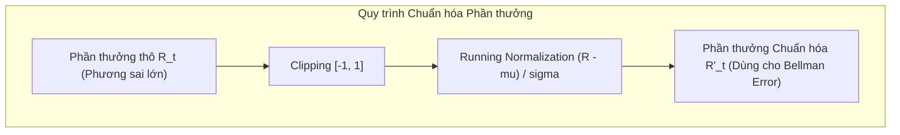

#### d. Code Thực chiến (Dual-Engine: C++ & Python)

```cpp
// C++20: Bộ chuẩn hóa Phần thưởng thời gian thực (Welford's Algorithm)
#include <iostream>
#include <cmath>

class RewardNormalizer {
private:
    float mean{0.0f};
    float m2{0.0f};
    size_t count{0};
    const float eps{1e-8f};

public:
    float update_and_normalize(float reward) {
        count++;
        float delta = reward - mean;
        mean += delta / count;
        float delta2 = reward - mean;
        m2 += delta * delta2;

        float variance = (count > 1) ? (m2 / (count - 1)) : 1.0f;
        float std_dev = std::sqrt(variance);
        return (reward - mean) / (std_dev + eps);
    }
};

int main() {
    RewardNormalizer normalizer;
    float raw_rewards[] = {100.0f, 50.0f, 500.0f, -20.0f, 300.0f};
    for (float r : raw_rewards) {
        float norm_r = normalizer.update_and_normalize(r);
        std::cout << "[C++] Raw: " << r << " -> Normalized: " << norm_r << "\n";
    }
    return 0;
}
```

```python
# Python / PyTorch: Lớp chuẩn hóa phần thưởng động sử dụng tensor running statistics
import torch

class RunningRewardScaler:
    def __init__(self, gamma: float = 0.99, eps: float = 1e-8):
        self.gamma = gamma
        self.eps = eps
        self.ret = 0.0
        self.var = 1.0
        self.alpha = 0.001 # He so cap nhat Moving Average

    def __call__(self, reward: float) -> float:
        self.ret = self.ret * self.gamma + reward
        # Cap nhat phuong sai cua return tich luy
        self.var = (1 - self.alpha) * self.var + self.alpha * (self.ret ** 2)
        return reward / (torch.sqrt(torch.tensor(self.var)) + self.eps).item()

scaler = RunningRewardScaler()
for step in range(5):
    scaled_r = scaler(10.0 * (step + 1))
    print(f"[PyTorch] Step {step}: Scaled Reward = {scaled_r:.4f}")
```

#### e. Lỗi Thường gặp & Ổn định Số học (Pitfalls & Numerical Stability)
- **Reward Hacking**: Agent khai thác các sơ hở trong hàm thưởng để tối đa hóa điểm số mà không hoàn thành nhiệm vụ thực sự (ví dụ trong game đua thuyền CoastRunners, agent lái vòng tròn liên tục để ăn điểm thưởng thay vì về đích).

#### f. Ứng dụng Thực chiến trong AI / Deep Learning
- **Mô hình Thưởng trong RLHF (Reward Model)**: Huấn luyện một mạng nơ-ron Transformer $R_\psi(x, y)$ đánh giá độ an toàn và chất lượng câu trả lời của LLM.

---

### 7. Policy (Chính sách)

#### a. Định nghĩa Bản chất Toán học (Mathematical Formulation)
Chính sách $\pi$ định nghĩa hành vi của Agent bằng cách ánh xạ từ không gian trạng thái $\mathcal{S}$ sang không gian hành động $\mathcal{A}$.

1. **Chính sách Tất định (Deterministic Policy)**:
$$a = \mu(s), \quad \mu: \mathcal{S} \to \mathcal{A}$$
Ánh xạ trực tiếp mỗi trạng thái sang một hành động duy nhất.

2. **Chính sách Ngẫu nhiên (Stochastic Policy)**:
$$\pi(a \mid s) = \mathbb{P}(A_t = a \mid S_t = s)$$
Với ràng buộc chuẩn hóa phân phối xác suất:
$$\sum_{a \in \mathcal{A}} \pi(a \mid s) = 1 \quad \text{hoặc} \quad \int_{\mathcal{A}} \pi(a \mid s) \, da = 1, \quad \forall s \in \mathcal{S}$$

#### b. Cơ chế Tầng Sâu & Điện toán (Under The Hood / Hardware Internals)
- **Gumbel-Max & Gumbel-Softmax**: Khi muốn đạo hàm qua một biến ngẫu nhiên rời rạc đại diện cho chính sách, ta sử dụng Gumbel-Softmax trick:
$$A = \text{Softmax}\left(\frac{\mathbf{z} + \mathbf{g}}{\tau}\right), \quad g_i \sim \text{Gumbel}(0, 1) = -\log(-\log U_i)$$
với $U_i \sim \text{Uniform}(0, 1)$ và $\tau$ là hệ số nhiệt độ (temperature). Cơ chế này giúp luồng tính toán Autograd có thể truyền ngược gradient trực tiếp qua hành động rời rạc.

#### c. Sơ đồ Minh họa (Mermaid Diagram)
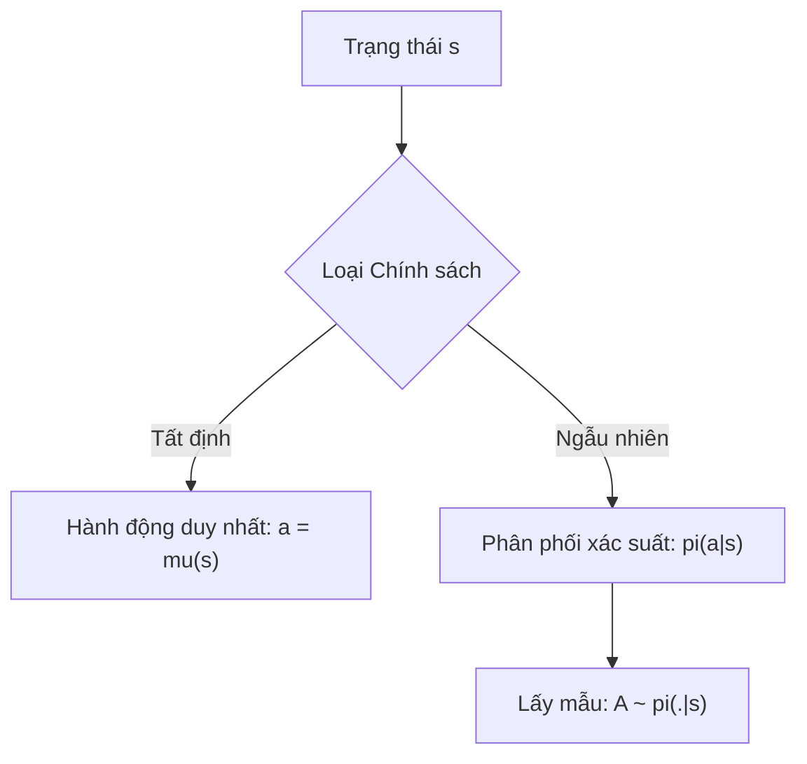

#### d. Code Thực chiến (Dual-Engine: C++ & Python)

```cpp
// C++20: Bảng chính sách rời rạc tối ưu hóa truy xuất bộ nhớ L1 (Tabular Policy)
#include <iostream>
#include <vector>
#include <numeric>
#include <random>

class TabularPolicy {
private:
    size_t num_states;
    size_t num_actions;
    std::vector<float> policy_table; // 1D Flat array: shape [num_states * num_actions]
    std::mt19937 rng{42};

public:
    TabularPolicy(size_t s, size_t a) : num_states(s), num_actions(a), policy_table(s * a, 1.0f / a) {}

    int sample_action(size_t state) {
        const float* prob_ptr = &policy_table[state * num_actions];
        std::uniform_real_distribution<float> dist(0.0f, 1.0f);
        float p = dist(rng);
        float cumulative = 0.0f;

        for (size_t a = 0; a < num_actions; ++a) {
            cumulative += prob_ptr[a];
            if (p <= cumulative) return static_cast<int>(a);
        }
        return static_cast<int>(num_actions - 1);
    }
};

int main() {
    TabularPolicy pi(10, 4);
    int action = pi.sample_action(3);
    std::cout << "[C++] Sampled Action from Tabular Policy: " << action << "\n";
    return 0;
}
```

```python
# Python / PyTorch: Gumbel-Softmax Differentiable Policy
import torch
import torch.nn as nn
import torch.nn.functional as F

class CategoricalPolicy(nn.Module):
    def __init__(self, state_dim: int, action_dim: int):
        super().__init__()
        self.net = nn.Linear(state_dim, action_dim)

    def forward(self, state: torch.Tensor, temperature: float = 1.0):
        logits = self.net(state)
        # Gumbel Softmax cho phep backprop qua hanh dong
        action_probs = F.gumbel_softmax(logits, tau=temperature, hard=True)
        return action_probs

pol = CategoricalPolicy(4, 3)
s = torch.randn(1, 4)
action_one_hot = pol(s)
print(f"[PyTorch] Differentiable Action One-Hot: {action_one_hot.detach().numpy()}")
```

#### e. Lỗi Thường gặp & Ổn định Số học (Pitfalls & Numerical Stability)
- **Numerical Overflow in Softmax**: Khi logits $z_k$ quá lớn, $\exp(z_k)$ tràn số thành `inf`. Luôn luôn trừ giá trị lớn nhất trước khi tính hàm mũ:
$$\text{Softmax}(\mathbf{z})_k = \frac{\exp(z_k - \max_j z_j)}{\sum_i \exp(z_i - \max_j z_j)}$$

#### f. Ứng dụng Thực chiến trong AI / Deep Learning
- Kiến trúc chính của mọi mô hình Actor trong PPO, SAC, DDPG giải quyết các bài toán từ điều khiển cánh tay robot đến sinh code tự động.

---

### 8. Trajectory (Quỹ đạo)

#### a. Định nghĩa Bản chất Toán học (Mathematical Formulation)
Quỹ đạo (Trajectory) hoặc Lịch sử (History / Rollout), ký hiệu là $\tau$, là một chuỗi tuần tự xen kẽ giữa các trạng thái và hành động từ bước $0$ đến bước $T$:
$$\tau = (S_0, A_0, R_1, S_1, A_1, R_2, \dots, S_{T-1}, A_{T-1}, R_T, S_T)$$
Xác suất xuất hiện của một quỹ đạo $\tau$ dưới sự điều khiển của chính sách $\pi$ trong môi trường có động lực học $\mathcal{P}$ là:
$$P(\tau \mid \pi) = \rho_0(S_0) \prod_{t=0}^{T-1} \pi(A_t \mid S_t) \mathcal{P}(S_{t+1} \mid S_t, A_t)$$
Đạo hàm log xác suất của quỹ đạo (Log-Derivative Trick) loại bỏ hoàn toàn sự phụ thuộc vào hàm chuyển trạng thái $\mathcal{P}$ chưa biết:
$$\nabla_\theta \log P(\tau \mid \pi_\theta) = \sum_{t=0}^{T-1} \nabla_\theta \log \pi_\theta(A_t \mid S_t)$$

#### b. Cơ chế Tầng Sâu & Điện toán (Under The Hood / Hardware Internals)
- **Rollout Storage Layout**: Trong PPO/A2C, các trajectory được lưu trữ dưới dạng mảng đa chiều có thứ tự thời gian ưu tiên: `[Time_Steps, Num_Envs, State_Dim]`. Định dạng Time-Major này hỗ trợ tính toán các chuỗi hồi quy (RNN / LSTM) hoặc phép hồi quy lợi nhuận $G_t$ ngược dòng từ $T-1$ về $0$ mà không cần tráo đổi trục bộ nhớ (Memory Transpose).

#### c. Sơ đồ Minh họa (Mermaid Diagram)
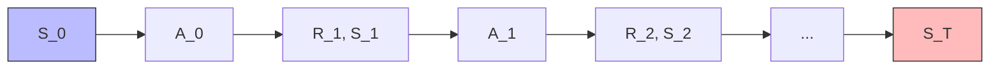

#### d. Code Thực chiến (Dual-Engine: C++ & Python)

```cpp
// C++20: Cấu trúc Rollout Buffer lưu trữ Quỹ đạo tuần tự tối ưu hóa truy cập
#include <iostream>
#include <vector>

struct Transition {
    std::vector<float> state;
    int action;
    float reward;
    std::vector<float> next_state;
    bool done;
};

class TrajectoryBuffer {
private:
    std::vector<Transition> buffer;

public:
    void add(std::vector<float> s, int a, float r, std::vector<float> next_s, bool d) {
        buffer.push_back({std::move(s), a, r, std::move(next_s), d});
    }

    size_t length() const { return buffer.size(); }
    void clear() { buffer.clear(); }

    float compute_total_raw_reward() const {
        float total = 0.0f;
        for (const auto& step : buffer) {
            total += step.reward;
        }
        return total;
    }
};

int main() {
    TrajectoryBuffer traj;
    traj.add({0.1f, 0.2f}, 1, 1.0f, {0.2f, 0.3f}, false);
    traj.add({0.2f, 0.3f}, 0, 2.0f, {0.3f, 0.4f}, true);
    std::cout << "[C++] Trajectory Len: " << traj.length() 
              << ", Total Reward: " << traj.compute_total_raw_reward() << "\n";
    return 0;
}
```

```python
# Python / PyTorch: Lưu trữ và đóng gói Trajectory dưới dạng Batch Tensors
import torch
from dataclasses import dataclass

@dataclass
class TrajectoryBatch:
    states: torch.Tensor
    actions: torch.Tensor
    rewards: torch.Tensor
    dones: torch.Tensor

    def __len__(self):
        return self.states.shape[0]

states = torch.randn(10, 4)
actions = torch.randint(0, 2, (10,))
rewards = torch.ones(10)
dones = torch.zeros(10, dtype=torch.bool)
dones[-1] = True

batch = TrajectoryBatch(states, actions, rewards, dones)
print(f"[PyTorch] Rollout Trajectory Batch: {len(batch)} steps, Total Reward: {batch.rewards.sum().item()}")
```

#### e. Lỗi Thường gặp & Ổn định Số học (Pitfalls & Numerical Stability)
- **Truncated vs Terminated Trajectories**: Nhầm lẫn giữa việc trajectory kết thúc do hoàn thành tác vụ (Terminated - Done thật) và kết thúc do chạm giới hạn thời gian (Truncated - Time Limit). Việc gán giá trị $V(S_T) = 0$ khi chạm time limit sẽ phá vỡ tính đúng đắn của phương trình Bellman (cần dùng kỹ thuật Time-limit Bootstrapping).

#### f. Ứng dụng Thực chiến trong AI / Deep Learning
- Thu thập hàng triệu quỹ đạo tương tác mỗi ngày trong môi trường giả lập đám mây để huấn luyện các mô hình Foundation World Models.

---

### 9. Episode (Hồi / Tập)

#### a. Định nghĩa Bản chất Toán học (Mathematical Formulation)
Một Episode (hay Trial) là một quỹ đạo hữu hạn bắt đầu từ trạng thái ban đầu $S_0 \sim \rho_0$ và kết thúc tại trạng thái kết thúc (Terminal State) $S_T \in \mathcal{S}_{\text{terminal}}$:
$$\tau_{\text{episode}} = (S_0, A_0, R_1, S_1, \dots, S_T)$$
Một tác vụ được phân loại thành:
1. **Tác vụ Hồi (Episodic Tasks)**: Tác vụ tự nhiên chia thành các tập rời rạc, có trạng thái kết thúc rõ ràng ($T < \infty$). Mỗi khi chạm trạng thái kết thúc, hệ thống tự động reset về $S_0$.
2. **Tác vụ Liên tục (Continuing Tasks)**: Tác vụ kéo dài vô hạn không có điểm dừng ($T = \infty$).

#### b. Cơ chế Tầng Sâu & Điện toán (Under The Hood / Hardware Internals)
- **Auto-Reset Optimization**: Trong các hệ thống thu thập dữ liệu phân tán (Ray/RLlib), khi một worker hoàn thành một Episode, việc khởi tạo lại môi trường (Reset) có thể gây ra hiện tượng lệch pha thời gian (Straggler problem). Kiến trúc hiện đại thực hiện Auto-Reset ngay trong vòng lặp C++ của GPU Simulator, chèn trạng thái khởi tạo $S_0$ của episode tiếp theo vào batch mà không cần đồng bộ CPU.

#### c. Sơ đồ Minh họa (Mermaid Diagram)
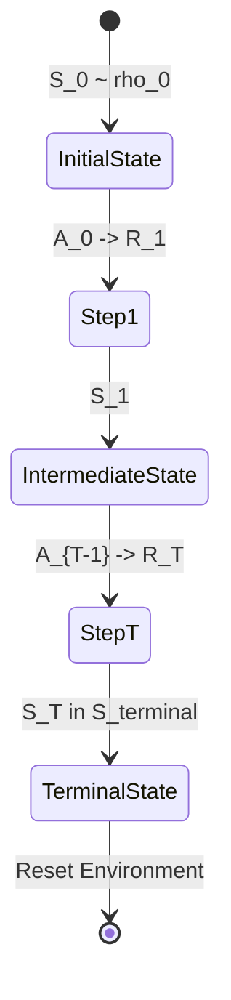

#### d. Code Thực chiến (Dual-Engine: C++ & Python)

```cpp
// C++20: Quản lý vòng đời Episode với Auto-Reset
#include <iostream>

class EpisodicSession {
private:
    int current_step{0};
    const int max_horizon{5};
    int episode_id{0};

public:
    bool step() {
        current_step++;
        std::cout << "[C++] Episode " << episode_id << " | Step " << current_step << "\n";
        if (current_step >= max_horizon) {
            std::cout << "[C++] -> Episode " << episode_id << " Ket thuc! Auto-resetting...\n";
            current_step = 0;
            episode_id++;
            return true; // Done
        }
        return false;
    }
};

int main() {
    EpisodicSession session;
    for (int i = 0; i < 7; ++i) {
        session.step();
    }
    return 0;
}
```

```python
# Python: Xử lý Episode boundaries trong vòng lặp huấn luyện RL
class EpisodeManager:
    def __init__(self, max_episodes: int = 2):
        self.max_episodes = max_episodes
        self.current_episode = 0

    def run_episodes(self):
        while self.current_episode < self.max_episodes:
            done = False
            step = 0
            ep_reward = 0.0
            print(f"[Python] Bat dau Episode {self.current_episode}")
            while not done:
                step += 1
                r = 1.0
                ep_reward += r
                if step >= 3:
                    done = True
            print(f"[Python] Episode {self.current_episode} ket thuc sau {step} buoc, Tong thuong: {ep_reward}")
            self.current_episode += 1

EpisodeManager().run_episodes()
```

#### e. Lỗi Thường gặp & Ổn định Số học (Pitfalls & Numerical Stability)
- **Leaking Discount Across Episodes**: Lỗi nghiêm trọng khi triển khai tính discounted return $G_t$ nếu quên nhân với $(1 - \text{done})$, khiến lợi nhuận của episode sau bị chiết khấu ngược vào episode trước.

#### f. Ứng dụng Thực chiến trong AI / Deep Learning
- Phân đoạn ván chơi trong cờ vua, game thể thao (FIFA), hay chuỗi đàm phán thương lượng tự động.

---

### 10. Return (Lợi nhuận)

#### a. Định nghĩa Bản chất Toán học (Mathematical Formulation)
Lợi nhuận (Return), ký hiệu là $G_t$, là tổng lượng phần thưởng tích lũy mà Agent nhận được từ thời điểm $t$ đến khi kết thúc nhiệm vụ.

1. **Lợi nhuận không chiết khấu (Undiscounted Return)** - Thường dùng cho Episodic Tasks:
$$G_t = R_{t+1} + R_{t+2} + \dots + R_T = \sum_{k=0}^{T - t - 1} R_{t+k+1}$$

2. **Lợi nhuận chiết khấu (Discounted Return)** - Áp dụng tổng quát cho cả Continuing Tasks:
$$G_t = R_{t+1} + \gamma R_{t+2} + \gamma^2 R_{t+3} + \dots = \sum_{k=0}^{\infty} \gamma^k R_{t+k+1}$$
với $\gamma \in [0, 1)$ là hệ số chiết khấu.

Hệ thức truy hồi nền tảng của Lợi nhuận (Recursive Relation of Return):
$$G_t = R_{t+1} + \gamma G_{t+1}$$

#### b. Cơ chế Tầng Sâu & Điện toán (Under The Hood / Hardware Internals)
- **Vectorized Backwards Calculation**: Để tính $G_t$ cho một chuỗi $T$ bước, việc duyệt xuôi đòi hỏi độ phức tạp $\mathcal{O}(T^2)$. Bằng cách duyệt ngược từ $t = T-1$ về $0$ theo công thức $G_t = R_{t+1} + \gamma G_{t+1}$, độ phức tạp giảm xuống $\mathcal{O}(T)$ với truy cập bộ nhớ tuyến tính liên tục (stride = 1), đạt hiệu suất tối ưu trên L1 Cache.

#### c. Sơ đồ Minh họa (Mermaid Diagram)
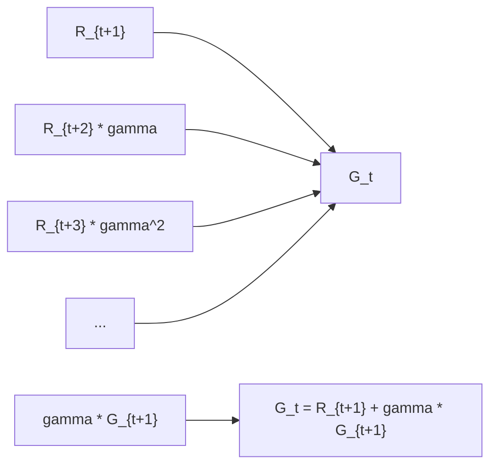

#### d. Code Thực chiến (Dual-Engine: C++ & Python)

```cpp
// C++20: Tính Discounted Return ngược chiều (O(N) cache-friendly)
#include <iostream>
#include <vector>

std::vector<float> compute_discounted_returns(const std::vector<float>& rewards, float gamma) {
    const size_t n = rewards.size();
    std::vector<float> returns(n, 0.0f);
    float running_g = 0.0f;

    // Duyet nguoc tu n-1 ve 0
    for (int t = static_cast<int>(n) - 1; t >= 0; --t) {
        running_g = rewards[t] + gamma * running_g;
        returns[t] = running_g;
    }
    return returns;
}

int main() {
    std::vector<float> rewards = {1.0f, 1.0f, 1.0f, 10.0f};
    float gamma = 0.9f;
    auto returns = compute_discounted_returns(rewards, gamma);
    for (size_t i = 0; i < returns.size(); ++i) {
        std::cout << "[C++] Return G_" << i << ": " << returns[i] << "\n";
    }
    return 0;
}
```

```python
# Python / PyTorch: Vectorized Return Computation sử dụng Tensor Operations
import torch

def compute_returns_torch(rewards: torch.Tensor, gamma: float = 0.99) -> torch.Tensor:
    returns = torch.zeros_like(rewards)
    g = 0.0
    for t in reversed(range(len(rewards))):
        g = rewards[t] + gamma * g
        returns[t] = g
    return returns

rewards = torch.tensor([1.0, 1.0, 1.0, 10.0], dtype=torch.float32)
returns = compute_returns_torch(rewards, gamma=0.9)
print(f"[PyTorch] Computed Returns G_t: {returns.numpy()}")
```

#### e. Lỗi Thường gặp & Ổn định Số học (Pitfalls & Numerical Stability)
- **Phương sai vô hạn khi $\gamma = 1$**: Trong các bài toán vô hạn bước, nếu $\gamma = 1$, chuỗi $G_t$ có thể phân kỳ ra vô cùng ($\infty$), khiến toán tử tối ưu không thể hội tụ.

#### f. Ứng dụng Thực chiến trong AI / Deep Learning
- Mục tiêu mục tiêu trực tiếp trong thuật toán REINFORCE (Monte Carlo Policy Gradient) để ước lượng hàm mục tiêu $\nabla_\theta \mathcal{J}(\theta)$.

---

### 11. Discount Factor (Hệ số chiết khấu)

#### a. Định nghĩa Bản chất Toán học (Mathematical Formulation)
Hệ số chiết khấu, ký hiệu $\gamma$ (Gamma), với $\gamma \in [0, 1)$, là tham số quy định trọng số của các phần thưởng trong tương lai so với phần thưởng ở hiện tại.

Ý nghĩa toán học và giải tích:
1. **Đảm bảo tính hội tụ của chuỗi vô hạn**: Nếu $|R_t| \le R_{\max}$, thì:
$$G_t = \sum_{k=0}^{\infty} \gamma^k R_{t+k+1} \le R_{\max} \sum_{k=0}^{\infty} \gamma^k = \frac{R_{\max}}{1 - \gamma} < \infty$$
2. **Thời chân trời hiệu dụng (Effective Horizon)**:
$$H_{\text{eff}} = \frac{1}{1 - \gamma}$$
Ví dụ: $\gamma = 0.9 \implies H_{\text{eff}} = 10$ bước; $\gamma = 0.99 \implies H_{\text{eff}} = 100$ bước.
- Khi $\gamma \to 0$: Agent mang tính "cận thị" (myopic), chỉ quan tâm đến phần thưởng ngay lập tức.
- Khi $\gamma \to 1$: Agent mang tầm nhìn xa (far-sighted), cân nhắc sâu sắc hậu quả tương lai.

#### b. Cơ chế Tầng Sâu & Điện toán (Under The Hood / Hardware Internals)
- **Độ co (Contraction Factor) của Toán tử Bellman**: Trong chứng minh hội tụ của quy hoạch động, toán tử Bellman $\mathcal{T}$ là một phép ánh xạ co (Contraction Mapping) theo chuẩn vô cùng với hệ số co đúng bằng $\gamma$:
$$\|\mathcal{T} U - \mathcal{T} V\|_\infty \le \gamma \|U - V\|_\infty$$
Hệ số $\gamma$ càng nhỏ thì thuật toán hội tụ theo cấp số nhân càng nhanh, nhưng nghiệm tìm được có thể lệch khỏi bài toán thực tế.

#### c. Sơ đồ Minh họa (Mermaid Diagram)
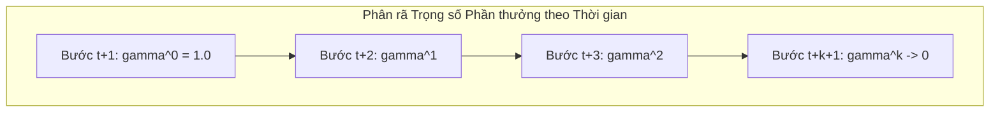

#### d. Code Thực chiến (Dual-Engine: C++ & Python)

```cpp
// C++20: Tính bảng lũy thừa Gamma tối ưu hóa bằng mảng tĩnh
#include <iostream>
#include <vector>

class DiscountTable {
private:
    std::vector<float> gammas;

public:
    DiscountTable(size_t max_horizon, float gamma) : gammas(max_horizon) {
        float current = 1.0f;
        for (size_t i = 0; i < max_horizon; ++i) {
            gammas[i] = current;
            current *= gamma;
        }
    }

    [[nodiscard]] float get(size_t step) const noexcept {
        return (step < gammas.size()) ? gammas[step] : 0.0f;
    }
};

int main() {
    DiscountTable table(10, 0.95f);
    std::cout << "[C++] Gamma^0: " << table.get(0) << " | Gamma^5: " << table.get(5) << "\n";
    return 0;
}
```

```python
# Python / NumPy: Minh họa Exponential Decay của Discount Factor
import numpy as np

def visualize_discount_horizon(gamma: float, steps: int = 100):
    powers = np.arange(steps)
    weights = gamma ** powers
    effective_horizon = 1.0 / (1.0 - gamma)
    print(f"[Python] Gamma: {gamma} | Horizon: {effective_horizon:.1f} steps | Weight at step 50: {weights[50]:.6f}")

visualize_discount_horizon(0.95)
visualize_discount_horizon(0.99)
```

#### e. Lỗi Thường gặp & Ổn định Số học (Pitfalls & Numerical Stability)
- **Underflow**: Khi $\gamma^k$ với $k > 1000$ (ví dụ $\gamma = 0.9$), giá trị rơi về $0.9^{1000} \approx 1.7 \times 10^{-46}$, gây underflow trong chuẩn FP32 (giới hạn dưới $\sim 1.17 \times 10^{-38}$). Cần tính toán trong miền log nếu chuỗi thời gian quá dài.

#### f. Ứng dụng Thực chiến trong AI / Deep Learning
- Chọn $\gamma = 0.99$ hoặc $0.995$ cho các tác vụ cần chiến thuật dài hạn như cờ vây, DotA 2, StarCraft II.

---

### 12. Reward Function (Hàm phần thưởng)

#### a. Định nghĩa Bản chất Toán học (Mathematical Formulation)
Hàm phần thưởng quy định cấu trúc động học của tín hiệu phản hồi. Có ba dạng biểu diễn toán học tương đương:
1. Phụ thuộc vào trạng thái hiện tại:
$$\mathcal{R}: \mathcal{S} \to \mathbb{R}, \quad R_t = R(S_t)$$
2. Phụ thuộc vào trạng thái và hành động:
$$\mathcal{R}: \mathcal{S} \times \mathcal{A} \to \mathbb{R}, \quad R_t = R(S_t, A_t)$$
3. Phụ thuộc vào bước chuyển đầy đủ (Dạng tổng quát nhất):
$$\mathcal{R}: \mathcal{S} \times \mathcal{A} \times \mathcal{S} \to \mathbb{R}, \quad R_{t+1} = R(S_t, A_t, S_{t+1})$$

Một biến đổi hàm thưởng (Reward Transformation) $R'(s, a, s') = R(s, a, s') + F(s, a, s')$ được gọi là **Bảo toàn Chính sách Tối ưu (Policy Invariance)** nếu và chỉ nếu hàm định hình $F$ có dạng hiệu thế (Potential-based Reward Shaping - Ng et al., 1999):
$$F(s, a, s') = \gamma \Phi(s') - \Phi(s)$$
với $\Phi: \mathcal{S} \to \mathbb{R}$ là một hàm thế vô hướng bất kỳ.

#### b. Cơ chế Tầng Sâu & Điện toán (Under The Hood / Hardware Internals)
- **Evaluation Overhead**: Trong các môi trường phức tạp, hàm thưởng có thể bao gồm nhiều phép tính ma trận tốn kém (như khoảng cách Euclidean giữa hàng trăm điểm va chạm trong mô phỏng vật lý). Tính toán hàm thưởng trực tiếp trên GPU Kernel song song với bước tích phân vật lý giúp loại bỏ hoàn toàn độ trễ truyền dữ liệu Host-to-Device.

#### c. Sơ đồ Minh họa (Mermaid Diagram)
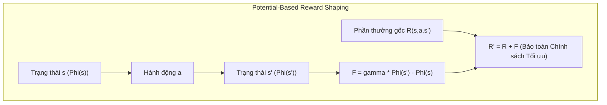

#### d. Code Thực chiến (Dual-Engine: C++ & Python)

```cpp
// C++20: Triển khai Potential-Based Reward Shaping bảo toàn nghiệm tối ưu
#include <iostream>
#include <cmath>

class PotentialRewardShaper {
private:
    float gamma{0.99f};

    // Ham the Phi(s): uoc luong khoang cach toi dich (negative distance)
    float potential(float x, float y, float target_x, float target_y) const {
        float dx = target_x - x;
        float dy = target_y - y;
        return -std::sqrt(dx * dx + dy * dy);
    }

public:
    explicit PotentialRewardShaper(float g) : gamma(g) {}

    float shape(float base_reward, float x, float y, float next_x, float next_y, float tx, float ty) {
        float phi_s = potential(x, y, tx, ty);
        float phi_s_prime = potential(next_x, next_y, tx, ty);
        float f = gamma * phi_s_prime - phi_s;
        return base_reward + f;
    }
};

int main() {
    PotentialRewardShaper shaper(0.99f);
    float shaped = shaper.shape(-1.0f, 0.0f, 0.0f, 0.5f, 0.5f, 5.0f, 5.0f);
    std::cout << "[C++] Shaped Reward: " << shaped << " (Tang toc hoi tu nhung khong doi nghiem toi uu)\n";
    return 0;
}
```

```python
# Python: Potential-based Reward Shaping trong điều khiển vị trí
import numpy as np

class ShapedNavigationEnv:
    def __init__(self, gamma: float = 0.99):
        self.gamma = gamma
        self.target = np.array([10.0, 10.0])

    def potential(self, state: np.ndarray) -> float:
        # The nang cang cao khi cang gan dich
        return -float(np.linalg.norm(state - self.target))

    def step_reward(self, state: np.ndarray, next_state: np.ndarray, base_reward: float) -> float:
        f = self.gamma * self.potential(next_state) - self.potential(state)
        return base_reward + f

env = ShapedNavigationEnv()
s_curr = np.array([0.0, 0.0])
s_next = np.array([1.0, 1.0])
r_shaped = env.step_reward(s_curr, s_next, base_reward=-1.0)
print(f"[Python] Original Reward: -1.0 | Shaped Reward: {r_shaped:.4f}")
```

#### e. Lỗi Thường gặp & Ổn định Số học (Pitfalls & Numerical Stability)
- **Positive Reward Loops (Chu trình thưởng dương không hợp lệ)**: Nếu thêm phần thưởng trung gian không theo dạng potential-based shaping, Agent có thể học được chính sách lặp đi lặp lại một chuỗi hành động để ăn thưởng mà không bao giờ hoàn thành mục tiêu chính.

#### f. Ứng dụng Thực chiến trong AI / Deep Learning
- **Huấn luyện xe tự hành**: Hàm thưởng kết hợp giữa tốc độ di chuyển, mức độ giữ làn đường, sự êm ái khi phanh/ga và phạt nặng khi xảy ra va chạm.
