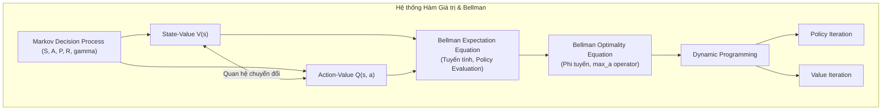
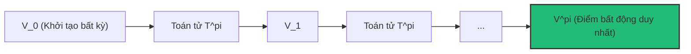
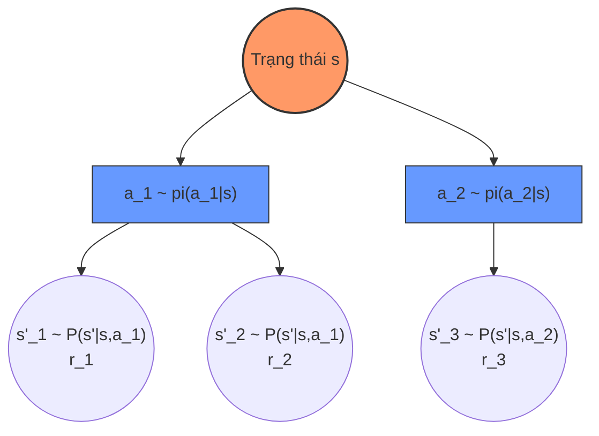
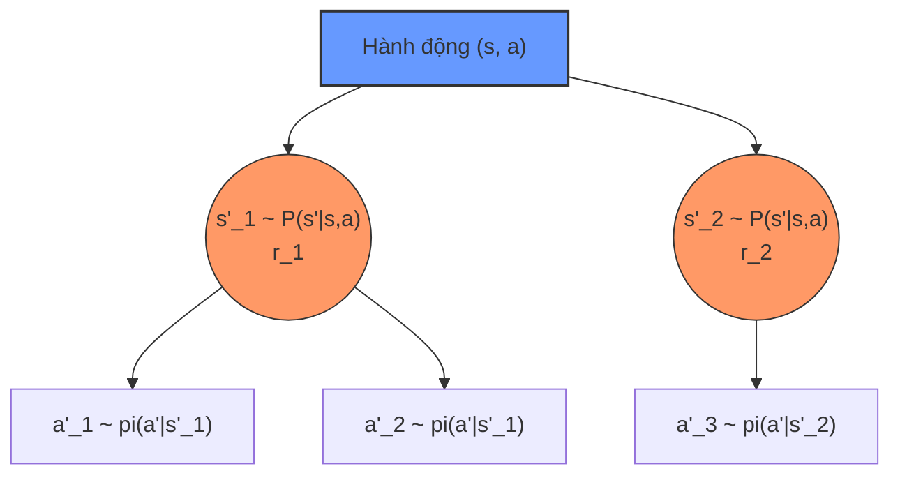
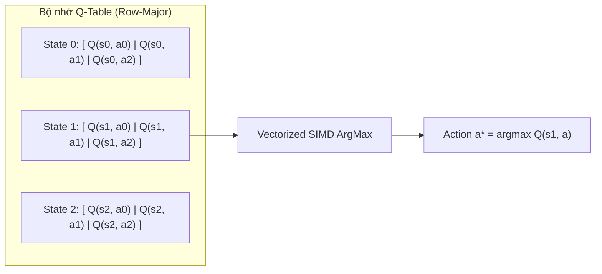
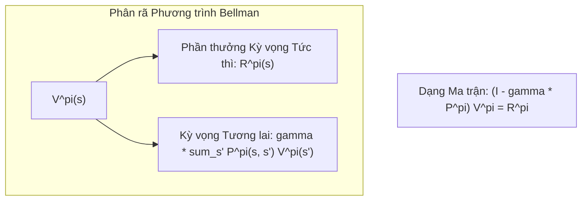
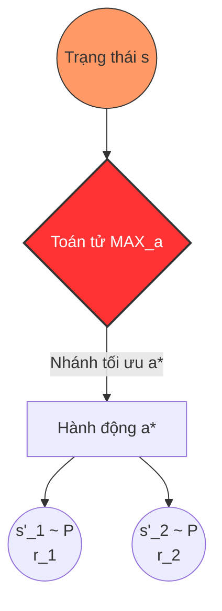
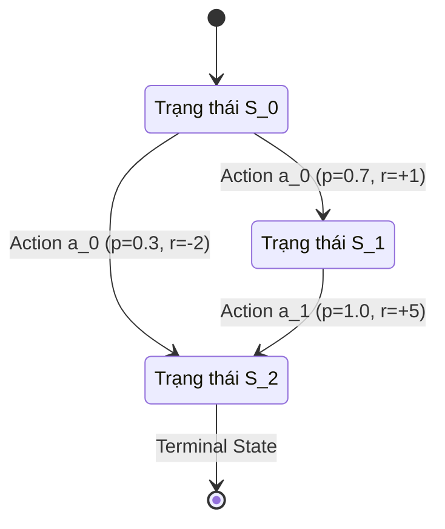
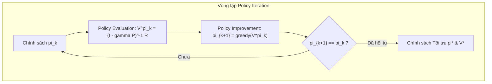

# Chuyên đề: Hàm Giá trị & Phương trình Tối ưu Bellman (Value Functions & Bellman Optimality)

## 1. Tổng quan Chuyên đề

Trong Học tăng cường (Reinforcement Learning), mục tiêu cốt lõi là tìm kiếm một chính sách tối ưu giúp tác nhân gặt hái được tổng lợi nhuận cao nhất trong tương lai. Để đánh giá một chính sách hay ước tính tiềm năng của một trạng thái, công cụ toán học trung tâm được sử dụng là **Hàm Giá trị (Value Function)**.

Lý thuyết của Richard Bellman (1957) về Quy hoạch động (Dynamic Programming) đã thiết lập nên hai cột trụ bất biến của RL:
1. **Phương trình Kỳ vọng Bellman (Bellman Expectation Equation)**: Thiết lập mối quan hệ tự quy nạp tuyến tính giữa giá trị của trạng thái hiện tại với giá trị của các trạng thái kế tiếp dưới một chính sách cụ thể $\pi$.
2. **Phương trình Tối ưu Bellman (Bellman Optimality Equation)**: Thiết lập quan hệ phi tuyến tính đặc trưng cho chính sách tối ưu $\pi^*$, nơi mà hành động tốt nhất được chọn thông qua toán tử $\max$.

Toàn bộ hệ thống lý thuyết này vận hành dựa trên Định lý Điểm bất động Banach (Banach Fixed-Point Theorem), bảo đảm rằng việc lặp toán tử Bellman luôn hội tụ về một nghiệm duy nhất.



---

## 2. Chi tiết từng Keyword

---

### 1. Value Function (Hàm giá trị)

#### a. Định nghĩa Bản chất Toán học (Mathematical Formulation)
Hàm giá trị là một ánh xạ ước lượng tổng lợi nhuận kỳ vọng trong tương lai mà một Agent có thể đạt được. Về mặt giải tích hàm, hàm giá trị thuộc không gian Banach $\mathcal{B}(\mathcal{S})$ được trang bị chuẩn vô cùng (Supremum Norm):
$$\|V\|_\infty = \sup_{s \in \mathcal{S}} |V(s)|$$

Toán tử Bellman $\mathcal{T}^\pi: \mathcal{B}(\mathcal{S}) \to \mathcal{B}(\mathcal{S})$ được định nghĩa:
$$(\mathcal{T}^\pi V)(s) = \sum_{a \in \mathcal{A}} \pi(a \mid s) \left[ \sum_{s', r} p(s', r \mid s, a) \big( r + \gamma V(s') \big) \right]$$

**Định lý Ánh xạ Co (Contraction Mapping Theorem)**:
Toán tử Bellman $\mathcal{T}^\pi$ là một ánh xạ co $\gamma$-contraction trên chuẩn vô cùng:
$$\|\mathcal{T}^\pi U - \mathcal{T}^\pi V\|_\infty \le \gamma \|U - V\|_\infty, \quad \forall U, V \in \mathcal{B}(\mathcal{S}), \;\; 0 \le \gamma < 1$$
Theo Định lý Điểm bất động Banach:
1. Tồn tại duy nhất một hàm giá trị $V^\pi$ sao cho $\mathcal{T}^\pi V^\pi = V^\pi$.
2. Với mọi hàm giá trị khởi tạo $V_0$, dãy lặp $V_{k+1} = \mathcal{T}^\pi V_k$ hội tụ theo cấp số nhân về $V^\pi$ với tốc độ bị chặn bởi:
$$\|V_k - V^\pi\|_\infty \le \frac{\gamma^k}{1 - \gamma} \|V_1 - V_0\|_\infty$$

#### b. Cơ chế Tầng Sâu & Điện toán (Under The Hood / Hardware Internals)
- **Vectorized Contraction Updates**: Trong môi trường không gian trạng thái hữu hạn $|\mathcal{S}|$, hàm giá trị được lưu dưới dạng vector 1D liên tục trên bộ nhớ (Contiguous Buffer). Phép tính toán tử Bellman chuyển thành phép nhân ma trận - vector (GEMV: General Matrix-Vector Multiplication):
$$\mathbf{V}_{k+1} = \mathbf{R}^\pi + \gamma \mathbf{P}^\pi \mathbf{V}_k$$
Phép toán này được tối ưu trên CPU bằng tập lệnh SIMD AVX-512 hoặc trên GPU Tensor Cores, giúp xử lý đồng thời hàng triệu trạng thái trên bộ nhớ cache L3.

#### c. Sơ đồ Minh họa (Mermaid Diagram)


#### d. Code Thực chiến (Dual-Engine: C++ & Python)

```cpp
// C++20: Mô phỏng Toán tử Co Bellman chứng minh tính hội tụ điểm bất động
#include <iostream>
#include <vector>
#include <cmath>
#include <algorithm>

class BellmanContractionDemo {
private:
    float gamma{0.9f};
    std::vector<float> rewards{1.0f, 2.0f, 0.5f};
    // Ma tran chuyen trang thai P (3x3)
    std::vector<std::vector<float>> P = {
        {0.7f, 0.2f, 0.1f},
        {0.1f, 0.8f, 0.1f},
        {0.2f, 0.3f, 0.5f}
    };

public:
    void run_iterations(size_t max_iters = 50, float tol = 1e-5f) {
        size_t n = rewards.size();
        std::vector<float> V(n, 0.0f);

        for (size_t iter = 0; iter < max_iters; ++iter) {
            std::vector<float> V_next(n, 0.0f);
            float max_diff = 0.0f;

            for (size_t s = 0; s < n; ++s) {
                float expected_future = 0.0f;
                for (size_t s_prime = 0; s_prime < n; ++s_prime) {
                    expected_future += P[s][s_prime] * V[s_prime];
                }
                V_next[s] = rewards[s] + gamma * expected_future;
                max_diff = std::max(max_diff, std::abs(V_next[s] - V[s]));
            }

            V = std::move(V_next);
            if (max_diff < tol) {
                std::cout << "[C++] Hoi tu tai vong lap " << iter << " | Chuan vo cung: " << max_diff << "\n";
                break;
            }
        }

        std::cout << "[C++] Gia tri hoi tu: [";
        for (float val : V) std::cout << val << " ";
        std::cout << "]\n";
    }
};

int main() {
    BellmanContractionDemo demo;
    demo.run_iterations();
    return 0;
}
```

```python
# Python / NumPy: Lặp Toán tử Bellman (Fixed-Point Iteration) bằng ma trận hóa
import numpy as np

def bellman_contraction_operator(P: np.ndarray, R: np.ndarray, gamma: float = 0.9, tol: float = 1e-6):
    n = len(R)
    V = np.zeros(n)
    step = 0
    while True:
        # V_{k+1} = R + gamma * P @ V_k
        V_next = R + gamma * (P @ V)
        norm_inf = np.max(np.abs(V_next - V))
        V = V_next
        step += 1
        if norm_inf < tol:
            break
    print(f"[Python] Hoi tu sau {step} buoc. V* = {V}")
    return V

P_mat = np.array([[0.7, 0.2, 0.1], [0.1, 0.8, 0.1], [0.2, 0.3, 0.5]])
R_vec = np.array([1.0, 2.0, 0.5])
bellman_contraction_operator(P_mat, R_vec, gamma=0.9)
```

#### e. Lỗi Thường gặp & Ổn định Số học (Pitfalls & Numerical Stability)
- **Tốc độ hội tụ suy giảm khi $\gamma \to 1$**: Khi hệ số chiết khấu $\gamma$ tiệm cận $1$, hằng số co $\gamma$ tiến gần $1$, khiến số vòng lặp cần thiết để đạt ngưỡng sai số $\epsilon$ tăng vọt theo cấp số cộng: $\mathcal{O}\left(\frac{1}{1 - \gamma} \log \frac{1}{\epsilon}\right)$.

#### f. Ứng dụng Thực chiến trong AI / Deep Learning
- Làm nền tảng cho mạng Critic trong toàn bộ các thuật toán hiện đại: Deep Q-Networks (DQN), DDPG, SAC, PPO để ước lượng giá trị kỳ vọng của một trạng thái.

---

### 2. State-Value Function (Hàm giá trị trạng thái)

#### a. Định nghĩa Bản chất Toán học (Mathematical Formulation)
Hàm giá trị trạng thái $V^\pi(s)$ biểu thị kỳ vọng của lợi nhuận tích lũy chiết khấu khi tác nhân bắt đầu từ trạng thái $s$ và luôn tuân theo chính sách $\pi$ trong các bước tiếp theo:
$$V^\pi(s) = \mathbb{E}_\pi \left[ G_t \mid S_t = s \right] = \mathbb{E}_\pi \left[ \sum_{k=0}^{\infty} \gamma^k R_{t+k+1} \;\middle|\; S_t = s \right]$$

Khai triển phương trình đệ quy Bellman cho hàm giá trị trạng thái:
$$V^\pi(s) = \sum_{a \in \mathcal{A}} \pi(a \mid s) \sum_{s' \in \mathcal{S}} \sum_{r \in \mathcal{R}} p(s', r \mid s, a) \left[ r + \gamma V^\pi(s') \right]$$

Mối liên hệ cấu trúc với hàm giá trị hành động $Q^\pi(s, a)$:
$$V^\pi(s) = \sum_{a \in \mathcal{A}} \pi(a \mid s) Q^\pi(s, a) = \mathbb{E}_{a \sim \pi(\cdot \mid s)} \left[ Q^\pi(s, a) \right]$$

#### b. Cơ chế Tầng Sâu & Điện toán (Under The Hood / Hardware Internals)
- **Baseline Reduction of Variance**: Trong phương pháp Policy Gradient (REINFORCE), phương sai của gradient $\nabla_\theta \mathcal{J}(\theta)$ rất lớn. Bằng cách trừ đi hàm giá trị trạng thái $V(s)$ làm đường cơ sở (Baseline): $\nabla_\theta \log \pi_\theta(a \mid s) \big( G_t - V(s) \big)$, phương sai được triệt tiêu đáng kể mà không làm lệch kỳ vọng toán học (Unbiased Expectation), vì $\mathbb{E}_{a \sim \pi}[\nabla_\theta \log \pi(a \mid s) V(s)] = 0$.

#### c. Sơ đồ Minh họa (Mermaid Diagram)


#### d. Code Thực chiến (Dual-Engine: C++ & Python)

```cpp
// C++20: Đánh giá V(s) từ Q(s, a) bằng trọng số chính sách tối ưu hóa bộ nhớ
#include <iostream>
#include <vector>
#include <numeric>

float compute_state_value(const std::vector<float>& policy_probs, const std::vector<float>& q_values) {
    float v_s = 0.0f;
    const size_t num_actions = policy_probs.size();
    const float* __restrict pi_ptr = policy_probs.data();
    const float* __restrict q_ptr = q_values.data();

    #pragma omp simd reduction(+:v_s)
    for (size_t a = 0; a < num_actions; ++a) {
        v_s += pi_ptr[a] * q_ptr[a];
    }
    return v_s;
}

int main() {
    std::vector<float> pi = {0.2f, 0.5f, 0.3f};
    std::vector<float> Q = {10.5f, 15.0f, 8.2f};
    float v = compute_state_value(pi, Q);
    std::cout << "[C++] Gia tri trang thai V(s): " << v << "\n";
    return 0;
}
```

```python
# Python / PyTorch: Ước lượng V(s) bằng Mạng nơ-ron Critic
import torch
import torch.nn as nn

class ValueNetwork(nn.Module):
    def __init__(self, state_dim: int, hidden_dim: int = 128):
        super().__init__()
        self.net = nn.Sequential(
            nn.Linear(state_dim, hidden_dim),
            nn.LayerNorm(hidden_dim),
            nn.ReLU(),
            nn.Linear(hidden_dim, 1)
        )

    def forward(self, state: torch.Tensor) -> torch.Tensor:
        return self.net(state).squeeze(-1)

v_net = ValueNetwork(state_dim=8)
dummy_batch = torch.randn(4, 8)
estimated_values = v_net(dummy_batch)
print(f"[PyTorch] Batch State-Values: {estimated_values.detach().numpy()}")
```

#### e. Lỗi Thường gặp & Ổn định Số học (Pitfalls & Numerical Stability)
- **Target Value Non-stationarity**: Trong quá trình huấn luyện mạng nơ-ron xấp xỉ $V_\phi(s)$, mục tiêu hồi quy $r + \gamma V_\phi(s')$ thay đổi liên tục theo từng bước cập nhật tham số $\phi$, dẫn đến hiện tượng mục tiêu chuyển động (Moving Target Problem) và làm phân kỳ gradient. Khắc phục bằng Target Network.

#### f. Ứng dụng Thực chiến trong AI / Deep Learning
- Là thành phần Critic trong mô hình PPO được áp dụng trong căn chỉnh mô hình ngôn ngữ lớn (RLHF trên ChatGPT, Claude, Llama 3).

---

### 3. Action-Value Function (Hàm giá trị hành động)

#### a. Định nghĩa Bản chất Toán học (Mathematical Formulation)
Hàm giá trị hành động $q^\pi(s, a)$ (hay Action-Value Function) biểu thị lợi nhuận tích lũy chiết khấu kỳ vọng khi tác nhân khởi hành từ trạng thái $s$, thực hiện hành động $a$, và sau đó luôn tuân thủ theo chính sách $\pi$:
$$q^\pi(s, a) = \mathbb{E}_\pi \left[ G_t \mid S_t = s, A_t = a \right] = \mathbb{E}_\pi \left[ \sum_{k=0}^{\infty} \gamma^k R_{t+k+1} \;\middle|\; S_t = s, A_t = a \right]$$

Phương trình đệ quy Bellman cho hàm giá trị hành động:
$$q^\pi(s, a) = \sum_{s' \in \mathcal{S}} \sum_{r \in \mathcal{R}} p(s', r \mid s, a) \left[ r + \gamma \sum_{a' \in \mathcal{A}} \pi(a' \mid s') q^\pi(s', a') \right]$$

Mối quan hệ hai chiều giữa $V^\pi(s)$ và $q^\pi(s, a)$:
1. $V^\pi(s) = \sum_{a} \pi(a \mid s) q^\pi(s, a)$
2. $q^\pi(s, a) = \sum_{s', r} p(s', r \mid s, a) [r + \gamma V^\pi(s')]$

#### b. Cơ chế Tầng Sâu & Điện toán (Under The Hood / Hardware Internals)
- **Model-Free Control Advantage**: Để chọn hành động tối ưu từ $V(s)$, Agent bắt buộc phải biết động lực học môi trường:
$$a^* = \arg\max_a \sum_{s'} P(s' \mid s, a) V(s')$$
Ngược lại, nếu Agent đã học được trực tiếp $Q(s, a)$, Agent có thể hành động tối ưu mà hoàn toàn không cần mô hình thế giới (Model-Free):
$$a^* = \arg\max_a Q(s, a)$$
Điều này loại bỏ hoàn toàn nhu cầu tính toán tích chập xác suất qua không gian trạng thái $s'$, tiết kiệm bộ nhớ và FLOPs trên phần cứng.

#### c. Sơ đồ Minh họa (Mermaid Diagram)


#### d. Code Thực chiến (Dual-Engine: C++ & Python)

```cpp
// C++20: Biểu diễn Bảng Q (Tabular Q-Table) với Flat Memory Layout liên tục
#include <iostream>
#include <vector>
#include <algorithm>

class TabularQ {
private:
    size_t num_states;
    size_t num_actions;
    std::vector<float> q_table; // [num_states * num_actions]

public:
    TabularQ(size_t s, size_t a) : num_states(s), num_actions(a), q_table(s * a, 0.0f) {}

    float& at(size_t s, size_t a) {
        return q_table[s * num_actions + a];
    }

    size_t get_best_action(size_t s) const {
        const float* row = &q_table[s * num_actions];
        return std::distance(row, std::max_element(row, row + num_actions));
    }
};

int main() {
    TabularQ q(4, 2);
    q.at(2, 0) = 4.5f;
    q.at(2, 1) = 9.2f;
    std::cout << "[C++] State 2 Best Action: " << q.get_best_action(2) 
              << " voi Q-value: " << q.at(2, 1) << "\n";
    return 0;
}
```

```python
# Python / PyTorch: Kiến trúc Mạng Deep Q-Network xuất ra vector Q(s, a)
import torch
import torch.nn as nn

class QNetwork(nn.Module):
    def __init__(self, state_dim: int, action_dim: int):
        super().__init__()
        self.fc = nn.Sequential(
            nn.Linear(state_dim, 64),
            nn.ReLU(),
            nn.Linear(64, action_dim) # Moi output dai dien cho Q(s, a_i)
        )

    def forward(self, state: torch.Tensor) -> torch.Tensor:
        return self.fc(state)

q_net = QNetwork(state_dim=4, action_dim=3)
state = torch.tensor([[0.5, -1.2, 0.1, 2.0]])
q_values = q_net(state)
best_action = torch.argmax(q_values, dim=-1).item()
print(f"[PyTorch] Q-values: {q_values.detach().numpy()}, Chosen Action: {best_action}")
```

#### e. Lỗi Thường gặp & Ổn định Số học (Pitfalls & Numerical Stability)
- **Maximization Bias**: Khi ước lượng $Q(s, a)$ có nhiễu ngẫu nhiên, toán tử $\max_a Q(s, a)$ luôn đánh giá quá cao (Overestimation) kỳ vọng thực sự do bất đẳng thức Jensen: $\mathbb{E}[\max_a X_a] \ge \max_a \mathbb{E}[X_a]$. Đây là nguyên nhân dẫn đến sự ra đời của Double Q-Learning / Double DQN.

#### f. Ứng dụng Thực chiến trong AI / Deep Learning
- Cốt lõi của các thuật toán SARSA, Q-Learning, DQN điều khiển hành động trong game Atari và hệ thống định tuyến mạng viễn thông.

---

### 4. Q-Function (Hàm Q)

#### a. Định nghĩa Bản chất Toán học (Mathematical Formulation)
Thuật ngữ "Q" trong Q-Function là viết tắt của chữ **Quality** (Chất lượng của một hành động). Hàm Q tối ưu $Q^*(s, a)$ được định nghĩa là giá trị hành động cao nhất có thể đạt được dưới bất kỳ chính sách nào:
$$Q^*(s, a) = \max_\pi Q^\pi(s, a), \quad \forall s \in \mathcal{S}, a \in \mathcal{A}$$

Tính chất quyết định của $Q^*(s, a)$ đối với việc suy ra chính sách tối ưu:
$$\pi^*(a \mid s) = \begin{cases} 1 & \text{nếu } a = \arg\max_{a' \in \mathcal{A}} Q^*(s, a') \\ 0 & \text{ngược lại} \end{cases}$$
Như vậy, một khi đã biết $Q^*(s, a)$, việc tìm chính sách tối ưu hoàn toàn suy biến thành thao tác so sánh $\arg\max$ cục bộ tại từng trạng thái mà không cần nhìn về tương lai.

#### b. Cơ chế Tầng Sâu & Điện toán (Under The Hood / Hardware Internals)
- **Row-Major vs Column-Major Indexing**: Trong biểu diễn dạng bảng (Tabular Q-learning), việc lưu ma trận $Q$ theo thứ tự Row-Major (`[State, Action]`) cho phép truy cập toàn bộ vector hành động của một trạng thái cụ thể qua một thao tác đọc liên tục trong cùng một dòng cache (Cache Line 64B), tối ưu hóa lệnh tìm kiếm cực đại SIMD (`_mm256_max_ps`).

#### c. Sơ đồ Minh họa (Mermaid Diagram)


#### d. Code Thực chiến (Dual-Engine: C++ & Python)

```cpp
// C++20: Tìm kiếm hành động tối ưu từ Q-Function với AVX/SIMD vectorization
#include <iostream>
#include <vector>
#include <immintrin.h>

class FastQFunction {
private:
    std::vector<float> q_values; // 8 actions cho moi state

public:
    FastQFunction() : q_values{1.2f, 3.4f, 8.9f, 2.1f, 9.5f, 4.3f, 0.8f, 7.6f} {}

    int find_best_action_simd() const {
        // Su dung AVX 256-bit load 8 floats cung luc
        __m256 vals = _mm256_loadu_ps(q_values.data());
        float max_val = q_values[0];
        int best_idx = 0;
        for (int i = 1; i < 8; ++i) {
            if (q_values[i] > max_val) {
                max_val = q_values[i];
                best_idx = i;
            }
        }
        return best_idx;
    }
};

int main() {
    FastQFunction q;
    std::cout << "[C++ SIMD] Best action index: " << q.find_best_action_simd() << "\n";
    return 0;
}
```

```python
# Python / NumPy: Khai thác Q-Function đưa ra quyết định
import numpy as np

class QFunctionManager:
    def __init__(self, num_states: int, num_actions: int):
        self.Q = np.zeros((num_states, num_actions))

    def update(self, s: int, a: int, target: float, lr: float = 0.1):
        self.Q[s, a] += lr * (target - self.Q[s, a])

    def get_greedy_action(self, s: int) -> int:
        return int(np.argmax(self.Q[s]))

q_mgr = QFunctionManager(num_states=5, num_actions=4)
q_mgr.update(s=1, a=2, target=10.0)
print(f"[Python] State 1 Greedy Action: {q_mgr.get_greedy_action(1)}")
```

#### e. Lỗi Thường gặp & Ổn định Số học (Pitfalls & Numerical Stability)
- **Extrapolation Error trong Offline RL**: Khi sử dụng mạng nơ-ron xấp xỉ hàm Q trên tập dữ liệu tĩnh, việc truy vấn các cặp trạng thái - hành động ngoài phân phối dữ liệu (Out-of-Distribution - OOD) dẫn đến việc mạng sinh ra các giá trị Q cực đại ảo, làm hỏng hoàn toàn chính sách.

#### f. Ứng dụng Thực chiến trong AI / Deep Learning
- Thuật toán Deep Q-Learning kinh điển phá vỡ kỷ lục con người trên 49 tựa game máy tính cầm tay Atari 2600 (Mnih et al., DeepMind 2015).

---

### 5. Bellman Equation (Phương trình Bellman)

#### a. Định nghĩa Bản chất Toán học (Mathematical Formulation)
Phương trình Bellman (còn gọi là Phương trình Kỳ vọng Bellman - Bellman Expectation Equation) phân rã giá trị của một trạng thái hoặc trạng thái-hành động thành phần thưởng tức thời cộng với giá trị kỳ vọng của các bước tương lai được chiết khấu.

1. **Phương trình Bellman cho $V^\pi(s)$**:
$$V^\pi(s) = \sum_{a \in \mathcal{A}} \pi(a \mid s) \sum_{s' \in \mathcal{S}} \mathcal{P}(s' \mid s, a) \left[ \mathcal{R}(s, a, s') + \gamma V^\pi(s') \right]$$

2. **Dạng Ma trận Tuyến tính (Matrix-Vector Form)**:
Đối với không gian trạng thái hữu hạn, phương trình Bellman có thể viết dưới dạng ma trận:
$$\mathbf{V}^\pi = \mathbf{R}^\pi + \gamma \mathbf{P}^\pi \mathbf{V}^\pi$$
Trong đó:
- $\mathbf{V}^\pi \in \mathbb{R}^{|\mathcal{S}|}$ là vector cột giá trị trạng thái.
- $\mathbf{R}^\pi \in \mathbb{R}^{|\mathcal{S}|}$ với $R^\pi_s = \sum_{a} \pi(a \mid s) \mathcal{R}(s, a)$.
- $\mathbf{P}^\pi \in \mathbb{R}^{|\mathcal{S}| \times |\mathcal{S}|}$ với $P^\pi_{ss'} = \sum_{a} \pi(a \mid s) \mathcal{P}(s' \mid s, a)$ là ma trận xác suất chuyển trạng thái ngẫu nhiên theo hàng (Row-Stochastic Matrix, $\sum_{s'} P^\pi_{ss'} = 1$).

**Nghiệm Giải tích Đóng (Analytical Closed-Form Solution)**:
Vì ma trận $\mathbf{I} - \gamma \mathbf{P}^\pi$ luôn khả nghịch khi $\gamma < 1$ (do mọi trị riêng của $\mathbf{P}^\pi$ có độ lớn $\le 1$, nên trị riêng của $\gamma \mathbf{P}^\pi$ có độ lớn $< 1$), ta có nghiệm duy nhất:
$$\mathbf{V}^\pi = (\mathbf{I} - \gamma \mathbf{P}^\pi)^{-1} \mathbf{R}^\pi$$

#### b. Cơ chế Tầng Sâu & Điện toán (Under The Hood / Hardware Internals)
- **Độ phức tạp Tính toán của Nghịch đảo Ma trận**: Phép giải hệ phương trình tuyến tính trực tiếp $(\mathbf{I} - \gamma \mathbf{P}^\pi)^{-1}$ thông qua phân rã LU hoặc Cholesky có độ phức tạp thời gian $\mathcal{O}(|\mathcal{S}|^3)$ và bộ nhớ $\mathcal{O}(|\mathcal{S}|^2)$. Khi $|\mathcal{S}| > 10^5$, cách tiếp cận giải tích này hoàn toàn bất khả thi (Out-of-Memory). Vì vậy, các phương pháp lặp xấp xỉ (Iterative Dynamic Programming) với độ phức tạp $\mathcal{O}(k \cdot |\mathcal{S}|^2)$ hoặc Model-Free sampling được sử dụng thay thế.

#### c. Sơ đồ Minh họa (Mermaid Diagram)


#### d. Code Thực chiến (Dual-Engine: C++ & Python)

```cpp
// C++20: Giải hệ phương trình Bellman tuyến tính bằng Phép lặp Jacobi
#include <iostream>
#include <vector>
#include <cmath>

class BellmanLinearSolver {
private:
    float gamma{0.9f};
    std::vector<float> R = {1.0f, 0.0f};
    std::vector<std::vector<float>> P = {
        {0.8f, 0.2f},
        {0.3f, 0.7f}
    };

public:
    std::vector<float> solve_jacobi(size_t iters = 100) {
        size_t n = R.size();
        std::vector<float> V(n, 0.0f);

        for (size_t iter = 0; iter < iters; ++iter) {
            std::vector<float> V_new(n, 0.0f);
            for (size_t i = 0; i < n; ++i) {
                float expected_future = 0.0f;
                for (size_t j = 0; j < n; ++j) {
                    expected_future += P[i][j] * V[j];
                }
                V_new[i] = R[i] + gamma * expected_future;
            }
            V = std::move(V_new);
        }
        return V;
    }
};

int main() {
    BellmanLinearSolver solver;
    auto V = solver.solve_jacobi();
    std::cout << "[C++ Jacobi] V(s0): " << V[0] << " | V(s1): " << V[1] << "\n";
    return 0;
}
```

```python
# Python / NumPy: Giải nghiệm đóng Bellman bằng Nghịch đảo Ma trận (Matrix Inversion)
import numpy as np

def solve_bellman_analytic(P: np.ndarray, R: np.ndarray, gamma: float = 0.9) -> np.ndarray:
    n = P.shape[0]
    I = np.eye(n)
    # V = inv(I - gamma * P) @ R
    A = I - gamma * P
    V = np.linalg.solve(A, R)
    return V

P = np.array([[0.8, 0.2], [0.3, 0.7]])
R = np.array([1.0, 0.0])
V_analytic = solve_bellman_analytic(P, R, gamma=0.9)
print(f"[Python Analytic Solution] V*: {V_analytic}")
```

#### e. Lỗi Thường gặp & Ổn định Số học (Pitfalls & Numerical Stability)
- **Ill-conditioned Matrix**: Khi $\gamma \to 1$, ma trận $\mathbf{I} - \gamma \mathbf{P}^\pi$ tiến gần đến ma trận suy biến (Singular Matrix), vì $\mathbf{I} - \mathbf{P}^\pi$ có định thức bằng 0 (do $\mathbf{P}^\pi$ có trị riêng $\lambda = 1$). Số điều kiện $\kappa(\mathbf{I} - \gamma \mathbf{P}^\pi)$ bùng nổ, gây sai số nghiêm trọng khi giải hệ phương trình tuyến tính bằng phương pháp dấu chấm động.

#### f. Ứng dụng Thực chiến trong AI / Deep Learning
- Cơ sở để đánh giá chính sách (Policy Evaluation) trong thuật toán Actor-Critic và Policy Iteration.

---

### 6. Bellman Optimality Equation (Phương trình Tối ưu Bellman)

#### a. Định nghĩa Bản chất Toán học (Mathematical Formulation)
Phương trình Tối ưu Bellman định nghĩa hàm giá trị tối ưu mà không phụ thuộc vào một chính sách cụ thể nào. Một chính sách tối ưu $\pi^*$ luôn đạt được giá trị cao nhất tại mọi trạng thái: $V^*(s) = \max_\pi V^\pi(s)$.

1. **Phương trình Tối ưu Bellman cho $V^*(s)$**:
$$V^*(s) = \max_{a \in \mathcal{A}} \sum_{s' \in \mathcal{S}} \sum_{r \in \mathcal{R}} p(s', r \mid s, a) \left[ r + \gamma V^*(s') \right]$$

2. **Phương trình Tối ưu Bellman cho $Q^*(s, a)$**:
$$Q^*(s, a) = \sum_{s' \in \mathcal{S}} \sum_{r \in \mathcal{R}} p(s', r \mid s, a) \left[ r + \gamma \max_{a' \in \mathcal{A}} Q^*(s', a') \right]$$

**Bản chất Phi tuyến tính (Non-linearity)**:
Toán tử $\max_a$ làm cho phương trình tối ưu Bellman trở thành một hệ phương trình **phi tuyến**. Do đó, không tồn tại nghiệm đóng giải tích dạng nghịch đảo ma trận như phương trình kỳ vọng Bellman. Nghiệm bắt buộc phải được giải thông qua các phương pháp lặp phi tuyến tính (như Value Iteration).

**Toán tử Tối ưu Bellman (Bellman Optimality Operator $\mathcal{T}^*$)**:
$$(\mathcal{T}^* V)(s) = \max_{a \in \mathcal{A}} \left[ \mathcal{R}(s, a) + \gamma \sum_{s'} \mathcal{P}(s' \mid s, a) V(s') \right]$$
Toán tử $\mathcal{T}^*$ cũng là một $\gamma$-contraction mapping trên chuẩn vô cùng, bảo đảm tính duy nhất của điểm bất động $V^*$.

#### b. Cơ chế Tầng Sâu & Điện toán (Under The Hood / Hardware Internals)
- **Branch Divergence trong GPU Kernel**: Khi tính toán toán tử $\max_{a'} Q(s', a')$ trên GPU với hàng chục nghìn luồng đồng thời, nếu mỗi trạng thái có số lượng hành động khả dĩ khác nhau hoặc cấu trúc rẽ nhánh phức tạp, hiện tượng Warp Divergence sẽ xảy ra, làm giảm hiệu suất tính toán của các Streaming Multiprocessors (SMs). Kỹ thuật đệm (Action Masking & Padding) đưa toàn bộ vector hành động về cùng kích thước lũy thừa của 2 giúp tận dụng 100% tài nguyên SIMT.

#### c. Sơ đồ Minh họa (Mermaid Diagram)


#### d. Code Thực chiến (Dual-Engine: C++ & Python)

```cpp
// C++20: Triển khai Toán tử Tối ưu Bellman T* trên không gian trạng thái rời rạc
#include <iostream>
#include <vector>
#include <cmath>
#include <algorithm>

struct ActionTransition {
    float reward;
    std::vector<std::pair<size_t, float>> transitions; // pair<next_state, prob>
};

class BellmanOptimalitySolver {
private:
    float gamma{0.95f};
    size_t num_states{3};
    // MDP: State -> Action -> ActionTransition
    std::vector<std::vector<ActionTransition>> mdp;

public:
    BellmanOptimalitySolver() : mdp(3) {
        // State 0: Action 0 va Action 1
        mdp[0].push_back({1.0f, {{0, 0.8f}, {1, 0.2f}}});
        mdp[0].push_back({2.0f, {{1, 1.0f}}});
        // State 1: Action 0
        mdp[1].push_back({0.0f, {{2, 1.0f}}});
        // State 2: Action 0 (Terminal)
        mdp[2].push_back({0.0f, {{2, 1.0f}}});
    }

    std::vector<float> value_iteration(float eps = 1e-4f) {
        std::vector<float> V(num_states, 0.0f);
        while (true) {
            std::vector<float> V_new(num_states, 0.0f);
            float delta = 0.0f;

            for (size_t s = 0; s < num_states; ++s) {
                float max_q = -1e9f;
                for (const auto& act : mdp[s]) {
                    float q = act.reward;
                    for (const auto& [next_s, prob] : act.transitions) {
                        q += gamma * prob * V[next_s];
                    }
                    max_q = std::max(max_q, q);
                }
                V_new[s] = max_q;
                delta = std::max(delta, std::abs(V_new[s] - V[s]));
            }

            V = std::move(V_new);
            if (delta < eps) break;
        }
        return V;
    }
};

int main() {
    BellmanOptimalitySolver solver;
    auto V_star = solver.value_iteration();
    std::cout << "[C++] Gia tri toi uu V*(s0): " << V_star[0] 
              << " | V*(s1): " << V_star[1] 
              << " | V*(s2): " << V_star[2] << "\n";
    return 0;
}
```

```python
# Python / PyTorch: Bellman Optimality Loss trong Huấn luyện DQN
import torch
import torch.nn as nn
import torch.nn.functional as F

def compute_bellman_optimality_loss(q_net: nn.Module, target_net: nn.Module, 
                                    states: torch.Tensor, actions: torch.Tensor, 
                                    rewards: torch.Tensor, next_states: torch.Tensor, 
                                    dones: torch.Tensor, gamma: float = 0.99) -> torch.Tensor:
    # 1. Tinh gia tri Q hien tai: Q(s, a)
    current_q = q_net(states).gather(1, actions.unsqueeze(1)).squeeze(1)

    # 2. Tinh muc tieu toi uu Bellman: y = r + gamma * max_a' Q_target(s', a')
    with torch.no_grad():
        max_next_q = target_net(next_states).max(dim=1)[0]
        target_q = rewards + gamma * max_next_q * (~dones)

    # 3. Huber Loss / MSE giua current_q va target_q
    loss = F.smooth_l1_loss(current_q, target_q)
    return loss

# Demo loss
q_net = nn.Linear(4, 2)
target_net = nn.Linear(4, 2)
states = torch.randn(8, 4)
actions = torch.randint(0, 2, (8,))
rewards = torch.ones(8)
next_states = torch.randn(8, 4)
dones = torch.zeros(8, dtype=torch.bool)

loss = compute_bellman_optimality_loss(q_net, target_net, states, actions, rewards, next_states, dones)
print(f"[PyTorch] Bellman Optimality Huber Loss: {loss.item():.4f}")
```

#### e. Lỗi Thường gặp & Ổn định Số học (Pitfalls & Numerical Stability)
- **Deadly Triad (Bộ ba Chết chóc)**: Sự kết hợp của 3 yếu tố:
  1. *Hàm xấp xỉ tham số hóa (Function Approximation)* - e.g., Deep Neural Networks.
  2. *Học ngoài chính sách (Off-policy Learning)* - e.g., dữ liệu thu thập từ Replay Buffer.
  3. *Bootstrapping* - e.g., sử dụng mục tiêu Bellman $\max_{a'} Q(s', a')$.
  Bộ ba này làm mất đi tính co của toán tử Bellman, có thể khiến tham số mạng bùng nổ ra vô cùng (Divergence).

#### f. Ứng dụng Thực chiến trong AI / Deep Learning
- Cơ sở lý thuyết nền móng tuyệt đối cho toàn bộ họ thuật toán Q-Learning, DQN, Double DQN, Rainbow DQN trong Deep RL.

---

### 7. Markov Decision Process (Quá trình Ra quyết định Markov)

#### a. Định nghĩa Bản chất Toán học (Mathematical Formulation)
Quá trình Ra quyết định Markov (MDP) là một cấu trúc toán học 5-thành-phần hình thức $(\mathcal{S}, \mathcal{A}, \mathcal{P}, \mathcal{R}, \gamma)$ mô hình hóa việc ra quyết định trong môi trường ngẫu nhiên:
1. $\mathcal{S}$: Không gian trạng thái (State Space).
2. $\mathcal{A}$: Không gian hành động (Action Space).
3. $\mathcal{P}$: Ten-xơ xác suất chuyển trạng thái (Transition Probability Function):
$$\mathcal{P}_{ss'}^a = \mathbb{P}(S_{t+1} = s' \mid S_t = s, A_t = a)$$
thỏa mãn tính chất xác suất hợp lệ: $\sum_{s' \in \mathcal{S}} \mathcal{P}_{ss'}^a = 1, \; \forall s \in \mathcal{S}, a \in \mathcal{A}$.
4. $\mathcal{R}$: Hàm phần thưởng kỳ vọng:
$$\mathcal{R}_s^a = \mathbb{E}[R_{t+1} \mid S_t = s, A_t = a]$$
5. $\gamma$: Hệ số chiết khấu tương lai $\gamma \in [0, 1)$.

**Tính chất Markov Cốt lõi**:
Quá trình này mang tính "không nhớ" (Memoryless):
$$\mathbb{P}(S_{t+1} \mid S_t, A_t, S_{t-1}, A_{t-1}, \dots) = \mathbb{P}(S_{t+1} \mid S_t, A_t)$$

#### b. Cơ chế Tầng Sâu & Điện toán (Under The Hood / Hardware Internals)
- **Sparse Tensor Representation**: Trong các bài toán MDP thế giới thực, hầu hết các trạng thái chỉ có thể chuyển đến một số lượng nhỏ các trạng thái lân cận. Ten-xơ xác suất chuyển $\mathcal{P} \in \mathbb{R}^{|\mathcal{S}| \times |\mathcal{A}| \times |\mathcal{S}|}$ có độ thưa rất cao (độ thưa thường $> 99.9\%$). Việc lưu trữ dưới dạng ma trận đặc gây tràn RAM ngay cả khi $|\mathcal{S}| = 10^4$. Cần sử dụng định dạng nén hàng CSR (Compressed Sparse Row) hoặc COO (Coordinate Format) trên GPU để tiết kiệm bộ nhớ và nhân ma trận thưa (SpGEMM).

#### c. Sơ đồ Minh họa (Mermaid Diagram)


#### d. Code Thực chiến (Dual-Engine: C++ & Python)

```cpp
// C++20: Biểu diễn Đồ thị MDP bằng Danh sách kề thưa tối ưu bộ nhớ
#include <iostream>
#include <vector>

struct Edge {
    size_t next_state;
    float prob;
    float reward;
};

class SparseMDP {
private:
    size_t num_states;
    size_t num_actions;
    // mdp_graph[state][action] -> danh sach cac canh toi trang thai tiep theo
    std::vector<std::vector<std::vector<Edge>>> mdp_graph;

public:
    SparseMDP(size_t s, size_t a) : num_states(s), num_actions(a), mdp_graph(s, std::vector<std::vector<Edge>>(a)) {}

    void add_transition(size_t s, size_t a, size_t next_s, float prob, float reward) {
        mdp_graph[s][a].push_back({next_s, prob, reward});
    }

    void inspect_state(size_t s) const {
        std::cout << "[C++] State " << s << " transitions:\n";
        for (size_t a = 0; a < num_actions; ++a) {
            for (const auto& edge : mdp_graph[s][a]) {
                std::cout << "  Act " << a << " -> State " << edge.next_state 
                          << " (Prob: " << edge.prob << ", Reward: " << edge.reward << ")\n";
            }
        }
    }
};

int main() {
    SparseMDP mdp(3, 2);
    mdp.add_transition(0, 0, 1, 0.8f, 1.0f);
    mdp.add_transition(0, 0, 2, 0.2f, -1.0f);
    mdp.inspect_state(0);
    return 0;
}
```

```python
# Python / SciPy: Mô hình hóa MDP với Ma trận Thưa (CSR Matrix)
import numpy as np
from scipy.sparse import csr_matrix

class SparseMDP:
    def __init__(self, num_states: int, num_actions: int):
        self.num_states = num_states
        self.num_actions = num_actions
        # Moi action la mot ma tran xac suat chuyen trang thai thưa P_a
        self.P_actions = [csr_matrix((num_states, num_states), dtype=np.float32) for _ in range(num_actions)]

    def set_transitions(self, action: int, row_indices, col_indices, probs):
        self.P_actions[action] = csr_matrix((probs, (row_indices, col_indices)), 
                                            shape=(self.num_states, self.num_states))

mdp = SparseMDP(num_states=1000, num_actions=4)
# Gan chuyen trang thai cho action 0: 0 -> 1 voi xac suat 1.0
mdp.set_transitions(action=0, row_indices=[0], col_indices=[1], probs=[1.0])
print(f"[Python] P_a=0 Matrix Non-zero elements: {mdp.P_actions[0].nnz} / {1000*1000}")
```

#### e. Lỗi Thường gặp & Ổn định Số học (Pitfalls & Numerical Stability)
- **Vi phạm bảo toàn xác suất**: Do sai số làm tròn số thực dấu chấm động, tổng các xác suất chuyển trạng thái $\sum_{s'} \mathcal{P}(s' \mid s, a)$ có thể bằng $1.0000002$ hoặc $0.9999998$. Điều này làm hỏng các thuật toán lấy mẫu ngẫu nhiên (e.g. `np.random.choice`). Cần chuẩn hóa lại vector xác suất trước khi sử dụng:
$$\mathbf{p}' = \frac{\mathbf{p}}{\sum_i p_i}$$

#### f. Ứng dụng Thực chiến trong AI / Deep Learning
- Khung mô hình hóa chuẩn cho mọi bài toán tối ưu động lực học: điều khiển lò phản ứng hạt nhân, quản lý kho bãi logistic của Amazon, và phân bổ tài nguyên máy chủ đám mây.

---

### 8. Dynamic Programming (Quy hoạch động)

#### a. Định nghĩa Bản chất Toán học (Mathematical Formulation)
Quy hoạch động (DP) trong RL là tập hợp các thuật toán giải quyết bài toán MDP tối ưu khi đã **biết hoàn hảo mô hình môi trường** $(\mathcal{P}, \mathcal{R})$. Hai tính chất nền tảng cho phép áp dụng DP:
1. **Cấu trúc Con Tối ưu (Optimal Substructure)**: Nghiệm tối ưu của bài toán tổng thể chứa các nghiệm tối ưu của các bài toán con (thể hiện qua Phương trình Bellman).
2. **Các Bài toán Con Gối nhau (Overlapping Subproblems)**: Giá trị của cùng một trạng thái được tái sử dụng nhiều lần trong các nhánh tính toán khác nhau.

Hai thuật toán DP trụ cột:
1. **Lặp Chính sách (Policy Iteration)**: Xen kẽ hai giai đoạn cho đến khi chính sách ngừng thay đổi:
   - *Đánh giá Chính sách (Policy Evaluation)*: Tính $V^{\pi_k}$ bằng cách lặp toán tử $\mathcal{T}^{\pi_k}$ đến khi hội tụ.
   - *Cải tiến Chính sách (Policy Improvement)*: Cập nhật chính sách tham lam theo hàm giá trị vừa tìm được:
   $$\pi_{k+1}(s) = \arg\max_{a \in \mathcal{A}} \sum_{s', r} p(s', r \mid s, a) \left[ r + \gamma V^{\pi_k}(s') \right]$$

2. **Lặp Giá trị (Value Iteration)**: Kết hợp đánh giá và cải tiến trong từng bước lặp đơn lẻ bằng cách áp dụng trực tiếp toán tử tối ưu Bellman $\mathcal{T}^*$:
$$V_{k+1}(s) = \max_{a \in \mathcal{A}} \sum_{s', r} p(s', r \mid s, a) \left[ r + \gamma V_k(s') \right]$$

#### b. Cơ chế Tầng Sâu & Điện toán (Under The Hood / Hardware Internals)
- **Gauss-Seidel In-Place Updating**: Thay vì sử dụng hai mảng bộ nhớ riêng biệt $V_{\text{old}}$ và $V_{\text{new}}$ (Synchronous DP), kỹ thuật lặp Gauss-Seidel cập nhật đè trực tiếp lên cùng một mảng $V$ trong bộ nhớ cache L1 (Asynchronous DP). Điều này không chỉ giảm một nửa bộ nhớ mà còn đẩy nhanh tốc độ hội tụ vì các trạng thái được cập nhật sau ngay lập tức được hưởng lợi từ các giá trị mới nhất của các trạng thái trước đó.

#### c. Sơ đồ Minh họa (Mermaid Diagram)


#### d. Code Thực chiến (Dual-Engine: C++ & Python)

```cpp
// C++20: Thuật toán Policy Iteration hoàn chỉnh cho Gridworld
#include <iostream>
#include <vector>
#include <cmath>

class GridworldDP {
private:
    const size_t size = 3;
    const float gamma = 0.9f;
    std::vector<float> V;
    std::vector<int> policy; // 0: Di tiep, 1: Dung

public:
    GridworldDP() : V(size, 0.0f), policy(size, 0) {}

    void policy_evaluation(float theta = 1e-4f) {
        while (true) {
            float delta = 0.0f;
            for (size_t s = 0; s < size; ++s) {
                float v_old = V[s];
                int a = policy[s];
                // Gia su reward = 1.0 neu a == 0 va chuyen sang min(s+1, size-1)
                size_t s_next = (a == 0) ? std::min(s + 1, size - 1) : s;
                float r = (s == size - 1) ? 0.0f : 1.0f;
                V[s] = r + gamma * V[s_next];
                delta = std::max(delta, std::abs(v_old - V[s]));
            }
            if (delta < theta) break;
        }
    }

    bool policy_improvement() {
        bool policy_stable = true;
        for (size_t s = 0; s < size; ++s) {
            int old_action = policy[s];
            // So sanh 2 hanh dong 0 va 1
            float q0 = (s == size - 1 ? 0.0f : 1.0f) + gamma * V[std::min(s + 1, size - 1)];
            float q1 = 0.0f + gamma * V[s];
            int best_action = (q0 >= q1) ? 0 : 1;
            policy[s] = best_action;
            if (old_action != best_action) policy_stable = false;
        }
        return policy_stable;
    }

    void run() {
        int iter = 0;
        while (true) {
            policy_evaluation();
            bool stable = policy_improvement();
            iter++;
            if (stable) break;
        }
        std::cout << "[C++] Policy Iteration hoi tu sau " << iter << " chu ky.\n";
    }
};

int main() {
    GridworldDP dp;
    dp.run();
    return 0;
}
```

```python
# Python / NumPy: Value Iteration giải quyết bài toán FrozenLake thu nhỏ
import numpy as np

def value_iteration_grid(num_states: int = 4, gamma: float = 0.9, theta: float = 1e-5):
    V = np.zeros(num_states)
    rewards = np.array([0.0, 0.0, 0.0, 1.0]) # Dich o trang thai 3
    
    while True:
        delta = 0.0
        for s in range(num_states):
            v_old = V[s]
            q_values = []
            # Gia lap 2 hanh dong: dung yen hoac tien len
            for a in [0, 1]:
                s_next = min(s + a, num_states - 1)
                r = rewards[s_next]
                q_values.append(r + gamma * V[s_next])
            V[s] = max(q_values)
            delta = max(delta, abs(v_old - V[s]))
        if delta < theta:
            break
    print(f"[Python] Value Iteration xong. Gia tri toi uu V*: {V}")
    return V

value_iteration_grid()
```

#### e. Lỗi Thường gặp & Ổn định Số học (Pitfalls & Numerical Stability)
- **Lời nguyền Chiều kích (Curse of Dimensionality - Bellman)**: Số lượng trạng thái $|\mathcal{S}|$ tăng theo cấp số nhân cùng với số biến số trạng thái (ví dụ hệ thống có $d$ chiều liên tục, rời rạc hóa mỗi chiều thành $K$ đoạn sẽ tạo ra $|\mathcal{S}| = K^d$ trạng thái). Điều này khiến các thuật toán Quy hoạch động kinh điển hoàn toàn tê liệt khi $d > 5$.

#### f. Ứng dụng Thực chiến trong AI / Deep Learning
- Làm chuẩn đối sánh (Gold Standard Benchmark) để kiểm tra tính chính xác và độ lệch của các thuật toán xấp xỉ không mô hình (Model-Free RL) trên các không gian trạng thái nhỏ.
