# Chuyên đề: Dự đoán & Điều khiển Không mô hình (Model-Free Prediction & Control)

## 1. Tổng quan Chuyên đề

Trong thực tế, môi trường vật lý hay các tác vụ trí tuệ nhân tạo thường quá phức tạp để có thể mô hình hóa giải tích tường minh xác suất chuyển trạng thái $\mathcal{P}(s' \mid s, a)$ và hàm phần thưởng $\mathcal{R}(s, a)$. Khi đó, các phương pháp Quy hoạch động (Dynamic Programming) trở nên bất khả thi. Nhánh **Học tăng cường Không mô hình (Model-Free Reinforcement Learning)** ra đời để giải quyết bài toán cốt tử: *Làm thế nào để Agent học được cách đánh giá trạng thái (Prediction) và tìm ra chính sách hành động tối ưu (Control) chỉ dựa vào dữ liệu tương tác thực nghiệm (Sampled Experience)?*

Hai trường phái căn bản trong Model-Free RL là:
1. **Phương pháp Monte Carlo (MC)**: Dựa trên luật số lớn, chờ toàn bộ hồi (Episode) kết thúc để tính tổng lợi nhuận thực tế $G_t$. Phương pháp này không chệch (Zero Bias) nhưng có phương sai rất lớn (High Variance).
2. **Học Sai phân Thời gian (Temporal Difference - TD)**: Kết hợp ý tưởng lấy mẫu của Monte Carlo với cơ chế tự quy nạp (Bootstrapping) của Quy hoạch động. Agent cập nhật ngay tại từng bước thời gian mà không cần chờ hết episode.

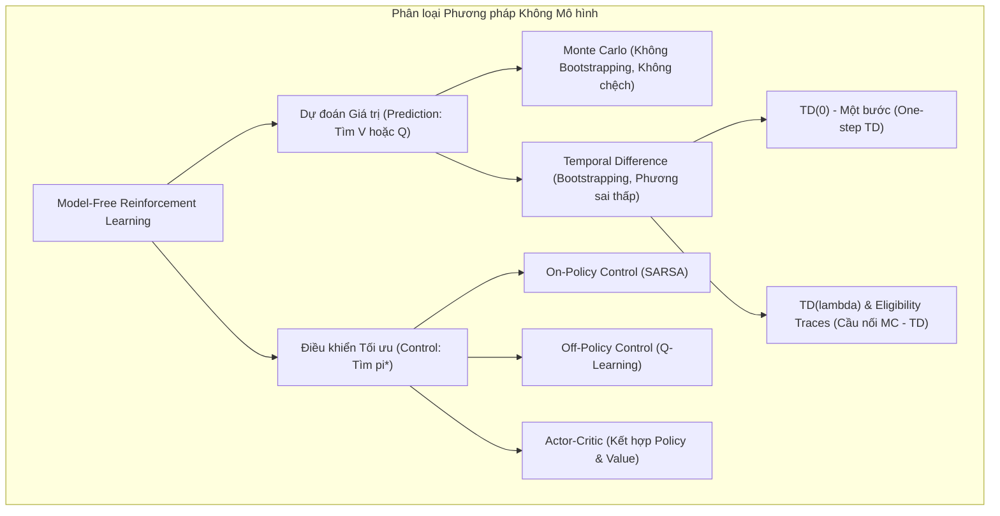

---

## 2. Chi tiết từng Keyword

---

### 1. Model-Based Reinforcement Learning (Học tăng cường Dựa trên Mô hình)

#### a. Định nghĩa Bản chất Toán học (Mathematical Formulation)
Model-Based RL là trường phái mà Agent chủ động học hoặc đã được cung cấp trước một mô hình biểu diễn động lực học của môi trường $\mathcal{M} = (\hat{\mathcal{P}}, \hat{\mathcal{R}})$.
- Mô hình chuyển trạng thái: $\hat{\mathcal{P}}_\theta(s' \mid s, a) \approx \mathbb{P}(S_{t+1} = s' \mid S_t = s, A_t = a)$
- Mô hình phần thưởng: $\hat{\mathcal{R}}_\phi(s, a) \approx \mathbb{E}[R_{t+1} \mid S_t = s, A_t = a]$

Sau khi đã có $\mathcal{M}$, Agent tối ưu chính sách thông qua hai cơ chế chính:
1. **Quy hoạch Động / Lập kế hoạch (Planning)**: Sử dụng các thuật toán như Tìm kiếm Cây Monte Carlo (MCTS) hoặc Điều khiển Dự báo Mô hình (Model Predictive Control - MPC):
$$a_t^* = \arg\max_{a_t, \dots, a_{t+H}} \sum_{k=0}^H \gamma^k \hat{\mathcal{R}}(s_{t+k}, a_{t+k}), \quad \text{với } s_{t+k+1} \sim \hat{\mathcal{P}}(\cdot \mid s_{t+k}, a_{t+k})$$
2. **Tạo dữ liệu Tưởng tượng (Imagined Rollouts / Hallucination - Dyna Architecture)**: Sinh ra hàng triệu mẫu chuyển trạng thái giả lập bên trong bộ nhớ để huấn luyện hàm giá trị.

#### b. Cơ chế Tầng Sâu & Điện toán (Under The Hood / Hardware Internals)
- **High Computational Efficiency via GPU Parallelism**: Một mô hình World Model tham số hóa bằng Mạng nơ-ron hồi quy (Recurrent State Space Model - RSSM như trong DreamerV3) cho phép sinh song song hàng chục nghìn quỹ đạo giả lập trên bộ nhớ VRAM của GPU mà không phải chịu độ trễ I/O vật lý của môi trường thực (nhanh hơn từ $100\times$ đến $1000\times$).

#### c. Sơ đồ Minh họa (Mermaid Diagram)
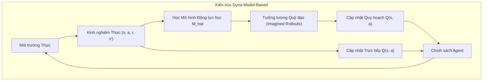

#### d. Code Thực chiến (Dual-Engine: C++ & Python)

```cpp
// C++20: Mô hình Chuyển trạng thái Gaussian tất định tuyến tính (Linear Model-Based Step)
#include <iostream>
#include <vector>

class DeterministicLinearModel {
private:
    float A{0.95f}; // He so suy giam vi tri
    float B{0.1f};  // He so gia toc hanh dong
    float R_coeff{-0.05f}; // Chi phi nang luong hanh dong

public:
    std::pair<float, float> predict(float state, float action) const noexcept {
        float next_state = A * state + B * action;
        float reward = - (state * state) + R_coeff * (action * action);
        return {next_state, reward};
    }
};

int main() {
    DeterministicLinearModel model;
    float s = 1.0f;
    float a = -0.5f;
    auto [s_next, r] = model.predict(s, a);
    std::cout << "[C++] Model-Based Prediction -> Next State: " << s_next << " | Reward: " << r << "\n";
    return 0;
}
```

```python
# Python / PyTorch: World Model học Động lực học bằng Mạng Nơ-ron Đa tầng (MLP Ensemble)
import torch
import torch.nn as nn

class WorldDynamicsModel(nn.Module):
    def __init__(self, state_dim: int, action_dim: int):
        super().__init__()
        self.net = nn.Sequential(
            nn.Linear(state_dim + action_dim, 64),
            nn.SiLU(),
            nn.Linear(64, state_dim + 1) # Output: [next_state, reward]
        )

    def forward(self, state: torch.Tensor, action: torch.Tensor):
        x = torch.cat([state, action], dim=-1)
        out = self.net(x)
        next_state = out[:, :-1]
        reward = out[:, -1:]
        return next_state, reward

model = WorldDynamicsModel(state_dim=2, action_dim=1)
s = torch.randn(4, 2)
a = torch.randn(4, 1)
pred_s, pred_r = model(s, a)
print(f"[PyTorch] Imagined Next States Shape: {pred_s.shape}, Rewards: {pred_r.squeeze().detach().numpy()}")
```

#### e. Lỗi Thường gặp & Ổn định Số học (Pitfalls & Numerical Stability)
- **Model Exploitation (Lỗi Khai thác Mô hình)**: Khi mô hình $\hat{\mathcal{P}}$ có sai số dự báo nhỏ, thuật toán quy hoạch sẽ vô tình tìm ra những hành động khai thác đúng vào điểm sai sót đó (vùng không gian mà mô hình ảo tưởng đem lại phần thưởng cực cao), dẫn đến việc chính sách thất bại thảm hại khi đưa ra môi trường thực. Giải pháp: Sử dụng Ensemble of Models và thêm hình phạt độ bất định (Epistemic Uncertainty Penalty).

#### f. Ứng dụng Thực chiến trong AI / Deep Learning
- **MuZero & AlphaZero**: Lập kế hoạch cây Monte Carlo ẩn trên biểu diễn latent vector của trạng thái, làm chủ cờ vua, shogi, cờ vây và nén video (YouTube encoding optimization).
- **DreamerV1/V2/V3**: Làm chủ điều khiển robot và phá đảo game Minecraft từ dữ liệu pixel mà không cần hướng dẫn của con người.

---

### 2. Model-Free Reinforcement Learning (Học tăng cường Không mô hình)

#### a. Định nghĩa Bản chất Toán học (Mathematical Formulation)
Model-Free RL là phương pháp tối ưu hóa trực tiếp hàm giá trị hoặc chính sách mà **hoàn toàn không cố gắng xấp xỉ xác suất chuyển trạng thái $\mathcal{P}(s' \mid s, a)$ hay hàm phần thưởng $\mathcal{R}(s, a)$**.

Agent coi môi trường như một chiếc hộp đen (Black-box Oracle). Agent chỉ có thể gửi hành động $A_t$ và nhận lại mẫu phản hồi $(S_{t+1}, R_{t+1}) \sim \text{Environment}(S_t, A_t)$. 

Hội tụ của các thuật toán Model-Free dựa trên lý thuyết Xấp xỉ Ngẫu nhiên (Stochastic Approximation Theory - Robbins & Monro, 1951):
$$\theta_{t+1} = \theta_t + \alpha_t \left[ \text{Target}_t - \theta_t \right]$$
Với điều kiện Robbins-Monro bảo đảm hội tụ hầu chắc chắn (Almost Sure Convergence):
$$\sum_{t=1}^\infty \alpha_t = \infty \quad \text{và} \quad \sum_{t=1}^\infty \alpha_t^2 < \infty$$

#### b. Cơ chế Tầng Sâu & Điện toán (Under The Hood / Hardware Internals)
- **Sample Inefficiency vs Computational Simplicity**: Model-Free RL tiêu tốn hàng triệu bước lấy mẫu (Sample Inefficient) do phải dựa vào luật số lớn để trung bình hóa nhiễu ngẫu nhiên. Tuy nhiên, mỗi bước cập nhật có độ phức tạp thuật toán cực kỳ thấp ($\mathcal{O}(1)$ với Tabular hoặc một lượt lan truyền xuôi/ngược FP32 với GPU), không tốn RAM duy trì ma trận chuyển trạng thái hay chạy cây tìm kiếm phân nhánh đắt đỏ.

#### c. Sơ đồ Minh họa (Mermaid Diagram)
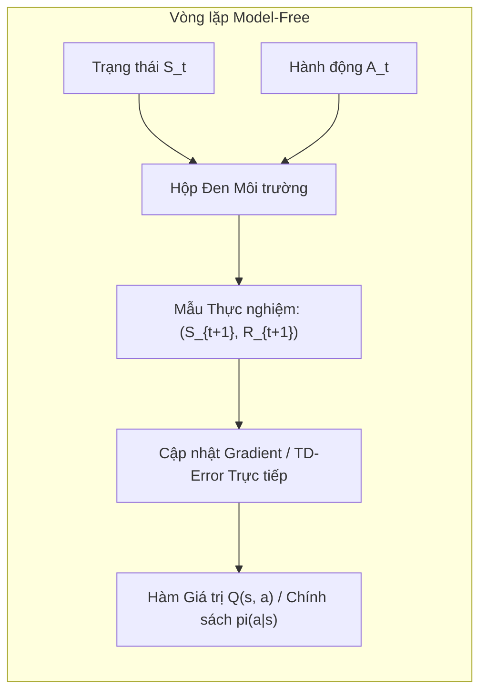

#### d. Code Thực chiến (Dual-Engine: C++ & Python)

```cpp
// C++20: Cập nhật hàm giá trị trung bình mẫu thuần túy không cần biết quy luật chuyển trạng thái
#include <iostream>
#include <vector>

class ModelFreeMeanEstimator {
private:
    float estimated_value{0.0f};
    size_t sample_count{0};

public:
    void observe(float observed_return) {
        sample_count++;
        // Cong thuc cap nhat trung binh online: mu_n = mu_{n-1} + (1/n) * (x_n - mu_{n-1})
        estimated_value += (observed_return - estimated_value) / sample_count;
    }

    [[nodiscard]] float get_value() const noexcept { return estimated_value; }
};

int main() {
    ModelFreeMeanEstimator estimator;
    float returns[] = {2.0f, 4.0f, 1.0f, 5.0f, 3.0f};
    for (float g : returns) {
        estimator.observe(g);
    }
    std::cout << "[C++] Model-Free Value Estimate: " << estimator.get_value() << "\n";
    return 0;
}
```

```python
# Python / NumPy: Cập nhật xấp xỉ ngẫu nhiên Model-Free Robbins-Monro
import numpy as np

class RobbinsMonroEstimator:
    def __init__(self, initial_val: float = 0.0):
        self.val = initial_val
        self.t = 0

    def step(self, sample: float):
        self.t += 1
        # Toc do hoc alpha_t thoa man dieu kien Robbins-Monro: alpha_t = 1 / t^0.6
        alpha_t = 1.0 / (self.t ** 0.6)
        td_error = sample - self.val
        self.val += alpha_t * td_error
        return self.val

estimator = RobbinsMonroEstimator()
samples = np.random.normal(loc=10.0, scale=2.0, size=100)
for s in samples:
    v = estimator.step(s)
print(f"[Python] Ước lượng Robbins-Monro sau 100 mẫu (Kỳ vọng ~ 10): {v:.4f}")
```

#### e. Lỗi Thường gặp & Ổn định Số học (Pitfalls & Numerical Stability)
- **High Variance in Stochastic Environments**: Khi môi trường có độ ngẫu nhiên cao (ví dụ xác suất xúc xắc trúng thưởng phân tán rộng), việc học hoàn toàn không có mô hình đòi hỏi số lượng mẫu khổng lồ, dễ sa lầy vào dao động ngẫu nhiên nếu hệ số học $\alpha$ không giảm dần theo thời gian.

#### f. Ứng dụng Thực chiến trong AI / Deep Learning
- Là phương pháp mặc định để huấn luyện các tác nhân chơi game phức tạp từ màn hình pixel (như Atari 2600 qua DQN, VizDoom qua A3C).

---

### 3. Policy-Based Methods (Phương pháp Dựa trên Chính sách)

#### a. Định nghĩa Bản chất Toán học (Mathematical Formulation)
Phương pháp Dựa trên Chính sách tối ưu hóa trực tiếp không gian tham số của chính sách $\pi_\theta(a \mid s)$ thông qua việc leo đồi gradient trên hàm mục tiêu hiệu năng $J(\theta)$:
$$\theta_{t+1} = \theta_t + \alpha \nabla_\theta J(\theta_t)$$
Hàm mục tiêu được định nghĩa là kỳ vọng tổng lợi nhuận:
$$J(\theta) = \mathbb{E}_{\tau \sim \pi_\theta} \left[ R(\tau) \right] = \int P(\tau; \theta) R(\tau) \, d\tau$$

**Ưu điểm vượt trội so với Value-Based**:
1. Xử lý tự nhiên không gian hành động liên tục $\mathcal{A} \subseteq \mathbb{R}^d$ (không cần tính $\arg\max_{a}$ vốn là bài toán tối ưu phi tuyến cực kỳ đắt đỏ tại mỗi bước suy luận).
2. Có thể học được **chính sách ngẫu nhiên tối ưu (Optimal Stochastic Policy)** trong các bài toán thông tin không hoàn hảo (như Oẳn tù tì - Rock Paper Scissors hoặc bài toán State Aliasing).

#### b. Cơ chế Tầng Sâu & Điện toán (Under The Hood / Hardware Internals)
- **Zero-Copy Tensor Slicing in Continuous Action Sampling**: Khi mạng Actor xuất ra vector kỳ vọng $\boldsymbol{\mu} \in \mathbb{R}^{B \times D}$ và độ lệch chuẩn $\boldsymbol{\sigma} \in \mathbb{R}^{B \times D}$ cho một batch gồm $B$ môi trường, việc thực hiện phép toán Reparameterization Trick $\mathbf{a} = \boldsymbol{\mu} + \boldsymbol{\sigma} \odot \boldsymbol{\epsilon}$ (với $\boldsymbol{\epsilon} \sim \mathcal{N}(0, \mathbf{I})$) được thực thi bằng một kernel Fused Element-wise CUDA duy nhất, giảm thiểu tối đa việc ghi dữ liệu trung gian vào bộ nhớ toàn cục (Global VRAM).

#### c. Sơ đồ Minh họa (Mermaid Diagram)
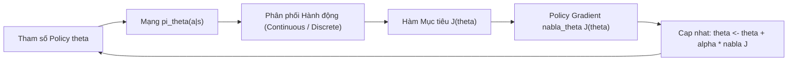

#### d. Code Thực chiến (Dual-Engine: C++ & Python)

```cpp
// C++20: Gradient Log-Likelihood của Chính sách Gauss 1 chiều
#include <iostream>
#include <cmath>

struct GaussianPolicyGrad {
    float grad_mu;
    float grad_log_std;
};

GaussianPolicyGrad compute_gaussian_log_grad(float action, float mu, float log_std) {
    float std_dev = std::exp(log_std);
    float diff = action - mu;
    float var = std_dev * std_dev;

    // nabla_mu log N(a; mu, sigma) = (a - mu) / sigma^2
    float g_mu = diff / var;
    // nabla_log_sigma log N(a; mu, sigma) = ((a - mu)^2 / sigma^2) - 1
    float g_log_std = (diff * diff / var) - 1.0f;

    return {g_mu, g_log_std};
}

int main() {
    auto grad = compute_gaussian_log_grad(1.5f, 1.0f, 0.0f); // mu=1, std=1, action=1.5
    std::cout << "[C++] Grad w.r.t Mu: " << grad.grad_mu 
              << " | Grad w.r.t Log-Std: " << grad.grad_log_std << "\n";
    return 0;
}
```

```python
# Python / PyTorch: Tối ưu hóa hàm mục tiêu Policy-Based trực tiếp
import torch
import torch.nn as nn
from torch.distributions import Normal

class ContinuousPolicy(nn.Module):
    def __init__(self, state_dim: int, action_dim: int):
        super().__init__()
        self.mu_net = nn.Linear(state_dim, action_dim)
        self.log_std = nn.Parameter(torch.zeros(action_dim))

    def forward(self, state: torch.Tensor):
        mu = self.mu_net(state)
        std = torch.exp(self.log_std)
        return Normal(mu, std)

policy = ContinuousPolicy(state_dim=4, action_dim=2)
optimizer = torch.optim.Adam(policy.parameters(), lr=1e-3)

# Gia lap 1 buoc cap nhat policy voi loi nhuan G_t = 5.0
state = torch.randn(1, 4)
dist = policy(state)
action = dist.sample()
log_prob = dist.log_prob(action).sum()

loss = - log_prob * 5.0 # Objective: Maximizing J(theta) <=> Minimizing -log_prob * G
optimizer.zero_grad()
loss.backward()
optimizer.step()
print(f"[PyTorch] Policy Updated. Log-Prob: {log_prob.item():.4f}, Loss: {loss.item():.4f}")
```

#### e. Lỗi Thường gặp & Ổn định Số học (Pitfalls & Numerical Stability)
- **Hội tụ về Cực tiểu Cục bộ (Local Optima)**: Các phương pháp thuần Policy-Based rất dễ bị mắc kẹt vào các chính sách dưới mức tối ưu do bản chất tìm kiếm gradient cục bộ.
- **Bước nhảy Quá lớn (Destructive Policy Step)**: Nếu bước học $\alpha$ quá lớn, phân phối chính sách mới có thể rơi vào vùng hoàn toàn tồi tệ, khiến Agent không thể thu thập thêm dữ liệu hữu ích để hồi phục lại. Đây là lý do TRPO và PPO ra đời để kẹp kích thước bước cập nhật.

#### f. Ứng dụng Thực chiến trong AI / Deep Learning
- Điều khiển bước chân cho robot 4 chân (Boston Dynamics Spot, Unitree Go2) trên các địa hình gồ ghề.

---

### 4. Value-Based Methods (Phương pháp Dựa trên Giá trị)

#### a. Định nghĩa Bản chất Toán học (Mathematical Formulation)
Phương pháp Dựa trên Giá trị gián tiếp tối ưu hóa hành vi của Agent bằng cách học hàm giá trị hành động $Q(s, a)$. Chính sách hành động không được tham số hóa riêng biệt mà được suy diễn mang tính tất định từ hàm Q thông qua toán tử tham lam:
$$\pi(s) = \arg\max_{a \in \mathcal{A}} Q(s, a)$$
Hoặc thông qua chính sách thăm dò $\epsilon$-tham lam ($\epsilon$-greedy):
$$\pi(a \mid s) = \begin{cases} 1 - \epsilon + \frac{\epsilon}{|\mathcal{A}|} & \text{nếu } a = \arg\max_{a'} Q(s, a') \\ \frac{\epsilon}{|\mathcal{A}|} & \text{ngược lại} \end{cases}$$

Mục tiêu học tập là tối thiểu hóa Sai số Bellman (Bellman Error):
$$\mathcal{L}(\theta) = \mathbb{E}_{(s, a, r, s')} \left[ \left( r + \gamma \max_{a'} Q_{\theta^-}(s', a') - Q_\theta(s, a) \right)^2 \right]$$

#### b. Cơ chế Tầng Sâu & Điện toán (Under The Hood / Hardware Internals)
- **Off-Policy Sample Reuse via Replay Buffer**: Ưu thế vượt bậc của Value-Based methods là tính chất Off-Policy (học ngoài chính sách). Agent có thể tái sử dụng dữ liệu từ các chính sách cũ cách đó hàng triệu bước được lưu trong bộ đệm Replay Buffer (DRAM/VRAM), giúp hiệu quả sử dụng mẫu (Sample Efficiency) vượt trội hơn hẳn so với Policy-Based thuần túy (On-policy).

#### c. Sơ đồ Minh họa (Mermaid Diagram)
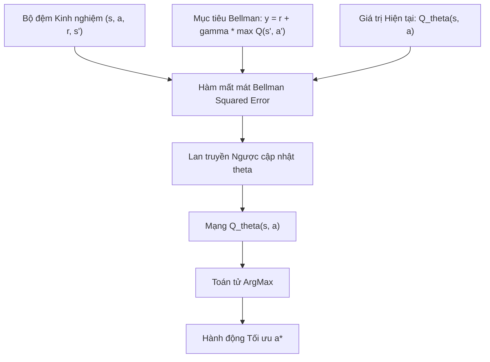

#### d. Code Thực chiến (Dual-Engine: C++ & Python)

```cpp
// C++20: Cập nhật hàm Q theo thuật toán Q-Learning cơ bản
#include <iostream>
#include <vector>
#include <algorithm>

class SimpleValueBasedLearner {
private:
    float alpha{0.1f};
    float gamma{0.9f};
    std::vector<float> q_table; // [num_states * num_actions]
    size_t num_actions{2};

public:
    SimpleValueBasedLearner(size_t s, size_t a) : num_actions(a), q_table(s * a, 0.0f) {}

    void update(size_t s, size_t a, float r, size_t next_s) {
        // Tim max Q(next_s, a')
        const float* next_row = &q_table[next_s * num_actions];
        float max_next_q = *std::max_element(next_row, next_row + num_actions);

        // Bellman TD update
        float& current_q = q_table[s * num_actions + a];
        float td_target = r + gamma * max_next_q;
        float td_error = td_target - current_q;
        current_q += alpha * td_error;
    }

    [[nodiscard]] float get_q(size_t s, size_t a) const noexcept {
        return q_table[s * num_actions + a];
    }
};

int main() {
    SimpleValueBasedLearner learner(3, 2);
    learner.update(0, 1, 10.0f, 1);
    std::cout << "[C++] Q(0, 1) sau buoc cap nhat: " << learner.get_q(0, 1) << "\n";
    return 0;
}
```

```python
# Python / PyTorch: Lớp Value-Based Q-Learning sử dụng MSE Loss
import torch
import torch.nn as nn

class QValueAgent(nn.Module):
    def __init__(self, state_dim: int, action_dim: int):
        super().__init__()
        self.q_net = nn.Sequential(
            nn.Linear(state_dim, 32),
            nn.ReLU(),
            nn.Linear(32, action_dim)
        )

    def select_action(self, state: torch.Tensor, epsilon: float = 0.05) -> int:
        if torch.rand(1).item() < epsilon:
            return torch.randint(0, self.q_net[-1].out_features, (1,)).item()
        with torch.no_grad():
            q_vals = self.q_net(state)
            return torch.argmax(q_vals, dim=-1).item()

agent = QValueAgent(state_dim=4, action_dim=2)
dummy_s = torch.randn(1, 4)
act = agent.select_action(dummy_s)
print(f"[PyTorch] Action selected by Value-Based Epsilon-Greedy: {act}")
```

#### e. Lỗi Thường gặp & Ổn định Số học (Pitfalls & Numerical Stability)
- **Không thể biểu diễn trực tiếp Không gian Hành động Liên tục**: Với $\mathcal{A} \subseteq \mathbb{R}^d$, việc tìm $\arg\max_a Q(s, a)$ đòi hỏi phải chạy tối ưu hóa gradient descent lặp nội tại ở mỗi bước hành động, làm tăng độ trễ tính toán lên hàng nghìn lần và không thể đáp ứng thời gian thực.

#### f. Ứng dụng Thực chiến trong AI / Deep Learning
- Chơi các trò chơi bàn cờ hoặc game console cổ điển với số nút bấm hữu hạn (DQN chơi Nintendo Game Boy, Atari).

---

### 5. Actor-Critic Methods (Phương pháp Actor-Critic)

#### a. Định nghĩa Bản chất Toán học (Mathematical Formulation)
Phương pháp Actor-Critic hợp nhất hai trường phái Policy-Based và Value-Based để phát huy tối đa ưu điểm và triệt tiêu nhược điểm của cả hai:
1. **Actor (Diễn viên)**: Đóng vai trò chính sách $\pi_\theta(a \mid s)$, quyết định hành động đưa ra. Tham số $\theta$ được cập nhật theo hướng đạo hàm chính sách có trọng số bởi hàm đánh giá:
$$\nabla_\theta J(\theta) = \mathbb{E}_{\pi_\theta} \left[ \nabla_\theta \log \pi_\theta(A_t \mid S_t) A(S_t, A_t) \right]$$
2. **Critic (Nhà phê bình)**: Đóng vai trò hàm giá trị (thường là $V_\phi(s)$ hoặc $Q_\phi(s, a)$), chịu trách nhiệm đánh giá mức độ tốt/xấu của hành động mà Actor vừa thực hiện bằng việc tính toán Hàm Lợi thế (Advantage Function):
$$A(S_t, A_t) = Q(S_t, A_t) - V(S_t) \approx R_{t+1} + \gamma V_\phi(S_{t+1}) - V_\phi(S_t) = \delta_t$$

Critic loại bỏ nhu cầu chờ hết episode của Monte Carlo, biến thuật toán thành trực tuyến (Online) và giảm mạnh phương sai của Actor.

#### b. Cơ chế Tầng Sâu & Điện toán (Under The Hood / Hardware Internals)
- **Two-Headed Architecture vs Independent Models**: Trong các mô hình hiện đại (như A2C/PPO), mạng Actor và Critic có thể thiết kế theo dạng:
  1. *Two-Headed (Chung thân)*: Một mạng trích xuất đặc trưng chung (Shared CNN/Transformer) chia sẻ trọng số, sau đó rẽ thành 2 đầu output độc lập. Cách này giảm một nửa số phép tính GEMM trên GPU nhưng có nguy cơ xung đột gradient giữa nhiệm vụ Actor và Critic.
  2. *Two-Independent*: Hai mạng riêng biệt hoàn toàn. Ổn định hơn về mặt tối ưu số học nhưng ngốn gấp đôi VRAM và thông lượng tính toán.

#### c. Sơ đồ Minh họa (Mermaid Diagram)
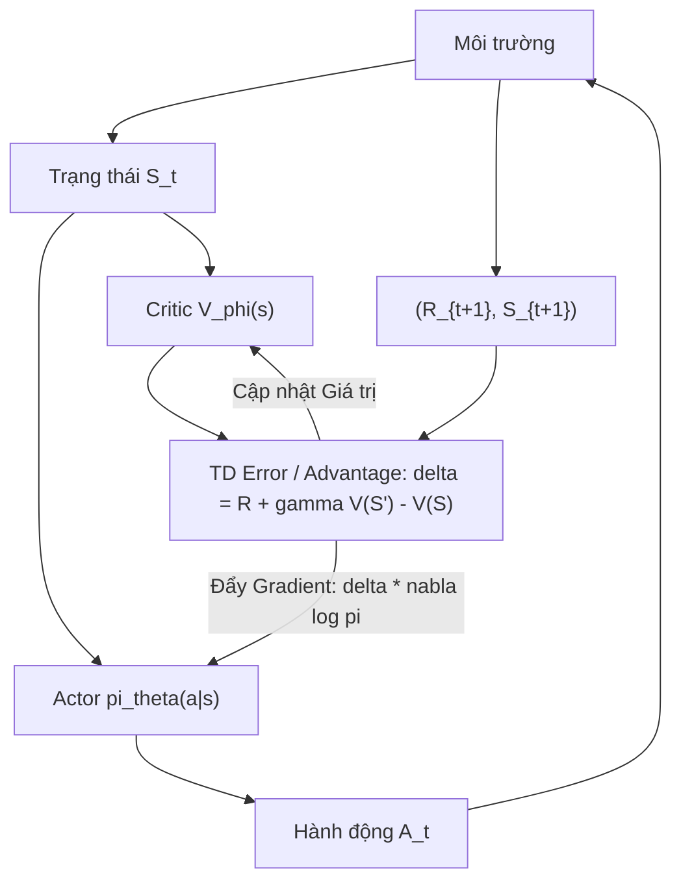

#### d. Code Thực chiến (Dual-Engine: C++ & Python)

```cpp
// C++20: Khung tính toán cập nhật một bước Actor-Critic (One-Step TD Actor-Critic)
#include <iostream>
#include <cmath>

struct ActorCriticUpdate {
    float actor_grad_step;
    float critic_loss;
};

ActorCriticUpdate compute_actor_critic_step(float reward, float gamma, float v_current, float v_next, float log_prob_action) {
    // 1. Tinh TD Error / Advantage dong vai tro nha phe binh
    float td_target = reward + gamma * v_next;
    float delta = td_target - v_current;

    // 2. Tinh buoc day cho Actor
    float actor_step = log_prob_action * delta;

    // 3. Loss cho Critic
    float critic_loss = 0.5f * delta * delta;

    return {actor_step, critic_loss};
}

int main() {
    auto res = compute_actor_critic_step(1.0f, 0.99f, 2.5f, 3.0f, -0.693f);
    std::cout << "[C++] Actor Gradient Step: " << res.actor_grad_step 
              << " | Critic MSE Loss: " << res.critic_loss << "\n";
    return 0;
}
```

```python
# Python / PyTorch: Pipeline Actor-Critic hoàn chỉnh chia sẻ tầng đầu
import torch
import torch.nn as nn
from torch.distributions import Categorical

class ActorCriticNetwork(nn.Module):
    def __init__(self, state_dim: int, action_dim: int):
        super().__init__()
        self.backbone = nn.Sequential(nn.Linear(state_dim, 64), nn.Tanh())
        self.actor_head = nn.Linear(64, action_dim)
        self.critic_head = nn.Linear(64, 1)

    def forward(self, state: torch.Tensor):
        feat = self.backbone(state)
        logits = self.actor_head(feat)
        value = self.critic_head(feat)
        return Categorical(logits=logits), value.squeeze(-1)

ac_net = ActorCriticNetwork(state_dim=4, action_dim=2)
state = torch.randn(1, 4)
next_state = torch.randn(1, 4)
reward = 1.0
gamma = 0.99

dist, value = ac_net(state)
action = dist.sample()
log_prob = dist.log_prob(action)

with torch.no_grad():
    _, next_value = ac_net(next_state)
    td_target = reward + gamma * next_value
    advantage = td_target - value

actor_loss = - log_prob * advantage.detach()
critic_loss = 0.5 * (td_target.detach() - value).pow(2)
total_loss = actor_loss + critic_loss

print(f"[PyTorch] Total AC Loss: {total_loss.item():.4f} (Actor: {actor_loss.item():.4f}, Critic: {critic_loss.item():.4f})")
```

#### e. Lỗi Thường gặp & Ổn định Số học (Pitfalls & Numerical Stability)
- **Gradient Interference in Shared Backbone**: Khi Critic cố gắng giảm nhanh sai số MSE của hàm giá trị, gradient rất mạnh từ nhánh Critic có thể phá hủy các biểu diễn đặc trưng có ích mà Actor đã dày công xây dựng. Khắc phục bằng cách nhân hệ số cân bằng `value_loss_coef = 0.5` và sử dụng `orthogonal_initialization`.

#### f. Ứng dụng Thực chiến trong AI / Deep Learning
- Nền tảng của các thuật toán state-of-the-art: PPO, SAC, A3C áp dụng từ huấn luyện trực thăng nhào lộn đến các mô hình sinh ảnh diffusion guided by RL.

---

### 6. Monte Carlo Methods (Phương pháp Monte Carlo)

#### a. Định nghĩa Bản chất Toán học (Mathematical Formulation)
Phương pháp Monte Carlo (MC) học hàm giá trị trực tiếp từ các kinh nghiệm theo hồi hoàn chỉnh (Complete Episodes). Điểm đặc thù của MC là **hoàn toàn không sử dụng Bootstrapping**:
$$V(S_t) \leftarrow V(S_t) + \alpha \left[ G_t - V(S_t) \right]$$
Trong đó $G_t = \sum_{k=0}^{T-t-1} \gamma^k R_{t+k+1}$ là tổng lợi nhuận thực tế quan sát được từ bước $t$ đến khi chạm trạng thái kết thúc $T$.

Hai biến thể đánh giá:
1. **Lần ghé thăm đầu tiên (First-Visit MC)**: Chỉ ghi nhận $G_t$ cho trạng thái $s$ tại lần đầu tiên $s$ xuất hiện trong episode.
2. **Mọi lần ghé thăm (Every-Visit MC)**: Ghi nhận $G_t$ tại mọi thời điểm trạng thái $s$ xuất hiện trong episode.

Theo Luật Số Lớn (Law of Large Numbers), khi số lượng episode $N \to \infty$:
$$V(s) = \frac{1}{N} \sum_{i=1}^N G_t^{(i)}(s) \xrightarrow{a.s.} \mathbb{E}_\pi [G_t \mid S_t = s]$$
Ưu điểm: **Không chệch (Unbiased, $\mathbb{E}[G_t] = V^\pi(S_t)$)**.
Nhược điểm: **Phương sai cực cao (High Variance)** do tích lũy nhiều biến ngẫu nhiên dọc theo toàn bộ episode.

#### b. Cơ chế Tầng Sâu & Điện toán (Under The Hood / Hardware Internals)
- **Episodic Memory Overhead**: Vì không thể cập nhật theo thời gian thực (Online Step-by-Step), toàn bộ lịch sử trạng thái, hành động và phần thưởng của một episode phải được giữ trên bộ nhớ RAM cho đến khi episode kết thúc. Với các tác vụ dài hàng triệu bước, điều này có thể gây áp lực lớn lên bộ nhớ đệm cache và dung lượng RAM của hệ thống.

#### c. Sơ đồ Minh họa (Mermaid Diagram)
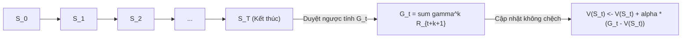

#### d. Code Thực chiến (Dual-Engine: C++ & Python)

```cpp
// C++20: First-Visit Monte Carlo Prediction cho một chuỗi Episode
#include <iostream>
#include <vector>
#include <unordered_map>
#include <unordered_set>

struct Step {
    int state;
    float reward;
};

class FirstVisitMonteCarlo {
private:
    float gamma{0.9f};
    std::unordered_map<int, float> V;
    std::unordered_map<int, int> counts;

public:
    void process_episode(const std::vector<Step>& episode) {
        float G = 0.0f;
        std::unordered_set<int> visited_states;
        const int n = static_cast<int>(episode.size());
        std::vector<float> returns(n, 0.0f);

        // Duyet nguoc de tinh returns
        for (int t = n - 1; t >= 0; --t) {
            G = episode[t].reward + gamma * G;
            returns[t] = G;
        }

        // First-visit check
        for (int t = 0; t < n; ++t) {
            int s = episode[t].state;
            if (visited_states.find(s) == visited_states.end()) {
                visited_states.insert(s);
                counts[s]++;
                V[s] += (returns[t] - V[s]) / counts[s];
            }
        }
    }

    void dump_values() const {
        for (const auto& [s, val] : V) {
            std::cout << "[C++] State " << s << " -> MC Value: " << val << " (Visits: " << counts.at(s) << ")\n";
        }
    }
};

int main() {
    FirstVisitMonteCarlo mc;
    std::vector<Step> ep1 = {{1, 1.0f}, {2, 2.0f}, {3, 10.0f}};
    mc.process_episode(ep1);
    mc.dump_values();
    return 0;
}
```

```python
# Python / NumPy: Every-Visit Monte Carlo Prediction
import numpy as np

def every_visit_mc(episodes, gamma=0.9):
    values = {}
    counts = {}

    for episode in episodes:
        # episode la list cac tuple (state, reward)
        G = 0.0
        # Duyet nguoc tinh toan Return
        for s, r in reversed(episode):
            G = r + gamma * G
            if s not in values:
                values[s] = 0.0
                counts[s] = 0
            counts[s] += 1
            values[s] += (G - values[s]) / counts[s]
            
    return values

sample_episodes = [
    [('A', 1.0), ('B', 0.0), ('C', 10.0)],
    [('B', 2.0), ('C', 5.0)]
]
val_dict = every_visit_mc(sample_episodes)
print(f"[Python] Every-Visit MC Values: {val_dict}")
```

#### e. Lỗi Thường gặp & Ổn định Số học (Pitfalls & Numerical Stability)
- **Hoàn toàn Bất lực trên Tác vụ Vô hạn (Continuing Tasks)**: Vì MC yêu cầu episode phải kết thúc để có giá trị $G_t$, phương pháp này không thể áp dụng cho các hệ thống công nghiệp chạy liên tục 24/7 (như quản lý trạm biến áp, điều phối máy chủ đám mây).

#### f. Ứng dụng Thực chiến trong AI / Deep Learning
- Phương pháp Monte Carlo Tree Search (MCTS) trong AlphaGo và thuật toán REINFORCE cơ bản.

---

### 7. Temporal Difference Learning (Học Sai phân Thời gian)

#### a. Định nghĩa Bản chất Toán học (Mathematical Formulation)
Học Sai phân Thời gian (Temporal Difference - TD Learning) là sự kết hợp tinh hoa giữa hai ý tưởng:
1. **Lấy mẫu thực nghiệm từ Monte Carlo**: Học trực tiếp từ kinh nghiệm mà không cần mô hình động lực học $\mathcal{P}$.
2. **Bootstrapping từ Quy hoạch động**: Cập nhật giá trị trạng thái dựa trên các ước lượng giá trị của các trạng thái tương lai mà không cần chờ toàn bộ episode kết thúc.

Công thức cập nhật tổng quát của TD Learning:
$$\text{NewEstimate} \leftarrow \text{OldEstimate} + \alpha \left[ \text{Target} - \text{OldEstimate} \right]$$
Trong đó $[\text{Target} - \text{OldEstimate}]$ được gọi là **Sai số TD (TD Error)**.

**Sự đánh đổi Bias - Variance giữa DP, MC và TD**:
- **Dynamic Programming (DP)**: Zero Sampling Variance, High Model Reliance.
- **Monte Carlo (MC)**: Zero Bias, High Variance.
- **Temporal Difference (TD)**: Có một lượng độ chệch nhỏ (Low-to-Medium Bias - do dùng hàm giá trị chưa hoàn thiện để bootstrap), nhưng **Phương sai thấp hơn nhiều so với MC (Low Variance)** vì chỉ phụ thuộc vào tính ngẫu nhiên của một bước chuyển thay vì cả chuỗi dài.

#### b. Cơ chế Tầng Sâu & Điện toán (Under The Hood / Hardware Internals)
- **Ring Buffer for Online Stream Processing**: TD Learning chỉ yêu cầu thông tin của bộ chuyển tiếp tức thời $(S_t, A_t, R_{t+1}, S_{t+1})$. Điều này cho phép tổ chức bộ nhớ dưới dạng Bộ đệm Vòng tròn (Circular Ring Buffer) có kích thước cố định, loại bỏ hoàn toàn hiện tượng phân mảnh bộ nhớ (Memory Fragmentation) và liên tục tái sử dụng bộ đệm L1/L2 Cache của CPU.

#### c. Sơ đồ Minh họa (Mermaid Diagram)
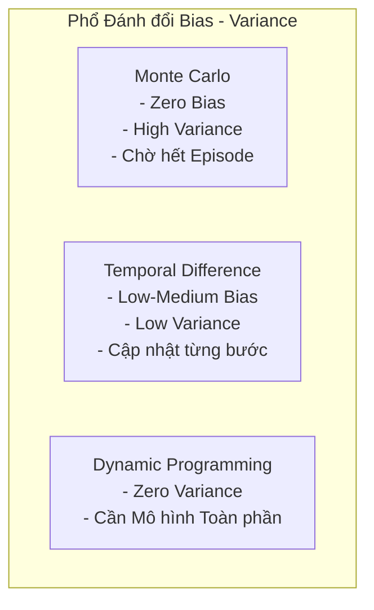

#### d. Code Thực chiến (Dual-Engine: C++ & Python)

```cpp
// C++20: Bộ đệm tròn (Circular Ring Buffer) phục vụ cập nhật TD Stream
#include <iostream>
#include <array>

struct TransitionSample {
    int s;
    float r;
    int s_next;
};

template<size_t Capacity>
class CircularTDStream {
private:
    std::array<TransitionSample, Capacity> buffer;
    size_t head{0};
    size_t size{0};

public:
    void push(int s, float r, int s_next) {
        buffer[head] = {s, r, s_next};
        head = (head + 1) % Capacity;
        if (size < Capacity) size++;
    }

    const TransitionSample& latest() const {
        size_t idx = (head == 0) ? Capacity - 1 : head - 1;
        return buffer[idx];
    }
};

int main() {
    CircularTDStream<16> stream;
    stream.push(1, 2.5f, 2);
    auto t = stream.latest();
    std::cout << "[C++] Latest Ring Transition: s=" << t.s << ", r=" << t.r << ", s'=" << t.s_next << "\n";
    return 0;
}
```

```python
# Python: So sánh độ lệch chuẩn giữa Monte Carlo và TD Updates
import numpy as np

def compare_variance(trials=1000):
    # Gia lap mot chuoi 10 buoc, moi buoc reward ~ Normal(1.0, 2.0)
    # MC Return tich luy phuong sai = 10 * Var(R) = 40.0
    # TD Target chi tich luy phuong sai 1 buoc = 4.0
    mc_returns = [np.sum(np.random.normal(1.0, 2.0, size=10)) for _ in range(trials)]
    td_targets = [np.random.normal(1.0, 2.0) + 0.9 * 10.0 for _ in range(trials)]

    print(f"[Python] MC Returns Std Dev: {np.std(mc_returns):.4f} (High Variance)")
    print(f"[Python] TD Targets Std Dev: {np.std(td_targets):.4f} (Low Variance)")

compare_variance()
```

#### e. Lỗi Thường gặp & Ổn định Số học (Pitfalls & Numerical Stability)
- **Bootstrapping on Biased Estimates**: Nếu giá trị khởi tạo $V_0(s)$ bị sai lệch nghiêm trọng, các bước cập nhật TD ban đầu sẽ kế thừa toàn bộ sai lệch đó, làm chậm quá trình hội tụ trong giai đoạn đầu (Warm-up phase).

#### f. Ứng dụng Thực chiến trong AI / Deep Learning
- Là cơ sở lý thuyết chi phối toàn bộ các kiến trúc RL hiện đại xử lý dòng dữ liệu liên tục theo thời gian thực (Real-time Stream AI).

---

### 8. TD(0) (Học Sai phân Thời gian Một bước)

#### a. Định nghĩa Bản chất Toán học (Mathematical Formulation)
TD(0) là dạng đơn giản nhất và phổ biến nhất của thuật toán Temporal Difference, trong đó bước nhìn về tương lai đúng bằng $1$ bước thời gian:
$$V(S_t) \leftarrow V(S_t) + \alpha \delta_t$$
Trong đó $\delta_t$ là **Sai số TD Một bước (One-Step TD Error)**:
$$\delta_t = R_{t+1} + \gamma V(S_{t+1}) - V(S_t)$$

Ý nghĩa các đại lượng:
- $R_{t+1} + \gamma V(S_{t+1})$: **Mục tiêu TD (TD Target)**, đại diện cho ước lượng không chệch của phần thưởng kế tiếp cộng với giá trị kỳ vọng của trạng thái tương lai.
- $V(S_t)$: Ước lượng hiện tại.
- $\delta_t$: Đo lường sự sai lệch giữa kỳ vọng cũ và thực tế trải nghiệm mới.

**Định lý Hội tụ của TD(0)**:
Dưới chính sách cố định $\pi$, nếu không gian trạng thái là hữu hạn và hệ số học $\alpha_t$ thỏa mãn điều kiện Robbins-Monro, thuật toán TD(0) hội tụ hầu chắc chắn (Almost Surely) về hàm giá trị thực $V^\pi$.

#### b. Cơ chế Tầng Sâu & Điện toán (Under The Hood / Hardware Internals)
- **Cache Friendly One-Step Lookup**: TD(0) chỉ cần truy xuất 2 phần tử trong bộ nhớ: $V[S_t]$ và $V[S_{t+1}]$. Điều này giảm thiểu tối đa tình trạng Cache Miss, bởi hai chỉ số này thường nằm gần nhau hoặc đã được nạp sẵn vào bộ đệm L1 thông qua cơ chế Hardware Prefetcher của CPU.

#### c. Sơ đồ Minh họa (Mermaid Diagram)
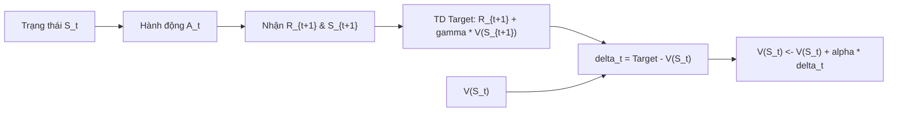

#### d. Code Thực chiến (Dual-Engine: C++ & Python)

```cpp
// C++20: Thuật toán TD(0) Tabular tối ưu hóa tốc độ thực thi
#include <iostream>
#include <vector>

class TD0Predictor {
private:
    float alpha{0.1f};
    float gamma{0.95f};
    std::vector<float> V;

public:
    explicit TD0Predictor(size_t num_states) : V(num_states, 0.0f) {}

    float step_update(size_t s, float reward, size_t next_s, bool done) {
        float next_val = done ? 0.0f : V[next_s];
        float td_target = reward + gamma * next_val;
        float td_error = td_target - V[s];
        V[s] += alpha * td_error;
        return td_error;
    }

    [[nodiscard]] float get_value(size_t s) const noexcept { return V[s]; }
};

int main() {
    TD0Predictor predictor(5);
    float err1 = predictor.step_update(0, 1.0f, 1, false);
    float err2 = predictor.step_update(1, 2.0f, 2, false);
    std::cout << "[C++] TD(0) Step 1 Error: " << err1 << " | V(0): " << predictor.get_value(0) << "\n";
    std::cout << "[C++] TD(0) Step 2 Error: " << err2 << " | V(1): " << predictor.get_value(1) << "\n";
    return 0;
}
```

```python
# Python / PyTorch: TD(0) Loss trong Mạng Critic nơ-ron sâu
import torch
import torch.nn as nn
import torch.nn.functional as F

class TD0ValueLearner:
    def __init__(self, state_dim: int, lr: float = 1e-3, gamma: float = 0.99):
        self.v_net = nn.Sequential(nn.Linear(state_dim, 32), nn.ReLU(), nn.Linear(32, 1))
        self.optimizer = torch.optim.Adam(self.v_net.parameters(), lr=lr)
        self.gamma = gamma

    def update(self, s: torch.Tensor, r: float, next_s: torch.Tensor, done: bool):
        # 1. Tinh Target dung no_grad de chan gradient chay qua bootstrap target
        with torch.no_grad():
            next_v = 0.0 if done else self.v_net(next_s).item()
            td_target = torch.tensor([[r + self.gamma * next_v]], dtype=torch.float32)

        # 2. Tinh Current Value va Loss
        current_v = self.v_net(s)
        loss = F.mse_loss(current_v, td_target)

        self.optimizer.zero_grad()
        loss.backward()
        self.optimizer.step()
        return loss.item()

learner = TD0ValueLearner(state_dim=2)
loss = learner.update(torch.tensor([[1.0, 0.5]]), 1.0, torch.tensor([[1.2, 0.6]]), False)
print(f"[PyTorch] TD(0) Step Loss: {loss:.6f}")
```

#### e. Lỗi Thường gặp & Ổn định Số học (Pitfalls & Numerical Stability)
- **Gradient Leaking qua Target**: Lỗi phổ biến nhất khi lập trình Deep RL là quên sử dụng `with torch.no_grad():` hoặc `.detach()` trên giá trị trạng thái tiếp theo $V(S_{t+1})$. Việc để gradient chảy qua cả hai nhánh sẽ làm biến dạng bài toán thành Semi-Gradient không hợp lệ và gây nổ trọng số mạng nơ-ron.

#### f. Ứng dụng Thực chiến trong AI / Deep Learning
- Cốt lõi của mô hình TD-Gammon (Gerald Tesauro, 1992) - hệ thống AI đầu tiên đánh bại đại kiện tướng cờ vua Backgammon thế giới.

---

### 9. TD(lambda) & Eligibility Traces (Dấu vết Đủ điều kiện)

#### a. Định nghĩa Bản chất Toán học (Mathematical Formulation)
$\text{TD}(\lambda)$ là một cầu nối liên tục tuyệt đẹp nối liền giữa $\text{TD}(0)$ ($\lambda = 0$) và Monte Carlo ($\lambda = 1$).

1. **Lợi nhuận $n$-bước ($n$-step Return)**:
$$G_t^{(n)} = R_{t+1} + \gamma R_{t+2} + \dots + \gamma^{n-1} R_{t+n} + \gamma^n V(S_{t+n})$$
- Khi $n=1$: $G_t^{(1)} = R_{t+1} + \gamma V(S_{t+1})$ chính là mục tiêu $\text{TD}(0)$.
- Khi $n=\infty$: $G_t^{(\infty)} = G_t$ chính là mục tiêu Monte Carlo.

2. **Lợi nhuận $\lambda$ ($\lambda$-Return - Góc nhìn Xuôi / Forward View)**:
Trung bình trọng số hình học của tất cả các lợi nhuận $n$-bước:
$$G_t^\lambda = (1 - \lambda) \sum_{n=1}^{\infty} \lambda^{n-1} G_t^{(n)}$$

3. **Dấu vết Đủ điều kiện (Eligibility Traces - Góc nhìn Ngược / Backward View)**:
Góc nhìn xuôi không thể thực thi thời gian thực vì đòi hỏi phải biết tương lai. Góc nhìn ngược sử dụng vector nhớ ngắn hạn $E_t(s)$ (Eligibility Trace) để phân bổ tín hiệu TD Error tức thời $\delta_t$ ngược về các trạng thái đã ghé thăm trong quá khứ:
- **Tích lũy Dấu vết (Accumulating Trace)**:
$$E_t(s) = \begin{cases} \gamma \lambda E_{t-1}(s) + 1 & \text{nếu } S_t = s \\ \gamma \lambda E_{t-1}(s) & \text{ngược lại} \end{cases}$$
- **Quy tắc Cập nhật $\text{TD}(\lambda)$ Ngược**:
$$\delta_t = R_{t+1} + \gamma V(S_{t+1}) - V(S_t)$$
$$V(s) \leftarrow V(s) + \alpha \delta_t E_t(s), \quad \forall s \in \mathcal{S}$$

#### b. Cơ chế Tầng Sâu & Điện toán (Under The Hood / Hardware Internals)
- **Vectorized Trace Decay via SIMD**: Tại mỗi bước thời gian $t$, toàn bộ mảng dấu vết $E \in \mathbb{R}^{|\mathcal{S}|}$ phải được nhân với hằng số suy giảm $\gamma \lambda$. Thao tác này là một phép nhân mảng với vô hướng (Scalar-Vector Multiplication) hoàn hảo cho các thanh ghi SIMD AVX-512 (xử lý 16 số thực float một nhịp xung nhịp clock).

#### c. Sơ đồ Minh họa (Mermaid Diagram)
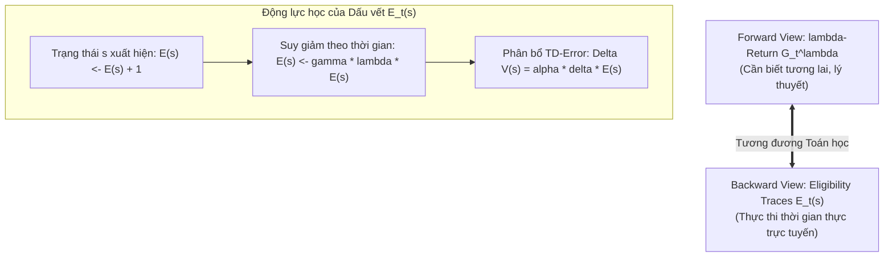

#### d. Code Thực chiến (Dual-Engine: C++ & Python)

```cpp
// C++20: Triển khai TD(lambda) Backward View với Eligibility Traces
#include <iostream>
#include <vector>

class TDLambda {
private:
    float alpha{0.1f};
    float gamma{0.9f};
    float lambda{0.8f};
    std::vector<float> V;
    std::vector<float> E; // Eligibility Traces

public:
    explicit TDLambda(size_t n) : V(n, 0.0f), E(n, 0.0f) {}

    void step(size_t s, float reward, size_t next_s, bool done) {
        float next_v = done ? 0.0f : V[next_s];
        float delta = reward + gamma * next_v - V[s];

        // 1. Tang trace cho trang thai hien tai
        E[s] += 1.0f;

        // 2. Cap nhat tat ca trang thai va suy giam trace
        const size_t n = V.size();
        for (size_t i = 0; i < n; ++i) {
            V[i] += alpha * delta * E[i];
            E[i] *= gamma * lambda;
        }

        if (done) {
            std::fill(E.begin(), E.end(), 0.0f);
        }
    }

    void print_values() const {
        std::cout << "[C++] TD(lambda) Values: [";
        for (float v : V) std::cout << v << " ";
        std::cout << "]\n";
    }
};

int main() {
    TDLambda td_l(4);
    td_l.step(0, 0.0f, 1, false);
    td_l.step(1, 0.0f, 2, false);
    td_l.step(2, 10.0f, 3, true); // Nhan thuong lon o cuoi
    td_l.print_values(); // Ca trang thai 0 va 1 deu nhan duoc credit nho co Trace!
    return 0;
}
```

```python
# Python / NumPy: Generalized Advantage Estimation (GAE) - Phiên bản hiện đại của TD(lambda)
import numpy as np

def compute_gae(rewards, values, next_value, gamma=0.99, lam=0.95):
    # GAE: Trao credit nguoc dong su dung tu tuong TD(lambda)
    n = len(rewards)
    advantages = np.zeros(n)
    last_gae_lam = 0.0

    for t in reversed(range(n)):
        v_next = next_value if t == n - 1 else values[t + 1]
        delta = rewards[t] + gamma * v_next - values[t]
        last_gae_lam = delta + gamma * lam * last_gae_lam
        advantages[t] = last_gae_lam

    return advantages

rews = np.array([0.0, 0.0, 10.0])
vals = np.array([1.0, 2.0, 8.0])
adv = compute_gae(rews, vals, next_value=0.0)
print(f"[Python GAE] Computed Advantages: {adv}")
```

#### e. Lỗi Thường gặp & Ổn định Số học (Pitfalls & Numerical Stability)
- **Trace Explosion**: Nếu sử dụng Accumulating Traces trong các bài toán mà một trạng thái lặp lại liên tục trong chu kỳ ngắn, giá trị $E_t(s)$ có thể tích lũy vượt quá ngưỡng biểu diễn dấu chấm động. Giải pháp: Sử dụng **Replacing Traces**:
$$E_t(s) = \begin{cases} 1 & \text{nếu } S_t = s \\ \gamma \lambda E_{t-1}(s) & \text{ngược lại} \end{cases}$$

#### f. Ứng dụng Thực chiến trong AI / Deep Learning
- Nền tảng của **Generalized Advantage Estimation (GAE)** - xương sống tính toán hàm lợi thế trong thuật toán PPO dùng để căn chỉnh ChatGPT.

---

### 10. SARSA (State-Action-Reward-State-Action)

#### a. Định nghĩa Bản chất Toán học (Mathematical Formulation)
SARSA là thuật toán điều khiển Model-Free theo trường phái **On-Policy** (Học cùng chính sách). Tên gọi SARSA phản ánh đúng bộ 5 phần tử kinh nghiệm liên tiếp được sử dụng trong mỗi bước cập nhật:
$$(S_t, A_t, R_{t+1}, S_{t+1}, A_{t+1})$$

Phương trình cập nhật giá trị hàm Q của SARSA:
$$Q(S_t, A_t) \leftarrow Q(S_t, A_t) + \alpha \left[ R_{t+1} + \gamma Q(S_{t+1}, A_{t+1}) - Q(S_t, A_t) \right]$$
Trong đó:
- Hành động kế tiếp $A_{t+1}$ được chọn **trực tiếp từ chính sách hiện tại $\pi$** (ví dụ $\epsilon$-greedy theo $Q$):
$$A_{t+1} \sim \pi(\cdot \mid S_{t+1})$$

**Sự khác biệt Cốt tử giữa SARSA (On-Policy) và Q-Learning (Off-Policy)**:
- **SARSA**: Đánh giá chính xác cái giá của việc thăm dò ngẫu nhiên. Nếu chính sách $\epsilon$-greedy có rủi ro nhảy xuống vực thẳm do $\epsilon$, SARSA sẽ học cách đi vòng qua con đường an toàn hơn xa mép vực.
- **Q-Learning**: Giả định rằng trong tương lai nó sẽ luôn hành động tối ưu ($\max_{a'} Q$), bất chấp việc chính sách thực tế đang chọn hành động có thăm dò hay không.

#### b. Cơ chế Tầng Sâu & Điện toán (Under The Hood / Hardware Internals)
- **Action Feedback Pipeline**: Trong kiến trúc triển khai tuần tự, SARSA yêu cầu giữ lại hành động $A_{t+1}$ cho bước thời gian tiếp theo, trở thành $A_t$ của chu kỳ sau. Điều này loại bỏ hoàn toàn việc phải gọi lại mạng Actor hoặc hàm chọn hành động ngẫu nhiên hai lần cho cùng một trạng thái, tiết kiệm $50\%$ số lần truy xuất bộ nhớ hàm chính sách.

#### c. Sơ đồ Minh họa (Mermaid Diagram)
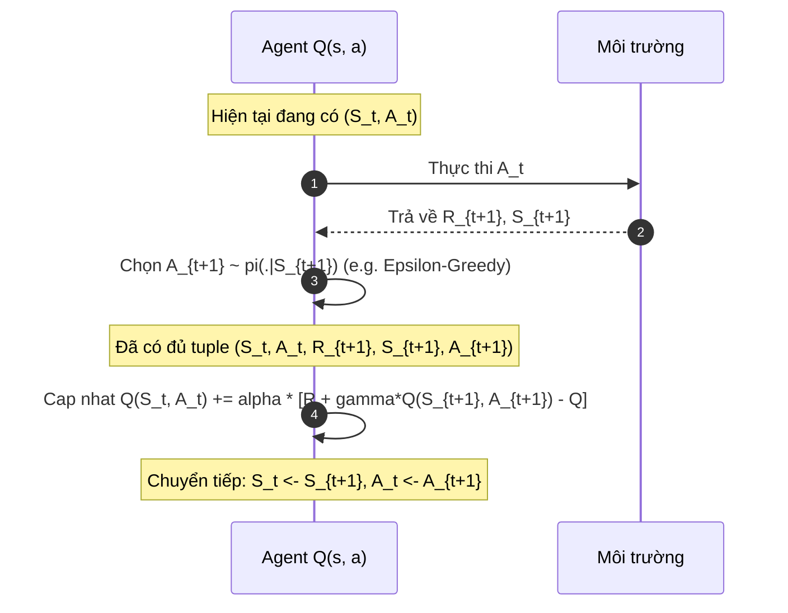

#### d. Code Thực chiến (Dual-Engine: C++ & Python)

```cpp
// C++20: Thuật toán SARSA On-Policy Control hoàn chỉnh trên Grid
#include <iostream>
#include <vector>
#include <random>
#include <algorithm>

class TabularSARSA {
private:
    float alpha{0.1f};
    float gamma{0.9f};
    float epsilon{0.1f};
    size_t num_states;
    size_t num_actions;
    std::vector<float> Q;
    std::mt19937 rng{42};

public:
    TabularSARSA(size_t s, size_t a) : num_states(s), num_actions(a), Q(s * a, 0.0f) {}

    int choose_action(size_t s) {
        std::uniform_real_distribution<float> d(0.0f, 1.0f);
        if (d(rng) < epsilon) {
            std::uniform_int_distribution<size_t> act_d(0, num_actions - 1);
            return static_cast<int>(act_d(rng));
        }
        const float* row = &Q[s * num_actions];
        return static_cast<int>(std::distance(row, std::max_element(row, row + num_actions)));
    }

    void update(size_t s, int a, float r, size_t next_s, int next_a) {
        float& current_q = Q[s * num_actions + a];
        float next_q = Q[next_s * num_actions + next_a];
        float td_target = r + gamma * next_q;
        current_q += alpha * (td_target - current_q);
    }

    float get_q(size_t s, int a) const { return Q[s * num_actions + a]; }
};

int main() {
    TabularSARSA sarsa(5, 2);
    int s = 0;
    int a = sarsa.choose_action(s);
    // Gia lap 1 buoc di chuyen
    int next_s = 1;
    float reward = -1.0f;
    int next_a = sarsa.choose_action(next_s);

    sarsa.update(s, a, reward, next_s, next_a);
    std::cout << "[C++] SARSA Updated Q(0, " << a << "): " << sarsa.get_q(0, a) << "\n";
    return 0;
}
```

```python
# Python / NumPy: Thử nghiệm bài toán Cliff Walking kinh điển (SARSA vs Q-Learning)
import numpy as np

class CliffWalkingSARSA:
    def __init__(self, num_states=48, num_actions=4, alpha=0.1, gamma=0.99, epsilon=0.1):
        self.Q = np.zeros((num_states, num_actions))
        self.alpha = alpha
        self.gamma = gamma
        self.epsilon = epsilon
        self.num_actions = num_actions

    def choose_action(self, state: int) -> int:
        if np.random.rand() < self.epsilon:
            return np.random.randint(self.num_actions)
        return int(np.argmax(self.Q[state]))

    def step_learn(self, s, a, r, next_s, next_a):
        # SARSA: target = r + gamma * Q(s', a')
        td_target = r + self.gamma * self.Q[next_s, next_a]
        self.Q[s, a] += self.alpha * (td_target - self.Q[s, a])

agent = CliffWalkingSARSA()
s = 0
a = agent.choose_action(s)
next_s = 1
r = -1.0
next_a = agent.choose_action(next_s)
agent.step_learn(s, a, r, next_s, next_a)
print(f"[Python] SARSA Target Step Completed. Q[0, {a}] = {agent.Q[s, a]:.4f}")
```

#### e. Lỗi Thường gặp & Ổn định Số học (Pitfalls & Numerical Stability)
- **Chính sách không hội tụ về Tối ưu Tuyệt đối nếu $\epsilon$ cố định**: Vì SARSA là On-Policy, nếu $\epsilon$ được giữ nguyên không đổi, Agent sẽ luôn hành động với một xác suất ngẫu nhiên và chính sách học được sẽ hội tụ về chính sách tối ưu *có tính đến sai sót ngẫu nhiên*, thay vì chính sách tối ưu toán học thực sự. Cần giảm dần $\epsilon \to 0$ theo thời gian (GLIE - Greedy in the Limit with Infinite Exploration).

#### f. Ứng dụng Thực chiến trong AI / Deep Learning
- Ứng dụng trong các hệ thống đòi hỏi tính **An toàn cao (Safe RL)**: xe tự lái, vận hành robot phẫu thuật, nơi mà cái giá của việc thử nghiệm hành động liều lĩnh gần ranh giới nguy hiểm là không thể chấp nhận được.
