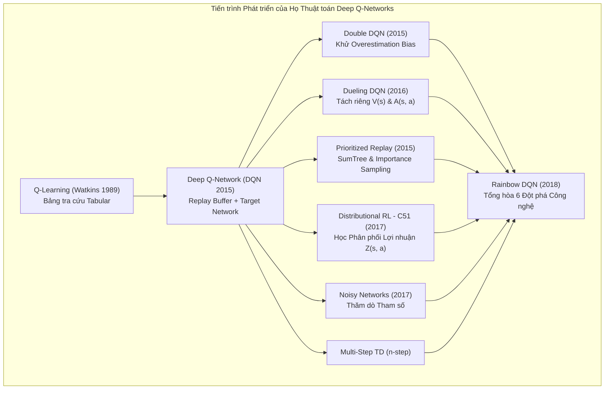
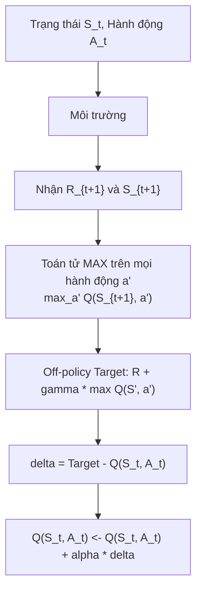
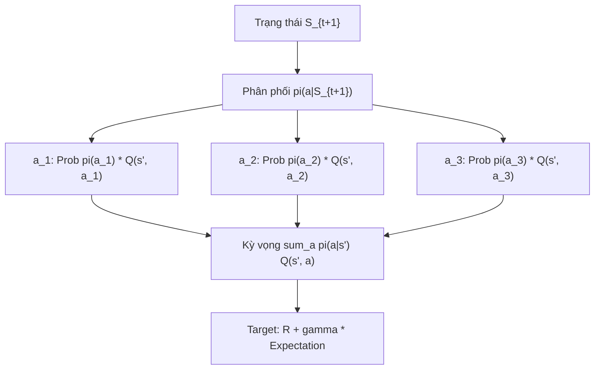
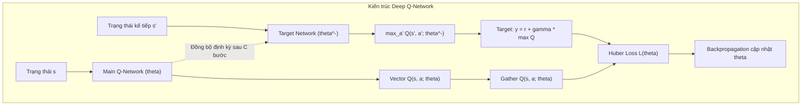
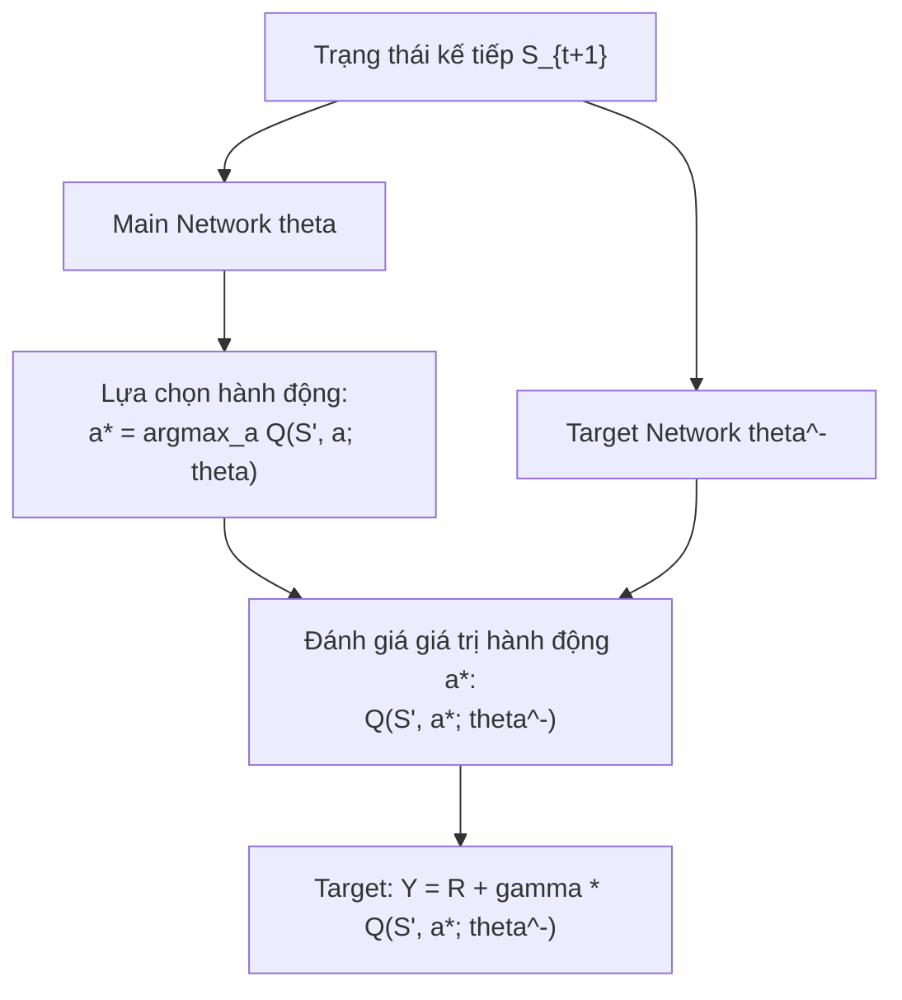
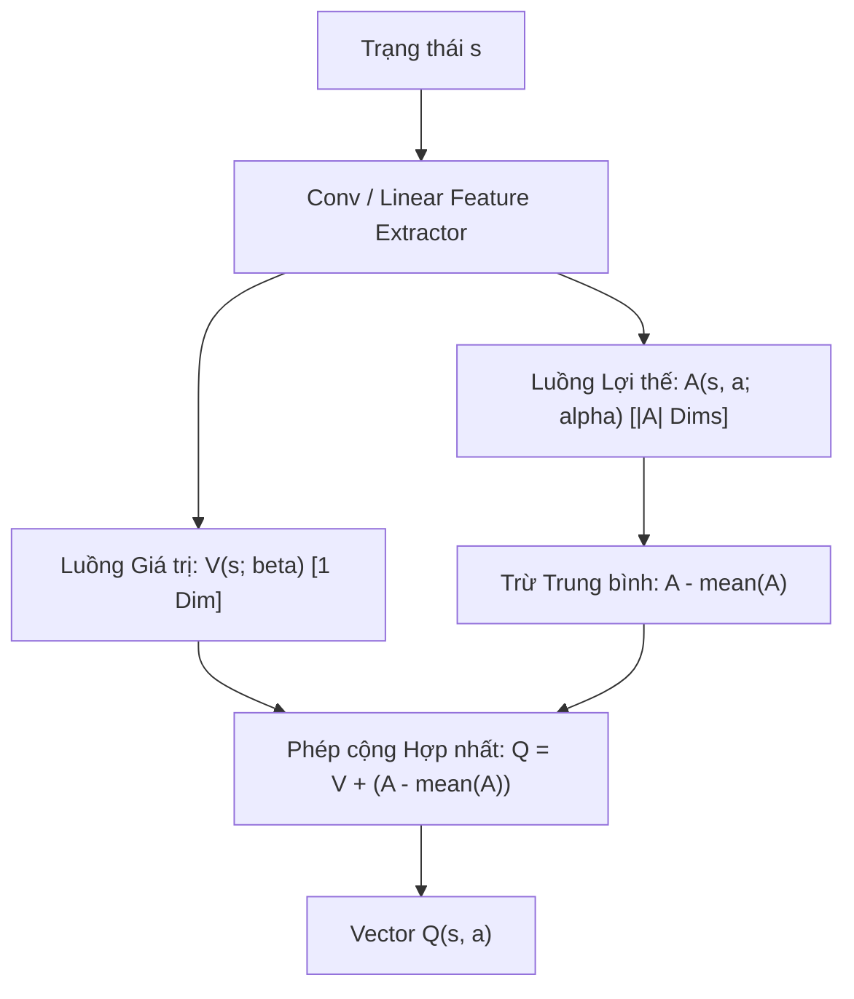
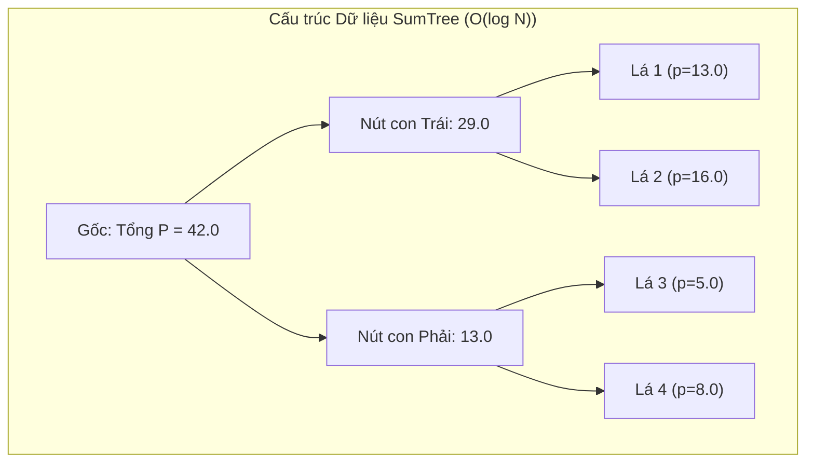
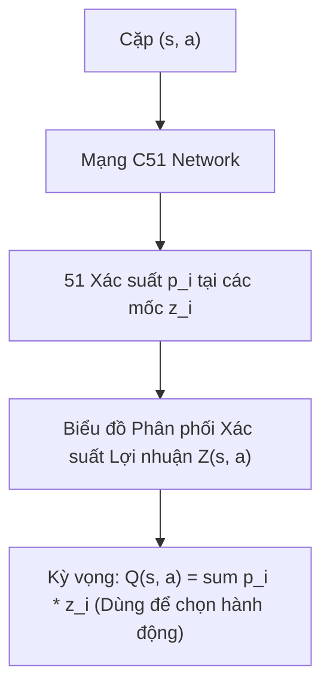
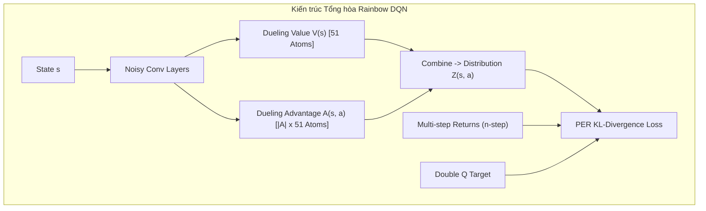

# Chuyên đề: Q-Learning & Mạng Q Sâu (Q-Learning & Deep Q-Networks)

## 1. Tổng quan Chuyên đề

Học tăng cường Dựa trên Giá trị (Value-Based RL) đạt đến bước ngoặt lịch sử khi kết hợp giữa lý thuyết điều khiển tối ưu cổ điển và Mạng nơ-ron sâu (Deep Neural Networks). Thuật toán **Q-Learning** (Watkins, 1989) thiết lập phương thức điều khiển ngoài chính sách (Off-Policy Control) mẫu mực, cho phép Agent học hàm giá trị hành động tối ưu mà không cần phụ thuộc vào chính sách đang thực thi.

Khi áp dụng xấp xỉ hàm phi tuyến tính bằng Mạng nơ-ron sâu trong **Deep Q-Network (DQN)** (DeepMind, 2015), bài toán vấp phải "Bộ ba chết chóc" (Deadly Triad) gây phân kỳ gradient. DQN và các cải tiến kế tiếp (Double DQN, Dueling DQN, Prioritized Experience Replay, Distributional RL, Rainbow) đã giải quyết triệt để sự mất ổn định này, mở ra kỷ nguyên Deep Reinforcement Learning hiện đại.



---

## 2. Chi tiết từng Keyword

---

### 1. Q-Learning

#### a. Định nghĩa Bản chất Toán học (Mathematical Formulation)
Q-Learning là thuật toán điều khiển không mô hình, **ngoài chính sách (Off-Policy TD Control)**. 
- **Chính sách Hành vi (Behavior Policy $\mu$)**: Dùng để tương tác với môi trường và thu thập dữ liệu (thường là $\epsilon$-greedy để duy trì việc thăm dò).
- **Chính sách Mục tiêu (Target Policy $\pi$)**: Chính sách hoàn toàn tham lam (Greedy Policy) hướng tới mục tiêu tối ưu tuyệt đối: $\pi(s) = \arg\max_{a} Q(s, a)$.

Quy tắc cập nhật Q-Learning áp dụng trực tiếp Toán tử Tối ưu Bellman:
$$Q(S_t, A_t) \leftarrow Q(S_t, A_t) + \alpha \left[ R_{t+1} + \gamma \max_{a \in \mathcal{A}} Q(S_{t+1}, a) - Q(S_t, A_t) \right]$$

**Định lý Hội tụ (Watkins & Dayan, 1992)**:
Nếu tất cả các cặp trạng thái - hành động $(s, a)$ được ghé thăm vô hạn lần và hệ số học $\alpha_t$ thỏa mãn điều kiện Robbins-Monro:
$$\sum_{t=1}^\infty \alpha_t(s, a) = \infty, \quad \sum_{t=1}^\infty \alpha_t^2(s, a) < \infty$$
thì $Q(s, a)$ hội tụ với xác suất bằng 1 (Almost Surely) về hàm giá trị tối ưu $Q^*(s, a)$.

#### b. Cơ chế Tầng Sâu & Điện toán (Under The Hood / Hardware Internals)
- **Contiguous Tabular Memory & SIMD Max**: Với bảng Q dạng mảng phẳng 2D `[num_states, num_actions]`, thao tác `max_a Q(s', a)` được thực hiện bằng cách đọc liên tục một khối nhớ của trạng thái `s'`. Các thanh ghi SIMD AVX2 có thể nạp và so sánh song song 8 giá trị float trong 1 chu kỳ máy thông qua lệnh `_mm256_max_ps`.

#### c. Sơ đồ Minh họa (Mermaid Diagram)


#### d. Code Thực chiến (Dual-Engine: C++ & Python)

```cpp
// C++20: Triển khai Q-Learning Tabular hiệu năng cao
#include <iostream>
#include <vector>
#include <algorithm>
#include <random>

class QLearningAgent {
private:
    float alpha{0.1f};
    float gamma{0.95f};
    float epsilon{0.1f};
    size_t num_states;
    size_t num_actions;
    std::vector<float> Q;
    std::mt19937 rng{1337};

public:
    QLearningAgent(size_t s, size_t a) : num_states(s), num_actions(a), Q(s * a, 0.0f) {}

    int act(size_t s) {
        std::uniform_real_distribution<float> dist(0.0f, 1.0f);
        if (dist(rng) < epsilon) {
            std::uniform_int_distribution<size_t> act_dist(0, num_actions - 1);
            return static_cast<int>(act_dist(rng));
        }
        const float* row = &Q[s * num_actions];
        return static_cast<int>(std::distance(row, std::max_element(row, row + num_actions)));
    }

    void update(size_t s, int a, float r, size_t next_s, bool done) {
        float max_next_q = 0.0f;
        if (!done) {
            const float* next_row = &Q[next_s * num_actions];
            max_next_q = *std::max_element(next_row, next_row + num_actions);
        }
        float& cur_q = Q[s * num_actions + a];
        float target = r + gamma * max_next_q;
        cur_q += alpha * (target - cur_q);
    }

    float get_q(size_t s, int a) const { return Q[s * num_actions + a]; }
};

int main() {
    QLearningAgent agent(4, 2);
    agent.update(0, 1, 5.0f, 1, false);
    std::cout << "[C++] Q(0, 1) sau buoc hoc Q-Learning: " << agent.get_q(0, 1) << "\n";
    return 0;
}
```

```python
# Python / NumPy: Thử nghiệm Q-Learning cập nhật Vector hóa
import numpy as np

class QLearningVectorized:
    def __init__(self, num_states: int, num_actions: int, lr: float = 0.1, gamma: float = 0.99):
        self.Q = np.zeros((num_states, num_actions), dtype=np.float32)
        self.lr = lr
        self.gamma = gamma

    def step_update(self, states, actions, rewards, next_states, dones):
        # Tinh toan target vector hoa tren toan bo batch
        max_next_q = np.max(self.Q[next_states], axis=1)
        targets = rewards + self.gamma * max_next_q * (1.0 - dones)
        # Cap nhat TD
        errors = targets - self.Q[states, actions]
        self.Q[states, actions] += self.lr * errors

agent = QLearningVectorized(num_states=10, num_actions=4)
agent.step_update(
    states=np.array([1, 2]),
    actions=np.array([0, 3]),
    rewards=np.array([1.0, 2.0]),
    next_states=np.array([3, 4]),
    dones=np.array([0.0, 0.0])
)
print(f"[Python] Q-Table updated:\n{agent.Q[:3]}")
```

#### e. Lỗi Thường gặp & Ổn định Số học (Pitfalls & Numerical Stability)
- **Maximization Bias**: Toán tử $\max_a Q(s', a)$ làm tăng vọt giá trị ước lượng khi hàm Q có nhiễu ngẫu nhiên, dẫn đến việc Agent ưu tiên các hành động có phương sai cao thay vì hành động thực sự tốt.

#### f. Ứng dụng Thực chiến trong AI / Deep Learning
- Nền tảng nguyên thủy của mọi thuật toán học giá trị trong điều khiển trò chơi và tự động hóa công nghiệp.

---

### 2. Expected SARSA

#### a. Định nghĩa Bản chất Toán học (Mathematical Formulation)
Expected SARSA là bước phát triển lai tạo giữa SARSA và Q-Learning. Thay vì lấy giá trị cực đại $\max_{a'} Q(S_{t+1}, a')$ (như Q-Learning) hoặc lấy mẫu một hành động duy nhất $A_{t+1} \sim \pi$ (như SARSA), Expected SARSA sử dụng **giá trị kỳ vọng toán học** của hành động tiếp theo dưới chính sách mục tiêu $\pi$:
$$Q(S_t, A_t) \leftarrow Q(S_t, A_t) + \alpha \left[ R_{t+1} + \gamma \sum_{a \in \mathcal{A}} \pi(a \mid S_{t+1}) Q(S_{t+1}, a) - Q(S_t, A_t) \right]$$

Mục tiêu TD của Expected SARSA:
$$\text{Target}_{\text{Expected SARSA}} = R_{t+1} + \gamma \mathbb{E}_{a \sim \pi(\cdot \mid S_{t+1})} \left[ Q(S_{t+1}, a) \right]$$

**Đặc tính Đột phá**:
1. Triệt tiêu hoàn toàn phương sai do việc lấy mẫu ngẫu nhiên hành động tiếp theo trong SARSA.
2. Vừa có thể hoạt động như một thuật toán **On-Policy** (khi $\pi$ chính là chính sách hành vi hiện tại), vừa có thể hoạt động như **Off-Policy** (khi $\pi$ là một chính sách khác).
3. Khi $\pi$ là chính sách tham lam tuyệt đối ($\pi(a \mid s) = 1$ cho hành động max), Expected SARSA **suy biến chính xác thành Q-Learning**.

#### b. Cơ chế Tầng Sâu & Điện toán (Under The Hood / Hardware Internals)
- **Dot-Product Acceleration**: Việc tính toán $\sum_a \pi(a \mid s') Q(s', a)$ bản chất là một phép nhân tích vô hướng (Dot Product) giữa hai vector phân phối xác suất và vector giá trị Q. Phép tính này được tối ưu hóa xuất sắc trên các bộ tăng tốc phần cứng nhờ các lệnh Fused Multiply-Add (FMA3/FMA4) trên CPU và Tensor Cores trên GPU.

#### c. Sơ đồ Minh họa (Mermaid Diagram)


#### d. Code Thực chiến (Dual-Engine: C++ & Python)

```cpp
// C++20: Expected SARSA với chính sách Epsilon-Greedy Target
#include <iostream>
#include <vector>
#include <numeric>
#include <algorithm>

float compute_expected_sarsa_target(float reward, float gamma, const std::vector<float>& next_q_row, float epsilon) {
    const size_t num_actions = next_q_row.size();
    auto max_it = std::max_element(next_q_row.begin(), next_q_row.end());
    size_t best_action = std::distance(next_q_row.begin(), max_it);

    float expected_q = 0.0f;
    for (size_t a = 0; a < num_actions; ++a) {
        float prob = (a == best_action) ? (1.0f - epsilon + (epsilon / num_actions)) 
                                        : (epsilon / num_actions);
        expected_q += prob * next_q_row[a];
    }
    return reward + gamma * expected_q;
}

int main() {
    std::vector<float> q_s_prime = {2.0f, 8.0f, 4.0f}; // action 1 la best
    float target = compute_expected_sarsa_target(1.0f, 0.9f, q_s_prime, 0.1f);
    std::cout << "[C++] Expected SARSA Target: " << target << "\n";
    return 0;
}
```

```python
# Python / PyTorch: Expected SARSA Loss trên Batch Tensors
import torch

def expected_sarsa_loss(q_values: torch.Tensor, actions: torch.Tensor, rewards: torch.Tensor, 
                        next_q_values: torch.Tensor, dones: torch.Tensor, 
                        gamma: float = 0.99, epsilon: float = 0.1) -> torch.Tensor:
    # 1. Lay Q(s, a) hien tai
    current_q = q_values.gather(1, actions.unsqueeze(1)).squeeze(1)

    # 2. Tinh xac suat epsilon-greedy tren next_q_values
    num_actions = next_q_values.shape[1]
    best_actions = next_q_values.argmax(dim=1, keepdim=True)
    probs = torch.full_like(next_q_values, epsilon / num_actions)
    probs.scatter_add_(1, best_actions, torch.full_like(best_actions, 1.0 - epsilon, dtype=torch.float32))

    # 3. Tinh ky vong expected value
    expected_next_q = (probs * next_q_values).sum(dim=1)
    target = rewards + gamma * expected_next_q * (~dones)

    return torch.nn.functional.mse_loss(current_q, target)

q = torch.tensor([[1.0, 3.0], [4.0, 2.0]])
a = torch.tensor([1, 0])
r = torch.tensor([1.0, 0.5])
next_q = torch.tensor([[2.0, 5.0], [6.0, 1.0]])
d = torch.tensor([False, False])

loss = expected_sarsa_loss(q, a, r, next_q, d)
print(f"[PyTorch] Expected SARSA Batch Loss: {loss.item():.4f}")
```

#### e. Lỗi Thường gặp & Ổn định Số học (Pitfalls & Numerical Stability)
- **Chi phí Tính toán Tăng theo Số Hành động**: Khi không gian hành động $|\mathcal{A}|$ rất lớn (hàng triệu sản phẩm trong hệ thống khuyến nghị), việc duyệt qua toàn bộ các hành động để tính kỳ vọng $\sum_a \pi(a \mid s') Q(s', a)$ trở nên quá tải. Cần dùng kỹ thuật lấy mẫu Importance Sampling.

#### f. Ứng dụng Thực chiến trong AI / Deep Learning
- Kiểm soát chuyển động mượt mà cho xe điện thông minh, tránh hiện tượng giật cục do dao động của toán tử cực đại $\max$.

---

### 3. Deep Q-Network (DQN)

#### a. Định nghĩa Bản chất Toán học (Mathematical Formulation)
Deep Q-Network (Mnih et al., 2015) sử dụng Mạng nơ-ron sâu có tham số $\theta$ để xấp xỉ hàm giá trị tối ưu:
$$Q(s, a; \theta) \approx Q^*(s, a)$$

Để ổn định quá trình học và phá vỡ **Bộ ba Chết chóc (Deadly Triad)**, DQN đề xuất hai cơ chế cốt tử:
1. **Bộ đệm Tái hiện Kinh nghiệm (Experience Replay $\mathcal{D}$)**: Lưu trữ các bộ chuyển tiếp $e_t = (s_t, a_t, r_{t+1}, s_{t+1}, d_t)$. Việc lấy mẫu ngẫu nhiên đồng đều một mini-batch $\mathcal{B} \sim \mathcal{D}$ giúp phá vỡ tính tương quan thời gian (Temporal Correlation) và thỏa mãn giả định mẫu độc lập cùng phân phối (i.i.d).
2. **Mạng Mục tiêu Tách biệt (Target Network $\theta^-$)**: Tham số $\theta^-$ được đóng băng và chỉ được sao chép định kỳ từ mạng chính $\theta$ sau mỗi $C$ bước: $\theta^- \leftarrow \theta$.

Hàm mất mát của DQN (sử dụng Huber Loss / Smooth L1 Loss):
$$\mathcal{L}(\theta) = \mathbb{E}_{(s, a, r, s', d) \sim \mathcal{D}} \left[ \mathcal{L}_{\text{Huber}}\left( r + \gamma (1 - d) \max_{a' \in \mathcal{A}} Q(s', a'; \theta^-) - Q(s, a; \theta) \right) \right]$$
Với hàm Huber Loss:
$$\mathcal{L}_{\text{Huber}}(\delta) = \begin{cases} \frac{1}{2}\delta^2 & \text{nếu } |\delta| \le 1 \\ |\delta| - \frac{1}{2} & \text{ngược lại} \end{cases}$$

#### b. Cơ chế Tầng Sâu & Điện toán (Under The Hood / Hardware Internals)
- **Gradient Clipping & Smooth L1**: Khi xảy ra sai số TD cực lớn $|\delta| \gg 1$, hàm mất mát $L_2$ bậc hai ($\delta^2$) tạo ra gradient bằng $2\delta$ bùng nổ, dễ gây tràn số NaN trong chuẩn FP16. Huber Loss chuyển sang độ dốc tuyến tính $|\delta|$ khi vượt ngưỡng 1, khống chế gradient luôn nằm trong khoảng $[-1, 1]$, bảo vệ độ ổn định số học trên GPU.

#### c. Sơ đồ Minh họa (Mermaid Diagram)


#### d. Code Thực chiến (Dual-Engine: C++ & Python)

```cpp
// C++20: Tính Huber Loss và Gradient phân kỳ ổn định
#include <iostream>
#include <cmath>

struct HuberResult {
    float loss;
    float gradient;
};

HuberResult compute_huber(float td_error, float delta = 1.0f) {
    float abs_err = std::abs(td_error);
    if (abs_err <= delta) {
        return {0.5f * td_error * td_error, -td_error};
    } else {
        float grad = (td_error > 0.0f) ? -delta : delta;
        return {delta * (abs_err - 0.5f * delta), grad};
    }
}

int main() {
    auto res1 = compute_huber(0.5f);
    auto res2 = compute_huber(10.0f); // Sai so cuc lon nhung gradient van bi chan o -1.0
    std::cout << "[C++] Error 0.5 -> Loss: " << res1.loss << " | Grad: " << res1.gradient << "\n";
    std::cout << "[C++] Error 10.0 -> Loss: " << res2.loss << " | Grad: " << res2.gradient << "\n";
    return 0;
}
```

```python
# Python / PyTorch: Kiến trúc Mạng DQN DeepMind Atari 2600
import torch
import torch.nn as nn

class NatureDQN(nn.Module):
    def __init__(self, in_channels: int = 4, num_actions: int = 6):
        super().__init__()
        # Trích xuất đặc trưng không gian từ khung hình Atari (84x84)
        self.conv = nn.Sequential(
            nn.Conv2d(in_channels, 32, kernel_size=8, stride=4),
            nn.ReLU(),
            nn.Conv2d(32, 64, kernel_size=4, stride=2),
            nn.ReLU(),
            nn.Conv2d(64, 64, kernel_size=3, stride=1),
            nn.ReLU()
        )
        self.fc = nn.Sequential(
            nn.Linear(64 * 7 * 7, 512),
            nn.ReLU(),
            nn.Linear(512, num_actions)
        )

    def forward(self, x: torch.Tensor) -> torch.Tensor:
        feat = self.conv(x)
        feat_flat = feat.view(feat.size(0), -1)
        return self.fc(feat_flat)

net = NatureDQN(in_channels=4, num_actions=4)
dummy_frames = torch.randn(2, 4, 84, 84) # Batch size 2, 4 frames stacked
q_out = net(dummy_frames)
print(f"[PyTorch] Nature DQN Output Shape: {q_out.shape} -> Q-values: {q_out[0].detach().numpy()}")
```

#### e. Lỗi Thường gặp & Ổn định Số học (Pitfalls & Numerical Stability)
- **Moving Target Instability**: Nếu không sử dụng Target Network $\theta^-$ mà dùng trực tiếp $\theta$ để tính target, giá trị mục tiêu sẽ liên tục thay đổi theo từng bước gradient descent, tạo thành vòng lặp cộng hưởng dao động (Feedback Loop) khiến mạng mất khả năng hội tụ.

#### f. Ứng dụng Thực chiến trong AI / Deep Learning
- Đột phá lịch sử của DeepMind (2015) khi một mạng nơ-ron duy nhất học trực tiếp từ điểm ảnh thô (Raw Pixels) và đánh bại con người trên phần lớn trò chơi Atari 2600.

---

### 4. Double DQN (Double Deep Q-Network)

#### a. Định nghĩa Bản chất Toán học (Mathematical Formulation)
Trong DQN tiêu chuẩn, mục tiêu Bellman sử dụng cùng một bộ trọng số $\theta^-$ cho cả hai nhiệm vụ: **lựa chọn hành động tốt nhất** và **đánh giá giá trị của hành động đó**:
$$Y_t^{\text{DQN}} = R_{t+1} + \gamma Q\left(S_{t+1}, \arg\max_{a} Q(S_{t+1}, a; \theta^-); \theta^-\right)$$

Do bất đẳng thức Jensen $\mathbb{E}[\max(X, Y)] \ge \max(\mathbb{E}[X], \mathbb{E}[Y])$, việc tối đa hóa trên một biến ước lượng có nhiễu luôn mang thiên kiến dương (Maximization Bias), dẫn đến hiện tượng **Thổi phồng Giá trị (Overestimation Bias)** nghiêm trọng.

**Giải pháp Tách rời của Double DQN (van Hasselt et al., 2015)**:
Tách rời hoàn toàn quá trình **Lựa chọn Hành động (Action Selection)** và **Đánh giá Hành động (Action Evaluation)** giữa hai mạng:
1. Mạng chính $\theta$ chọn hành động tối ưu: $a^* = \arg\max_{a} Q(S_{t+1}, a; \theta_t)$
2. Mạng mục tiêu $\theta^-$ đánh giá giá trị của hành động đó: $Q(S_{t+1}, a^*; \theta_t^-)$

Mục tiêu Double DQN:
$$Y_t^{\text{DoubleQ}} = R_{t+1} + \gamma (1 - d_t) Q\left( S_{t+1}, \arg\max_{a} Q(S_{t+1}, a; \theta_t); \theta_t^- \right)$$

#### b. Cơ chế Tầng Sâu & Điện toán (Under The Hood / Hardware Internals)
- **Zero Memory Overhead Extension**: Double DQN không yêu cầu cấp phát thêm bất kỳ tham số mạng hay vùng nhớ mới nào so với DQN tiêu chuẩn, vì nó tận dụng chính hai mạng đã tồn tại sẵn (Main Network và Target Network). Chi phí tính toán tăng thêm chỉ là một lượt Forward pass qua mạng chính để lấy $\arg\max$, sau đó dùng toán tử `torch.gather()` trên GPU.

#### c. Sơ đồ Minh họa (Mermaid Diagram)


#### d. Code Thực chiến (Dual-Engine: C++ & Python)

```cpp
// C++20: Tính mục tiêu Double Q Target loại bỏ Maximization Bias
#include <iostream>
#include <vector>
#include <algorithm>

float compute_double_q_target(float reward, float gamma, bool done,
                              const std::vector<float>& main_next_q,
                              const std::vector<float>& target_next_q) {
    if (done) return reward;

    // 1. Mang chinh chon hanh dong
    auto best_act_it = std::max_element(main_next_q.begin(), main_next_q.end());
    size_t best_action = std::distance(main_next_q.begin(), best_act_it);

    // 2. Mang target danh gia gia tri tai hanh dong do
    float eval_val = target_next_q[best_action];

    return reward + gamma * eval_val;
}

int main() {
    std::vector<float> main_q = {1.5f, 4.2f, 3.8f};   // Main chon action 1
    std::vector<float> target_q = {2.0f, 3.1f, 5.0f}; // Target tai action 1 la 3.1 (khong phai max 5.0)

    float target = compute_double_q_target(1.0f, 0.99f, false, main_q, target_q);
    std::cout << "[C++] Double DQN Target: " << target << " (Tranh duoc thoi phong len gia tri 5.0)\n";
    return 0;
}
```

```python
# Python / PyTorch: Hàm tính Double DQN Loss chuẩn
import torch
import torch.nn as nn
import torch.nn.functional as F

def double_dqn_loss(main_net: nn.Module, target_net: nn.Module,
                    states: torch.Tensor, actions: torch.Tensor,
                    rewards: torch.Tensor, next_states: torch.Tensor,
                    dones: torch.Tensor, gamma: float = 0.99) -> torch.Tensor:
    # 1. Q(s, a) tu main network
    current_q = main_net(states).gather(1, actions.unsqueeze(1)).squeeze(1)

    with torch.no_grad():
        # 2. Main net chon best action a* tai s'
        next_actions = main_net(next_states).argmax(dim=1, keepdim=True)
        # 3. Target net danh gia Q tai a*
        next_q_values = target_net(next_states).gather(1, next_actions).squeeze(1)
        # 4. Target Double Q
        target_q = rewards + gamma * next_q_values * (~dones)

    return F.smooth_l1_loss(current_q, target_q)

# Test function
main_n = nn.Linear(4, 3)
target_n = nn.Linear(4, 3)
loss = double_dqn_loss(
    main_n, target_n,
    states=torch.randn(8, 4), actions=torch.randint(0, 3, (8,)),
    rewards=torch.ones(8), next_states=torch.randn(8, 4),
    dones=torch.zeros(8, dtype=torch.bool)
)
print(f"[PyTorch] Double DQN Loss: {loss.item():.4f}")
```

#### e. Lỗi Thường gặp & Ổn định Số học (Pitfalls & Numerical Stability)
- **Overcorrection / Underestimation**: Mặc dù loại bỏ được hoàn toàn bias thổi phồng dương, trong một số môi trường có phần thưởng thưa thớt (Sparse Reward), Double DQN có thể đánh giá hơi thấp (Underestimation) giá trị thực tế trong giai đoạn đầu, làm chậm quá trình tìm thấy đường đi tới đích.

#### f. Ứng dụng Thực chiến trong AI / Deep Learning
- Nâng cấp tiêu chuẩn bắt buộc cho mọi hệ thống DQN sản xuất thực tế để bảo đảm đường cong học tập ổn định, không bị hiện tượng sụp đổ hàm giá trị (Value Collapse).

---

### 5. Dueling DQN

#### a. Định nghĩa Bản chất Toán học (Mathematical Formulation)
Dueling DQN (Wang et al., 2016) xuất phát từ nhận định thực tế: trong rất nhiều trạng thái, việc chọn hành động cụ thể nào không thực sự quan trọng bằng việc trạng thái đó có an toàn hay không (ví dụ: khi xe đang chạy trên đường thẳng vắng vẻ, việc nhích nhẹ vô lăng sang trái hay phải không thay đổi giá trị của trạng thái).

Mạng Dueling chia cấu trúc thành hai luồng xử lý riêng biệt từ tầng biểu diễn chung:
1. **Luồng Giá trị Trạng thái (Value Stream $V(s; \theta, \beta)$)**: Đại diện cho giá trị tổng quát của trạng thái $s$ (vô hướng 1D).
2. **Luồng Lợi thế Hành động (Advantage Stream $A(s, a; \theta, \alpha)$)**: Đo lường mức độ vượt trội của từng hành động so với mức trung bình (vector $|\mathcal{A}|$ chiều).

**Vấn đề Bất định Định danh (Unidentifiability)**:
Nếu chỉ cộng đơn thuần $Q(s, a) = V(s) + A(s, a)$, hệ phương trình vô số nghiệm (với mọi hằng số $c$, $V' = V + c$ và $A' = A - c$ cho cùng $Q$).

**Công thức Chuẩn hóa Dueling (Trừ Trung bình Lợi thế)**:
$$Q(s, a; \theta, \alpha, \beta) = V(s; \theta, \beta) + \left( A(s, a; \theta, \alpha) - \frac{1}{|\mathcal{A}|} \sum_{a' \in \mathcal{A}} A(s, a'; \theta, \alpha) \right)$$
Công thức này bảo đảm tính duy nhất và ổn định tối ưu hóa vì trung bình của nhánh lợi thế luôn bị ép về 0: $\sum_a \left(A(s, a) - \frac{1}{|\mathcal{A}|}\sum_{a'} A(s, a')\right) = 0$.

#### b. Cơ chế Tầng Sâu & Điện toán (Under The Hood / Hardware Internals)
- **Broadcasting & Memory Footprint**: Trong biểu thức $V(s) + (A(s, a) - \text{mean}(A))$, Ten-xơ $V(s)$ có kích thước `[Batch, 1]` và Ten-xơ $A$ có kích thước `[Batch, Action_Dim]`. Cơ chế PyTorch Broadcasting thực hiện phép cộng trực tiếp mà không cần sao chép nhân bản dữ liệu $V(s)$ trên VRAM, tiết kiệm dung lượng bộ nhớ đệm và tối ưu băng thông.

#### c. Sơ đồ Minh họa (Mermaid Diagram)


#### d. Code Thực chiến (Dual-Engine: C++ & Python)

```cpp
// C++20: Module Dueling Aggregator chuẩn hóa lợi thế
#include <iostream>
#include <vector>
#include <numeric>

std::vector<float> combine_dueling(float v, const std::vector<float>& A) {
    const size_t num_actions = A.size();
    float sum_a = std::accumulate(A.begin(), A.end(), 0.0f);
    float mean_a = sum_a / num_actions;

    std::vector<float> Q(num_actions);
    for (size_t i = 0; i < num_actions; ++i) {
        Q[i] = v + (A[i] - mean_a);
    }
    return Q;
}

int main() {
    float state_val = 10.0f;
    std::vector<float> adv = {1.0f, -2.0f, 3.0f, 0.0f}; // mean = 0.5
    auto Q = combine_dueling(state_val, adv);
    std::cout << "[C++] Dueling Q-values: [";
    for (float q : Q) std::cout << q << " ";
    std::cout << "]\n";
    return 0;
}
```

```python
# Python / PyTorch: Kiến trúc Mạng Dueling DQN hoàn chỉnh
import torch
import torch.nn as nn

class DuelingDQN(nn.Module):
    def __init__(self, state_dim: int, action_dim: int):
        super().__init__()
        self.feature_network = nn.Sequential(
            nn.Linear(state_dim, 128),
            nn.ReLU()
        )
        # Nhanh State-Value V(s)
        self.value_stream = nn.Sequential(
            nn.Linear(128, 64),
            nn.ReLU(),
            nn.Linear(64, 1)
        )
        # Nhanh Advantage A(s, a)
        self.advantage_stream = nn.Sequential(
            nn.Linear(128, 64),
            nn.ReLU(),
            nn.Linear(64, action_dim)
        )

    def forward(self, state: torch.Tensor) -> torch.Tensor:
        features = self.feature_network(state)
        values = self.value_stream(features) # Shape: (B, 1)
        advantages = self.advantage_stream(features) # Shape: (B, action_dim)
        
        # Q(s, a) = V(s) + (A(s, a) - mean(A))
        q_values = values + (advantages - advantages.mean(dim=-1, keepdim=True))
        return q_values

model = DuelingDQN(state_dim=8, action_dim=4)
state_batch = torch.randn(2, 8)
q_out = model(state_batch)
print(f"[PyTorch] Dueling Output Q Shape: {q_out.shape} | Q values: {q_out[0].detach().numpy()}")
```

#### e. Lỗi Thường gặp & Ổn định Số học (Pitfalls & Numerical Stability)
- **Sử dụng Toán tử Max thay vì Mean**: Biến thể thay thế dùng $Q = V + (A - \max A)$ ép giá trị của hành động tốt nhất bằng đúng $V(s)$. Tuy nhiên, toán tử $\max$ làm mất tính trơn tru và dễ bị ảnh hưởng bởi nhiễu cực đại, khiến biến thể dùng $\text{mean}$ được chứng minh là ổn định hơn trên thực nghiệm.

#### f. Ứng dụng Thực chiến trong AI / Deep Learning
- Cải thiện đáng kể hiệu năng trên các trò chơi có không gian hành động lớn mà nhiều hành động mang tính dự thừa hoặc không ảnh hưởng trực tiếp đến trạng thái tiếp theo.

---

### 6. Experience Replay (Tái hiện Kinh nghiệm)

#### a. Định nghĩa Bản chất Toán học (Mathematical Formulation)
Trong tương tác RL thông thường, chuỗi dữ liệu thực nghiệm $\dots, (S_t, A_t, R_{t+1}, S_{t+1}), (S_{t+1}, A_{t+1}, R_{t+2}, S_{t+2}), \dots$ có tính tương quan chuỗi thời gian cực kỳ mạnh mẽ:
$$\text{Cov}(S_t, S_{t+1}) \gg 0$$
Điều này vi phạm nghiêm trọng giả định cơ bản của thuật toán Hạ Gradient Ngẫu nhiên (SGD): các mẫu trong mini-batch phải **Độc lập và Cùng phân phối (i.i.d)**. Hơn nữa, các trải nghiệm hiếm gặp (như ăn điểm thưởng lớn) sẽ nhanh chóng bị lãng quên ngay sau một bước học.

**Cơ chế Experience Replay (Lin, 1992; Mnih, 2015)**:
Lưu trữ một tập hữu hạn các bước chuyển tiếp gần nhất trong một bộ đệm vòng tròn (Circular Buffer) $\mathcal{D} = \{e_1, e_2, \dots, e_N\}$.
Khi huấn luyện, Agent lấy mẫu ngẫu nhiên đồng đều:
$$\mathcal{B} = \{e^{(1)}, e^{(2)}, \dots, e^{(B)}\} \sim \text{Uniform}(\mathcal{D})$$
Nhờ đó:
1. Phá vỡ mối tương quan thời gian giữa các mẫu liên tiếp.
2. Tái sử dụng dữ liệu nhiều lần, tăng hiệu quả sử dụng mẫu (Data Sample Efficiency) lên gấp hàng trăm lần.

#### b. Cơ chế Tầng Sâu & Điện toán (Under The Hood / Hardware Internals)
- **Zero-Copy Replay Buffer via Contiguous Pre-allocated Tensors**: Việc tạo một `deque` trong Python chứa hàng triệu object `namedtuple` gây phân mảnh RAM và tiêu tốn hàng chục Gigabyte bộ nhớ do overhead con trỏ của CPython. Giải pháp tối ưu tầng thấp là cấp phát tĩnh sẵn các mảng liên tục lớn trên RAM (hoặc Pin Memory để truyền DMA tốc độ cao sang GPU):
  `states = np.empty((N, *state_shape), dtype=np.uint8)`
  `actions = np.empty((N,), dtype=np.int64)`

#### c. Sơ đồ Minh họa (Mermaid Diagram)


#### d. Code Thực chiến (Dual-Engine: C++ & Python)

```cpp
// C++20: Experience Replay Buffer tối ưu hóa bộ nhớ phẳng (Flat Memory Layout)
#include <iostream>
#include <vector>
#include <random>

struct Experience {
    float state;
    int action;
    float reward;
    float next_state;
    bool done;
};

class ReplayBuffer {
private:
    std::vector<Experience> storage;
    size_t capacity;
    size_t head{0};
    size_t current_size{0};
    std::mt19937 rng{42};

public:
    explicit ReplayBuffer(size_t cap) : capacity(cap), storage(cap) {}

    void push(float s, int a, float r, float next_s, bool d) {
        storage[head] = {s, a, r, next_s, d};
        head = (head + 1) % capacity;
        if (current_size < capacity) current_size++;
    }

    std::vector<Experience> sample(size_t batch_size) {
        std::vector<Experience> batch;
        batch.reserve(batch_size);
        std::uniform_int_distribution<size_t> dist(0, current_size - 1);
        for (size_t i = 0; i < batch_size; ++i) {
            batch.push_back(storage[dist(rng)]);
        }
        return batch;
    }

    size_t size() const noexcept { return current_size; }
};

int main() {
    ReplayBuffer rb(1000);
    rb.push(1.0f, 0, 1.0f, 2.0f, false);
    rb.push(2.0f, 1, -0.5f, 3.0f, false);
    auto sample_batch = rb.sample(1);
    std::cout << "[C++] Sampled transition s: " << sample_batch[0].state << "\n";
    return 0;
}
```

```python
# Python / NumPy: Replay Buffer hiệu năng cao cấp phát tĩnh
import numpy as np
import torch

class FastReplayBuffer:
    def __init__(self, capacity: int, state_dim: int):
        self.capacity = capacity
        self.ptr = 0
        self.size = 0
        # Cap phat truoc toan bo mang lien tuc trong RAM
        self.states = np.zeros((capacity, state_dim), dtype=np.float32)
        self.actions = np.zeros(capacity, dtype=np.int64)
        self.rewards = np.zeros(capacity, dtype=np.float32)
        self.next_states = np.zeros((capacity, state_dim), dtype=np.float32)
        self.dones = np.zeros(capacity, dtype=np.bool_)

    def add(self, s, a, r, next_s, d):
        self.states[self.ptr] = s
        self.actions[self.ptr] = a
        self.rewards[self.ptr] = r
        self.next_states[self.ptr] = next_s
        self.dones[self.ptr] = d

        self.ptr = (self.ptr + 1) % self.capacity
        self.size = min(self.size + 1, self.capacity)

    def sample(self, batch_size: int):
        indices = np.random.randint(0, self.size, size=batch_size)
        return (
            torch.from_numpy(self.states[indices]),
            torch.from_numpy(self.actions[indices]),
            torch.from_numpy(self.rewards[indices]),
            torch.from_numpy(self.next_states[indices]),
            torch.from_numpy(self.dones[indices])
        )

rb = FastReplayBuffer(capacity=10000, state_dim=4)
rb.add(np.array([1, 2, 3, 4]), 0, 1.0, np.array([2, 3, 4, 5]), False)
b_s, b_a, b_r, b_ns, b_d = rb.sample(1)
print(f"[Python] Sampled Buffer State Tensor Shape: {b_s.shape}")
```

#### e. Lỗi Thường gặp & Ổn định Số học (Pitfalls & Numerical Stability)
- **Tập dữ liệu Out-of-Date Quá sâu**: Nếu dung lượng bộ đệm $N$ quá lớn (hàng triệu bước), các mẫu lưu từ thời kỳ chính sách sơ khai hoàn toàn ngớ ngẩn vẫn được bốc ngẫu nhiên để huấn luyện, làm chậm quá trình tối ưu hóa của chính sách hiện tại.

#### f. Ứng dụng Thực chiến trong AI / Deep Learning
- Thành phần kiến trúc bất biến trong mọi thuật toán Deep RL Off-policy như DQN, DDPG, TD3, SAC.

---

### 7. Prioritized Experience Replay (Tái hiện Kinh nghiệm có Ưu tiên)

#### a. Định nghĩa Bản chất Toán học (Mathematical Formulation)
Trong Replay Buffer chuẩn, mọi chuyển tiếp đều được lấy mẫu với xác suất đồng đều $1/N$, bất kể trải nghiệm đó có bất ngờ hay quen thuộc. **Prioritized Experience Replay (PER - Schaul et al., 2015)** lập luận rằng Agent sẽ học nhanh hơn rất nhiều nếu tập trung lấy mẫu những chuyển tiếp có độ bất ngờ cao, đo lường bởi độ lớn của **Sai số TD (TD Error $|\delta_i|$)**.

1. **Xác suất Lấy mẫu có Ưu tiên**:
$$P(i) = \frac{p_i^\alpha}{\sum_k p_k^\alpha}$$
Trong đó:
- $p_i = |\delta_i| + \epsilon$ là độ ưu tiên của mẫu thứ $i$ ($\epsilon > 0$ là hằng số dương nhỏ để bảo đảm mọi mẫu đều có xác suất $>0$ được ghé thăm lại).
- $\alpha \in [0, 1]$ là hệ số quy định mức độ ưu tiên: $\alpha=0$ trở về Uniform sampling, $\alpha=1$ hoàn toàn ưu tiên theo sai số.

2. **Hiệu chỉnh Thiên kiến bằng Trọng số Importance Sampling (IS)**:
Việc lấy mẫu thiên lệch làm thay đổi phân phối kỳ vọng, gây ra sai số ước lượng. PER hiệu chỉnh bằng trọng số IS:
$$w_i = \left( \frac{1}{N \cdot P(i)} \right)^\beta$$
Hệ số $\beta \in [0, 1]$ được tăng dần từ $\beta_0$ lên $1$ vào cuối quá trình huấn luyện để khôi phục hoàn toàn tính không chệch. Trọng số được chuẩn hóa: $w_i \leftarrow w_i / \max_j w_j$.

#### b. Cơ chế Tầng Sâu & Điện toán (Under The Hood / Hardware Internals)
- **SumTree Data Structure**: Nếu tính tổng xác suất $\sum_k p_k^\alpha$ và lấy mẫu bằng mảng thông thường, chi phí lấy mẫu là $\mathcal{O}(N)$ - hoàn toàn không khả thi khi $N = 10^6$. PER sử dụng cấu trúc dữ liệu **Cây Nhị phân Tổng (SumTree)**:
  - Nút lá lưu trữ độ ưu tiên $p_i^\alpha$.
  - Nút cha lưu tổng giá trị của hai nút con.
  - Thao tác lấy mẫu prefix sum và cập nhật độ ưu tiên sau mỗi bước gradient đều đạt độ phức tạp tối ưu $\mathcal{O}(\log N)$.

#### c. Sơ đồ Minh họa (Mermaid Diagram)


#### d. Code Thực chiến (Dual-Engine: C++ & Python)

```cpp
// C++20: Cấu trúc SumTree hiệu năng cao cho Prioritized Experience Replay
#include <iostream>
#include <vector>
#include <cmath>

class SumTree {
private:
    size_t capacity;
    std::vector<float> tree; // Mang phang 1D bieu dien cay nhi phan [2 * capacity]

public:
    explicit SumTree(size_t cap) : capacity(cap), tree(2 * cap, 0.0f) {}

    void update(size_t data_index, float priority) {
        size_t tree_idx = data_index + capacity;
        float change = priority - tree[tree_idx];
        tree[tree_idx] = priority;

        // Lan truyen nguoc len goc O(log N)
        while (tree_idx > 1) {
            tree_idx /= 2;
            tree[tree_idx] += change;
        }
    }

    size_t sample_prefix(float value) const {
        size_t idx = 1; // Bat dau tu goc
        while (idx < capacity) {
            size_t left = 2 * idx;
            size_t right = left + 1;
            if (value <= tree[left]) {
                idx = left;
            } else {
                value -= tree[left];
                idx = right;
            }
        }
        return idx - capacity;
    }

    float total_priority() const noexcept { return tree[1]; }
};

int main() {
    SumTree tree(4);
    tree.update(0, 10.0f);
    tree.update(1, 20.0f);
    tree.update(2, 5.0f);
    tree.update(3, 15.0f);
    std::cout << "[C++] SumTree Total: " << tree.total_priority() << "\n";
    std::cout << "[C++] Sample prefix at val 25.0: Index " << tree.sample_prefix(25.0f) << "\n";
    return 0;
}
```

```python
# Python: Cập nhật Loss có trọng số Importance Sampling w_i trong PER
import torch
import torch.nn.functional as F

def prioritized_huber_loss(td_errors: torch.Tensor, weights: torch.Tensor) -> torch.Tensor:
    # Huber Loss tren tung phan tu rieng le
    huber = F.smooth_l1_loss(td_errors, torch.zeros_like(td_errors), reduction='none')
    # Nhan voi trong so Importance Sampling w_i
    weighted_loss = (weights * huber).mean()
    return weighted_loss

errors = torch.tensor([0.2, 5.0, 1.2]) # Mẫu thứ 2 có sai số rất lớn
is_weights = torch.tensor([1.0, 0.1, 0.5]) # Mẫu có xác suất cao được giảm trọng số
loss = prioritized_huber_loss(errors, is_weights)
print(f"[PyTorch] Prioritized Weighted Huber Loss: {loss.item():.4f}")
```

#### e. Lỗi Thường gặp & Ổn định Số học (Pitfalls & Numerical Stability)
- **Zero Priority Deadlock**: Nếu một mẫu có sai số $\delta = 0$, độ ưu tiên $p_i = 0$ sẽ khiến nó vĩnh viễn không bao giờ được bốc lại để học (ngay cả khi hàm Q thay đổi và trạng thái đó trở nên sai lệch). Bắt buộc phải cộng thêm hằng số $\epsilon \approx 10^{-5}$.

#### f. Ứng dụng Thực chiến trong AI / Deep Learning
- Giúp Agent học nhanh gấp 2 đến 3 lần trong các môi trường có phần thưởng thưa thớt (như Montezuma's Revenge) nơi một chuỗi hành động đúng đắn rất hiếm khi xuất hiện.

---

### 8. Distributional Reinforcement Learning

#### a. Định nghĩa Bản chất Toán học (Mathematical Formulation)
Toàn bộ lý thuyết RL truyền thống đều dựa trên việc mô hình hóa kỳ vọng vô hướng: $Q(s, a) = \mathbb{E}[Z(s, a)]$. Tuy nhiên, kỳ vọng che giấu hoàn toàn các thông tin tối quan trọng về **phân phối xác suất thực tế** của lợi nhuận: độ xiên (Skewness), độ nhọn (Kurtosis), và cấu trúc đa mốt (Multimodality).

**Distributional RL (Bellemare et al., 2017)** mô hình hóa trực tiếp toàn bộ hàm mật độ xác suất của biến ngẫu nhiên lợi nhuận $Z(s, a)$:
$$Z(s, a) \stackrel{D}{=} R(s, a) + \gamma Z(S', A')$$
Trong đó $\stackrel{D}{=}$ biểu thị đẳng cấu về mặt phân phối xác suất.

**Thuật toán C51 (Categorical 51 Atoms)**:
Rời rạc hóa không gian giá trị lợi nhuận thành $N=51$ nguyên tử (Atoms) cố định nằm đều trên đoạn $[V_{\min}, V_{\max}]$:
$$z_i = V_{\min} + i \cdot \Delta z, \quad \Delta z = \frac{V_{\max} - V_{\min}}{N - 1}$$
Phân phối xác suất được biểu diễn bởi vector xác suất $\mathbf{p}(s, a) \in \Delta^{51}$:
$$Z_\theta(s, a) = \sum_{i=1}^{51} p_i(s, a) \delta_{z_i}$$

Toán tử Bellman phân phối thực hiện phép co dãn phần thưởng và chiếu phân phối mục tiêu (Distribution Projection) trở lại 51 nguyên tử bằng cách tối thiểu hóa Phân kỳ Kullback-Leibler (KL Divergence) hoặc Khoảng cách Wasserstein.

#### b. Cơ chế Tầng Sâu & Điện toán (Under The Hood / Hardware Internals)
- **Softmax Head với Dimension 51**: Đầu ra của mạng nơ-ron thay vì là một vector `[Batch, Action_Dim]` sẽ trở thành một Ten-xơ 3D `[Batch, Action_Dim, 51]`. Phép tính toán tử chiếu (Cramer Projection) được viết bằng CUDA Kernel riêng biệt để tránh rẽ nhánh và tận dụng bộ nhớ chia sẻ (Shared Memory) của GPU.

#### c. Sơ đồ Minh họa (Mermaid Diagram)


#### d. Code Thực chiến (Dual-Engine: C++ & Python)

```cpp
// C++20: Chiếu phân phối Bellman Target lên lưới Categorical Atoms (C51 Projection)
#include <iostream>
#include <vector>
#include <cmath>
#include <algorithm>

void project_c51(const std::vector<float>& next_probs, float reward, float gamma,
                 float v_min, float v_max, size_t num_atoms, std::vector<float>& target_dist) {
    std::fill(target_dist.begin(), target_dist.end(), 0.0f);
    float delta_z = (v_max - v_min) / (num_atoms - 1);

    for (size_t j = 0; j < num_atoms; ++j) {
        // Tinh gia tri chieu Bellman
        float tz = std::clamp(reward + gamma * (v_min + j * delta_z), v_min, v_max);
        float b = (tz - v_min) / delta_z;
        size_t l = static_cast<size_t>(std::floor(b));
        size_t u = static_cast<size_t>(std::ceil(b));

        if (l == u) {
            target_dist[l] += next_probs[j];
        } else {
            target_dist[l] += next_probs[j] * (u - b);
            target_dist[u] += next_probs[j] * (b - l);
        }
    }
}

int main() {
    std::vector<float> next_p = {0.1f, 0.8f, 0.1f};
    std::vector<float> proj(3, 0.0f);
    project_c51(next_p, 1.0f, 0.9f, 0.0f, 10.0f, 3, proj);
    std::cout << "[C++] Projected C51 Atoms: [" << proj[0] << ", " << proj[1] << ", " << proj[2] << "]\n";
    return 0;
}
```

```python
# Python / PyTorch: Kiến trúc C51 Distributional Q-Network
import torch
import torch.nn as nn
import torch.nn.functional as F

class C51Network(nn.Module):
    def __init__(self, state_dim: int, action_dim: int, num_atoms: int = 51, v_min: float = -10.0, v_max: float = 10.0):
        super().__init__()
        self.num_atoms = num_atoms
        self.action_dim = action_dim
        self.register_buffer("support", torch.linspace(v_min, v_max, num_atoms))

        self.net = nn.Sequential(
            nn.Linear(state_dim, 128),
            nn.ReLU(),
            nn.Linear(128, action_dim * num_atoms)
        )

    def forward(self, state: torch.Tensor):
        logits = self.net(state).view(-1, self.action_dim, self.num_atoms)
        probs = F.softmax(logits, dim=-1)
        return probs

    def get_q_values(self, state: torch.Tensor) -> torch.Tensor:
        probs = self.forward(state)
        # Q(s, a) = sum_i p_i * z_i
        q_values = (probs * self.support).sum(dim=-1)
        return q_values

c51 = C51Network(state_dim=4, action_dim=2)
dummy_s = torch.randn(1, 4)
probs = c51(dummy_s)
q_vals = c51.get_q_values(dummy_s)
print(f"[PyTorch] C51 Probs Shape: {probs.shape} | Expected Q: {q_vals.detach().numpy()}")
```

#### e. Lỗi Thường gặp & Ổn định Số học (Pitfalls & Numerical Stability)
- **Hạn chế của Giới hạn Cắt cụt $[V_{\min}, V_{\max}]$**: Nếu Agent bất ngờ gặp một chuỗi phần thưởng khổng lồ vượt khỏi phạm vi $V_{\max}$, toàn bộ phần phân phối xác suất vượt ngưỡng sẽ bị kẹp cứng (clamped) vào nguyên tử thứ 51, dẫn đến việc ước lượng sai lệch nghiêm trọng. Cải tiến hiện đại là **QR-DQN (Quantile Regression DQN)** học trực tiếp các mốc lượng phân vị mà không cần cố định biên.

#### f. Ứng dụng Thực chiến trong AI / Deep Learning
- **Giao dịch Thuật toán & Quản lý Danh mục Rủi ro (Risk-Sensitive RL)**: Cho phép đo lường trực tiếp chỉ số Value-at-Risk (VaR) và Conditional Value-at-Risk (CVaR).

---

### 9. Rainbow DQN

#### a. Định nghĩa Bản chất Toán học (Mathematical Formulation)
Rainbow DQN (Hessel et al., DeepMind 2018) là đỉnh cao hội tụ công nghệ của trường phái Value-Based RL, giải quyết bài toán: *Liệu các cải tiến độc lập của DQN có xung đột hay sẽ bổ trợ cho nhau?*

Rainbow tích hợp đồng thời **6 cải tiến mang tính đột phá** vào một cấu trúc thống nhất:
1. **Double Q-Learning**: Khử Maximization Bias bằng cách dùng mạng chính để chọn hành động và mạng mục tiêu để đánh giá.
2. **Prioritized Experience Replay (PER)**: Lấy mẫu theo độ lớn sai số phân phối KL divergence thông qua cấu trúc SumTree.
3. **Dueling Networks**: Tách hai dòng mạng tính toán $V(s)$ và $A(s, a)$ có chuẩn hóa trung bình.
4. **Multi-Step Learning ($n$-step TD)**: Thay thế mục tiêu 1 bước bằng lợi nhuận tích lũy $n$-bước:
$$G_{t:t+n} = \sum_{k=0}^{n-1} \gamma^k R_{t+k+1} + \gamma^n \max_{a'} Q(S_{t+n}, a')$$
5. **Distributional RL (C51)**: Thay thế hàm giá trị vô hướng bằng phân phối xác suất trên 51 nguyên tử.
6. **Noisy Networks (NoisyNet)**: Thay thế chính sách thăm dò $\epsilon$-greedy thủ công bằng các tầng tham số có nhiễu Gaussian học được:
$$y = (W + \sigma_w \odot \epsilon_w) x + (b + \sigma_b \odot \epsilon_b)$$

#### b. Cơ chế Tầng Sâu & Điện toán (Under The Hood / Hardware Internals)
- **High Computational Pipeline Throughput**: Rainbow đòi hỏi sự phối hợp nhịp nhàng giữa nhiều thành phần phần cứng: CPU chạy đa luồng thu thập dữ liệu và cập nhật SumTree, GPU chạy đồng thời forward pass NoisyNet, tính toán phân phối C51 và tối ưu hóa KL divergence loss. Việc tối ưu hóa luồng dữ liệu thông qua PyTorch CUDA Streams là điều kiện tiên quyết để giữ tải GPU luôn $> 95\%$.

#### c. Sơ đồ Minh họa (Mermaid Diagram)


#### d. Code Thực chiến (Dual-Engine: C++ & Python)

```cpp
// C++20: Noisy Linear Layer cơ bản (Factorized Gaussian Noise)
#include <iostream>
#include <vector>
#include <cmath>
#include <random>

class MinimalNoisyLinear {
private:
    float weight{0.5f};
    float sigma_weight{0.2f};
    std::mt19937 rng{1337};
    std::normal_distribution<float> norm{0.0f, 1.0f};

public:
    float forward(float x) {
        float epsilon = norm(rng);
        // w_noisy = weight + sigma * epsilon
        float noisy_w = weight + sigma_weight * epsilon;
        return noisy_w * x;
    }
};

int main() {
    MinimalNoisyLinear layer;
    std::cout << "[C++] Noisy Forward 1: " << layer.forward(2.0f) << "\n";
    std::cout << "[C++] Noisy Forward 2: " << layer.forward(2.0f) << " (Tu dong tham do ngau nhien)\n";
    return 0;
}
```

```python
# Python / PyTorch: Module NoisyLinear chuẩn hóa dùng trong Rainbow DQN
import torch
import torch.nn as nn
import torch.nn.functional as F
import math

class NoisyLinear(nn.Module):
    def __init__(self, in_features: int, out_features: int, std_init: float = 0.5):
        super().__init__()
        self.in_features = in_features
        self.out_features = out_features

        self.weight_mu = nn.Parameter(torch.empty(out_features, in_features))
        self.weight_sigma = nn.Parameter(torch.empty(out_features, in_features))
        self.register_buffer("weight_epsilon", torch.empty(out_features, in_features))

        self.bias_mu = nn.Parameter(torch.empty(out_features))
        self.bias_sigma = nn.Parameter(torch.empty(out_features))
        self.register_buffer("bias_epsilon", torch.empty(out_features))

        self.reset_parameters(std_init)
        self.reset_noise()

    def reset_parameters(self, std_init):
        mu_range = 1 / math.sqrt(self.in_features)
        self.weight_mu.data.uniform_(-mu_range, mu_range)
        self.weight_sigma.data.fill_(std_init / math.sqrt(self.in_features))
        self.bias_mu.data.uniform_(-mu_range, mu_range)
        self.bias_sigma.data.fill_(std_init / math.sqrt(self.out_features))

    def reset_noise(self):
        # Factorized Gaussian noise
        epsilon_in = torch.randn(self.in_features)
        epsilon_out = torch.randn(self.out_features)
        f_in = epsilon_in.sign() * epsilon_in.abs().sqrt()
        f_out = epsilon_out.sign() * epsilon_out.abs().sqrt()
        self.weight_epsilon.copy_(f_out.ger(f_in))
        self.bias_epsilon.copy_(f_out)

    def forward(self, x: torch.Tensor) -> torch.Tensor:
        if self.training:
            weight = self.weight_mu + self.weight_sigma * self.weight_epsilon
            bias = self.bias_mu + self.bias_sigma * self.bias_epsilon
        else:
            weight = self.weight_mu
            bias = self.bias_mu
        return F.linear(x, weight, bias)

layer = NoisyLinear(4, 2)
dummy_x = torch.randn(1, 4)
out = layer(dummy_x)
print(f"[PyTorch Rainbow] NoisyLinear Output: {out.detach().numpy()}")
```

#### e. Lỗi Thường gặp & Ổn định Số học (Pitfalls & Numerical Stability)
- **Quá nhiều Hyperparameters**: Rainbow DQN chứa hàng chục siêu tham số cần tinh chỉnh đồng thời ($\alpha, \beta$ của PER, $n$ của multi-step, 51 atoms, $V_{\min}, V_{\max}$, noise std). Việc điều chỉnh sai một thông số có thể làm hỏng sự đồng bộ giữa các thành phần.

#### f. Ứng dụng Thực chiến trong AI / Deep Learning
- Thiết lập kỷ lục vô tiền khoáng hậu về hiệu quả sử dụng mẫu và điểm số tổng hợp trên toàn bộ 57 tựa game chuẩn Atari Benchmark của DeepMind.
