# Chuyên đề: Đạo hàm Chính sách & Actor-Critic Nâng cao (Policy Gradients & Advanced Actor-Critic)

## 1. Tổng quan Chuyên đề

Trong khi các phương pháp Dựa trên Giá trị (Value-Based như DQN) thống trị không gian hành động rời rạc, chúng gặp phải giới hạn nghiêm trọng khi đối mặt với không gian hành động liên tục đa chiều trong điều khiển robot và bài toán tự hành. Trường phái **Đạo hàm Chính sách (Policy Gradient)** và **Actor-Critic Nâng cao** mở ra giải pháp tối ưu trực tiếp trên không gian tham số của chính sách, cho phép lấy mẫu hành động mượt mà và bảo đảm tính hội tụ ổn định.

Đột phá của lĩnh vực này được dẫn dắt bởi hai hướng phát triển:
1. **Khống chế Vùng Tin cậy (Trust Region Optimization)**: Kiểm soát kích thước bước cập nhật chính sách bằng Phân kỳ Kullback-Leibler (TRPO) và cơ chế Kẹp Hàm mục tiêu (PPO) để ngăn chặn việc chính sách bị phá hủy đột ngột.
2. **Actor-Critic Ngoài chính sách Liên tục (Continuous Off-Policy Actor-Critic)**: Tối ưu hóa chính sách tất định hoặc cực đại hóa entropy (DDPG, TD3, SAC) kết hợp với kỹ thuật ước lượng lợi thế tổng quát (GAE).

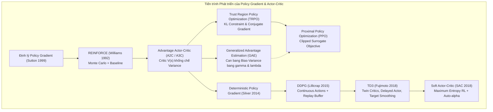

---

## 2. Chi tiết từng Keyword

---

### 1. Policy Gradient (Đạo hàm Chính sách)

#### a. Định nghĩa Bản chất Toán học (Mathematical Formulation)
Đạo hàm Chính sách giải quyết bài toán tối ưu hóa trực tiếp hàm mục tiêu hiệu năng $J(\theta)$ biểu thị kỳ vọng lợi nhuận của toàn bộ quỹ đạo $\tau = (s_0, a_0, r_1, \dots, s_T)$:
$$J(\theta) = \mathbb{E}_{\tau \sim \pi_\theta} [R(\tau)] = \int P(\tau; \theta) R(\tau) \, d\tau$$

**Định lý Đạo hàm Chính sách (Policy Gradient Theorem - Sutton et al., 1999)**:
Sử dụng thủ thuật Tỉ số Khả năng (Likelihood Ratio / Score Function Trick): $\nabla_\theta P(\tau; \theta) = P(\tau; \theta) \nabla_\theta \log P(\tau; \theta)$, ta có:
$$\nabla_\theta J(\theta) = \int P(\tau; \theta) \nabla_\theta \log P(\tau; \theta) R(\tau) \, d\tau = \mathbb{E}_{\tau \sim \pi_\theta} \left[ \nabla_\theta \log P(\tau; \theta) R(\tau) \right]$$

Vì xác suất quỹ đạo là $P(\tau; \theta) = \rho_0(s_0) \prod_{t=0}^{T-1} \pi_\theta(a_t \mid s_t) \mathcal{P}(s_{t+1} \mid s_t, a_t)$, khi lấy logarit và đạo hàm theo $\theta$, toàn bộ xác suất chuyển động lực học môi trường $\mathcal{P}$ chưa biết bị triệt tiêu hoàn toàn:
$$\nabla_\theta \log P(\tau; \theta) = \sum_{t=0}^{T-1} \nabla_\theta \log \pi_\theta(a_t \mid s_t)$$
Dẫn đến công thức Policy Gradient bất biến:
$$\nabla_\theta J(\theta) = \mathbb{E}_{\tau \sim \pi_\theta} \left[ \sum_{t=0}^{T-1} \nabla_\theta \log \pi_\theta(A_t \mid S_t) G_t \right]$$

#### b. Cơ chế Tầng Sâu & Điện toán (Under The Hood / Hardware Internals)
- **Automatic Differentiation Graph (Log-Derivative Trick)**: Trong các framework như PyTorch, ta không cần tự lập trình công thức giải tích của $\nabla_\theta \log \pi$. Bằng cách định nghĩa hàm mục tiêu giả (Surrogate Objective):
$$\mathcal{L}_{\text{surr}}(\theta) = -\sum_t \log \pi_\theta(a_t \mid s_t) \cdot G_t^{\text{detached}}$$
khi gọi `loss.backward()`, đồ thị tính toán Autograd tự động truyền ngược gradient về các tham số $\theta$ với chi phí bộ nhớ tối thiểu nhờ việc ngắt nhánh đạo hàm của $G_t$.

#### c. Sơ đồ Minh họa (Mermaid Diagram)
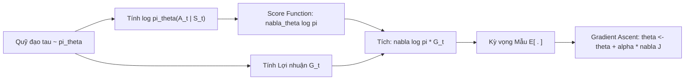

#### d. Code Thực chiến (Dual-Engine: C++ & Python)

```cpp
// C++20: Tính đạo hàm phân loại Categorical Policy Gradient
#include <iostream>
#include <vector>
#include <cmath>

std::vector<float> compute_categorical_policy_grad(const std::vector<float>& probs, int chosen_action, float return_g) {
    const size_t num_actions = probs.size();
    std::vector<float> grad_logits(num_actions, 0.0f);

    // nabla_{z_i} log Softmax(z)_a = I(i == a) - probs[i]
    for (size_t i = 0; i < num_actions; ++i) {
        float indicator = (static_cast<int>(i) == chosen_action) ? 1.0f : 0.0f;
        grad_logits[i] = (indicator - probs[i]) * return_g;
    }
    return grad_logits;
}

int main() {
    std::vector<float> probs = {0.2f, 0.5f, 0.3f};
    int action = 1; // Chọn hành động 1
    float G = 10.0f; // Nhận lợi nhuận cao

    auto grad = compute_categorical_policy_grad(probs, action, G);
    std::cout << "[C++] Policy Gradient w.r.t logits: [";
    for (float g : grad) std::cout << g << " ";
    std::cout << "]\n";
    return 0;
}
```

```python
# Python / PyTorch: Triển khai Đạo hàm Chính sách Surrogate Loss
import torch
import torch.nn as nn
from torch.distributions import Categorical

class PolicyNet(nn.Module):
    def __init__(self, s_dim: int, a_dim: int):
        super().__init__()
        self.fc = nn.Linear(s_dim, a_dim)

    def forward(self, s):
        return Categorical(logits=self.fc(s))

net = PolicyNet(4, 2)
opt = torch.optim.SGD(net.parameters(), lr=0.01)

# Forward pass
s = torch.randn(1, 4)
dist = net(s)
a = dist.sample()
log_p = dist.log_prob(a)
g_t = torch.tensor(5.0) # Loi nhuan thuc nghiem

# Surrogate Loss: L = - log_prob * G
loss = - log_p * g_t
opt.zero_grad()
loss.backward()
opt.step()
print(f"[PyTorch] Policy Gradient Applied. Action: {a.item()}, Loss: {loss.item():.4f}")
```

#### e. Lỗi Thường gặp & Ổn định Số học (Pitfalls & Numerical Stability)
- **High Variance Explosion**: Vì $G_t$ là tổng của hàng trăm bước ngẫu nhiên, phương sai của ước lượng gradient rất lớn. Đôi khi một hành động cực tốt lại bị gán $G_t$ âm do các hành động ngớ ngẩn ở các bước tiếp theo, làm chệch hướng hội tụ.

#### f. Ứng dụng Thực chiến trong AI / Deep Learning
- Phương pháp nền móng để sinh ra toàn bộ các thuật toán Actor-Critic và thuật toán tối ưu hóa lời nhắc (Prompt Optimization) trong LLM.

---

### 2. REINFORCE (Monte Carlo Policy Gradient)

#### a. Định nghĩa Bản chất Toán học (Mathematical Formulation)
REINFORCE (Williams, 1992) là thuật toán Policy Gradient dựa trên phương pháp Monte Carlo, sử dụng dữ liệu của toàn bộ một Episode hoàn chỉnh để cập nhật trọng số chính sách:
$$\theta \leftarrow \theta + \alpha \sum_{t=0}^{T-1} \gamma^t \nabla_\theta \log \pi_\theta(A_t \mid S_t) G_t$$

**Kỹ thuật Trừ Đường Cơ sở (Baseline Subtraction)**:
Để giảm mạnh phương sai mà không làm lệch kỳ vọng toán học, ta trừ đi một hàm cơ sở $b(S_t)$ không phụ thuộc vào hành động $A_t$:
$$\nabla_\theta J(\theta) = \mathbb{E} \left[ \sum_{t=0}^{T-1} \nabla_\theta \log \pi_\theta(A_t \mid S_t) \big( G_t - b(S_t) \big) \right]$$

**Chứng minh Tính Không Chệch (Unbiased Proof)**:
$$\mathbb{E}_{A_t \sim \pi_\theta} \left[ \nabla_\theta \log \pi_\theta(A_t \mid S_t) b(S_t) \right] = \sum_{a \in \mathcal{A}} \pi_\theta(a \mid S_t) \frac{\nabla_\theta \pi_\theta(a \mid S_t)}{\pi_\theta(a \mid S_t)} b(S_t)$$
$$= b(S_t) \sum_{a \in \mathcal{A}} \nabla_\theta \pi_\theta(a \mid S_t) = b(S_t) \nabla_\theta \left( \sum_{a \in \mathcal{A}} \pi_\theta(a \mid S_t) \right) = b(S_t) \nabla_\theta (1) = 0$$
Đường cơ sở tối ưu nhất thường là hàm giá trị trạng thái ước lượng $b(s) = V^\phi(s)$.

#### b. Cơ chế Tầng Sâu & Điện toán (Under The Hood / Hardware Internals)
- **Post-Episode Vectorized Rollout Processing**: Sau khi một episode kết thúc, toàn bộ tensor phần thưởng $\mathbf{R} \in \mathbb{R}^T$ được chuyển về GPU. Việc tính $G_t$ được thực hiện bằng phép nhân ma trận tam giác trên (Upper Triangular Toeplitz Matrix) hoặc hàm `torch.cumsum()` đảo ngược, hoàn thành trong $< 1\mu\text{s}$.

#### c. Sơ đồ Minh họa (Mermaid Diagram)
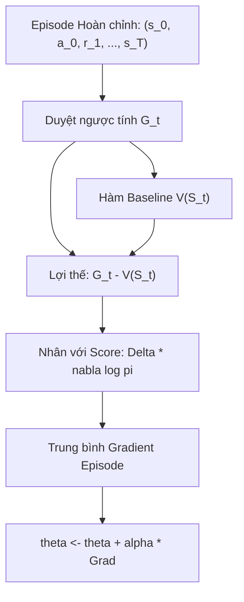

#### d. Code Thực chiến (Dual-Engine: C++ & Python)

```cpp
// C++20: Cập nhật REINFORCE với Baseline trung bình trượt
#include <iostream>
#include <vector>
#include <numeric>

class REINFORCEBaselineTracker {
private:
    float moving_baseline{0.0f};
    float beta{0.05f}; // He so EMA

public:
    float update_and_get_advantage(float return_g) {
        moving_baseline = (1.0f - beta) * moving_baseline + beta * return_g;
        return return_g - moving_baseline; // Advantage
    }

    float get_baseline() const noexcept { return moving_baseline; }
};

int main() {
    REINFORCEBaselineTracker tracker;
    float returns[] = {10.0f, 12.0f, 8.0f, 15.0f};
    for (float g : returns) {
        float adv = tracker.update_and_get_advantage(g);
        std::cout << "[C++] Return: " << g << " -> Advantage (G - b): " << adv << "\n";
    }
    return 0;
}
```

```python
# Python / PyTorch: Thuật toán REINFORCE hoàn chỉnh trên CartPole
import torch
import torch.nn as nn
from torch.distributions import Categorical

class REINFORCEAgent(nn.Module):
    def __init__(self):
        super().__init__()
        self.net = nn.Sequential(nn.Linear(4, 32), nn.ReLU(), nn.Linear(32, 2))
        self.saved_log_probs = []
        self.rewards = []

    def forward(self, x):
        return Categorical(logits=self.net(x))

    def finish_episode(self, optimizer, gamma=0.99):
        R = 0.0
        returns = []
        for r in reversed(self.rewards):
            R = r + gamma * R
            returns.insert(0, R)
        returns = torch.tensor(returns)
        # Chuan hoa returns lam baseline don gian
        returns = (returns - returns.mean()) / (returns.std() + 1e-8)

        policy_loss = []
        for log_prob, G in zip(self.saved_log_probs, returns):
            policy_loss.append(-log_prob * G)

        optimizer.zero_grad()
        loss = torch.stack(policy_loss).sum()
        loss.backward()
        optimizer.step()

        self.saved_log_probs.clear()
        self.rewards.clear()
        return loss.item()

agent = REINFORCEAgent()
opt = torch.optim.Adam(agent.parameters(), lr=0.01)
# Gia lap 3 buoc episode
for _ in range(3):
    dist = agent(torch.randn(1, 4))
    a = dist.sample()
    agent.saved_log_probs.append(dist.log_prob(a))
    agent.rewards.append(1.0)
ep_loss = agent.finish_episode(opt)
print(f"[PyTorch REINFORCE] Episode Finished, Loss: {ep_loss:.4f}")
```

#### e. Lỗi Thường gặp & Ổn định Số học (Pitfalls & Numerical Stability)
- **Batch Normalization Failure**: Khi episode chỉ có 1 hoặc 2 bước, việc tính độ lệch chuẩn `returns.std()` sẽ trả về `NaN` hoặc phép chia cho số 0. Luôn luôn cộng hằng số $\epsilon = 10^{-8}$ vào mẫu số.

#### f. Ứng dụng Thực chiến trong AI / Deep Learning
- Phương pháp huấn luyện cho các bài toán sinh chuỗi tuần tự rời rạc như Dịch máy (Neural Machine Translation) và Tóm tắt văn bản dùng RL căn chỉnh độ đo BLEU/ROUGE.

---

### 3. Advantage Function (Hàm Lợi thế)

#### a. Định nghĩa Bản chất Toán học (Mathematical Formulation)
Hàm Lợi thế $A^\pi(s, a)$ định lượng mức độ tốt hơn (hoặc xấu hơn) của một hành động cụ thể $a$ so với hành động trung bình mà chính sách $\pi$ sẽ lựa chọn tại trạng thái $s$:
$$A^\pi(s, a) = Q^\pi(s, a) - V^\pi(s)$$

Ý nghĩa các trường hợp:
- $A^\pi(s, a) > 0$: Hành động $a$ mang lại kết quả vượt trội hơn mức trung bình $\implies$ Tăng xác suất chọn $a$.
- $A^\pi(s, a) < 0$: Hành động $a$ mang lại kết quả kém hơn mức trung bình $\implies$ Giảm xác suất chọn $a$.

**Tính chất Trung tâm (Centering Property)**:
Kỳ vọng của hàm lợi thế dưới chính sách $\pi$ luôn bằng chính xác số $0$:
$$\mathbb{E}_{a \sim \pi(\cdot \mid s)} \left[ A^\pi(s, a) \right] = \sum_{a \in \mathcal{A}} \pi(a \mid s) \big( Q^\pi(s, a) - V^\pi(s) \big) = \sum_{a} \pi(a \mid s) Q^\pi(s, a) - V^\pi(s) = V^\pi(s) - V^\pi(s) = 0$$

#### b. Cơ chế Tầng Sâu & Điện toán (Under The Hood / Hardware Internals)
- **Advantage Normalization**: Trước khi đưa vector lợi thế $\mathbf{A} \in \mathbb{R}^B$ vào hàm mất mát gradient, việc chuẩn hóa theo batch (Batch Standardization):
$$\hat{\mathbf{A}} = \frac{\mathbf{A} - \mu_A}{\sigma_A + \epsilon}$$
giúp ổn định gradient ở biên độ xấp xỉ 1, cho phép sử dụng cùng một Learning Rate qua mọi giai đoạn huấn luyện trên phần cứng tăng tốc GPU.

#### c. Sơ đồ Minh họa (Mermaid Diagram)
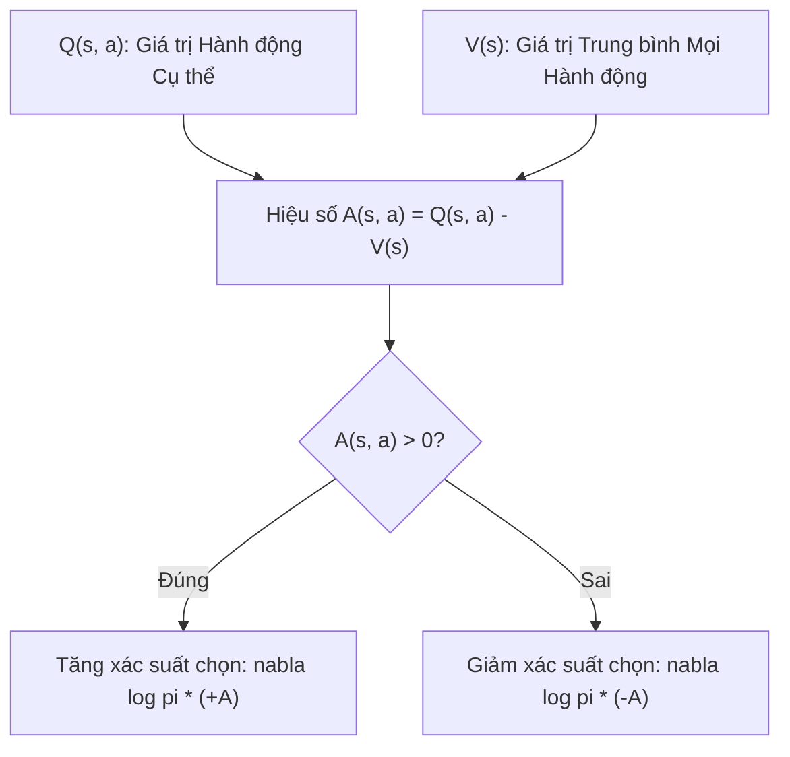

#### d. Code Thực chiến (Dual-Engine: C++ & Python)

```cpp
// C++20: Chuẩn hóa vector Advantage trong bộ nhớ liên tục
#include <iostream>
#include <vector>
#include <cmath>
#include <numeric>

void normalize_advantages(std::vector<float>& advantages) {
    const size_t n = advantages.size();
    float sum = std::accumulate(advantages.begin(), advantages.end(), 0.0f);
    float mean = sum / n;

    float sq_sum = 0.0f;
    for (float a : advantages) sq_sum += (a - mean) * (a - mean);
    float std_dev = std::sqrt(sq_sum / n) + 1e-8f;

    for (float& a : advantages) {
        a = (a - mean) / std_dev;
    }
}

int main() {
    std::vector<float> adv = {2.5f, -1.0f, 4.0f, 0.5f};
    normalize_advantages(adv);
    std::cout << "[C++] Normalized Advantage: [";
    for (float a : adv) std::cout << a << " ";
    std::cout << "]\n";
    return 0;
}
```

```python
# Python / PyTorch: Tính Advantage bằng TD Residual 1 bước
import torch

def compute_one_step_advantage(rewards: torch.Tensor, values: torch.Tensor, 
                               next_values: torch.Tensor, dones: torch.Tensor, gamma: float = 0.99):
    # delta_t = r_t + gamma * V(s_{t+1}) * (1 - done) - V(s_t)
    targets = rewards + gamma * next_values * (~dones)
    advantages = targets - values
    # Chuan hoa
    norm_advantages = (advantages - advantages.mean()) / (advantages.std() + 1e-8)
    return norm_advantages

r = torch.tensor([1.0, 0.0, 5.0])
v = torch.tensor([2.0, 1.5, 4.0])
nv = torch.tensor([1.5, 4.0, 0.0])
d = torch.tensor([False, False, True])
adv = compute_one_step_advantage(r, v, nv, d)
print(f"[PyTorch] 1-Step Normalized Advantage: {adv.numpy()}")
```

#### e. Lỗi Thường gặp & Ổn định Số học (Pitfalls & Numerical Stability)
- **Normalizing trên Batch Quá nhỏ**: Nếu kích thước mini-batch $B \le 4$, độ lệch chuẩn mẫu $\sigma_A$ dao động rất mạnh, dẫn đến việc khuếch đại nhiễu ngẫu nhiên thành các gradient khổng lồ. Kích thước batch khuyến nghị để chuẩn hóa Advantage là $B \ge 64$.

#### f. Ứng dụng Thực chiến trong AI / Deep Learning
- Là tín hiệu cốt lõi điều chỉnh hướng cập nhật của Actor trong mọi thuật toán A2C, PPO, TRPO.

---

### 4. Advantage Actor-Critic (A2C)

#### a. Định nghĩa Bản chất Toán học (Mathematical Formulation)
A2C là phiên bản **đồng bộ (Synchronous)**, tập trung hóa của phương pháp Actor-Critic. Thay vì chờ đợi phân tán, một quá trình điều phối trung tâm chạy song song $N$ môi trường đồng bộ.

1. **Bộ gom bước chuyển (Synchronous Step Collection)**:
Tại mỗi bước thời gian, toàn bộ $N$ môi trường thực thi hành động đồng thời:
$$\mathbf{S}_{t} \in \mathbb{R}^{N \times d}, \quad \mathbf{A}_t \sim \pi_\theta(\cdot \mid \mathbf{S}_t), \quad (\mathbf{S}_{t+1}, \mathbf{R}_{t+1}, \mathbf{D}_{t+1}) = \text{EnvStep}(\mathbf{A}_t)$$

2. **Hàm mất mát Kết hợp (Total Joint Loss)**:
$$\mathcal{L}_{\text{total}}(\theta, \phi) = \mathcal{L}_{\text{policy}}(\theta) + c_1 \mathcal{L}_{\text{value}}(\phi) - c_2 \mathcal{H}(\pi_\theta)$$
Trong đó:
- $\mathcal{L}_{\text{policy}}(\theta) = -\frac{1}{N} \sum_{i=1}^N \log \pi_\theta(a_t^{(i)} \mid s_t^{(i)}) \hat{A}_t^{(i)}$
- $\mathcal{L}_{\text{value}}(\phi) = \frac{1}{2N} \sum_{i=1}^N \left( R_{t+1}^{(i)} + \gamma V_\phi(S_{t+1}^{(i)}) - V_\phi(S_t^{(i)}) \right)^2$
- $\mathcal{H}(\pi_\theta) = -\sum_a \pi(a \mid s) \log \pi(a \mid s)$ là số hạng Entropy Regularization kích thích khám phá.

#### b. Cơ chế Tầng Sâu & Điện toán (Under The Hood / Hardware Internals)
- **GPU Batch Saturation**: A2C vượt trội hơn A3C trên kiến trúc GPU hiện đại vì nó gom dữ liệu từ $N$ môi trường thành một Tensor lớn duy nhất `[N, State_Dim]`. Điều này giúp tận dụng triệt để năng lực tính toán xử lý song song khối lớn (Bulk Synchronous Parallel) của các nhân CUDA và Tensor Cores, thay vì bị nghẽn khóa luồng CPU.

#### c. Sơ đồ Minh họa (Mermaid Diagram)
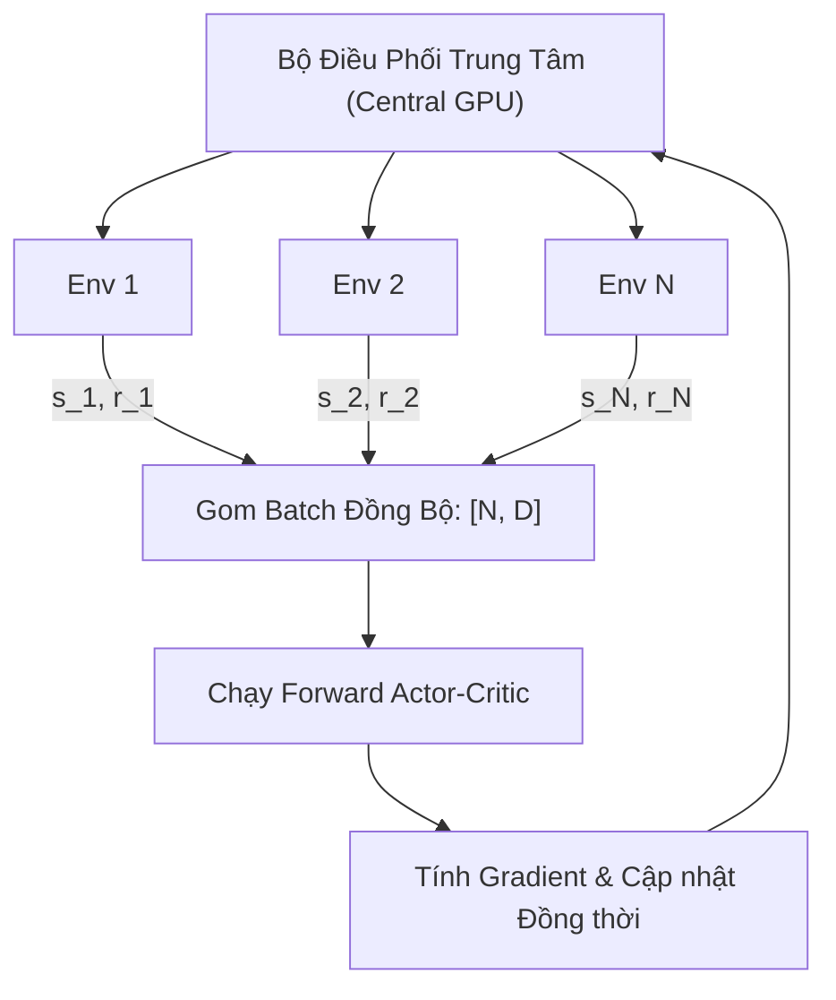

#### d. Code Thực chiến (Dual-Engine: C++ & Python)

```cpp
// C++20: Quản lý Batch Đồng bộ N Môi trường cho A2C
#include <iostream>
#include <vector>

struct SynchronousEnvBatch {
    size_t num_envs;
    std::vector<float> states;
    std::vector<float> rewards;
    std::vector<bool> dones;

    explicit SynchronousEnvBatch(size_t n) : num_envs(n), states(n, 0.0f), rewards(n, 0.0f), dones(n, false) {}

    void step_all(const std::vector<int>& actions) {
        for (size_t i = 0; i < num_envs; ++i) {
            states[i] += (actions[i] == 1) ? 1.0f : -1.0f;
            rewards[i] = (states[i] > 0.0f) ? 1.0f : -0.1f;
            dones[i] = (std::abs(states[i]) >= 5.0f);
            if (dones[i]) states[i] = 0.0f; // Auto-reset
        }
    }
};

int main() {
    SynchronousEnvBatch batch(4);
    std::vector<int> acts = {1, 0, 1, 1};
    batch.step_all(acts);
    std::cout << "[C++] Env 0 State: " << batch.states[0] << ", Reward: " << batch.rewards[0] << "\n";
    return 0;
}
```

```python
# Python / PyTorch: Vòng lặp Cập nhật A2C Đồng bộ hoàn chỉnh
import torch
import torch.nn as nn
from torch.distributions import Categorical

class A2CNet(nn.Module):
    def __init__(self, s_dim: int, a_dim: int):
        super().__init__()
        self.actor = nn.Sequential(nn.Linear(s_dim, 64), nn.ReLU(), nn.Linear(64, a_dim))
        self.critic = nn.Sequential(nn.Linear(s_dim, 64), nn.ReLU(), nn.Linear(64, 1))

    def forward(self, s):
        logits = self.actor(s)
        value = self.critic(s)
        return Categorical(logits=logits), value.squeeze(-1)

net = A2CNet(4, 2)
opt = torch.optim.Adam(net.parameters(), lr=1e-3)

# Batch 8 moi truong dong bo
states = torch.randn(8, 4)
dist, values = net(states)
actions = dist.sample()
rewards = torch.ones(8)
next_states = torch.randn(8, 4)
dones = torch.zeros(8, dtype=torch.bool)

with torch.no_grad():
    _, next_values = net(next_states)
    targets = rewards + 0.99 * next_values * (~dones)
    advantages = targets - values

# Loss calculation
policy_loss = - (dist.log_prob(actions) * advantages.detach()).mean()
value_loss = 0.5 * (targets - values).pow(2).mean()
entropy_loss = - dist.entropy().mean()

total_loss = policy_loss + 0.5 * value_loss + 0.01 * entropy_loss
opt.zero_grad()
total_loss.backward()
opt.step()
print(f"[PyTorch A2C] Total Loss: {total_loss.item():.4f}")
```

#### e. Lỗi Thường gặp & Ổn định Số học (Pitfalls & Numerical Stability)
- **Straggler Effect**: Nếu một trong số $N$ môi trường chạy chậm hơn các môi trường còn lại (ví dụ bị vướng I/O hoặc reset nặng), toàn bộ tiến trình A2C trên GPU phải dừng lại chờ đợi, làm giảm hiệu suất khai thác phần cứng.

#### f. Ứng dụng Thực chiến trong AI / Deep Learning
- Huấn luyện bot chơi game trong các môi trường giả lập vector hóa tốc độ cao như Atari EnvPool, Isaac Gym.

---

### 5. Asynchronous Advantage Actor-Critic (A3C)

#### a. Định nghĩa Bản chất Toán học (Mathematical Formulation)
A3C (Mnih et al., DeepMind 2016) là thuật toán tiên phong giải quyết vấn đề tương quan mẫu thời gian mà **hoàn toàn không cần Experience Replay Buffer**.

Cơ chế vận hành của A3C:
1. Duy trì một bộ tham số toàn cục (Global Shared Parameters) $\theta$ và $\phi$.
2. Tạo $N$ luồng công nhân (Worker Threads) độc lập chạy trên các lõi CPU khác nhau. Mỗi luồng sở hữu một môi trường riêng và một bản sao trọng số cục bộ (Local Weights) $\theta', \phi'$.
3. Mỗi worker tương tác $t_{\max}$ bước, tự tính toán gradient cục bộ:
$$d\theta = \nabla_{\theta'} \mathcal{L}_{\text{policy}}(\theta'), \quad d\phi = \nabla_{\phi'} \mathcal{L}_{\text{value}}(\phi')$$
4. Worker đẩy trực tiếp gradient cục bộ lên mạng tham số toàn cục theo cơ chế **Cập nhật Bất đồng bộ Không khóa (Hogwild! Lock-free Update - Niu et al., 2011)**:
$$\theta \leftarrow \theta - \alpha \, d\theta, \quad \phi \leftarrow \phi - \alpha \, d\phi$$
5. Worker đồng bộ lại trọng số mới nhất từ mạng toàn cục về máy mình: $\theta' \leftarrow \theta, \; \phi' \leftarrow \phi$.

#### b. Cơ chế Tầng Sâu & Điện toán (Under The Hood / Hardware Internals)
- **Lock-Free Shared Memory & Cache Invalidation**: Thuật toán Hogwild! cho phép các CPU thread ghi đè gradient vào cùng một mảng bộ nhớ dùng chung mà không cần dùng Mutex Lock. Mặc dù có nguy cơ xung đột ghi (Race Conditions), trong mạng nơ-ron sâu với hàng triệu tham số, xác suất hai thread ghi vào cùng một trọng số tại cùng một chu kỳ xung nhịp là cực thấp. Tuy nhiên, việc các core liên tục invalid cache line (L1/L2 Cache Coherence Traffic) là yếu tố hạn chế khả năng mở rộng khi số core $> 64$.

#### c. Sơ đồ Minh họa (Mermaid Diagram)
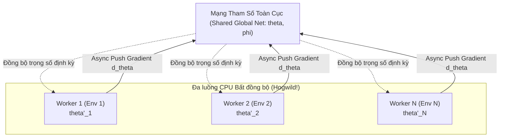

#### d. Code Thực chiến (Dual-Engine: C++ & Python)

```cpp
// C++20: Mô phỏng Cập nhật Trọng số Toàn cục Bất đồng bộ Atomic Lock-Free
#include <iostream>
#include <vector>
#include <atomic>
#include <thread>

class SharedGlobalWeights {
private:
    std::vector<std::atomic<float>> weights;

public:
    explicit SharedGlobalWeights(size_t n) : weights(n) {
        for (size_t i = 0; i < n; ++i) weights[i].store(0.0f);
    }

    void apply_gradient(size_t idx, float grad, float lr) {
        float current = weights[idx].load(std::memory_order_relaxed);
        // Lock-free CAS loop (Compare-And-Swap)
        while (!weights[idx].compare_exchange_weak(
            current, current - lr * grad, std::memory_order_relaxed)) {
            // Tiep tuc thu lai neu bi luong khac ghi de
        }
    }

    float get(size_t idx) const { return weights[idx].load(); }
};

int main() {
    SharedGlobalWeights global_w(2);
    // Luong 1 va Luong 2 cap nhat bat dong bo
    std::thread t1([&]() { global_w.apply_gradient(0, 1.5f, 0.1f); });
    std::thread t2([&]() { global_w.apply_gradient(0, -0.5f, 0.1f); });
    t1.join();
    t2.join();
    std::cout << "[C++ A3C Lock-free] Global Weight 0: " << global_w.get(0) << "\n";
    return 0;
}
```

```python
# Python / PyTorch: Cấu hình Shared Memory cho A3C bằng Torch Multiprocessing
import torch
import torch.multiprocessing as mp

class SharedModel(torch.nn.Module):
    def __init__(self):
        super().__init__()
        self.fc = torch.nn.Linear(4, 2)

    def forward(self, x):
        return self.fc(x)

def worker_process(rank, shared_model):
    # Tao ban sao cuc bo
    local_model = SharedModel()
    local_model.load_state_dict(shared_model.state_dict())
    # Tinh gradient gia lap
    loss = local_model(torch.randn(1, 4)).sum()
    loss.backward()
    # Day gradient len global shared model
    for p_shared, p_local in zip(shared_model.parameters(), local_model.parameters()):
        if p_shared.grad is None:
            p_shared.grad = p_local.grad
        else:
            p_shared.grad.copy_(p_local.grad)
    print(f"[Python Worker {rank}] Gradient pushed to shared model.")

# Khởi tạo shared memory
global_model = SharedModel()
global_model.share_memory() # Chuyen tensor sang bo nho dung chung lien tien trinh
p = mp.Process(target=worker_process, args=(0, global_model))
p.start()
p.join()
```

#### e. Lỗi Thường gặp & Ổn định Số học (Pitfalls & Numerical Stability)
- **Stale Gradients (Gradient Lỗi thời)**: Khi một worker tính toán gradient trên bản sao trọng số cũ, vào thời điểm nó đẩy gradient lên mạng toàn cục, trọng số toàn cục đã bị các worker khác thay đổi nhiều lần. Gradient bị trễ pha có thể phá hoại tính ổn định của mô hình.

#### f. Ứng dụng Thực chiến trong AI / Deep Learning
- Mở đường cho kỷ nguyên huấn luyện RL không cần GPU trên các cụm máy chủ CPU đa lõi lớn (e.g. AWS EC2 64-core instances).

---

### 6. Proximal Policy Optimization (PPO)

#### a. Định nghĩa Bản chất Toán học (Mathematical Formulation)
Proximal Policy Optimization (PPO - Schulman et al., 2017) hiện là thuật toán phổ biến và thành công nhất trong Deep RL, đóng vai trò giải thuật mặc định của OpenAI. PPO kế thừa ý tưởng giới hạn vùng cập nhật của TRPO nhưng sử dụng **tối ưu hóa gradient cấp 1 (First-order Optimization)** đơn giản hơn rất nhiều.

Định nghĩa Tỉ số Xác suất (Probability Ratio):
$$r_t(\theta) = \frac{\pi_\theta(a_t \mid s_t)}{\pi_{\theta_{\text{old}}}(a_t \mid s_t)}$$
Khi chính sách mới giống hệt chính sách cũ, $r_t(\theta_{\text{old}}) = 1$.

**Hàm Mục tiêu Kẹp Cắt (Clipped Surrogate Objective $L^{\text{CLIP}}$)**:
$$L^{\text{CLIP}}(\theta) = \hat{\mathbb{E}}_t \left[ \min\left( r_t(\theta) \hat{A}_t, \, \text{clip}(r_t(\theta), 1 - \epsilon, 1 + \epsilon) \hat{A}_t \right) \right]$$
Trong đó:
- $\epsilon \approx 0.1$ hoặc $0.2$ là biên kẹp an toàn.
- Toán tử $\min$ tạo thành **chặn dưới bi quan (Pessimistic Bound)**: nếu sự thay đổi của chính sách làm tăng hàm mục tiêu quá mức biên kẹp, nó sẽ bị cắt cụt; nếu sự thay đổi làm kết quả tồi tệ hơn, hàm mục tiêu không bị kẹp để thuật toán nhanh chóng hồi phục.

#### b. Cơ chế Tầng Sâu & Điện toán (Under The Hood / Hardware Internals)
- **Minibatch SGD over Collected Rollout Buffer**: Khác với A2C chỉ dùng dữ liệu 1 lần rồi xóa ngay, PPO cho phép chạy nhiều Epochs (e.g. 4 đến 10 epochs) của thuật toán Adam trên các Mini-batch bốc từ bộ đệm Rollout. Điều này làm tăng hệ số tái sử dụng dữ liệu tính toán trên GPU lên gấp 10 lần mà vẫn bảo đảm độ lệch chính sách không vượt quá biên an toàn $1 \pm \epsilon$.

#### c. Sơ đồ Minh họa (Mermaid Diagram)
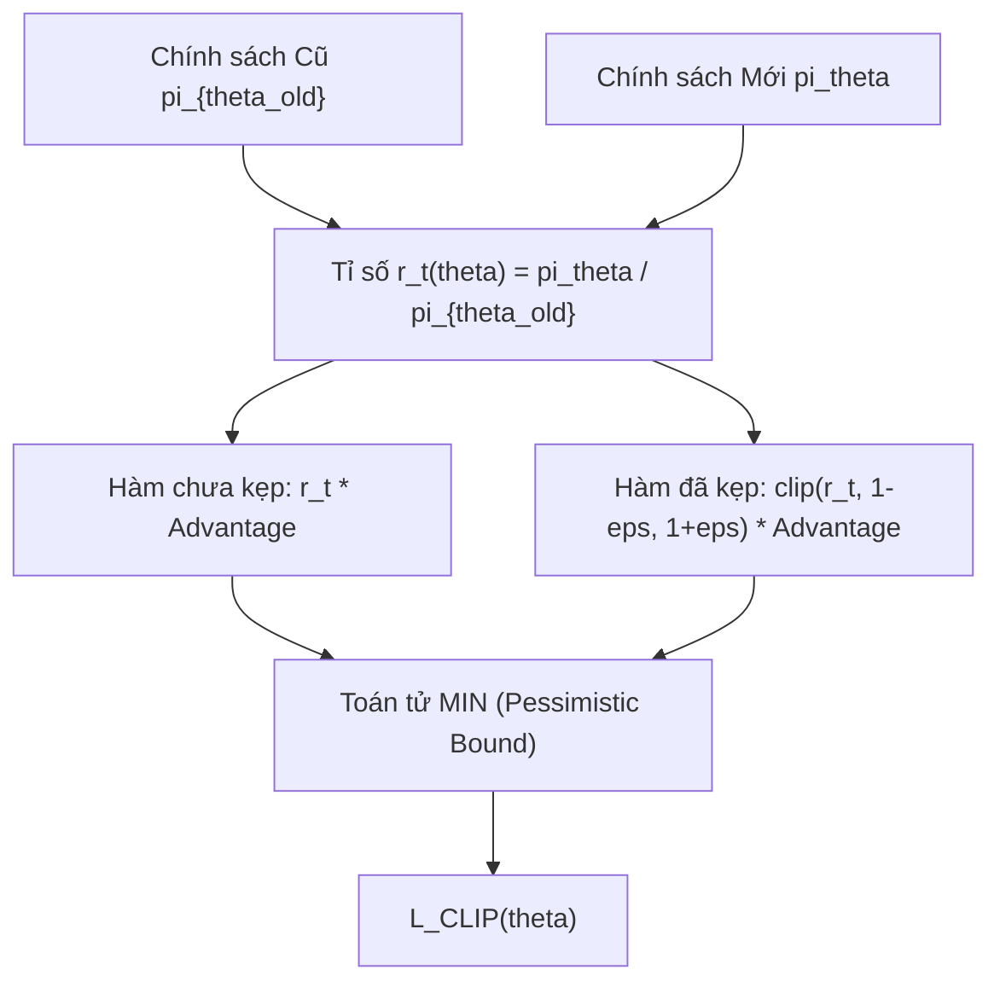

#### d. Code Thực chiến (Dual-Engine: C++ & Python)

```cpp
// C++20: Tính PPO Clipped Surrogate Objective
#include <iostream>
#include <algorithm>

float compute_ppo_clipped_objective(float prob_new, float prob_old, float advantage, float epsilon = 0.2f) {
    float ratio = prob_new / (prob_old + 1e-8f);
    float unclipped = ratio * advantage;
    float clipped_ratio = std::clamp(ratio, 1.0f - epsilon, 1.0f + epsilon);
    float clipped = clipped_ratio * advantage;

    // Lay min bi quan
    return std::min(unclipped, clipped);
}

int main() {
    // Truong hop 1: Loi the duong (Adv > 0), ratio tang qua muc cho phep (ratio = 1.5)
    float obj1 = compute_ppo_clipped_objective(0.75f, 0.5f, 2.0f, 0.2f);
    // Truong hop 2: Loi the am (Adv < 0), ratio giam qua muc (ratio = 0.5)
    float obj2 = compute_ppo_clipped_objective(0.25f, 0.5f, -2.0f, 0.2f);

    std::cout << "[C++] PPO Objective (Adv > 0, Ratio 1.5): " << obj1 << " (Bi kep o 1.2 * 2 = 2.4)\n";
    std::cout << "[C++] PPO Objective (Adv < 0, Ratio 0.5): " << obj2 << " (Khong bi kep, giu nguyen -1.0)\n";
    return 0;
}
```

```python
# Python / PyTorch: PPO Loss Function hoàn chỉnh cho một Mini-Batch
import torch

def ppo_clipped_loss(log_probs_new: torch.Tensor, log_probs_old: torch.Tensor,
                     advantages: torch.Tensor, epsilon: float = 0.2) -> torch.Tensor:
    # 1. Tinh ratio bang exp(log_prob_new - log_prob_old) de tranh underflow
    ratio = torch.exp(log_probs_new - log_probs_old)

    # 2. Hai nhanh unclipped va clipped
    surr1 = ratio * advantages
    surr2 = torch.clamp(ratio, 1.0 - epsilon, 1.0 + epsilon) * advantages

    # 3. PPO Loss: toi da hoa L_CLIP <=> toi thieu hoa -L_CLIP
    policy_loss = - torch.min(surr1, surr2).mean()
    return policy_loss

lp_new = torch.tensor([-0.693, -1.2])
lp_old = torch.tensor([-0.750, -1.1])
adv = torch.tensor([1.5, -0.8])
loss = ppo_clipped_loss(lp_new, lp_old, adv)
print(f"[PyTorch PPO] Clipped Policy Loss: {loss.item():.4f}")
```

#### e. Lỗi Thường gặp & Ổn định Số học (Pitfalls & Numerical Stability)
- **Early Stopping KL Divergence**: Nếu phân phối chính sách mới trôi quá xa so với chính sách cũ ($D_{\text{KL}}(\pi_{\text{old}} \parallel \pi) > 1.5 \times \text{target\_kl}$), việc tiếp tục chạy các epoch tối ưu tiếp theo sẽ phá vỡ tính ổn định. Cần ngắt sớm vòng lặp (Early Stop) của epoch hiện tại.

#### f. Ứng dụng Thực chiến trong AI / Deep Learning
- **Tiêu chuẩn Vàng cho RLHF (Reinforcement Learning from Human Feedback)**: Dùng để căn chỉnh InstructGPT, ChatGPT, Claude, Llama 2/3 đảm bảo mô hình trả lời trung thực, hữu ích và vô hại.

---

### 7. Trust Region Policy Optimization (TRPO)

#### a. Định nghĩa Bản chất Toán học (Mathematical Formulation)
TRPO (Schulman et al., 2015) giải quyết vấn đề bước nhảy gradient quá lớn phá hủy chính sách bằng cách áp dụng **Định lý Cải tiến Đơn điệu (Monotonic Improvement Theorem - Kakade & Langford, 2002)**:
$$J(\pi_{\text{new}}) \ge J(\pi_{\text{old}}) + \mathbb{E}_{s \sim \rho_{\pi_{\text{old}}}, a \sim \pi_{\text{new}}} \left[ A^{\pi_{\text{old}}}(s, a) \right] - C \cdot D_{\text{KL}}^{\max}(\pi_{\text{old}}, \pi_{\text{new}})$$

Để biến định lý này thành thuật toán thực thi khả thi, TRPO thiết lập bài toán tối ưu hóa ràng buộc:
$$\max_\theta \hat{\mathbb{E}}_t \left[ \frac{\pi_\theta(a_t \mid s_t)}{\pi_{\theta_{\text{old}}}(a_t \mid s_t)} \hat{A}_t \right]$$
Ràng buộc trong Vùng Tin cậy:
$$\hat{\mathbb{E}}_t \left[ D_{\text{KL}}(\pi_{\theta_{\text{old}}}(\cdot \mid s_t) \parallel \pi_\theta(\cdot \mid s_t)) \right] \le \delta$$

**Nghiệm Xấp xỉ Cấp 2 (Second-Order Approximation)**:
Khai triển Taylor cấp 1 cho hàm mục tiêu và cấp 2 cho ràng buộc KL (với $\mathbf{g} = \nabla_\theta L$, $\mathbf{H}$ là Ma trận Thông tin Fisher - Fisher Information Matrix FIM):
$$\theta \approx \theta_{\text{old}} + \sqrt{\frac{2 \delta}{\mathbf{g}^T \mathbf{H}^{-1} \mathbf{g}}} \mathbf{H}^{-1} \mathbf{g}$$
Vector hướng $\mathbf{x} = \mathbf{H}^{-1} \mathbf{g}$ được giải bằng thuật toán **Gradient Liên hợp (Conjugate Gradient - CG)** kết hợp với tìm kiếm đường lùi (Backtracking Line Search) để bảo đảm ràng buộc được thỏa mãn.

#### b. Cơ chế Tầng Sâu & Điện toán (Under The Hood / Hardware Internals)
- **Hessian-Free Conjugate Gradient via Pearlmutter Trick**: Ma trận FIM $\mathbf{H} \in \mathbb{R}^{P \times P}$ (với $P$ là số triệu tham số) đòi hỏi hàng Terabyte bộ nhớ nếu lưu tường minh. Thuật toán TRPO không bao giờ tính toán hay lưu ma trận $\mathbf{H}$. Thay vào đó, nó sử dụng tích Hessian - Vector:
$$\mathbf{H} \mathbf{v} = \nabla_\theta \left( (\nabla_\theta D_{\text{KL}})^T \mathbf{v} \right)$$
được tính qua 2 lượt đạo hàm tự động Autograd ngược, giữ mức tiêu thụ RAM luôn ở mức tối thiểu $\mathcal{O}(P)$.

#### c. Sơ đồ Minh họa (Mermaid Diagram)
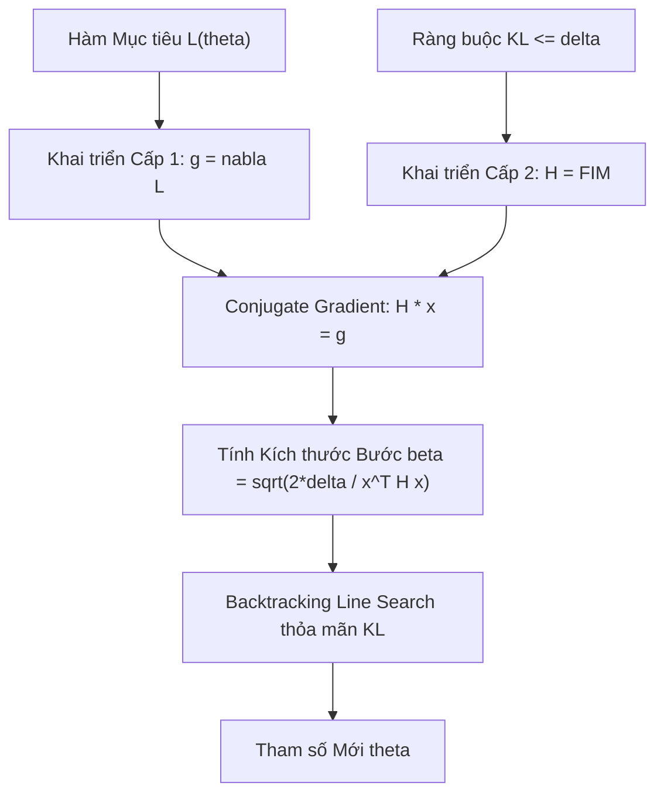

#### d. Code Thực chiến (Dual-Engine: C++ & Python)

```cpp
// C++20: Thuật toán Conjugate Gradient giải hệ Ax = b ma trận đối xứng dương
#include <iostream>
#include <vector>
#include <cmath>

std::vector<float> conjugate_gradient_solve(const std::vector<std::vector<float>>& A, const std::vector<float>& b, size_t max_steps = 10) {
    size_t n = b.size();
    std::vector<float> x(n, 0.0f);
    std::vector<float> r = b; // r_0 = b - A*x_0 = b
    std::vector<float> p = r;
    float rs_old = 0.0f;
    for (float val : r) rs_old += val * val;

    for (size_t step = 0; step < max_steps; ++step) {
        // Ap = A * p
        std::vector<float> Ap(n, 0.0f);
        for (size_t i = 0; i < n; ++i) {
            for (size_t j = 0; j < n; ++j) Ap[i] += A[i][j] * p[j];
        }

        float p_Ap = 0.0f;
        for (size_t i = 0; i < n; ++i) p_Ap += p[i] * Ap[i];

        float alpha = rs_old / (p_Ap + 1e-10f);
        for (size_t i = 0; i < n; ++i) x[i] += alpha * p[i];
        for (size_t i = 0; i < n; ++i) r[i] -= alpha * Ap[i];

        float rs_new = 0.0f;
        for (float val : r) rs_new += val * val;
        if (std::sqrt(rs_new) < 1e-6f) break;

        for (size_t i = 0; i < n; ++i) p[i] = r[i] + (rs_new / rs_old) * p[i];
        rs_old = rs_new;
    }
    return x;
}

int main() {
    std::vector<std::vector<float>> FIM = {{2.0f, 0.5f}, {0.5f, 3.0f}};
    std::vector<float> grad = {1.0f, 2.0f};
    auto x = conjugate_gradient_solve(FIM, grad);
    std::cout << "[C++ CG] Natural Step Direction x: [" << x[0] << ", " << x[1] << "]\n";
    return 0;
}
```

```python
# Python / PyTorch: Tích Hessian-Vector (HVP) tối ưu bộ nhớ dùng trong TRPO
import torch

def hessian_vector_product(kl: torch.Tensor, parameters, vector: torch.Tensor) -> torch.Tensor:
    # Dao ham cap 1 cua KL
    grads = torch.autograd.grad(kl, parameters, create_graph=True)
    flat_grad = torch.cat([g.view(-1) for g in grads])

    # Tich vo huong grad * v
    grad_vector_product = (flat_grad * vector).sum()

    # Dao ham cap 2 lan truyen tiep
    hvp = torch.autograd.grad(grad_vector_product, parameters)
    flat_hvp = torch.cat([h.contiguous().view(-1) for h in hvp])
    return flat_hvp

# Test HVP
param = torch.nn.Parameter(torch.tensor([1.0, 2.0]))
dummy_kl = 0.5 * (param ** 2).sum() # Hessian la ma tran don vi I
v = torch.tensor([3.0, 4.0])
res_hvp = hessian_vector_product(dummy_kl, [param], v)
print(f"[PyTorch TRPO] Hessian-Vector Product: {res_hvp.numpy()} (Khop voi I * v)")
```

#### e. Lỗi Thường gặp & Ổn định Số học (Pitfalls & Numerical Stability)
- **Extreme Computational Overhead**: Việc phải chạy thuật toán Conjugate Gradient (10 đến 20 bước) và Line Search (10 bước) cho mỗi bản cập nhật làm cho TRPO chậm hơn PPO từ 3 đến 5 lần và rất khó để phân tán trên nhiều GPU.

#### f. Ứng dụng Thực chiến trong AI / Deep Learning
- Là cơ sở lý thuyết toán học vững chắc nhất về tính hội tụ đơn điệu trong Học tăng cường, đặt nền móng trực tiếp cho sự ra đời của PPO.

---

### 8. Deep Deterministic Policy Gradient (DDPG)

#### a. Định nghĩa Bản chất Toán học (Mathematical Formulation)
DDPG (Lillicrap et al., 2015) mở rộng thuật toán Q-Learning sang không gian hành động liên tục bằng cách kết hợp mạng **Chính sách Tất định (Deterministic Policy $\mu_\theta(s)$)** và mạng **Đánh giá Hành động ($Q_\phi(s, a)$)**.

**Định lý Đạo hàm Chính sách Tất định (DPG Theorem - Silver et al., 2014)**:
Gradient của hàm mục tiêu hiệu năng $J(\theta)$ theo tham số chính sách tất định $\theta$ có dạng:
$$\nabla_\theta J(\theta) = \mathbb{E}_{s \sim \rho^\beta} \left[ \nabla_\theta \mu_\theta(s) \nabla_a Q_\phi(s, a) \big|_{a = \mu_\theta(s)} \right]$$
Đây chính là quy tắc đạo hàm hàm hợp (Chain Rule) đa biến: Critic tính đạo hàm mức độ tăng giá trị theo từng chiều hành động $\nabla_a Q$, sau đó Actor điều chỉnh trọng số $\theta$ theo hướng đó.

**Kỹ thuật Trọng số Mục tiêu Mềm (Soft Target Updates / Polyak Averaging)**:
Thay vì sao chép đột ngột sau $C$ bước như DQN, DDPG cập nhật chậm mạng mục tiêu ở mỗi bước thời gian:
$$\theta^- \leftarrow \tau \theta + (1 - \tau) \theta^-, \quad \phi^- \leftarrow \tau \phi + (1 - \tau) \phi^- \quad (\text{với } \tau \ll 1, \text{e.g. } \tau = 0.005)$$

#### b. Cơ chế Tầng Sâu & Điện toán (Under The Hood / Hardware Internals)
- **Gradient Flow through Continuous Action Tensor**: Trong quá trình cập nhật Actor, ta thực hiện chuỗi: $\text{State} \to \text{Actor} \to \text{Action} \to \text{Critic} \to \text{Q-Value}$. Để cập nhật Actor mà không làm biến đổi Critic, ta phải đóng băng gradient của Critic (`for p in critic.parameters(): p.requires_grad = False`) trước khi gọi `q_value.backward()`.

#### c. Sơ đồ Minh họa (Mermaid Diagram)
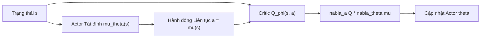

#### d. Code Thực chiến (Dual-Engine: C++ & Python)

```cpp
// C++20: Cập nhật Trọng số Mềm Polyak Averaging
#include <iostream>
#include <vector>

void polyak_average_update(std::vector<float>& target_weights, const std::vector<float>& main_weights, float tau = 0.005f) {
    const size_t n = target_weights.size();
    float* __restrict tgt = target_weights.data();
    const float* __restrict src = main_weights.data();

    #pragma omp simd
    for (size_t i = 0; i < n; ++i) {
        tgt[i] = tau * src[i] + (1.0f - tau) * tgt[i];
    }
}

int main() {
    std::vector<float> main_w = {10.0f, 20.0f};
    std::vector<float> target_w = {0.0f, 0.0f};
    polyak_average_update(target_w, main_w, 0.1f);
    std::cout << "[C++] Polyak Target Weights: [" << target_w[0] << ", " << target_w[1] << "]\n";
    return 0;
}
```

```python
# Python / PyTorch: Vòng lặp cập nhật Actor DDPG theo Chain Rule
import torch
import torch.nn as nn

class DeterministicActor(nn.Module):
    def __init__(self, s_dim: int, a_dim: int):
        super().__init__()
        self.net = nn.Sequential(nn.Linear(s_dim, 64), nn.ReLU(), nn.Linear(64, a_dim), nn.Tanh())
    def forward(self, s): return self.net(s)

class ContinuousCritic(nn.Module):
    def __init__(self, s_dim: int, a_dim: int):
        super().__init__()
        self.net = nn.Sequential(nn.Linear(s_dim + a_dim, 64), nn.ReLU(), nn.Linear(64, 1))
    def forward(self, s, a): return self.net(torch.cat([s, a], dim=-1))

actor = DeterministicActor(3, 1)
critic = ContinuousCritic(3, 1)
actor_opt = torch.optim.Adam(actor.parameters(), lr=1e-3)

states = torch.randn(4, 3)
# Maximizing Q(s, mu(s)) <=> Minimizing -Q(s, mu(s))
actions = actor(states)
actor_loss = - critic(states, actions).mean()

actor_opt.zero_grad()
actor_loss.backward()
actor_opt.step()
print(f"[PyTorch DDPG] Actor Loss updated: {actor_loss.item():.4f}")
```

#### e. Lỗi Thường gặp & Ổn định Số học (Pitfalls & Numerical Stability)
- **Cực kỳ Nhạy cảm với Hyperparameters & Khám phá Kém**: DDPG sử dụng quá trình ngẫu nhiên Ornstein-Uhlenbeck (OU Process) để sinh nhiễu khám phá cho hành động tất định. Nếu nhiễu tắt quá nhanh, Agent sẽ ngừng học hoàn toàn; ngoài ra, hiện tượng Overestimation Bias của mạng Q khiến DDPG rất dễ bị phân kỳ.

#### f. Ứng dụng Thực chiến trong AI / Deep Learning
- Điều khiển góc lái và chân ga trong các hệ sinh thái mô phỏng đường đua (Torcs, Gym CarRacing).

---

### 9. Twin Delayed DDPG (TD3)

#### a. Định nghĩa Bản chất Toán học (Mathematical Formulation)
TD3 (Fujimoto et al., 2018) giải quyết triệt để 3 điểm yếu chí mạng của DDPG bằng cách đưa vào **3 cơ chế kỹ thuật cốt lõi**:

1. **Clipped Double-Q Tricks (Khử Overestimation)**:
Sử dụng hai mạng Critic độc lập $Q_{\phi_1}$ và $Q_{\phi_2}$, và lấy giá trị cực tiểu khi tính mục tiêu Bellman:
$$y = R_{t+1} + \gamma (1 - d_t) \min_{i=1, 2} Q_{\phi_i^-}(S_{t+1}, \tilde{a})$$

2. **Làm Trơn Chính sách Mục tiêu (Target Policy Smoothing)**:
Cộng thêm một lượng nhiễu Gaussian bị kẹp vào hành động mục tiêu để làm mịn hàm giá trị xung quanh điểm dự đoán, tránh việc mạng nơ-ron khai thác các gai nhọn cực đại ảo:
$$\tilde{a} = \text{clip}\left( \mu_{\theta^-}(S_{t+1}) + \text{clip}(\epsilon, -c, c), \, a_{\text{low}}, \, a_{\text{high}} \right), \quad \epsilon \sim \mathcal{N}(0, \sigma^2)$$

3. **Trì hoãn Cập nhật Chính sách (Delayed Policy Updates)**:
Cập nhật mạng Actor $\theta$ và các mạng Target với tần suất chậm hơn Critic (ví dụ: chỉ cập nhật Actor 1 lần sau mỗi $d=2$ lần cập nhật Critic), đảm bảo Critic đã hội tụ tương đối ổn định trước khi hướng dẫn Actor.

#### b. Cơ chế Tầng Sâu & Điện toán (Under The Hood / Hardware Internals)
- **Twin Forward Passes on GPU**: Để tối ưu hiệu suất tính toán khi có hai mạng Critic $Q_1, Q_2$, thay vì gọi 2 lượt forward riêng biệt, ta có thể ghép trọng số của $Q_1$ và $Q_2$ thành một mạng duy nhất dùng kỹ thuật Batched GEMM (hoặc `torch.vmap`), giảm một nửa số lượng kernel launch trên GPU.

#### c. Sơ đồ Minh họa (Mermaid Diagram)
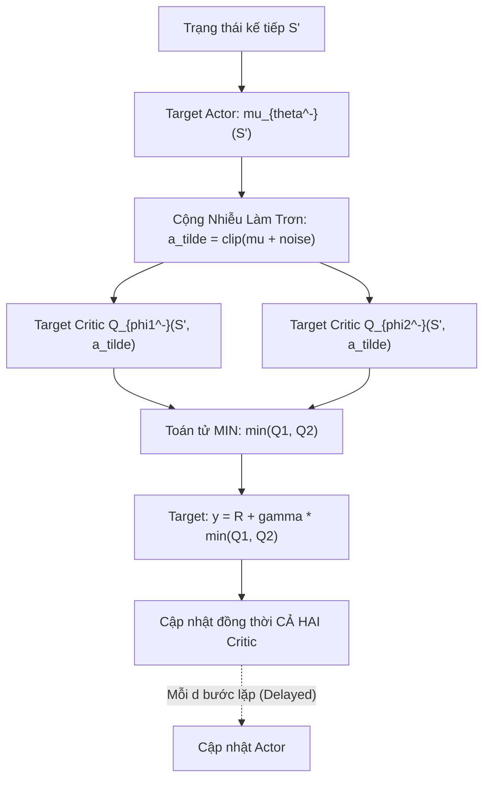

#### d. Code Thực chiến (Dual-Engine: C++ & Python)

```cpp
// C++20: Làm trơn hành động mục tiêu (Target Action Smoothing) với kẹp biên
#include <iostream>
#include <algorithm>
#include <random>

class TargetSmoother {
private:
    float noise_std{0.2f};
    float noise_clip{0.5f};
    float act_min{-1.0f};
    float act_max{1.0f};
    std::mt19937 rng{42};
    std::normal_distribution<float> norm{0.0f, 1.0f};

public:
    float smooth(float base_action) {
        float noise = std::clamp(norm(rng) * noise_std, -noise_clip, noise_clip);
        return std::clamp(base_action + noise, act_min, act_max);
    }
};

int main() {
    TargetSmoother smoother;
    float smooth_act = smoother.smooth(0.8f);
    std::cout << "[C++ TD3] Smoothed Action: " << smooth_act << "\n";
    return 0;
}
```

```python
# Python / PyTorch: Tính TD3 Clipped Double Critic Target
import torch
import torch.nn.functional as F

def td3_critic_loss(q1_net, q2_net, target_actor, target_q1, target_q2,
                    states, actions, rewards, next_states, dones,
                    gamma=0.99, noise_std=0.2, noise_clip=0.5):
    with torch.no_grad():
        # 1. Target policy smoothing
        noise = (torch.randn_like(actions) * noise_std).clamp(-noise_clip, noise_clip)
        next_actions = (target_actor(next_states) + noise).clamp(-1.0, 1.0)

        # 2. Clipped double Q target
        target_q = torch.min(target_q1(next_states, next_actions), target_q2(next_states, next_actions))
        y = rewards + gamma * target_q * (~dones)

    # 3. MSE loss cho ca hai critic
    q1_loss = F.mse_loss(q1_net(states, actions), y)
    q2_loss = F.mse_loss(q2_net(states, actions), y)
    return q1_loss + q2_loss

print("[PyTorch TD3] Logic hàm mất mát Twin Critic định nghĩa thành công.")
```

#### e. Lỗi Thường gặp & Ổn định Số học (Pitfalls & Numerical Stability)
- **Nhiễu làm trơn quá lớn**: Nếu đặt `noise_std` quá lớn, hành động mục tiêu $\tilde{a}$ sẽ bị phân tán lệch hoàn toàn khỏi hành vi tối ưu của Agent, khiến Critic đánh giá sai lệch khả năng thực tế của Actor.

#### f. Ứng dụng Thực chiến trong AI / Deep Learning
- Chuẩn mực đánh giá trong môi trường liên tục phức tạp: MuJoCo (HalfCheetah, Ant, Humanoid).

---

### 10. Soft Actor-Critic (SAC) & Generalized Advantage Estimation (GAE)

#### a. Định nghĩa Bản chất Toán học (Mathematical Formulation)
**Soft Actor-Critic (SAC - Haarnoja et al., 2018)** là thuật toán điều khiển ngoài chính sách hàng đầu kết hợp khung lý thuyết **Học tăng cường Cực đại hóa Entropy (Maximum Entropy RL)**:
$$J(\pi) = \sum_{t=0}^T \mathbb{E}_{(S_t, A_t) \sim \rho_\pi} \left[ R(S_t, A_t) + \alpha \mathcal{H}(\pi(\cdot \mid S_t)) \right]$$
Trong đó:
- $\mathcal{H}(\pi(\cdot \mid S_t)) = \mathbb{E}_{a \sim \pi} [-\log \pi(a \mid S_t)]$ là độ đo Entropy (mức độ hỗn loạn/ngẫu nhiên của chính sách).
- $\alpha$ là hệ số nhiệt độ (Temperature Parameter) tự động điều chỉnh qua tối ưu hóa đối ngẫu Lagrange:
$$\mathcal{L}(\alpha) = \mathbb{E}_{a \sim \pi} \left[ -\alpha \left( \log \pi(a \mid s) + \bar{\mathcal{H}} \right) \right], \quad \text{với } \bar{\mathcal{H}} = -\dim(\mathcal{A})$$

**Generalized Advantage Estimation (GAE - Schulman et al., 2015)**:
GAE là phương pháp vàng để ước lượng hàm lợi thế trong các thuật toán On-Policy (như PPO). GAE tính trung bình trọng số suy giảm theo cấp số nhân của các sai số TD $\delta_t^V = R_{t+1} + \gamma V(S_{t+1}) - V(S_t)$:
$$\hat{A}_t^{\text{GAE}(\gamma, \lambda)} = \sum_{l=0}^{\infty} (\gamma \lambda)^l \delta_{t+l}^V$$
- Khi $\lambda = 0$: $\hat{A}_t = \delta_t^V$ (chính xác 1-step TD, phương sai tối thiểu, độ chệch tối đa).
- Khi $\lambda = 1$: $\hat{A}_t = \sum_{l=0}^\infty \gamma^l R_{t+l+1} - V(S_t)$ (chính xác Monte Carlo, phương sai tối đa, độ chệch bằng 0).

#### b. Cơ chế Tầng Sâu & Điện toán (Under The Hood / Hardware Internals)
- **Reparameterization Trick with Tanh Jacobian in SAC**: Để gradient chảy qua entropy, SAC sử dụng phép lấy mẫu reparameterized Gauss kết hợp với hàm nén $\tanh$:
$$a = \tanh(u), \quad u \sim \mathcal{N}(\mu(s), \sigma^2(s))$$
Đạo hàm của biểu thức này đòi hỏi phép tính log-determinant của ma trận Jacobian:
$$\log \pi(a \mid s) = \log \mathcal{N}(u; \mu(s), \sigma^2(s)) - \sum_{i} \log(1 - \tanh^2(u_i) + \epsilon)$$
Kernel tính toán này được nén trong 1 pass CUDA duy nhất để tránh tạo các tensor trung gian lớn trên VRAM.

#### c. Sơ đồ Minh họa (Mermaid Diagram)
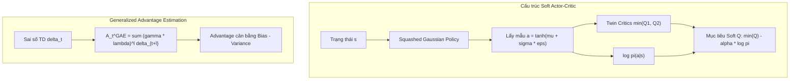

#### d. Code Thực chiến (Dual-Engine: C++ & Python)

```cpp
// C++20: Tính GAE lặp ngược dòng thời gian tối ưu hóa Cache
#include <iostream>
#include <vector>

std::vector<float> compute_gae_backwards(const std::vector<float>& rewards,
                                         const std::vector<float>& values,
                                         float next_value,
                                         const std::vector<bool>& dones,
                                         float gamma = 0.99f,
                                         float lambda = 0.95f) {
    const size_t n = rewards.size();
    std::vector<float> advantages(n, 0.0f);
    float last_gae = 0.0f;

    for (int t = static_cast<int>(n) - 1; t >= 0; --t) {
        float next_v = (t == static_cast<int>(n) - 1) ? next_value : values[t + 1];
        float non_terminal = dones[t] ? 0.0f : 1.0f;
        float delta = rewards[t] + gamma * next_v * non_terminal - values[t];
        last_gae = delta + gamma * lambda * non_terminal * last_gae;
        advantages[t] = last_gae;
    }
    return advantages;
}

int main() {
    std::vector<float> r = {1.0f, 0.0f, 2.0f};
    std::vector<float> v = {0.5f, 1.2f, 1.8f};
    std::vector<bool> d = {false, false, true};
    auto gae = compute_gae_backwards(r, v, 0.0f, d);
    std::cout << "[C++] GAE Values: [";
    for (float a : gae) std::cout << a << " ";
    std::cout << "]\n";
    return 0;
}
```

```python
# Python / PyTorch: Tự động điều chỉnh nhiệt độ Alpha trong SAC
import torch
import torch.nn as nn

class AutoAlphaSAC(nn.Module):
    def __init__(self, target_entropy: float = -1.0):
        super().__init__()
        self.target_entropy = target_entropy
        # Hoc truc tiep log_alpha de dam bao alpha > 0
        self.log_alpha = nn.Parameter(torch.zeros(1))
        self.alpha_optimizer = torch.optim.Adam([self.log_alpha], lr=3e-4)

    @property
    def alpha(self):
        return self.log_alpha.exp()

    def update_alpha(self, log_probs: torch.Tensor):
        # Loss: - alpha * (log_prob + target_entropy)
        alpha_loss = - (self.alpha * (log_probs.detach() + self.target_entropy)).mean()
        self.alpha_optimizer.zero_grad()
        alpha_loss.backward()
        self.alpha_optimizer.step()
        return alpha_loss.item()

sac_alpha = AutoAlphaSAC(target_entropy=-1.0)
fake_log_probs = torch.tensor([-2.5]) # Chinh sach qua ngau nhien -> Alpha can giam
loss = sac_alpha.update_alpha(fake_log_probs)
print(f"[PyTorch SAC] Alpha Loss: {loss:.4f}, New Alpha: {sac_alpha.alpha.item():.4f}")
```

#### e. Lỗi Thường gặp & Ổn định Số học (Pitfalls & Numerical Stability)
- **Log Probability Underflow**: Khi $a = \tanh(u)$ tiến sát $\pm 1$, biểu thức $1 - a^2$ tiệm cận 0, khiến $\log(1 - a^2) \to -\infty$, sinh ra các giá trị gradient `NaN`. Bắt buộc phải sử dụng `torch.clamp(1 - a.pow(2), min=1e-6)`.

#### f. Ứng dụng Thực chiến trong AI / Deep Learning
- **Robotics Manipulation**: SAC là thuật toán phổ biến nhất trên các cánh tay robot công nghiệp thực tế (Franka Emika Panda) nhờ khả năng tự động khám phá mạnh mẽ và thích nghi với các va chạm cơ học.
