# Chuyên đề: Thăm dò, RL An toàn & Các Hướng Biên giới (Exploration, Safe RL & Frontiers)

## 1. Tổng quan Chuyên đề

Học tăng cường hiện đại đã vượt ra khỏi phạm vi các bài toán đồ chơi trong phòng thí nghiệm để tiến vào các hệ thống thế giới thực phức tạp. Tuy nhiên, việc triển khai RL trên quy mô công nghiệp phải đối mặt với ba rào cản nền tảng:
1. **Thách thức Thăm dò (Exploration Challenge)**: Làm thế nào Agent có thể tìm thấy mục tiêu trong những môi trường mà phần thưởng cực kỳ thưa thớt (Sparse Rewards) hoặc không gian trạng thái vô tận?
2. **Yêu cầu An toàn Tuyệt đối (Safe & Constrained RL)**: Làm thế nào để Agent học tập hiệu quả mà không bao giờ vi phạm các ràng buộc an toàn vật lý (ví dụ: không làm rơi vỡ cánh tay robot triệu đô hoặc không gây tai nạn cho xe tự hành)?
3. **Các Biên giới Mở rộng (Frontiers)**: Học ngoại tuyến từ dữ liệu tĩnh có sẵn (Offline RL), trừu tượng hóa thời gian phân tầng (Hierarchical RL), phối hợp nhiều tác nhân (Multi-Agent RL), mô hình hóa thế giới (World Models), và thu hẹp khoảng cách giả lập sang thực tế (Sim-to-Real Transfer).

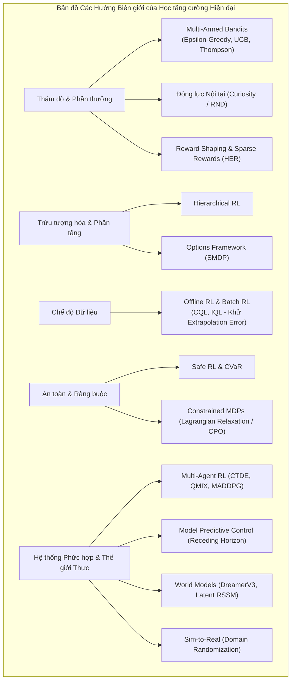

---

## 2. Chi tiết từng Keyword

---

### 1. Exploration vs Exploitation (Đánh đổi Thăm dò - Khai thác)

#### a. Định nghĩa Bản chất Toán học (Mathematical Formulation)
Sự Đánh đổi Thăm dò - Khai thác là bài toán kinh điển mô tả sự mâu thuẫn giữa hai mục tiêu:
1. **Khai thác (Exploitation)**: Chọn hành động mà hệ thống hiện tại tin rằng sẽ mang lại phần thưởng cao nhất: $a = \arg\max_{a'} \hat{Q}(a')$.
2. **Thăm dò (Exploration)**: Thử nghiệm những hành động chưa chắc chắn nhằm thu thập thêm thông tin, với hy vọng tìm thấy những hành vi vượt trội hơn trong tương lai.

Được hình thức hóa qua bài toán **Cực tiểu hóa Độ ân hận (Regret Minimization)** trong $T$ bước:
$$R_T = \sum_{t=1}^T \left( \mu^* - \mu_{A_t} \right) = T \mu^* - \sum_{t=1}^T \mathbb{E}[\mu_{A_t}]$$
Trong đó $\mu^*$ là giá trị kỳ vọng của hành động tối ưu thực tế, và $\mu_{A_t}$ là giá trị kỳ vọng của hành động đã chọn tại bước $t$.
- Theo **Định lý Chặn dưới Lai & Robbins (1985)**: Bất kỳ thuật toán nào cũng phải chịu mức độ ân hận tối thiểu tăng trưởng theo quy luật logarit theo thời gian:
$$\liminf_{T \to \infty} \frac{R_T}{\log T} \ge \sum_{a: \mu_a < \mu^*} \frac{\mu^* - \mu_a}{D_{\text{KL}}(P_a \parallel P^*)}$$

#### b. Cơ chế Tầng Sâu & Điện toán (Under The Hood / Hardware Internals)
- **Tracking Uncertainty on GPU**: Việc theo dõi độ bất định của hàng triệu trạng thái đòi hỏi lưu trữ các biến đếm số lần ghé thăm $N(s, a)$ hoặc ma trận hiệp phương sai. Trên phần cứng, thao tác này được thực hiện qua các mảng băm số nguyên nguyên tử (Atomic Hash Tables) trên GPU hoặc sử dụng các mạng ngẫu nhiên cố định (như RND).

#### c. Sơ đồ Minh họa (Mermaid Diagram)
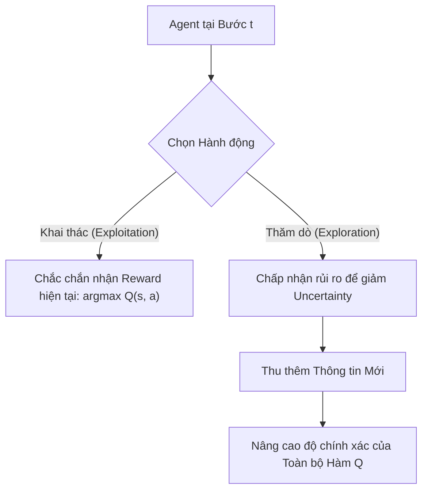

#### d. Code Thực chiến (Dual-Engine: C++ & Python)

```cpp
// C++20: Đo lường Cumulative Regret trong bài toán Multi-Armed Bandit
#include <iostream>
#include <vector>
#include <numeric>

class BanditRegretTracker {
private:
    float optimal_mean{0.8f};
    float cumulative_regret{0.0f};

public:
    void step(float chosen_arm_true_mean) {
        cumulative_regret += (optimal_mean - chosen_arm_true_mean);
    }

    float get_regret() const noexcept { return cumulative_regret; }
};

int main() {
    BanditRegretTracker tracker;
    tracker.step(0.5f); // Chon arm kem hon -> Regret + 0.3
    tracker.step(0.8f); // Chon arm toi uu -> Regret + 0.0
    std::cout << "[C++] Cumulative Regret: " << tracker.get_regret() << "\n";
    return 0;
}
```

```python
# Python / NumPy: Mô phỏng bài toán Đánh đổi Thăm dò - Khai thác
import numpy as np

class MultiArmedBanditEnv:
    def __init__(self, means):
        self.means = np.array(means)
        self.optimal_mean = np.max(self.means)

    def pull(self, arm: int) -> float:
        return np.random.normal(loc=self.means[arm], scale=0.5)

env = MultiArmedBanditEnv([0.2, 0.5, 0.9, 0.4])
print(f"[Python] Best Arm Index: {np.argmax(env.means)}, Max Reward: {env.optimal_mean}")
```

#### e. Lỗi Thường gặp & Ổn định Số học (Pitfalls & Numerical Stability)
- **Sa vào Cực tiểu Cục bộ Sớm (Premature Exploitation)**: Nếu Agent bắt đầu khai thác quá sớm khi chưa khám phá đủ, nó sẽ vĩnh viễn lặp lại một hành động tầm thường và bỏ lỡ hành động mang lại phần thưởng khổng lồ ẩn giấu.

#### f. Ứng dụng Thực chiến trong AI / Deep Learning
- Tối ưu hóa gợi ý tin tức trên Bảng tin Facebook và thử nghiệm A/B Testing tự động cho chiến dịch quảng cáo Google Ads.

---

### 2. Epsilon-Greedy

#### a. Định nghĩa Bản chất Toán học (Mathematical Formulation)
$\epsilon$-Greedy là cơ chế thăm dò đơn giản và phổ biến nhất:
$$\pi(a \mid s) = \begin{cases} 1 - \epsilon + \frac{\epsilon}{|\mathcal{A}|} & \text{nếu } a = \arg\max_{a' \in \mathcal{A}} Q(s, a') \\ \frac{\epsilon}{|\mathcal{A}|} & \text{ngược lại} \end{cases}$$
Trong đó $\epsilon \in [0, 1]$ là xác suất Agent quyết định hành động ngẫu nhiên hoàn toàn.

**Điều kiện Hội tụ GLIE (Greedy in the Limit with Infinite Exploration)**:
Để bảo đảm chính sách hội tụ về nghiệm tối ưu toàn cục theo thời gian, $\epsilon$ phải suy giảm dần theo lịch trình (Epsilon Decay Schedule) thỏa mãn:
$$\lim_{t \to \infty} \epsilon_t = 0 \quad \text{và} \quad \sum_{t=1}^\infty \epsilon_t = \infty$$
Ví dụ phổ biến: $\epsilon_t = \max\left(\epsilon_{\min}, \, \epsilon_0 \cdot d^t\right)$ với hệ số suy giảm $d \in (0, 1)$.

#### b. Cơ chế Tầng Sâu & Điện toán (Under The Hood / Hardware Internals)
- **Vectorized PRNG in GPU Kernels**: Khi chạy $N$ môi trường song song trên GPU, việc sinh số ngẫu nhiên $\epsilon$ độc lập cho từng môi trường được tối ưu bằng các bộ sinh ngẫu nhiên nhẹ trên phần cứng như Philox hoặc XORShift trong cuRAND, tránh tình trạng tắc nghẽn khóa luồng toàn cục.

#### c. Sơ đồ Minh họa (Mermaid Diagram)
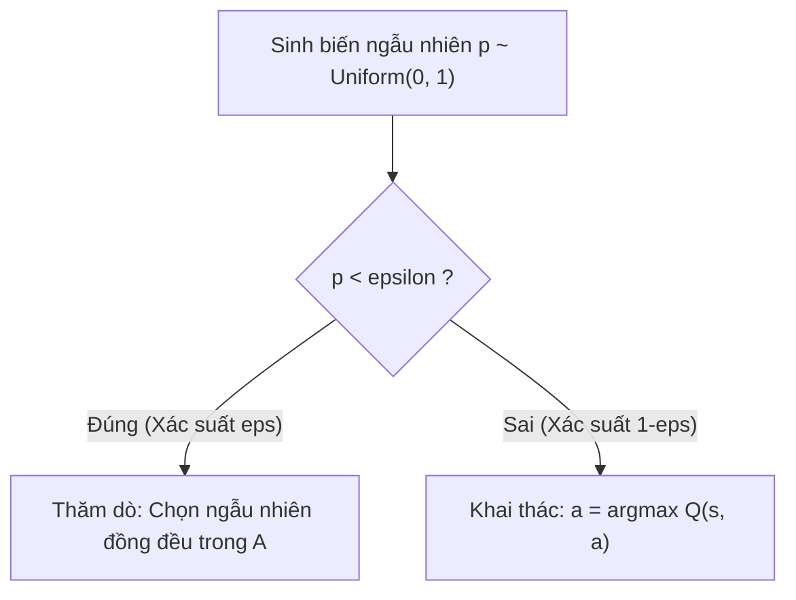

#### d. Code Thực chiến (Dual-Engine: C++ & Python)

```cpp
// C++20: Bộ điều phối Epsilon-Greedy với Exponential Decay
#include <iostream>
#include <algorithm>
#include <random>

class EpsilonDecayScheduler {
private:
    float current_eps;
    float min_eps;
    float decay_rate;

public:
    EpsilonDecayScheduler(float start = 1.0f, float min_val = 0.05f, float decay = 0.995f)
        : current_eps(start), min_eps(min_val), decay_rate(decay) {}

    float step() {
        current_eps = std::max(min_eps, current_eps * decay_rate);
        return current_eps;
    }

    [[nodiscard]] float get() const noexcept { return current_eps; }
};

int main() {
    EpsilonDecayScheduler sched(1.0f, 0.1f, 0.9f);
    for (int i = 0; i < 5; ++i) {
        std::cout << "[C++] Step " << i << " -> Epsilon: " << sched.step() << "\n";
    }
    return 0;
}
```

```python
# Python / NumPy: Vectorized Epsilon-Greedy Action Selection
import numpy as np

def vectorized_epsilon_greedy(q_values: np.ndarray, epsilon: float) -> np.ndarray:
    num_envs, num_actions = q_values.shape
    # 1. Tim hanh dong greedy
    greedy_actions = np.argmax(q_values, axis=1)
    # 2. Sinh hanh dong ngau nhien
    random_actions = np.random.randint(0, num_actions, size=num_envs)
    # 3. Chon dua tren mask boolean
    explore_mask = np.random.rand(num_envs) < epsilon
    return np.where(explore_mask, random_actions, greedy_actions)

q = np.array([[1.0, 5.0], [8.0, 2.0], [3.0, 4.0]]) # 3 envs
actions = vectorized_epsilon_greedy(q, epsilon=0.33)
print(f"[Python] Vectorized Chosen Actions: {actions}")
```

#### e. Lỗi Thường gặp & Ổn định Số học (Pitfalls & Numerical Stability)
- **Thăm dò Mù quáng (Blind Exploration)**: $\epsilon$-Greedy chọn ngẫu nhiên đồng đều trên mọi hành động không tham lam. Nếu trong 10 hành động có 1 hành động chết người (nhảy xuống vực) và 1 hành động khám phá tiềm năng, $\epsilon$-greedy sẽ đối xử với cả hai như nhau.

#### f. Ứng dụng Thực chiến trong AI / Deep Learning
- Chiến lược thăm dò mặc định kinh điển trong DQN chơi game Atari của DeepMind.

---

### 3. Upper Confidence Bound (UCB)

#### a. Định nghĩa Bản chất Toán học (Mathematical Formulation)
Nguyên lý của UCB dựa trên triết lý **"Lạc quan khi đối mặt với sự Bất định" (Optimism in the Face of Uncertainty)**: nếu một hành động có độ bất định cao, ta tạm thời giả định rằng nó có tiềm năng mang lại phần thưởng rất lớn.

Công thức thuật toán **UCB1 (Auer et al., 2002)**:
$$A_t = \arg\max_{a \in \mathcal{A}} \left[ \hat{Q}_t(a) + c \sqrt{\frac{\ln t}{N_t(a)}} \right]$$
Trong đó:
- $\hat{Q}_t(a)$: Trung bình mẫu phần thưởng quan sát được của hành động $a$.
- $N_t(a)$: Số lần hành động $a$ đã được chọn tính đến thời điểm $t$.
- $t$: Tổng số bước thời gian đã trôi qua.
- $\sqrt{\frac{\ln t}{N_t(a)}}$: **Khoảng tin cậy trên (Upper Confidence Interval)**, suy ra trực tiếp từ Bất đẳng thức Tập trung Hoeffding (Hoeffding's Inequality):
$$\mathbb{P}\left( \mu_a \ge \hat{Q}_t(a) + U_t(a) \right) \le e^{-2 N_t(a) U_t^2(a)} = t^{-4}$$
với việc đặt $U_t(a) = \sqrt{\frac{2 \ln t}{N_t(a)}}$.

Thuật toán UCB1 đạt được **Độ ân hận tiệm cận Logarit tối ưu (Logarithmic Regret Bound)**:
$$\mathbb{E}[R_T] \le 8 \sum_{a: \mu_a < \mu^*} \frac{\ln T}{\mu^* - \mu_a} + \left(1 + \frac{\pi^2}{3}\right) \sum_{a} (\mu^* - \mu_a)$$

#### b. Cơ chế Tầng Sâu & Điện toán (Under The Hood / Hardware Internals)
- **Zero-Division Avoidance in Parallel Tree Search**: Trong MCTS (như AlphaGo), hàng nghìn luồng đồng thời mở rộng cây và truy vấn giá trị PUCT (Predictor + UCB). Để tránh phép chia cho 0 khi $N(s, a) = 0$, phần tử được khởi tạo với $N = \epsilon$ hoặc được ép buộc ghé thăm ít nhất 1 lần trong giai đoạn khởi tạo.

#### c. Sơ đồ Minh họa (Mermaid Diagram)
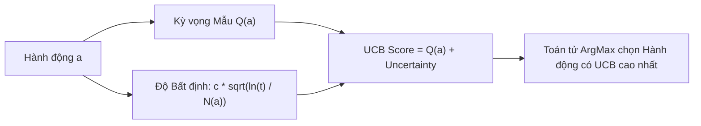

#### d. Code Thực chiến (Dual-Engine: C++ & Python)

```cpp
// C++20: Thuật toán UCB1 Multi-Armed Bandit
#include <iostream>
#include <vector>
#include <cmath>
#include <algorithm>

class UCB1Agent {
private:
    size_t num_arms;
    std::vector<float> q_values;
    std::vector<int> counts;
    int total_steps{0};
    float c_param;

public:
    UCB1Agent(size_t k, float c = 1.414f) : num_arms(k), q_values(k, 0.0f), counts(k, 0), c_param(c) {}

    int select_arm() {
        total_steps++;
        // Uu tien chon moi arm 1 lan dau tien
        for (size_t a = 0; a < num_arms; ++a) {
            if (counts[a] == 0) return static_cast<int>(a);
        }

        float max_ucb = -1e9f;
        int best_arm = 0;
        float log_t = std::log(static_cast<float>(total_steps));

        for (size_t a = 0; a < num_arms; ++a) {
            float bonus = c_param * std::sqrt(log_t / counts[a]);
            float ucb_val = q_values[a] + bonus;
            if (ucb_val > max_ucb) {
                max_ucb = ucb_val;
                best_arm = static_cast<int>(a);
            }
        }
        return best_arm;
    }

    void update(int arm, float reward) {
        counts[arm]++;
        q_values[arm] += (reward - q_values[arm]) / counts[arm];
    }
};

int main() {
    UCB1Agent agent(3);
    int arm = agent.select_arm();
    agent.update(arm, 1.0f);
    std::cout << "[C++] UCB1 Arm Selected: " << arm << "\n";
    return 0;
}
```

```python
# Python / NumPy: UCB1 Simulation vs Random Exploration
import numpy as np

def ucb1_selection(q_estimates, counts, t, c=1.414):
    bonus = c * np.sqrt(np.log(t + 1) / (counts + 1e-6))
    return int(np.argmax(q_estimates + bonus))

q_est = np.array([0.5, 0.8, 0.4])
pull_counts = np.array([100, 100, 5]) # Arm 2 ít được kéo -> Bonus rất cao
chosen = ucb1_selection(q_est, pull_counts, t=205)
print(f"[Python] UCB1 Chosen Arm: {chosen} (Ưu tiên khám phá arm ít dữ liệu)")
```

#### e. Lỗi Thường gặp & Ổn định Số học (Pitfalls & Numerical Stability)
- **Không áp dụng trực tiếp được cho Không gian Trạng thái Lớn**: UCB yêu cầu biến đếm chính xác $N(s, a)$. Trong không gian liên tục hoặc ảnh pixel, hầu như không có hai trạng thái nào trùng khớp từng bit, khiến $N(s, a) = 0$ ở mọi nơi. Cần dùng Pseudo-counts hoặc Random Network Distillation.

#### f. Ứng dụng Thực chiến trong AI / Deep Learning
- Thuật toán PUCT trong Tìm kiếm Cây Monte Carlo của **AlphaGo, AlphaZero, KataGo**.

---

### 4. Thompson Sampling (Lấy mẫu Thompson)

#### a. Định nghĩa Bản chất Toán học (Mathematical Formulation)
Thompson Sampling (Posterior Sampling / Bayesian Bandits - Thompson, 1933) tiếp cận bài toán thăm dò dưới góc nhìn Xác suất Bayes. Thay vì chọn theo biên độ tin cậy cứng (như UCB), Thompson Sampling duy trì một **phân phối tiên nghiệm/hậu nghiệm (Posterior Distribution)** về kỳ vọng của mỗi hành động:
$$P(\theta \mid \mathcal{D}_t) \propto P(\mathcal{D}_t \mid \theta) P(\theta)$$

Tại mỗi bước thời gian $t$:
1. Lấy mẫu một tham số giá trị $\tilde{\theta}_a$ từ phân phối hậu nghiệm hiện tại của từng hành động:
$$\tilde{\theta}_a \sim P(\theta_a \mid \mathcal{D}_t), \quad \forall a \in \mathcal{A}$$
2. Chọn hành động có giá trị vừa lấy mẫu cao nhất:
$$A_t = \arg\max_{a \in \mathcal{A}} \tilde{\theta}_a$$

**Liên hợp Bayes Beta-Bernoulli (Beta-Binomial Conjugate Prior)**:
Với phần thưởng nhị phân $R \in \{0, 1\}$, hàm tiên nghiệm liên hợp là phân phối Beta $\text{Beta}(\alpha_a, \beta_a)$.
Quy tắc cập nhật đóng giải tích cực kỳ thanh lịch:
- Nhận phần thưởng thành công ($R = 1$): $\alpha_a \leftarrow \alpha_a + 1$
- Nhận phần thưởng thất bại ($R = 0$): $\beta_a \leftarrow \beta_a + 1$

#### b. Cơ chế Tầng Sâu & Điện toán (Under The Hood / Hardware Internals)
- **Fast Gamma/Beta Sampling via SIMD**: Việc lấy mẫu từ phân phối Beta được thực hiện gián tiếp qua việc sinh hai biến ngẫu nhiên Gamma độc lập: $X \sim \text{Gamma}(\alpha, 1), Y \sim \text{Gamma}(\beta, 1) \implies \frac{X}{X + Y} \sim \text{Beta}(\alpha, \beta)$. Bằng các thư viện tối ưu phần cứng (như Intel MKL hoặc cuRAND), việc sinh hàng nghìn mẫu diễn ra trong vài nano-giây.

#### c. Sơ đồ Minh họa (Mermaid Diagram)
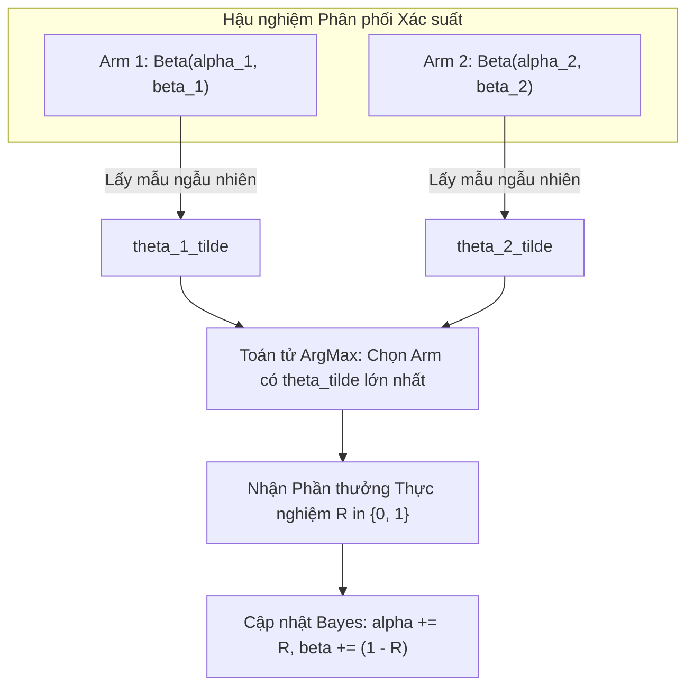

#### d. Code Thực chiến (Dual-Engine: C++ & Python)

```cpp
// C++20: Triển khai Thompson Sampling với Phân phối Beta liên hợp
#include <iostream>
#include <vector>
#include <random>

class ThompsonSamplingBernoulli {
private:
    struct ArmParams {
        float alpha{1.0f}; // Tien nghiem dong deu Uniform(0, 1)
        float beta{1.0f};
    };
    std::vector<ArmParams> arms;
    std::mt19937 rng{1337};

public:
    explicit ThompsonSamplingBernoulli(size_t k) : arms(k) {}

    int select_arm() {
        float max_sample = -1.0f;
        int best_arm = 0;

        for (size_t a = 0; a < arms.size(); ++a) {
            std::gamma_distribution<float> gamma_a(arms[a].alpha, 1.0f);
            std::gamma_distribution<float> gamma_b(arms[a].beta, 1.0f);
            float x = gamma_a(rng);
            float y = gamma_b(rng);
            float beta_sample = x / (x + y + 1e-8f);

            if (beta_sample > max_sample) {
                max_sample = beta_sample;
                best_arm = static_cast<int>(a);
            }
        }
        return best_arm;
    }

    void update(int arm, int reward) {
        if (reward == 1) arms[arm].alpha += 1.0f;
        else arms[arm].beta += 1.0f;
    }
};

int main() {
    ThompsonSamplingBernoulli ts(3);
    int arm = ts.select_arm();
    ts.update(arm, 1);
    std::cout << "[C++] Thompson Sampling Selected Arm: " << arm << "\n";
    return 0;
}
```

```python
# Python / NumPy: So sánh phân phối Posterior của Thompson Sampling
import numpy as np

class ThompsonSampler:
    def __init__(self, num_arms: int):
        self.alphas = np.ones(num_arms)
        self.betas = np.ones(num_arms)

    def select(self) -> int:
        samples = np.random.beta(self.alphas, self.betas)
        return int(np.argmax(samples))

    def update(self, arm: int, reward: int):
        self.alphas[arm] += reward
        self.betas[arm] += (1 - reward)

ts = ThompsonSampler(num_arms=3)
# Gia su arm 1 lien tuc thanh cong
for _ in range(10): ts.update(1, 1)
# Gia su arm 0 lien tuc that bai
for _ in range(10): ts.update(0, 0)

chosen = ts.select()
print(f"[Python] Thompson Sampled Arm: {chosen} (Arm 1 posterior mean = {ts.alphas[1]/(ts.alphas[1]+ts.betas[1]):.2f})")
```

#### e. Lỗi Thường gặp & Ổn định Số học (Pitfalls & Numerical Stability)
- **Extreme Beta Parameters**: Khi số bước $T > 10^6$, các tham số $\alpha, \beta$ có thể vượt ngưỡng hàng triệu, khiến thuật toán sinh phân phối Gamma gặp hiện tượng tràn số dấu chấm động. Cần chuẩn hóa hoặc áp dụng hệ số suy giảm thời gian (Discounted Thompson Sampling).

#### f. Ứng dụng Thực chiến trong AI / Deep Learning
- Phân phối lưu lượng người dùng tối ưu trong các hệ thống gợi ý của Netflix và Spotify.

---

### 5. Intrinsic Motivation (Động lực Nội tại)

#### a. Định nghĩa Bản chất Toán học (Mathematical Formulation)
Trong các môi trường có phần thưởng thưa thớt (Sparse Rewards) hoặc hoàn toàn không có phần thưởng ngoại tại ($R_t^e = 0$), Agent không thể học được bất cứ điều gì nếu chỉ dựa vào môi trường. **Động lực Nội tại (Intrinsic Motivation / Curiosity-Driven Learning)** trao cho Agent khả năng tự sinh phần thưởng nội tại $R_t^i$:
$$R_t = R_t^e + \eta R_t^i$$

Hai cơ chế toán học chủ đạo:
1. **Intrinsic Curiosity Module (ICM - Pathak et al., 2017)**: Phần thưởng nội tại tỷ lệ thuận với **sai số dự báo động lực học tiến (Forward Dynamics Prediction Error)** trong không gian đặc trưng ẩn $\phi(s)$:
$$R_t^i = \frac{1}{2} \|\hat{\phi}(S_{t+1}) - \phi(S_{t+1})\|_2^2$$
Mô hình nghịch đảo (Inverse Dynamics Model) $g(\phi(S_t), \phi(S_{t+1})) \to \hat{A}_t$ được dùng để loại bỏ các đặc trưng nhiễu không kiểm soát được (Noisy-TV Problem).

2. **Random Network Distillation (RND - Burda et al., 2018)**: Sử dụng một mạng mục tiêu cố định ngẫu nhiên $f_{\text{target}}(s)$ và một mạng dự đoán học được $f_{\text{pred}}(s; \theta)$:
$$R_t^i = \|f_{\text{pred}}(S_t; \theta) - f_{\text{target}}(S_t)\|_2^2$$
Trạng thái nào ghé thăm càng nhiều thì $f_{\text{pred}}$ học càng giống $f_{\text{target}} \implies R^i \to 0$. Trạng thái mới lạ sẽ có sai số lớn $\implies R^i$ cao.

#### b. Cơ chế Tầng Sâu & Điện toán (Under The Hood / Hardware Internals)
- **Frozen Weight Optimization in RND**: Mạng $f_{\text{target}}$ được khởi tạo ngẫu nhiên một lần duy nhất và đóng băng vĩnh viễn (`requires_grad = False`). Thao tác forward qua mạng target trên GPU tiêu tốn rất ít tài nguyên vì không cần lưu trữ activations trong bộ nhớ đệm cho quá trình lan truyền ngược Autograd.

#### c. Sơ đồ Minh họa (Mermaid Diagram)
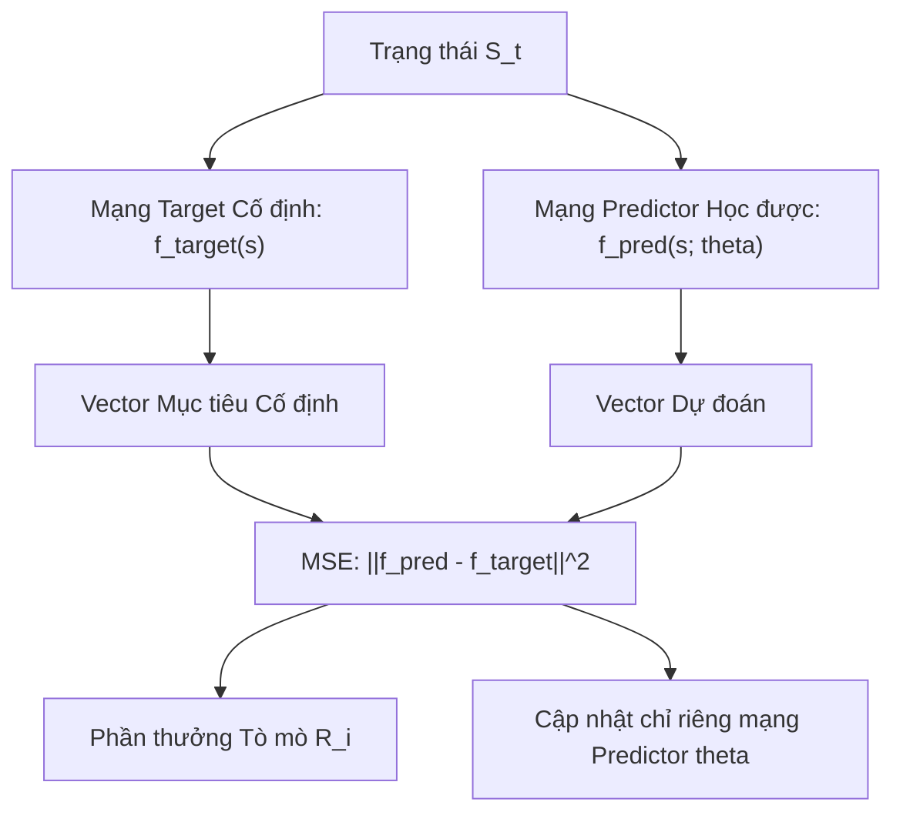

#### d. Code Thực chiến (Dual-Engine: C++ & Python)

```cpp
// C++20: Tính phần thưởng tò mò dựa trên khoảng cách Euclidean L2 giữa 2 vector biểu diễn
#include <iostream>
#include <vector>
#include <cmath>

float compute_rnd_intrinsic_reward(const std::vector<float>& target_feat, const std::vector<float>& pred_feat) {
    float mse = 0.0f;
    const size_t n = target_feat.size();
    for (size_t i = 0; i < n; ++i) {
        float diff = target_feat[i] - pred_feat[i];
        mse += diff * diff;
    }
    return mse / n;
}

int main() {
    std::vector<float> target = {0.5f, -1.2f, 0.8f};
    std::vector<float> pred = {0.1f, -0.9f, 0.2f}; // Sai số lớn do trạng thái mới
    float r_intrinsic = compute_rnd_intrinsic_reward(target, pred);
    std::cout << "[C++] Intrinsic Curiosity Reward: " << r_intrinsic << "\n";
    return 0;
}
```

```python
# Python / PyTorch: Kiến trúc Random Network Distillation (RND) hoàn chỉnh
import torch
import torch.nn as nn

class RNDModel(nn.Module):
    def __init__(self, state_dim: int, emb_dim: int = 64):
        super().__init__()
        # 1. Target network dong bang vinh vien
        self.target = nn.Sequential(nn.Linear(state_dim, emb_dim), nn.ReLU(), nn.Linear(emb_dim, emb_dim))
        for p in self.target.parameters():
            p.requires_grad = False

        # 2. Predictor network duoc huan luyen de bat chuoc target
        self.predictor = nn.Sequential(nn.Linear(state_dim, emb_dim), nn.ReLU(), nn.Linear(emb_dim, emb_dim))
        self.optimizer = torch.optim.Adam(self.predictor.parameters(), lr=1e-3)

    def compute_intrinsic_reward(self, state: torch.Tensor) -> torch.Tensor:
        with torch.no_grad():
            target_feat = self.target(state)
        pred_feat = self.predictor(state)
        # Phan thuong noi tai la sai so MSE giua hai mang
        intrinsic_reward = (pred_feat - target_feat).pow(2).mean(dim=-1, keepdim=True)
        return intrinsic_reward

rnd = RNDModel(state_dim=4)
s = torch.randn(2, 4)
r_i = rnd.compute_intrinsic_reward(s)
print(f"[PyTorch RND] Computed Intrinsic Rewards: {r_i.squeeze().detach().numpy()}")
```

#### e. Lỗi Thường gặp & Ổn định Số học (Pitfalls & Numerical Stability)
- **The "Noisy-TV" Problem (Bài toán Màn hình Tivi Nhiễu)**: Nếu trong phòng có một màn hình tivi chiếu tuyết ngẫu nhiên trắng đen (Pure White Noise), mạng dự báo không thể nào đoán trước được khung hình tiếp theo. Agent tò mò thuần túy sẽ đứng im dán mắt vào tivi suốt đời vì sai số dự báo luôn đạt mức tối đa.

#### f. Ứng dụng Thực chiến trong AI / Deep Learning
- Giúp Agent lần đầu tiên vượt qua toàn bộ màn chơi siêu khó **Montezuma's Revenge** trên Atari mà không cần con người chỉ dẫn (OpenAI, 2018).

---

### 6. Reward Shaping (Định hình Phần thưởng)

#### a. Định nghĩa Bản chất Toán học (Mathematical Formulation)
Reward Shaping là kỹ thuật biến đổi hàm phần thưởng ban đầu $R(s, a, s')$ thành một hàm mới $R'(s, a, s') = R(s, a, s') + F(s, a, s')$ nhằm bổ sung các chỉ dẫn phần thưởng trung gian, giúp Agent học nhanh hơn.

**Định lý Bảo toàn Chính sách Tối ưu (Policy Invariance Theorem - Ng, Harada, Russell, 1999)**:
Hàm thưởng bổ sung $F(s, a, s')$ bảo toàn tập hợp các chính sách tối ưu ban đầu $\Pi^*(M) = \Pi^*(M')$ nếu và chỉ nếu $F$ là **Hiệu thế thế năng (Potential-Based Reward Shaping - PBRS)**:
$$F(s, a, s') = \gamma \Phi(s') - \Phi(s)$$
với $\Phi: \mathcal{S} \to \mathbb{R}$ là một hàm thế năng bất kỳ.

**Chứng minh Triệt tiêu Chuỗi**:
Tổng lợi nhuận tích lũy của một quỹ đạo dưới hàm thưởng mới:
$$G'_t = \sum_{k=0}^\infty \gamma^k R'_{t+k+1} = \sum_{k=0}^\infty \gamma^k \left( R_{t+k+1} + \gamma \Phi(S_{t+k+1}) - \Phi(S_{t+k}) \right)$$
$$= \sum_{k=0}^\infty \gamma^k R_{t+k+1} - \Phi(S_t) = G_t - \Phi(S_t)$$
Vì $\Phi(S_t)$ chỉ phụ thuộc vào trạng thái hiện tại $S_t$ chứ không phụ thuộc vào hành động $A_t$, nên:
$$\arg\max_a Q'(s, a) = \arg\max_a \left( Q(s, a) - \Phi(s) \right) = \arg\max_a Q(s, a)$$

#### b. Cơ chế Tầng Sâu & Điện toán (Under The Hood / Hardware Internals)
- **Zero-Inference Cost at Deployment**: Ưu điểm vượt bậc của PBRS là nó chỉ can thiệp vào giai đoạn cập nhật loss hàm Bellman trong quá trình huấn luyện. Khi triển khai mô hình thực tế (Inference), toàn bộ module tính thế năng $\Phi(s)$ được gỡ bỏ hoàn toàn, không làm tăng độ trễ tính toán của hệ thống.

#### c. Sơ đồ Minh họa (Mermaid Diagram)
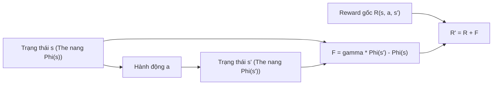

#### d. Code Thực chiến (Dual-Engine: C++ & Python)

```cpp
// C++20: Potential-Based Reward Shaping Module
#include <iostream>
#include <cmath>

class PotentialShaper {
private:
    float gamma;

public:
    explicit PotentialShaper(float g = 0.99f) : gamma(g) {}

    // Ham the nang Phi(s): uoc tinh khoang cach Manhattan toi dich
    float potential(int x, int y, int goal_x, int goal_y) const {
        return - static_cast<float>(std::abs(goal_x - x) + std::abs(goal_y - y));
    }

    float get_shaped_reward(float raw_reward, int x, int y, int next_x, int next_y, int gx, int gy) {
        float phi_s = potential(x, y, gx, gy);
        float phi_next = potential(next_x, next_y, gx, gy);
        float f = gamma * phi_next - phi_s;
        return raw_reward + f;
    }
};

int main() {
    PotentialShaper shaper(0.99f);
    // Di chuyen tu (0, 0) sang (1, 0) tien gan ve dich (5, 5)
    float r = shaper.get_shaped_reward(-1.0f, 0, 0, 1, 0, 5, 5);
    std::cout << "[C++] Shaped Reward (Tien gan ve dich): " << r << " (Tot hon -1.0 goc)\n";
    return 0;
}
```

```python
# Python: Minh họa Bảo toàn Chính sách qua Potential-Based Shaping
import numpy as np

def verify_policy_invariance():
    gamma = 0.9
    # 2 hanh dong a1 (tot hon) va a2 tai trang thai s
    q_a1, q_a2 = 10.0, 8.0 # a1 thang
    phi_s = 5.0
    # Du sau khi bien doi tru di Phi(s), thu tu toi uu khong he thay doi
    q_prime_a1 = q_a1 - phi_s # 5.0
    q_prime_a2 = q_a2 - phi_s # 3.0
    print(f"[Python] Original Best: {np.argmax([q_a1, q_a2])} | Shaped Best: {np.argmax([q_prime_a1, q_prime_a2])}")

verify_policy_invariance()
```

#### e. Lỗi Thường gặp & Ổn định Số học (Pitfalls & Numerical Stability)
- **Reward Cycling Hacking**: Nếu định hình phần thưởng không tuân theo dạng hiệu thế $F = \gamma \Phi(s') - \Phi(s)$ (ví dụ: chỉ đơn giản thưởng $+1$ mỗi khi xe nhích về phía trước), Agent có thể học được chính sách tiến lên rồi lùi lại liên tục để ăn điểm thưởng vô hạn mà không bao giờ về đích.

#### f. Ứng dụng Thực chiến trong AI / Deep Learning
- Cung cấp tín hiệu điều hướng cho các cánh tay robot gắp đồ vật (Robotic Peg-in-Hole Insertion).

---

### 7. Sparse Rewards (Phần thưởng Thưa thớt)

#### a. Định nghĩa Bản chất Toán học (Mathematical Formulation)
Bài toán Phần thưởng Thưa thớt (Sparse Rewards) xảy ra khi môi trường chỉ trả về tín hiệu phần thưởng khác 0 tại thời điểm hoàn thành mục tiêu cuối cùng:
$$R_{t+1} = \begin{cases} 1 & \text{nếu đạt trạng thái mục tiêu } S_{t+1} \in \mathcal{S}_{\text{goal}} \\ 0 & \text{ngược lại} \end{cases}$$
Trong không gian trạng thái $D$-chiều, xác suất để một chính sách ngẫu nhiên đi lang thang (Random Walk) chạm được vào mục tiêu sau $H$ bước giảm theo hàm mũ nghịch đảo:
$$\mathbb{P}\left(\tau \cap \mathcal{S}_{\text{goal}} \neq \emptyset\right) \sim \mathcal{O}\left( \left(\frac{\text{Vol}(\mathcal{S}_{\text{goal}})}{\text{Vol}(\mathcal{S})}\right)^H \right) \to 0$$
Khi đó, $\nabla_\theta J(\theta) = \mathbf{0}$, gradient biến mất hoàn toàn và Agent không thể bắt đầu quá trình học.

**Các Giải pháp Khắc phục Đột phá**:
1. **Hindsight Experience Replay (HER - Andrychowicz et al., 2017)**: Tái tạo mục tiêu trong quá khứ ("Nếu mục tiêu ban đầu chính là vị trí ta vừa chạm tới, thì ta đã thành công!").
2. **Curriculum Learning (Học theo Giáo trình)**: Huấn luyện từ các trạng thái xuất phát rất gần đích, sau đó kéo dần khoảng cách ra xa.

#### b. Cơ chế Tầng Sâu & Điện toán (Under The Hood / Hardware Internals)
- **Virtual Goal Substitution in Replay Memory**: Thuật toán HER không đòi hỏi chạy thêm bất kỳ bước mô phỏng môi trường nào. Bằng cách thao tác trực tiếp trên bộ đệm Replay Buffer trên RAM, nó nhân bản mỗi bước chuyển tiếp thất bại thành nhiều bản ghi thành công ảo bằng cách thay thế vector trường mục tiêu `goal` bằng `achieved_goal`.

#### c. Sơ đồ Minh họa (Mermaid Diagram)
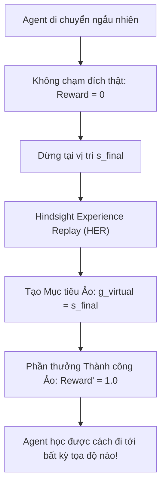

#### d. Code Thực chiến (Dual-Engine: C++ & Python)

```cpp
// C++20: Hindsight Goal Relabeling đơn giản
#include <iostream>
#include <vector>

struct GoalTransition {
    float state;
    float goal;
    float reward;
};

GoalTransition relabel_with_her(float state, float original_goal, float final_achieved_state) {
    // Thay the muc tieu goc bang trang thai cuoi cung thuc te dat duoc
    float new_goal = final_achieved_state;
    float reward = (std::abs(state - new_goal) < 1e-3f) ? 1.0f : 0.0f;
    return {state, new_goal, reward};
}

int main() {
    auto t = relabel_with_her(5.0f, 10.0f, 5.0f); // Dich goc la 10 (that bai), nhung dich ao la 5 (thanh cong!)
    std::cout << "[C++] HER Transition -> State: " << t.state << " | Virtual Goal: " << t.goal << " | Reward: " << t.reward << "\n";
    return 0;
}
```

```python
# Python / NumPy: Hindsight Experience Replay (HER) Strategy
import numpy as np

class SimpleHERBuffer:
    def __init__(self):
        self.buffer = []

    def store_episode_with_her(self, trajectory):
        # trajectory la list cac dict: {'s': pos, 'a': act, 'g': goal, 'achieved_g': pos}
        final_goal = trajectory[-1]['achieved_g']
        for step in trajectory:
            # 1. Luu ban ghi that bai ban dau
            self.buffer.append((step['s'], step['a'], step['g'], 0.0))
            # 2. HER: Tao ban ghi thanh cong ao voi final_goal
            her_reward = 1.0 if np.array_equal(step['achieved_g'], final_goal) else 0.0
            self.buffer.append((step['s'], step['a'], final_goal, her_reward))

her_buf = SimpleHERBuffer()
dummy_traj = [
    {'s': 0, 'a': 1, 'g': 10, 'achieved_g': 1},
    {'s': 1, 'a': 1, 'g': 10, 'achieved_g': 2} # Ket thuc o 2 thay vi 10
]
her_buf.store_episode_with_her(dummy_traj)
print(f"[Python HER] Total Transitions in Buffer (Original + Relabeled): {len(her_buf.buffer)}")
```

#### e. Lỗi Thường gặp & Ổn định Số học (Pitfalls & Numerical Stability)
- **Goal Space Dimension Mismatch**: Khi không gian mục tiêu không tương thích trực tiếp với không gian trạng thái (ví dụ: mục tiêu là ảnh mong muốn nhưng trạng thái là góc quay của động cơ), việc ánh xạ trạng thái sang mục tiêu đòi hỏi một hàm chiếu được huấn luyện riêng.

#### f. Ứng dụng Thực chiến trong AI / Deep Learning
- Cánh tay robot tự học giải khối Rubik một tay của OpenAI (Dactyl) hoàn toàn từ tín hiệu sparse reward.

---

### 8. Hierarchical Reinforcement Learning (Học tăng cường Phân tầng)

#### a. Định nghĩa Bản chất Toán học (Mathematical Formulation)
Hierarchical Reinforcement Learning (HRL) giải quyết bài toán chân trời thời gian cực dài bằng cách chia nhỏ bài toán thành một cấu trúc phân cấp đa tầng (Temporal Abstraction):
1. **Chính sách Cấp cao (Manager / Meta-Controller $\pi^M$)**: Hoạt động ở thang thời gian thô (ví dụ mỗi $c$ bước một lần), phát ra các **Mục tiêu Phụ (Sub-goals $g_t$)**:
$$g_t \sim \pi^M(g \mid s_t)$$
2. **Chính sách Cấp thấp (Worker / Low-Level Controller $\pi^W$)**: Hoạt động ở thang thời gian mịn tại từng bước, thực thi các hành động nguyên tử nhằm đưa trạng thái hiện tại tiến sát tới mục tiêu phụ $g$:
$$a_t \sim \pi^W(a \mid s_t, g)$$

Hàm thưởng của Worker là khoảng cách tới sub-goal:
$$R_t^W = - \|s_{t+1} - (s_t + g_t)\|_2$$
Trong khi Manager nhận phần thưởng từ môi trường:
$$R_t^M = \sum_{k=0}^{c-1} \gamma^k R_{t+k+1}$$

#### b. Cơ chế Tầng Sâu & Điện toán (Under The Hood / Hardware Internals)
- **Feudal Networks (FuNs) Latent Space Representations**: Trong kiến trúc Feudal Networks, mục tiêu phụ $g_t$ không biểu diễn trong không gian tọa độ vật lý mà là một vector định hướng trong không gian ẩn (Latent Feature Space) của mạng nơ-ron hồi quy LSTM. Tính toán cosin tương đồng giữa vector di chuyển và vector mục tiêu phụ được tối ưu qua lệnh FMA trên phần cứng.

#### c. Sơ đồ Minh họa (Mermaid Diagram)
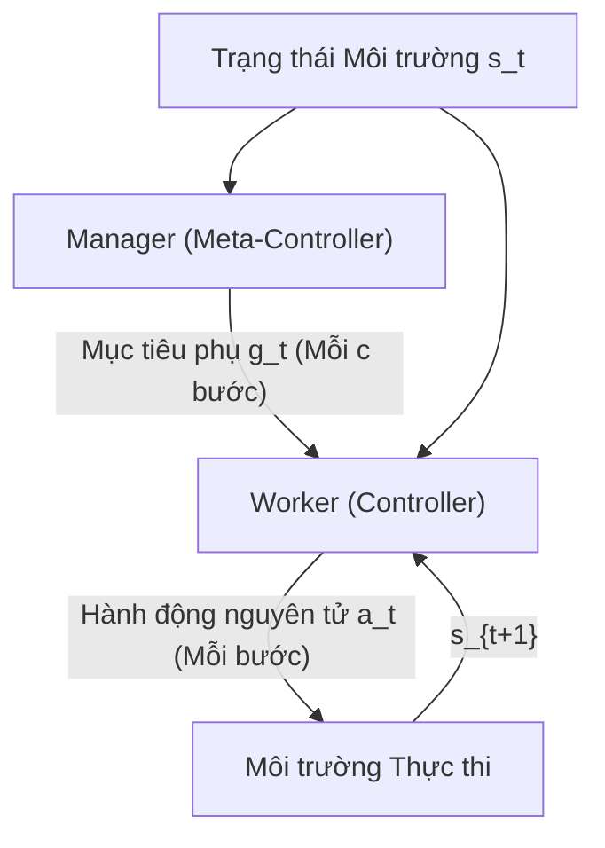

#### d. Code Thực chiến (Dual-Engine: C++ & Python)

```cpp
// C++20: Bộ điều phối Phân cấp 2 Tầng (Manager - Worker)
#include <iostream>
#include <cmath>

class HierarchicalCoordinator {
private:
    int step_counter{0};
    const int horizon_c{5};
    float current_subgoal{0.0f};

public:
    float manager_step(float current_state, float global_goal) {
        // Manager phat subgoal moi moi khi het chu ky c
        if (step_counter % horizon_c == 0) {
            current_subgoal = (global_goal > current_state) ? 2.0f : -2.0f;
            std::cout << "[C++ Manager] Emit new Subgoal: " << current_subgoal << "\n";
        }
        step_counter++;
        return current_subgoal;
    }

    int worker_act(float state, float subgoal) {
        // Worker hanh dong nguyen tu: 1 (tien), -1 (lui)
        return (subgoal > 0.0f) ? 1 : -1;
    }
};

int main() {
    HierarchicalCoordinator hrl;
    float s = 0.0f;
    float goal = 10.0f;
    float sub = hrl.manager_step(s, goal);
    int act = hrl.worker_act(s, sub);
    std::cout << "[C++] Worker executed atomic action: " << act << "\n";
    return 0;
}
```

```python
# Python / PyTorch: Kiến trúc Mạng Phân tầng Manager - Worker
import torch
import torch.nn as nn

class HierarchicalActor(nn.Module):
    def __init__(self, s_dim: int, sub_dim: int, a_dim: int):
        super().__init__()
        self.manager = nn.Linear(s_dim, sub_dim) # Phat subgoal
        self.worker = nn.Linear(s_dim + sub_dim, a_dim) # Output atomic action

    def forward(self, state: torch.Tensor):
        subgoal = torch.tanh(self.manager(state))
        worker_input = torch.cat([state, subgoal], dim=-1)
        action_logits = self.worker(worker_input)
        return subgoal, action_logits

hrl_net = HierarchicalActor(s_dim=4, sub_dim=2, a_dim=3)
s = torch.randn(1, 4)
sub, act_logits = hrl_net(s)
print(f"[PyTorch HRL] Emitted Subgoal: {sub.detach().numpy()}, Action Logits: {act_logits.detach().numpy()}")
```

#### e. Lỗi Thường gặp & Ổn định Số học (Pitfalls & Numerical Stability)
- **Non-Stationary Transition for Manager**: Vì chính sách của Worker thay đổi liên tục trong quá trình huấn luyện, phản hồi của môi trường dưới góc nhìn của Manager bị trôi phân phối dữ liệu (Non-Stationary Dynamics). Cần áp dụng kỹ thuật Off-Policy Correction (HIRO - Nachum et al., 2018).

#### f. Ứng dụng Thực chiến trong AI / Deep Learning
- Điều khiển robot hình người Humanoid vượt chướng ngại vật phức tạp (vừa lập kế hoạch đường đi tổng quát, vừa điều khiển từng khớp chân).

---

### 9. Options Framework (Khung Tùy chọn)

#### a. Định nghĩa Bản chất Toán học (Mathematical Formulation)
Options Framework (Sutton, Precup, Singh, 1999) là nền tảng toán học chuẩn tắc của việc trừu tượng hóa thời gian trong RL thông qua lý thuyết **Quá trình Ra quyết định Bán Markov (Semi-Markov Decision Process - SMDP)**.

Một Tùy chọn (Option) $\omega \in \Omega$ là một bộ 3 toán học hình thức:
$$\omega = \langle \mathcal{I}_\omega, \, \pi_\omega, \, \beta_\omega \rangle$$
1. **Tập Khởi tạo (Initiation Set $\mathcal{I}_\omega \subseteq \mathcal{S}$)**: Tập hợp các trạng thái mà tại đó Option $\omega$ có thể được kích hoạt: $\mathbb{I}(s \in \mathcal{I}_\omega)$.
2. **Chính sách Nội tại (Internal Policy $\pi_\omega(a \mid s)$)**: Phân phối xác suất chọn các hành động nguyên tử khi Option đang chạy.
3. **Điều kiện Kết thúc (Termination Condition $\beta_\omega: \mathcal{S} \to [0, 1]$)**: Xác suất Option $\omega$ tự động chấm dứt khi chạm tới trạng thái $s$: $\mathbb{P}(\text{Dừng} \mid S_t = s) = \beta_\omega(s)$.

**Phương trình Bellman cho SMDP (Option-Value Function)**:
$$Q_\Omega(s, \omega) = R(s, \omega) + \sum_{s'} F(s' \mid s, \omega) \max_{\omega' \in \Omega} Q_\Omega(s', \omega')$$
Trong đó $F(s' \mid s, \omega) = \sum_{k=1}^\infty \gamma^k p(s', k \mid s, \omega)$ là xác suất chiết khấu chuyển tới trạng thái $s'$ sau $k$ bước thực thi option.

#### b. Cơ chế Tầng Sâu & Điện toán (Under The Hood / Hardware Internals)
- **Option-Critic Architecture & Gradient Flow**: Mạng Option-Critic (Bacon et al., 2017) cho phép học đồng thời $\pi_\omega$ và $\beta_\omega$ thông qua đạo hàm chính sách:
$$\nabla_\theta \beta_\omega(s) = \left( Q_\Omega(s, \omega) - V_\Omega(s) \right) \nabla_\theta \beta_\omega(s)$$
Việc tính toán giá trị này đòi hỏi lưu vết trạng thái active của option qua các bước thời gian, tối ưu bằng các cờ bitmask trong bộ đệm GPU.

#### c. Sơ đồ Minh họa (Mermaid Diagram)
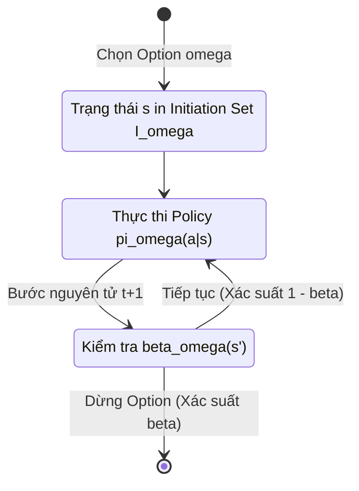

#### d. Code Thực chiến (Dual-Engine: C++ & Python)

```cpp
// C++20: Mô phỏng vòng đời một Option SMDP
#include <iostream>
#include <random>

class MacroMoveOption {
private:
    float beta_terminate_prob{0.25f}; // Xac suat ket thuc
    std::mt19937 rng{42};

public:
    bool is_valid_initiation(int state) const {
        return state >= 0 && state < 10;
    }

    int policy_step(int state) {
        return 1; // Luon tien ve phia truoc
    }

    bool should_terminate(int next_state) {
        if (next_state >= 8) return true; // Cham nguong dich
        std::uniform_real_distribution<float> dist(0.0f, 1.0f);
        return dist(rng) < beta_terminate_prob;
    }
};

int main() {
    MacroMoveOption opt;
    int s = 0;
    std::cout << "[C++] Option execution started at state " << s << "\n";
    while (true) {
        s += opt.policy_step(s);
        if (opt.should_terminate(s)) {
            std::cout << "[C++] Option terminated at state " << s << "\n";
            break;
        }
    }
    return 0;
}
```

```python
# Python / PyTorch: Module Termination Function trong Option-Critic
import torch
import torch.nn as nn

class OptionCriticTermination(nn.Module):
    def __init__(self, state_dim: int, num_options: int):
        super().__init__()
        self.net = nn.Sequential(
            nn.Linear(state_dim, 64),
            nn.ReLU(),
            nn.Linear(64, num_options),
            nn.Sigmoid() # Output beta in [0, 1]
        )

    def forward(self, state: torch.Tensor) -> torch.Tensor:
        return self.net(state)

term_net = OptionCriticTermination(state_dim=4, num_options=2)
dummy_s = torch.randn(1, 4)
beta_probs = term_net(dummy_s)
print(f"[PyTorch Option-Critic] Termination Probs for each option: {beta_probs.detach().numpy()}")
```

#### e. Lỗi Thường gặp & Ổn định Số học (Pitfalls & Numerical Stability)
- **Option Collapse**: Nếu hàm phạt thời gian không được thiết lập hợp lý, $\beta(s) \to 1$ ở mọi trạng thái, khiến các option suy biến thành các hành động nguyên tử 1 bước thông thường; hoặc ngược lại $\beta(s) \to 0$ vĩnh viễn không bao giờ nhả quyền điều khiển.

#### f. Ứng dụng Thực chiến trong AI / Deep Learning
- Thiết kế macro-actions trong các trò chơi chiến thuật thời gian thực như StarCraft II (e.g. xây nhà, khai thác khoáng sản).

---

### 10. Offline Reinforcement Learning (Học tăng cường Ngoại tuyến)

#### a. Định nghĩa Bản chất Toán học (Mathematical Formulation)
Offline RL (hay Data-Driven RL) là bài toán học chính sách tối ưu chỉ dựa trên một tập dữ liệu tĩnh cố định $\mathcal{D} = \{(s_i, a_i, r_i, s'_i)\}_{i=1}^N$ được thu thập từ trước bởi một hoặc nhiều chính sách hành vi $\pi_\beta$, **hoàn toàn không được phép tương tác thêm với môi trường**:
$$\max_\pi \mathbb{E}_{s \sim \mathcal{D}} [V^\pi(s)] \quad \text{s.t. không có tương tác trực tuyến}$$

**Vấn đề Cốt tử: Lệch Phân phối & Sai số Ngoại suy (Distribution Shift & Extrapolation Error)**:
Khi sử dụng toán tử tối đa hóa $\max_{a'} Q(s', a')$, nếu chính sách mới đề xuất một hành động ngoài phân phối dữ liệu (Out-of-Distribution - OOD): $a' \notin \text{supp}(\pi_\beta(\cdot \mid s'))$, mạng nơ-ron sâu sẽ dự báo một giá trị Q cực đại ảo khổng lồ, dẫn đến việc chính sách sụp đổ hoàn toàn.

**Giải pháp Conservative Q-Learning (CQL - Kumar et al., 2020)**:
Ép hàm Q học chặn dưới bi quan bằng cách phạt nặng các giá trị Q tại các hành động không có trong dữ liệu:
$$\min_Q \alpha \cdot \mathbb{E}_{s \sim \mathcal{D}} \left[ \log \sum_{a \in \mathcal{A}} \exp(Q(s, a)) - \mathbb{E}_{a \sim \mathcal{D}}[Q(s, a)] \right] + \frac{1}{2} \mathbb{E}_{(s, a, r, s') \sim \mathcal{D}} \left[ (Q(s, a) - \mathcal{B}^{\pi} \hat{Q}(s, a))^2 \right]$$

#### b. Cơ chế Tầng Sâu & Điện toán (Under The Hood / Hardware Internals)
- **High-Throughput Static Dataset Streaming**: Vì dữ liệu không thay đổi trong suốt quá trình huấn luyện, tập dữ liệu hàng trăm Gigabyte có thể được lưu trữ trên các ổ SSD NVMe tốc độ cao dưới định dạng HDF5 hoặc WebDataset, nạp trực tiếp qua DirectStorage/GPUDirect Storage vào VRAM mà không phải chịu chi phí GIL của Python.

#### c. Sơ đồ Minh họa (Mermaid Diagram)
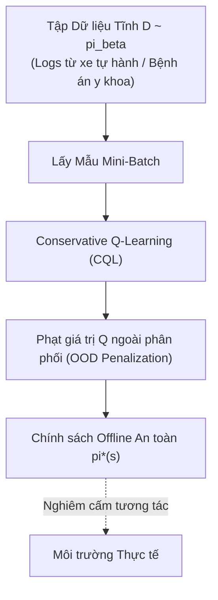

#### d. Code Thực chiến (Dual-Engine: C++ & Python)

```cpp
// C++20: Tính hình phạt độ lệch OOD (Out-Of-Distribution Penalty)
#include <iostream>
#include <cmath>
#include <algorithm>

float compute_cql_regularizer(float q_ood, float q_data, float alpha = 1.0f) {
    // Phat neu Q tai diem ngoai phan phoi cao hon Q tai du lieu that
    float diff = q_ood - q_data;
    return alpha * std::max(0.0f, diff);
}

int main() {
    float q_data = 5.0f;
    float q_ood_bad = 12.0f; // Mang no-ron ao tuong gia tri cuc cao ngoai phan phoi
    float penalty = compute_cql_regularizer(q_ood_bad, q_data);
    std::cout << "[C++] CQL Regularizer Penalty: " << penalty << "\n";
    return 0;
}
```

```python
# Python / PyTorch: CQL Loss Function thu nhỏ
import torch
import torch.nn.functional as F

def cql_loss(q_net, states, actions, rewards, next_states, dones, alpha=1.0, gamma=0.99):
    # 1. Standard Bellman TD Loss
    current_q = q_net(states).gather(1, actions.unsqueeze(1)).squeeze(1)
    with torch.no_grad():
        target_q = rewards + gamma * q_net(next_states).max(dim=1)[0] * (~dones)
    td_loss = F.mse_loss(current_q, target_q)

    # 2. CQL Conservative Penalty: LogSumExp(Q) - Q(data)
    all_q = q_net(states)
    cql_penalty = (torch.logsumexp(all_q, dim=-1) - current_q).mean()

    return td_loss + alpha * cql_penalty

q_model = torch.nn.Linear(4, 2)
loss = cql_loss(q_model, torch.randn(8, 4), torch.randint(0, 2, (8,)), torch.ones(8), torch.randn(8, 4), torch.zeros(8, dtype=torch.bool))
print(f"[PyTorch Offline RL] CQL Total Loss: {loss.item():.4f}")
```

#### e. Lỗi Thường gặp & Ổn định Số học (Pitfalls & Numerical Stability)
- **Over-Conservatism (Bảo thủ Quá mức)**: Nếu đặt hệ số $\alpha$ quá lớn trong CQL, hàm Q sẽ bị đè bẹp xuống các giá trị âm vô cùng, khiến chính sách mới chỉ sao chép một cách máy móc chính sách hành vi cũ kém cỏi mà không thể tìm ra các kết hợp tối ưu vượt trội.

#### f. Ứng dụng Thực chiến trong AI / Deep Learning
- **Y tế & Chăm sóc Sức khỏe**: Tối ưu hóa phác đồ điều trị cho bệnh nhân nhiễm trùng huyết (Sepsis treatment) từ dữ liệu bệnh án điện tử MIMIC-III mà không được phép thử nghiệm liều thuốc nguy hiểm trên người thật.

---

### 11. Batch Reinforcement Learning (Học tăng cường Theo mẻ)

#### a. Định nghĩa Bản chất Toán học (Mathematical Formulation)
Batch RL là mô hình chuyển tiếp giữa Online RL và Offline RL. Dữ liệu được thu thập theo từng mẻ (Batches) lớn thay vì tương tác liên tục:
$$\mathcal{D}_0 \to \text{Train } \pi_1 \to \text{Collect } \mathcal{D}_1 \to \text{Train } \pi_2 \to \dots$$

**Thuật toán Fitted Q-Iteration (FQI - Ernst et al., 2005)**:
Biến bài toán học tăng cường thành một chuỗi các bài toán Học có giám sát (Supervised Regression). Tại mỗi vòng lặp $k$:
1. Tạo tập dữ liệu mục tiêu:
$$y_i = r_i + \gamma \max_{a'} \hat{Q}_{k-1}(s'_i, a'), \quad \forall (s_i, a_i, r_i, s'_i) \in \mathcal{D}$$
2. Huấn luyện một hàm hồi quy bất kỳ (Random Forest, Gradient Boosting, MLP) giải bài toán tối ưu:
$$\hat{Q}_k = \arg\min_f \sum_{i=1}^{|\mathcal{D}|} \left( f(s_i, a_i) - y_i \right)^2$$

#### b. Cơ chế Tầng Sâu & Điện toán (Under The Hood / Hardware Internals)
- **Tree-based Ensemble Training on Multi-core CPU**: Trong các bài toán Batch RL truyền thống, các mô hình Extreme Gradient Boosting (XGBoost/LightGBM) tận dụng cấu trúc nén cột (CSC) để huấn luyện trên 64-core CPU với tốc độ nhanh hơn nhiều so với việc tối ưu mạng nơ-ron bằng SGD.

#### c. Sơ đồ Minh họa (Mermaid Diagram)
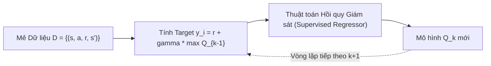

#### d. Code Thực chiến (Dual-Engine: C++ & Python)

```cpp
// C++20: Fitted Q Iteration bước tạo nhãn hồi quy có giám sát
#include <iostream>
#include <vector>
#include <algorithm>

struct BatchTransition {
    float s;
    int a;
    float r;
    float next_s;
};

std::vector<float> generate_fqi_targets(const std::vector<BatchTransition>& batch, float gamma) {
    std::vector<float> targets;
    targets.reserve(batch.size());

    for (const auto& t : batch) {
        // Gia lap Q_{k-1}(next_s) duoc danh gia bang ham gia tri don gian
        float max_next_q = 2.0f * t.next_s; 
        targets.push_back(t.r + gamma * max_next_q);
    }
    return targets;
}

int main() {
    std::vector<BatchTransition> batch = {{1.0f, 0, 1.0f, 2.0f}, {2.0f, 1, 0.5f, 3.0f}};
    auto targets = generate_fqi_targets(batch, 0.9f);
    std::cout << "[C++] FQI Target 0: " << targets[0] << " | Target 1: " << targets[1] << "\n";
    return 0;
}
```

```python
# Python / Scikit-Learn: Fitted Q-Iteration sử dụng Random Forest
import numpy as np
from sklearn.ensemble import RandomForestRegressor

class FittedQIteration:
    def __init__(self, gamma: float = 0.9):
        self.gamma = gamma
        self.model = RandomForestRegressor(n_estimators=10, max_depth=5)

    def fit_step(self, states, actions, rewards, next_states, num_actions=2):
        n = len(states)
        # 1. Tinh max_a' Q(next_s, a')
        next_features = np.array([[next_states[i], a] for i in range(n) for a in range(num_actions)])
        all_next_q = self.model.predict(next_features).reshape(n, num_actions) if hasattr(self.model, "estimators_") else np.zeros((n, num_actions))
        max_next_q = np.max(all_next_q, axis=1)

        targets = rewards + self.gamma * max_next_q
        features = np.column_stack([states, actions])
        self.model.fit(features, targets)

fqi = FittedQIteration()
s = np.array([1.0, 2.0, 3.0])
a = np.array([0, 1, 0])
r = np.array([1.0, 2.0, 0.0])
ns = np.array([2.0, 3.0, 4.0])
fqi.fit_step(s, a, r, ns)
print(f"[Python FQI] Random Forest Regressor Fitted.")
```

#### e. Lỗi Thường gặp & Ổn định Số học (Pitfalls & Numerical Stability)
- **Error Accumulation qua các Vòng lặp**: Sai số hồi quy của mỗi vòng lặp $k$ sẽ bị tích lũy và khuếch đại ở vòng lặp $k+1$ thông qua toán tử bootstrapping, có thể dẫn đến việc hàm giá trị bị trôi dạt (Error Propagation Bound $\mathcal{O}\left(\frac{\epsilon}{(1-\gamma)^2}\right)$).

#### f. Ứng dụng Thực chiến trong AI / Deep Learning
- Phân tích và tối ưu hóa hệ thống máy sưởi ấm và thông gió (HVAC) trong các tòa nhà thông minh dựa trên dữ liệu nhật ký cảm biến thu thập hàng tháng.

---

### 12. Safe Reinforcement Learning (Học tăng cường An toàn)

#### a. Định nghĩa Bản chất Toán học (Mathematical Formulation)
Safe RL nghiên cứu việc tối ưu hóa hiệu năng kỳ vọng đồng thời bảo đảm các tiêu chuẩn an toàn nghiêm ngặt trong suốt quá trình học và triển khai:
$$\max_\pi J(\pi) \quad \text{s.t. } \text{Safety Constraints are Satisfied}$$

Các hướng tiếp cận toán học chính:
1. **Độ đo Rủi ro Điều kiện (Conditional Value-at-Risk - CVaR)**: Thay vì tối đa hóa kỳ vọng trung bình $\mathbb{E}[R]$, ta tối ưu hóa giá trị trung bình của phần trăm $\alpha$ trường hợp tồi tệ nhất (Worst-Case Scenarios):
$$\text{CVaR}_\alpha(Z) = \mathbb{E}\left[ Z \mid Z \le \text{VaR}_\alpha(Z) \right]$$
2. **Lớp Bảo vệ Điều khiển An toàn (Safety Layer / Control Barrier Functions - CBF)**: Một bộ lọc phân giải bậc 2 (Quadratic Programming - QP) can thiệp vào hành động $a$ của mạng nơ-ron tại thời gian thực:
$$a^* = \arg\min_{a'} \|a' - a_{\text{NN}}\|_2^2 \quad \text{s.t. } \dot{h}(x, a') + \kappa h(x) \ge 0$$
với $h(x) \ge 0$ định nghĩa tập hợp các trạng thái an toàn.

#### b. Cơ chế Tầng Sâu & Điện toán (Under The Hood / Hardware Internals)
- **Real-Time QP Solver on Embedded FPGA/Microcontroller**: Để đảm bảo tính an toàn tính bằng micro-giây, các bộ giải quy hoạch toàn phương (như OSQP, qpOASES) được biên dịch tĩnh thành mã C trần nhúng trực tiếp vào bộ điều khiển phần cứng của robot mà không cần thông qua hệ điều hành.

#### c. Sơ đồ Minh họa (Mermaid Diagram)
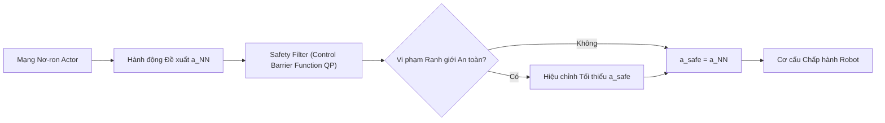

#### d. Code Thực chiến (Dual-Engine: C++ & Python)

```cpp
// C++20: Bộ lọc Hành động An toàn (Safety Action Shield) 1 chiều
#include <iostream>
#include <algorithm>

class SafetyShield {
private:
    float max_speed{2.0f};
    float min_distance_barrier{0.5f};

public:
    float filter_action(float proposed_velocity, float obstacle_distance) {
        if (obstacle_distance < min_distance_barrier) {
            std::cout << "[C++ Shield] Canh bao va cham! Cuong che phanh khan cap.\n";
            return 0.0f; // Dung ngay lap tuc
        }
        return std::clamp(proposed_velocity, -max_speed, max_speed);
    }
};

int main() {
    SafetyShield shield;
    float safe_a = shield.filter_action(5.0f, 0.2f);
    std::cout << "[C++] Safe Output Velocity: " << safe_a << "\n";
    return 0;
}
```

```python
# Python / CVXPY: Bộ giải Lớp Bảo vệ An toàn Quadratic Programming
import numpy as np

def simple_cvar_metric(returns: np.ndarray, alpha: float = 0.05) -> float:
    # Tinh CVaR o muc 5% xui xeo nhat
    sorted_returns = np.sort(returns)
    cutoff_index = int(alpha * len(returns))
    cvar = np.mean(sorted_returns[:cutoff_index])
    return float(cvar)

all_returns = np.random.normal(loc=100.0, scale=30.0, size=1000)
# Them mot vai ca tai nan nghiem trong
all_returns[:20] = -500.0
cvar_val = simple_cvar_metric(all_returns, alpha=0.05)
print(f"[Python Safe RL] Mean Return: {np.mean(all_returns):.2f} | Worst 5% CVaR: {cvar_val:.2f}")
```

#### e. Lỗi Thường gặp & Ổn định Số học (Pitfalls & Numerical Stability)
- **Feasibility Deadlock (Mất khả thi của QP)**: Khi trạng thái hệ thống vô tình lọt vào vùng cấm do nhiễu môi trường quá lớn, bài toán ràng buộc an toàn trở nên vô nghiệm (Infeasible), khiến bộ giải QP ném biệt lệ và làm hệ thống mất điều khiển.

#### f. Ứng dụng Thực chiến trong AI / Deep Learning
- Vận hành máy bay không người lái (UAV) tự bay xuyên rừng và xe tự lái Waymo giữ khoảng cách an toàn với người đi bộ.

---

### 13. Constrained Reinforcement Learning (Học tăng cường Có ràng buộc)

#### a. Định nghĩa Bản chất Toán học (Mathematical Formulation)
Constrained RL được hình thức hóa thông qua mô hình **Quá trình Ra quyết định Markov Có ràng buộc (Constrained MDP - CMDP - Altman, 1999)**:
$$\max_{\pi} J_R(\pi) = \mathbb{E}_{\tau \sim \pi} \left[ \sum_{t=0}^\infty \gamma^t R(S_t, A_t) \right]$$
Thỏa mãn $K$ ràng buộc chi phí (Cost Constraints):
$$J_{C_k}(\pi) = \mathbb{E}_{\tau \sim \pi} \left[ \sum_{t=0}^\infty \gamma^t C_k(S_t, A_t) \right] \le d_k, \quad \forall k \in \{1, \dots, K\}$$

**Phương pháp Nhân tử Lagrange (Lagrangian Relaxation)**:
Chuyển bài toán ràng buộc thành bài toán tối ưu đối ngẫu Min-Max không ràng buộc thông qua hàm Lagrange:
$$\max_\theta \min_{\boldsymbol{\lambda} \ge 0} \mathcal{L}(\theta, \boldsymbol{\lambda}) = J_R(\theta) - \sum_{k=1}^K \lambda_k \left( J_{C_k}(\theta) - d_k \right)$$
Các tham số được cập nhật luân phiên bằng Đạo hàm Vi phân Đối ngẫu (Primal-Dual Gradient Method):
$$\theta \leftarrow \theta + \alpha_\theta \nabla_\theta \mathcal{L}(\theta, \boldsymbol{\lambda})$$
$$\lambda_k \leftarrow \max\left(0, \, \lambda_k - \alpha_\lambda (d_k - J_{C_k}(\theta))\right)$$

**Constrained Policy Optimization (CPO - Achiam et al., 2017)**:
Mở rộng TRPO sang CMDP bằng cách giải bài toán quy hoạch toàn phương trực tiếp trên cả ràng buộc hiệu năng và ràng buộc chi phí trong vùng tin cậy KL.

#### b. Cơ chế Tầng Sâu & Điện toán (Under The Hood / Hardware Internals)
- **Dual Multiplier Dynamics**: Biến Lagrange $\lambda$ được cập nhật song song với Actor trên GPU. Khi chi phí vượt ngưỡng ($J_C > d$), $\lambda$ tăng vọt, lập tức áp đảo hàm mục tiêu phần thưởng, buộc gradient của Actor tập trung 100% vào việc giảm chi phí vi phạm.

#### c. Sơ đồ Minh họa (Mermaid Diagram)
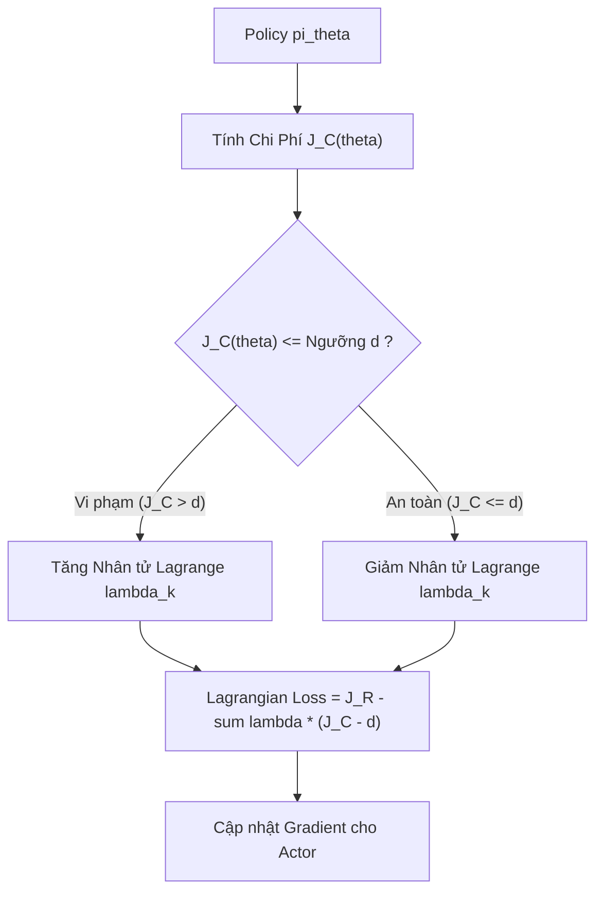

#### d. Code Thực chiến (Dual-Engine: C++ & Python)

```cpp
// C++20: Cập nhật biến đối ngẫu Lagrange cho Constrained MDP
#include <iostream>
#include <algorithm>

class LagrangianDualOptimizer {
private:
    float lambda{0.0f};
    float cost_limit;
    float lr_lambda;

public:
    LagrangianDualOptimizer(float limit, float lr = 0.05f) : cost_limit(limit), lr_lambda(lr) {}

    float update(float current_cost) {
        // Gradient ascent tren lambda: lambda <- max(0, lambda + lr * (cost - limit))
        float violation = current_cost - cost_limit;
        lambda = std::max(0.0f, lambda + lr_lambda * violation);
        return lambda;
    }

    [[nodiscard]] float get_lambda() const noexcept { return lambda; }
};

int main() {
    LagrangianDualOptimizer dual(10.0f); // Nguong gioi han chi phi la 10
    dual.update(15.0f); // Vi pham chi phi (15 > 10)
    std::cout << "[C++] Lambda tang len de phat nang: " << dual.get_lambda() << "\n";
    dual.update(4.0f);  // An toan tro lai
    std::cout << "[C++] Lambda sau buoc an toan: " << dual.get_lambda() << "\n";
    return 0;
}
```

```python
# Python / PyTorch: Hàm mất mát CMDP kết hợp Lagrange Multiplier
import torch

def cmdp_lagrangian_loss(actor_loss: torch.Tensor, cost_loss: torch.Tensor,
                         cost_limit: float, log_lambda: torch.nn.Parameter):
    # Dùng log_lambda để bảo đảm lambda = exp(log_lambda) >= 0
    lambda_val = torch.exp(log_lambda)
    cost_violation = cost_loss.detach() - cost_limit

    # Loss cho Actor: Toi thieu hoa (Actor_Loss + lambda * Cost_Loss)
    total_actor_loss = actor_loss + lambda_val.detach() * cost_loss
    # Loss cho Lambda: Toi thieu hoa - lambda * violation
    lambda_loss = - lambda_val * cost_violation

    return total_actor_loss, lambda_loss

log_lam = torch.nn.Parameter(torch.zeros(1))
a_loss = torch.tensor(2.0)
c_loss = torch.tensor(15.0) # Vuot nguong 10.0
tot_loss, lam_loss = cmdp_lagrangian_loss(a_loss, c_loss, cost_limit=10.0, log_lambda=log_lam)
print(f"[PyTorch CMDP] Total Actor Loss: {tot_loss.item():.4f}, Lambda Loss: {lam_loss.item():.4f}")
```

#### e. Lỗi Thường gặp & Ổn định Số học (Pitfalls & Numerical Stability)
- **Oscillations in Primal-Dual Updates**: Việc tối ưu hóa luân phiên giữa Primal ($\theta$) và Dual ($\lambda$) thường tạo ra các quỹ đạo dao động tròn (Limit Cycles) xung quanh điểm yên ngựa (Saddle Point), khiến Agent liên tục dao động giữa việc hành động liều lĩnh và quá sợ hãi.

#### f. Ứng dụng Thực chiến trong AI / Deep Learning
- Quản lý lưới điện quốc gia thông minh (Smart Grid) tối ưu hóa chi phí mua bán điện nhưng bắt buộc không được để quá tải điện áp đường dây.

---

### 14. Multi-Agent Reinforcement Learning (Học tăng cường Đa tác nhân)

#### a. Định nghĩa Bản chất Toán học (Mathematical Formulation)
Multi-Agent RL (MARL) mô hình hóa sự tương tác đồng thời của $N$ Agent thông qua cấu trúc **Trò chơi Ngẫu nhiên Markov (Stochastic Game / Markov Game - Shapley, 1953)**:
$$\mathcal{M} = \langle \mathcal{N}, \mathcal{S}, \{\mathcal{A}_i\}_{i=1}^N, \mathcal{P}, \{\mathcal{R}_i\}_{i=1}^N, \gamma \rangle$$
- Mỗi Agent $i$ chọn hành động $a_i \in \mathcal{A}_i$. Hành động chung: $\mathbf{a} = (a_1, \dots, a_N) \in \boldsymbol{\mathcal{A}}$.
- Xác suất chuyển trạng thái phụ thuộc vào toàn bộ hành động chung: $\mathcal{P}(s' \mid s, \mathbf{a})$.

**Thách thức Phi dừng (Non-Stationarity)**:
Từ góc nhìn của Agent $i$, môi trường liên tục thay đổi quy luật chuyển trạng thái vì các Agent khác đồng thời thay đổi chính sách của họ: $\mathcal{P}_i(s' \mid s, a_i) = \sum_{\mathbf{a}_{-i}} \mathcal{P}(s' \mid s, a_i, \mathbf{a}_{-i}) \prod_{j \neq i} \pi_j(a_j \mid s)$. Điều này làm mất hiệu lực của phương trình Bellman tiêu chuẩn.

**Khung CTDE (Centralized Training with Decentralized Execution)**:
- **Huấn luyện Tập trung (Centralized Training)**: Khi học (trong giả lập), Critic được cung cấp trạng thái toàn cục $s$ và hành động chung của mọi Agent $\mathbf{a}$.
- **Thực thi Phi tập trung (Decentralized Execution)**: Khi triển khai thực tế, mỗi Actor chỉ được quan sát quan sát cục bộ $o_i$ của riêng mình để đưa ra quyết định $a_i \sim \pi_i(\cdot \mid o_i)$.

**Mạng Trộn Giá trị QMIX (Rashid et al., 2018)**:
Bảo đảm tính nhất quán giữa quyết định tham lam toàn cục và quyết định cục bộ bằng điều kiện đơn điệu (Monotonicity Constraint):
$$\frac{\partial Q_{\text{tot}}(\mathbf{s}, \mathbf{a})}{\partial Q_i(s, a_i)} \ge 0, \quad \forall i \in \{1, \dots, N\}$$

#### b. Cơ chế Tầng Sâu & Điện toán (Under The Hood / Hardware Internals)
- **Mixing Network with Absolute Weights**: Để bảo đảm đạo hàm $\frac{\partial Q_{\text{tot}}}{\partial Q_i} \ge 0$, trọng số của mạng Mixing Network trong QMIX được sinh ra từ trạng thái toàn cục thông qua Hypernetworks và được ép dương bằng hàm giá trị tuyệt đối `torch.abs(weights)`.

#### c. Sơ đồ Minh họa (Mermaid Diagram)
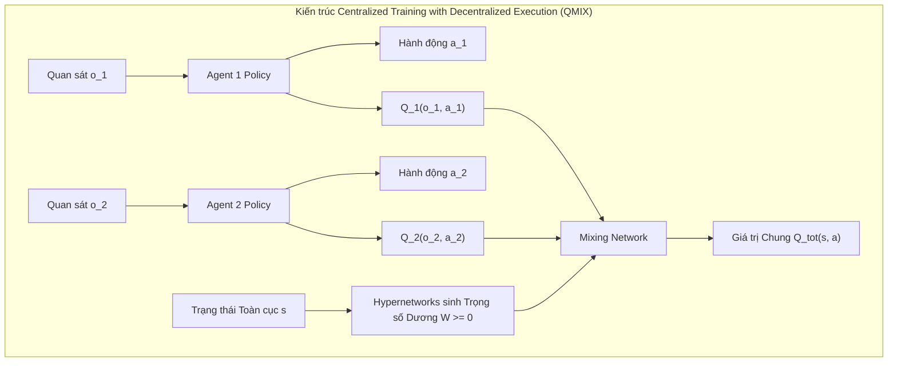

#### d. Code Thực chiến (Dual-Engine: C++ & Python)

```cpp
// C++20: Mô phỏng điều kiện đơn điệu QMIX Monotonicity
#include <iostream>
#include <vector>
#include <numeric>
#include <cmath>

float compute_q_tot(const std::vector<float>& individual_qs, const std::vector<float>& mixing_weights) {
    float q_tot = 0.0f;
    const size_t n = individual_qs.size();
    for (size_t i = 0; i < n; ++i) {
        // mixing_weights bat buoc phai >= 0 de bao dam dao ham khong am
        float positive_w = std::abs(mixing_weights[i]);
        q_tot += positive_w * individual_qs[i];
    }
    return q_tot;
}

int main() {
    std::vector<float> qs = {5.0f, 3.0f};
    std::vector<float> raw_weights = {-1.5f, 2.0f}; // Bi ep thanh [1.5, 2.0]
    float total_q = compute_q_tot(qs, raw_weights);
    std::cout << "[C++] QMIX Monotonic Q_tot: " << total_q << "\n";
    return 0;
}
```

```python
# Python / PyTorch: Kiến trúc QMIX Mixing Network hoàn chỉnh
import torch
import torch.nn as nn

class QMixer(nn.Module):
    def __init__(self, num_agents: int, state_dim: int, embed_dim: int = 32):
        super().__init__()
        self.num_agents = num_agents
        # Hypernetwork sinh trong so W1 duong tu State
        self.hyper_w1 = nn.Linear(state_dim, num_agents * embed_dim)
        self.hyper_b1 = nn.Linear(state_dim, embed_dim)
        # Hypernetwork sinh trong so W2 duong
        self.hyper_w2 = nn.Linear(state_dim, embed_dim * 1)
        self.hyper_b2 = nn.Sequential(nn.Linear(state_dim, embed_dim), nn.ReLU(), nn.Linear(embed_dim, 1))

    def forward(self, agent_qs: torch.Tensor, states: torch.Tensor) -> torch.Tensor:
        # agent_qs: (Batch, Num_Agents)
        b_size = agent_qs.size(0)
        # Lop 1
        w1 = torch.abs(self.hyper_w1(states)).view(b_size, self.num_agents, -1)
        b1 = self.hyper_b1(states).view(b_size, 1, -1)
        hidden = torch.bmm(agent_qs.unsqueeze(1), w1) + b1
        hidden = torch.elu(hidden)

        # Lop 2
        w2 = torch.abs(self.hyper_w2(states)).view(b_size, -1, 1)
        b2 = self.hyper_b2(states).view(b_size, 1, 1)
        q_tot = torch.bmm(hidden, w2) + b2
        return q_tot.view(b_size, 1)

mixer = QMixer(num_agents=3, state_dim=12)
q_agents = torch.tensor([[2.0, 4.0, 1.0]])
s_global = torch.randn(1, 12)
q_total = mixer(q_agents, s_global)
print(f"[PyTorch QMIX] Aggregated Q_tot: {q_total.item():.4f}")
```

#### e. Lỗi Thường gặp & Ổn định Số học (Pitfalls & Numerical Stability)
- **Lazy Agent Problem (Hội chứng Tác nhân Lười biếng)**: Khi nhận chung một phần thưởng nhóm (Shared Team Reward), một Agent xuất sắc có thể gánh toàn đội, khiến các Agent còn lại học được chính sách đứng im vô dụng (Credit Assignment Problem giữa các tác nhân).

#### f. Ứng dụng Thực chiến trong AI / Deep Learning
- **OpenAI Five**: 5 mạng nơ-ron phối hợp hạ gục đội tuyển vô địch thế giới OG trong tựa game eSports phức tạp bậc nhất DotA 2.

---

### 15. Model Predictive Control (Điều khiển Dự báo Mô hình)

#### a. Định nghĩa Bản chất Toán học (Mathematical Formulation)
Điều khiển Dự báo Mô hình (MPC) là phương pháp điều khiển quy hoạch chân trời lùi (Receding Horizon Planning). Tại mỗi bước thời gian $t$, Agent giải một bài toán tối ưu quỹ đạo hữu hạn $H$ bước trong tương lai dựa trên mô hình động lực học:
$$\mathbf{a}_{t:t+H-1}^* = \arg\max_{a_t, \dots, a_{t+H-1}} \sum_{k=0}^{H-1} \gamma^k \mathcal{R}(s_{t+k}, a_{t+k}) + \gamma^H \mathcal{V}_{\text{terminal}}(s_{t+H})$$
Ràng buộc:
$$s_{t+k+1} = f(s_{t+k}, a_{t+k})$$

**Nguyên lý Chân trời Lùi (Receding Horizon Principle)**:
Mặc dù tính toán chuỗi hành động tối ưu cho cả $H$ bước, Agent **chỉ thực thi duy nhất hành động đầu tiên $a_t^*$**. Sau đó, môi trường chuyển sang trạng thái mới $S_{t+1}$, và toàn bộ bài toán tối ưu trên chân trời $H$ được giải lại từ đầu. Cơ chế phản hồi khép kín (Closed-loop Feedback) này giúp MPC liên tục tự sửa chữa các sai số của mô hình.

**Phương pháp Tối ưu hóa Cross-Entropy (CEM)**:
Thuật toán tối ưu hóa ngẫu nhiên không đạo hàm (Derivative-Free) phổ biến trong MPC:
1. Lấy mẫu $K$ chuỗi hành động từ phân phối Gauss: $\mathbf{A}^{(i)} \sim \mathcal{N}(\boldsymbol{\mu}, \boldsymbol{\Sigma})$.
2. Đánh giá tổng thưởng của từng chuỗi bằng mô hình thế giới.
3. Chọn $M$ chuỗi ưu tú nhất (Elite Samples) để cập nhật lại $\boldsymbol{\mu}$ và $\boldsymbol{\Sigma}$.

#### b. Cơ chế Tầng Sâu & Điện toán (Under The Hood / Hardware Internals)
- **Massive Parallel Trajectory Shooting on GPU**: Với CEM, việc mô phỏng $K=1024$ chuỗi hành động qua một mô hình động lực học MLP được thực thi song song hoàn toàn trên Tensor Cores, giúp toàn bộ chu trình tối ưu CEM 10 bước hoàn thành trong dưới $5\text{ms}$.

#### c. Sơ đồ Minh họa (Mermaid Diagram)
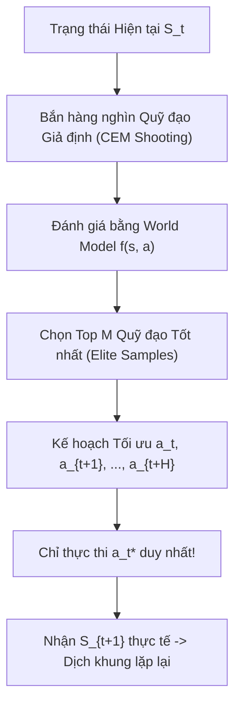

#### d. Code Thực chiến (Dual-Engine: C++ & Python)

```cpp
// C++20: Cross-Entropy Method (CEM) 1 bước tối ưu hóa hành động
#include <iostream>
#include <vector>
#include <random>
#include <algorithm>

float simulate_dynamics(float s, float a) {
    return s + a; // Dong luc hoc tuyen tinh don gian
}

float reward_fn(float next_s) {
    return - (next_s - 10.0f) * (next_s - 10.0f); // Dich den la 10
}

float run_cem_1d(float current_s, size_t num_samples = 100, size_t num_elites = 10) {
    float mean = 0.0f;
    float std_dev = 2.0f;
    std::mt19937 rng{42};

    for (int iter = 0; iter < 3; ++iter) {
        std::normal_distribution<float> dist(mean, std_dev);
        std::vector<std::pair<float, float>> population; // pair<reward, action>

        for (size_t i = 0; i < num_samples; ++i) {
            float a = dist(rng);
            float s_next = simulate_dynamics(current_s, a);
            float r = reward_fn(s_next);
            population.push_back({r, a});
        }

        std::sort(population.rbegin(), population.rend()); // Sap xep giam dan
        // Cap nhat mean va std tu elite
        float sum_a = 0.0f;
        for (size_t i = 0; i < num_elites; ++i) sum_a += population[i].second;
        mean = sum_a / num_elites;
    }
    return mean;
}

int main() {
    float best_a = run_cem_1d(6.0f);
    std::cout << "[C++ CEM MPC] Optimal Action for state 6.0: " << best_a << " (Tien sat ve 10 - 6 = 4)\n";
    return 0;
}
```

```python
# Python / PyTorch: MPC Planner Vectorized bằng PyTorch Tensors
import torch

def mpc_random_shooting(model, state: torch.Tensor, horizon: int = 5, num_candidates: int = 1000):
    state_dim = state.shape[-1]
    # Sinh ngau nhien cac chuoi hanh dong [Candidates, Horizon, 1]
    actions = torch.empty(num_candidates, horizon, 1).uniform_(-1.0, 1.0)
    curr_states = state.repeat(num_candidates, 1)
    cumulative_rewards = torch.zeros(num_candidates)

    for h in range(horizon):
        acts = actions[:, h]
        next_states = curr_states + acts # Gia lap mo hinh don gian
        rewards = - (next_states - 0.0).pow(2).sum(dim=-1) # Goal la 0.0
        cumulative_rewards += rewards
        curr_states = next_states

    best_idx = torch.argmax(cumulative_rewards)
    return actions[best_idx, 0] # Tra ve hanh dong dau tien

s0 = torch.tensor([2.5])
act0 = mpc_random_shooting(None, s0)
print(f"[PyTorch MPC] Executed First Action: {act0.item():.4f}")
```

#### e. Lỗi Thường gặp & Ổn định Số học (Pitfalls & Numerical Stability)
- **Myopic Planning Horizon**: Nếu chọn chân trời dự báo $H$ quá ngắn, MPC sẽ rơi vào bẫy cận thị (không nhìn thấy vực thẳm sau $H$ bước). Nếu $H$ quá dài, sai số dự báo của mô hình sẽ tích lũy theo cấp số nhân khiến kế hoạch tối ưu trở thành vô nghĩa.

#### f. Ứng dụng Thực chiến trong AI / Deep Learning
- Hệ thống tự hành tên lửa Falcon 9 của SpaceX hạ cánh thẳng đứng chính xác xuống sà lan biển.

---

### 16. World Models (Mô hình Thế giới)

#### a. Định nghĩa Bản chất Toán học (Mathematical Formulation)
World Models (Ha & Schmidhuber, 2018; Danijar Hafner et al., DreamerV1/V2/V3) tái định nghĩa Học tăng cường: *Agent không cần học trong thế giới thực đầy rủi ro, mà học hoàn toàn bên trong "giấc mơ" (Latent Imagination) do chính nó tưởng tượng ra.*

Kiến trúc chuẩn của World Model hiện đại (Recurrent State Space Model - RSSM):
1. **Mô hình Thị giác / Mã hóa (Representation Model $q_\phi$)**: Nén trạng thái điểm ảnh thô $x_t$ thành vector ẩn ngẫu nhiên $z_t$:
$$z_t \sim q_\phi(z_t \mid h_t, x_t)$$
2. **Mô hình Hồi quy / Bộ nhớ (Recurrent Model $h_t = f_\phi(h_{t-1}, z_{t-1}, a_{t-1})$)**: Theo dõi tiến trình thời gian bằng tế bào GRU/Transformer.
3. **Mô hình Chuyển trạng thái Tiên nghiệm (Transition Predictor $p_\phi$)**: Dự đoán tương lai mà không cần nhìn thấy ảnh tiếp theo:
$$\hat{z}_t \sim p_\phi(\hat{z}_t \mid h_t)$$
4. **Mô hình Giải mã & Thưởng**: Tái tạo ảnh $\hat{x}_t \sim p(x_t \mid h_t, z_t)$ và dự báo thưởng $\hat{R}_t \sim p(r_t \mid h_t, z_t)$.

**Học Chính sách trong Giấc mơ (Learning in Latent Dreams)**:
Actor $\pi_\theta(a \mid h, z)$ và Critic $V_\psi(h, z)$ được huấn luyện trên hàng triệu bước tưởng tượng liên tục bằng cách truyền ngược đạo hàm giải tích qua các phương trình động lực học (Analytic Gradient Propagation).

#### b. Cơ chế Tầng Sâu & Điện toán (Under The Hood / Hardware Internals)
- **Mixed-Precision Latent Rollouts**: Toàn bộ quá trình tưởng tượng của Dreamer diễn ra hoàn toàn trong không gian vector ẩn `[Batch, Horizon, Latent_Dim]` với kiểu dữ liệu FP16/BF16. Không cần giải mã ngược ra ảnh pixel lớn trong quá trình học chính sách, giúp tiết kiệm $90\%$ VRAM và tăng tốc độ huấn luyện lên hàng trăm lần.

#### c. Sơ đồ Minh họa (Mermaid Diagram)
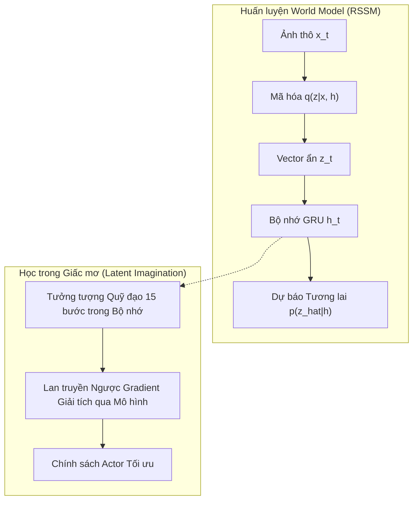

#### d. Code Thực chiến (Dual-Engine: C++ & Python)

```cpp
// C++20: Mô phỏng không gian trạng thái ẩn RSSM (Deterministic + Stochastic State)
#include <iostream>
#include <vector>

struct LatentState {
    std::vector<float> h_det;  // Phan hoi quy tat dinh (GRU state)
    std::vector<float> z_stoch; // Bien ngau nhien an (Latent vector)
};

class ToyRSSM {
public:
    LatentState transition(const LatentState& prev, float action) {
        LatentState next_state;
        next_state.h_det = {prev.h_det[0] * 0.9f + action * 0.1f};
        next_state.z_stoch = {next_state.h_det[0] + 0.05f}; // Mau du bao
        return next_state;
    }
};

int main() {
    ToyRSSM rssm;
    LatentState s0{{0.0f}, {0.0f}};
    auto s1 = rssm.transition(s0, 1.0f);
    std::cout << "[C++] Imagined Latent State h: " << s1.h_det[0] << " | z: " << s1.z_stoch[0] << "\n";
    return 0;
}
```

```python
# Python / PyTorch: Kiến trúc Recurrent State Space Model (RSSM) lõi
import torch
import torch.nn as nn

class MinimalRSSM(nn.Module):
    def __init__(self, act_dim: int, deter_dim: int = 64, stoch_dim: int = 32):
        super().__init__()
        self.gru_cell = nn.GRUCell(stoch_dim + act_dim, deter_dim)
        self.prior_net = nn.Linear(deter_dim, stoch_dim * 2) # Output mean & std

    def imagine_step(self, prev_deter, prev_stoch, action):
        # 1. Cap nhat trang thai tat dinh h_t
        x = torch.cat([prev_stoch, action], dim=-1)
        deter = self.gru_cell(x, prev_deter)

        # 2. Du doan trang thai ngau nhien tien nghiem z_t
        stats = self.prior_net(deter)
        mean, log_std = torch.chunk(stats, 2, dim=-1)
        std = torch.exp(log_std)
        stoch = mean + std * torch.randn_like(std) # Reparameterization
        return deter, stoch

rssm = MinimalRSSM(act_dim=1)
h = torch.zeros(1, 64)
z = torch.zeros(1, 32)
a = torch.tensor([[0.5]])
next_h, next_z = rssm.imagine_step(h, z, a)
print(f"[PyTorch Dreamer] Imagined Next Step: Deter shape {next_h.shape}, Stoch shape {next_z.shape}")
```

#### e. Lỗi Thường gặp & Ổn định Số học (Pitfalls & Numerical Stability)
- **Objective Collapse (KL Balancing)**: Trong việc cân bằng giữa hàm mất mát tái tạo ảnh và hàm phân kỳ KL giữa Posterior và Prior, nếu không sử dụng kỹ thuật KL Balancing (như trong DreamerV2/V3), biểu diễn latent space có thể bị sụp đổ về nhiễu thuần túy.

#### f. Ứng dụng Thực chiến trong AI / Deep Learning
- **DreamerV3 (2023)**: Thuật toán đầu tiên trên thế giới tự thu thập kim cương trong thế giới mở Minecraft hoàn toàn từ đầu mà không cần dữ liệu người chơi chuyên gia.

---

### 17. Sim-to-Real Transfer (Chuyển đổi Giả lập sang Thực tế)

#### a. Định nghĩa Bản chất Toán học (Mathematical Formulation)
Huấn luyện robot trực tiếp trên thế giới thực đối mặt với ba rủi ro: chi phí phần cứng đắt đỏ, nguy cơ phá hủy thiết bị, và tốc độ thu thập mẫu chậm (thời gian thực 1 giây chỉ thu được 1 giây dữ liệu). Các bộ giả lập mô phỏng vật lý (Isaac Gym, MuJoCo) có thể chạy nhanh gấp $10000\times$, nhưng gặp phải **Khoảng cách Thực tế (Reality Gap / Simulation-to-Reality Gap)**:
$$\mathbb{P}_{\text{sim}}(S_{t+1} \mid S_t, A_t) \neq \mathbb{P}_{\text{real}}(S_{t+1} \mid S_t, A_t)$$

**Nguyên lý Xáo trộn Miền (Domain Randomization - DR - Tobin et al., 2017)**:
Thay vì cố gắng xây dựng một bộ giả lập hoàn hảo (vốn bất khả thi), ta huấn luyện Agent trên một họ phân phối rộng lớn các môi trường mô phỏng có tham số vật lý $\boldsymbol{\xi} \sim P(\boldsymbol{\Xi})$ ngẫu nhiên:
$$\max_\theta \mathbb{E}_{\boldsymbol{\xi} \sim P(\boldsymbol{\Xi})} \left[ \mathbb{E}_{\tau \sim \pi_\theta(\boldsymbol{\xi})} [R(\tau)] \right]$$
Các tham số xáo trộn $\boldsymbol{\xi}$ bao gồm: khối lượng robot, ma sát mặt sàn, độ trễ truyền động động cơ, ánh sáng môi trường, và nhiễu cảm biến.

Nếu phân phối giả lập đủ rộng để bao bọc thế giới thực bên trong nó:
$$\mathbb{P}_{\text{real}} \in \text{supp}(P(\boldsymbol{\Xi}))$$
thì chính sách học được sẽ coi thế giới thực chỉ là một biến thể ngẫu nhiên khác và vận hành mượt mà mà không cần tinh chỉnh thêm (Zero-Shot Sim-to-Real).

#### b. Cơ chế Tầng Sâu & Điện toán (Under The Hood / Hardware Internals)
- **GPU-Accelerated PhysX Engine**: Thay vì thay đổi ma trận tham số vật lý tuần tự qua CPU, toàn bộ các thuộc tính cơ học (khối lượng, ma sát, độ đàn hồi) của hàng chục nghìn robot được lưu dưới dạng Unified Tensors trên VRAM, cho phép xáo trộn độc lập cho từng môi trường con ở mỗi lần reset mà không làm giảm tốc độ khung hình của bộ giả lập.

#### c. Sơ đồ Minh họa (Mermaid Diagram)
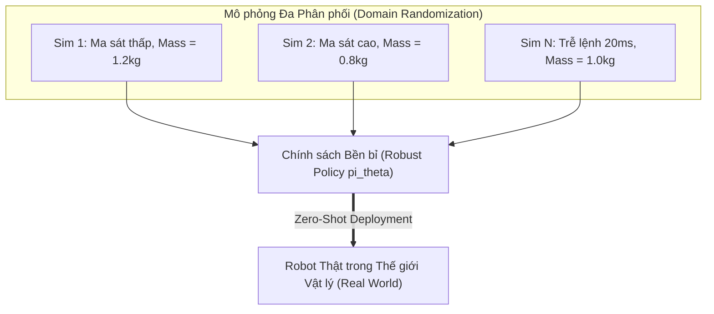

#### d. Code Thực chiến (Dual-Engine: C++ & Python)

```cpp
// C++20: Xáo trộn tham số vật lý môi trường (Physics Parameter Randomizer)
#include <iostream>
#include <random>

struct PhysicalParameters {
    float mass;
    float friction;
    float motor_delay_ms;
};

class DomainRandomizer {
private:
    std::mt19937 rng{1337};
    std::uniform_real_distribution<float> mass_dist{0.8f, 1.2f};
    std::uniform_real_distribution<float> friction_dist{0.4f, 1.0f};
    std::uniform_real_distribution<float> delay_dist{0.0f, 20.0f};

public:
    PhysicalParameters randomize() {
        return {mass_dist(rng), friction_dist(rng), delay_dist(rng)};
    }
};

int main() {
    DomainRandomizer dr;
    auto p = dr.randomize();
    std::cout << "[C++ Sim2Real] Random Physics -> Mass: " << p.mass 
              << "kg | Friction: " << p.friction 
              << " | Motor Delay: " << p.motor_delay_ms << "ms\n";
    return 0;
}
```

```python
# Python / PyTorch: Bộ đệm trễ hành động (Action Latency Queue) mô phỏng độ trễ phần cứng
import collections
import torch

class ActionLatencySimulator:
    def __init__(self, max_delay_steps: int = 2):
        self.max_delay_steps = max_delay_steps
        self.queue = collections.deque(maxlen=max_delay_steps + 1)

    def step(self, action: torch.Tensor, current_delay: int) -> torch.Tensor:
        self.queue.append(action)
        # Lay hanh dong bi tre pha trong qua khu
        delayed_idx = max(0, len(self.queue) - 1 - current_delay)
        return self.queue[delayed_idx]

sim = ActionLatencySimulator(max_delay_steps=2)
for t in range(4):
    act = torch.tensor([float(t)])
    delayed_act = sim.step(act, current_delay=1) # Tre 1 buoc
    print(f"[Python Sim2Real] Step {t}: Sent Act {act.item()} -> Physical Motor Received: {delayed_act.item()}")
```

#### e. Lỗi Thường gặp & Ổn định Số học (Pitfalls & Numerical Stability)
- **Over-Randomization (Xáo trộn Quá đà)**: Nếu đặt dải tham số vật lý quá rộng (ví dụ ma sát từ băng trơn tới keo dính, khối lượng lệch 10 lần), bài toán trở nên bất khả thi để tối ưu, dẫn đến việc Agent học một chính sách siêu bảo thủ (chỉ đứng im run rẩy để tránh ngã).

#### f. Ứng dụng Thực chiến trong AI / Deep Learning
- Huấn luyện robot 4 chân ANYmal và Unitree vượt qua địa hình tuyết lầy lội, cầu thang trơn trượt hoàn toàn bằng mô hình huấn luyện trong Isaac Gym mà không cần tinh chỉnh lại ngoài đời thực.
