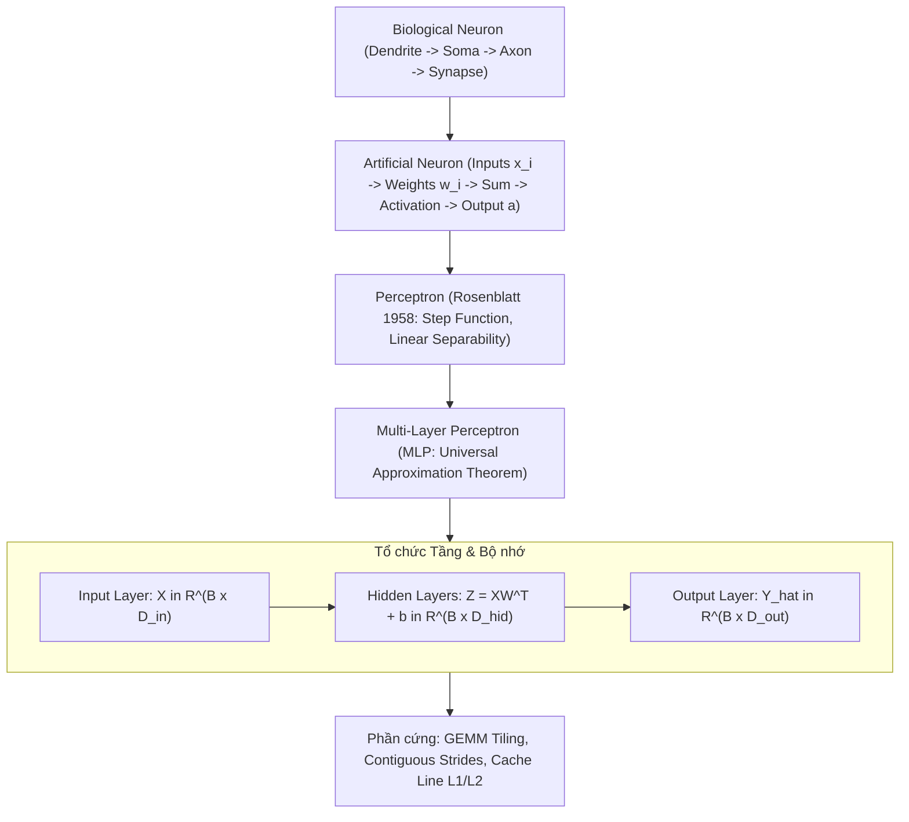
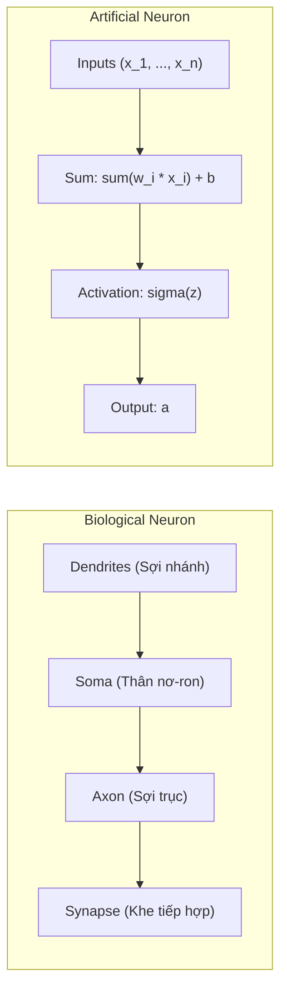
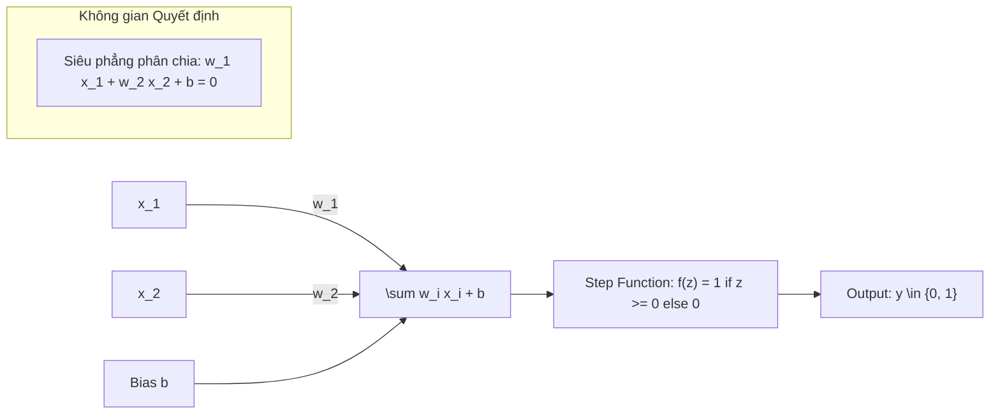
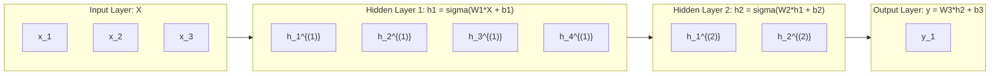

# Chuyên đề: Kiến trúc Mạng & Mô hình Nơ-ron (Network Architecture & Neuron Models)

## 1. Tổng quan Chuyên đề
Mạng Nơ-ron Nhân tạo (**Artificial Neural Networks - ANN**) là nền tảng cốt lõi của Deep Learning hiện đại. Khởi nguồn từ nỗ lực mô phỏng tính toán sinh học của hệ thần kinh, các mô hình nơ-ron nhân tạo đã phát triển thành các cấu trúc toán học đại số trừu tượng: các hàm phi tuyến đa tầng (Universal Function Approximators) được thực thi trên phần cứng tính toán song song (SIMD, GPUs, TPUs).

Về bản chất điện toán, một mạng nơ-ron sâu là một đồ thị phi chu trình (DAG) của các phép biến đổi affine liên tiếp $\mathbf{z} = \mathbf{W}\mathbf{x} + \mathbf{b}$ xen kẽ với các hàm kích hoạt phi tuyến $\sigma(\cdot)$, trong đó hàng triệu hoặc hàng tỷ tham số trọng số ($\mathbf{W}$) và độ chệch ($\mathbf{b}$) được lưu trữ dưới dạng các tensor liên tục trong bộ nhớ và tối ưu hoá thông qua vi phân tự động.



---

## 2. Chi tiết từng Keyword

---

### 1. Artificial Neural Networks (ANN) & Biological Neurons

#### a. Định nghĩa Bản chất Toán học
- **Biological Neurons (Nơ-ron Sinh học)**: Tế bào thần kinh sinh học bao gồm sợi nhánh (dendrites) nhận tín hiệu điện hóa, thân tế bào (soma) tích lũy điện thế màng, sợi trục (axon) truyền xung điện thế hoạt động (action potential) khi điện thế vượt ngưỡng, và synapse là khe tiếp hợp điều biến cường độ truyền tin.
- **Artificial Neural Networks (ANN)**: Mô hình đồ thị có hướng biểu diễn ánh xạ hàm phi tuyến $f_\Theta: \mathcal{X} \to \mathcal{Y}$, trong đó $\mathcal{X} \subseteq \mathbb{R}^d$ và $\mathcal{Y} \subseteq \mathbb{R}^k$. Một mạng $L$ tầng được định nghĩa đệ quy:
  $$\mathbf{h}^{(0)} = \mathbf{x}$$
  $$\mathbf{z}^{(l)} = \mathbf{W}^{(l)} \mathbf{h}^{(l-1)} + \mathbf{b}^{(l)}, \quad l = 1, \dots, L$$
  $$\mathbf{h}^{(l)} = \sigma^{(l)}(\mathbf{z}^{(l)})$$
  $$\hat{\mathbf{y}} = \mathbf{h}^{(L)}$$
  trong đó $\Theta = \{\mathbf{W}^{(l)}, \mathbf{b}^{(l)}\}_{l=1}^L$ là tập tham số của mạng.

#### b. Cơ chế Tầng Sâu & Điện toán (Internals)
- **Tương phản Sinh học vs Phần cứng**: Nơ-ron sinh học hoạt động bất đồng bộ, truyền tín hiệu bằng tần số xung (Spike-timing-dependent plasticity - STDP) với tiêu thụ năng lượng cực thấp (~20W cho não bộ người). Ngược lại, ANN trên máy tính hoạt động đồng bộ theo chu kỳ xung nhịp, xử lý dữ liệu dấu phẩy động (FP32/FP16/BF16/INT8) trên các mảng số dày đặc (dense tensors) thông qua phép toán nhân ma trận lớn (GEMM).
- **Phân bổ Bộ nhớ**: Một tầng nơ-ron với $D_{\text{in}}$ đầu vào và $D_{\text{out}}$ đầu ra yêu cầu một ma trận trọng số $\mathbf{W} \in \mathbb{R}^{D_{\text{out}} \times D_{\text{in}}}$ chiếm $D_{\text{out}} \times D_{\text{in}} \times 4$ bytes (nếu dùng FP32) trong VRAM/RAM, được bố trí tuần tự theo hàng (Row-Major).

#### c. Sơ đồ Minh họa


#### d. Code Thực chiến (C++ & Python)

```cpp
// C++17: Mô phỏng cấu trúc nơ-ron cơ bản với SIMD memory alignment
#include <iostream>
#include <vector>
#include <numeric>
#include <cmath>

struct BiologicalSynapse {
    float weight;
    float delay_ms;
};

class ArtificialNeuron {
public:
    alignas(64) std::vector<float> weights;
    float bias;

    ArtificialNeuron(size_t input_dim, float b = 0.0f) : weights(input_dim, 0.05f), bias(b) {}

    float forward(const std::vector<float>& x) const {
        float z = bias;
        // Dot product tối ưu hóa bộ nhớ tuần tự
        for (size_t i = 0; i < weights.size(); ++i) {
            z += weights[i] * x[i];
        }
        // Activation: Sigmoid
        return 1.0f / (1.0f + std::exp(-z));
    }
};

int main() {
    ArtificialNeuron neuron(4, 0.1f);
    std::vector<float> inputs = {1.0f, -2.0f, 0.5f, 3.0f};
    std::cout << "Neuron Activation: " << neuron.forward(inputs) << "\n";
    return 0;
}
```

```python
# Python / PyTorch: Biểu diễn ANN cơ bản
import torch
import torch.nn as nn

class BasicANN(nn.Module):
    def __init__(self, in_features: int, out_features: int):
        super().__init__()
        self.weights = nn.Parameter(torch.randn(out_features, in_features) * 0.01)
        self.bias = nn.Parameter(torch.zeros(out_features))

    def forward(self, x: torch.Tensor) -> torch.Tensor:
        # z = x @ W^T + b
        z = torch.matmul(x, self.weights.t()) + self.bias
        return torch.sigmoid(z)

ann = BasicANN(in_features=4, out_features=1)
sample_x = torch.tensor([[1.0, -2.0, 0.5, 3.0]])
print("ANN Output:", ann(sample_x).item())
```

#### e. Lỗi Thường gặp & Ổn định Số học
- **Khác biệt giả định sinh học**: Cố gắng mô phỏng quá mức cơ chế điện thế màng sinh học (Spiking Neural Networks - SNN) trên GPU truyền thống sẽ dẫn đến hiệu suất tính toán cực kém do thiếu tính liên tục trong bộ nhớ và không tận dụng được Tensor Cores.

#### f. Ứng dụng Thực chiến trong AI
- Toàn bộ các kiến trúc Deep Learning hiện đại (MLP, CNN, RNN, Transformer) đều kế thừa nguyên lý xử lý phân tán song song từ cấu trúc kết nối của nơ-ron sinh học.

---

### 2. Artificial Neurons & Perceptron

#### a. Định nghĩa Bản chất Toán học
- **Artificial Neuron (McCulloch-Pitts 1943)**: Đơn vị tính toán nhận $n$ tín hiệu nhị phân $x_i \in \{0, 1\}$ và trả về 1 nếu tổng vượt ngưỡng $\theta$, ngược lại trả về 0:
  $$y = \Theta\left(\sum_{i=1}^n w_i x_i - \theta\right)$$
- **Rosenblatt Perceptron (1958)**: Mở rộng cho đầu vào thực $x_i \in \mathbb{R}$, sử dụng hàm bước nhảy Heaviside làm hàm kích hoạt:
  $$f(\mathbf{x}) = \begin{cases} 1 & \text{nếu } \mathbf{w}^T \mathbf{x} + b \ge 0 \\ 0 & \text{nếu } \mathbf{w}^T \mathbf{x} + b < 0 \end{cases}$$
- **Quy tắc học Perceptron (Perceptron Learning Rule)**:
  Với mỗi mẫu $(\mathbf{x}_k, y_k)$ có nhãn $y_k \in \{0, 1\}$:
  $$\mathbf{w} \leftarrow \mathbf{w} + \eta (y_k - \hat{y}_k) \mathbf{x}_k$$
  $$b \leftarrow b + \eta (y_k - \hat{y}_k)$$
  **Định lý hội tụ Perceptron (Novikoff 1962)**: Nếu tập dữ liệu phân tách tuyến tính với lề (margin) $\gamma > 0$ và $\|\mathbf{x}_k\|_2 \le R$, thuật toán đảm bảo hội tụ sau tối đa $\left(\frac{R}{\gamma}\right)^2$ bước cập nhật.

#### b. Cơ chế Tầng Sâu & Giới hạn Tính toán (XOR Problem)
- **Hạn chế Tuyến tính**: Một Perceptron đơn lẻ chỉ có thể phân chia không gian bằng một siêu phẳng (hyperplane) $\mathbf{w}^T \mathbf{x} + b = 0$.
- **Vấn đề XOR (Minsky & Papert 1969)**: Hàm XOR không phân tách tuyến tính, khiến Perceptron đơn tầng bất khả thi trong việc học hàm logic này. Muốn giải quyết XOR, cần ít nhất 2 tầng tuyến tính với hàm kích hoạt phi tuyến.

#### c. Sơ đồ Minh họa


#### d. Code Thực chiến (C++ & Python)

```cpp
// C++17: Cài đặt Rosenblatt Perceptron từ đầu
#include <iostream>
#include <vector>

class Perceptron {
private:
    std::vector<float> weights;
    float bias;
    float lr;

public:
    Perceptron(size_t dim, float learning_rate = 0.1f)
        : weights(dim, 0.0f), bias(0.0f), lr(learning_rate) {}

    int predict(const std::vector<float>& x) const {
        float sum = bias;
        for (size_t i = 0; i < weights.size(); ++i) sum += weights[i] * x[i];
        return (sum >= 0.0f) ? 1 : 0;
    }

    void train(const std::vector<std::vector<float>>& X, const std::vector<int>& y, int epochs) {
        for (int ep = 0; ep < epochs; ++ep) {
            for (size_t i = 0; i < X.size(); ++i) {
                int y_hat = predict(X[i]);
                int error = y[i] - y_hat;
                if (error != 0) {
                    for (size_t j = 0; j < weights.size(); ++j) {
                        weights[j] += lr * error * X[i][j];
                    }
                    bias += lr * error;
                }
            }
        }
    }
};

int main() {
    Perceptron p(2, 0.1f);
    // Học cổng AND
    std::vector<std::vector<float>> X = {{0, 0}, {0, 1}, {1, 0}, {1, 1}};
    std::vector<int> y = {0, 0, 0, 1};
    p.train(X, y, 20);
    std::cout << "Predict (1, 1): " << p.predict({1, 1}) << " (Expected 1)\n";
    std::cout << "Predict (1, 0): " << p.predict({1, 0}) << " (Expected 0)\n";
    return 0;
}
```

```python
import numpy as np

class PerceptronNumpy:
    def __init__(self, in_dim: int, lr: float = 0.1):
        self.w = np.zeros(in_dim, dtype=np.float32)
        self.b = 0.0
        self.lr = lr

    def predict(self, X: np.ndarray) -> np.ndarray:
        return (np.dot(X, self.w) + self.b >= 0.0).astype(np.int32)

    def fit(self, X: np.ndarray, y: np.ndarray, epochs: int = 20):
        for _ in range(epochs):
            for xi, yi in zip(X, y):
                y_hat = 1 if (np.dot(xi, self.w) + self.b) >= 0.0 else 0
                error = yi - y_hat
                self.w += self.lr * error * xi
                self.b += self.lr * error

# Kiểm thử với cổng AND
X = np.array([[0, 0], [0, 1], [1, 0], [1, 1]], dtype=np.float32)
y = np.array([0, 0, 0, 1], dtype=np.int32)
p = PerceptronNumpy(2)
p.fit(X, y)
print("Dự đoán AND:", p.predict(X))
```

#### e. Lỗi Thường gặp & Ổn định Số học
- **Không hội tụ trên dữ liệu không khả ly**: Nếu dữ liệu bị nhiễu hoặc không phân tách tuyến tính hoàn hảo, thuật toán Perceptron sẽ dao động vô hạn quanh siêu phẳng tối ưu cục bộ mà không dừng lại.
- **Hàm bậc thang không khả vi**: Hàm Heaviside có đạo hàm bằng 0 ở khắp mọi nơi (ngoại trừ tại 0 không xác định), do đó không thể tối ưu hóa qua lan truyền ngược (Backpropagation) bằng đạo hàm Gradient Descent.

#### f. Ứng dụng Thực chiến trong AI
- Là viên gạch cơ sở mở đường cho mạng nơ-ron đa tầng (MLP) và Support Vector Machines (SVM).

---

### 3. Multi-Layer Perceptron (MLP) & Universal Approximation Theorem

#### a. Định nghĩa Bản chất Toán học
Một **Multi-Layer Perceptron (MLP)** là mạng nơ-ron truyền thẳng (Feedforward Neural Network) bao gồm ít nhất một tầng ẩn (hidden layer) với các hàm kích hoạt phi tuyến liên tục.
$$\mathbf{y} = f(\mathbf{x}) = \sigma^{(L)}\left( \mathbf{W}^{(L)} \dots \sigma^{(1)}\left(\mathbf{W}^{(1)}\mathbf{x} + \mathbf{b}^{(1)}\right) \dots + \mathbf{b}^{(L)} \right)$$

**Định lý Xấp xỉ Vạn năng (Universal Approximation Theorem - Cybenko 1989, Hornik 1991)**:
Cho $\sigma$ là bất kỳ hàm kích hoạt liên tục không phải đa thức (non-polynomial). Khi đó, tập hợp các hàm có dạng:
$$F(\mathbf{x}) = \sum_{i=1}^N v_i \sigma\left(\mathbf{w}_i^T \mathbf{x} + b_i\right)$$
là trù mật (dense) trong không gian $C(K)$ của các hàm liên tục trên mọi tập compact $K \subset \mathbb{R}^d$. Nói cách khác, với mọi hàm liên tục $f$ và sai số $\epsilon > 0$, luôn tồn tại một mạng nơ-ron 1 tầng ẩn với số nơ-ron $N$ đủ lớn sao cho:
$$\sup_{\mathbf{x} \in K} |F(\mathbf{x}) - f(\mathbf{x})| < \epsilon$$

#### b. Cơ chế Tầng Sâu: Chiều sâu (Depth) vs Chiều rộng (Width)
Mặc dù 1 tầng ẩn với chiều rộng $N \to \infty$ có thể xấp xỉ bất kỳ hàm nào, mạng nơ-ron sâu (**Deep Networks**) có ưu thế áp đảo về hiệu quả biểu diễn:
- Để xấp xỉ một số lớp hàm dao động cao, mạng nông (shallow) cần số lượng nơ-ron tăng theo cấp số nhân $\mathcal{O}(2^d)$ (lời nguyền số chiều - curse of dimensionality).
- Mạng sâu với $L$ tầng có thể biểu diễn cùng độ phức tạp chỉ với số tham số tỷ lệ thuận đa thức $\mathcal{O}(L \cdot d)$ bằng cách tái sử dụng các đặc trưng phân cấp (compositional hierarchy).

#### c. Sơ đồ Minh họa


#### d. Code Thực chiến (C++ & Python)

```cpp
// C++17: MLP Forward Pass thủ công với Matrix Buffer phẳng
#include <iostream>
#include <vector>
#include <cmath>

struct LinearParams {
    std::vector<float> W; // Row-major: out_dim x in_dim
    std::vector<float> b; // out_dim
    int in_dim, out_dim;
};

void gemm_forward(const float* X, const LinearParams& layer, float* Out, int batch_size) {
    for (int b = 0; b < batch_size; ++b) {
        for (int o = 0; o < layer.out_dim; ++o) {
            float sum = layer.b[o];
            for (int i = 0; i < layer.in_dim; ++i) {
                sum += X[b * layer.in_dim + i] * layer.W[o * layer.in_dim + i];
            }
            Out[b * layer.out_dim + o] = sum;
        }
    }
}

void relu_inplace(float* data, int size) {
    for (int i = 0; i < size; ++i) {
        if (data[i] < 0.0f) data[i] = 0.0f;
    }
}

int main() {
    int B = 1, D_in = 2, D_hid = 4, D_out = 1;
    std::vector<float> X = {1.0f, 2.0f};
    LinearParams l1{std::vector<float>(D_hid * D_in, 0.5f), std::vector<float>(D_hid, 0.1f), D_in, D_hid};
    LinearParams l2{std::vector<float>(D_out * D_hid, 0.2f), std::vector<float>(D_out, 0.0f), D_hid, D_out};
    
    std::vector<float> H(B * D_hid);
    std::vector<float> Y(B * D_out);

    gemm_forward(X.data(), l1, H.data(), B);
    relu_inplace(H.data(), B * D_hid);
    gemm_forward(H.data(), l2, Y.data(), B);

    std::cout << "MLP Output y = " << Y[0] << "\n";
    return 0;
}
```

```python
import torch
import torch.nn as nn

class StandardMLP(nn.Module):
    def __init__(self, in_features: int, hidden_features: int, out_features: int):
        super().__init__()
        self.net = nn.Sequential(
            nn.Linear(in_features, hidden_features),
            nn.ReLU(),
            nn.Linear(hidden_features, hidden_features),
            nn.ReLU(),
            nn.Linear(hidden_features, out_features)
        )

    def forward(self, x: torch.Tensor) -> torch.Tensor:
        return self.net(x)

mlp = StandardMLP(in_features=8, hidden_features=32, out_features=2)
x = torch.randn(4, 8) # Batch = 4
out = mlp(x)
print("MLP Output Shape:", out.shape) # [4, 2]
```

#### e. Lỗi Thường gặp & Ổn định Số học
- **Quên hàm kích hoạt giữa các tầng**: Nếu bỏ qua hàm phi tuyến, tích chuỗi ma trận $\mathbf{W}^{(L)} \dots \mathbf{W}^{(1)}\mathbf{x}$ chỉ đơn giản là một ma trận biến đổi tuyến tính đơn lẻ $\mathbf{W}_{\text{eff}}\mathbf{x}$, làm mất hoàn toàn khả năng xấp xỉ hàm phức tạp của mạng sâu.

#### f. Ứng dụng Thực chiến trong AI
- MLP là khối cơ bản (Feed-Forward Networks - FFN) trong cấu trúc khối Transformer (chiếm 2/3 tổng số tham số của mô hình ngôn ngữ lớn như GPT-4, LLaMA-3).

---

### 4. Input Layer, Hidden Layer, Output Layer & Neurons

#### a. Định nghĩa Bản chất Toán học
1. **Input Layer (Tầng Đầu vào)**: Không thực hiện phép tính; đóng vai trò là vector trạng thái ban đầu của không gian quan sát $\mathbf{x} \in \mathbb{R}^{D_{\text{in}}}$.
2. **Hidden Layer (Tầng Ẩn)**: Thực hiện phép ánh xạ trung gian vào không gian biểu diễn ẩn (latent representation space) $\mathbf{h}^{(l)} \in \mathbb{R}^{D_l}$. Tầng ẩn trích xuất các đặc trưng phân cấp phi tuyến mà con người không cần thiết kế thủ công.
3. **Output Layer (Tầng Đầu ra)**: Ánh xạ không gian ẩn về không gian nhãn/mục tiêu $\hat{\mathbf{y}} \in \mathbb{R}^{D_{\text{out}}}$, đi kèm với hàm chuẩn hóa phù hợp với bài toán (Regression: Identity; Binary Classification: Sigmoid; Multi-class: Softmax).
4. **Neuron (Nút mạng)**: Đơn vị tính toán vô hướng $z_j = \sum_{i} w_{ji} x_i + b_j$, $a_j = \sigma(z_j)$.

#### b. Cơ chế Tầng Sâu & Memory Footprint trong Quá trình Huấn luyện
Trong quá trình Forward Pass, không chỉ các tham số $\mathbf{W}, \mathbf{b}$ được lưu trữ, mà **toàn bộ giá trị kích hoạt trung gian (activations)** $\mathbf{z}^{(l)}$ và $\mathbf{h}^{(l)}$ của tất cả các tầng ẩn đều phải được giữ lại trong VRAM để phục vụ việc tính đạo hàm trong Backward Pass:
$$\text{Memory Activation} = \sum_{l=1}^L B \times D_l \times \text{sizeof}(\text{dtype})$$
Đối với Batch size $B$ lớn, bộ nhớ lưu activation thường vượt xa bộ nhớ lưu trữ trọng số.

#### c. Code Thực chiến (C++ & Python)

```cpp
// C++17: Quản lý bộ nhớ Activation Cache cho Forward và Backward
#include <vector>
#include <iostream>

struct LayerActivationCache {
    int batch_size;
    int dim;
    std::vector<float> z; // pre-activation
    std::vector<float> a; // post-activation
    
    LayerActivationCache(int B, int D) : batch_size(B), dim(D), z(B * D, 0.0f), a(B * D, 0.0f) {}
    
    size_t memory_bytes() const {
        return (z.capacity() + a.capacity()) * sizeof(float);
    }
};

int main() {
    LayerActivationCache hidden_layer(64, 1024);
    std::cout << "Activation Cache Memory: " << hidden_layer.memory_bytes() / 1024.0f << " KB\n";
    return 0;
}
```

```python
import torch

# Minh họa việc lưu trữ activation qua PyTorch Hooks
model = torch.nn.Sequential(
    torch.nn.Linear(10, 64),
    torch.nn.ReLU(),
    torch.nn.Linear(64, 2)
)

activations = {}
def get_activation(name):
    def hook(model, input, output):
        activations[name] = output.detach()
    return hook

model[0].register_forward_hook(get_activation('layer1_hidden'))
x = torch.randn(4, 10)
out = model(x)
print("Captured Hidden Layer Activation Shape:", activations['layer1_hidden'].shape)
```

---

### 5. Weights, Biases, Linear Layers & Fully Connected Layers

#### a. Định nghĩa Bản chất Toán học
- **Weights ($\mathbf{W} \in \mathbb{R}^{D_{\text{out}} \times D_{\text{in}}}$)**: Đại lượng biểu thị cường độ kết nối giữa các nơ-ron; đóng vai trò là toán tử biến đổi tỉ lệ xoay, co giãn trong không gian véc-tơ.
- **Biases ($\mathbf{b} \in \mathbb{R}^{D_{\text{out}}}$)**: Thành phần tự do giúp tịnh tiến siêu phẳng tách biệt ra khỏi gốc tọa độ $\mathbf{0}$, cho phép mô hình học các hàm không đi qua gốc toạ độ.
- **Linear Layer / Fully Connected (FC) Layer**: Tầng tính toán biến đổi affine:
  $$\mathbf{Y} = \mathbf{X} \mathbf{W}^T + \mathbf{b}$$
  với $\mathbf{X} \in \mathbb{R}^{B \times D_{\text{in}}}$, $\mathbf{W} \in \mathbb{R}^{D_{\text{out}} \times D_{\text{in}}}$, $\mathbf{b} \in \mathbb{R}^{D_{\text{out}}}$, và $\mathbf{Y} \in \mathbb{R}^{B \times D_{\text{out}}}$.

#### b. Cơ chế Tầng Sâu: Tại sao $\mathbf{X} \mathbf{W}^T$ thay vì $\mathbf{W} \mathbf{X}$?
1. **Trong Đại số Tuyến tính truyền thống**: Một mẫu đơn lẻ thường viết dưới dạng cột $\mathbf{x} \in \mathbb{R}^{D_{\text{in}} \times 1}$, khi đó $\mathbf{y} = \mathbf{W} \mathbf{x} + \mathbf{b}$.
2. **Trong Điện toán song song (Deep Learning Frameworks)**: Dữ liệu được gom thành batch để tối đa hóa băng thông bộ nhớ. Tensor $\mathbf{X}$ có shape `[Batch, Features]`.
   Vì bộ nhớ RAM/VRAM lưu trữ theo chuẩn Row-Major (C-contiguous):
   - Mẫu thứ $i$ nằm liên tục trên cùng một dòng.
   - Để tránh phải chuyển vị ma trận đầu vào $\mathbf{X}$ (gây tốn bộ nhớ hoặc stride miss), frameworks thực hiện phép nhân ma trận $\mathbf{X} \mathbf{W}^T$.

#### c. Code Thực chiến (C++ & Python)

```cpp
// C++17: Fully Connected Layer với Strided Memory Layout và Bias Broadcasting
#include <iostream>
#include <vector>

class FullyConnectedLayer {
private:
    int in_features;
    int out_features;
    std::vector<float> weights; // Shape [out_features, in_features]
    std::vector<float> biases;  // Shape [out_features]

public:
    FullyConnectedLayer(int in_f, int out_f) 
        : in_features(in_f), out_features(out_f),
          weights(out_f * in_f, 0.01f), biases(out_f, 0.0f) {}

    void forward(const float* X, float* Y, int batch_size) const {
        for (int b = 0; b < batch_size; ++b) {
            for (int o = 0; o < out_features; ++o) {
                float acc = biases[o]; // Tịnh tiến Bias
                const float* w_row = &weights[o * in_features];
                const float* x_row = &X[b * in_features];
                for (int i = 0; i < in_features; ++i) {
                    acc += x_row[i] * w_row[i];
                }
                Y[b * out_features + o] = acc;
            }
        }
    }
};

int main() {
    FullyConnectedLayer fc(3, 2);
    std::vector<float> X = {1.0f, 2.0f, 3.0f, 4.0f, 5.0f, 6.0f}; // Batch = 2, Features = 3
    std::vector<float> Y(2 * 2);
    fc.forward(X.data(), Y.data(), 2);
    std::cout << "Y[0][0]: " << Y[0] << " | Y[1][1]: " << Y[3] << "\n";
    return 0;
}
```

```python
import torch
import torch.nn as nn

linear = nn.Linear(in_features=3, out_features=2, bias=True)
print("Weight Tensor Shape:", linear.weight.shape) # torch.Size([2, 3])
print("Bias Tensor Shape:", linear.bias.shape)     # torch.Size([2])

x = torch.randn(2, 3)
y = linear(x) # Tính: x @ weight.t() + bias
print("Output Shape:", y.shape) # torch.Size([2, 2])
```

#### d. Lỗi Thường gặp & Ứng dụng AI
- **Bùng nổ số lượng tham số trong Vision**: Sử dụng Fully Connected Layers trực tiếp trên ảnh độ phân giải cao (ví dụ $1024 \times 1024 \times 3 \approx 3.1 \times 10^6$ pixels) sẽ đòi hỏi hàng trăm triệu tham số chỉ cho một tầng đơn lẻ, dẫn đến overfitting trầm trọng và tràn bộ nhớ VRAM. Do đó CNN và Attention được thiết kế để giải quyết bài toán chia sẻ trọng số (weight sharing).
