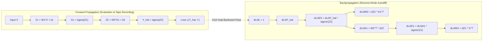
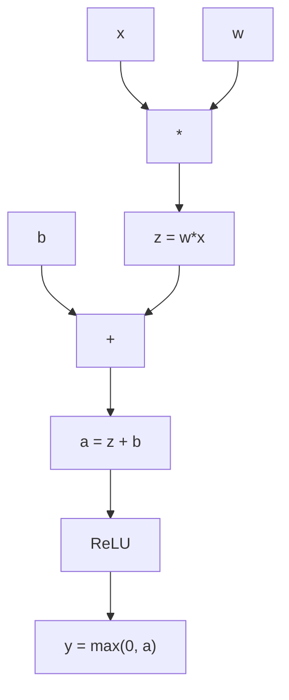

# Chuyên đề: Lan truyền Tiến, Lan truyền Ngược & Đồ thị Tính toán (Forward, Backprop & Computational Graphs)

## 1. Tổng quan Chuyên đề
Khả năng học tập của mạng nơ-ron sâu phụ thuộc hoàn toàn vào hai quá trình đối ngẫu: **Lan truyền tiến (Forward Propagation)** để ánh xạ dữ liệu đầu vào thành dự báo, và **Lan truyền ngược (Backpropagation)** để truyền tín hiệu sai số từ hàm mất mát ngược về từng tham số.

Về bản chất vi phân và điện toán, Backpropagation chính là thuật toán **Vi phân tự động chế độ đảo ngược (Reverse-Mode Automatic Differentiation)** được thực thi trên một **Đồ thị Tính toán phi chu trình (Computational Graph / DAG)**. Trong quá trình này, các hiện tượng bệnh lý vi phân như **Triệt tiêu đạo hàm (Vanishing Gradient)**, **Bùng nổ đạo hàm (Exploding Gradient)**, và **Nơ-ron chết (Dead Neurons)** là những thách thức cốt lõi quyết định khả năng huấn luyện của các mạng nơ-ron sâu.



---

## 2. Chi tiết từng Keyword

---

### 1. Forward Propagation & Computational Graph

#### a. Định nghĩa Bản chất Toán học
- **Đồ thị Tính toán (Computational Graph)**: Một đồ thị có hướng phi chu trình (DAG) $\mathcal{G} = (\mathcal{V}, \mathcal{E})$, trong đó mỗi đỉnh $v \in \mathcal{V}$ đại diện cho một biến số (tensors, parameters, constants) hoặc một phép toán nguyên thủy (primitive operation), và mỗi cạnh $(u, v) \in \mathcal{E}$ đại diện cho luồng dữ liệu (data dependency).
- **Forward Propagation (Lan truyền tiến)**: Quá trình duyệt đồ thị theo thứ tự tô-pô (topological order) từ các nút nguồn (inputs $\mathbf{X}$, tham số $\mathbf{W}, \mathbf{b}$) đến nút đích (Loss $\mathcal{L}$). Với mỗi nút $u$ có tập cha $\text{Parents}(u)$:
  $$v_u = f_u\left(\{v_p \mid p \in \text{Parents}(u)\}\right)$$

#### b. Cơ chế Tầng Sâu: Dynamic Graphs (PyTorch Tape) vs Static Graphs (TensorFlow 1.x / XLA)
1. **Dynamic Computational Graph (Define-by-Run)**:
   - PyTorch xây dựng đồ thị động tại runtime thông qua cơ chế `torch.autograd.Tape`.
   - Mỗi khi một tensor thực hiện toán tử (ví dụ `torch.matmul`), một đối tượng `Node` kế thừa từ `torch::autograd::Node` được cấp phát trên heap, lưu trữ con trỏ tới các hàm backward (`grad_fn`) và lưu lại các tensor cần thiết cho backward pass (`save_for_backward`).
2. **Static Computational Graph (Define-and-Run)**:
   - Đồ thị được định nghĩa toàn bộ trước khi nạp dữ liệu.
   - Ưu điểm: Trình biên dịch (như XLA, TorchScript) có thể thực hiện **Kernel Fusion** (hợp nhất phép nhân ma trận, cộng bias và kích hoạt ReLU vào một kernel GPU duy nhất), loại bỏ hàng loạt thao tác ghi/đọc bộ nhớ trung gian ra VRAM.

#### c. Sơ đồ Minh họa


#### d. Code Thực chiến (C++ & Python)

```cpp
// C++17: Cấu trúc cơ bản của một Node trong Computational Graph
#include <iostream>
#include <vector>
#include <memory>
#include <functional>

struct Variable;
using VarPtr = std::shared_ptr<Variable>;

struct Variable {
    float data;
    float grad = 0.0f;
    std::vector<VarPtr> parents;
    std::function<void()> backward_fn;

    Variable(float val) : data(val) {}
};

VarPtr make_var(float val) { return std::make_shared<Variable>(val); }

VarPtr multiply(VarPtr a, VarPtr b) {
    auto out = make_var(a->data * b->data);
    out->parents = {a, b};
    out->backward_fn = [a, b, out]() {
        a->grad += b->data * out->grad;
        b->grad += a->data * out->grad;
    };
    return out;
}

int main() {
    auto w = make_var(3.0f);
    auto x = make_var(2.0f);
    auto z = multiply(w, x); // z = w * x = 6.0
    z->grad = 1.0f;          // Seed gradient
    z->backward_fn();        // Execute reverse step
    std::cout << "dz/dw = " << w->grad << " | dz/dx = " << x->grad << "\n";
    return 0;
}
```

```python
import torch

# Khám phá cấu trúc đồ thị tính toán của PyTorch
x = torch.tensor([2.0], requires_grad=True)
w = torch.tensor([3.0], requires_grad=True)
b = torch.tensor([1.5], requires_grad=True)

z = w * x + b
a = torch.relu(z)

print("z grad_fn:", z.grad_fn) # <AddBackward0>
print("a grad_fn:", a.grad_fn) # <ReluBackward0>
print("Next functions in DAG:", a.grad_fn.next_functions)
```

---

### 2. Backpropagation & Gradient Flow

#### a. Định nghĩa Bản chất Toán học
**Quy tắc Chuỗi Đa biến (Multivariate Chain Rule)**:
Cho hàm mất mát vô hướng $\mathcal{L} \in \mathbb{R}$ và một biến trung gian $\mathbf{z}^{(l)} \in \mathbb{R}^{d_l}$. Đạo hàm của $\mathcal{L}$ theo tham số $\mathbf{W}^{(l)}$ và biến kích hoạt tầng trước $\mathbf{a}^{(l-1)}$:
$$\frac{\partial \mathcal{L}}{\partial \mathbf{W}^{(l)}} = \boldsymbol{\delta}^{(l)} (\mathbf{a}^{(l-1)})^T$$
$$\frac{\partial \mathcal{L}}{\partial \mathbf{b}^{(l)}} = \boldsymbol{\delta}^{(l)}$$
$$\boldsymbol{\delta}^{(l)} \triangleq \frac{\partial \mathcal{L}}{\partial \mathbf{z}^{(l)}} = \left( (\mathbf{W}^{(l+1)})^T \boldsymbol{\delta}^{(l+1)} \right) \odot \sigma'(\mathbf{z}^{(l)})$$
trong đó $\odot$ là tích Hadamard (element-wise multiplication) và $\sigma'(\mathbf{z}^{(l)})$ là đạo hàm bậc nhất của hàm kích hoạt.

#### b. Cơ chế Tầng Sâu: Trí nhớ Tape & VRAM Footprint
Trong quá trình lan truyền ngược:
1. **Backward Pass đảo ngược hoàn toàn trình tự của Forward**: Các tầng được tính từ $L$ lùi về $1$.
2. **Giải phóng Tensor Cache**: Ngay khi $\boldsymbol{\delta}^{(l)}$ và đạo hàm $\frac{\partial \mathcal{L}}{\partial \mathbf{W}^{(l)}}$ được tính xong, giá trị activation $\mathbf{a}^{(l-1)}$ có thể được giải phóng khỏi bộ nhớ nếu không còn nút nào khác phụ thuộc vào nó (trừ khi bật `retain_graph=True`).
3. **Gradient Checkpointing (Activation Recomputation)**: Đối với các mô hình LLM khổng lồ không đủ VRAM, người ta không lưu trữ toàn bộ activations trong forward pass mà chỉ lưu một số trạm kiểm soát (checkpoints), sau đó tính lại forward khi cần thiết trong backward pass để đánh đổi computation lấy memory.

#### c. Code Thực chiến (C++ & Python)

```cpp
// C++17: Thực thi Forward và Backward Pass cho một Linear Layer đầy đủ
#include <iostream>
#include <vector>

class DenseLayer {
public:
    int in_dim, out_dim;
    std::vector<float> W; // [out_dim x in_dim]
    std::vector<float> b; // [out_dim]
    std::vector<float> grad_W;
    std::vector<float> grad_b;
    std::vector<float> saved_x; // Cache for backward

    DenseLayer(int in_d, int out_d) : in_dim(in_d), out_dim(out_d),
        W(out_d * in_d, 0.1f), b(out_d, 0.0f),
        grad_W(out_d * in_d, 0.0f), grad_b(out_d, 0.0f) {}

    std::vector<float> forward(const std::vector<float>& x) {
        saved_x = x;
        std::vector<float> out(out_dim, 0.0f);
        for (int o = 0; o < out_dim; ++o) {
            out[o] = b[o];
            for (int i = 0; i < in_dim; ++i) {
                out[o] += W[o * in_dim + i] * x[i];
            }
        }
        return out;
    }

    std::vector<float> backward(const std::vector<float>& grad_out) {
        std::vector<float> grad_x(in_dim, 0.0f);
        // grad_W = grad_out * x^T
        // grad_b = grad_out
        for (int o = 0; o < out_dim; ++o) {
            grad_b[o] += grad_out[o];
            for (int i = 0; i < in_dim; ++i) {
                grad_W[o * in_dim + i] += grad_out[o] * saved_x[i];
                grad_x[i] += W[o * in_dim + i] * grad_out[o];
            }
        }
        return grad_x;
    }
};

int main() {
    DenseLayer layer(2, 3);
    auto y = layer.forward({1.0f, -1.0f});
    auto grad_in = layer.backward({0.5f, -0.2f, 1.0f});
    std::cout << "Backward executed successfully. grad_in size: " << grad_in.size() << "\n";
    return 0;
}
```

```python
import torch

x = torch.tensor([1.0, -1.0], requires_grad=True)
fc = torch.nn.Linear(2, 3, bias=True)
y = fc(x)
loss = (y ** 2).sum()

loss.backward()
print("fc.weight.grad shape:", fc.weight.grad.shape) # [3, 2]
print("fc.bias.grad shape:", fc.bias.grad.shape)     # [3]
print("x.grad shape:", x.grad.shape)                 # [2]
```

---

### 3. Vanishing Gradient & Exploding Gradient

#### a. Định nghĩa Bản chất Toán học
Xét công thức truyền ngược qua chuỗi $L$ tầng tuyến tính và phi tuyến:
$$\boldsymbol{\delta}^{(1)} = \left( \prod_{l=1}^{L-1} \mathbf{W}^{(l+1)T} \operatorname{diag}\left(\sigma'(\mathbf{z}^{(l)})\right) \right) \boldsymbol{\delta}^{(L)}$$
Độ lớn của gradient cấp 1 tại tầng đầu tiên bị chặn bởi chuẩn ma trận:
$$\|\boldsymbol{\delta}^{(1)}\| \le \|\boldsymbol{\delta}^{(L)}\| \cdot \prod_{l=1}^{L-1} \|\mathbf{W}^{(l+1)}\|_2 \cdot \|\operatorname{diag}\left(\sigma'(\mathbf{z}^{(l)})\right)\|_2$$

1. **Vanishing Gradient (Triệt tiêu đạo hàm)**:
   - Nếu $\|\mathbf{W}^{(l)}\|_2 < 1$ hoặc $|\sigma'(z)| \ll 1$ (ví dụ Sigmoid có $\max \sigma' = 0.25$, Tanh có $\max \sigma' = 1.0$ nhưng bão hòa về $0$ ở 2 đuôi), tích $\prod_{l=1}^L \gamma^l \to 0$ khi $L$ lớn. Các tầng đầu tiên gần như không nhận được tín hiệu cập nhật, đóng băng trọng số.
2. **Exploding Gradient (Bùng nổ đạo hàm)**:
   - Nếu $\|\mathbf{W}^{(l)}\|_2 > 1$, tích lũy chuỗi ma trận tăng theo hàm mũ $\gamma^L \to \infty$, dẫn đến gradient tràn số `NaN` hoặc `Inf`.

#### b. Cơ chế Tầng Sâu & Phân tích Trị riêng (Spectral Analysis)
- Đạo hàm lan truyền ngược thực chất là phép áp dụng toán tử tuyến tính lặp. Bán kính phổ (spectral radius) $\rho(\mathbf{W}) = \max_i |\lambda_i|$ của ma trận trọng số quyết định độ ổn định:
  - $\rho(\mathbf{W}) < 1 \implies$ Hội tụ về 0 (Vanishing).
  - $\rho(\mathbf{W}) > 1 \implies$ Phân kỳ ra vô cùng (Explosion).

#### c. Code Thực chiến (C++ & Python)

```cpp
// C++17: Gradient Clipping by Norm để ngăn chặn Exploding Gradients
#include <iostream>
#include <vector>
#include <cmath>
#include <algorithm>

void clip_grad_norm(std::vector<float>& grads, float max_norm) {
    float sum_sq = 0.0f;
    for (float g : grads) sum_sq += g * g;
    float total_norm = std::sqrt(sum_sq);

    if (total_norm > max_norm) {
        float scale = max_norm / (total_norm + 1e-6f);
        for (float& g : grads) g *= scale;
        std::cout << "Grad clipped! Old Norm: " << total_norm << " -> New Norm: " << max_norm << "\n";
    }
}

int main() {
    std::vector<float> explosive_grads = {100.0f, -250.0f, 400.0f};
    clip_grad_norm(explosive_grads, 5.0f);
    return 0;
}
```

```python
import torch
import torch.nn as nn

# Minh họa Vanishing Gradient trên mạng sâu không có Residual Connection
layers = [nn.Linear(10, 10) for _ in range(30)]
net = nn.Sequential(*[sub for l in layers for sub in (l, nn.Sigmoid())])

x = torch.randn(1, 10)
out = net(x).sum()
out.backward()

first_layer_grad = layers[0].weight.grad.norm().item()
last_layer_grad = layers[-1].weight.grad.norm().item()
print(f"Gradient tầng cuối (L=30): {last_layer_grad:.6f}")
print(f"Gradient tầng đầu (L=1):  {first_layer_grad:.12f} (Gần như triệt tiêu hoàn toàn)")
```

---

### 4. Dead Neurons (Nơ-ron Chết)

#### a. Định nghĩa Bản chất Toán học
Hiện tượng **Dead Neurons** xảy ra chủ yếu đối với hàm kích hoạt **ReLU** ($f(x) = \max(0, x)$).
Đạo hàm của ReLU:
$$f'(x) = \begin{cases} 1 & \text{nếu } x > 0 \\ 0 & \text{nếu } x < 0 \end{cases}$$
Nếu trong quá trình huấn luyện, một bước cập nhật gradient lớn đẩy giá trị tiền kích hoạt $z = \mathbf{w}^T \mathbf{x} + b < 0$ cho **mọi mẫu dữ liệu** trong tập phân phối huấn luyện:
$$\forall \mathbf{x} \in \mathcal{D}_{\text{train}}: \quad z(\mathbf{x}) < 0 \implies a = 0 \implies \frac{\partial \mathcal{L}}{\partial \mathbf{w}} = \mathbf{0}, \quad \frac{\partial \mathcal{L}}{\partial b} = 0$$
Nơ-ron này vĩnh viễn không bao giờ được kích hoạt, đạo hàm bằng 0 và không bao giờ học thêm được bất kỳ thông tin nào.

#### b. Cơ chế Tầng Sâu: Tác động của Learning Rate Quá Cao
- Khi learning rate $\eta$ quá lớn, bước cập nhật trọng số $\Delta \mathbf{w} = -\eta \nabla_\mathbf{w} \mathcal{L}$ có thể làm lệch phân phối của vector trọng số sang vùng âm sâu. Một khi $z \ll 0$, không có bất kỳ dòng gradient nào chảy ngược qua nhánh này để kéo trọng số trở lại vùng dương.

#### c. Giải pháp Khắc phục
1. **Hàm kích hoạt thay thế**: Leaky ReLU ($f(x) = \max(\alpha x, x)$ với $\alpha \approx 0.01$), PReLU, GELU, Swish.
2. **Khởi tạo trọng số đúng chuẩn**: He/Kaiming Initialization.
3. **Giảm Learning Rate hoặc dùng Warmup schedule**.

```python
import torch
import torch.nn as nn

# Đo lường tỷ lệ Dead Neurons trong mạng ReLU
def detect_dead_neurons(layer: nn.Linear, val_loader_data: torch.Tensor):
    with torch.no_grad():
        activations = torch.relu(layer(val_loader_data))
        # Nếu nơ-ron luôn bằng 0 trên toàn bộ batch dữ liệu
        is_dead = (activations.sum(dim=0) == 0.0)
        dead_count = is_dead.sum().item()
        total = layer.out_features
        print(f"Dead Neurons: {dead_count}/{total} ({dead_count/total*100:.1f}%)")

fc = nn.Linear(64, 128)
# Giả lập bias âm sâu gây dead neurons
fc.bias.data.fill_(-100.0)
dummy_x = torch.randn(100, 64)
detect_dead_neurons(fc, dummy_x)
```
