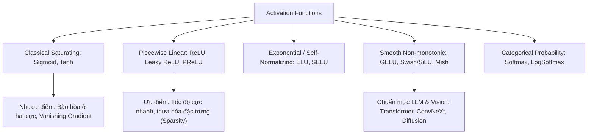
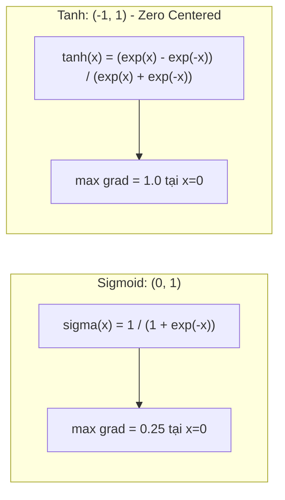

# Chuyên đề: Các Hàm Kích Hoạt (Activation Functions)

## 1. Tổng quan Chuyên đề
Hàm kích hoạt (**Activation Functions**) đóng vai trò quyết định trong việc đưa tính phi tuyến (non-linearity) vào mạng nơ-ron, phá vỡ giới hạn của các phép biến đổi tuyến tính affine liên tiếp. Không có hàm kích hoạt phi tuyến, một mạng nơ-ron dù sâu bao nhiêu tầng cũng chỉ tương đương với một phép nhân ma trận đơn lẻ.

Từ góc độ toán học và tối ưu hóa phần cứng, một hàm kích hoạt lý tưởng phải thỏa mãn:
1. **Tính phi tuyến đa dạng**: Cho phép xấp xỉ các bề mặt quyết định phức tạp.
2. **Gradient Flow tốt**: Tránh hiện tượng bão hòa đạo hàm (Saturation) dẫn đến triệt tiêu gradient (Vanishing Gradient).
3. **Hiệu năng tính toán trên phần cứng**: Chi phí tính toán thấp trên vi xử lý (tính toán đơn giản như `max(0, x)` so với các hàm mũ `exp(x)` tốn nhiều chu kỳ xung nhịp CPU/GPU ALU).
4. **Zero-centered**: Giúp gradient của các trọng số không bị dao động cùng dấu trong quá trình cập nhật.



---

## 2. Chi tiết từng Keyword

---

### 1. Sigmoid & Tanh (Hyperbolic Tangent)

#### a. Định nghĩa Bản chất Toán học
- **Sigmoid (Logistic Function)**: Ánh xạ trục số thực về khoảng xác suất $(0, 1)$:
  $$\sigma(x) = \frac{1}{1 + e^{-x}} = \frac{e^x}{e^x + 1}$$
  Đạo hàm: $\sigma'(x) = \sigma(x)(1 - \sigma(x))$. Giá trị cực đại của đạo hàm đạt tại $x = 0$ là $\sigma'(0) = 0.25$.
- **Tanh (Hyperbolic Tangent)**: Ánh xạ trục số thực về khoảng đối xứng $(-1, 1)$, là dạng dịch chuyển và co giãn của Sigmoid:
  $$\tanh(x) = \frac{e^x - e^{-x}}{e^x + e^{-x}} = 2\sigma(2x) - 1$$
  Đạo hàm: $\tanh'(x) = 1 - \tanh^2(x)$. Giá trị cực đại của đạo hàm là $\tanh'(0) = 1.0$.

#### b. Cơ chế Tầng Sâu & Vấn đề Bão hòa (Saturation)
1. **Saturation & Vanishing Gradients**: Khi $|x| > 4$, $\sigma'(x) \approx 0$ và $\tanh'(x) \approx 0$. Trong mạng sâu nhiều tầng, tích các số $\le 0.25$ làm gradient triệt tiêu chỉ sau 3-4 tầng.
2. **Zero-Centered Property**:
   - Sigmoid **không zero-centered** ($\sigma(x) > 0, \forall x$). Do đó đạo hàm theo trọng số $\frac{\partial \mathcal{L}}{\partial w_i} = \delta \cdot x_i$ sẽ luôn cùng dấu với $\delta$ cho mọi $i$, tạo ra hiện tượng gradient dao động theo đường ziczac (zig-zagging dynamics).
   - Tanh là **zero-centered**, giúp tối ưu hóa nhanh hơn và ổn định hơn so với Sigmoid trong các tầng ẩn.

#### c. Sơ đồ Minh họa


#### d. Code Thực chiến (C++ & Python)

```cpp
// C++17: Vectorized Sigmoid & Tanh với Fast Approximation
#include <iostream>
#include <cmath>
#include <vector>

inline float fast_sigmoid(float x) {
    return 0.5f * (x / (1.0f + std::abs(x))) + 0.5f; // Xấp xỉ nhanh không dùng exp()
}

inline float exact_tanh(float x) {
    return std::tanh(x);
}

int main() {
    float x = 2.5f;
    std::cout << "Exact Sigmoid: " << 1.0f / (1.0f + std::exp(-x)) << "\n";
    std::cout << "Fast Sigmoid:  " << fast_sigmoid(x) << "\n";
    std::cout << "Exact Tanh:    " << exact_tanh(x) << "\n";
    return 0;
}
```

```python
import torch

x = torch.tensor([-3.0, 0.0, 3.0], requires_grad=True)
sig = torch.sigmoid(x)
tnh = torch.tanh(x)

sig.sum().backward(retain_graph=True)
print("Sigmoid grad:", x.grad) # [0.0452, 0.2500, 0.0452]
x.grad.zero_()
tnh.sum().backward()
print("Tanh grad:   ", x.grad) # [0.0099, 1.0000, 0.0099]
```

---

### 2. ReLU, Leaky ReLU & PReLU

#### a. Định nghĩa Bản chất Toán học
- **ReLU (Rectified Linear Unit - Nair & Hinton 2010)**:
  $$\text{ReLU}(x) = \max(0, x)$$
  Đạo hàm bán vi phân (subgradient):
  $$\text{ReLU}'(x) = \begin{cases} 1 & \text{nếu } x > 0 \\ 0 & \text{nếu } x < 0 \end{cases}, \quad \text{tại } x = 0 \text{ quy ước } \in [0, 1]$$
- **Leaky ReLU (Maas et al. 2013)**: Khắc phục Dying ReLU bằng cách gán độ dốc nhỏ cố định $\alpha$ (thường là $0.01$) khi $x < 0$:
  $$\text{LeakyReLU}(x) = \max(\alpha x, x) = \begin{cases} x & \text{nếu } x \ge 0 \\ \alpha x & \text{nếu } x < 0 \end{cases}$$
- **PReLU (Parametric ReLU - He et al. 2015)**: Biến hệ số góc $\alpha$ thành một tham số khả vi được tối ưu hóa cùng mạng qua lan truyền ngược:
  $$\text{PReLU}(x) = \max(a x, x), \quad \frac{\partial \text{PReLU}(x)}{\partial a} = \begin{cases} x & \text{nếu } x < 0 \\ 0 & \text{nếu } x \ge 0 \end{cases}$$

#### b. Cơ chế Tầng Sâu & Tốc độ Phần cứng
- **Tính toán Cực nhanh**: ReLU chỉ là một lệnh so sánh phần cứng đơn giản (`max` hoặc bitwise AND với mask dấu), không tốn chu kỳ tính hàm siêu việt (`exp`) như Sigmoid/Tanh.
- **Tính thưa hóa biểu diễn (Sparse Representation)**: ReLU đưa một tỷ lệ lớn các kích hoạt về đúng $0.0$, tạo ra tính thưa tự nhiên (sparsity), giúp mạng tiết kiệm năng lượng và tập trung vào các đặc trưng quan trọng nhất.

#### c. Code Thực chiến (C++ & Python)

```cpp
// C++17: AVX2 Vectorized ReLU (Xử lý 8 số float trong 1 lệnh)
#include <immintrin.h>
#include <vector>
#include <iostream>

void avx2_relu(float* data, size_t n) {
    __m256 zero = _mm256_setzero_ps();
    size_t i = 0;
    for (; i + 8 <= n; i += 8) {
        __m256 val = _mm256_loadu_ps(&data[i]);
        __m256 res = _mm256_max_ps(val, zero);
        _mm256_storeu_ps(&data[i], res);
    }
    for (; i < n; ++i) {
        data[i] = data[i] > 0.0f ? data[i] : 0.0f;
    }
}

int main() {
    std::vector<float> arr = {-2.0f, 3.5f, -0.1f, 10.0f, -5.0f, 0.0f, 1.2f, -8.0f};
    avx2_relu(arr.data(), arr.size());
    for (float v : arr) std::cout << v << " ";
    std::cout << "\n";
    return 0;
}
```

```python
import torch
import torch.nn as nn

x = torch.tensor([-2.0, 0.0, 3.0], requires_grad=True)
relu = nn.ReLU()
leaky = nn.LeakyReLU(negative_slope=0.01)
prelu = nn.PReLU(num_parameters=1, init=0.25)

print("ReLU:      ", relu(x).tolist())
print("LeakyReLU: ", leaky(x).tolist())
print("PReLU:     ", prelu(x).tolist())
```

---

### 3. ELU & SELU (Exponential & Self-Normalizing)

#### a. Định nghĩa Bản chất Toán học
- **ELU (Exponential Linear Unit - Clevert et al. 2015)**: Kết hợp ưu điểm của ReLU ở miền dương và làm mượt trơn ở miền âm về giá trị tiệm cận $-\alpha$:
  $$\text{ELU}(x) = \begin{cases} x & \text{nếu } x > 0 \\ \alpha (e^x - 1) & \text{nếu } x \le 0 \end{cases}$$
- **SELU (Scaled Exponential Linear Unit - Klambauer et al. 2017)**: Tự chuẩn hóa phân phối (Self-Normalizing Neural Networks):
  $$\text{SELU}(x) = \lambda \begin{cases} x & \text{nếu } x > 0 \\ \alpha (e^x - 1) & \text{nếu } x \le 0 \end{cases}$$
  với các hằng số toán học kỳ dị được suy ra từ Định lý Điểm Bất Động Banach (Banach Fixed-Point Theorem) để duy trì kỳ vọng bằng 0 và phương sai bằng 1 qua vô hạn tầng:
  $$\alpha \approx 1.6732632423543772848170429916717$$
  $$\lambda \approx 1.0507009873554804934193349852946$$

#### b. Cơ chế Tầng Sâu: Tự Triệt Tiêu Batch Normalization
Mạng sử dụng SELU kết hợp với khởi tạo LeCun Normal có khả năng tự đưa giá trị kích hoạt về phân phối chuẩn chuẩn tắc $\mathcal{N}(0, 1)$ mà **không cần sử dụng bất kỳ tầng Batch Normalization nào**, triệt tiêu hoàn toàn hiện tượng Internal Covariate Shift.

```python
import torch
import torch.nn as nn

selu = nn.SELU()
# Dữ liệu qua SELU duy trì kỳ vọng ~ 0 và phương sai ~ 1
x = torch.randn(10000, dtype=torch.float32)
out = selu(x)
print(f"Mean: {out.mean().item():.4f}, Std: {out.std().item():.4f}")
```

---

### 4. GELU, Swish/SiLU & Mish (Hiện đại & Khả vi Trơn)

#### a. Định nghĩa Bản chất Toán học
- **GELU (Gaussian Error Linear Unit - Hendrycks & Gimpel 2016)**:
  Kích hoạt nơ-ron theo xác suất dựa trên phân phối chuẩn Gaussian tích lũy $\Phi(x) = P(X \le x)$ với $X \sim \mathcal{N}(0, 1)$:
  $$\text{GELU}(x) = x \cdot \Phi(x) = x \cdot \frac{1}{2}\left[1 + \text{erf}\left(\frac{x}{\sqrt{2}}\right)\right]$$
  Xấp xỉ nhanh (Fast approximation):
  $$\text{GELU}(x) \approx 0.5x \left(1 + \tanh\left(\sqrt{\frac{2}{\pi}} \left(x + 0.044715 x^3\right)\right)\right)$$
- **Swish / SiLU (Sigmoid Linear Unit - Ramachandran et al. 2017, Elfwing et al. 2018)**:
  $$\text{SiLU}(x) = x \cdot \sigma(x) = \frac{x}{1 + e^{-x}}$$
  Swish tổng quát với tham số $\beta$: $\text{Swish}_\beta(x) = x \cdot \sigma(\beta x)$.
- **Mish (Misra 2019)**:
  $$\text{Mish}(x) = x \cdot \tanh(\text{softplus}(x)) = x \cdot \tanh(\ln(1 + e^x))$$

#### b. Cơ chế Tầng Sâu & Bản chất Phi Đơn điệu (Non-monotonicity)
Các hàm này đều có một vùng trũng nhỏ ở miền âm (ví dụ GELU có cực tiểu địa phương tại $x \approx -0.17$ với giá trị $\approx -0.158$). Tính chất phi đơn điệu này cho phép:
1. Đạo hàm trơn bậc cao liên tục ở khắp mọi nơi (khác với đạo hàm gián đoạn tại 0 của ReLU).
2. Cho phép một lượng nhỏ thông tin gradient âm tiếp tục lưu thông, ngăn chặn Dead Neurons mà vẫn duy trì tính lọc thông tin mạnh mẽ.

#### c. Code Thực chiến (C++ & Python)

```cpp
// C++17: GELU Fast Approximation chuẩn GPT-2 / LLaMA
#include <iostream>
#include <cmath>

inline float gelu_tanh_approx(float x) {
    constexpr float sqrt_2_over_pi = 0.7978845608028654f;
    constexpr float coeff = 0.044715f;
    float inner = sqrt_2_over_pi * (x + coeff * x * x * x);
    return 0.5f * x * (1.0f + std::tanh(inner));
}

inline float silu(float x) {
    return x / (1.0f + std::exp(-x));
}

int main() {
    float x = 1.5f;
    std::cout << "GELU(1.5): " << gelu_tanh_approx(x) << "\n";
    std::cout << "SiLU(1.5): " << silu(x) << "\n";
    return 0;
}
```

```python
import torch
import torch.nn.functional as F

x = torch.tensor([-2.0, -0.5, 0.0, 0.5, 2.0], requires_grad=True)
gelu_out = F.gelu(x)
silu_out = F.silu(x)
mish_out = F.mish(x)

print("GELU:", gelu_out)
print("SiLU:", silu_out)
print("Mish:", mish_out)
```

---

### 5. Softmax & LogSoftmax (Phân phối Xác suất Đa lớp)

#### a. Định nghĩa Bản chất Toán học
- **Softmax**: Ánh xạ vector logits $\mathbf{z} = [z_1, \dots, z_K]^T \in \mathbb{R}^K$ thành một phân phối xác suất hợp lệ trên đơn vị đơn hình (probability simplex) $\Delta^{K-1}$:
  $$\text{Softmax}(\mathbf{z})_i = \frac{e^{z_i}}{\sum_{j=1}^K e^{z_j}}, \quad \text{với } \sum_{i=1}^K \text{Softmax}(\mathbf{z})_i = 1, \quad \text{Softmax}(\mathbf{z})_i > 0$$
  Ma trận Jacobian của Softmax:
  $$\frac{\partial p_i}{\partial z_j} = p_i (\delta_{ij} - p_j) = \begin{cases} p_i (1 - p_i) & \text{nếu } i = j \\ -p_i p_j & \text{nếu } i \neq j \end{cases}$$
- **LogSoftmax**:
  $$\text{LogSoftmax}(\mathbf{z})_i = \ln\left( \frac{e^{z_i}}{\sum_{j=1}^K e^{z_j}} \right) = z_i - \ln\left( \sum_{j=1}^K e^{z_j} \right)$$

#### b. Cơ chế Tầng Sâu & Kỹ thuật LogSumExp (Ngăn tràn số Float)
- **Tràn số trên Phần cứng (Overflow/Underflow)**: Khi logits $z_i > 88.7$ (với FP32), $e^{z_i}$ sẽ tràn số thành `+Inf`. Khi $z_i < -88.7$, $e^{z_i} \to 0$ dẫn đến chia cho $0$.
- **Kỹ thuật Safe Softmax (LogSumExp Trick)**: Dịch chuyển toàn bộ logits theo phần tử lớn nhất $M = \max_j z_j$:
  $$\frac{e^{z_i}}{\sum_j e^{z_j}} = \frac{e^{z_i - M}}{\sum_j e^{z_j - M}}$$
  Vì $z_i - M \le 0$, số mũ luôn nằm trong khoảng $(-\infty, 0]$, triệt tiêu hoàn toàn nguy cơ tràn số dương (`+Inf`).

#### c. Code Thực chiến (C++ & Python)

```cpp
// C++17: Numerically Stable Softmax với Safe Max Subtraction
#include <iostream>
#include <vector>
#include <cmath>
#include <algorithm>
#include <numeric>

std::vector<float> stable_softmax(const std::vector<float>& z) {
    float max_val = *std::max_element(z.begin(), z.end());
    std::vector<float> exp_z(z.size());
    float sum_exp = 0.0f;
    for (size_t i = 0; i < z.size(); ++i) {
        exp_z[i] = std::exp(z[i] - max_val); // Chống Overflow
        sum_exp += exp_z[i];
    }
    for (size_t i = 0; i < z.size(); ++i) {
        exp_z[i] /= sum_exp;
    }
    return exp_z;
}

int main() {
    std::vector<float> dangerous_logits = {1000.0f, 1001.0f, 999.0f}; // Gây tràn số nếu không trừ max
    auto probs = stable_softmax(dangerous_logits);
    for (float p : probs) std::cout << p << " ";
    std::cout << "\n";
    return 0;
}
```

```python
import torch
import torch.nn.functional as F

logits = torch.tensor([1000.0, 1001.0, 999.0])
probs = F.softmax(logits, dim=-1)
log_probs = F.log_softmax(logits, dim=-1)

print("Stable Softmax Probs:   ", probs)
print("Stable LogSoftmax Probs:", log_probs)
```

#### d. Lỗi Thường gặp & Ứng dụng AI
- **Sử dụng Softmax rồi lấy Log riêng biệt**: Viết `torch.log(torch.softmax(logits))` thay vì dùng trực tiếp `torch.log_softmax(logits)` là một lỗi kinh điển gây mất ổn định số học nghiêm trọng do underflow ở các nhãn có xác suất cực nhỏ.
- **Ứng dụng**: Softmax là tầng chuẩn hóa cốt lõi trong cơ chế **Scaled Dot-Product Attention** của Transformer:
  $$\text{Attention}(\mathbf{Q}, \mathbf{K}, \mathbf{V}) = \text{Softmax}\left(\frac{\mathbf{Q}\mathbf{K}^T}{\sqrt{d_k}}\right)\mathbf{V}$$
