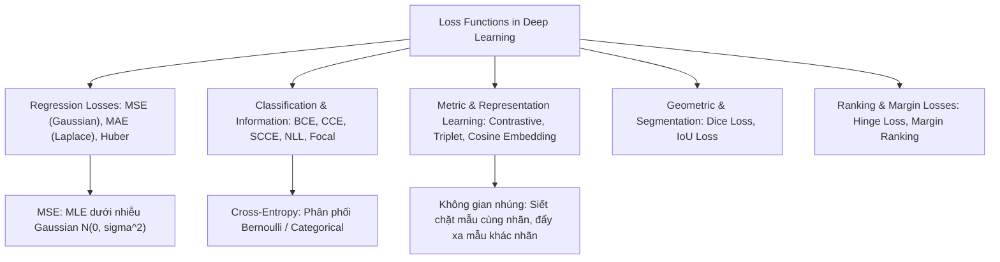

# Chuyên đề: Các Hàm Mất Mát (Loss Functions)

## 1. Tổng quan Chuyên đề
Hàm mất mát (**Loss Function / Criterion**) $\mathcal{L}(\hat{\mathbf{y}}, \mathbf{y})$ định lượng sai số giữa đầu ra dự đoán của mô hình và nhãn thực tế của dữ liệu. Trong học sâu, việc lựa chọn hàm mất mát không đơn thuần là một phép đo sai số hình học, mà bắt nguồn từ các nguyên lý tột cùng của **Ước lượng Hợp lý Cực đại (Maximum Likelihood Estimation - MLE)** và **Lý thuyết Thông tin (Information Theory)**.

Từ các bài toán hồi quy (Regression), phân loại (Classification), học biểu diễn metric (Metric Learning / Contrastive Learning) cho đến phân vùng ảnh y tế (Segmentation), mỗi hàm mất mát tương ứng với một giả định tiên nghiệm về phân phối xác suất của nhiễu dữ liệu.



---

## 2. Chi tiết từng Keyword

---

### 1. Mean Squared Error (MSE), Mean Absolute Error (MAE) & Huber Loss

#### a. Định nghĩa Bản chất Toán học
Cho vector dự đoán $\hat{\mathbf{y}} \in \mathbb{R}^N$ và nhãn thực $\mathbf{y} \in \mathbb{R}^N$:
- **Mean Squared Error (MSE / L2 Loss)**:
  $$\mathcal{L}_{\text{MSE}}(\hat{\mathbf{y}}, \mathbf{y}) = \frac{1}{N} \sum_{i=1}^N (\hat{y}_i - y_i)^2$$
  *Đạo hàm*: $\frac{\partial \mathcal{L}_{\text{MSE}}}{\partial \hat{y}_i} = \frac{2}{N} (\hat{y}_i - y_i)$.
  *Bản chất MLE*: Tương đương cực đại hóa Log-Likelihood dưới giả định sai số tuân theo phân phối Gauss chuẩn tắc $\epsilon_i \sim \mathcal{N}(0, \sigma^2)$.
- **Mean Absolute Error (MAE / L1 Loss)**:
  $$\mathcal{L}_{\text{MAE}}(\hat{\mathbf{y}}, \mathbf{y}) = \frac{1}{N} \sum_{i=1}^N |\hat{y}_i - y_i|$$
  *Đạo hàm*: $\frac{\partial \mathcal{L}_{\text{MAE}}}{\partial \hat{y}_i} = \frac{1}{N} \operatorname{sgn}(\hat{y}_i - y_i)$ (bất biến với độ lớn sai số).
  *Bản chất MLE*: Tương đương MLE dưới giả định sai số phân phối Laplace $\epsilon_i \sim \text{Laplace}(0, b)$.
- **Huber Loss (Smooth L1 Loss)**: Kết hợp ưu điểm trơn khả vi của MSE tại lân cận $0$ và tính kháng ngoại lai (robustness) của MAE khi sai số lớn:
  $$\mathcal{L}_\delta(e) = \begin{cases} \frac{1}{2} e^2 & \text{nếu } |e| \le \delta \\ \delta \left(|e| - \frac{1}{2}\delta\right) & \text{nếu } |e| > \delta \end{cases}, \quad e = \hat{y} - y$$

#### b. Cơ chế Tầng Sâu & Độ nhạy Ngoại lai (Outlier Sensitivity)
- **Độ nhạy của MSE**: Do bình phương sai số $e^2$, các điểm ngoại lai (outliers) có sai số lớn sẽ tạo ra gradient khổng lồ $2e$, chi phối toàn bộ quá trình cập nhật trọng số và kéo nghiệm tối ưu lệch khỏi phân phối chính.
- **Độ bền vững của Huber**: Khi sai số vượt ngưỡng $\delta$, gradient của Huber bị chặn cố định ở $\pm \delta$, ngăn ngừa bùng nổ gradient từ các mẫu nhiễu.

#### c. Code Thực chiến (C++ & Python)

```cpp
// C++17: Huber Loss và đạo hàm ổn định
#include <iostream>
#include <vector>
#include <cmath>

struct HuberGrad {
    float loss;
    float grad;
};

HuberGrad compute_huber(float y_pred, float y_true, float delta = 1.0f) {
    float error = y_pred - y_true;
    float abs_e = std::abs(error);
    if (abs_e <= delta) {
        return {0.5f * error * error, error};
    } else {
        return {delta * (abs_e - 0.5f * delta), delta * (error > 0.0f ? 1.0f : -1.0f)};
    }
}

int main() {
    auto res_small = compute_huber(1.2f, 1.0f, 1.0f);
    auto res_large = compute_huber(10.0f, 1.0f, 1.0f);
    std::cout << "Small error grad: " << res_small.grad << "\n";
    std::cout << "Outlier error grad (clipped to delta): " << res_large.grad << "\n";
    return 0;
}
```

```python
import torch
import torch.nn.functional as F

y_pred = torch.tensor([1.2, 10.0], requires_grad=True)
y_true = torch.tensor([1.0, 1.0])

loss_mse = F.mse_loss(y_pred, y_true)
loss_mae = F.l1_loss(y_pred, y_true)
loss_huber = F.huber_loss(y_pred, y_true, delta=1.0)

print(f"MSE: {loss_mse.item():.4f}, MAE: {loss_mae.item():.4f}, Huber: {loss_huber.item():.4f}")
```

---

### 2. Binary Cross-Entropy (BCE), Categorical Cross-Entropy (CCE), Sparse Categorical CE & Negative Log-Likelihood (NLL)

#### a. Định nghĩa Bản chất Toán học
1. **Binary Cross-Entropy (BCE)**: Dành cho phân loại 2 lớp với nhãn $y \in \{0, 1\}$ và dự đoán $p = \sigma(z) \in [0, 1]$:
   $$\mathcal{L}_{\text{BCE}}(p, y) = - \left[ y \ln p + (1 - y) \ln(1 - p) \right]$$
2. **Negative Log-Likelihood (NLL Loss)**: Với phân phối rời rạc đa lớp và nhãn one-hot $\mathbf{y}$:
   $$\mathcal{L}_{\text{NLL}}(\mathbf{p}, \mathbf{y}) = - \sum_{k=1}^K y_k \ln p_k = - \ln p_{\text{target}}$$
3. **Categorical Cross-Entropy (CCE)**: NLL áp dụng trên đầu ra của hàm Softmax:
   $$\mathcal{L}_{\text{CCE}}(\mathbf{z}, \mathbf{y}) = - \sum_{k=1}^K y_k \ln\left( \frac{e^{z_k}}{\sum_{j=1}^K e^{z_j}} \right)$$
   *Đạo hàm kỳ diệu theo Logits*:
   $$\frac{\partial \mathcal{L}_{\text{CCE}}}{\partial z_i} = p_i - y_i$$
   Đạo hàm có dạng cực kỳ thanh lịch và ổn định: chính là hiệu số giữa xác suất dự đoán $p_i$ và phân phối nhãn thật $y_i$.
4. **Sparse Categorical Cross-Entropy (SCCE)**: Về bản chất toán học hoàn toàn trùng khớp với CCE, nhưng nhãn được lưu trữ dưới dạng một số nguyên đơn lẻ (scalar class index) $y \in \{0, 1, \dots, K-1\}$ thay vì vector One-Hot $\mathbf{y} \in \{0, 1\}^K$.

#### b. Cơ chế Tầng Sâu & Tiết kiệm Bộ nhớ của Sparse Label
- **Sparse vs Dense One-Hot**: Trong các bài toán từ điển lớn (như Large Language Models với kích thước bộ từ vựng $V = 128,000$, sequence length $T = 4096$, batch $B = 32$):
  - Tạo tensor One-hot $\mathbf{Y}$ cần: $32 \times 4096 \times 128,000 \times 4 \text{ bytes} \approx 67 \text{ GB}$ VRAM chỉ để chứa nhãn!
  - Dùng Sparse Categorical (nhãn nguyên 64-bit int): $32 \times 4096 \times 8 \text{ bytes} \approx 1 \text{ MB}$ VRAM!

#### c. Code Thực chiến (C++ & Python)

```cpp
// C++17: Kết hợp LogSoftmax và NLLLoss để tránh underflow
#include <iostream>
#include <vector>
#include <cmath>
#include <algorithm>

float cross_entropy_loss_with_logits(const std::vector<float>& logits, int target_class) {
    float max_logit = *std::max_element(logits.begin(), logits.end());
    float sum_exp = 0.0f;
    for (float z : logits) sum_exp += std::exp(z - max_logit);
    float log_sum_exp = max_logit + std::log(sum_exp);
    // Loss = - (logits[target] - log_sum_exp)
    return log_sum_exp - logits[target_class];
}

int main() {
    std::vector<float> logits = {2.0f, 1.0f, 0.1f};
    int target = 0; // Class 0
    std::cout << "Fused CE Loss: " << cross_entropy_loss_with_logits(logits, target) << "\n";
    return 0;
}
```

```python
import torch
import torch.nn as nn

# Fused CrossEntropyLoss trong PyTorch (Tự động tích hợp LogSoftmax + NLL)
criterion = nn.CrossEntropyLoss()
logits = torch.tensor([[2.0, 1.0, 0.1]], requires_grad=True)
target_sparse = torch.tensor([0]) # Class 0

loss = criterion(logits, target_sparse)
loss.backward()

print("Loss:", loss.item())
print("Gradient theo logits (p - y):", logits.grad)
```

---

### 3. Focal Loss (Lin et al. 2017)

#### a. Định nghĩa Bản chất Toán học
Được thiết kế để giải quyết bài toán **Mất cân bằng lớp trầm trọng (Extreme Class Imbalance)** trong phát hiện vật thể (Object Detection - RetinaNet), nơi mà số lượng mẫu nền (background/easy negatives) áp đảo hoàn toàn mẫu mục tiêu.
Định nghĩa xác suất dự đoán cho lớp đúng:
$$p_t = \begin{cases} p & \text{nếu } y = 1 \\ 1 - p & \text{nếu } y = 0 \end{cases}$$
Hàm **Focal Loss**:
$$\mathcal{L}_{\text{Focal}}(p_t) = - \alpha_t (1 - p_t)^\gamma \ln(p_t)$$
- $\gamma \ge 0$ là tham số điều chỉnh tập trung (**Focusing Parameter**).
- $(1 - p_t)^\gamma$ là **Hệ số điều biến (Modulating Factor)**:
  - Khi một mẫu được phân loại dễ dàng ($p_t \to 1$), hệ số $(1 - p_t)^\gamma \to 0$, làm suy giảm triệt để gradient của mẫu dễ, ngăn không cho hàng triệu mẫu âm dễ chi phối hàm mất mát.
  - Khi một mẫu bị phân loại sai nghiêm trọng ($p_t \to 0$), hệ số $(1 - p_t)^\gamma \approx 1$, giữ nguyên giá trị mất mát.

#### b. Code Thực chiến (Python)

```python
import torch
import torch.nn as nn

class FocalLoss(nn.Module):
    def __init__(self, alpha: float = 0.25, gamma: float = 2.0):
        super().__init__()
        self.alpha = alpha
        self.gamma = gamma

    def forward(self, logits: torch.Tensor, targets: torch.Tensor) -> torch.Tensor:
        bce_loss = nn.functional.binary_cross_entropy_with_logits(logits, targets, reduction='none')
        probs = torch.sigmoid(logits)
        p_t = targets * probs + (1 - targets) * (1 - probs)
        modulating_factor = (1.0 - p_t) ** self.gamma
        alpha_t = targets * self.alpha + (1 - targets) * (1 - self.alpha)
        focal_loss = alpha_t * modulating_factor * bce_loss
        return focal_loss.mean()

logits = torch.tensor([5.0, -5.0]) # Mẫu 1: Dễ (prob ~ 0.993), Mẫu 2: Khó nếu target = 1
targets = torch.tensor([1.0, 1.0])
fl = FocalLoss(gamma=2.0)
print("Focal Loss:", fl(logits, targets).item())
```

---

### 4. Metric Learning: Contrastive Loss, Triplet Loss & Cosine Embedding Loss

#### a. Định nghĩa Bản chất Toán học
1. **Contrastive Loss (Hadsell et al. 2006)**: Dành cho cặp mẫu $(\mathbf{x}_1, \mathbf{x}_2)$ với khoảng cách Euclidean $d = \|\mathbf{z}_1 - \mathbf{z}_2\|_2$ và cờ tương đồng $y \in \{0, 1\}$:
   $$\mathcal{L}_{\text{Contrastive}}(d, y) = \frac{1}{2} y d^2 + \frac{1}{2} (1 - y) \max(0, m - d)^2$$
   với $m > 0$ là biên lề cách ly (margin).
2. **Triplet Loss (Schroff et al. 2015 - FaceNet)**: Xét bộ ba: Mẫu neo (**Anchor** $\mathbf{a}$), Mẫu dương cùng nhãn (**Positive** $\mathbf{p}$), và Mẫu âm khác nhãn (**Negative** $\mathbf{n}$):
   $$\mathcal{L}_{\text{Triplet}}(\mathbf{a}, \mathbf{p}, \mathbf{n}) = \max\left(0, \|\mathbf{z}_a - \mathbf{z}_p\|_2^2 - \|\mathbf{z}_a - \mathbf{z}_n\|_2^2 + \alpha\right)$$
   Mục tiêu: Kéo khoảng cách giữa $(a, p)$ ngắn hơn khoảng cách giữa $(a, n)$ ít nhất một lề $\alpha$.
3. **Cosine Embedding Loss**: Đo lường sự tương đồng góc giữa hai vector nhúng:
   $$\mathcal{L}(\mathbf{z}_1, \mathbf{z}_2, y) = \begin{cases} 1 - \cos(\mathbf{z}_1, \mathbf{z}_2) & \text{nếu } y = 1 \\ \max(0, \cos(\mathbf{z}_1, \mathbf{z}_2) - \text{margin}) & \text{nếu } y = -1 \end{cases}$$

#### b. Cơ chế Tầng Sâu & Hard Negative Mining
Trong không gian biểu diễn nhúng, phần lớn các cặp âm ngẫu nhiên đã nằm rất xa nhau và tạo ra loss bằng $0$. Do đó, quá trình huấn luyện bắt buộc phải áp dụng kỹ thuật **Semi-Hard / Hard Negative Mining** (tìm kiếm mẫu âm gần anchor nhất) trên từng Mini-Batch để đảm bảo gradient khác 0.

#### c. Code Thực chiến (Python)

```python
import torch
import torch.nn.functional as F

# Triplet Loss thực chiến
anchor = torch.randn(16, 128)
positive = anchor + torch.randn(16, 128) * 0.1 # Cùng class, rất gần
negative = torch.randn(16, 128)               # Khác class

margin = 1.0
dist_pos = (anchor - positive).pow(2).sum(dim=-1)
dist_neg = (anchor - negative).pow(2).sum(dim=-1)
triplet_loss = F.relu(dist_pos - dist_neg + margin).mean()
print("Triplet Loss Value:", triplet_loss.item())
```

---

### 5. Segmentation & Geometric Losses: Dice Loss & IoU Loss

#### a. Định nghĩa Bản chất Toán học
Trong phân đoạn ảnh y tế và thị giác máy tính, diện tích vùng mục tiêu (foreground) thường chiếm tỷ lệ rất nhỏ so với nền (background). Các hàm mất mát hình học đo lường trực tiếp độ trùng lặp tập hợp:
- **Sørensen–Dice Coefficient & Dice Loss**:
  $$\text{Dice} = \frac{2 |\mathbf{X} \cap \mathbf{Y}|}{|\mathbf{X}| + |\mathbf{Y}|} = \frac{2 \sum_i p_i y_i}{\sum_i p_i + \sum_i y_i}$$
  $$\mathcal{L}_{\text{Dice}} = 1 - \frac{2 \sum_i p_i y_i + \epsilon}{\sum_i p_i + \sum_i y_i + \epsilon}$$
- **Intersection over Union (IoU / Jaccard Loss)**:
  $$\text{IoU} = \frac{|\mathbf{X} \cap \mathbf{Y}|}{|\mathbf{X} \cup \mathbf{Y}|} = \frac{\sum_i p_i y_i}{\sum_i p_i + \sum_i y_i - \sum_i p_i y_i}$$
  $$\mathcal{L}_{\text{IoU}} = 1 - \frac{\sum_i p_i y_i + \epsilon}{\sum_i p_i + \sum_i y_i - \sum_i p_i y_i + \epsilon}$$
  với $\epsilon \approx 10^{-6}$ là hằng số mượt để chống chia cho 0.

```python
import torch

def soft_dice_loss(pred_probs: torch.Tensor, target_masks: torch.Tensor, eps: float = 1e-6) -> torch.Tensor:
    # Flatten spatial dimensions [B, H, W] -> [B, H*W]
    p = pred_probs.view(pred_probs.shape[0], -1)
    y = target_masks.view(target_masks.shape[0], -1)
    intersection = (p * y).sum(dim=1)
    cardinality = p.sum(dim=1) + y.sum(dim=1)
    dice = (2.0 * intersection + eps) / (cardinality + eps)
    return (1.0 - dice).mean()

probs = torch.tensor([[0.9, 0.8, 0.1, 0.0]])
target = torch.tensor([[1.0, 1.0, 0.0, 0.0]])
print("Soft Dice Loss:", soft_dice_loss(probs, target).item())
```

---

### 6. Ranking Loss, Margin Loss & Hinge Loss

#### a. Định nghĩa Bản chất Toán học
- **Hinge Loss**: Nền tảng của Support Vector Machines (SVM) và một số biến thể mạng nơ-ron phân loại lề cực đại với nhãn $y \in \{-1, +1\}$:
  $$\mathcal{L}_{\text{Hinge}}(y, \hat{y}) = \max(0, 1 - y \cdot \hat{y})$$
- **Margin Ranking Loss**: Cho hai dự đoán $x_1, x_2$ và nhãn thứ tự $y \in \{-1, 1\}$ (quy định liệu $x_1$ có điểm cao hơn $x_2$ hay không):
  $$\mathcal{L}(x_1, x_2, y) = \max(0, -y(x_1 - x_2) + \text{margin})$$
- **KL Divergence Loss**: Đo mức độ khác biệt giữa hai phân phối xác suất $P$ và $Q$:
  $$D_{\text{KL}}(P \parallel Q) = \sum_i P(i) \ln\left(\frac{P(i)}{Q(i)}\right)$$
  Thường dùng trong mô hình hóa chưng cất tri thức (Knowledge Distillation) và VAE.
