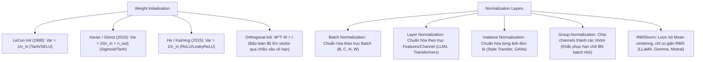
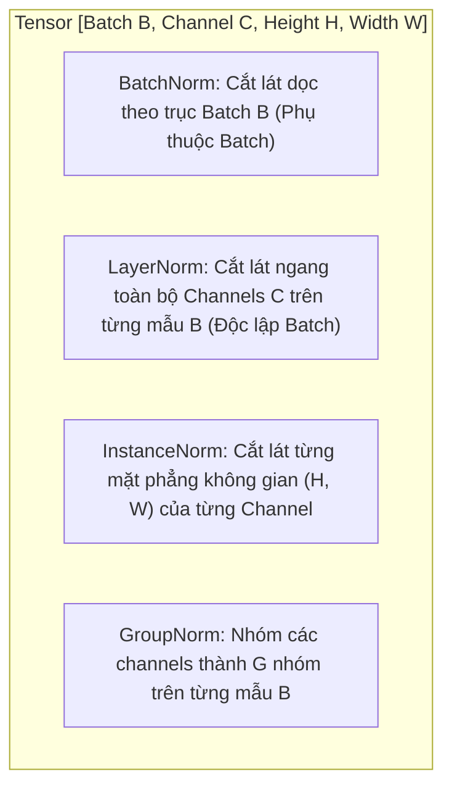

# Chuyên đề: Khởi Tạo Trọng Số & Các Tầng Chuẩn Hóa (Weight Initialization & Normalization Layers)

## 1. Tổng quan Chuyên đề
Hai rào cản toán học lớn nhất khiến các mạng nơ-ron sâu thời kỳ đầu không thể huấn luyện được là: **Sự mất cân bằng phương sai tín hiệu qua các tầng** (dẫn đến triệt tiêu hoặc bùng nổ kích hoạt) và hiện tượng **Dịch chuyển Hiệp biến Nội bộ (Internal Covariate Shift)** trong quá trình cập nhật trọng số.

Để giải quyết bài toán này, Deep Learning hiện đại dựa trên hai trụ cột tương hỗ:
1. **Khởi tạo Trọng số Toán học (Weight Initialization)**: Đảm bảo phương sai của các kích hoạt ở chiều xuôi (forward activations) và phương sai của các gradient ở chiều ngược (backward gradients) được bảo toàn qua các phép biến đổi ma trận.
2. **Các Tầng Chuẩn Hóa (Normalization Layers)**: Duy trì phân phối ổn định của tensor kích hoạt độc lập với độ lớn trọng số, làm phẳng mặt phẳng tổn thất (loss landscape smoothness), cho phép sử dụng tốc độ học (learning rate) lớn hơn hàng chục lần.



---

## 2. Chi tiết từng Keyword

---

### 1. Xavier / Glorot Initialization & LeCun Initialization

#### a. Định nghĩa Bản chất Toán học
Xét một tầng tuyến tính không có bias: $y = \sum_{i=1}^{n_{\text{in}}} w_i x_i$. Giả định các $x_i$ và $w_i$ độc lập, có kỳ vọng bằng 0: $\mathbb{E}[x_i] = \mathbb{E}[w_i] = 0$. Phương sai của $y$ là:
$$\operatorname{Var}(y) = \operatorname{Var}\left(\sum_{i=1}^{n_{\text{in}}} w_i x_i\right) = \sum_{i=1}^{n_{\text{in}}} \operatorname{Var}(w_i x_i) = n_{\text{in}} \operatorname{Var}(w) \operatorname{Var}(x)$$
Để phương sai đầu ra không bị phóng đại hay suy giảm qua các tầng ($\operatorname{Var}(y) = \operatorname{Var}(x)$), ta bắt buộc phải có:
$$\operatorname{Var}(w) = \frac{1}{n_{\text{in}}}$$
- **LeCun Initialization (LeCun et al. 1998)**:
  - Khởi tạo Gauss: $W_{ij} \sim \mathcal{N}\left(0, \frac{1}{n_{\text{in}}}\right)$
  - Khởi tạo đều: $W_{ij} \sim \mathcal{U}\left(-\sqrt{\frac{3}{n_{\text{in}}}}, +\sqrt{\frac{3}{n_{\text{in}}}}\right)$
- **Xavier / Glorot Initialization (Glorot & Bengio 2010)**:
  Cân bằng đồng thời cả phương sai truyền tiến ($\operatorname{Var}(w) = \frac{1}{n_{\text{in}}}$) và phương sai truyền ngược ($\operatorname{Var}(w) = \frac{1}{n_{\text{out}}}$) bằng cách lấy trung bình điều hòa:
  $$\operatorname{Var}(w) = \frac{2}{n_{\text{in}} + n_{\text{out}}}$$
  - Phân phối Gauss (Glorot Normal):
    $$W_{ij} \sim \mathcal{N}\left(0, \frac{2}{n_{\text{in}} + n_{\text{out}}}\right)$$
  - Phân phối Đều (Glorot Uniform):
    $$W_{ij} \sim \mathcal{U}\left(-\sqrt{\frac{6}{n_{\text{in}} + n_{\text{out}}}}, +\sqrt{\frac{6}{n_{\text{in}} + n_{\text{out}}}}\right)$$

#### b. Giả định & Điểm Hạn chế Cốt tử
Xavier/Glorot dựa trên giả định rằng hàm kích hoạt là tuyến tính quanh điểm 0 với đạo hàm $\sigma'(0) \approx 1$ (thỏa mãn với Tanh, Sigmoid co giãn). Tuy nhiên, khi mạng sử dụng **ReLU**, ReLU triệt tiêu một nửa giá trị âm ($\mathbb{E}[\text{ReLU}(z)^2] = \frac{1}{2} \mathbb{E}[z^2]$), khiến phương sai bị cắt giảm một nửa sau mỗi tầng. Qua 30 tầng, phương sai co lại $2^{-30} \approx 10^{-9}$, làm sập hoàn toàn tín hiệu forward!

---

### 2. He / Kaiming Initialization (He et al. 2015)

#### a. Định nghĩa Bản chất Toán học
Kaiming He bổ sung hệ số điều chỉnh cho tính bất đối xứng của ReLU. Do phân phối bị triệt tiêu phần âm:
$$\operatorname{Var}(y) = n_{\text{in}} \operatorname{Var}(w) \cdot \frac{1}{2} \operatorname{Var}(x) \implies \operatorname{Var}(w) = \frac{2}{n_{\text{in}}}$$
- **He Normal (Kaiming Normal)**:
  $$W_{ij} \sim \mathcal{N}\left(0, \frac{2}{n_{\text{in}}}\right)$$
- **He Uniform (Kaiming Uniform)**:
  $$W_{ij} \sim \mathcal{U}\left(-\sqrt{\frac{6}{n_{\text{in}}}}, +\sqrt{\frac{6}{n_{\text{in}}}}\right)$$
- **Mở rộng cho Leaky ReLU**: Với độ dốc âm $\alpha$:
  $$\operatorname{Var}(w) = \frac{2}{(1 + \alpha^2) n_{\text{in}}}$$

#### b. Orthogonal Initialization (Saxe et al. 2013)
Khởi tạo ma trận trọng số $\mathbf{W} \in \mathbb{R}^{n \times n}$ sao cho $\mathbf{W}^T \mathbf{W} = \mathbf{I}$.
- **Bản chất Hình học**: Phép biến đổi trực giao bảo toàn hoàn toàn chuẩn vector Euclidean $\|\mathbf{W}\mathbf{x}\|_2 = \|\mathbf{x}\|_2$. Tín hiệu không bao giờ bị khuếch đại hay suy giảm, cực kỳ hữu dụng trong mạng hồi quy RNN và các mô hình sâu hàng trăm tầng.
- **Thực thi Phần cứng**: Sinh ma trận Gauss ngẫu nhiên $\mathbf{A} \sim \mathcal{N}(0, 1)$ rồi phân rã QR ($\mathbf{A} = \mathbf{Q}\mathbf{R}$) và gán $\mathbf{W} = \mathbf{Q}$.

#### c. Code Thực chiến (C++ & Python)

```cpp
// C++17: Kaiming He Normal Initialization
#include <iostream>
#include <vector>
#include <random>
#include <cmath>

void kaiming_normal(std::vector<float>& W, int n_in, int n_out) {
    float std_dev = std::sqrt(2.0f / static_cast<float>(n_in));
    std::mt19937 gen(42);
    std::normal_distribution<float> dist(0.0f, std_dev);
    for (float& w : W) {
        w = dist(gen);
    }
}

int main() {
    int in_dim = 512, out_dim = 1024;
    std::vector<float> W(in_dim * out_dim);
    kaiming_normal(W, in_dim, out_dim);
    std::cout << "Kaiming Initialized W[0]: " << W[0] 
              << " | Target std: " << std::sqrt(2.0f / 512.0f) << "\n";
    return 0;
}
```

```python
import torch
import torch.nn as nn

linear = nn.Linear(512, 1024)

# Kaiming He Normal
nn.init.kaiming_normal_(linear.weight, mode='fan_in', nonlinearity='relu')
print("He Weight Std:", linear.weight.std().item()) # ~ sqrt(2/512) = 0.0625

# Xavier Glorot Uniform
nn.init.xavier_uniform_(linear.weight)

# Orthogonal Init
nn.init.orthogonal_(linear.weight)
```

---

### 3. Batch Normalization (Ioffe & Szegedy 2015)

#### a. Định nghĩa Bản chất Toán học
Cho một mini-batch $\mathcal{B} = \{x_1, \dots, x_m\}$ trên một kênh đặc trưng cụ thể:
1. **Tính giá trị trung bình và phương sai của batch**:
   $$\mu_\mathcal{B} = \frac{1}{m} \sum_{i=1}^m x_i, \quad \sigma_\mathcal{B}^2 = \frac{1}{m} \sum_{i=1}^m (x_i - \mu_\mathcal{B})^2$$
2. **Chuẩn hóa (Normalize)**:
   $$\hat{x}_i = \frac{x_i - \mu_\mathcal{B}}{\sqrt{\sigma_\mathcal{B}^2 + \epsilon}}$$
3. **Biến đổi Affine học được (Scale & Shift)**:
   $$y_i = \gamma \hat{x}_i + \beta$$
   trong đó $\gamma, \beta$ là các tham số khả vi giúp mạng có khả năng khôi phục lại biểu diễn ban đầu nếu cần thiết ($y_i = x_i$ khi $\gamma = \sqrt{\sigma^2}, \beta = \mu$).
4. **Running Statistics trong Inference**:
   Khi suy luận (eval mode), không dùng thống kê của batch đơn lẻ mà dùng trung bình động hàm mũ (Exponential Moving Average - EMA) đã tích lũy trong huấn luyện:
   $$\mu_{\text{run}} \leftarrow (1 - \text{momentum}) \mu_{\text{run}} + \text{momentum} \cdot \mu_\mathcal{B}$$

#### b. Cơ chế Tầng Sâu & Điểm yếu Cốt tử của Batch Normalization
- **Phụ thuộc Batch Size**: Nếu $m$ nhỏ (ví dụ $m \le 4$ trong Object Detection ảnh lớn), ước lượng $\mu_\mathcal{B}, \sigma_\mathcal{B}^2$ bị nhiễu rất mạnh, làm suy giảm nghiêm trọng độ chính xác.
- **Không áp dụng được cho RNN/Sequence**: Độ dài chuỗi thay đổi khiến việc gom batch theo trục thời gian không đồng nhất.
- **Phân tán Training (DDP Synchronization)**: Trong huấn luyện song song đa GPU, BatchNorm mặc định chỉ chuẩn hóa trên từng GPU nội bộ, đòi hỏi **SyncBatchNorm** (trao đổi thống kê AllReduce qua NVLink) làm tăng độ trễ mạng.

---

### 4. Layer Normalization, Instance Normalization & Group Normalization

#### a. Định nghĩa Bản chất Toán học
Sự khác biệt cốt lõi giữa các phương pháp chuẩn hóa nằm ở **tập hợp các chiều không gian (dimensions)** được gom lại để tính $\mu$ và $\sigma^2$ trên tensor 4D $[B, C, H, W]$:

| Chuẩn hóa | Tập chiều gom để tính $(\mu, \sigma^2)$ | Kích thước thống kê | Miền ứng dụng chủ đạo |
| :--- | :--- | :--- | :--- |
| **Batch Normalization (BN)** | Gom $[B, H, W]$ theo từng channel $C$ | $1 \times C \times 1 \times 1$ | CNN truyền thống (ResNet, MobileNet) |
| **Layer Normalization (LN)** | Gom $[C, H, W]$ độc lập cho từng mẫu $B$ | $B \times 1 \times 1 \times 1$ | NLP, Transformers, LLMs (GPT, LLaMA) |
| **Instance Normalization (IN)**| Gom $[H, W]$ độc lập cho từng $(B, C)$ | $B \times C \times 1 \times 1$ | Style Transfer, GANs (khử thông tin phong cách) |
| **Group Normalization (GN)** | Gom $[C/G, H, W]$ trong từng nhóm kênh $G$ | $B \times G \times 1 \times 1$ | Computer Vision với Batch size nhỏ |

#### b. Sơ đồ Minh họa Không gian Tensor 4D


#### c. Code Thực chiến (C++ & Python)

```cpp
// C++17: Layer Normalization với chuẩn hóa Vector 1D
#include <iostream>
#include <vector>
#include <cmath>
#include <numeric>

void layer_norm(const float* x, float* y, int hidden_dim, float gamma, float beta, float eps = 1e-5f) {
    float sum = 0.0f;
    for (int i = 0; i < hidden_dim; ++i) sum += x[i];
    float mean = sum / hidden_dim;

    float sum_sq_diff = 0.0f;
    for (int i = 0; i < hidden_dim; ++i) {
        float diff = x[i] - mean;
        sum_sq_diff += diff * diff;
    }
    float var = sum_sq_diff / hidden_dim;
    float inv_std = 1.0f / std::sqrt(var + eps);

    for (int i = 0; i < hidden_dim; ++i) {
        y[i] = ((x[i] - mean) * inv_std) * gamma + beta;
    }
}

int main() {
    std::vector<float> hidden = {2.0f, -1.0f, 0.5f, 3.5f};
    std::vector<float> normalized(4);
    layer_norm(hidden.data(), normalized.data(), 4, 1.0f, 0.0f);
    std::cout << "LayerNorm output: ";
    for (float v : normalized) std::cout << v << " ";
    std::cout << "\n";
    return 0;
}
```

```python
import torch
import torch.nn as nn

x = torch.randn(2, 6, 4, 4) # [Batch=2, Channel=6, H=4, W=4]

bn = nn.BatchNorm2d(num_features=6)
ln = nn.LayerNorm(normalized_shape=[6, 4, 4])
ins_n = nn.InstanceNorm2d(num_features=6)
gn = nn.GroupNorm(num_groups=2, num_channels=6)

print("BN output shape: ", bn(x).shape)
print("LN output shape: ", ln(x).shape)
print("IN output shape: ", ins_n(x).shape)
print("GN output shape: ", gn(x).shape)
```

---

### 5. RMSNorm (Root Mean Square Normalization - Zhang & Sennrich 2019)

#### a. Định nghĩa Bản chất Toán học
Các phân tích lý thuyết chỉ ra rằng tác dụng chính của LayerNorm nằm ở việc **co giãn phương sai (scaling invariance)** thay vì dịch chuyển kỳ vọng (mean-centering).
**RMSNorm** lược bỏ hoàn toàn bước tính kỳ vọng $\mu$, chỉ chuẩn hóa theo giá trị hiệu dụng căn bậc hai trung bình bình phương (Root Mean Square):
$$\text{RMS}(\mathbf{x}) = \sqrt{\frac{1}{d} \sum_{i=1}^d x_i^2 + \epsilon}$$
$$\bar{a}_i = \frac{x_i}{\text{RMS}(\mathbf{x})} \odot \gamma_i$$

#### b. Cơ chế Tầng Sâu & Tối ưu Băng thông Bộ nhớ GPU (Memory Bandwidth)
- **Tiết kiệm 7% - 15% thời gian huấn luyện**: Trong các mô hình LLM lớn, LayerNorm bị giới hạn bởi tốc độ đọc/ghi VRAM (Memory Bandwidth Bound). Việc bỏ qua bước tính trung bình $\mu$ giúp giảm một lượt duyệt qua bộ nhớ (memory pass) và loại bỏ việc lưu trữ $\mu$ cho backward pass, tăng tốc độ tính toán đáng kể.
- **Tiêu chuẩn công nghiệp hiện đại**: Được lựa chọn làm tầng chuẩn hóa mặc định trong LLaMA-1/2/3, Gemma, Mistral, Qwen, DeepSeek.

```python
import torch
import torch.nn as nn

class RMSNorm(nn.Module):
    def __init__(self, dim: int, eps: float = 1e-6):
        super().__init__()
        self.eps = eps
        self.weight = nn.Parameter(torch.ones(dim))

    def forward(self, x: torch.Tensor) -> torch.Tensor:
        # rms = sqrt(mean(x^2) + eps)
        variance = x.pow(2).mean(dim=-1, keepdim=True)
        x_norm = x * torch.rsqrt(variance + self.eps)
        return self.weight * x_norm

x = torch.randn(2, 4, 128)
rms_layer = RMSNorm(128)
print("RMSNorm output shape:", rms_layer(x).shape)
```

---

### 6. Weight Normalization (Salimans & Kingma 2016)

#### a. Định nghĩa Bản chất Toán học
Thay vì chuẩn hóa các biến kích hoạt trung gian (activations), **Weight Normalization** tái tham số hóa trực tiếp vector trọng số $\mathbf{w}$ thành tích của độ dài vô hướng $g$ và vector phương hướng đơn vị $\mathbf{v}$:
$$\mathbf{w} = \frac{g}{\|\mathbf{v}\|_2} \mathbf{v}$$
với $g = \|\mathbf{w}\|_2$ là đại lượng vô hướng học được, và $\mathbf{v}$ là vector cùng chiều với $\mathbf{w}$.
- Phân tách độ lớn và hướng giúp điều hòa gradient: gradient theo $\mathbf{v}$ tự động tự thu nhỏ nếu $\|\mathbf{v}\|$ tăng, tạo cơ chế tự ổn định tương tự như BatchNorm nhưng hoàn toàn độc lập với Batch size và không tốn bộ nhớ lưu trữ running statistics.
