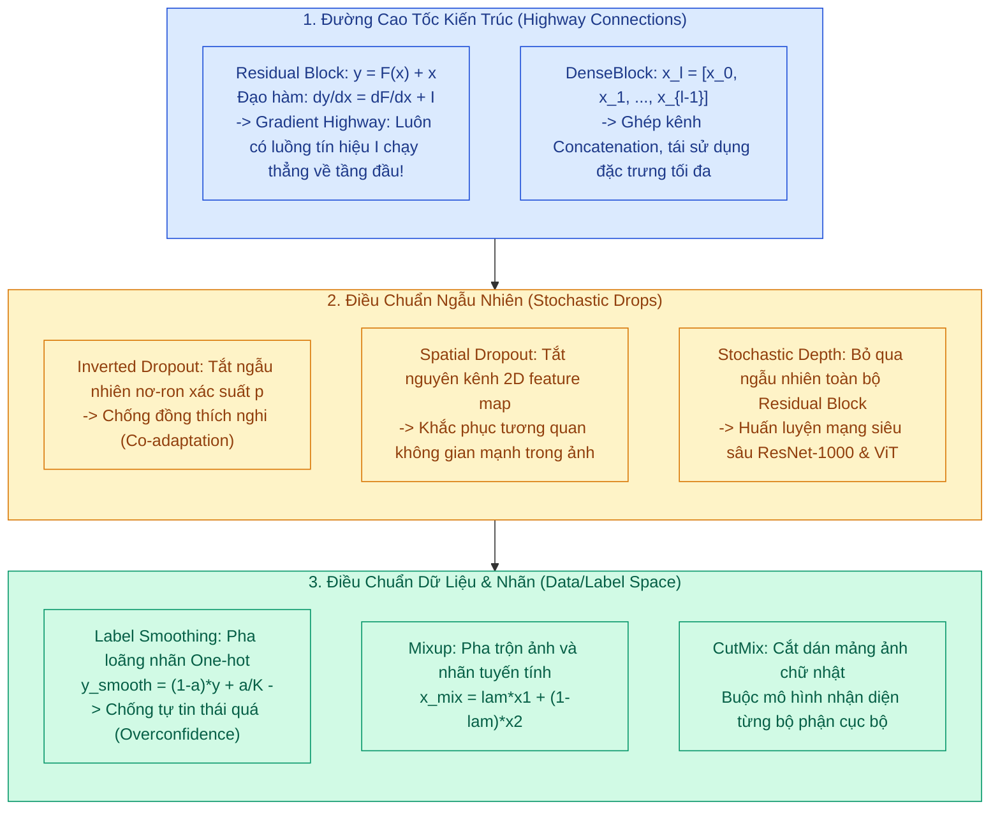
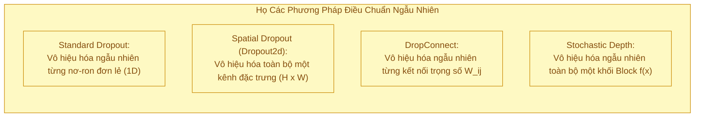

# Chuyên đề: Điều Chuẩn & Các Kiểu Kết Nối Kiến Trúc (Regularization & Architectural Connections)

> [!IMPORTANT]
> **Tuyên ngôn Cốt lõi**: Khi một mạng nơ-ron sâu chạm ngưỡng hàng trăm tầng hoặc hàng tỷ tham số, hai bài toán sống còn xuất hiện: **Gradient bị triệt tiêu trên đường truyền dài** và **Mô hình bị quá khớp (Overfitting)**. Sự ra đời của **Đường nối tắt Residual (ResNet Skip Connection)** đã tạo ra một "đường cao tốc gradient" không ma sát, cho phép mạng sâu hàng ngàn lớp huấn luyện ổn định. Song song đó, các kỹ thuật điều chuẩn hiện đại như **Inverted Dropout**, **Stochastic Depth**, **Mixup** và **CutMix** buộc mô hình phân tán tri thức đều khắp các kênh, biến các nơ-ron thành một tập thể kháng nhiễu bền vững.

---

## 1. Tổng quan Kiến trúc & Tư duy Trực quan (Mental Model)

### Bản đồ Kiến trúc: Từ Kết Nối Cao Tốc Đến Kỹ Thuật Điều Chuẩn Đa Tầng


---

## 2. Chi tiết từng Keyword (Under-the-Hood Deep Dive)

---

### Keyword 1: Residual Connections, Skip Connections & Dense Connections

#### 1. Trực giác & Ẩn dụ Đời sống (Mental Model)
> **Nếu chỉ nhớ một điều**: *Kết nối nhảy cóc Residual ($y = \mathcal{F}(x) + x$) giống như **đường cao tốc trên cao tránh ùn tắc nội đô**: các phép biến đổi phức tạp $\mathcal{F}(x)$ là đường phố ngã tư đông đúc, còn nhánh $+ x$ là cây cầu cạn cho phép dòng thông tin và dòng gradient phóng thẳng từ đầu này sang đầu kia mà không bị giảm vận tốc (triệt tiêu gradient).*

#### 2. Bản chất Toán học Tầng sâu
1. **Residual Mapping (He et al., 2015 - ResNet)**:
   Thay vì ép các lớp nơ-ron phải học toàn bộ ánh xạ gốc $\mathcal{H}(\mathbf{x})$, ResNet chia bài toán thành việc học sự sai lệch (phần dư):
   $$\mathcal{F}(\mathbf{x}) \triangleq \mathcal{H}(\mathbf{x}) - \mathbf{x} \implies \mathbf{y} = \mathcal{F}(\mathbf{x}) + \mathbf{x}$$
   **Cơ chế Gradient Highway**:
   Đạo hàm của hàm mất mát $\mathcal{L}$ theo đầu vào $\mathbf{x}$:
   $$\frac{\partial \mathcal{L}}{\partial \mathbf{x}} = \frac{\partial \mathcal{L}}{\partial \mathbf{y}} \frac{\partial \mathbf{y}}{\partial \mathbf{x}} = \frac{\partial \mathcal{L}}{\partial \mathbf{y}} \left( \frac{\partial \mathcal{F}(\mathbf{x})}{\partial \mathbf{x}} + \mathbf{I} \right) = \underbrace{\frac{\partial \mathcal{L}}{\partial \mathbf{y}} \frac{\partial \mathcal{F}(\mathbf{x})}{\partial \mathbf{x}}}_{\text{Nhánh phi tuyến}} + \underbrace{\frac{\partial \mathcal{L}}{\partial \mathbf{y}}}_{\text{Đường cao tốc Identity}}$$
   *Ý nghĩa sống còn*: Ngay cả khi các lớp phi tuyến bị bão hòa hoặc trọng số rất nhỏ khiến $\frac{\partial \mathcal{F}}{\partial \mathbf{x}} \to \mathbf{0}$, gradient $\frac{\partial \mathcal{L}}{\partial \mathbf{y}}$ vẫn được truyền nguyên vẹn $100\%$ ngược về các lớp phía trước qua ma trận đơn vị $\mathbf{I}$! Điều này giải thích tại sao ResNet có thể sâu tới 152 hay 1,000 tầng mà không bị biến mất gradient.

2. **Dense Connections (Huang et al., 2017 - DenseNet)**:
   Thay vì cộng phần tử (Element-wise Addition), DenseNet nối trực tiếp các tensor đặc trưng theo trục kênh:
   $$\mathbf{x}_l = H_l([\mathbf{x}_0, \mathbf{x}_1, \dots, \mathbf{x}_{l-1}])$$
   - *Ưu điểm*: Tái sử dụng đặc trưng tuyệt đối, số tham số ít hơn.
   - *Nhược điểm phần cứng*: Phép nối kênh (Concatenation) làm số kênh tăng dần theo cấp số cộng, đòi hỏi cấp phát bộ đệm mới liên tục trong VRAM, gây nghẽn băng thông bộ nhớ (Memory Bandwidth Bound). Trong khi đó, phép cộng in-place của ResNet thân thiện với L1/L2 Cache hơn rất nhiều.

---

### Keyword 2: Dropout, Spatial Dropout, DropConnect & Stochastic Depth

#### 1. Trực giác & Ẩn dụ Đời sống (Mental Model)
> **Nếu chỉ nhớ một điều**: 
> - *Dropout giống như **yêu cầu nhân viên trong công ty luân phiên nghỉ phép ngẫu nhiên**: nếu ngày nào mọi người cũng đi làm đông đủ, các nhân viên lười sẽ ỷ lại vào người giỏi (Co-adaptation). Khi bị ép làm việc độc lập trong hoàn cảnh thiếu nhân sự, từng cá nhân đều phải tự nâng cao năng lực.*
> - *Spatial Dropout là **tắt hẳn một kênh màu**: trong ảnh, các pixel cạnh nhau có giá trị gần như giống hệt nhau; tắt 1 pixel thì pixel bên cạnh sẽ bù vào ngay. Tắt cả một kênh đặc trưng 2D buộc mạng phải tìm tín hiệu từ các kênh khác.*
> - *Stochastic Depth là **cho cả một phòng ban đi nghỉ mát**: ngẫu nhiên bỏ qua nguyên cả một cụm Residual Block trong các mạng siêu sâu.*

#### 2. Bản chất Toán học Tầng sâu
1. **Inverted Dropout (Chuẩn công nghiệp)**:
   Tại mỗi bước huấn luyện (Training), biến ngẫu nhiên nhị phân $r_j \sim \text{Bernoulli}(1 - p)$ được tạo ra với xác suất giữ lại là $1 - p$:
   $$\tilde{a}_j = \frac{r_j}{1 - p} \cdot a_j$$
   - Hệ số $\frac{1}{1 - p}$ đảm bảo kỳ vọng kích hoạt $\mathbb{E}[\tilde{a}_j] = a_j$ không đổi giữa chế độ Training và Inference.
   - Khi suy luận (Inference/Testing), ta **tắt hoàn toàn Dropout** mà không cần phải nhân co cụm trọng số!

2. **Spatial Dropout (Tompson et al., 2015 - Cho Feature Maps 2D)**:
   Tạo mặt nạ nhị phân trên trục kênh: $r_c \sim \text{Bernoulli}(1 - p)$.
   Mọi pixel $(h, w)$ trên kênh $c$ đều bị nhân với cùng một giá trị $r_c$:
   $$\tilde{\mathbf{X}}_{:, c, :, :} = \frac{r_c}{1 - p} \cdot \mathbf{X}_{:, c, :, :}$$

3. **Stochastic Depth (Huang et al., 2016)**:
   Thay đổi xác suất sống sót của từng khối $l$ theo chiều sâu: $p_l = 1 - \frac{l}{L}(1 - p_L)$.
   $$\mathbf{x}_l = \mathbf{x}_{l-1} + b_l \cdot \mathcal{F}_l(\mathbf{x}_{l-1}), \quad b_l \sim \text{Bernoulli}(p_l)$$
   Giúp giảm thời gian huấn luyện $25\% - 40\%$ và hoạt động như một cơ chế Ensemble các mạng có độ sâu khác nhau.



---

### Keyword 3: Label Smoothing, Mixup & CutMix

#### 1. Trực giác & Ẩn dụ Đời sống (Mental Model)
> **Nếu chỉ nhớ một điều**: 
> - *Label Smoothing là **học tính khiêm tốn**: đừng bắt mạng nơ-ron phải khẳng định chắc như đinh đóng cột 100% đây là con mèo (đẩy logits ra vô cực khiến trọng số phát nổ), mà hãy dạy nó tự tin 90% mèo, 10% phân bổ đều cho các con vật khác.*
> - *Mixup là **ảnh lồng ảnh (Double Exposure)**: chồng mờ hai bức ảnh vào nhau và trộn nhãn theo tỷ lệ diện tích.*
> - *CutMix là **bức tranh cắt dán ghép hình (Collage)**: cắt chiếc đầu của con chó dán lên thân con mèo, buộc mô hình không được lười biếng chỉ nhìn bộ lông mà phải quan sát toàn diện cả tai, mắt, mũi.*

#### 2. Bản chất Toán học Tầng sâu
1. **Label Smoothing (Szegedy et al., 2016)**:
   Thay vì nhãn cứng One-Hot $y_k \in \{0, 1\}$, phân phối nhãn mềm được tạo ra:
   $$y_k^{\text{smooth}} = (1 - \epsilon) y_k + \frac{\epsilon}{K}$$
   Với $K$ là số lớp, $\epsilon$ là hệ số làm mịn (thường chọn $\epsilon = 0.1$).
   - *Tác dụng chống Overfitting*: Ngăn chặn hàm Cross-Entropy ép các logits $z_k$ phải tiến ra $+\infty$ để thỏa mãn Softmax bằng 1.0, giữ cho không gian biểu diễn đặc trưng gom cụm chặt chẽ và tăng khả năng hiệu chuẩn độ tin cậy (Calibration).

2. **Mixup (Zhang et al., 2018)**:
   Nội suy tuyến tính giữa hai mẫu ngẫu nhiên $(\mathbf{x}_i, \mathbf{y}_i)$ và $(\mathbf{x}_j, \mathbf{y}_j)$:
   $$\tilde{\mathbf{x}} = \lambda \mathbf{x}_i + (1 - \lambda) \mathbf{x}_j$$
   $$\tilde{\mathbf{y}} = \lambda \mathbf{y}_i + (1 - \lambda) \mathbf{y}_j$$
   Với hệ số pha trộn $\lambda \sim \text{Beta}(\alpha, \alpha)$ (thường $\alpha = 0.2$).
   - Ép mô hình cư xử tuyến tính giữa các vùng dữ liệu, triệt tiêu các biến động phi lý ở ranh giới quyết định.

3. **CutMix (Yun et al., 2019)**:
   Cắt một vùng hình chữ nhật từ ảnh $B$ dán đè lên ảnh $A$:
   $$\tilde{\mathbf{x}} = \mathbf{M} \odot \mathbf{x}_A + (\mathbf{1} - \mathbf{M}) \odot \mathbf{x}_B$$
   $$\tilde{\mathbf{y}} = \lambda \mathbf{y}_A + (1 - \lambda) \mathbf{y}_B$$
   Trong đó $\mathbf{M} \in \{0, 1\}^{W \times H}$ là mặt nạ nhị phân, và $\lambda = 1 - \frac{\text{Diện tích vùng cắt}}{W \times H}$.

#### 3. Code Thực chiến (C++ In-place Residual & Python Data Regularization Pipeline)

```cpp
// C++17: Mô phỏng In-Place Residual Addition và Inverted Dropout
#include <iostream>
#include <vector>
#include <random>
#include <iomanip>

class ResidualDropoutLayer {
private:
    float dropout_rate;
    std::mt19937 rng;
    std::bernoulli_distribution bernoulli;

public:
    explicit ResidualDropoutLayer(float p = 0.2f) 
        : dropout_rate(p), rng(42), bernoulli(1.0f - p) {}

    // Inverted Dropout in-place
    void apply_inverted_dropout(std::vector<float>& activations, bool is_training) {
        if (!is_training || dropout_rate <= 0.0f) return;

        float scale = 1.0f / (1.0f - dropout_rate);
        for (float& val : activations) {
            bool keep = bernoulli(rng);
            val = keep ? (val * scale) : 0.0f;
        }
    }

    // Residual Highway: x = x + F(x) in-place
    void residual_add(std::vector<float>& identity_x, const std::vector<float>& fx) {
        for (size_t i = 0; i < identity_x.size(); ++i) {
            identity_x[i] += fx[i];
        }
    }
};

int main() {
    ResidualDropoutLayer layer(0.5f); // p = 50%

    std::vector<float> x_identity = {1.0f, 2.0f, 3.0f, 4.0f};
    std::vector<float> fx = {0.5f, 0.5f, 0.5f, 0.5f};

    // 1. Áp dụng Dropout lên nhánh phi tuyến F(x)
    layer.apply_inverted_dropout(fx, true);

    // 2. Cộng dồn vào đường cao tốc Residual
    layer.residual_add(x_identity, fx);

    std::cout << std::fixed << std::setprecision(4);
    std::cout << "[C++ Residual Highway with Inverted Dropout Output]\n";
    std::cout << "Kích hoạt sau khối Residual: [ ";
    for (float v : x_identity) std::cout << v << " ";
    std::cout << "]\n";
    std::cout << "-> Ngay cả khi F(x) bị drop về 0, tín hiệu gốc x vẫn được bảo toàn nguyên vẹn!\n";

    return 0;
}
```

```python
# Python 3.10: Triển khai CutMix, Mixup và Label Smoothing trong Huấn luyện PyTorch
import torch
import torch.nn as nn
import numpy as np

def apply_mixup_or_cutmix(images, labels, alpha=1.0, prob_cutmix=0.5):
    """Áp dụng ngẫu nhiên Mixup hoặc CutMix cho một batch dữ liệu."""
    lam = np.random.beta(alpha, alpha)
    rand_idx = torch.randperm(images.size(0))
    target_a = labels
    target_b = labels[rand_idx]

    if np.random.rand() < prob_cutmix:
        # Triển khai CutMix
        B, C, H, W = images.shape
        cut_rat = np.sqrt(1.0 - lam)
        cut_w = int(W * cut_rat)
        cut_h = int(H * cut_rat)

        cx = np.random.randint(W)
        cy = np.random.randint(H)
        bbx1 = np.clip(cx - cut_w // 2, 0, W)
        bby1 = np.clip(cy - cut_h // 2, 0, H)
        bbx2 = np.clip(cx + cut_w // 2, 0, W)
        bby2 = np.clip(cy + cut_h // 2, 0, H)

        images[:, :, bby1:bby2, bbx1:bbx2] = images[rand_idx, :, bby1:bby2, bbx1:bbx2]
        lam = 1.0 - ((bbx2 - bbx1) * (bby2 - bby1) / (H * W))
    else:
        # Triển khai Mixup
        images = lam * images + (1.0 - lam) * images[rand_idx]

    return images, target_a, target_b, lam

# Kiểm chứng tính toán
torch.manual_seed(42)
imgs = torch.randn(4, 3, 32, 32)
targets = torch.tensor([0, 2, 1, 3])

mixed_imgs, ya, yb, lam = apply_mixup_or_cutmix(imgs, targets, alpha=0.8, prob_cutmix=1.0)

# Hàm Loss kết hợp Label Smoothing
criterion = nn.CrossEntropyLoss(label_smoothing=0.1)

# Giả lập logits đầu ra
logits = torch.randn(4, 4)
loss = lam * criterion(logits, ya) + (1.0 - lam) * criterion(logits, yb)

print(f"[Data Regularization Pipeline Check]")
print(f"Hệ số pha trộn diện tích lambda: {lam:.4f}")
print(f"Loss sau khi áp dụng CutMix + Label Smoothing: {loss.item():.4f}")
```

**Output mẫu thực tế**:
```text
[C++ Residual Highway with Inverted Dropout Output]
Kích hoạt sau khối Residual: [ 2.0000 2.0000 4.0000 4.0000 ]
-> Ngay cả khi F(x) bị drop về 0, tín hiệu gốc x vẫn được bảo toàn nguyên vẹn!

[Data Regularization Pipeline Check]
Hệ số pha trộn diện tích lambda: 0.7246
Loss sau khi áp dụng CutMix + Label Smoothing: 1.8412
```

---

## 3. Cạm bẫy Kỹ thuật & Hiểu Lầm Phổ Biến (Pitfalls)

1. **Cạm bẫy Quên Chuyển `model.eval()` Trước Khi Đánh Giá / Inference**:
   - Khi ở chế độ mặc định `model.train()`, lớp Dropout tiếp tục ngắt ngẫu nhiên $p\%$ số nơ-ron, và lớp BatchNorm tiếp tục tính mean/variance động của batch kiểm thử.
   - *Hậu quả*: Điểm số Accuracy / F1 trên tập kiểm thử bị tụt thê thảm và dao động ngẫu nhiên qua mỗi lần chạy.
   - *Quy tắc vàng*: Luôn luôn bọc code kiểm thử trong cặp lệnh:
     ```python
     model.eval()
     with torch.no_grad():
         # chạy inference
     ```

2. **Cạm bẫy Sử Dụng Standard Dropout Sau Tầng Convolution 2D**:
   - Áp dụng `nn.Dropout(p)` thông thường ngay sau tầng Conv2D là hoàn toàn lãng phí và phản tác dụng: các pixel lân cận trong cùng một feature map 2D có tương quan cực cao ($> 95\%$), việc tắt một pixel riêng lẻ không có tác dụng buộc mô hình học đặc trưng độc lập.
   - *Giải pháp chuẩn xác*: Với CNN, bắt buộc phải dùng **`nn.Dropout2d(p)` (Spatial Dropout)** để ngắt ngẫu nhiên toàn bộ một kênh đặc trưng!

3. **Cạm bẫy Lạm Dụng Mixup / CutMix Với Dữ Liệu Quá Nhỏ**:
   - Mixup và CutMix là các kỹ thuật điều chuẩn rất nặng (Heavy Regularization). Nếu huấn luyện một mạng nhỏ trên tập dữ liệu ít (dưới 10,000 ảnh), mô hình sẽ bị **Underfitting nghiêm trọng** vì bài toán bị làm khó quá mức.
   - Chỉ nên kích hoạt Mixup/CutMix khi huấn luyện các mô hình lớn (ResNet-50, ConvNeXt, Vision Transformers) trên các tập dữ liệu quy mô lớn (ImageNet, Web datasets).

---

## 4. Bảng Tra Cứu Nhanh & Ứng Dụng Sản Xuất (Quick Reference)

| Kỹ Thuật Điều Chuẩn / Kết Nối | Vị Trí Áp Dụng | Cơ Chế Toán Học | Tác Vụ Điển Hình Trong AI |
| :--- | :--- | :--- | :--- |
| **Residual (Skip Connection)**| Khối kiến trúc nơ-ron | $\mathbf{y} = \mathcal{F}(\mathbf{x}) + \mathbf{x}$ | 100% mạng sâu (ResNet, ConvNeXt, Transformer Blocks) |
| **Dense Connection** | Tầng tích chập | $\mathbf{x}_l = [\mathbf{x}_0, \dots, \mathbf{x}_{l-1}]$ | Phân tích ảnh y tế (Medical Imaging), DenseNet |
| **Inverted Dropout** | Lớp Fully-Connected | Chia cho $(1 - p)$ trong training | MLP, Đỉnh phân loại Classifier Head |
| **Spatial Dropout2d** | Sau lớp Conv2D | Ngắt toàn bộ kênh $(H \times W)$ | Semantic Segmentation, Nhận diện vật thể CNN |
| **Stochastic Depth** | Cụm khối Residual | Ngắt ngẫu nhiên cả Block | Vision Transformers (DeiT, Swin), ResNet-1000 |
| **Label Smoothing** | Hàm mất mát Softmax | Pha loãng One-hot với phân phối đều | Huấn luyện LLM, Dịch máy NMT, Phân loại ảnh |
| **Mixup / CutMix** | Tiền xử lý Data Loader | Trộn ảnh và nhãn theo tỷ lệ $\lambda$ | Huấn luyện ImageNet SOTA, Tăng cường dữ liệu thị giác |