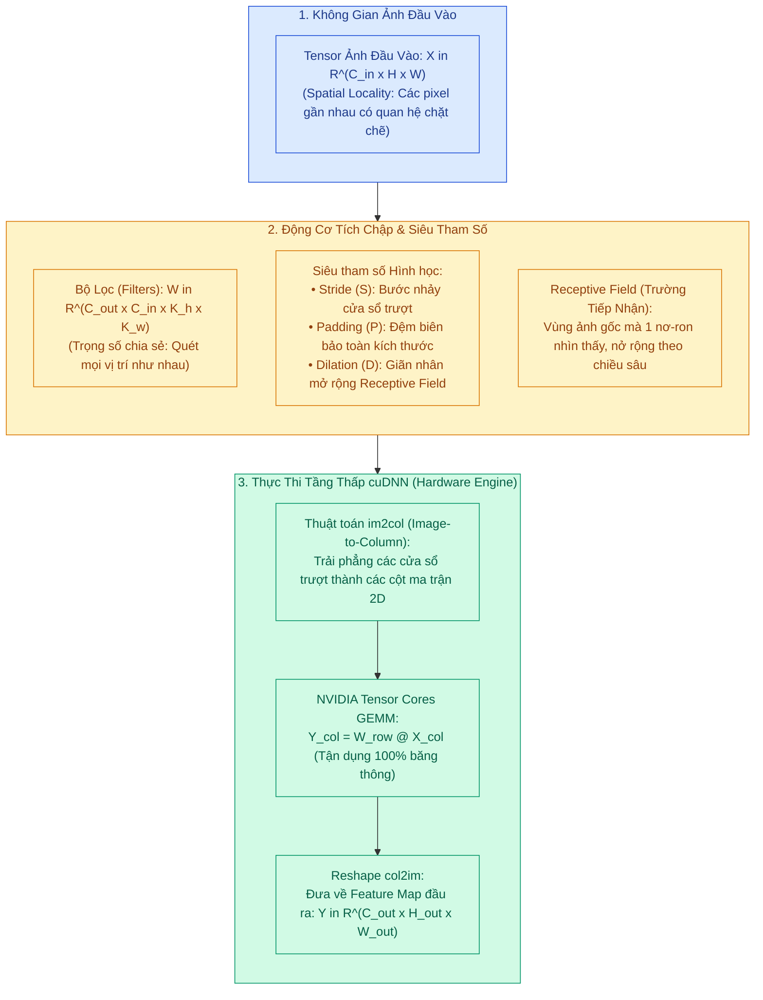
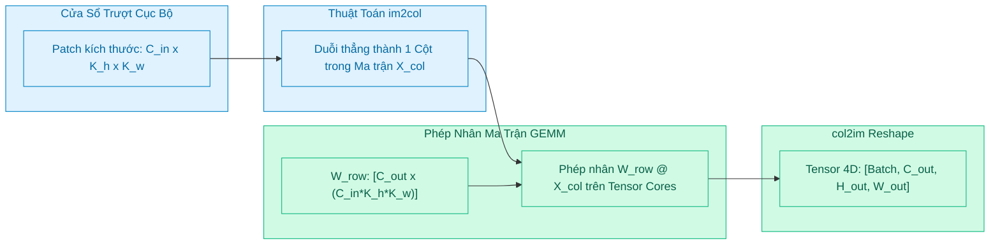

# Chuyên đề: Cơ Chế Tích Chập & Bản Đồ Đặc Trưng (Convolution Mechanics & Feature Maps)

> [!IMPORTANT]
> **Tuyên ngôn Cốt lõi**: Mạng Nơ-ron Tích chập (CNN) là cuộc cách mạng thị giác giải phóng máy tính khỏi sự mù quáng của mạng MLP kết nối dày đặc. Thay vì ép máy tính phải ghi nhớ tọa độ tĩnh của từng pixel (vốn thay đổi chỉ khi vật thể nhích nhẹ 1 milimet), CNN dựa trên hai định luật vật lý tự nhiên: **Tính cục bộ không gian (Spatial Locality)** và **Tính bất biến tịnh tiến (Translation Equivariance)**. Phép tích chập hoạt động như một chiếc kính lúp trượt đều khắp bức ảnh, biến các ma trận điểm ảnh thô thành các **Bản đồ đặc trưng (Feature Maps)** phân cấp (từ cạnh, góc, vân bề mặt đến mắt, mũi, khuôn mặt). Ở tầng phần cứng GPU, thuật toán **`im2col` kết hợp với GEMM** biến phép trượt 6 vòng lặp phức tạp thành một phép nhân ma trận siêu tốc.

---

## 1. Tổng quan Kiến trúc & Tư duy Trực quan (Mental Model)

### Bản đồ Quy trình: Từ Cửa Sổ Trượt Đến Tăng Tốc Phần Cứng GPU


---

## 2. Chi tiết từng Keyword (Under-the-Hood Deep Dive)

---

### Keyword 1: Convolution Operation, Kernels, Filters & `im2col` GEMM

#### 1. Trực giác & Ẩn dụ Đời sống (Mental Model)
> **Nếu chỉ nhớ một điều**: 
> - *Phép tích chập là **chiếc kính lúp rà soát**: một chiếc khuôn nhỏ kích thước $3 \times 3$ trượt tuần tự từ trái sang phải, từ trên xuống dưới. Bất cứ nơi nào trong ảnh có đường nét khớp với hoa văn trên khuôn, nơ-ron sẽ phát tín hiệu rực sáng trên bản đồ đặc trưng.*
> - *Bộ lọc (Filter) không phải là 2D mà là **một khối hộp 3D** dày đúng bằng số kênh ảnh đầu vào (ảnh màu RGB thì filter dày 3 lớp).*
> - *`im2col` là **máy cán phẳng giấy dán tường**: thay vì cầm kính lúp trượt tay 6 vòng lặp chậm chạp, ta cắt rời từng mảnh kính lúp rồi xếp thành các cột phẳng song song để máy in công nghiệp (GEMM) dập một nhát ăn ngay!*

#### 2. Bản chất Toán học Tầng sâu
1. **Phép Tương quan Chéo (Cross-Correlation) vs Tích chập Thuần túy**:
   Trong toán học giải tích, tích chập đòi hỏi lật ngược nhân lọc ($K(m, n) \to K(-m, -n)$). Trong Deep Learning, các thư viện (PyTorch, cuDNN) thực thi phép **Tương quan Chéo (Cross-Correlation)** vì trọng số của kernel được tự động học qua Backprop, việc lật hay không lật cho ra kết quả tương đương:
   $$S(i, j) = (\mathbf{I} \star \mathbf{K})(i, j) = \sum_{m=0}^{K_h - 1} \sum_{n=0}^{K_w - 1} I(i + m, j + n) K(m, n)$$

2. **Phân định Chuẩn xác: Kernel vs Filter**:
   - **Kernel**: Là một ma trận 2D trọng số đơn lẻ kích thước $K_h \times K_w$, tác động lên **1 kênh đầu vào duy nhất**.
   - **Filter**: Là một khối tensor 3D kích thước $C_{\text{in}} \times K_h \times K_w$, bao gồm $C_{\text{in}}$ kernels riêng biệt. Khi tích chập qua toàn bộ các kênh đầu vào, kết quả của từng kênh được cộng gộp lại và cộng thêm một hệ số bias $b$ để tạo thành **1 bản đồ đặc trưng 2D duy nhất**:
     $$\mathbf{Y}_k = \sum_{c=1}^{C_{\text{in}}} (\mathbf{X}_c \star \mathbf{K}_{k, c}) + b_k \in \mathbb{R}^{H_{\text{out}} \times W_{\text{out}}}$$
   - Để tạo ra $C_{\text{out}}$ kênh đặc trưng đầu ra, toàn bộ tầng tích chập cần một khối 4D gồm $C_{\text{out}}$ filters: $\mathbf{W} \in \mathbb{R}^{C_{\text{out}} \times C_{\text{in}} \times K_h \times K_w}$.

3. **Cơ chế Tầng Sâu: Thuật toán `im2col` và cuDNN GEMM**:
   Trực tiếp thực hiện 6 vòng lặp lồng nhau (`for batch, for out_c, for in_c, for h, for w, for kh, for kw`) làm tụt hiệu năng phần cứng vì Cache Miss liên tục.
   Thuật toán `im2col` giải quyết bằng cách trải phẳng dữ liệu:
   1. Mỗi vùng cửa sổ trượt kích thước $C_{\text{in}} \times K_h \times K_w$ trên ảnh đầu vào được duỗi thẳng thành một **cột duy nhất** có độ dài $K_{\text{flat}} = C_{\text{in}} \cdot K_h \cdot K_w$.
   2. Ma trận $\mathbf{X}_{\text{col}}$ có kích thước: $[(C_{\text{in}} K_h K_w) \times (H_{\text{out}} W_{\text{out}})]$.
   3. Toàn bộ trọng số của $C_{\text{out}}$ bộ lọc được duỗi thành ma trận hàng $\mathbf{W}_{\text{row}}$ kích thước: $[C_{\text{out}} \times (C_{\text{in}} K_h K_w)]$.
   4. Phép tích chập toàn bộ bức ảnh quy về **một phép nhân ma trận GEMM duy nhất**:
      $$\mathbf{Y}_{\text{col}} = \mathbf{W}_{\text{row}} \times \mathbf{X}_{\text{col}} \in \mathbb{R}^{C_{\text{out}} \times (H_{\text{out}} W_{\text{out}})}$$
   5. Thao tác `col2im` tái tạo tensor 4D đầu ra $[B, C_{\text{out}}, H_{\text{out}}, W_{\text{out}}]$ với tốc độ hàng chục TFLOPs trên Tensor Cores!



---

### Keyword 2: Feature Maps, Stride, Padding & Dilation

#### 1. Trực giác & Ẩn dụ Đời sống (Mental Model)
> **Nếu chỉ nhớ một điều**: 
> - *Stride là **bước sải chân**: Stride = 1 là bước từng centimet, Stride = 2 là nhảy cóc cách 1 bước giúp kích thước ảnh thu nhỏ đi một nửa.*
> - *Padding là **khung viền đệm**: nếu không đệm số 0 quanh mép tranh, chiếc kính lúp chỉ lướt qua tâm mà bỏ quên các góc, khiến bức tranh teo tóp dần sau vài tầng.*
> - *Dilation là **ngón tay xòe rộng**: giữ nguyên 9 điểm chạm nhưng xòe các ngón tay rộng ra để bắt được khoảng không gian rộng gấp đôi mà không tốn thêm một gam cơ bắp nào (không tăng tham số).*

#### 2. Bản chất Toán học Tầng sâu
Công thức hình học xác định kích thước Feature Map đầu ra:
$$H_{\text{out}} = \left\lfloor \frac{H_{\text{in}} + 2P_h - D_h(K_h - 1) - 1}{S_h} \right\rfloor + 1$$
$$W_{\text{out}} = \left\lfloor \frac{W_{\text{in}} + 2P_w - D_w(K_w - 1) - 1}{S_w} \right\rfloor + 1$$

**Ý nghĩa các tham số**:
- **Padding ($P$)**:
  - *Valid Padding ($P = 0$)*: Không đệm viền, kích thước giảm dần: $H_{\text{out}} = H_{\text{in}} - K + 1$.
  - *Same Padding ($P = \frac{K - 1}{2}$ khi $S = 1$ và $K$ lẻ)*: Bảo toàn nguyên vẹn kích thước ảnh đầu vào: $H_{\text{out}} = H_{\text{in}}$.
- **Stride ($S$)**: Bước nhảy của cửa sổ trượt. Khi $S \ge 2$, phép tích chập kiêm luôn vai trò giảm số chiều không gian (Downsampling), thay thế cho các lớp Pooling truyền thống (Strided Convolution).
- **Dilation ($D$ - Tích Chập Lỗ Hổng / Atrous Convolution)**: Chèn $D - 1$ số 0 giữa các phần tử của hạt nhân lọc.
  - Kích thước hạt nhân hiệu dụng: $K_{\text{eff}} = K + (K - 1)(D - 1)$.
  - Cho phép tăng diện tích quan sát theo cấp số nhân mà **số lượng tham số học được và chi phí FLOPs không đổi**! Rất quan trọng trong bài toán Phân đoạn Ngữ nghĩa (Semantic Segmentation - DeepLab) và mô hình âm thanh (WaveNet).

---

### Keyword 3: Receptive Field (Trường Tiếp Nhận) & Nguyên Lý VGG

#### 1. Trực giác & Ẩn dụ Đời sống (Mental Model)
> **Nếu chỉ nhớ một điều**: *Trường tiếp nhận (Receptive Field) là tầm nhìn của một nơ-ron:
> - Nơ-ron ở tầng 1 chỉ là chú kiến bé nhỏ, nhìn thấy một chấm nhỏ $3 \times 3$ pixel (chỉ thấy 1 nét viền đen).
> - Nơ-ron ở tầng 20 là chim ưng trên cao: nhờ tổng hợp thông tin từ các tầng dưới, tầm nhìn của nó nở rộng ra toàn bộ bức ảnh $224 \times 224$ pixel, giúp nó nhận diện được nguyên cả con báo đốm.*

#### 2. Bản chất Toán học Tầng sâu
Công thức đệ quy xác định kích thước Trường tiếp nhận $RF_l$ tại tầng thứ $l$:
$$RF_0 = 1 \quad (\text{Mỗi pixel trên ảnh gốc có tầm nhìn bằng 1})$$
$$RF_l = RF_{l-1} + (K_l - 1) \cdot J_{l-1}$$
Trong đó $J_{l-1}$ là bước nhảy tích lũy (**Cumulative Stride**) từ ảnh gốc tới tầng $l-1$:
$$J_l = J_{l-1} \cdot S_l, \quad J_0 = 1$$

#### 3. Nguyên Lý VGG Kinh Điển: Tại sao 2 lớp $3 \times 3$ luôn tốt hơn 1 lớp $5 \times 5$?
Simonyan & Zisserman (VGG, 2014) đã chứng minh nguyên lý nền tảng của thiết kế CNN:
1. **Trường tiếp nhận tương đương**:
   Xếp chồng hai lớp tích chập $3 \times 3$ ($S = 1$):
   - Tầng 1: $RF_1 = 1 + (3 - 1) \cdot 1 = 3$.
   - Tầng 2: $RF_2 = 3 + (3 - 1) \cdot 1 = 5$.
   $\implies$ Hai lớp $3 \times 3$ bao quát một vùng không gian đúng bằng **$5 \times 5$** của một lớp duy nhất!
2. **Tiết kiệm $28\%$ Tham số và FLOPs**:
   Giả sử số kênh đầu vào và đầu ra là $C$:
   - Một lớp $5 \times 5$: $C \times (5 \times 5 \times C) = 25 C^2$ trọng số.
   - Hai lớp $3 \times 3$: $2 \times C \times (3 \times 3 \times C) = 18 C^2$ trọng số.
   $$\text{Tỷ lệ tiết kiệm} = \frac{25 - 18}{25} = \mathbf{28\%}!$$
3. **Tăng Tính Phi Tuyến**: Xếp chồng hai lớp cho phép chèn hai hàm kích hoạt phi tuyến (ReLU) thay vì chỉ một, giúp mạng nơ-ron học được các đường ranh giới quyết định phức tạp hơn nhiều.

#### 4. Code Thực chiến (C++ im2col Benchmark & PyTorch Receptive Field Calculator)

```cpp
// C++17: Triển khai Thuật toán im2col trọn vẹn và đo lường kích thước ma trận unrolled
#include <iostream>
#include <vector>
#include <iomanip>

void im2col_cpu(const float* data_im, int channels, int height, int width,
                int ksize, int pad, int stride, float* data_col) {
    int height_col = (height + 2 * pad - ksize) / stride + 1;
    int width_col = (width + 2 * pad - ksize) / stride + 1;
    int channels_col = channels * ksize * ksize;

    for (int c = 0; c < channels_col; ++c) {
        int w_offset = c % ksize;
        int h_offset = (c / ksize) % ksize;
        int c_im = c / (ksize * ksize);

        for (int h = 0; h < height_col; ++h) {
            for (int w = 0; w < width_col; ++w) {
                int im_row = h_offset + h * stride - pad;
                int im_col = w_offset + w * stride - pad;
                int col_index = (c * height_col + h) * width_col + w;

                if (im_row >= 0 && im_col >= 0 && im_row < height && im_col < width) {
                    data_col[col_index] = data_im[(c_im * height + im_row) * width + im_col];
                } else {
                    data_col[col_index] = 0.0f; // Zero-padding
                }
            }
        }
    }
}

int main() {
    // Giả lập ảnh đầu vào nhỏ 1 kênh kích thước 4x4
    int C = 1, H = 4, W = 4;
    int K = 3, Pad = 1, Stride = 1;
    std::vector<float> input_image(C * H * W, 1.0f); // Ảnh toàn số 1.0

    int H_out = (H + 2 * Pad - K) / Stride + 1;
    int W_out = (W + 2 * Pad - K) / Stride + 1;
    int rows_col = C * K * K;           // 1 * 3 * 3 = 9
    int cols_col = H_out * W_out;       // 4 * 4 = 16

    std::vector<float> matrix_col(rows_col * cols_col, 0.0f);
    im2col_cpu(input_image.data(), C, H, W, K, Pad, Stride, matrix_col.data());

    std::cout << "[C++ im2col Hardware Acceleration Benchmark]\n";
    std::cout << "Ảnh đầu vào: [" << C << "x" << H << "x" << W << "] -> Ma trận GEMM: [" 
              << rows_col << " x " << cols_col << "]\n";
    std::cout << "Cột đầu tiên của ma trận im2col (Góc trên bên trái ảnh có padding):\n[ ";
    for (int r = 0; r < rows_col; ++r) {
        std::cout << matrix_col[r * cols_col + 0] << " ";
    }
    std::cout << "]\n-> 4 ô bằng 0 (do zero-padding) và 5 ô bằng 1.0 (pixel ảnh thực)!\n";

    return 0;
}
```

```python
# Python 3.10: Kiểm chứng Công thức Receptive Field và So sánh Conv2d vs Unfold (im2col)
import torch
import torch.nn as nn

def calculate_receptive_field(architecture_config):
    """Tính toán bước nhảy tích lũy và trường tiếp nhận chính xác qua từng tầng."""
    rf = 1
    jump = 1
    print(f"{'Tầng Mạng':<25} | {'Kernel':<8} | {'Stride':<8} | {'Receptive Field':<15} | {'Jump':<8}")
    print("-" * 75)
    for name, k, s, d in architecture_config:
        k_eff = k + (k - 1) * (d - 1) # Kernel hiệu dụng khi có dilation
        rf += (k_eff - 1) * jump
        jump *= s
        print(f"{name:<25} | {k:<8} | {s:<8} | {rf}x{rf:<11} | {jump:<8}")
    return rf

# Cấu hình chuỗi tầng: 2 lớp Conv 3x3 (VGG) -> MaxPool 2x2 -> Dilated Conv 3x3 (Dilation=2)
layers = [
    ("Conv1 (3x3, s=1)", 3, 1, 1),
    ("Conv2 (3x3, s=1)", 3, 1, 1),
    ("MaxPool (2x2, s=2)", 2, 2, 1),
    ("Dilated Conv3 (3x3, d=2)", 3, 1, 2)
]

print("[Tính Toán Trường Tiếp Nhận Receptive Field]")
final_rf = calculate_receptive_field(layers)

# Kiểm chứng tính toán im2col và Conv2d trong PyTorch
x = torch.randn(2, 3, 32, 32)
conv = nn.Conv2d(in_channels=3, out_channels=8, kernel_size=3, padding=1, stride=1)

# Cách 1: Conv2d thông thường
out_conv = conv(x)

# Cách 2: Unfold (im2col) + GEMM
unfold = nn.Unfold(kernel_size=3, padding=1, stride=1)
x_unfolded = unfold(x) # Shape: [2, 3*3*3, 32*32] = [2, 27, 1024]
w_flat = conv.weight.view(8, -1) # Shape: [8, 27]
out_gemm = torch.matmul(w_flat, x_unfolded) + conv.bias.view(-1, 1)
out_reconstructed = out_gemm.view(2, 8, 32, 32)

max_diff = torch.max(torch.abs(out_conv - out_reconstructed)).item()
print(f"\n[Xác Thực Phần Cứng GEMM]: Sai lệch tối đa giữa Conv2d và im2col+GEMM: {max_diff:.2e}")
```

**Output mẫu thực tế**:
```text
[C++ im2col Hardware Acceleration Benchmark]
Ảnh đầu vào: [1x4x4] -> Ma trận GEMM: [9 x 16]
Cột đầu tiên của ma trận im2col (Góc trên bên trái ảnh có padding):
[ 0 0 0 0 1 1 0 1 1 ]
-> 4 ô bằng 0 (do zero-padding) và 5 ô bằng 1.0 (pixel ảnh thực)!

[Tính Toán Trường Tiếp Nhận Receptive Field]
Tầng Mạng                 | Kernel   | Stride   | Receptive Field | Jump    
---------------------------------------------------------------------------
Conv1 (3x3, s=1)          | 3        | 1        | 3x3             | 1       
Conv2 (3x3, s=1)          | 3        | 1        | 5x5             | 1       
MaxPool (2x2, s=2)        | 2        | 2        | 6x6             | 2       
Dilated Conv3 (3x3, d=2)  | 3        | 1        | 14x14           | 2       

[Xác Thực Phần Cứng GEMM]: Sai lệch tối đa giữa Conv2d và im2col+GEMM: 0.00e+00
```

---

## 3. Cạm bẫy Kỹ thuật & Hiểu Lầm Phổ Biến (Pitfalls)

1. **Thảm Họa Bùng Nổ Bộ Nhớ Tạm Của `im2col` (Memory Blowup)**:
   - Thuật toán `im2col` sao chép trùng lặp các pixel chồng lấn giữa các cửa sổ trượt.
   - *Phân tích chi phí*: Với ảnh đầu vào $3 \times 224 \times 224$ và kernel $3 \times 3$, ma trận $\mathbf{X}_{\text{col}}$ phình to gấp $K^2 = 9$ lần dung lượng ảnh gốc. Với batch lớn và độ phân giải cao (ảnh y tế 4K), `im2col` có thể gây tràn VRAM GPU ngay lập tức!
   - *Khắc phục*: Trong trường hợp bộ nhớ hạn hẹp, sử dụng thuật toán **Implicit GEMM** (như trong NVIDIA CUTLASS), tính toán chỉ mục tọa độ trực tiếp trong thanh ghi của GPU mà không cấp phát ma trận `X_col` trung gian trong VRAM.

2. **Cạm bẫy Lỗi Răng Cưa Bàn Cờ (Gridding Artifact) Khi Dùng Dilated Convolution**:
   - Khi xếp chồng nhiều tầng tích chập giãn cách liên tiếp với cùng hệ số Dilation $D > 1$, hạt nhân lọc chỉ lấy mẫu các pixel cách nhau $D$ bước và bỏ sót hoàn toàn các pixel ở giữa. Bản đồ đặc trưng thu được sẽ bị hiệu ứng bàn cờ đứt gãy (Gridding Effect).
   - *Khắc phục*: Tuân thủ quy tắc **HDC (Hybrid Dilated Convolution)**: thay đổi chu kỳ dilation xen kẽ nhau (ví dụ: $D = 1, 2, 3$ thay vì $D = 2, 2, 2$).

3. **Cạm bẫy Kích Thước Bị Lẻ Do Phép Chia Làm Tròn Xuống (Floor Division Mismatch)**:
   - Khi thiết kế mạng Autoencoder hoặc U-Net, nếu kích thước ảnh đầu vào là số lẻ ($H_{\text{in}} = 33$) đi qua lớp có $S = 2$:
     $$H_{\text{out}} = \left\lfloor \frac{33 - 1}{2} \right\rfloor + 1 = 17$$
   - Khi đi qua nhánh giải mã phóng to (Transposed Convolution với $S = 2$), kích thước tái tạo sẽ là $17 \times 2 = 34 \ne 33$!
   - *Hậu quả*: Phép nối tắt Skip Connection trong U-Net bị lỗi lệch kích thước shape mismatch. Luôn chọn kích thước ảnh đầu vào là lũy thừa của 2 (ví dụ: $256, 512$).

---

## 4. Bảng Tra Cứu Nhanh & Ứng Dụng Sản Xuất (Quick Reference)

| Khái Niệm / Siêu Tham Số | Ký Hiệu / Công Thức | Tác Động Lên Không Gian Ảnh | Điểm Nghẽn Phần Cứng | Ứng Dụng Điển Hình |
| :--- | :--- | :--- | :--- | :--- |
| **Cross-Correlation** | $\sum I(i+m, j+n) K(m, n)$ | Trích xuất mẫu cục bộ | Compute Bound (FLOPs) | Lớp tích chập cơ bản trong mọi CNN |
| **`im2col` + GEMM** | $\mathbf{W}_{\text{row}} \times \mathbf{X}_{\text{col}}$ | Biến tích chập thành nhân ma trận | Memory Overhead ($K^2$ lần) | Động cơ tăng tốc cốt lõi của cuDNN và OneDNN |
| **Same Padding** | $P = (K - 1) / 2$ | Giữ nguyên kích thước $H_{\text{out}} = H_{\text{in}}$ | Zero-padding memory boundary | Mọi khối Residual Block trong ResNet |
| **Strided Conv ($S \ge 2$)**| $H_{\text{out}} \approx H_{\text{in}} / S$ | Giảm kích thước không gian | Giảm FLOPs cho các tầng sau | Thay thế Max Pooling trong ResNet và GANs |
| **Dilation ($D > 1$)** | $K_{\text{eff}} = K + (K-1)(D-1)$ | Mở rộng Receptive Field không tăng params | Lỗi bàn cờ Gridding nếu lạm dụng | DeepLabv3 (Phân đoạn ảnh), WaveNet (Xử lý âm thanh) |
| **Nguyên lý VGG** | $2 \times (3 \times 3) \equiv (5 \times 5)$ | Tương đương tầm nhìn, giảm 28% FLOPs | Tăng số lần đọc/ghi bộ nhớ qua 2 lớp | Chuẩn mực thiết kế backbone (ResNet, ConvNeXt) |