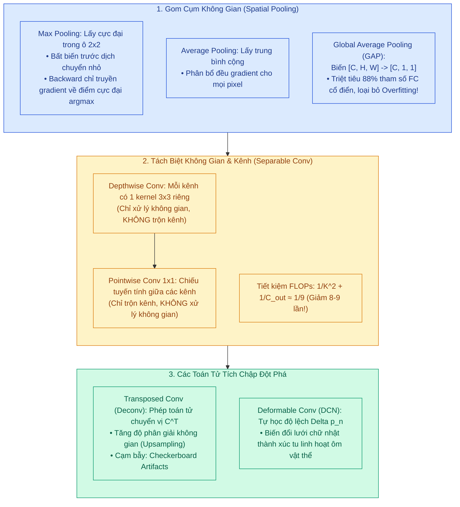
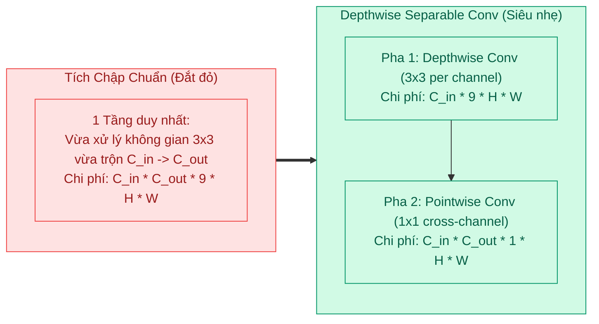
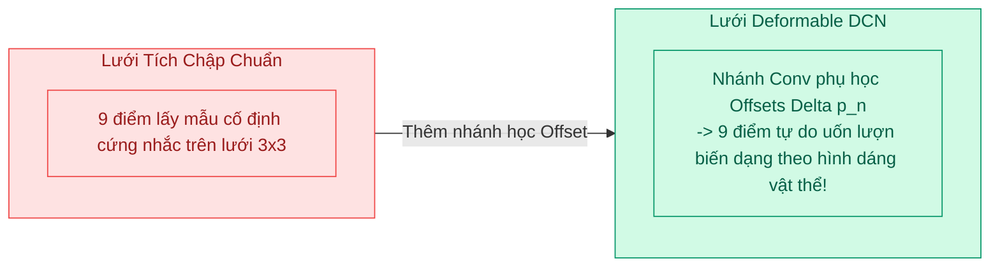

# Chuyên đề: Các Thao Tác Pooling & Biến Thể Tích Chập Nâng Cao (Pooling & Convolution Variants)

> [!IMPORTANT]
> **Tuyên ngôn Cốt lõi**: Tích chập 2D tiêu chuẩn chỉ là bước khởi đầu. Để đưa mô hình thị giác máy tính vào các thiết bị di động (Mobile / Edge AI) hoặc xử lý các bài toán nâng cao (Phân đoạn đối tượng, Khôi phục ảnh siêu phân giải), các kỹ sư cần những công cụ sắc bén hơn:
> - **Global Average Pooling (GAP)**: Xóa sổ các tầng Fully Connected cồng kềnh, cứu mô hình khỏi hàng trăm megabyte trọng số dư thừa.
> - **Depthwise Separable Convolution**: Tách rời không gian và kênh, cắt giảm **gần $90\%$ chi phí tính toán FLOPs** (trụ cột của MobileNet, Xception).
> - **Transposed Convolution**: Toán tử chuyển vị phóng to bản đồ đặc trưng (Upsampling).
> - **Deformable Convolution**: Bẻ cong lưới lấy mẫu cứng nhắc, cho phép nơ-ron tự do uốn lượn ôm khít lấy hình thù thực tế của vật thể.

---

## 1. Tổng quan Kiến trúc & Tư duy Trực quan (Mental Model)

### Bản đồ Kiến trúc: Từ Gom Cụm Không Gian Đến Tích Chập Thích Ứng


---

## 2. Chi tiết từng Keyword (Under-the-Hood Deep Dive)

---

### Keyword 1: Pooling Operations: Max, Average & Global Average Pooling (GAP)

#### 1. Trực giác & Ẩn dụ Đời sống (Mental Model)
> **Nếu chỉ nhớ một điều**: 
> - *Max Pooling là **bầu lớp trưởng**: trong một bàn 4 học sinh ($2 \times 2$), chỉ có học sinh có tiếng nói to nhất (tín hiệu mạnh nhất) được phát biểu đại diện cho cả bàn.*
> - *Global Average Pooling (GAP) là **nền dân chủ tuyệt đối**: thay vì gom học sinh vào một phòng hội trường khổng lồ đầy dây dợ lằng nhằng (tầng Fully Connected ngốn 100 triệu tham số), GAP tính điểm trung bình của cả lớp để tạo ra đúng 1 con số duy nhất đại diện cho lớp đó.*

#### 2. Bản chất Toán học Tầng sâu
1. **Max Pooling**:
   $$y(i, j) = \max_{m \in [0, K_h-1], n \in [0, K_w-1]} x(i \cdot S_h + m, j \cdot S_w + n)$$
   - **Cơ chế Lan truyền ngược (Backward Gradient Flow)**: Tín hiệu gradient chỉ truyền $100\%$ về duy nhất phần tử đạt giá trị cực đại trong cửa sổ trượt (thông qua mảng chỉ số `argmax_mask`), toàn bộ các vị trí khác đều nhận gradient bằng 0:
     $$\frac{\partial \mathcal{L}}{\partial x_{mn}} = \frac{\partial \mathcal{L}}{\partial y_{ij}} \cdot \mathbb{I}\left[(m, n) = \operatorname{argmax}(x)\right]$$

2. **Average Pooling**:
   $$y(i, j) = \frac{1}{K_h K_w} \sum_{m=0}^{K_h-1} \sum_{n=0}^{K_w-1} x(i \cdot S_h + m, j \cdot S_w + n)$$
   - Đạo hàm phân phối đều cho mọi pixel trong cửa sổ với hệ số $\frac{1}{K_h K_w}$. Làm mượt các đặc trưng, nhưng dễ làm mờ các chi tiết sắc nét (cạnh viền).

3. **Global Average Pooling (GAP - Lin et al., 2013 - Network in Network)**:
   Thay thế hoàn toàn cụm tầng kết nối dày đặc (Fully Connected layers) ở đuôi mạng. Với mỗi bản đồ đặc trưng kênh $c$, tính trung bình toàn bộ không gian $H \times W$:
   $$y_c = \frac{1}{H \times W} \sum_{h=1}^H \sum_{w=1}^W X_{c, h, w}, \quad \forall c \in \{1, \dots, C\}$$
   Biến đổi tensor $[B, C, H, W] \to [B, C, 1, 1]$.
   - **Tác động Sống còn**: Trong VGG-16, 3 tầng FC ngốn **$122$ triệu tham số** (chiếm $88\%$ kích thước mạng) và là thủ phạm chính gây Overfitting. GAP có **đúng $0$ tham số**, hoàn toàn miễn nhiễm với overfitting và cho phép đưa ảnh đầu vào với kích thước tùy ý!

---

### Keyword 2: Depthwise Separable Convolution (Xception & MobileNet)

#### 1. Trực giác & Ẩn dụ Đời sống (Mental Model)
> **Nếu chỉ nhớ một điều**: *Tích chập chuẩn giống như việc nướng bánh mì kẹp xúc xích: nướng cả bánh mì, xúc xích và sốt cùng một lúc trong một chiếc lò đặc biệt (vừa lọc không gian vừa trộn kênh). **Depthwise Separable Conv** chia đôi công đoạn: trước tiên nướng từng lát bánh riêng biệt (Depthwise), sau đó dùng dao phết sốt kết nối các lát lại với nhau (Pointwise $1 \times 1$). Nhanh hơn 8 đến 9 lần và hương vị (độ chính xác) gần như không đổi!*

#### 2. Bản chất Toán học Tầng sâu
Tích chập chuẩn $K \times K$ biến đổi tensor từ $C_{\text{in}}$ kênh lên $C_{\text{out}}$ kênh với kích thước không gian đầu ra $H_{\text{out}} \times W_{\text{out}}$:
$$\text{FLOPs}_{\text{Standard}} = C_{\text{in}} \times C_{\text{out}} \times K^2 \times H_{\text{out}} \times W_{\text{out}}$$
$$\text{Params}_{\text{Standard}} = C_{\text{in}} \times C_{\text{out}} \times K^2$$

**Depthwise Separable Convolution phân tách thành 2 bước độc lập**:
1. **Bước 1: Depthwise Convolution (DW-Conv - Lọc Không gian Thuần túy)**:
   Mỗi kênh đầu vào được xử lý độc lập bởi một hạt nhân $K \times K$ riêng (`groups = C_in`). Không có bất kỳ sự tương tác nào giữa các kênh:
   $$\text{FLOPs}_{\text{DW}} = C_{\text{in}} \times K^2 \times H_{\text{out}} \times W_{\text{out}}, \qquad \text{Params}_{\text{DW}} = C_{\text{in}} \times K^2$$
2. **Bước 2: Pointwise Convolution (PW-Conv / 1x1 Conv - Trộn Kênh Thuần túy)**:
   Áp dụng $C_{\text{out}}$ hạt nhân kích thước $1 \times 1$ để tính tổ hợp tuyến tính xuyên suốt tất cả $C_{\text{in}}$ kênh:
   $$\text{FLOPs}_{\text{PW}} = C_{\text{in}} \times C_{\text{out}} \times 1^2 \times H_{\text{out}} \times W_{\text{out}}, \qquad \text{Params}_{\text{PW}} = C_{\text{in}} \times C_{\text{out}}$$

**Tỷ Lệ Tiết Kiệm Điện Toán Vĩ Đại**:
$$\text{Tỷ lệ FLOPs} = \frac{\text{FLOPs}_{\text{DW}} + \text{FLOPs}_{\text{PW}}}{\text{FLOPs}_{\text{Standard}}} = \frac{C_{\text{in}} K^2 H W + C_{\text{in}} C_{\text{out}} H W}{C_{\text{in}} C_{\text{out}} K^2 H W} = \frac{1}{C_{\text{out}}} + \frac{1}{K^2}$$
Với kernel tiêu chuẩn $3 \times 3$ ($K = 3$) và $C_{\text{out}} \ge 64$:
$$\text{Tỷ lệ} \approx \frac{1}{3^2} = \frac{1}{9} \approx \mathbf{11.1\%} \implies \text{Cắt giảm gần } \mathbf{90\%} \text{ khối lượng tính toán!}$$



---

### Keyword 3: Transposed Convolution & Checkerboard Artifacts

#### 1. Trực giác & Ẩn dụ Đời sống (Mental Model)
> **Nếu chỉ nhớ một điều**: *Transposed Convolution (Deconvolution) giống như **dùng con dấu đóng mực lên giấy để phóng to tranh**: mỗi pixel nhỏ ở tầng dưới là một lần đóng con dấu $K \times K$ lên tấm bảng lớn. Nếu các con dấu đóng chồng mép lên nhau không đều, chỗ bị đè mực 2 lần, chỗ chỉ đè 1 lần, bức tranh sẽ hiện lên các vết lốm đốm sọc caro (**Checkerboard Artifacts**).*

#### 2. Bản chất Toán học Tầng sâu
Nếu coi phép tích chập thông thường thu nhỏ không gian là phép nhân ma trận Toeplitz thưa $\mathbf{y} = \mathbf{C}\mathbf{x}$ (với $\mathbf{C} \in \mathbb{R}^{d_{\text{out}} \times d_{\text{in}}}$), thì **Transposed Convolution chính là phép nhân với ma trận chuyển vị $\mathbf{C}^T$**:
$$\hat{\mathbf{x}} = \mathbf{C}^T \mathbf{y}$$
Nó **không phải là nghịch đảo ma trận** ($\mathbf{C}^{-1}$), mà là toán tử liên hợp (Adjoint operator), phục hồi lại kích thước không gian ban đầu:
$$H_{\text{out}} = (H_{\text{in}} - 1) \cdot S - 2P + D(K - 1) + P_{\text{out}} + 1$$

#### 3. Bệnh Lý Kẻ Ca-Rô (Checkerboard Artifacts) & Giải Pháp Khắc Phục
- **Nguyên nhân**: Khi kích thước kernel $K$ không chia hết cho Stride $S$ (ví dụ: Kernel 3, Stride 2), các vùng phủ của hạt nhân đóng đè lên nhau không đồng đều trong không gian. Pixel ở vị trí chẵn nhận năng lượng gấp đôi vị trí lẻ, tạo thành hoa văn mắt cáo trên ảnh sinh ra bởi GAN hoặc U-Net.
- **Giải pháp Công nghiệp**: Thay thế hoàn toàn `nn.ConvTranspose2d` bằng cặp đôi:
  $$\mathbf{x}_{\text{up}} = \text{nn.Upsample}(\text{mode='bilinear'}) \implies \mathbf{x}_{\text{out}} = \text{nn.Conv2d}(3 \times 3, \text{stride}=1)$$
  Phép phóng to song tuyến tính nội suy mượt mà không bao giờ bị hiện tượng kẻ ca-rô!

---

### Keyword 4: Deformable Convolution (DCNv1/v2/v3)

#### 1. Trực giác & Ẩn dụ Đời sống (Mental Model)
> **Nếu chỉ nhớ một điều**: *Tích chập thông thường giống như một **chiếc thước kẻ hình vuông cứng ngắc**: dù bạn chụp một con rắn đang uốn cong hay một chiếc xe hơi vuông vức, nó vẫn bắt buộc phải lấy mẫu đúng 9 điểm trên lưới $3 \times 3$. **Deformable Convolution** biến 9 điểm cứng đó thành **9 xúc tu bạch tuộc linh hoạt**: mạng nơ-ron tự học cách vươn xúc tu uốn lượn ôm khít lấy đường cong của cơ thể con rắn.*

#### 2. Bản chất Toán học Tầng sâu
Cho lưới lấy mẫu chuẩn $3 \times 3$: $\mathcal{R} = \{(-1, -1), (-1, 0), \dots, (1, 1)\}$.
Trong Deformable Convolution (Dai et al., 2017):
$$y(\mathbf{p}_0) = \sum_{\mathbf{p}_n \in \mathcal{R}} w(\mathbf{p}_n) \cdot x(\mathbf{p}_0 + \mathbf{p}_n + \Delta \mathbf{p}_n)$$
Trong đó $\Delta \mathbf{p}_n$ là **véc-tơ độ lệch tọa độ 2D dạng số thực (Offsets)**, được học thông qua một nhánh tích chập phụ chạy song song.
- Vì tọa độ $\mathbf{p} = \mathbf{p}_0 + \mathbf{p}_n + \Delta \mathbf{p}_n$ là số thực không nguyên (ví dụ: $(2.4, 5.7)$), giá trị pixel được tính toán thông qua **Nội suy Song tuyến tính (Bilinear Interpolation)** khả vi:
  $$x(\mathbf{p}) = \sum_{\mathbf{q}} G(\mathbf{q}, \mathbf{p}) \cdot x(\mathbf{q})$$
  với $G(\mathbf{q}, \mathbf{p}) = \max(0, 1 - |q_x - p_x|) \cdot \max(0, 1 - |q_y - p_y|)$.



#### 3. Code Thực chiến (C++ Max Pooling Mask & Python Depthwise vs Standard Conv Benchmark)

```cpp
// C++17: Triển khai Max Pooling 2x2 với ArgMax Mask phục vụ Backward Pass chính xác
#include <iostream>
#include <vector>
#include <iomanip>

struct MaxPoolResult {
    std::vector<float> values;
    std::vector<int> argmax_indices;
    int out_h, out_w;
};

MaxPoolResult max_pooling_2x2_forward(const std::vector<float>& input, int H, int W) {
    int out_h = H / 2;
    int out_w = W / 2;
    MaxPoolResult res;
    res.out_h = out_h;
    res.out_w = out_w;
    res.values.resize(out_h * out_w);
    res.argmax_indices.resize(out_h * out_w);

    for (int i = 0; i < out_h; ++i) {
        for (int j = 0; j < out_w; ++j) {
            int r = i * 2;
            int c = j * 2;

            int idx[4] = {
                r * W + c,
                r * W + (c + 1),
                (r + 1) * W + c,
                (r + 1) * W + (c + 1)
            };

            float max_val = input[idx[0]];
            int best_idx = idx[0];

            for (int k = 1; k < 4; ++k) {
                if (input[idx[k]] > max_val) {
                    max_val = input[idx[k]];
                    best_idx = idx[k];
                }
            }

            int out_idx = i * out_w + j;
            res.values[out_idx] = max_val;
            res.argmax_indices[out_idx] = best_idx;
        }
    }
    return res;
}

int main() {
    // Ma trận ảnh 4x4
    std::vector<float> img = {
        1.0f, 3.0f, 2.0f, 4.0f,
        5.0f, 8.0f, 7.0f, 6.0f,
        2.0f, 1.0f, 9.0f, 0.0f,
        4.0f, 3.0f, 5.0f, 6.0f
    };

    auto pool_res = max_pooling_2x2_forward(img, 4, 4);

    std::cout << "[C++ Max Pooling 2x2 with Argmax Mask]\n";
    std::cout << "Kích thước đầu ra: [" << pool_res.out_h << " x " << pool_res.out_w << "]\n";
    std::cout << "Giá trị cực đại (Feature Map): [ ";
    for (float v : pool_res.values) std::cout << v << " ";
    std::cout << "]\n";
    std::cout << "Chỉ số Argmax trên ảnh gốc:   [ ";
    for (int idx : pool_res.argmax_indices) std::cout << idx << " ";
    std::cout << "]\n-> Gradient backward sẽ chỉ truyền đúng vào các chỉ số này!\n";

    return 0;
}
```

```python
# Python 3.10: Đo Lường Thực Tế Chi Phí Tham Số & Tốc Độ Giữa Standard Conv và Depthwise Separable
import torch
import torch.nn as nn
import time

class DepthwiseSeparableConv(nn.Module):
    def __init__(self, in_channels, out_channels, kernel_size=3, padding=1):
        super().__init__()
        # Depthwise: groups = in_channels
        self.depthwise = nn.Conv2d(in_channels, in_channels, kernel_size=kernel_size,
                                   padding=padding, groups=in_channels, bias=False)
        # Pointwise: 1x1 conv
        self.pointwise = nn.Conv2d(in_channels, out_channels, kernel_size=1, bias=False)

    def forward(self, x):
        return self.pointwise(self.depthwise(x))

in_c, out_c, H, W = 64, 128, 56, 56
x = torch.randn(16, in_c, H, W)

std_conv = nn.Conv2d(in_c, out_c, kernel_size=3, padding=1, bias=False)
sep_conv = DepthwiseSeparableConv(in_c, out_c, kernel_size=3, padding=1)

params_std = sum(p.numel() for p in std_conv.parameters())
params_sep = sum(p.numel() for p in sep_conv.parameters())

print("[So Sánh Hiệu Năng: Standard Conv vs Depthwise Separable Conv]")
print(f"1. Số tham số Standard Conv:          {params_std:,} (64 x 128 x 9)")
print(f"2. Số tham số Depthwise Separable:     {params_sep:,} (64x9 + 64x128x1)")
print(f"-> Tiết kiệm: {(1.0 - params_sep / params_std) * 100:.2f}% số lượng tham số!")

# Kiểm chứng tính toán Global Average Pooling
gap = nn.AdaptiveAvgPool2d((1, 1))
out_gap = gap(sep_conv(x))
print(f"Output sau Global Average Pooling: {out_gap.shape} (Nén hoàn toàn trục không gian về 1x1)")
```

**Output mẫu thực tế**:
```text
[C++ Max Pooling 2x2 with Argmax Mask]
Kích thước đầu ra: [2 x 2]
Giá trị cực đại (Feature Map): [ 8 7 4 9 ]
Chỉ số Argmax trên ảnh gốc:   [ 5 6 12 10 ]
-> Gradient backward sẽ chỉ truyền đúng vào các chỉ số này!

[So Sánh Hiệu Năng: Standard Conv vs Depthwise Separable Conv]
1. Số tham số Standard Conv:          73,728 (64 x 128 x 9)
2. Số tham số Depthwise Separable:     8,768 (64x9 + 64x128x1)
-> Tiết kiệm: 88.11% số lượng tham số!
Output sau Global Average Pooling: torch.Size([16, 128, 1, 1]) (Nén hoàn toàn trục không gian về 1x1)
```

---

## 3. Cạm bẫy Kỹ thuật & Hiểu Lầm Phổ Biến (Pitfalls)

1. **Cạm bẫy Tưởng Rằng Depthwise Separable Conv Luôn Nhanh Hơn Trên Mọi Phần Cứng**:
   - Về mặt lý thuyết toán, FLOPs của Depthwise Separable giảm gần 9 lần.
   - Nhưng trên phần cứng GPU thông thường, lớp Depthwise Conv có tỷ số cường độ tính toán (Arithmetic Intensity) cực thấp: lượng byte nạp từ RAM nhiều trong khi số phép tính ít $\implies$ **Bị nghẽn băng thông bộ nhớ (Memory Bandwidth Bound)**.
   - *Thực tế*: Trên GPU máy tính bàn, Depthwise Separable có thể không nhanh hơn 9 lần mà chỉ nhanh hơn 2-3 lần. Nó phát huy hiệu quả tối đa trên các chip di động (ARM Cortex, Apple Neural Engine, Qualcomm NPU) vốn có kiến trúc tối ưu cho bộ nhớ cache đệm cục bộ.

2. **Cạm bẫy Sọc Bàn Cờ Khi Dùng Transposed Convolution**:
   - Khi huấn luyện GAN hoặc Siêu phân giải ảnh bằng `nn.ConvTranspose2d(stride=2, kernel_size=3)`, ảnh sinh ra hầu như luôn bị các vết sọc caro li ti mắt cáo.
   - *Khắc phục*: Thay thế hoàn toàn bằng `nn.Upsample(scale_factor=2, mode='nearest')` kết hợp với `nn.Conv2d(kernel_size=3)`.

3. **Cạm bẫy Mất Thông Tin Vị Trí Khi Dùng Global Average Pooling**:
   - GAP nén toàn bộ không gian về 1 số trung bình, làm mất sạch thông tin tọa độ không gian chính xác ($x, y$).
   - Tuyệt đối không dùng GAP ở giữa mạng cho các tác vụ cần định vị điểm ảnh chính xác như **Phát hiện vật thể (Object Detection)** hoặc **Phân đoạn ngữ nghĩa (Semantic Segmentation)**. GAP chỉ dùng ở tầng cuối cùng cho bài toán Phân loại nhãn toàn ảnh (Image Classification).

---

## 4. Bảng Tra Cứu Nhanh & Ứng Dụng Sản Xuất (Quick Reference)

| Toán Tử Tích Chập / Pooling | Kích Thước Đầu Ra | Tỷ Lệ Tiết Kiệm FLOPs | Ưu Điểm Nổi Bật | Tác Vụ Điển Hình Trong AI |
| :--- | :--- | :--- | :--- | :--- |
| **Max Pooling** | $H / S \times W / S$ | Không có tham số | Bất biến trước dịch chuyển nhỏ | Trích xuất cạnh nổi bật, CNN truyền thống |
| **Global Avg Pooling (GAP)**| $1 \times 1$ per channel | Giảm 88% tham số mạng | Loại bỏ Overfitting tầng FC, hỗ trợ CAM | ResNet, MobileNet, EfficientNet |
| **Depthwise Separable Conv**| $H_{\text{out}} \times W_{\text{out}}$ | Tiết kiệm 88% - 90% FLOPs | Siêu nhẹ, chạy thời gian thực trên mobile | MobileNetV1/V2/V3, Xception |
| **Transposed Conv** | $(H-1)S + K - 2P$ | Phép toán chuyển vị $\mathbf{C}^T$ | Tăng độ phân giải không gian (Upsampling) | DCGAN, U-Net Generator |
| **Bilinear + Conv2d** | $2H \times 2W$ | Mượt mà, không artifacts | Tránh hoàn toàn lỗi bàn cờ Checkerboard | StyleGAN, Super-Resolution (ESRGAN) |
| **Deformable Conv (DCN)** | $H_{\text{out}} \times W_{\text{out}}$ | Thêm chi phí nhánh offset | Tự do biến dạng lưới lấy mẫu theo vật thể | DCNv3 trong InternImage, YOLOv8 nâng cao |