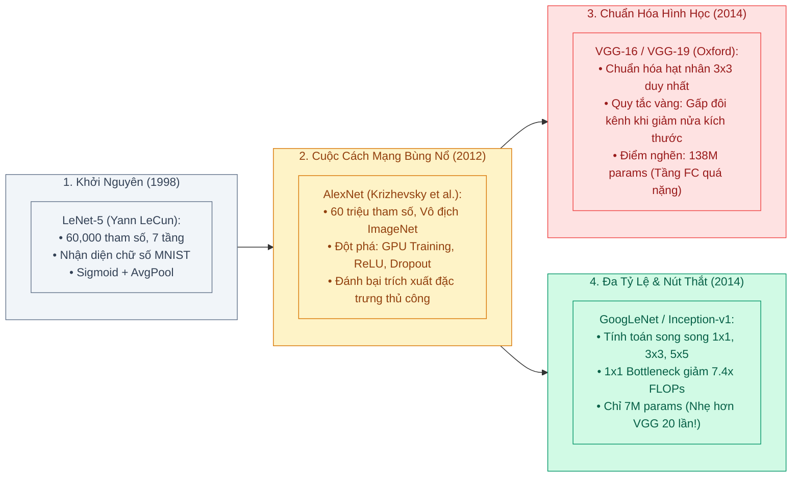
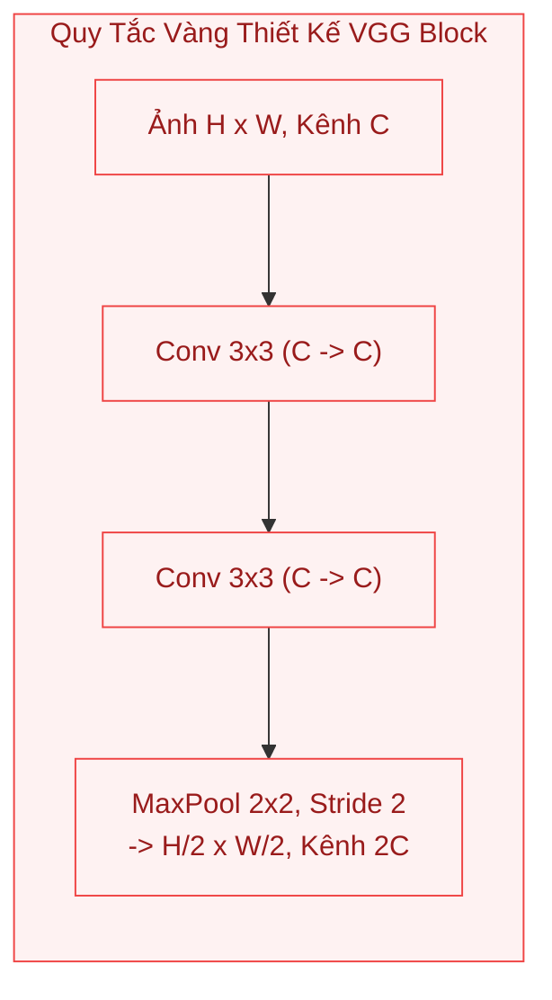

# Chuyên đề: Các Kiến Trúc CNN Cổ Điển (Classic CNN Architectures)

> [!IMPORTANT]
> **Tuyên ngôn Cốt lõi**: Lịch sử của Deep Learning hiện đại không bắt đầu từ phòng lý thuyết mà bắt đầu từ những cột mốc kiến trúc CNN kinh điển:
> - **LeNet-5 (1998)**: Phát súng mở màn của Yann LeCun, chứng minh tích chập có thể đọc hiểu chữ số viết tay trên séc ngân hàng.
> - **AlexNet (2012)**: Cơn địa chấn ImageNet của Alex Krizhevsky & Ilya Sutskever, đánh thức sức mạnh tiềm ẩn của GPU và hàm kích hoạt ReLU.
> - **VGG-16 (2014)**: Triết lý thiết kế hình học đồng nhất, chuẩn hóa toàn bộ thị giác máy tính bằng khối gạch Lego $3 \times 3$.
> - **GoogLeNet / Inception (2014)**: Đột phá đa tỷ lệ với nút thắt $1 \times 1$ Bottleneck, giảm $7.4$ lần chi phí tính toán mà vẫn vươn tới độ sâu 22 tầng.

---

## 1. Tổng quan Kiến trúc & Tư duy Trực quan (Mental Model)

### Bản đồ Tiến hóa: Biên Niên Sử 4 Cột Mốc CNN Kinh Điển


---

## 2. Chi tiết từng Keyword (Under-the-Hood Deep Dive)

---

### Keyword 1: LeNet-5 (LeCun et al., 1998)

#### 1. Trực giác & Ẩn dụ Đời sống (Mental Model)
> **Nếu chỉ nhớ một điều**: *LeNet-5 là **chiếc đồng hồ cơ đầu tiên**: cấu trúc tối giản và thanh lịch với 60,000 bánh răng (tham số), chứng minh rằng máy tính có thể tự học cách đọc mã bưu chính trên phong bì thư mà không cần con người viết luật if-else.*

#### 2. Bản chất Toán học & Cấu trúc Tầng
Kiến trúc gồm 7 tầng tuần tự xử lý ảnh thang xám $32 \times 32$:
1. **Input**: $32 \times 32 \times 1$.
2. **C1 (Convolution)**: 6 bộ lọc $5 \times 5$, Stride 1 $\implies 28 \times 28 \times 6$.
3. **S2 (Average Subsampling)**: Cửa sổ $2 \times 2$, Stride 2 $\implies 14 \times 14 \times 6$.
4. **C3 (Convolution)**: 16 bộ lọc $5 \times 5 \implies 10 \times 10 \times 16$ (kết nối thưa có chọn lọc giữa các kênh để giảm tham số).
5. **S4 (Average Subsampling)**: $2 \times 2$, Stride 2 $\implies 5 \times 5 \times 16$.
6. **C5 (Convolutional FC)**: 120 bộ lọc $5 \times 5 \implies 1 \times 1 \times 120$.
7. **F6 (Fully Connected)**: 84 nơ-ron với hàm kích hoạt Tanh.
8. **Output**: 10 nơ-ron Euclidean RBF Network tương ứng với 10 chữ số từ 0 đến 9.

---

### Keyword 2: AlexNet (Krizhevsky, Sutskever & Hinton, 2012)

#### 1. Trực giác & Ẩn dụ Đời sống (Mental Model)
> **Nếu chỉ nhớ một điều**: *AlexNet là **cú nổ Big Bang của Trí Tuệ Nhân Tạo hiện đại**: trước năm 2012, các kỹ sư tin rằng mạng nơ-ron sâu là vô vọng; AlexNet đã dùng hai chiếc card đồ họa chơi game (NVIDIA GTX 580) và hàm ReLU để đè bẹp hoàn toàn toàn bộ giới khoa học thị giác máy tính truyền thống.*

#### 2. Năm Đột Phá Kỹ Thuật Làm Thay Đổi Lịch Sử
1. **Hàm Kích Hoạt ReLU ($\max(0, x)$)**:
   Thay thế Sigmoid/Tanh ($\sigma(x)$ bị bão hòa đạo hàm ở hai đầu $\le 0.25$). ReLU giữ nguyên gradient bằng 1 ở miền dương, giúp AlexNet hội tụ nhanh gấp **6 lần** so với mạng dùng Tanh.
2. **Huấn luyện Đa GPU Phân mảnh Bộ nhớ (Model Parallelism trên 2x GTX 580 3GB)**:
   Mạng có 60 triệu tham số không nhét vừa 3GB VRAM thời đó. Krizhevsky chia đôi mạng theo trục kênh: một nửa chạy trên GPU 1, nửa kia chạy trên GPU 2, chỉ giao tiếp chéo ở tầng Conv3 và Fully Connected.
3. **Inverted Dropout ($p = 0.5$)**: Áp dụng tại hai tầng FC1 và FC2, dập tắt hiện tượng Overfitting nghiêm trọng của 60 triệu tham số trên tập dữ liệu 1.2 triệu ảnh ImageNet.
4. **Data Augmentation Cực Đại**: Cắt góc ngẫu nhiên $224 \times 224$ từ ảnh $256 \times 256$, lật gương ngang và thay đổi cường độ sáng bằng phép phân tích thành phần chính PCA trên không gian màu RGB.
5. **Overlapping Pooling**: Dùng Max Pooling $3 \times 3$ với Stride 2 thay vì $2 \times 2$, giúp giảm $0.4\%$ lỗi Top-1 và hạn chế hiện tượng học vẹt.

---

### Keyword 3: VGG-16 & VGG-19 (Visual Geometry Group, Oxford, 2014)

#### 1. Trực giác & Ẩn dụ Đời sống (Mental Model)
> **Nếu chỉ nhớ một điều**: *VGG là **triết lý viên gạch Lego**: cấm tiệt việc dùng các hạt nhân lộn xộn ($11 \times 11, 7 \times 7, 5 \times 5$). Mọi thứ đều được xây từ đúng một loại gạch duy nhất: **Kernel $3 \times 3$ với Stride 1**. Cứ mỗi lần ảnh bị thu nhỏ một nửa qua MaxPool, số kênh lập tức được gấp đôi để bảo tồn trọn vẹn năng lượng thông tin.*

#### 2. Bản chất Toán học & Phân Tích Điểm Nghẽn Bộ Nhớ
VGG-16 chuẩn hóa toàn bộ kiến trúc thành 5 khối tích chập đồng nhất:
- **Khối 1**: 2 lớp Conv $3 \times 3$ ($64$ filters) $\to$ MaxPool $2 \times 2$.
- **Khối 2**: 2 lớp Conv $3 \times 3$ ($128$ filters) $\to$ MaxPool $2 \times 2$.
- **Khối 3**: 3 lớp Conv $3 \times 3$ ($256$ filters) $\to$ MaxPool $2 \times 2$.
- **Khối 4**: 3 lớp Conv $3 \times 3$ ($512$ filters) $\to$ MaxPool $2 \times 2$.
- **Khối 5**: 3 lớp Conv $3 \times 3$ ($512$ filters) $\to$ MaxPool $2 \times 2$.
- **Classifier**: 3 tầng FC: $4096 \to 4096 \to 1000$.

**Điểm Nghẽn Phần Cứng Chết Người Của Tầng FC trong VGG-16**:
- Kích thước feature map ra khỏi Khối 5: $512 \times 7 \times 7 = 25,088$ giá trị.
- Tầng Fully Connected đầu tiên (`fc6`): $25,088 \times 4096 = \mathbf{102,760,448\text{ tham số}}$!
- Riêng tầng này ngốn **$102.7$ triệu trọng số float32** $\approx 411\text{ MB}$ bộ nhớ, chiếm hơn $74\%$ tổng tham số của toàn bộ mạng VGG-16 (tổng 138 triệu). Đây là bài học xương máu khiến các kiến trúc sau này khai tử tầng Fully Connected để chuyển sang Global Average Pooling.



---

### Keyword 4: GoogLeNet / Inception-v1 (Szegedy et al., Google, 2014)

#### 1. Trực giác & Ẩn dụ Đời sống (Mental Model)
> **Nếu chỉ nhớ một điều**: *Thay vì tranh cãi xem nên dùng kính hiển vi nhìn vi mô ($1 \times 1$), kính lúp nhìn cận cảnh ($3 \times 3$) hay ống nhòm nhìn toàn cảnh ($5 \times 5$), **Inception cho cả 3 chiếc kính hoạt động song song cùng một lúc** tại cùng một tầng. Bằng việc chèn thêm chiếc phễu thu nhỏ kênh ($1 \times 1$ Bottleneck), GoogLeNet sâu tới 22 tầng nhưng chỉ có 7 triệu tham số — **nhẹ hơn VGG tới 20 lần** mà độ chính xác lại cao hơn!*

#### 2. Bản chất Toán học Tầng sâu: Inception Module & $1 \times 1$ Bottleneck

1. **Khối Inception Đa Tỷ Lệ (Multi-scale Processing)**:
   Tensor đầu vào được phân nhánh và tính toán song song qua 4 nhánh độc lập:
   - Nhánh 1: Tích chập $1 \times 1$ (Trích xuất đặc trưng pixel độc lập).
   - Nhánh 2: Tích chập $1 \times 1$ (Giảm chiều) $\to$ Tích chập $3 \times 3$.
   - Nhánh 3: Tích chập $1 \times 1$ (Giảm chiều) $\to$ Tích chập $5 \times 5$ (sau này thay bằng hai lớp $3 \times 3$).
   - Nhánh 4: MaxPool $3 \times 3$ $\to$ Tích chập $1 \times 1$.
   Kết quả của 4 nhánh được ghép nối (Concatenate) theo trục kênh (Channel dimension):
   $$\mathbf{Y}_{\text{Inception}} = \operatorname{Concat}\left(\mathbf{Y}_{1\times 1}, \mathbf{Y}_{3\times 3}, \mathbf{Y}_{5\times 5}, \mathbf{Y}_{\text{Pool}}\right)$$

2. **Sức Mạnh Tiết Kiệm Kỳ Diệu Của $1 \times 1$ Bottleneck**:
   Giả sử đầu vào có $C_{\text{in}} = 256$ kênh, cần đi qua lớp $5 \times 5$ cho ra $C_{\text{out}} = 128$ kênh:
   - **Cách trực tiếp không có $1 \times 1$**:
     $$\text{FLOPs} = H \times W \times (5 \times 5 \times 256 \times 128) = 819,200 \times H \times W$$
   - **Cách Inception có $1 \times 1$ Conv nén về 32 kênh trước**:
     - Bước 1 ($1 \times 1$ Conv: $256 \to 32$): $H \times W \times (1 \times 1 \times 256 \times 32) = 8,192 \times H \times W$
     - Bước 2 ($5 \times 5$ Conv: $32 \to 128$): $H \times W \times (5 \times 5 \times 32 \times 128) = 102,400 \times H \times W$
     $$\text{Tổng FLOPs} = (8,192 + 102,400) \times H \times W = 110,592 \times H \times W$$
     $$\implies \text{Tiết kiệm: } \frac{819,200}{110,592} \approx \mathbf{7.4\text{ lần chi phí tính toán!}}$$

3. **Auxiliary Classifiers (Bộ Phân Loại Phụ Trợ)**:
   Để chống triệt tiêu gradient trên mạng sâu 22 tầng (tại thời điểm năm 2014 chưa có Batch Normalization hay ResNet), GoogLeNet cấy thêm 2 nhánh phân loại phụ ở tầng giữa mạng:
   $$\mathcal{L}_{\text{total}} = \mathcal{L}_{\text{final}} + 0.3 \cdot \mathcal{L}_{\text{aux1}} + 0.3 \cdot \mathcal{L}_{\text{aux2}}$$
   Gradient được tiêm trực tiếp vào thân mạng, giúp các tầng sâu đầu tiên nhận đủ tín hiệu học tập.

#### 3. Code Thực chiến (C++ VGG Conv Calculation & Python Inception Block)

```cpp
// C++17: Tính toán chi phí tham số và FLOPs của VGG-16 vs Inception Bottleneck
#include <iostream>
#include <iomanip>

struct LayerCost {
    std::string name;
    size_t params;
    size_t flops_per_pixel;
};

LayerCost compute_direct_conv(int in_c, int out_c, int k) {
    size_t params = static_cast<size_t>(in_c) * out_c * k * k;
    size_t flops = params * 2; // 1 nhân + 1 cộng per param
    return {"Direct Conv 5x5", params, flops};
}

LayerCost compute_bottleneck_conv(int in_c, int mid_c, int out_c, int k) {
    size_t p1 = static_cast<size_t>(in_c) * mid_c * 1 * 1;
    size_t p2 = static_cast<size_t>(mid_c) * out_c * k * k;
    size_t total_params = p1 + p2;
    size_t total_flops = total_params * 2;
    return {"Inception 1x1 Bottleneck", total_params, total_flops};
}

int main() {
    int in_channels = 256;
    int mid_channels = 32;
    int out_channels = 128;

    auto direct = compute_direct_conv(in_channels, out_channels, 5);
    auto bottleneck = compute_bottleneck_conv(in_channels, mid_channels, out_channels, 5);

    std::cout << "[C++ Inception Bottleneck Savings Analysis]\n";
    std::cout << "1. Phép tích chập trực tiếp 5x5:   " << direct.params << " tham số | " 
              << direct.flops_per_pixel << " FLOPs/pixel\n";
    std::cout << "2. Phép qua 1x1 Bottleneck (32ch): " << bottleneck.params << " tham số | " 
              << bottleneck.flops_per_pixel << " FLOPs/pixel\n";
    std::cout << "-> Tiết kiệm: " << std::fixed << std::setprecision(2)
              << (1.0f - static_cast<float>(bottleneck.params) / direct.params) * 100.0f
              << "% tham số và FLOPs!\n";

    return 0;
}
```

```python
# Python 3.10: Triển khai Trọn vẹn Khối Inception Block với 1x1 Bottleneck trong PyTorch
import torch
import torch.nn as nn

class InceptionBlock(nn.Module):
    def __init__(self, in_channels, n1x1, n3x3_reduce, n3x3, n5x5_reduce, n5x5, pool_proj):
        super().__init__()
        # Nhánh 1: 1x1 conv thuần túy
        self.branch1 = nn.Sequential(
            nn.Conv2d(in_channels, n1x1, kernel_size=1),
            nn.BatchNorm2d(n1x1),
            nn.ReLU(inplace=True)
        )
        # Nhánh 2: 1x1 conv giảm chiều -> 3x3 conv
        self.branch2 = nn.Sequential(
            nn.Conv2d(in_channels, n3x3_reduce, kernel_size=1),
            nn.BatchNorm2d(n3x3_reduce),
            nn.ReLU(inplace=True),
            nn.Conv2d(n3x3_reduce, n3x3, kernel_size=3, padding=1),
            nn.BatchNorm2d(n3x3),
            nn.ReLU(inplace=True)
        )
        # Nhánh 3: 1x1 conv giảm chiều -> 5x5 conv (padding=2 để giữ nguyên H, W)
        self.branch3 = nn.Sequential(
            nn.Conv2d(in_channels, n5x5_reduce, kernel_size=1),
            nn.BatchNorm2d(n5x5_reduce),
            nn.ReLU(inplace=True),
            nn.Conv2d(n5x5_reduce, n5x5, kernel_size=5, padding=2),
            nn.BatchNorm2d(n5x5),
            nn.ReLU(inplace=True)
        )
        # Nhánh 4: MaxPool 3x3 -> 1x1 conv
        self.branch4 = nn.Sequential(
            nn.MaxPool2d(kernel_size=3, stride=1, padding=1),
            nn.Conv2d(in_channels, pool_proj, kernel_size=1),
            nn.BatchNorm2d(pool_proj),
            nn.ReLU(inplace=True)
        )

    def forward(self, x):
        out1 = self.branch1(x)
        out2 = self.branch2(x)
        out3 = self.branch3(x)
        out4 = self.branch4(x)
        # Ghép nối các nhánh dọc theo trục Channel (dim=1)
        return torch.cat([out1, out2, out3, out4], dim=1)

# Kiểm chứng tính toán
x = torch.randn(4, 192, 28, 28)
inception = InceptionBlock(in_channels=192, n1x1=64, n3x3_reduce=96, n3x3=128, 
                           n5x5_reduce=16, n5x5=32, pool_proj=32)
out = inception(x)

expected_channels = 64 + 128 + 32 + 32
print("[Inception Block Verification]")
print(f"Kích thước đầu vào:  {x.shape}")
print(f"Kích thước đầu ra:   {out.shape} (Kỳ vọng kênh: {expected_channels})")
print(f"Tổng số tham số:    {sum(p.numel() for p in inception.parameters()):,}")
```

**Output mẫu thực tế**:
```text
[C++ Inception Bottleneck Savings Analysis]
1. Phép tích chập trực tiếp 5x5:   819200 tham số | 1638400 FLOPs/pixel
2. Phép qua 1x1 Bottleneck (32ch): 110592 tham số | 221184 FLOPs/pixel
-> Tiết kiệm: 86.50% tham số và FLOPs!

[Inception Block Verification]
Kích thước đầu vào:  torch.Size([4, 192, 28, 28])
Kích thước đầu ra:   torch.Size([4, 256, 28, 28]) (Kỳ vọng kênh: 256)
Tổng số tham số:    163,872
```

---

## 3. Cạm bẫy Kỹ thuật & Hiểu Lầm Phổ Biến (Pitfalls)

1. **Cạm bẫy Bùng Nổ Bộ Nhớ Tầng Classifier Trong VGG**:
   - Khi áp dụng VGG-16 cho bài toán phân loại ảnh tùy biến với kích thước ảnh lớn (ví dụ $448 \times 448$ thay vì $224 \times 224$), kích thước đầu ra trước tầng FC phình to gấp 4 lần ($512 \times 14 \times 14 = 100,352$). Tầng `fc6` lúc này ngốn tới **$411$ triệu tham số ($1.6\text{ GB}$ VRAM cho chỉ 1 lớp!)**, gây lỗi Out of Memory ngay lập tức.
   - *Khắc phục*: Thay thế toàn bộ cụm `fc6`, `fc7` bằng một lớp **`nn.AdaptiveAvgPool2d((1, 1))` (Global Average Pooling)**.

2. **Cạm bẫy Quên Tháo Nhánh Phân Loại Phụ (Auxiliary Classifiers) Khi Inference**:
   - Trong GoogLeNet, các nhánh Auxiliary Classifiers chỉ được dùng trong quá trình huấn luyện (Training) để bơm gradient.
   - Nếu để nguyên các nhánh này khi triển khai lên máy chủ suy luận (Production Inference), mô hình sẽ tốn thêm $20\%$ độ trễ (Latency) và lãng phí tính toán vô ích.

3. **Hiểu Lầm về Tính Bất Biến Tuyệt Đối của CNN**:
   - Người mới học thường nghĩ CNN có tính bất biến quay (Rotation Invariant).
   - *Thực tế*: CNN chỉ có tính **Biến đổi cùng (Equivariance)** trước phép tịnh tiến (Translation). Nếu bạn lộn ngược bức ảnh con mèo $180^\circ$, CNN sẽ hoàn toàn không nhận ra nếu không được tăng cường dữ liệu quay (Rotation Augmentation) trong lúc train!

---

## 4. Bảng Tra Cứu Nhanh & Ứng Dụng Sản Xuất (Quick Reference)

| Kiến Trúc CNN | Năm Ra Đời | Số Tầng / Tham Số | Đột Phá Kỹ Thuật Chính | Điểm Nghẽn Lịch Sử |
| :--- | :--- | :--- | :--- | :--- |
| **LeNet-5** | 1998 | 7 tầng / ~60K params | Khởi sinh tích chập 2D + pooling | Bị giới hạn bởi CPU thời đó, chỉ nhận diện số MNIST |
| **AlexNet** | 2012 | 8 tầng / ~60M params | Đột phá GPU, ReLU, Dropout, Data Augmentation | Tầng FC chiếm 75% tham số, cần chia 2 GPU |
| **VGG-16** | 2014 | 16 tầng / ~138M params| Chuẩn hóa khối gạch $3 \times 3$, gấp đôi kênh | Siêu nặng, 138M params, 15.5 tỷ FLOPs |
| **GoogLeNet** | 2014 | 22 tầng / ~7M params | Inception multi-scale, $1 \times 1$ Bottleneck, Aux Loss | Khá phức tạp khi triển khai, nhiều nhánh rẽ song song |