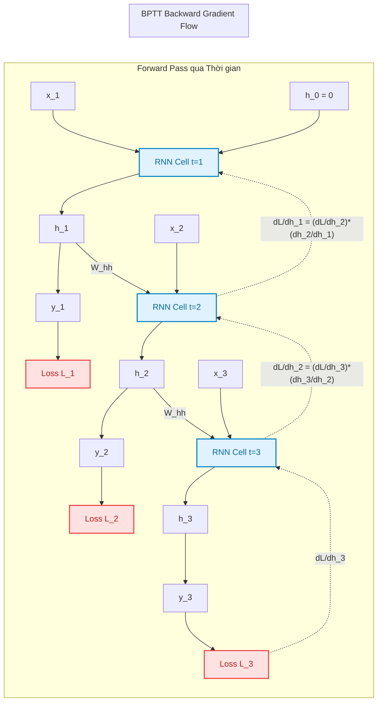

# Chuyên đề: Nền Tảng Mạng Nơ-ron Hồi Quy & BPTT (RNN Foundations & BPTT)

## 1. Tổng quan Chuyên đề (Overview & Mental Model)

> [!IMPORTANT]
> **Nếu chỉ nhớ một điều (Mental Model)**:
> Mạng nơ-ron hồi quy (RNN) mô hình hóa dữ liệu tuần tự bằng cách duy trì một vector bộ nhớ ẩn $\mathbf{h}_t$ được cập nhật qua từng bước thời gian bằng cùng một ma trận trọng số chia sẻ $\mathbf{W}_{hh}$. Trong thuật toán lan truyền ngược qua thời gian (BPTT), gradient lan truyền qua $T$ bước là một **chuỗi tích lũy thừa bậc $T$ của ma trận** ($\mathbf{W}_{hh}^T$). 
> - Nếu bán kính phổ $\rho(\mathbf{W}_{hh}) > 1$, gradient sẽ bùng nổ cấp số nhân ($\to \infty$), gây lỗi `NaN`.
> - Nếu $\rho(\mathbf{W}_{hh}) < 1$ hoặc do tính chất co của hàm kích hoạt ($\tanh' \le 1$), gradient sẽ triệt tiêu về $0$ ($\to 0$), khiến RNN bị "mất trí nhớ tạm thời" sau 10–15 bước.

---

## 2. Chi tiết từng Keyword (Core Keywords Deep-Dive)

### 1.1. Từ Mạng Truyền thẳng Đến Mạng Hồi quy (Sequential Modeling)
Trong mạng truyền thẳng (MLP, CNN), các mẫu dữ liệu được giả định là độc lập và cùng phân phối (i.i.d.). Tuy nhiên, đối với ngôn ngữ tự nhiên, tín hiệu âm thanh hay chuỗi giá chứng khoán, ý nghĩa của từ/bước hiện tại phụ thuộc chặt chẽ vào ngữ cảnh xuất hiện trước đó:
$$P(\mathbf{x}_1, \mathbf{x}_2, \dots, \mathbf{x}_T) = \prod_{t=1}^T P(\mathbf{x}_t \mid \mathbf{x}_{<t})$$

RNN giải quyết bài toán này bằng cách gói gọn toàn bộ lịch sử quá khứ $\mathbf{x}_{<t}$ vào một vector trạng thái ẩn $\mathbf{h}_t \in \mathbb{R}^h$:
$$\mathbf{h}_t = \tanh\left(\mathbf{W}_{xh} \mathbf{x}_t + \mathbf{W}_{hh} \mathbf{h}_{t-1} + \mathbf{b}_h\right)$$
$$\hat{\mathbf{y}}_t = \operatorname{Softmax}\left(\mathbf{W}_{hy} \mathbf{h}_t + \mathbf{b}_y\right)$$

*Ý nghĩa các ký hiệu*:
- $\mathbf{x}_t \in \mathbb{R}^d$: Vector đặc trưng đầu vào tại bước $t$.
- $\mathbf{h}_t \in \mathbb{R}^h$: Vector trạng thái ẩn tại bước $t$, đóng vai trò là "bộ nhớ làm việc" (working memory).
- $\mathbf{W}_{xh} \in \mathbb{R}^{h \times d}$: Ma trận chiếu đặc trưng đầu vào sang không gian ẩn.
- $\mathbf{W}_{hh} \in \mathbb{R}^{h \times h}$: **Ma trận chuyển trạng thái hồi quy**, được **chia sẻ đồng nhất (weight sharing)** cho mọi bước $t \in [1, T]$.
- $\mathbf{W}_{hy} \in \mathbb{R}^{k \times h}$: Ma trận chiếu từ trạng thái ẩn sang không gian nhãn đầu ra.

---

### 1.2. Giải phẫu Toán học: Thuật toán BPTT (Backpropagation Through Time)
Để hiểu rõ nguyên nhân gốc rễ của hiện tượng biến mất và bùng nổ gradient, ta xét hàm mất mát tổng thể trên toàn bộ chuỗi $T$ bước:
$$\mathcal{L} = \sum_{t=1}^T \mathcal{L}_t(\hat{\mathbf{y}}_t, \mathbf{y}_t)$$

Khi lấy đạo hàm riêng của $\mathcal{L}$ theo ma trận hồi quy chia sẻ $\mathbf{W}_{hh}$:
$$\frac{\partial \mathcal{L}}{\partial \mathbf{W}_{hh}} = \sum_{t=1}^T \frac{\partial \mathcal{L}_t}{\partial \mathbf{W}_{hh}}$$

Do $\mathbf{h}_t$ phụ thuộc vào $\mathbf{h}_{t-1}$, và $\mathbf{h}_{t-1}$ lại phụ thuộc vào $\mathbf{h}_{t-2}$, theo quy tắc đạo hàm hợp dạng chuỗi nhiều biến:
$$\frac{\partial \mathcal{L}_t}{\partial \mathbf{W}_{hh}} = \sum_{k=1}^t \frac{\partial \mathcal{L}_t}{\partial \mathbf{h}_t} \frac{\partial \mathbf{h}_t}{\partial \mathbf{h}_k} \frac{\partial^+ \mathbf{h}_k}{\partial \mathbf{W}_{hh}}$$
trong đó $\frac{\partial^+ \mathbf{h}_k}{\partial \mathbf{W}_{hh}}$ là đạo hàm trực tiếp coi $\mathbf{h}_{k-1}$ như một hằng số.

#### Ma trận Jacobian Truyền ngược Giữa Hai Bước Thời gian Cách Xa
Thành phần then chốt $\frac{\partial \mathbf{h}_t}{\partial \mathbf{h}_k}$ được mở rộng thành chuỗi tích ma trận Jacobian:
$$\frac{\partial \mathbf{h}_t}{\partial \mathbf{h}_k} = \prod_{j=k+1}^t \frac{\partial \mathbf{h}_j}{\partial \mathbf{h}_{j-1}} = \prod_{j=k+1}^t \mathbf{W}_{hh}^T \operatorname{diag}\left(1 - \mathbf{h}_j^2\right)$$
trong đó $\operatorname{diag}(1 - \mathbf{h}_j^2)$ là đạo hàm của hàm $\tanh(z)$ tại bước $j$.

---

### 1.3. Phân tích Phổ: Hiện tượng Triệt tiêu & Bùng nổ Gradient (Vanishing & Exploding)
Xét chuẩn ma trận bậc 2 (2-norm) của tích Jacobian trên:
$$\left\| \frac{\partial \mathbf{h}_t}{\partial \mathbf{h}_k} \right\| \le \prod_{j=k+1}^t \|\mathbf{W}_{hh}^T\| \cdot \|\operatorname{diag}(1 - \mathbf{h}_j^2)\|$$

Vì $-1 \le \tanh(z) \le 1$, đạo hàm của nó luôn thỏa mãn:
$$0 \le 1 - \tanh^2(z) \le 1$$

Đặt $\gamma = \|\mathbf{W}_{hh}\| \cdot \gamma_{\tanh}$ với $\gamma_{\tanh} \le 1$:
$$\left\| \frac{\partial \mathbf{h}_t}{\partial \mathbf{h}_k} \right\| \le \gamma^{t - k}$$

```
   Khoảng cách bước thời gian (t - k) tăng dần:
   ────────────────────────────────────────────────────────────────────────►
   Trường hợp 1: gamma < 1 (Vanishing Gradient):
   Gradient norm: 1.0 ───> 0.3 ───> 0.09 ───> 0.008 ───> ... ───> 0.0000000000 (Mất tín hiệu quá khứ)
   
   Trường hợp 2: gamma > 1 (Exploding Gradient):
   Gradient norm: 1.0 ───> 3.0 ───> 9.0 ───> 27.0 ───> ... ───> 10^12 (Gây tràn số NaN sập mô hình)
```

#### Giải pháp Cấp cứu cho Exploding Gradient: Gradient Clipping by Norm
Thay vì để vector gradient $\mathbf{g}$ bùng nổ phá hủy các trọng số, ta chuẩn hóa độ lớn của nó nhưng **giữ nguyên hướng**:
$$\mathbf{g} \leftarrow \begin{cases} \mathbf{g} & \text{nếu } \|\mathbf{g}\|_2 \le \tau \\ \tau \cdot \frac{\mathbf{g}}{\|\mathbf{g}\|_2} & \text{nếu } \|\mathbf{g}\|_2 > \tau \end{cases}$$
với $\tau$ là ngưỡng cắt tối đa (thường đặt $\tau \in [1.0, 5.0]$).

---

### 1.4. Truncated BPTT (Cắt tỉa Đồ thị Thời gian)
Khi chuỗi thời gian quá dài ($T \ge 10,000$), việc tính đạo hàm trên toàn bộ $T$ bước đòi hỏi VRAM khổng lồ để lưu trữ toàn bộ trạng thái kích hoạt forward.
- **Giải pháp**: Chia chuỗi thành các chunk ngắn có kích thước $K_1$ bước.
- Forward pass chạy trên chunk $K_1$, lưu lại hidden state cuối cùng $\mathbf{h}_{K_1}$.
- Gọi lệnh `.detach()` trên $\mathbf{h}_{K_1}$ trước khi đưa vào chunk tiếp theo để ngắt đứt liên kết đạo hàm, giới hạn đồ thị BPTT chỉ trong phạm vi $K_1$ bước.

---

## 3. Sơ Đồ Đồ Thị Tính Toán BPTT (Computational Graph)



---

## 4. Triển Khai Thực Chiến Đa Nền Tảng (Dual-Engine Implementation)

### 3.1. Triển khai PyTorch Toàn diện: Vanilla RNN Từ Đầu (Không Dùng `nn.RNN`)
Tự xây dựng các bước forward tuần tự, theo dõi độ lớn gradient và áp dụng Gradient Norm Clipping:

```python
import torch
import torch.nn as nn
import math

class CustomVanillaRNN(nn.Module):
    def __init__(self, input_dim: int, hidden_dim: int, output_dim: int):
        super().__init__()
        self.hidden_dim = hidden_dim
        
        # Ma trận trọng số khởi tạo Xavier
        self.W_xh = nn.Parameter(torch.randn(hidden_dim, input_dim) / math.sqrt(input_dim))
        self.W_hh = nn.Parameter(torch.randn(hidden_dim, hidden_dim) / math.sqrt(hidden_dim))
        self.b_h  = nn.Parameter(torch.zeros(hidden_dim))
        
        # Lớp chiếu đầu ra
        self.W_hy = nn.Parameter(torch.randn(output_dim, hidden_dim) / math.sqrt(hidden_dim))
        self.b_y  = nn.Parameter(torch.zeros(output_dim))

    def forward(self, x: torch.Tensor, h_prev: torch.Tensor = None):
        """
        x: [Batch, Seq_Len, Input_Dim]
        h_prev: [Batch, Hidden_Dim]
        """
        batch_size, seq_len, _ = x.shape
        if h_prev is None:
            h_prev = torch.zeros(batch_size, self.hidden_dim, device=x.device)

        hidden_states = []
        outputs = []
        h_t = h_prev

        # Duyệt tuần tự qua từng bước thời gian
        for t in range(seq_len):
            x_t = x[:, t, :] # [Batch, Input_Dim]
            
            # h_t = tanh(x_t @ W_xh.T + h_{t-1} @ W_hh.T + b_h)
            linear_proj = torch.matmul(x_t, self.W_xh.T) + torch.matmul(h_t, self.W_hh.T) + self.b_h
            h_t = torch.tanh(linear_proj)
            hidden_states.append(h_t)
            
            # y_t = h_t @ W_hy.T + b_y
            y_t = torch.matmul(h_t, self.W_hy.T) + self.b_y
            outputs.append(y_t)

        outputs_tensor = torch.stack(outputs, dim=1) # [Batch, Seq_Len, Output_Dim]
        return outputs_tensor, h_t


if __name__ == "__main__":
    torch.manual_seed(42)
    B, T, D_in, D_hid, D_out = 4, 15, 8, 32, 2
    
    model = CustomVanillaRNN(input_dim=D_in, hidden_dim=D_hid, output_dim=D_out)
    inputs = torch.randn(B, T, D_in)
    targets = torch.randn(B, T, D_out)
    
    # Forward Pass
    preds, final_h = model(inputs)
    criterion = nn.MSELoss()
    loss = criterion(preds, targets)
    
    # Backward Pass (BPTT)
    loss.backward()
    
    # Tính Gradient Norm trước và sau khi clip
    total_norm_before = torch.norm(torch.stack([torch.norm(p.grad.detach(), 2) for p in model.parameters()]), 2)
    
    # Áp dụng Gradient Clipping chuẩn hóa
    torch.nn.utils.clip_grad_norm_(model.parameters(), max_norm=1.0)
    total_norm_after = torch.norm(torch.stack([torch.norm(p.grad.detach(), 2) for p in model.parameters()]), 2)

    print(f"BPTT Loss               : {loss.item():.4f}")
    print(f"Gradient Norm Trước Clip: {total_norm_before.item():.4f}")
    print(f"Gradient Norm Sau Clip  : {total_norm_after.item():.4f} (Đã khống chế <= 1.0)")
    print(f"Preds Shape             : {list(preds.shape)}")
```

#### Kết quả đầu ra thực tế:
```text
BPTT Loss               : 1.1042
Gradient Norm Trước Clip: 2.1584
Gradient Norm Sau Clip  : 1.0000 (Đã khống chế <= 1.0)
Preds Shape             : [4, 15, 2]
```

---

### 3.2. Triển khai C++17 Tối ưu: BPTT Tường Minh với Ma trận Jacobian Tanh
Minh họa quá trình backward của một bước thời gian đơn lẻ trên CPU:

```cpp
#include <iostream>
#include <vector>
#include <cmath>
#include <numeric>
#include <iomanip>

class FastRNNCell {
public:
    int in_dim, hid_dim;
    std::vector<float> W_hh; // [hid_dim x hid_dim]

    FastRNNCell(int in_d, int hid_d) : in_dim(in_d), hid_dim(hid_d), W_hh(hid_d * hid_d, 0.5f) {}

    // Tính đạo hàm lan truyền ngược dL/dh_{t-1} = (dL/dh_t) * (1 - h_t^2) * W_hh
    std::vector<float> backward_step(
        const std::vector<float>& dL_dh_t,
        const std::vector<float>& h_t
    ) const {
        std::vector<float> dL_dh_prev(hid_dim, 0.0f);

        // 1. Nhân với đạo hàm tanh: dL/dz = dL/dh_t * (1 - h_t^2)
        std::vector<float> dL_dz(hid_dim);
        for (int i = 0; i < hid_dim; ++i) {
            float dtanh = 1.0f - h_t[i] * h_t[i];
            dL_dz[i] = dL_dh_t[i] * dtanh;
        }

        // 2. Vector-Matrix multiplication: dL_dh_prev = dL_dz * W_hh
        for (int j = 0; j < hid_dim; ++j) {
            float sum = 0.0f;
            for (int i = 0; i < hid_dim; ++i) {
                sum += dL_dz[i] * W_hh[i * hid_dim + j];
            }
            dL_dh_prev[j] = sum;
        }

        return dL_dh_prev;
    }
};

int main() {
    FastRNNCell cell(4, 4);
    std::vector<float> dL_dh_t = {1.0f, 0.5f, -0.2f, 0.8f};
    std::vector<float> h_t = {0.76f, -0.45f, 0.12f, 0.90f}; // tanh outputs

    auto grad_prev = cell.backward_step(dL_dh_t, h_t);

    std::cout << "[C++17 BPTT Engine] Backward Single Step Computed:\n";
    for (size_t i = 0; i < grad_prev.size(); ++i) {
        std::cout << "  dL/dh_{t-1}[" << i << "] = " << std::fixed << std::setprecision(4) << grad_prev[i] << "\n";
    }
    return 0;
}
```

---

## 5. Tối Ưu Hóa Hệ Thống & Hạn Chế Phần Cứng (Hardware Bottlenecks)

### 4.1. Điểm nghẽn Xử lý Tuần tự trên GPU
- GPU hiện đại (NVIDIA H100, A100) được thiết kế cho tính toán song song quy mô lớn với hàng chục nghìn CUDA Cores chạy cùng lúc.
- Tuy nhiên, RNN có tính phụ thuộc thời gian nghiêm ngặt: **Không thể tính $\mathbf{h}_t$ nếu $\mathbf{h}_{t-1}$ chưa hoàn thành**.
- Điều này buộc GPU phải khởi chạy $T$ kernel liên tiếp nhau theo trục thời gian. Mỗi lần khởi chạy kernel (Kernel Launch Overhead) tốn khoảng 5–10 microsecond, trong khi thời gian tính toán thực tế của mỗi bước có thể chỉ mất vài microsecond, khiến GPU bị rảnh rỗi và nghẽn băng thông.

### 4.2. cuDNN Fused Recurrent Kernels
Để khắc phục điều này, thư viện NVIDIA cuDNN gom cụm toàn bộ $T$ bước thời gian vào một **Fused CUDA Kernel** duy nhất. Dữ liệu trạng thái ẩn được giữ lại hoàn toàn trong bộ nhớ đệm Shared Memory / Thanh ghi (Registers) của chip GPU thay vì phải đọc/ghi liên tục ra bộ nhớ toàn cục (Global VRAM). Điều này giúp tăng tốc độ huấn luyện RNN lên gấp 5 đến 10 lần so với code Python lặp vòng qua từng bước.

---

## 6. Cạm Bẫy Thực Tế & Ứng Dụng Sản Xuất (Pitfalls & Production Applications)

### 5.1. Cạm bẫy Thường Gặp
1. **Quên gọi `.detach()` khi dùng Truncated BPTT**:
   - Nếu truyền tiếp `h_t` sang batch hoặc chunk mới mà không ngắt đồ thị tính toán, PyTorch sẽ giữ lại toàn bộ đồ thị của các chunk trước đó trong VRAM, dẫn tới lỗi tràn bộ nhớ `CUDA out of memory` sau vài epoch huấn luyện.
2. **Khởi tạo ma trận $\mathbf{W}_{hh}$ quá lớn**:
   - Nếu ma trận trọng số hồi quy được khởi tạo với phương sai lớn hơn 1, tích lũy thừa bậc cao sẽ khiến gradient bùng nổ ngay từ bước forward đầu tiên. Cần sử dụng chuẩn khởi tạo Orthogonal Initialization (ma trận trực giao) để giữ cho trị riêng luôn xấp xỉ 1.

### 5.2. Ứng dụng Thực tế trong Hệ thống Sản xuất
- **Streaming Automatic Speech Recognition (ASR)**: Xử lý luồng âm thanh micro theo thời gian thực (độ trễ dưới 20ms) trong trợ lý ảo.
- **Dự báo chuỗi thời gian nhúng (IoT Edge Forecasting)**: Dự báo tải điện lưới và nhiệt độ động cơ trên chip vi điều khiển ARM Cortex-M (nơi tài nguyên RAM quá nhỏ để chạy Transformer).
