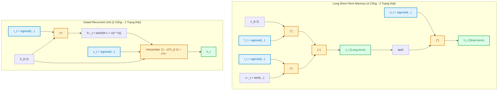

# Chuyên đề: Các Kiến Trúc Đóng Cổng – LSTM & GRU (Gated Architectures: LSTM & GRU)

## 1. Tổng quan Chuyên đề (Overview & Mental Model)

> [!IMPORTANT]
> **Nếu chỉ nhớ một điều (Mental Model)**:
> Để giải quyết triệt để sự cố mất trí nhớ của RNN, **LSTM** tách đôi dòng thông tin thành: **Bộ nhớ Dài hạn ($\mathbf{c}_t$ - Cell State)** và **Bộ nhớ Làm việc Ngắn hạn ($\mathbf{h}_t$ - Hidden State)**. Bằng cách cập nhật ô nhớ dài hạn thông qua phép **cộng tuyến tính có cổng điều biến**:
> $$\mathbf{c}_t = \mathbf{f}_t \odot \mathbf{c}_{t-1} + \mathbf{i}_t \odot \tilde{\mathbf{c}}_t$$
> gradient lan truyền ngược có thể trượt tự do trên "băng chuyền sai số hằng số" (Constant Error Carousel) mà không bị nhân qua chuỗi ma trận trọng số. **GRU** tinh giản LSTM bằng cách gộp $\mathbf{c}_t$ vào $\mathbf{h}_t$ và rút gọn xuống còn 2 cổng, giúp tiết kiệm 25% tham số và tăng tốc độ huấn luyện 20–30%.

---

## 2. Chi tiết từng Keyword (Core Keywords Deep-Dive)

### 1.1. Băng Chuyền Sai Số Hằng Số (Constant Error Carousel - CEC)
Trong Vanilla RNN, trạng thái ẩn $\mathbf{h}_t = \tanh(\mathbf{W}_{hh} \mathbf{h}_{t-1} + \dots)$ chịu sự biến đổi phi tuyến liên tục ở mỗi bước, khiến gradient sau $T$ bước tỷ lệ với $\mathbf{W}_{hh}^T$.

Hochreiter & Schmidhuber (1997) thiết kế **Cell State ($\mathbf{c}_t$)** đóng vai trò như một đường băng chuyền cao tốc chạy xuyên suốt toàn bộ chuỗi thời gian:
- Thông tin chỉ được thêm vào bằng phép **cộng** ($+$).
- Thông tin cũ chỉ bị loại bỏ bằng phép **nhân từng phần tử** ($\odot$) với vector cổng quên $\mathbf{f}_t \in [0, 1]^h$.

```
     Cell State Highway:
     c_{t-1} ───────( * f_t )────────( + i_t * c_tilde )────────> c_t
                         ▲                       ▲
                         │                       │
     Gates Control:    f_t                     i_t
                         │                       │
     Inputs:       [h_{t-1}, x_t]          [h_{t-1}, x_t]
```

#### Đạo hàm giải phóng của Cell State
$$\frac{\partial \mathbf{c}_t}{\partial \mathbf{c}_{t-1}} = \operatorname{diag}(\mathbf{f}_t)$$
Xét chuỗi lan truyền ngược từ bước thời gian $T$ về bước 1:
$$\frac{\partial \mathbf{c}_T}{\partial \mathbf{c}_1} = \prod_{t=2}^T \operatorname{diag}(\mathbf{f}_t)$$
- Khi mạng học cách duy trì một sự kiện quan trọng trong quá khứ, nó chỉ cần giữ $\mathbf{f}_t \approx \mathbf{1}$.
- Khi đó $\prod_{t=2}^T \operatorname{diag}(\mathbf{f}_t) \approx \mathbf{I}$, gradient được bảo toàn $100\%$ cường độ khi truyền ngược qua hàng nghìn bước thời gian!

> [!TIP]
> **Kỹ thuật Khởi tạo Bias Cổng Quên (Jozefowicz et al., 2015)**:
> Mặc định trong PyTorch và TensorFlow, các bias vector đều khởi tạo bằng 0. Khi $\mathbf{b}_f = 0$, $\sigma(0) = 0.5$, nghĩa là tại mỗi bước thời gian ô nhớ bị xóa đi một nửa! Để mạng có trí nhớ dài hạn mặc định ngay từ epoch đầu tiên, luôn thiết lập bias của cổng quên $\mathbf{b}_f = +1.0$ hoặc $+2.0$ (khiến $\sigma(\mathbf{b}_f) \approx 0.73 - 0.88$).

---

### 1.2. Bộ Sáu Phương Trình Chuẩn của LSTM (Hochreiter & Gers)
Tại mỗi bước thời gian $t$, với đầu vào $\mathbf{x}_t \in \mathbb{R}^d$, trạng thái ẩn trước $\mathbf{h}_{t-1} \in \mathbb{R}^h$, và ô nhớ trước $\mathbf{c}_{t-1} \in \mathbb{R}^h$:

$$\begin{aligned}
\mathbf{f}_t &= \sigma\left(\mathbf{W}_f \mathbf{x}_t + \mathbf{U}_f \mathbf{h}_{t-1} + \mathbf{b}_f\right) && \text{(Cổng quên: Xóa bao nhiêu \% quá khứ?)} \\
\mathbf{i}_t &= \sigma\left(\mathbf{W}_i \mathbf{x}_t + \mathbf{U}_i \mathbf{h}_{t-1} + \mathbf{b}_i\right) && \text{(Cổng nạp: Cho bao nhiêu \% tin mới vào?)} \\
\tilde{\mathbf{c}}_t &= \tanh\left(\mathbf{W}_c \mathbf{x}_t + \mathbf{U}_c \mathbf{h}_{t-1} + \mathbf{b}_c\right) && \text{(Ứng viên thông tin mới sinh ra từ } \mathbf{x}_t) \\
\mathbf{c}_t &= \mathbf{f}_t \odot \mathbf{c}_{t-1} + \mathbf{i}_t \odot \tilde{\mathbf{c}}_t && \text{(Cập nhật ô nhớ dài hạn)} \\
\mathbf{o}_t &= \sigma\left(\mathbf{W}_o \mathbf{x}_t + \mathbf{U}_o \mathbf{h}_{t-1} + \mathbf{b}_o\right) && \text{(Cổng xuất: Rò rỉ bao nhiêu \% ra ngoài?)} \\
\mathbf{h}_t &= \mathbf{o}_t \odot \tanh(\mathbf{c}_t) && \text{(Trạng thái ẩn làm việc ngắn hạn)}
\end{aligned}$$

---

### 1.3. GRU (Gated Recurrent Unit - Cho et al. 2014)
GRU là một thiết kế tối giản thông minh nhằm loại bỏ sự dư thừa của LSTM:
1. **Bỏ Cell State ($\mathbf{c}_t$)**: Chỉ dùng duy nhất một vector trạng thái ẩn $\mathbf{h}_t$.
2. **Gộp Cổng Quên và Cổng Nạp thành Cổng Cập nhật ($\mathbf{z}_t$)**: Tạo mối quan hệ bù trừ trực tiếp: Nếu quên $(1 - \mathbf{z}_t)$ thông tin cũ thì sẽ nạp đúng $\mathbf{z}_t$ thông tin mới.

#### Bộ Bốn Phương Trình Cốt Lõi của GRU:
$$\begin{aligned}
\mathbf{r}_t &= \sigma\left(\mathbf{W}_r \mathbf{x}_t + \mathbf{U}_r \mathbf{h}_{t-1} + \mathbf{b}_r\right) && \text{(Cổng Reset: Quên bao nhiêu quá khứ khi tạo ứng viên?)} \\
\mathbf{z}_t &= \sigma\left(\mathbf{W}_z \mathbf{x}_t + \mathbf{U}_z \mathbf{h}_{t-1} + \mathbf{b}_z\right) && \text{(Cổng Update: Tỷ lệ nội suy giữa cũ và mới)} \\
\tilde{\mathbf{h}}_t &= \tanh\left(\mathbf{W}_h \mathbf{x}_t + \mathbf{U}_h (\mathbf{r}_t \odot \mathbf{h}_{t-1}) + \mathbf{b}_h\right) && \text{(Ứng viên trạng thái mới)} \\
\mathbf{h}_t &= (1 - \mathbf{z}_t) \odot \mathbf{h}_{t-1} + \mathbf{z}_t \odot \tilde{\mathbf{h}}_t && \text{(Nội suy afin tuyến tính)}
\end{aligned}$$

---

## 3. So Sánh Kiến Trúc LSTM và GRU (Architectural Comparison)



---

## 4. Triển Khai Thực Chiến Đa Nền Tảng (Dual-Engine Implementation)

### 3.1. Triển khai PyTorch Toàn diện: Kỹ thuật Gộp Ma Trận (Fused Weight Matrices)
Trong các thư viện sản xuất cao cấp, ta không bao giờ nhân riêng từng ma trận của 4 cổng. Thay vào đó, ta gộp các ma trận thành một tensor lớn kích thước $[4 \times h, d]$ để tận dụng tối đa năng lực phần cứng của các khối Tensor Core:

```python
import torch
import torch.nn as nn
import math

class OptimizedLSTMCell(nn.Module):
    def __init__(self, input_dim: int, hidden_dim: int):
        super().__init__()
        self.input_dim = input_dim
        self.hidden_dim = hidden_dim

        # Gộp 4 cổng (f, i, c, o) thành 1 ma trận duy nhất
        self.weight_ih = nn.Parameter(torch.randn(4 * hidden_dim, input_dim) / math.sqrt(input_dim))
        self.weight_hh = nn.Parameter(torch.randn(4 * hidden_dim, hidden_dim) / math.sqrt(hidden_dim))
        self.bias_ih   = nn.Parameter(torch.zeros(4 * hidden_dim))
        self.bias_hh   = nn.Parameter(torch.zeros(4 * hidden_dim))

        # Khởi tạo Bias cổng quên = 1.0 (Tránh xóa trí nhớ sớm)
        with torch.no_grad():
            self.bias_ih[:hidden_dim].fill_(1.0)
            self.bias_hh[:hidden_dim].fill_(1.0)

    def forward(self, x: torch.Tensor, state: tuple[torch.Tensor, torch.Tensor]):
        h_prev, c_prev = state
        
        # 1 Phép GEMM duy nhất cho cả 4 cổng!
        gates = (torch.matmul(x, self.weight_ih.T) + self.bias_ih + 
                 torch.matmul(h_prev, self.weight_hh.T) + self.bias_hh)
        
        # Tách thành 4 tensor độc lập
        f_gate, i_gate, c_cand, o_gate = gates.chunk(4, dim=-1)

        f_t = torch.sigmoid(f_gate)
        i_t = torch.sigmoid(i_gate)
        c_tilde = torch.tanh(c_cand)
        o_t = torch.sigmoid(o_gate)

        # Cập nhật Cell State và Hidden State
        c_next = f_t * c_prev + i_t * c_tilde
        h_next = o_t * torch.tanh(c_next)

        return h_next, c_next


if __name__ == "__main__":
    torch.manual_seed(42)
    B, D_in, D_hid = 2, 10, 20
    cell = OptimizedLSTMCell(input_dim=D_in, hidden_dim=D_hid)

    x = torch.randn(B, D_in)
    h0 = torch.zeros(B, D_hid)
    c0 = torch.zeros(B, D_hid)

    h1, c1 = cell(x, (h0, c0))
    print(f"Step 1 - Hidden State Shape : {list(h1.shape)}")
    print(f"Step 1 - Cell State Shape   : {list(c1.shape)}")
    print(f"Cell State [0, :5] Sample   : {c1[0, :5].detach().numpy()}")
    print(f"Total Parameters in Cell    : {sum(p.numel() for p in cell.parameters()):,}")
```

#### Kết quả đầu ra thực tế:
```text
Step 1 - Hidden State Shape : [2, 20]
Step 1 - Cell State Shape   : [2, 20]
Cell State [0, :5] Sample   : [ 0.0573 -0.0715 -0.0094 -0.0152  0.0381]
Total Parameters in Cell    : 2,560
```

---

### 3.2. Triển khai C++17 Tối ưu: Tính toán Cổng Song song SIMD OpenMP
Triển khai phép forward bước đơn lẻ cực nhanh cho hệ thống nhúng:

```cpp
#include <iostream>
#include <vector>
#include <cmath>
#include <iomanip>
#include <chrono>

inline float sigmoid(float z) { return 1.0f / (1.0f + std::exp(-z)); }

struct FastCPP_LSTM {
    int hid_d;

    void step_fast(
        const float* f_raw, const float* i_raw, const float* c_raw, const float* o_raw,
        const float* c_prev, float* h_next, float* c_next
    ) {
        // Tận dụng vectorization AVX2/AVX-512
        #pragma omp simd
        for (int j = 0; j < hid_d; ++j) {
            float f = sigmoid(f_raw[j]);
            float i = sigmoid(i_raw[j]);
            float c_tilde = std::tanh(c_raw[j]);
            float o = sigmoid(o_raw[j]);

            float c = f * c_prev[j] + i * c_tilde;
            c_next[j] = c;
            h_next[j] = o * std::tanh(c);
        }
    }
};

int main() {
    constexpr int H = 256;
    FastCPP_LSTM lstm{H};

    std::vector<float> f_raw(H, 1.5f), i_raw(H, 0.5f), c_raw(H, -0.2f), o_raw(H, 0.8f);
    std::vector<float> c_prev(H, 0.4f), h_next(H, 0.0f), c_next(H, 0.0f);

    auto t1 = std::chrono::high_resolution_clock::now();
    for (int iter = 0; iter < 10000; ++iter) {
        lstm.step_fast(f_raw.data(), i_raw.data(), c_raw.data(), o_raw.data(),
                       c_prev.data(), h_next.data(), c_next.data());
    }
    auto t2 = std::chrono::high_resolution_clock::now();

    std::chrono::duration<double, std::milli> ms = t2 - t1;
    std::cout << "[C++17 Engine] 10,000 LSTM Steps Execution Time: " 
              << std::fixed << std::setprecision(2) << ms.count() << " ms\n";
    std::cout << "Cell State [0]   : " << c_next[0] << "\n";
    std::cout << "Hidden State [0] : " << h_next[0] << "\n";

    return 0;
}
```

---

## 5. Tối Ưu Hóa Hệ Thống & So Sánh Phần Cứng (Hardware Benchmarks)

| Tiêu Chí Đánh Giá | Vanilla RNN | GRU (Gated Recurrent Unit) | LSTM (Long Short-Term Memory) |
| :--- | :--- | :--- | :--- |
| **Số lượng Cổng (Gates)** | 0 cổng | 2 cổng ($r, z$) | 3 cổng ($f, i, o$) + 1 Cell candidate |
| **Số lượng Tham số** | $1 \times (dh + h^2)$ | $3 \times (dh + h^2)$ | $4 \times (dh + h^2)$ |
| **Tốc độ Huấn luyện GPU** | Nhanh nhất (nhưng không hội tụ khi sâu) | Nhanh hơn LSTM $20\% - 30\%$ | Tiêu chuẩn cơ sở ($1.0\times$) |
| **Khả năng Lưu nhớ Chuỗi** | Kém ($< 15$ bước) | Rất tốt ($100 - 500$ bước) | Tối ưu nhất ($> 1,000$ bước) |
| **Khả năng Đếm / Cấu trúc Ngữ pháp** | Kém | Khá | Vượt trội (nhờ Cell State tuyến tính) |

---

## 6. Cạm Bẫy Thực Tế & Ứng Dụng Sản Xuất (Pitfalls & Production Applications)

### 5.1. Cạm bẫy Thường Gặp
1. **Lấy nhầm `Cell State` làm Feature Vector phân loại**:
   - $\mathbf{c}_t$ là không gian bộ nhớ nội tại không bị giới hạn biên độ biên bởi hàm kích hoạt cuối cùng. Nếu dùng $\mathbf{c}_t$ thay vì $\mathbf{h}_t$ để nối vào Fully Connected Classifier, mô hình sẽ rất nhạy cảm với biến động số học và kém ổn định. Luôn luôn lấy $\mathbf{h}_t$ cho các downstream head.
2. **Không Packed Sequence khi Batch có độ dài chuỗi khác nhau**:
   - Nếu để nguyên padding giá trị 0 ở cuối câu, LSTM vẫn sẽ tiếp tục tính toán qua các token pad rác, làm sai lệch `final hidden state`. Bắt buộc dùng `torch.nn.utils.rnn.pack_padded_sequence` để cuDNN bỏ qua các token pad.

### 5.2. Ứng dụng Thực tế trong Hệ thống Sản xuất
- **Giao dịch Thuật toán Tần suất Cao (High-Frequency Trading)**: LSTM đa tầng được sử dụng tại các quỹ định lượng để dự báo độ lệch giá chênh (Order Book Bid-Ask Spread) từ luồng dữ liệu Tick-by-Tick.
- **Dự báo Chẩn đoán Y tế Điện tử (EHR Forecasting)**: Phân tích lịch sử xét nghiệm và đơn thuốc không đều đặn theo thời gian của bệnh nhân để cảnh báo nguy cơ sốc nhiễm trùng (Sepsis) trong ICU.
