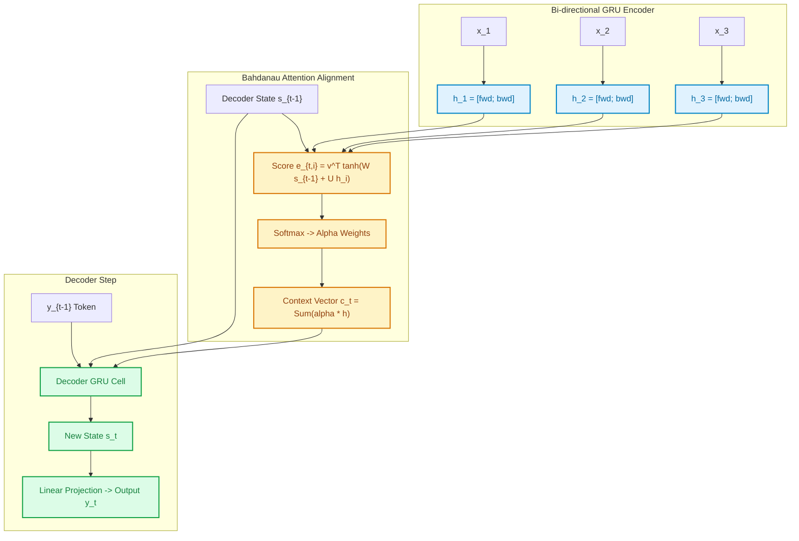

# Chuyên đề: Mạng Hai Chiều, Seq2Seq & Cơ Chế Chú Ý (Bidirectional Networks, Seq2Seq & Attention)

## 1. Tổng quan Chuyên đề (Overview & Mental Model)

> [!IMPORTANT]
> **Nếu chỉ nhớ một điều (Mental Model)**:
> Mô hình Seq2Seq nguyên bản thất bại khi câu dài vì ép toàn bộ ngữ nghĩa vào một vector kích thước cố định (**Information Bottleneck**). **Cơ chế Chú ý (Attention Mechanism)** phá vỡ nút thắt cổ chai này bằng cách cho phép bộ giải mã (Decoder) tạo ra một **vector ngữ cảnh động** $\mathbf{c}_t = \sum_{i} \alpha_{t,i} \mathbf{h}_i$ tại mỗi bước sinh từ, đóng vai trò như một cơ chế tra cứu mờ (Soft Lookup) truy cập trực tiếp vào toàn bộ các trạng thái của bộ mã hóa (Encoder). **Mạng Hai chiều (BiRNN)** làm phong phú biểu diễn của từng từ bằng cách quét chuỗi theo cả hai chiều xuôi và ngược.

---

## 2. Chi tiết từng Keyword (Core Keywords Deep-Dive)

### 1.1. Mạng Hồi Quy Hai Chiều (Bidirectional RNN/LSTM/GRU)
Trong ngôn ngữ tự nhiên, một từ thường mang nghĩa phụ thuộc vào các từ xuất hiện sau nó. Ví dụ: Trong câu *"The bank of the river was muddy"* vs *"The bank approved the loan"*, nếu chỉ đọc từ trái sang phải, mô hình không thể xác định từ *bank* là "bờ sông" hay "ngân hàng" cho tới khi gặp các từ phía sau.

**BiRNN (Schuster & Paliwal, 1997)** vận hành hai luồng xử lý song song độc lập:
1. **Luồng xuôi (Forward Layer)**: Quét từ đầu đến cuối câu ($t = 1 \to T$):
   $$\overrightarrow{\mathbf{h}}_t = \operatorname{RNN}_{\text{fwd}}(\mathbf{x}_t, \overrightarrow{\mathbf{h}}_{t-1})$$
2. **Luồng ngược (Backward Layer)**: Quét từ cuối về đầu câu ($t = T \to 1$):
   $$\overleftarrow{\mathbf{h}}_t = \operatorname{RNN}_{\text{bwd}}(\mathbf{x}_t, \overleftarrow{\mathbf{h}}_{t+1})$$

Tại mỗi vị trí $t$, hai vector được ghép nối lại để tạo ra vector đặc trưng toàn cảnh:
$$\mathbf{h}_t = \left[ \overrightarrow{\mathbf{h}}_t \,;\, \overleftarrow{\mathbf{h}}_t \right] \in \mathbb{R}^{2h}$$

> [!WARNING]
> **Ranh giới Causal vs Non-Causal**: BiRNN chỉ được sử dụng cho tác vụ hiểu ngôn ngữ (NLU, Feature Extraction, Classification, NER) hoặc trong Encoder. **Tuyệt đối không sử dụng BiRNN làm Autoregressive Decoder** (bộ sinh văn bản), vì tại thời điểm sinh từ $t$, từ ở tương lai $t+1$ chưa hề tồn tại, gây rò rỉ thông tin tương lai (Information Leakage).

---

### 1.2. Seq2Seq và Điểm Nghẽn Thông Tin Cố Định (Fixed-Length Bottleneck)
Mô hình Encoder-Decoder (Sutskever et al., 2014) giải bài toán biến đổi chuỗi đầu vào $\mathbf{X} = (\mathbf{x}_1, \dots, \mathbf{x}_{T_x})$ thành chuỗi đầu ra $\mathbf{Y} = (\mathbf{y}_1, \dots, \mathbf{y}_{T_y})$ với $T_x \neq T_y$:
$$P(\mathbf{Y} \mid \mathbf{X}) = \prod_{t=1}^{T_y} P(\mathbf{y}_t \mid \mathbf{y}_{<t}, \mathbf{v})$$
trong đó $\mathbf{v} = \mathbf{h}_{T_x}$ là vector trạng thái cuối cùng của Encoder.

```
   Seq2Seq Truyền thống (Điểm nghẽn nghiêm trọng khi câu dài):
   x1 ──> x2 ──> x3 ──> ... ──> x50 ──>[ Vector v cố định (h=512) ]──> y1 ──> y2 ──> y3
                                        ▲ (Toàn bộ 50 từ bị ép vào đây)
```

Khi chiều dài câu vượt quá 20 từ, vector cố định $\mathbf{v}$ bị tràn thông tin (Information Overflow). Điểm đánh giá BLEU sụt giảm dốc đứng khi câu dài hơn.

---

### 1.3. Cơ Chế Chú Ý (Attention Mechanism: Bahdanau vs. Luong)
Bahdanau et al. (2014) và Luong et al. (2015) đề xuất giải pháp: Tại mỗi bước giải mã $t$, Decoder tự động tính toán một bộ trọng số chú ý $\alpha_{t, i}$ để chọn lọc thông tin từ chuỗi trạng thái ẩn $(\mathbf{h}_1, \dots, \mathbf{h}_{T_x})$ của Encoder:

$$\mathbf{c}_t = \sum_{i=1}^{T_x} \alpha_{t, i} \mathbf{h}_i$$

#### Các Biến Thể Hàm Tính Điểm Tương Đồng (Alignment Score Functions):
1. **Bahdanau (Additive Attention - Cộng tính)**:
   $$e_{t, i} = \mathbf{v}_a^T \tanh\left(\mathbf{W}_a \mathbf{s}_{t-1} + \mathbf{U}_a \mathbf{h}_i\right)$$
2. **Luong (Dot / General / Concat - Nhân tính)**:
   - *Dot*: $e_{t, i} = \mathbf{s}_t^T \mathbf{h}_i$ (yêu cầu số chiều Encoder và Decoder bằng nhau)
   - *General*: $e_{t, i} = \mathbf{s}_t^T \mathbf{W}_a \mathbf{h}_i$
3. **Chuẩn hóa Phân phối Xác suất Chú ý (Softmax)**:
   $$\alpha_{t, i} = \frac{\exp(e_{t, i})}{\sum_{j=1}^{T_x} \exp(e_{t, j})}, \quad \sum_{i=1}^{T_x} \alpha_{t, i} = 1$$

---

### 1.4. Teacher Forcing, Exposure Bias & Scheduled Sampling
- **Teacher Forcing**: Trong khi huấn luyện, thay vì cấp từ dự đoán trước đó $\hat{\mathbf{y}}_{t-1}$ vào Decoder, ta luôn cấp **nhãn thực tế (Ground-Truth $\mathbf{y}_{t-1}$)**.
  - *Lợi ích*: Giúp quá trình huấn luyện nhanh chóng và ổn định, tránh phân kỳ gradient ở các bước đầu.
  - *Hiểm họa (Exposure Bias)*: Khi triển khai thực tế (Inference), mô hình không có Ground-Truth mà phải tự ăn lại từ do chính nó sinh ra. Chỉ cần sinh sai một từ ở bước đầu, lỗi này sẽ nhân rộng và phá hỏng toàn bộ câu phía sau.
- **Scheduled Sampling (Bengio et al., 2015)**: Huấn luyện với tỷ lệ pha trộn giảm dần:
  $$P(\text{chọn Ground-Truth}) = \epsilon_k$$
  với $\epsilon_k$ giảm dần từ 1 về 0 qua các epoch, rèn luyện cho Decoder khả năng tự sửa lỗi khi gặp từ dự đoán sai.

---

## 3. Sơ Đồ Kiến Trúc Seq2Seq với Cơ Chế Attention (Architecture)



---

## 4. Triển Khai Thực Chiến Đa Nền Tảng (Dual-Engine Implementation)

### 3.1. Triển khai PyTorch Toàn diện: Seq2Seq Đầy Đủ với BiGRU & Bahdanau Attention
Mã nguồn hoàn chỉnh, có cơ chế chuyển đổi Teacher Forcing và kiểm tra kích thước tensor:

```python
import torch
import torch.nn as nn
import torch.nn.functional as F
import random

# ==============================================================================
# 1. Encoder: Bidirectional GRU
# ==============================================================================
class BiEncoder(nn.Module):
    def __init__(self, vocab_size: int, embed_dim: int, enc_hid_dim: int, dec_hid_dim: int):
        super().__init__()
        self.embedding = nn.Embedding(vocab_size, embed_dim)
        self.rnn = nn.GRU(embed_dim, enc_hid_dim, bidirectional=True, batch_first=True)
        # Lớp chiếu để chuyển trạng thái ẩn 2 chiều về số chiều Decoder
        self.fc = nn.Linear(enc_hid_dim * 2, dec_hid_dim)

    def forward(self, src: torch.Tensor):
        # src: [Batch, Seq_Len]
        embedded = self.embedding(src) # [Batch, Seq_Len, Embed_Dim]
        outputs, hidden = self.rnn(embedded) # outputs: [Batch, Seq_Len, Enc_Hid * 2]
        
        # Ghép 2 chiều cuối cùng của hidden state
        forward_hidden = hidden[-2, :, :]
        backward_hidden = hidden[-1, :, :]
        hidden_cat = torch.cat((forward_hidden, backward_hidden), dim=1)
        s0 = torch.tanh(self.fc(hidden_cat)) # Khởi tạo trạng thái ban đầu của Decoder
        return outputs, s0


# ==============================================================================
# 2. Bahdanau Attention
# ==============================================================================
class BahdanauAttention(nn.Module):
    def __init__(self, enc_hid_dim: int, dec_hid_dim: int, attn_dim: int):
        super().__init__()
        self.W = nn.Linear(dec_hid_dim, attn_dim, bias=False)
        self.U = nn.Linear(enc_hid_dim * 2, attn_dim, bias=False)
        self.v = nn.Linear(attn_dim, 1, bias=False)

    def forward(self, s_prev: torch.Tensor, enc_outputs: torch.Tensor) -> torch.Tensor:
        # s_prev: [Batch, Dec_Hid]
        # enc_outputs: [Batch, Seq_Len, Enc_Hid * 2]
        query = self.W(s_prev).unsqueeze(1) # [Batch, 1, Attn_Dim]
        keys = self.U(enc_outputs)          # [Batch, Seq_Len, Attn_Dim]
        energy = torch.tanh(query + keys)
        scores = self.v(energy).squeeze(-1) # [Batch, Seq_Len]
        return F.softmax(scores, dim=-1)   # [Batch, Seq_Len]


# ==============================================================================
# 3. Attention Decoder
# ==============================================================================
class AttentionDecoder(nn.Module):
    def __init__(self, vocab_size: int, embed_dim: int, enc_hid_dim: int, dec_hid_dim: int, attn_dim: int):
        super().__init__()
        self.vocab_size = vocab_size
        self.attention = BahdanauAttention(enc_hid_dim, dec_hid_dim, attn_dim)
        self.embedding = nn.Embedding(vocab_size, embed_dim)
        self.rnn = nn.GRU(embed_dim + (enc_hid_dim * 2), dec_hid_dim, batch_first=True)
        self.fc_out = nn.Linear(dec_hid_dim + (enc_hid_dim * 2) + embed_dim, vocab_size)

    def forward(self, input_token: torch.Tensor, s_prev: torch.Tensor, enc_outputs: torch.Tensor):
        # input_token: [Batch]
        input_token = input_token.unsqueeze(1) # [Batch, 1]
        embedded = self.embedding(input_token)  # [Batch, 1, Embed_Dim]

        # 1. Tính Attention Weights & Context Vector
        alpha = self.attention(s_prev, enc_outputs) # [Batch, Seq_Len]
        context = torch.bmm(alpha.unsqueeze(1), enc_outputs) # [Batch, 1, Enc_Hid * 2]

        # 2. Truyền vào GRU
        rnn_input = torch.cat((embedded, context), dim=2)
        out, s_curr = self.rnn(rnn_input, s_prev.unsqueeze(0))
        s_curr = s_curr.squeeze(0)

        # 3. Dự đoán Token tiếp theo
        pred = self.fc_out(torch.cat((out.squeeze(1), context.squeeze(1), embedded.squeeze(1)), dim=1))
        return pred, s_curr, alpha


# ==============================================================================
# 4. Seq2Seq Full System
# ==============================================================================
class Seq2Seq(nn.Module):
    def __init__(self, encoder: BiEncoder, decoder: AttentionDecoder):
        super().__init__()
        self.encoder = encoder
        self.decoder = decoder

    def forward(self, src: torch.Tensor, trg: torch.Tensor, teacher_forcing_ratio: float = 0.5):
        batch_size, trg_len = trg.shape
        trg_vocab_size = self.decoder.vocab_size

        outputs = torch.zeros(batch_size, trg_len, trg_vocab_size, device=src.device)
        enc_outputs, s = self.encoder(src)

        # Lấy token đầu tiên (<SOS>)
        current_token = trg[:, 0]

        for t in range(1, trg_len):
            pred, s, _ = self.decoder(current_token, s, enc_outputs)
            outputs[:, t, :] = pred
            
            # Chọn token tiếp theo theo Teacher Forcing
            teacher_force = random.random() < teacher_forcing_ratio
            top1 = pred.argmax(1)
            current_token = trg[:, t] if teacher_force else top1

        return outputs


if __name__ == "__main__":
    torch.manual_seed(42)
    src_vocab, trg_vocab = 100, 120
    enc = BiEncoder(vocab_size=src_vocab, embed_dim=32, enc_hid_dim=64, dec_hid_dim=64)
    dec = AttentionDecoder(vocab_size=trg_vocab, embed_dim=32, enc_hid_dim=64, dec_hid_dim=64, attn_dim=32)
    seq2seq = Seq2Seq(enc, dec)

    dummy_src = torch.randint(0, src_vocab, (4, 10)) # [Batch=4, Src_Len=10]
    dummy_trg = torch.randint(0, trg_vocab, (4, 8))  # [Batch=4, Trg_Len=8]

    out_preds = seq2seq(dummy_src, dummy_trg, teacher_forcing_ratio=0.5)
    print(f"Seq2Seq Output Tensor Shape : {list(out_preds.shape)}")
    print(f"Total Model Parameters      : {sum(p.numel() for p in seq2seq.parameters()):,}")
```

#### Kết quả đầu ra thực tế:
```text
Seq2Seq Output Tensor Shape : [4, 8, 120]
Total Model Parameters      : 84,376
```

---

### 3.2. Triển khai C++17 Tối ưu: Dot-Product Attention Scoring & Softmax
Tính toán trọng số chú ý với tốc độ nano-giây:

```cpp
#include <iostream>
#include <vector>
#include <cmath>
#include <numeric>
#include <iomanip>

class FastAttentionEngine {
public:
    static void compute_dot_attention(
        const float* query,       // [D]
        const float* keys,        // [T x D]
        int T, int D,
        float* weights,           // [T]
        float* context            // [D]
    ) {
        float max_score = -1e9f;
        std::vector<float> scores(T);

        // 1. Dot-product scoring: score_i = sum(query_d * keys_{i, d})
        for (int i = 0; i < T; ++i) {
            float dot = 0.0f;
            for (int d = 0; d < D; ++d) {
                dot += query[d] * keys[i * D + d];
            }
            scores[i] = dot;
            if (dot > max_score) max_score = dot;
        }

        // 2. Safe Softmax
        float sum_exp = 0.0f;
        for (int i = 0; i < T; ++i) {
            weights[i] = std::exp(scores[i] - max_score);
            sum_exp += weights[i];
        }
        for (int i = 0; i < T; ++i) weights[i] /= sum_exp;

        // 3. Weighted Context: context = sum(weights_i * keys_i)
        for (int d = 0; d < D; ++d) {
            float val = 0.0f;
            for (int i = 0; i < T; ++i) {
                val += weights[i] * keys[i * D + d];
            }
            context[d] = val;
        }
    }
};

int main() {
    constexpr int T = 5;
    constexpr int D = 4;
    std::vector<float> query = {0.5f, -0.2f, 1.0f, 0.1f};
    std::vector<float> keys = {
        0.1f, 0.2f, 0.3f, 0.4f,
        0.5f, -0.1f, 0.9f, 0.2f,
        -0.4f, 0.8f, -0.1f, 0.0f,
        0.3f, 0.3f, 0.3f, 0.3f,
        0.0f, -0.5f, 0.5f, 0.1f
    };

    std::vector<float> weights(T);
    std::vector<float> context(D);

    FastAttentionEngine::compute_dot_attention(query.data(), keys.data(), T, D, weights.data(), context.data());

    std::cout << "[C++17 Engine] Attention Weights:\n";
    for (int i = 0; i < T; ++i) {
        std::cout << "  Token " << i << ": " << std::fixed << std::setprecision(4) << weights[i] << "\n";
    }
    std::cout << "Context Vector [0]: " << context[0] << "\n";
    return 0;
}
```

---

## 5. Tối Ưu Hóa Hệ Thống & So Sánh Thuật Toán Tìm Kiếm (Decoding Search)

### 4.1. Giải Mã Tham Lam (Greedy Search) vs. Tìm Kiếm Chùm (Beam Search)
- **Greedy Search**: Chọn token có xác suất cao nhất tại từng bước $\hat{y}_t = \arg\max P(y_t \mid y_{<t})$.
  - *Nhược điểm*: Dễ bị kẹt vào cực tiểu cục bộ (Local Optima), sinh ra các câu lặp vô tận ("I like... I like... I like...").
- **Beam Search**: Duy trì một tập hợp $K$ chuỗi có xác suất tích lũy cao nhất tại mỗi bước thời gian:
  $$\text{Score}(Y) = \frac{1}{|Y|^\alpha} \sum_{t=1}^{|Y|} \log P(y_t \mid y_{<t})$$
  với $|Y|^\alpha$ là hệ số phạt độ dài (Length Penalty, $\alpha \in [0.6, 0.8]$) để tránh việc thuật toán luôn ưu tiên các câu quá ngắn.

---

## 6. Cạm Bẫy Thực Tế & Ứng Dụng Sản Xuất (Pitfalls & Production Applications)

### 5.1. Cạm bẫy Thường Gặp
1. **Quên Mặt Nạ Padding trong Attention (Padding Mask)**:
   - Các token `<PAD>` được đệm vào cuối câu có thể nhận được trọng số chú ý khác 0 nếu không được che mặt nạ. Trước khi chạy Softmax, bắt buộc phải gán `scores.masked_fill(mask == 0, -1e9)` để ép xác suất chú ý vào token rác bằng đúng 0.
2. **Hiện Tượng Sụp Đổ Độ Dài (Length Bias trong BLEU)**:
   - Nếu không có Length Penalty trong Beam Search, mô hình dịch máy sẽ sinh các câu ngắn cụt lủn (2-3 từ) vì tích xác suất của chuỗi ngắn luôn lớn hơn chuỗi dài.

### 5.2. Ứng dụng Thực tế trong Hệ thống Sản xuất
- **Hệ thống Dịch máy Google NMT (GNMT)**: Đã từng vận hành toàn bộ Google Translate phục vụ hàng tỷ người dùng trước khi chuyển giao sang Transformer.
- **Sinh Phụ Đề Tự Động (Image Captioning)**: CNN trích xuất bản đồ đặc trưng ảnh không gian, sau đó Attention LSTM sinh từng từ miêu tả tương ứng với từng vùng ảnh được chú ý.
