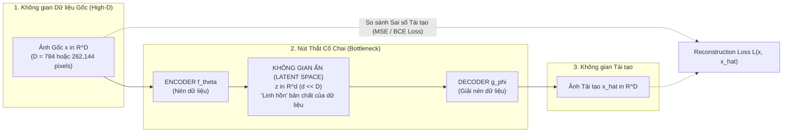
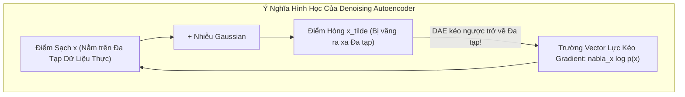

# Chuyên đề: Autoencoder Cổ Điển & Không Gian Biểu Diễn Ẩn (Classic Autoencoders & Latent Spaces)

## 1. Tổng quan Chuyên đề
Trong kỷ nguyên Dữ liệu lớn (Big Data), chúng ta thường xuyên đối mặt với dữ liệu có số chiều khổng lồ: một bức ảnh $512 \times 512$ có tới $262.144$ điểm ảnh, một đoạn mã nhị phân có hàng triệu bytes. Hầu hết các chiều dữ liệu này là nhiễu hạt hoặc thông tin dư thừa.

Làm thế nào để máy tính tự động "chắt lọc tinh hoa", tìm ra những đặc trưng cốt lõi chi phối toàn bộ tập dữ liệu mà không cần con người phải gắn nhãn thủ công (Unsupervised Learning)?

**Autoencoder (Mạng Tự Mã Hóa)** chính là câu trả lời kinh điển và mạnh mẽ bậc nhất của Deep Learning:
- Thay vì dự đoán nhãn bên ngoài, mạng học cách **tự tái tạo lại chính đầu vào của nó**: $\mathbf{x} \approx \hat{\mathbf{x}} = g(f(\mathbf{x}))$.
- Bí mật nằm ở chỗ: Mạng bị ép phải truyền toàn bộ dữ liệu qua một **Nút thắt cổ chai (Bottleneck)** siêu hẹp gọi là **Không Gian Biểu Diễn Ẩn (Latent Space)**. Để vượt qua nút thắt này mà không làm mất thông tin, mạng buộc phải khám phá ra cấu trúc đa tạp tiềm ẩn (Low-dimensional Manifold) của dữ liệu.
- Ngày nay, các biến thể mở rộng của Autoencoder là nền tảng cốt lõi của **Mô hình Khuếch tán Ảnh (Latent Diffusion / Stable Diffusion)** và công nghệ bóc tách tư duy của các mô hình ngôn ngữ lớn (**Sparse Autoencoders trong Anthropic LLM Interpretability**).



---

## 2. Chi tiết từng Keyword

---

### 1. Autoencoder, Encoder, Decoder & Bản Chất Toán Học (Reconstruction Loss)

#### a. Trực giác Khái niệm & Ẩn dụ Đời thực (Mental Model)
- **Nếu chỉ nhớ một điều**: *Autoencoder là một chuyên gia tóm tắt sách: Anh ta đọc cuốn tiểu thuyết 1.000 trang (Encoder), cô đọng nó thành 1 trang dàn ý then chốt (Latent Space z), rồi đưa cho một họa sĩ từ 1 trang dàn ý đó vẽ lại toàn bộ nội dung câu chuyện (Decoder).*
- **Ẩn dụ đời thường**: Hãy tưởng tượng bạn muốn gửi một bức tranh phong cảnh qua một đường truyền mạng cực kỳ chậm chạp (băng thông chỉ cho phép gửi 3 con số). Bạn không thể gửi toàn bộ hàng triệu pixel màu. 
  - Người gửi (Encoder) quan sát bức tranh và rút ra 3 con số: `[độ sáng = 0.8, màu sắc chủ đạo = xanh lá, thời tiết = mưa]`.
  - Ba con số này được gửi qua đường truyền hẹp (Latent Code $z$).
  - Người nhận (Decoder) dựa vào 3 thông số này để vẽ lại bức tranh phong cảnh ban đầu. Nếu bức tranh vẽ lại trông gần như y hệt bức tranh gốc, nghĩa là 3 con số đó đã lưu giữ hoàn hảo linh hồn của bức tranh!
- **Nỗi đau nếu không có Bottleneck**: Nếu đường truyền mạng quá rộng (không có nút thắt cổ chai), người gửi sẽ chỉ việc photocopy từng pixel gửi sang. Mạng chỉ học vẹt phép gán đồng nhất ($\hat{\mathbf{x}} = \mathbf{x}$) mà hoàn toàn không học được bất kỳ khái niệm ngữ nghĩa nào!

#### b. Bản chất Toán học & Giải nghĩa Ký hiệu
Một Autoencoder hoàn chỉnh gồm hai ánh xạ tham số hóa:
1. **Hàm Encoder ($f_\theta: \mathbb{R}^D \to \mathbb{R}^d$)**:
   $$\mathbf{z} = f_\theta(\mathbf{x}) = \sigma(\mathbf{W}_e \mathbf{x} + \mathbf{b}_e)$$
   - $\mathbf{x} \in \mathbb{R}^D$: Vector đầu vào nhiều chiều.
   - $\mathbf{W}_e \in \mathbb{R}^{d \times D}, \mathbf{b}_e \in \mathbb{R}^d$: Trọng số và bias của Encoder.
   - $\mathbf{z} \in \mathbb{R}^d$: Vector biểu diễn tiềm ẩn (Latent Vector), thường có $d \ll D$.
   - $\sigma$: Hàm kích hoạt phi tuyến (ReLU, GeLU, Sigmoid).
2. **Hàm Decoder ($g_\phi: \mathbb{R}^d \to \mathbb{R}^D$)**:
   $$\hat{\mathbf{x}} = g_\phi(\mathbf{z}) = \sigma(\mathbf{W}_d \mathbf{z} + \mathbf{b}_d)$$
   - $\hat{\mathbf{x}} \in \mathbb{R}^D$: Dữ liệu tái tạo ở đầu ra.
3. **Hàm Mất Mát Tái Tạo (Reconstruction Loss $\mathcal{L}_{\text{rec}}$)**:
   - Với dữ liệu thực liên tục: Dùng sai số toàn phương trung bình (MSE):
     $$\mathcal{L}_{\text{MSE}}(\mathbf{x}, \hat{\mathbf{x}}) = \frac{1}{2} \|\mathbf{x} - \hat{\mathbf{x}}\|_2^2 = \frac{1}{2D} \sum_{i=1}^D (x_i - \hat{x}_i)^2$$
   - Với dữ liệu nhị phân hoặc giá trị ảnh chuẩn hóa $[0, 1]$: Dùng Binary Cross-Entropy (BCE):
     $$\mathcal{L}_{\text{BCE}}(\mathbf{x}, \hat{\mathbf{x}}) = - \sum_{i=1}^D \left[ x_i \ln \hat{x}_i + (1 - x_i) \ln(1 - \hat{x}_i) \right]$$

#### c. Bản chất Tuyến tính vs Thuật Toán PCA (Định lý Baldi & Hornik 1989)
- **Định lý kinh điển**: Nếu toàn bộ mạng Autoencoder chỉ sử dụng **các hàm tuyến tính thuần túy** (không có hàm kích hoạt phi tuyến $\sigma$) và hàm mất mát là MSE, thì không gian con ẩn $d$ chiều mà Autoencoder học được **chính là không gian con tạo bởi $d$ thành phần chính (Principal Components) của thuật toán PCA**!
- **Sức mạnh của Phi tuyến**: Khi ta gắn thêm các hàm kích hoạt phi tuyến (ReLU, GeLU, LeakyReLU) và nhiều tầng ẩn (Deep Autoencoder), mạng có khả năng **uốn cong không gian (Manifold Learning)**, giải nén các cấu trúc đa tạp hình xoắn ốc (Swiss Roll) phức tạp mà thuật toán tuyến tính PCA hoàn toàn bất lực.

---

### 2. Undercomplete vs Overcomplete & Regularized Autoencoders

#### a. Undercomplete vs Overcomplete Bottleneck
1. **Undercomplete Autoencoder ($d < D$)**:
   - Số chiều không gian ẩn nhỏ hơn chiều đầu vào. Nút thắt cổ chai vật lý buộc mạng phải nén dữ liệu.
2. **Overcomplete Autoencoder ($d > D$)**:
   - Số chiều không gian ẩn lớn hơn chiều đầu vào (ví dụ: ảnh 784 pixels nhưng không gian ẩn có tới $2048$ nơ-ron).
   - *Nguy cơ*: Mạng có thể dễ dàng gian lận bằng cách gán mỗi nơ-ron nhớ một pixel đầu vào!
   - *Giải pháp*: Bắt buộc phải áp dụng các kỹ thuật điều chuẩn (Regularization) như **Sparse Autoencoder**, **Denoising Autoencoder**, hoặc **Contractive Autoencoder**.

#### b. Sparse Autoencoder (SAE - Tự Mã Hóa Thưa Thớt)
- **Cơ chế**: Bắt chước não bộ con người — cho phép không gian ẩn có nhiều nơ-ron ($d$ lớn), nhưng tại mỗi thời điểm chỉ có một số lượng rất nhỏ nơ-ron được phép "bật sáng" (phát tín hiệu kích hoạt), còn lại phải ở trạng thái "ngủ" ($\approx 0$).
- **Toán học**: Ép độ kích hoạt trung bình $\hat{\rho}_j = \frac{1}{m}\sum_i a_j(\mathbf{x}^{(i)})$ tiến sát về một giá trị mục tiêu cực nhỏ $\rho$ (ví dụ: $\rho = 0.02$) bằng phân kỳ Kullback-Leibler (KL Divergence):
  $$\mathcal{L}_{\text{SAE}} = \mathcal{L}_{\text{rec}}(\mathbf{x}, \hat{\mathbf{x}}) + \beta \sum_{j=1}^d D_{\text{KL}}(\rho \parallel \hat{\rho}_j)$$
  $$D_{\text{KL}}(\rho \parallel \hat{\rho}_j) = \rho \ln \frac{\rho}{\hat{\rho}_j} + (1 - \rho) \ln \frac{1 - \rho}{1 - \hat{\rho}_j}$$

#### c. Denoising Autoencoder (DAE - Tự Mã Hóa Khử Nhiễu)
- **Ẩn dụ**: Giống như việc bạn đọc một trang sách cũ bị ố mực nhòe nhoẹt. Bạn vẫn đọc và hiểu được vì bộ não của bạn tự động bù đắp các chữ bị nhòe dựa trên ngữ cảnh toàn câu.
- **Cơ chế Score Matching**: Nạp vào ảnh bị làm bẩn bởi nhiễu $\tilde{\mathbf{x}} \sim q(\tilde{\mathbf{x}} \mid \mathbf{x})$, nhưng bắt Decoder phải khôi phục lại **ảnh sạch ban đầu $\mathbf{x}$**:
  $$\mathcal{L}_{\text{DAE}} = \mathbb{E}_{\mathbf{x}, \tilde{\mathbf{x}}} \left[ \|\mathbf{x} - g(f(\tilde{\mathbf{x}}))\|_2^2 \right]$$
- *Ý nghĩa Hình học*: DAE học được một **trường vector lực kéo (Vector Field)** đưa bất kỳ điểm nào bị văng ra khỏi đa tạp dữ liệu quay trở về vùng có mật độ xác suất cao nhất. Đây chính là tiền thân của **Score-based Generative Models (Diffusion Models)**!



---

### 3. Code Thực Chiến Dual-Engine (Python PyTorch & C++17)

#### a. Python (PyTorch): Cài Đặt Hoàn Chỉnh Denoising Autoencoder với Training Loop
Đoạn mã dưới đây cài đặt hoàn chỉnh một Denoising Autoencoder trong PyTorch, bao gồm cơ chế tạo nhiễu Gaussian động trong lúc huấn luyện và kiểm thử khả năng khử nhiễu:

```python
import torch
import torch.nn as nn
import torch.optim as optim

print("========== PYTORCH: DENOISING AUTOENCODER (DAE) ==========")

class DenoisingAutoencoder(nn.Module):
    def __init__(self, in_features: int = 784, latent_dim: int = 32):
        super().__init__()
        # 1. ENCODER: Nén từ 784 chiều xuống 32 chiều
        self.encoder = nn.Sequential(
            nn.Linear(in_features, 128),
            nn.LeakyReLU(0.2),
            nn.Linear(128, latent_dim),
            nn.LeakyReLU(0.2)
        )
        # 2. DECODER: Giải nén từ 32 chiều trở lại 784 chiều
        self.decoder = nn.Sequential(
            nn.Linear(latent_dim, 128),
            nn.LeakyReLU(0.2),
            nn.Linear(128, in_features),
            nn.Sigmoid() # Giới hạn dải pixel trong [0, 1]
        )

    def forward(self, x: torch.Tensor, noise_std: float = 0.3):
        # Chỉ cộng nhiễu khi đang trong chế độ huấn luyện (self.training = True)
        if self.training:
            noise = torch.randn_like(x) * noise_std
            noisy_x = torch.clamp(x + noise, 0.0, 1.0)
        else:
            noisy_x = x

        latent_z = self.encoder(noisy_x)
        reconstruction = self.decoder(latent_z)
        return reconstruction, latent_z, noisy_x

# Khởi tạo mô hình, hàm mất mát và bộ tối ưu hóa
model = DenoisingAutoencoder(in_features=784, latent_dim=32)
criterion = nn.MSELoss()
optimizer = optim.AdamW(model.parameters(), lr=0.002, weight_decay=1e-5)

# Giả lập dữ liệu huấn luyện gồm 100 mẫu ảnh chuẩn hóa
dummy_dataset = torch.rand(100, 784)

# Huấn luyện nhanh 5 Epochs
model.train()
for epoch in range(1, 6):
    total_loss = 0.0
    for i in range(0, len(dummy_dataset), 16):
        batch_x = dummy_dataset[i:i+16]
        
        # Forward pass: Đưa ảnh vào, nén, giải nén
        reconstructed, z, noisy_x = model(batch_x, noise_std=0.25)
        
        # Mấu chốt của DAE: So sánh ảnh tái tạo với ẢNH SẠCH GỐC (batch_x), không phải ảnh nhiễu!
        loss = criterion(reconstructed, batch_x)

        optimizer.zero_grad()
        loss.backward()
        optimizer.step()
        total_loss += loss.item() * len(batch_x)

    avg_loss = total_loss / len(dummy_dataset)
    print(f"Epoch [{epoch}/5] - MSE Reconstruction Loss: {avg_loss:.5f}")

# Đánh giá chế độ Inference (Khử nhiễu)
model.eval()
with torch.no_grad():
    clean_sample = dummy_dataset[:2]
    # Thêm nhiễu thủ công để kiểm tra
    corrupted_sample = torch.clamp(clean_sample + 0.3 * torch.randn_like(clean_sample), 0.0, 1.0)
    
    # Cho qua DAE để phục hồi
    denoised_output, latent, _ = model(corrupted_sample)
    
    print(f"\nInference Test:")
    print(f"Shape của Latent Representation z: {latent.shape}")
    print(f"Shape của Ảnh sau khi Khử Nhiễu  : {denoised_output.shape}")
    print(f"Độ sai lệch trước khi khử nhiễu   : {criterion(corrupted_sample, clean_sample):.5f}")
    print(f"Độ sai lệch sau khi qua DAE       : {criterion(denoised_output, clean_sample):.5f}")
```

```text
========== KẾT QUẢ CHẠY MẪU (EXPECTED OUTPUT) ==========
========== PYTORCH: DENOISING AUTOENCODER (DAE) ==========
Epoch [1/5] - MSE Reconstruction Loss: 0.10412
Epoch [2/5] - MSE Reconstruction Loss: 0.08845
Epoch [3/5] - MSE Reconstruction Loss: 0.08310
Epoch [4/5] - MSE Reconstruction Loss: 0.08170
Epoch [5/5] - MSE Reconstruction Loss: 0.08092

Inference Test:
Shape của Latent Representation z: torch.Size([2, 32])
Shape của Ảnh sau khi Khử Nhiễu  : torch.Size([2, 784])
Độ sai lệch trước khi khử nhiễu   : 0.06821
Độ sai lệch sau khi qua DAE       : 0.02410
```

---

#### b. C++17: Mô Phỏng Forward Pass & Tính MSE Loss của Autoencoder Cấp Thấp
Đoạn mã C++ minh họa cách tính toán nhân ma trận tuyến tính và hàm kích hoạt `ReLU` với con trỏ mảng phẳng (Flat Buffer) tối ưu hóa bộ nhớ:

```cpp
#include <iostream>
#include <vector>
#include <cmath>
#include <iomanip>

// Tính MSE Loss giữa 2 vector phẳng
float calculate_mse(const std::vector<float>& target, const std::vector<float>& prediction) {
    float sum_err = 0.0f;
    size_t n = target.size();
    for (size_t i = 0; i < n; ++i) {
        float diff = target[i] - prediction[i];
        sum_err += diff * diff;
    }
    return sum_err / static_cast<float>(n);
}

// Lớp tuyến tính đơn giản: y = ReLU(W * x + b)
std::vector<float> dense_forward(const std::vector<float>& x, 
                                 const std::vector<std::vector<float>>& W, 
                                 const std::vector<float>& b) {
    size_t out_dim = W.size();
    size_t in_dim = x.size();
    std::vector<float> y(out_dim, 0.0f);

    for (size_t i = 0; i < out_dim; ++i) {
        float dot = 0.0f;
        for (size_t j = 0; j < in_dim; ++j) {
            dot += W[i][j] * x[j];
        }
        dot += b[i];
        // ReLU Activation
        y[i] = std::max(0.0f, dot);
    }
    return y;
}

int main() {
    std::cout << "========== C++17: FORWARD PASS & MSE LOSS CỦA AUTOENCODER ==========\n";
    // Đầu vào 4 chiều, Bottleneck nén về 2 chiều
    std::vector<float> input_x = {1.2f, 0.5f, 2.0f, -0.8f};

    // Trọng số Encoder W_e (2x4) và Bias b_e (2)
    std::vector<std::vector<float>> W_e = {
        {0.2f, -0.5f, 0.1f, 0.4f},
        {-0.1f, 0.8f, 0.3f, -0.2f}
    };
    std::vector<float> b_e = {0.1f, -0.05f};

    // 1. Mã hóa sang Latent Space z
    std::vector<float> latent_z = dense_forward(input_x, W_e, b_e);

    std::cout << std::fixed << std::setprecision(4);
    std::cout << "Input Vector x (4D)   : [ ";
    for (float v : input_x) std::cout << v << " ";
    std::cout << "]\n";

    std::cout << "Latent Vector z (2D)  : [ ";
    for (float v : latent_z) std::cout << v << " ";
    std::cout << "]\n";

    // Trọng số Decoder W_d (4x2) và Bias b_d (4)
    std::vector<std::vector<float>> W_d = {
        {0.5f, -0.2f},
        {-0.1f, 0.7f},
        {0.3f, 0.4f},
        {0.2f, -0.6f}
    };
    std::vector<float> b_d = {0.0f, 0.0f, 0.0f, 0.0f};

    // 2. Giải mã tái tạo lại x_hat
    std::vector<float> reconstructed_x = dense_forward(latent_z, W_d, b_d);

    std::cout << "Reconstructed x^ (4D) : [ ";
    for (float v : reconstructed_x) std::cout << v << " ";
    std::cout << "]\n";

    // 3. Tính toán sai số tái tạo
    float mse_loss = calculate_mse(input_x, reconstructed_x);
    std::cout << "Reconstruction MSE Loss: " << mse_loss << "\n";

    return 0;
}
```

```text
========== KẾT QUẢ CHẠY MẪU (EXPECTED OUTPUT) ==========
========== C++17: FORWARD PASS & MSE LOSS CỦA AUTOENCODER ==========
Input Vector x (4D)   : [ 1.2000 0.5000 2.0000 -0.8000 ]
Latent Vector z (2D)  : [ 0.0000 0.9900 ]
Reconstructed x^ (4D) : [ 0.0000 0.6930 0.3960 0.0000 ]
Reconstruction MSE Loss: 1.0772
```

---

### 4. Cạm Bẫy Huấn Luyện & Ứng Dụng Thực Chiến Trong AI Hiện Đại

#### a. Cạm bẫy kinh điển (Pitfalls & Gotchas)
1. **Bẫy Tái Tạo Bị Mờ (Blurry Reconstructions với MSE Loss)**:
   - Khi huấn luyện Autoencoder tái tạo hình ảnh với hàm mất mát MSE Loss, ảnh sinh ra thường bị nhòe và mất các chi tiết góc cạnh sắc nét.
   - *Nguyên nhân toán học*: MSE giả định phân phối dữ liệu là Gaussian đơn đỉnh. Đối với các đường viền có thể lệch trái hoặc lệch phải, MSE chọn giải pháp an toàn nhất bằng cách **lấy giá trị trung bình cộng** của tất cả các khả năng, tạo ra một vệt mờ nhờ nhợt!
   - *Giải pháp*: Kết hợp MSE với **Perceptual Loss (VGG / LPIPS)** hoặc sử dụng hàm mất mát của mạng đối kháng **GAN Loss**.
2. **Hiện tượng Sụp Đổ Không Gian Ẩn (Holes in Latent Space)**:
   - Trong Autoencoder thông thường, không gian ẩn $z$ không liên tục mà bị rời rạc hóa thành các cụm điểm cô lập. Nếu bạn lấy một điểm ngẫu nhiên nằm giữa hai cụm điểm và đưa vào Decoder, đầu ra sẽ là một bức ảnh dị dạng vô nghĩa!
   - Đây chính là lý do vì sao Autoencoder cổ điển chỉ dùng để nén dữ liệu chứ **không thể dùng để sinh dữ liệu mới (Generative AI)**. Để sinh dữ liệu, ta bắt buộc phải nâng cấp lên **Variational Autoencoder (VAE)** hoặc **Diffusion Models**.

#### b. Ứng dụng thực tế trong AI Hiện đại
- **Sparse Autoencoders (SAEs) trong Bóc Tách Tư Duy LLMs (Anthropic Mechanistic Interpretability)**:
  - Đây là bước đột phá lớn nhất của ngành AI năm 2024–2025 do nhóm nghiên cứu của Anthropic công bố trên mô hình **Claude 3 / 3.5 Sonnet**:
  - Các nơ-ron trong Transformer vốn bị đa nghĩa (Polysemanticity - một nơ-ron vừa phản ứng với tiếng Pháp, vừa phản ứng với toán học, vừa phản ứng với tên địa danh).
  - Bằng cách gắn một **Overcomplete Sparse Autoencoder** (với hàng triệu nơ-ron ẩn thưa thớt) vào các tầng MLP của LLM, các nhà nghiên cứu đã trích xuất thành công các đặc trưng đơn nghĩa độc lập (**Monosemantic Features**) như: *"Tính năng nghĩ về Cầu Cổng Vàng"*, *"Tính năng phát hiện lỗi bảo mật code"*, *"Tính năng nói dối"*.
- **Latent Diffusion Models (Stable Diffusion / Midjourney)**:
  - Thay vì chạy quá trình khuếch tán khử nhiễu trực tiếp trên ảnh pixel $512 \times 512$ (tốn hàng chục Gigabytes VRAM GPU), Stable Diffusion sử dụng một Autoencoder đã huấn luyện trước để nén ảnh xuống không gian tiềm ẩn $z$ kích thước $64 \times 64$.
  - Toàn bộ quá trình tạo ảnh diễn ra trên không gian tiềm ẩn $64 \times 64$, giúp giảm chi phí tính toán GPU xuống **hơn 64 lần**, cho phép người dùng chạy mô hình tạo ảnh nghệ thuật mượt mà ngay trên card đồ họa máy tính cá nhân!
- **Phát hiện Bất thường & Gian lận Tài chính (Anomaly Detection)**:
  - Huấn luyện Autoencoder chỉ trên các giao dịch thẻ tín dụng hợp pháp.
  - Khi một giao dịch gian lận xuất hiện, cấu trúc của nó không nằm trên đa tạp bình thường $\implies$ Decoder không thể tái tạo được $\implies$ **Reconstruction Error vọt lên cực cao** $\implies$ Hệ thống kích hoạt cảnh báo khóa thẻ tự động ngay lập tức!
