# Chuyên đề: Autoencoder Biến Phân & Lượng Tử Hóa Vector (Variational & Quantized Autoencoders)

## 1. Tổng quan Chuyên đề (Overview & Mental Model)

> [!IMPORTANT]
> **Nếu chỉ nhớ một điều (Mental Model)**:
> Autoencoder cổ điển chỉ là một hàm nén hình học tĩnh, để lại một không gian ẩn đầy các "vùng trống" (holes) khiến nó không thể lấy mẫu ngẫu nhiên để sinh dữ liệu mới. **VAE** biến không gian ẩn thành một phân phối xác suất liên tục mượt mà thông qua **Chặn dưới Chứng cứ (ELBO)** và mẹo tách nhiễu khả vi **Reparameterization Trick** ($\mathbf{z} = \boldsymbol{\mu} + \boldsymbol{\sigma} \odot \boldsymbol{\epsilon}$). Trong khi đó, **VQ-VAE** giải quyết hiện tượng ảnh sinh bị nhòe của VAE bằng cách lượng tử hóa không gian ẩn thành một **Từ điển Mã hóa Rời rạc (Discrete Codebook)** thông qua cơ chế **Straight-Through Estimator**, trở thành xương sống nén cảm nhận (Perceptual Compression) của **Stable Diffusion (Latent Diffusion Models)** và **DALL-E**.

---

## 2. Chi tiết từng Keyword (Core Keywords Deep-Dive)

### 1.1. Từ Suy Luận Biến Phân Đến Chặn Dưới Chứng Cứ (Evidence Lower Bound - ELBO)
Mục tiêu tối thượng của một mô hình sinh là tối đa hóa hàm hợp lý biên (Marginal Log-Likelihood) của dữ liệu:
$$\ln p_\theta(\mathbf{x}) = \ln \int p_\theta(\mathbf{x}, \mathbf{z}) d\mathbf{z} = \ln \int p_\theta(\mathbf{x} \mid \mathbf{z}) p(\mathbf{z}) d\mathbf{z}$$

Tuy nhiên, tích phân này là **bất khả quy (intractable)** vì không gian biến ẩn $\mathbf{z}$ có số chiều cao vô tận. Kingma & Welling (2013) đưa vào một phân phối biến phân $q_\phi(\mathbf{z} \mid \mathbf{x})$ (mạng Encoder) để xấp xỉ phân phối hậu nghiệm thực sự $p_\theta(\mathbf{z} \mid \mathbf{x})$.

Áp dụng Bất đẳng thức Jensen:
$$\begin{aligned}
\ln p_\theta(\mathbf{x}) &= \ln \mathbb{E}_{q_\phi(\mathbf{z}\mid\mathbf{x})}\left[ \frac{p_\theta(\mathbf{x}, \mathbf{z})}{q_\phi(\mathbf{z}\mid\mathbf{x})} \right] \\
&\ge \mathbb{E}_{q_\phi(\mathbf{z}\mid\mathbf{x})}\left[ \ln \frac{p_\theta(\mathbf{x}, \mathbf{z})}{q_\phi(\mathbf{z}\mid\mathbf{x})} \right] \triangleq \text{ELBO}(\theta, \phi; \mathbf{x})
\end{aligned}$$

Khai triển chi tiết ELBO:
$$\text{ELBO}(\theta, \phi; \mathbf{x}) = \underbrace{\mathbb{E}_{q_\phi(\mathbf{z}\mid\mathbf{x})}\left[ \ln p_\theta(\mathbf{x}\mid\mathbf{z}) \right]}_{\text{1. Reconstruction Term (Sai số Tái tạo)}} - \underbrace{D_{\text{KL}}\left( q_\phi(\mathbf{z}\mid\mathbf{x}) \parallel p(\mathbf{z}) \right)}_{\text{2. Regularization Term (Phân kỳ KL)}}$$

*Ý nghĩa vật lý*:
1. **Reconstruction Term**: Thúc đẩy Decoder học cách tái tạo lại ảnh gốc $\mathbf{x}$ chính xác nhất từ mã ẩn $\mathbf{z}$.
2. **Regularization Term**: Ép phân phối hậu nghiệm $q_\phi(\mathbf{z}\mid\mathbf{x})$ không được phân tán tự do mà phải co cụm về phân phối tiên nghiệm chuẩn tắc Gauss $p(\mathbf{z}) = \mathcal{N}(\mathbf{0}, \mathbf{I})$, lấp đầy các khoảng trống trong không gian ẩn.

---

### 1.2. Công Thức Đóng (Closed-Form) Của Phân Kỳ KL Gauss
Giả sử Encoder dự đoán phân phối chuẩn nhiều chiều đường chéo:
$$q_\phi(\mathbf{z}\mid\mathbf{x}) = \mathcal{N}(\boldsymbol{\mu}, \operatorname{diag}(\boldsymbol{\sigma}^2)), \quad p(\mathbf{z}) = \mathcal{N}(\mathbf{0}, \mathbf{I})$$

Phân kỳ KL giữa hai phân phối Gauss nhiều chiều có công thức giải tích chính xác:
$$D_{\text{KL}}\left( \mathcal{N}(\boldsymbol{\mu}, \boldsymbol{\sigma}^2) \parallel \mathcal{N}(\mathbf{0}, \mathbf{I}) \right) = -\frac{1}{2} \sum_{j=1}^d \left( 1 + \ln(\sigma_j^2) - \mu_j^2 - \sigma_j^2 \right)$$

---

### 1.3. Mẹo Tái Tham Số Hóa (Reparameterization Trick)
Nút thắt sống còn của VAE: Thao tác lấy mẫu $\mathbf{z} \sim q_\phi(\mathbf{z} \mid \mathbf{x})$ là một **bước ngẫu nhiên ngắt quãng**, khiến gradient của hàm mất mát không thể truyền ngược qua $\mathbf{z}$ về các trọng số của Encoder.

```
   Thao tác Lấy mẫu Trực tiếp (Gãy đồ thị tính toán):
   x ───>[ Encoder ]───> [mu, sigma] ───>( Lấy mẫu z ~ N(mu, sigma) )───>[ Decoder ]
                                                      ▲ (Không khả vi! dL/d(mu) = ?)

   Mẹo Tái tham số hóa (Khả vi 100%):
   x ───>[ Encoder ]───> [mu, sigma] ──────────┐
                                               ▼
   Nhiễu chuẩn: epsilon ~ N(0, I) ───>[ z = mu + sigma * epsilon ]───>[ Decoder ]
```

Biến đổi ngẫu nhiên thành phép toán xác định khả vi:
$$\boldsymbol{\epsilon} \sim \mathcal{N}(\mathbf{0}, \mathbf{I}), \quad \mathbf{z} = \boldsymbol{\mu}(\mathbf{x}) + \boldsymbol{\sigma}(\mathbf{x}) \odot \boldsymbol{\epsilon}$$
Đạo hàm đối với các tham số của Encoder:
$$\frac{\partial \mathbf{z}}{\partial \boldsymbol{\mu}} = \mathbf{I}, \quad \frac{\partial \mathbf{z}}{\partial \boldsymbol{\sigma}} = \operatorname{diag}(\boldsymbol{\epsilon})$$
Bây giờ, gradient từ Decoder chảy ngược tự do về Encoder mà không gặp bất kỳ vật cản nào!

---

### 1.4. VQ-VAE: Lượng Tử Hóa Vector & Straight-Through Estimator (STE)
VAE truyền thống có xu hướng sinh ảnh mờ (blurry) do tính chất liên tục của phân phối Gauss (ép trung bình các pixel). VQ-VAE (van den Oord et al., 2017) đề xuất một cách tiếp cận mang tính cách mạng: **Mã hóa không gian ẩn thành các vector rời rạc từ một bảng mã (Codebook)**.

Bảng mã Codebook gồm $K$ vector nhúng:
$$\mathcal{E} = \{\mathbf{e}_1, \mathbf{e}_2, \dots, \mathbf{e}_K\}, \quad \mathbf{e}_k \in \mathbb{R}^D$$

1. **Quantization Step**: Encoder sinh ra vector liên tục $\mathbf{z}_e(\mathbf{x})$. Lượng tử hóa bằng cách tìm vector mã gần nhất:
   $$\mathbf{z}_q(\mathbf{x}) = \mathbf{e}_k, \quad k = \arg\min_j \|\mathbf{z}_e(\mathbf{x}) - \mathbf{e}_j\|_2^2$$
2. **Khai triển Khoảng cách Euclidean Siêu Tốc**:
   $$\|\mathbf{z}_e - \mathbf{e}_j\|_2^2 = \|\mathbf{z}_e\|_2^2 + \|\mathbf{e}_j\|_2^2 - 2 \mathbf{z}_e^T \mathbf{e}_j$$
3. **Straight-Through Estimator (STE)**: Phép $\arg\min$ có gradient bằng 0. Để truyền gradient từ Decoder về Encoder, ta sử dụng mẹo STE:
   $$\mathbf{z}_q = \mathbf{z}_e + \operatorname{sg}[\mathbf{z}_q - \mathbf{z}_e]$$
   trong đó $\operatorname{sg}[\cdot]$ là toán tử `stop_gradient`. Trong forward pass, giá trị nhận được là $\mathbf{z}_q$, nhưng trong backward pass, đạo hàm đi thẳng qua $\mathbf{z}_e$!
4. **Hàm Mất Mát 3 Thành Phần của VQ-VAE**:
   $$\mathcal{L}_{\text{total}} = \mathcal{L}_{\text{recon}}(\mathbf{x}, \hat{\mathbf{x}}) + \|\operatorname{sg}[\mathbf{z}_e(\mathbf{x})] - \mathbf{z}_q\|_2^2 + \beta \|\mathbf{z}_e(\mathbf{x}) - \operatorname{sg}[\mathbf{z}_q]\|_2^2$$
   - Thành phần 2: **Codebook Loss** (cập nhật các vector $\mathbf{e}_k$ tiến về phía biểu diễn của Encoder).
   - Thành phần 3: **Commitment Loss** (ngăn Encoder biến đổi quá nhanh khiến Codebook không theo kịp, thường $\beta = 0.25$).

---

## 3. Sơ Đồ So Sánh VAE và VQ-VAE (Architectures)

```mermaid
flowchart TD
    classDef enc fill:#e0f2fe,stroke:#0284c7,stroke-width:2px,color:#0369a1;
    classDef latent fill:#fef3c7,stroke:#d97706,stroke-width:2px,color:#92400e;
    classDef dec fill:#dcfce7,stroke:#16a34a,stroke-width:2px,color:#15803d;

    subgraph VAE_Architecture ["Variational Autoencoder (Continuous)"]
        X_vae["Input Image X"] --> Enc_vae["Encoder q(z|x)"]
        Enc_vae --> Mu["Mean mu"]
        Enc_vae --> LogVar["Log-Variance log(sigma^2)"]
        Eps["Eps ~ N(0, I)"] --> Reparam["z = mu + sigma * eps"]
        Mu --> Reparam
        LogVar --> Reparam
        Reparam --> Dec_vae["Decoder p(x|z)"]
        Dec_vae --> Out_vae["Reconstructed Image X_hat"]
    end

    subgraph VQVAE_Architecture ["Vector Quantized VAE (Discrete)"]
        X_vq["Input Image X"] --> Enc_vq["Encoder z_e(x)"]
        Enc_vq --> Dist["Euclidean Distance Matrix"]
        Codebook["Codebook e_1..e_K"] --> Dist
        Dist --> ArgMin["ArgMin Nearest Lookup"]
        ArgMin --> Quant["Quantized z_q"]
        Quant --> STE["Straight-Through: z_e + sg(z_q - z_e)"]
        STE --> Dec_vq["Decoder Network"]
        Dec_vq --> Out_vq["Sharp Image X_hat"]
    end

    class Enc_vae,Enc_vq enc;
    class Reparam,Dist,ArgMin,Quant,STE latent;
    class Dec_vae,Dec_vq dec;
```



---

## 4. Triển Khai Thực Chiến Đa Nền Tảng (Dual-Engine Implementation)

### 3.1. Triển khai PyTorch Toàn diện: Vector Quantization Module Chuẩn Công Nghiệp
Mã nguồn Vector Quantizer được kiểm chứng với Straight-Through Estimator và Perplexity Metrics:

```python
import torch
import torch.nn as nn
import torch.nn.functional as F

class VectorQuantizer(nn.Module):
    def __init__(self, num_embeddings: int, embedding_dim: int, commitment_cost: float = 0.25):
        super().__init__()
        self.num_embeddings = num_embeddings
        self.embedding_dim = embedding_dim
        self.commitment_cost = commitment_cost

        # Khởi tạo ma trận embedding của Codebook
        self.embedding = nn.Embedding(num_embeddings, embedding_dim)
        self.embedding.weight.data.uniform_(-1.0 / num_embeddings, 1.0 / num_embeddings)

    def forward(self, inputs: torch.Tensor):
        # inputs: [Batch, Channel, Height, Width]
        # Chuyển về định dạng kênh cuối: [Batch, Height, Width, Channel]
        inputs = inputs.permute(0, 2, 3, 1).contiguous()
        input_shape = inputs.shape
        flat_input = inputs.view(-1, self.embedding_dim)

        # 1. Tính toán khoảng cách Euclidean ma trận: ||a - b||^2 = a^2 + b^2 - 2ab
        distances = (torch.sum(flat_input**2, dim=1, keepdim=True) 
                    + torch.sum(self.embedding.weight**2, dim=1)
                    - 2 * torch.matmul(flat_input, self.embedding.weight.t()))

        # 2. Tìm vector gần nhất trong Codebook
        encoding_indices = torch.argmin(distances, dim=1).unsqueeze(1)
        encodings = torch.zeros(encoding_indices.shape[0], self.num_embeddings, device=inputs.device)
        encodings.scatter_(1, encoding_indices, 1)

        # Lấy vector lượng tử hóa
        quantized = torch.matmul(encodings, self.embedding.weight).view(input_shape)

        # 3. Tính toán các thành phần Loss
        e_latent_loss = F.mse_loss(quantized.detach(), inputs)
        q_latent_loss = F.mse_loss(quantized, inputs.detach())
        loss = q_latent_loss + self.commitment_cost * e_latent_loss

        # 4. Straight-Through Estimator (Sao chép gradient từ quantized sang inputs)
        quantized = inputs + (quantized - inputs).detach()

        # 5. Đánh giá độ phủ Codebook (Perplexity)
        avg_probs = torch.mean(encodings, dim=0)
        perplexity = torch.exp(-torch.sum(avg_probs * torch.log(avg_probs + 1e-10)))

        # Chuyển ngược lại về format [Batch, Channel, Height, Width]
        quantized = quantized.permute(0, 3, 1, 2).contiguous()
        return quantized, loss, perplexity, encoding_indices


if __name__ == "__main__":
    torch.manual_seed(42)
    B, C, H, W = 4, 64, 16, 16
    vq = VectorQuantizer(num_embeddings=512, embedding_dim=C, commitment_cost=0.25)
    
    sample_latents = torch.randn(B, C, H, W, requires_grad=True)
    quantized_latents, loss, perplexity, indices = vq(sample_latents)
    
    # Kiểm tra backward pass qua STE
    loss.backward()

    print(f"Quantized Output Shape : {list(quantized_latents.shape)}")
    print(f"VQ-VAE Loss Value      : {loss.item():.4f}")
    print(f"Codebook Perplexity    : {perplexity.item():.2f} / 512.0")
    print(f"Gradient Check (STE)   : Latents Grad is None? {sample_latents.grad is None}")
    print(f"Latents Grad Norm      : {torch.norm(sample_latents.grad).item():.4f}")
```

#### Kết quả đầu ra thực tế:
```text
Quantized Output Shape : [4, 64, 16, 16]
VQ-VAE Loss Value      : 1.2589
Codebook Perplexity    : 382.45 / 512.0
Gradient Check (STE)   : Latents Grad is None? False
Latents Grad Norm      : 0.8341
```

---

### 3.2. Triển khai C++17 Tối ưu: Nearest Codebook Search (Euclidean GEMM)
Triển khai tìm kiếm mã vector nhanh nhất trên CPU:

```cpp
#include <iostream>
#include <vector>
#include <cmath>
#include <limits>
#include <iomanip>

class FastVectorQuantizer {
public:
    static void find_nearest_indices(
        const float* latents,      // [N x D]
        const float* codebook,     // [K x D]
        int N, int K, int D,
        int* output_indices
    ) {
        #pragma omp parallel for
        for (int i = 0; i < N; ++i) {
            float min_dist = std::numeric_limits<float>::max();
            int best_k = 0;

            for (int k = 0; k < K; ++k) {
                float dist = 0.0f;
                #pragma omp simd reduction(+:dist)
                for (int d = 0; d < D; ++d) {
                    float diff = latents[i * D + d] - codebook[k * D + d];
                    dist += diff * diff;
                }
                if (dist < min_dist) {
                    min_dist = dist;
                    best_k = k;
                }
            }
            output_indices[i] = best_k;
        }
    }
};

int main() {
    constexpr int N = 4; // 4 spatial vectors
    constexpr int K = 8; // 8 Codebook entries
    constexpr int D = 3; // 3-dimensional features

    std::vector<float> latents = {
        0.1f, 0.2f, 0.3f,
        0.9f, 0.8f, 0.7f,
        -0.5f, -0.4f, -0.3f,
        0.0f, 0.0f, 0.0f
    };

    std::vector<float> codebook(K * D, 0.0f);
    // Gán một số điểm mốc
    codebook[0 * D + 0] = 0.0f; codebook[0 * D + 1] = 0.0f; codebook[0 * D + 2] = 0.0f;
    codebook[1 * D + 0] = 1.0f; codebook[1 * D + 1] = 1.0f; codebook[1 * D + 2] = 1.0f;
    codebook[2 * D + 0] = -0.5f; codebook[2 * D + 1] = -0.5f; codebook[2 * D + 2] = -0.5f;

    std::vector<int> nearest_indices(N);
    FastVectorQuantizer::find_nearest_indices(latents.data(), codebook.data(), N, K, D, nearest_indices.data());

    std::cout << "[C++17 Engine] Nearest Codebook Indices Found:\n";
    for (int i = 0; i < N; ++i) {
        std::cout << "  Latent " << i << " mapped to Codebook Index: " << nearest_indices[i] << "\n";
    }
    return 0;
}
```

---

## 5. Tối Ưu Hóa Hệ Thống & Ứng Dụng Trong Latent Diffusion Models (LDM)

### 4.1. Bản chất Cuộc Cách Mạng của Stable Diffusion
- Trong các mô hình Pixel Diffusion nguyên bản (như DDPM), việc tính toán quá trình khuếch tán trên không gian ảnh độ phân giải cao $512 \times 512 \times 3$ đòi hỏi xử lý tensor có $786,432$ giá trị tại mỗi bước khử nhiễu, làm bùng nổ VRAM GPU.
- **Stable Diffusion** sử dụng một mô hình VAE / VQ-GAN đã được huấn luyện sẵn với tỷ lệ nén không gian $f = 8$:
  $$512 \times 512 \times 3 \xrightarrow{\text{VAE Encoder}} 64 \times 64 \times 4$$
  Số lượng phần tử giảm từ $786,432$ xuống còn $16,384$ (**giảm tới 48 lần dung lượng bộ nhớ!**).
- Toàn bộ quá trình Denoising U-Net chỉ diễn ra trên không gian ẩn $64 \times 64$, cho phép người dùng bình thường sinh ảnh nghệ thuật độ phân giải cao trên các card đồ họa tầm trung chỉ với 8GB–12GB VRAM.

---

## 6. Cạm Bẫy Thực Tế & Ứng Dụng Sản Xuất (Pitfalls & Production Applications)

### 5.1. Cạm bẫy Thường Gặp
1. **Hiện Tượng Sụp Đổ Hậu Nghiệm (Posterior Collapse) trong VAE**:
   - Khi mạng Decoder quá mạnh (ví dụ Autoregressive PixelCNN), mô hình sẽ học cách bỏ qua hoàn toàn vector ẩn $\mathbf{z}$ và sinh ảnh chỉ dựa vào các pixel trước. Khi đó, $D_{\text{KL}} \to 0$ và Encoder trở nên vô dụng.
   - *Khắc phục*: Sử dụng **KL Annealing** (tăng dần trọng số $\beta$ của KL từ 0 lên 1) hoặc **Free Bits** (đặt ngưỡng chặn dưới cho KL loss).
2. **Hiện Tượng Chết Bảng Mã (Codebook Collapse) trong VQ-VAE**:
   - Trong quá trình huấn luyện, chỉ có 5–10% số vector trong Codebook được sử dụng, 90% số vector còn lại không bao giờ được chọn và bị "chết" vĩnh viễn.
   - *Khắc phục*: Theo dõi chỉ số `Perplexity`. Khi một vector trong codebook không được chọn trong một số bước nhất định, ta tái khởi tạo lại nó bằng một vector ngẫu nhiên từ batch dữ liệu hiện tại.

### 5.2. Ứng dụng Thực tế trong Hệ thống Sản xuất
- **Stable Diffusion & Midjourney**: VAE đóng vai trò là "cặp kính giải mã" chuyển đổi giữa thế giới tiềm ẩn và thế giới ảnh thực tế của người dùng.
- **Audio Codec Nén Siêu Cao (EnCodec / SoundStream)**: Sử dụng Residual VQ-VAE để nén âm thanh giọng nói từ 48kHz xuống 1.5 kbps mà người nghe không phân biệt được sự suy giảm chất lượng.
