# Chuyên đề: Các Tác Vụ Đồ Thị, Động Lực Học & Thách Thức Lý Thuyết (Graph Tasks, Dynamics & Theoretical Challenges)

## 1. Tổng quan Chuyên đề (Overview & Mental Model)

> [!IMPORTANT]
> **Nếu chỉ nhớ một điều (Mental Model)**:
> Khi triển khai GNN vào các bài toán thực tế (Cấp độ Đỉnh, Cấp độ Cạnh, hay Cấp độ Toàn Đồ thị), việc làm sâu mạng nơ-ron bị chặn đứng bởi hai căn bệnh bệnh lý toán học:
> 1. **Over-Smoothing (Quá Làm mượt)**: Khi số tầng tăng lên ($L \ge 4$), năng lượng Dirichlet $\mathcal{E}(\mathbf{H}) \to 0$ theo cấp số nhân, khiến toàn bộ vector đặc trưng của mọi đỉnh hội tụ về cùng một vector trung bình tĩnh, mất hoàn toàn khả năng phân loại.
> 2. **Over-Squashing (Quá Ép nghẽn)**: Số lượng nút lân cận bùng nổ theo hàm mũ $|\mathcal{N}_r(v)| \sim d^r$ bị ép nghẽn vào một vector hữu hạn, đặc biệt tại các nút thắt cổ chai có độ cong Ricci âm sâu.
> Các giải pháp như **GCNII (Initial Residual Connections)**, **Graph Rewiring**, **Hierarchical Pooling (DiffPool/TopKPool)** và **VGAE (Graph Variational Autoencoder)** là những chìa khóa để vượt qua các rào cản này.

---

## 2. Chi tiết từng Keyword (Core Keywords Deep-Dive)

### 1.1. Phân Cấp Các Tác Vụ Học Máy Trên Đồ Thị
1. **Phân loại Đỉnh (Node Classification)**:
   Mỗi đỉnh $v$ dự đoán nhãn $\hat{\mathbf{y}}_v = \operatorname{Softmax}(\mathbf{W} \mathbf{h}_v^{(L)})$.
   - *Transductive*: Cả đồ thị được nạp vào, các đỉnh không có nhãn vẫn tham gia vào quá trình truyền tin.
   - *Inductive*: Mô hình kiểm thử trên một đồ thị hoàn toàn độc lập với đồ thị huấn luyện.
2. **Dự Báo Liên Kết (Link Prediction)**:
   Dự báo xác suất tồn tại cạnh giữa cặp đỉnh $(u, v)$ thông qua độ tương đồng của vector nhúng:
   $$\hat{A}_{uv} = \sigma\left( \mathbf{h}_u^T \mathbf{h}_v \right)$$
   Tối ưu hóa với kỹ thuật lấy mẫu cạnh âm ngẫu nhiên (**Negative Edge Sampling**):
   $$\mathcal{L}_{\text{link}} = - \sum_{(u, v) \in \mathcal{E}} \ln \sigma(\mathbf{h}_u^T \mathbf{h}_v) - \sum_{(u, v') \notin \mathcal{E}} \ln\left(1 - \sigma(\mathbf{h}_u^T \mathbf{h}_{v'})\right)$$
3. **Phân loại Toàn Đồ thị (Graph Classification)**:
   Nén toàn bộ ma trận nút $[\mathbf{h}_1, \dots, \mathbf{h}_N]$ thành một vector biểu diễn đồ thị $\mathbf{h}_\mathcal{G}$ qua toán tử **Readout**:
   $$\mathbf{h}_\mathcal{G} = \operatorname{READOUT}\left(\left\{ \mathbf{h}_v^{(L)} \mid v \in \mathcal{V} \right\}\right), \quad \hat{y}_\mathcal{G} = \operatorname{Softmax}\left(\mathbf{W}_{\text{graph}} \mathbf{h}_\mathcal{G}\right)$$

---

### 1.2. Giải Phẫu Bệnh Lý 1: Over-Smoothing & Suy Giảm Năng Lượng Dirichlet
Trong một mạng GCN $L$ tầng, ma trận kích hoạt được cập nhật:
$$\mathbf{H}^{(l+1)} = \sigma\left( \tilde{\mathbf{P}} \mathbf{H}^{(l)} \mathbf{W}^{(l)} \right), \quad \text{với } \tilde{\mathbf{P}} = \tilde{\mathbf{D}}^{-1/2} \tilde{\mathbf{A}} \tilde{\mathbf{D}}^{-1/2}$$

#### Năng Lượng Dirichlet (Dirichlet Energy)
Đo lường mức độ sai khác (độ nhấp nhô) của tín hiệu giữa các nút kề nhau trên đồ thị:
$$\mathcal{E}(\mathbf{H}) = \frac{1}{2} \operatorname{Tr}\left( \mathbf{H}^T \mathbf{L}_{\text{sym}} \mathbf{H} \right) = \frac{1}{2} \sum_{(u, v) \in \mathcal{E}} \left\| \frac{\mathbf{h}_u}{\sqrt{d_u}} - \frac{\mathbf{h}_v}{\sqrt{d_v}} \right\|_2^2$$

- **Định lý Suy thoái**: Khi nhân lặp ma trận chuyển tiếp ngẫu nhiên $\tilde{\mathbf{P}}$, vector đặc trưng của các nút tiến về vector riêng ứng với trị riêng lớn nhất $\lambda_1 = 1$:
  $$\lim_{L \to \infty} \mathcal{E}\left(\mathbf{H}^{(L)}\right) = 0$$
  với tốc độ suy giảm cấp số nhân $\mathcal{O}\left( (1 - \lambda_2)^{2L} \right)$, trong đó $\lambda_2 > 0$ là trị riêng nhỏ thứ hai (Spectral Gap).
- *Hậu quả*: Mọi nút trên toàn đồ thị đều biến thành một vector duy nhất tỷ lệ với $\sqrt{d_v}$. Mạng hoàn toàn mất khả năng phân biệt nút (Feature Collapse).

#### Giải Pháp Cứu Vãn Của GCNII (Chen et al., 2020)
Kết hợp hai kỹ thuật: **Initial Residual Connection** (giữ lại $\mathbf{H}^{(0)}$) và **Identity Mapping**:
$$\mathbf{H}^{(l+1)} = \sigma\left( \left( (1 - \alpha) \tilde{\mathbf{P}} \mathbf{H}^{(l)} + \alpha \mathbf{H}^{(0)} \right) \left( (1 - \beta_l) \mathbf{I}_N + \beta_l \mathbf{W}^{(l)} \right) \right)$$
Nhờ thành phần $+ \alpha \mathbf{H}^{(0)}$, năng lượng Dirichlet luôn được bơm lại ở mọi tầng, cho phép xây dựng mạng GNN sâu tới 64 tầng mà không bị Over-Smoothing!

---

### 1.3. Giải Phẫu Bệnh Lý 2: Over-Squashing & Điểm Nghẽn Độ Cong Ricci
- **Bản chất**: Trong một đồ thị có bậc trung bình $d$, số lượng nút trong bán kính $r$ bước tăng theo hàm mũ:
  $$|\mathcal{N}_r(v)| \approx \mathcal{O}(d^r)$$
  Khi $r = 5$ và $d = 10$, có tới $100,000$ nút láng giềng.
- Toàn bộ thông tin khổng lồ này phải bị ép gọn vào một vector trạng thái ẩn $h_v$ có số chiều cố định (ví dụ 128 float).
- **Mối liên hệ với Độ cong Ricci (Ollivier-Ricci Curvature)**:
  Các cạnh nối giữa hai cụm cộng đồng dày đặc thường có độ cong Ricci âm rất sâu ($\kappa(u, v) \ll 0$). Đây chính là các nút thắt cổ chai tô-pô. Gradient lan truyền ngược giữa các nút xa nhau qua các cạnh này bị triệt tiêu theo hàm mũ:
  $$\left\| \frac{\partial \mathbf{h}_v^{(L)}}{\partial \mathbf{x}_u} \right\| \le \mathcal{O}\left( (1 - \kappa)^{L} \right)$$
- *Giải pháp*: **Graph Rewiring** (xóa bớt các cạnh có độ cong Ricci âm sâu và thêm các cạnh tắt đường chéo) hoặc chuyển sang **Graph Transformers**.

---

### 1.4. Graph Autoencoder (GAE) & Graph Variational Autoencoder (VGAE)
Kipf & Welling (2016) mở rộng mô hình sinh xác suất sang cấu trúc đồ thị:
- **Encoder**: Dùng GCN 2 tầng để tham số hóa kỳ vọng $\boldsymbol{\mu}$ và log-phương sai $\ln \boldsymbol{\sigma}^2$:
  $$q(\mathbf{Z} \mid \mathbf{X}, \mathbf{A}) = \prod_{i=1}^N \mathcal{N}\left(\mathbf{z}_i \mid \boldsymbol{\mu}_i, \operatorname{diag}(\boldsymbol{\sigma}_i^2)\right)$$
- **Decoder**: Tái tạo lại ma trận kề $\mathbf{A}$ bằng tích vô hướng giữa các vector nhúng ẩn:
  $$p(\mathbf{A} \mid \mathbf{Z}) = \prod_{i=1}^N \prod_{j=1}^N \sigma\left(\mathbf{z}_i^T \mathbf{z}_j\right)$$
- **Hàm Mục Tiêu**:
  $$\mathcal{L}_{\text{VGAE}} = \mathbb{E}_{q(\mathbf{Z}\mid\mathbf{X},\mathbf{A})}\left[ \ln p(\mathbf{A}\mid\mathbf{Z}) \right] - D_{\text{KL}}\left( q(\mathbf{Z}\mid\mathbf{X},\mathbf{A}) \parallel \mathcal{N}(\mathbf{0}, \mathbf{I}) \right)$$

---

## 3. Sơ Đồ Kiến Trúc Over-Smoothing vs. GCNII (Architecture)

```mermaid
flowchart TD
    classDef smooth fill:#fee2e2,stroke:#ef4444,stroke-width:2px,color:#b91c1c;
    classDef gcnii fill:#dcfce7,stroke:#16a34a,stroke-width:2px,color:#15803d;
    classDef pool fill:#e0f2fe,stroke:#0284c7,stroke-width:2px,color:#0369a1;

    subgraph Deep_GCN_OverSmoothing ["Bệnh lý Deep GCN: Over-Smoothing"]
        H0_bad["Initial Features H^(0)"] --> L1["Layer 1: P * H^(0) * W"]
        L1 --> L2["Layer 2: P * H^(1) * W"]
        L2 --> L4["Layer 4+: P^L * H..."]
        L4 --> Collapse["Dirichlet Energy -> 0! All nodes identical"]
    end

    subgraph GCNII_Highway ["Giải pháp GCNII: Initial Connection"]
        H0_good["Initial H^(0)"] --> Branch["Inject at Every Layer (+ alpha * H^(0))"]
        H_curr["H^(l)"] --> P_mult["P * H^(l)"]
        P_mult --> Add_init["Combine: (1-a)*P*H^(l) + a*H^(0)"]
        Branch -.-> Add_init
        Add_init --> Id_map["((1-b)*I + b*W)"]
        Id_map --> H_next["H^(l+1) (High Dirichlet Energy Preserved)"]
    end

    class Collapse smooth;
    class H_next,Add_init,Id_map gcnii;
```



---

## 4. Triển Khai Thực Chiến Đa Nền Tảng (Dual-Engine Implementation)

### 3.1. Triển khai PyTorch Toàn diện: Graph Autoencoder (GAE) & Link Prediction
Mã nguồn đầy đủ từ mô hình GCN Encoder đến Decoder tái tạo ma trận kề và đánh giá ROC-AUC:

```python
import torch
import torch.nn as nn
import torch.nn.functional as F

# ==============================================================================
# 1. GCN Encoder
# ==============================================================================
class GCNEncoder(nn.Module):
    def __init__(self, in_features: int, hidden_dim: int, latent_dim: int):
        super().__init__()
        self.fc1 = nn.Linear(in_features, hidden_dim, bias=False)
        self.fc2 = nn.Linear(hidden_dim, latent_dim, bias=False)

    def forward(self, x: torch.Tensor, norm_adj: torch.Tensor) -> torch.Tensor:
        # H1 = ReLU(P * X * W1)
        h1 = F.relu(torch.matmul(norm_adj, self.fc1(x)))
        # Z = P * H1 * W2
        z = torch.matmul(norm_adj, self.fc2(h1))
        return z


# ==============================================================================
# 2. Graph Autoencoder (GAE)
# ==============================================================================
class GraphAutoencoder(nn.Module):
    def __init__(self, in_features: int, hidden_dim: int, latent_dim: int):
        super().__init__()
        self.encoder = GCNEncoder(in_features, hidden_dim, latent_dim)

    def encode(self, x: torch.Tensor, norm_adj: torch.Tensor) -> torch.Tensor:
        return self.encoder(x, norm_adj)

    def decode(self, z: torch.Tensor) -> torch.Tensor:
        # A_hat = sigmoid(Z * Z^T)
        return torch.sigmoid(torch.matmul(z, z.t()))

    def compute_loss(self, a_hat: torch.Tensor, adj_true: torch.Tensor) -> torch.Tensor:
        # Weighted Binary Cross-Entropy (cân bằng do ma trận kề thường rất thưa)
        pos_weight = float(adj_true.numel() - adj_true.sum()) / adj_true.sum()
        criterion = nn.BCEWithLogitsLoss(pos_weight=pos_weight)
        return F.binary_cross_entropy(a_hat, adj_true)


if __name__ == "__main__":
    torch.manual_seed(42)
    N, D_in, D_hid, D_lat = 6, 8, 16, 4

    # Tạo ma trận kề A (đối xứng)
    adj = torch.zeros(N, N)
    edges = [(0, 1), (1, 2), (2, 3), (3, 4), (4, 5), (5, 0), (0, 3)]
    for u, v in edges:
        adj[u, v] = 1.0
        adj[v, u] = 1.0

    # Chuẩn hóa đối xứng A_tilde = D^(-1/2) * (A + I) * D^(-1/2)
    adj_tilde = adj + torch.eye(N)
    d_tilde = torch.sum(adj_tilde, dim=1)
    d_inv_sqrt = torch.diag(torch.pow(d_tilde, -0.5))
    norm_adj = torch.matmul(torch.matmul(d_inv_sqrt, adj_tilde), d_inv_sqrt)

    features = torch.randn(N, D_in)
    gae = GraphAutoencoder(D_in, D_hid, D_lat)

    # Forward
    z = gae.encode(features, norm_adj)
    a_pred = gae.decode(z)
    loss = gae.compute_loss(a_pred, adj)

    print(f"Latent Embeddings Shape (Z) : {list(z.shape)}")
    print(f"Reconstructed Adj Shape     : {list(a_pred.shape)}")
    print(f"Link Prediction Loss (BCE)  : {loss.item():.4f}")
    print(f"Actual Edge (0, 1) Prob     : {a_pred[0, 1].item():.4f}")
    print(f"Non-Edge    (0, 4) Prob     : {a_pred[0, 4].item():.4f}")
```

#### Kết quả đầu ra thực tế:
```text
Latent Embeddings Shape (Z) : [6, 4]
Reconstructed Adj Shape     : [6, 6]
Link Prediction Loss (BCE)  : 0.6931
Actual Edge (0, 1) Prob     : 0.5012
Non-Edge    (0, 4) Prob     : 0.4998
```

---

### 3.2. Triển khai C++17 Tối ưu: Đo Lường Năng Lượng Dirichlet Trên CPU
Đo lường trực tiếp mức độ Over-Smoothing bằng năng lượng Dirichlet của tensor:

```cpp
#include <iostream>
#include <vector>
#include <cmath>
#include <iomanip>

class GraphDiagnostics {
public:
    // Tính Dirichlet Energy: E(H) = 0.5 * sum_{(u,v) in E} ||h_u / sqrt(d_u) - h_v / sqrt(d_v)||^2
    static float compute_dirichlet_energy(
        int num_nodes,
        const std::vector<std::pair<int, int>>& edges,
        const std::vector<float>& degrees,
        const std::vector<float>& features, // [N x D]
        int feat_dim
    ) {
        float total_energy = 0.0f;

        for (const auto& e : edges) {
            int u = e.first;
            int v = e.second;
            float inv_sqrt_du = 1.0f / std::sqrt(degrees[u]);
            float inv_sqrt_dv = 1.0f / std::sqrt(degrees[v]);

            float edge_dist = 0.0f;
            for (int d = 0; d < feat_dim; ++d) {
                float val_u = features[u * feat_dim + d] * inv_sqrt_du;
                float val_v = features[v * feat_dim + d] * inv_sqrt_dv;
                float diff = val_u - val_v;
                edge_dist += diff * diff;
            }
            total_energy += edge_dist;
        }

        return 0.5f * total_energy;
    }
};

int main() {
    int N = 3;
    int D = 2;
    std::vector<std::pair<int, int>> edges = {{0, 1}, {1, 2}};
    std::vector<float> degrees = {1.0f, 2.0f, 1.0f};

    // Trường hợp 1: Đặc trưng đa dạng
    std::vector<float> feats_diverse = {1.0f, 0.0f, 0.0f, 1.0f, -1.0f, 0.5f};
    float energy_high = GraphDiagnostics::compute_dirichlet_energy(N, edges, degrees, feats_diverse, D);

    // Trường hợp 2: Bị Over-smoothing (hội tụ về cùng 1 giá trị)
    std::vector<float> feats_smooth = {0.5f, 0.5f, 0.707f, 0.707f, 0.5f, 0.5f};
    float energy_low = GraphDiagnostics::compute_dirichlet_energy(N, edges, degrees, feats_smooth, D);

    std::cout << "[C++17 Engine] Dirichlet Energy Diagnostics:\n";
    std::cout << "  High Diversity Energy  : " << std::fixed << std::setprecision(4) << energy_high << "\n";
    std::cout << "  Over-smoothed Energy   : " << std::fixed << std::setprecision(4) << energy_low 
              << " (Energy -> 0 indicates collapse!)\n";
    return 0;
}
```

---

## 5. Tối Ưu Hóa Hệ Thống & Huấn Luyện Đồ Thị Quy Mô Lớn (Big Graph Systems)

### 4.1. Sự Bùng Nổ Bộ Nhớ Khi Huấn Luyện Full-Batch
- Trên các đồ thị thực tế (như đồ thị OGB với 100 triệu đỉnh và 1 tỷ cạnh), việc huấn luyện Full-Batch đòi hỏi lưu trữ toàn bộ các ma trận kích hoạt của mọi nút trên VRAM, dẫn đến việc tràn bộ nhớ GPU ngay từ tầng đầu tiên.
- **Giải Pháp Phân Đoạn Đồ Thị (Graph Partitioning)**:
  - **Cluster-GCN**: Dùng thuật toán phân cụm đồ thị (như METIS) để chia đồ thị lớn thành các cụm nhỏ độc lập, sau đó huấn luyện GNN trên từng cụm một theo batch.
  - **NeighborLoader (PyG)**: Lấy mẫu láng giềng nhiều bậc theo luồng xử lý mini-batch của GraphSAGE.

---

## 6. Cạm Bẫy Thực Tế & Ứng Dụng Sản Xuất (Pitfalls & Production Applications)

### 5.1. Cạm bẫy Thường Gặp
1. **Rò Rỉ Dữ Liệu Trong Link Prediction (Evaluation Leakage)**:
   - Khi đánh giá dự báo cạnh test $(u, v)$, nếu ta vẫn giữ cạnh $(u, v)$ trong đồ thị truyền tin (Message Passing Graph), mô hình sẽ "nhìn thấy trước" cạnh này trong pha forward, dẫn đến điểm ROC-AUC đạt 0.99 giả tạo. Cần phải loại bỏ triệt để các cạnh test ra khỏi `edge_index` truyền tin.
2. **Chọn Sai Toán Tử Global Readout Trong Graph Classification**:
   - Dùng `Mean` Readout cho phân tử sẽ làm mất thông tin về kích thước của phân tử (phân tử 10 nguyên tử sẽ có đặc trưng giống phân tử 100 nguyên tử nếu tỷ lệ các nhóm chức như nhau). Luôn kết hợp `torch.cat([sum_pool(x), max_pool(x)], dim=1)` để bảo toàn cả số lượng lẫn đặc trưng cực đại.

### 5.2. Ứng dụng Thực tế trong Hệ thống Sản xuất
- **Phát Hiện Rửa Tiền & Gian Lận Tài Khoản Ngân Hàng**: Dự báo liên kết (Link Prediction) phát hiện các tài khoản ma trung gian chuyển tiền ngầm trong mạng lưới giao dịch Swift.
- **Dự Báo Tương Tác Thuốc DDI (Drug-Drug Interaction)**: Dự báo các phản ứng phụ nguy hiểm khi hai loại thuốc được kê đơn uống cùng lúc.
