# Chuyên đề: Nền Tảng GAN & Trò Chơi Minimax (GAN Foundations & Minimax Game)

## 1. Tổng quan Chuyên đề (Overview & Mental Model)

> [!IMPORTANT]
> **Nếu chỉ nhớ một điều (Mental Model)**:
> Thay vì cố gắng học phân phối bằng cách đo khoảng cách pixel trực tiếp (như MSE/L2 khiến ảnh bị mờ nhòe do xu hướng lấy trung bình), **GAN (Generative Adversarial Networks)** biến bài toán sinh ảnh thành một **Trò chơi Đối kháng Hai người Tổng bằng Không (Two-Player Zero-Sum Game)** giữa Generator $G$ (kẻ làm tiền giả) và Discriminator $D$ (cảnh sát thẩm định). 
> - Khi $D$ đạt cực ưu, hàm mục tiêu của Goodfellow tương đương với việc cực tiểu hóa **Phân kỳ Jensen-Shannon (JSD)** giữa phân phối thật và giả: $V(D^*, G) = -\ln 4 + 2 D_{\text{JS}}(p_{\text{data}} \parallel p_g)$.
> - Tuy nhiên, trong không gian số chiều cao, hai phân phối hầu như **không có phần giao thoa chung (Disjoint Supports)**, khiến $D_{\text{JS}} \equiv \ln 2$ là hằng số, làm triệt tiêu hoàn toàn gradient của Generator và gây ra hiện tượng **Sụp đổ Chế độ (Mode Collapse)**.

---

## 2. Chi tiết từng Keyword (Core Keywords Deep-Dive)

### 1.1. Trò Chơi Minimax và Điểm Cân Bằng Nash (Nash Equilibrium)
Ian Goodfellow et al. (2014) thiết lập hàm mục tiêu giá trị $V(D, G)$:
$$\min_G \max_D V(D, G) = \mathbb{E}_{\mathbf{x} \sim p_{\text{data}}(\mathbf{x})}\left[ \ln D(\mathbf{x}) \right] + \mathbb{E}_{\mathbf{z} \sim p_{\mathbf{z}}(\mathbf{z})}\left[ \ln\left( 1 - D(G(\mathbf{z})) \right) \right]$$

*Ý nghĩa các ký hiệu*:
- $\mathbf{z} \sim p_{\mathbf{z}}$: Vector nhiễu ngẫu nhiên (thường lấy từ phân phối chuẩn $\mathcal{N}(\mathbf{0}, \mathbf{I})$).
- $G(\mathbf{z})$: Mẫu dữ liệu do mạng Generator tạo ra từ nhiễu $\mathbf{z}$.
- $D(\mathbf{x}) \in [0, 1]$: Xác suất mà Discriminator phán đoán mẫu $\mathbf{x}$ là dữ liệu thật ($1$) thay vì đồ giả ($0$).

```
   Trò chơi Đối kháng Xen kẽ:
   Nhiễu z ───>[ Generator G ]───> Mẫu giả G(z) ──┐
                                                  ├──>[ Discriminator D ]───> D(x) in [0, 1]
   Dữ liệu x ─────────────────────> Mẫu thật x ────┘           ▲
                                                               │
   Vòng phản hồi:                                              │
   1. Discriminator tối đa hóa: ln D(x) + ln(1 - D(G(z))) ─────┘
   2. Generator tối thiểu hóa : ln(1 - D(G(z)))  (hoặc tối đa hóa ln D(G(z)))
```

---

### 1.2. Chứng Minh Toán Học: Mối Liên Hệ Với Phân Kỳ Jensen-Shannon
#### Bước 1: Tìm Discriminator tối ưu $D^*$ khi cố định Generator $G$
Viết lại hàm mục tiêu dưới dạng tích phân liên tục trên toàn không gian dữ liệu:
$$V(D, G) = \int_{\mathbf{x}} \left[ p_{\text{data}}(\mathbf{x}) \ln D(\mathbf{x}) + p_g(\mathbf{x}) \ln(1 - D(\mathbf{x})) \right] d\mathbf{x}$$

Xét hàm số mục tiêu tại từng điểm $\mathbf{x}$: $f(y) = a \ln y + b \ln(1 - y)$ với $a = p_{\text{data}}(\mathbf{x})$, $b = p_g(\mathbf{x})$, và $y = D(\mathbf{x})$.
Lấy đạo hàm bậc nhất theo $y$ và cho bằng $0$:
$$f'(y) = \frac{a}{y} - \frac{b}{1 - y} = 0 \iff a(1 - y) = by \iff y^* = \frac{a}{a + b}$$

Do đó, **Discriminator tối ưu toàn cục** là:
$$D^*(\mathbf{x}) = \frac{p_{\text{data}}(\mathbf{x})}{p_{\text{data}}(\mathbf{x}) + p_g(\mathbf{x})}$$

#### Bước 2: Thay $D^*$ vào hàm mục tiêu $V(D^*, G)$
$$\begin{aligned}
V(D^*, G) &= \int_{\mathbf{x}} \left[ p_{\text{data}}(\mathbf{x}) \ln \frac{p_{\text{data}}(\mathbf{x})}{p_{\text{data}}(\mathbf{x}) + p_g(\mathbf{x})} + p_g(\mathbf{x}) \ln \frac{p_g(\mathbf{x})}{p_{\text{data}}(\mathbf{x}) + p_g(\mathbf{x})} \right] d\mathbf{x} \\
&= -\ln 4 + \int_{\mathbf{x}} \left[ p_{\text{data}}(\mathbf{x}) \ln \frac{p_{\text{data}}(\mathbf{x})}{\frac{p_{\text{data}}(\mathbf{x}) + p_g(\mathbf{x})}{2}} + p_g(\mathbf{x}) \ln \frac{p_g(\mathbf{x})}{\frac{p_{\text{data}}(\mathbf{x}) + p_g(\mathbf{x})}{2}} \right] d\mathbf{x} \\
&= -\ln 4 + D_{\text{KL}}\left( p_{\text{data}} \,\Big\|\, \frac{p_{\text{data}} + p_g}{2} \right) + D_{\text{KL}}\left( p_g \,\Big\|\, \frac{p_{\text{data}} + p_g}{2} \right) \\
&= -\ln 4 + 2 \cdot D_{\text{JS}}\left( p_{\text{data}} \parallel p_g \right)
\end{aligned}$$

*Kết luận then chốt*:
- Phân kỳ Jensen-Shannon $D_{\text{JS}} \ge 0$ và đạt cực tiểu bằng 0 khi và chỉ khi $p_g = p_{\text{data}}$.
- Khi đó giá trị của trò chơi là: $V(D^*, G^*) = -\ln 4 \approx -1.386$ và phán đoán của Discriminator là $D^*(\mathbf{x}) = \frac{1}{2}$ (Đoán mò ngẫu nhiên).

---

### 1.3. Tại Sao Phân Kỳ Jensen-Shannon Thất Bại Trong Không Gian Số Chiều Cao?
Trong không gian ảnh thực tế (ví dụ ảnh $256 \times 256 \times 3 \approx 200,000$ chiều), dữ liệu thực và dữ liệu do $G$ sinh ra nằm trên các đa tạp con số chiều thấp (Low-dimensional Manifolds). 

> [!WARNING]
> **Hiện tượng Giá mang Rời rạc (Disjoint Supports)**:
> Xác suất để hai đa tạp số chiều thấp giao nhau trong không gian $200,000$ chiều gần như bằng $0$.
> Khi $\operatorname{supp}(p_{\text{data}}) \cap \operatorname{supp}(p_g) = \emptyset$:
> $$D_{\text{JS}}(p_{\text{data}} \parallel p_g) \equiv \ln 2 \quad (\text{Hằng số tuyệt đối!})$$
> Vì phân kỳ là một hằng số không đổi, đạo hàm của nó đối với các tham số của Generator bằng $0$:
> $$\nabla_{\theta_g} D_{\text{JS}} = \mathbf{0}$$
> Generator hoàn toàn **không nhận được bất kỳ tín hiệu hướng dẫn gradient nào** để cải thiện! Đây chính là lý do cốt lõi khiến Vanilla GAN cực kỳ khó hội tụ và dẫn tới sự ra đời của Wasserstein GAN.

---

### 1.4. Mẹo Non-Saturating Game (Khắc phục Triệt tiêu Gradient Ban đầu)
Ở những bước đầu huấn luyện, Generator tạo ra ảnh rất xấu, Discriminator dễ dàng đạt $D(G(\mathbf{z})) \approx 0$.
- Đạo hàm của hàm mất mát gốc $\ln(1 - D(G(\mathbf{z})))$ theo logits tiệm cận về 0, làm Generator bị đóng băng.
- **Giải pháp Non-Saturating Loss**: Thay vì cực tiểu hóa $\ln(1 - D(G(\mathbf{z})))$, Generator chuyển sang **cực đại hóa $\ln D(G(\mathbf{z}))$** (hoặc cực tiểu hóa $-\ln D(G(\mathbf{z}))$):
  $$\mathcal{L}_G = -\mathbb{E}_{\mathbf{z} \sim p_{\mathbf{z}}}\left[ \ln D(G(\mathbf{z})) \right]$$
  Hàm mục tiêu này có độ dốc gradient cực mạnh ở giai đoạn đầu, giúp Generator học nhanh chóng.

---

### 1.5. Căn Bệnh Sụp Đổ Chế Độ (Mode Collapse)
- **Định nghĩa**: Thay vì học cách sinh đa dạng toàn bộ các phân lớp của dữ liệu (ví dụ sinh đủ 10 chữ số từ 0 đến 9), Generator chỉ chọn sinh ra duy nhất một lớp dễ đánh lừa Discriminator nhất (ví dụ toàn bộ ảnh sinh ra đều là số 1).
- **Nguyên nhân**: Khi Generator học nhanh hơn Discriminator trong một vài bước, nó tìm thấy một "lỗ hổng" cục bộ trong không gian quyết định của $D$ và dồn toàn bộ xác suất vào điểm đó mà không mở rộng sang các mode khác.

---

## 3. Sơ Đồ Động Lực Học Đối Kháng (Adversarial Dynamics)

```mermaid
flowchart TD
    classDef real fill:#e0f2fe,stroke:#0284c7,stroke-width:2px,color:#0369a1;
    classDef fake fill:#fef3c7,stroke:#d97706,stroke-width:2px,color:#92400e;
    classDef loss fill:#fee2e2,stroke:#ef4444,stroke-width:2px,color:#b91c1c;

    subgraph Step_D ["Bước 1: Cập Nhật Discriminator D"]
        Real_X["Real Data x ~ p_data"] --> D_Real["D(x) -> Target: 1"]
        Z_in1["Noise z ~ N(0, I)"] --> G_Fake1["Generator G(z)"]
        G_Fake1 --> D_Fake1["D(G(z)) -> Target: 0"]
        D_Real --> Loss_D["Loss_D = BCE(D(x), 1) + BCE(D(G(z)), 0)"]
        D_Fake1 --> Loss_D
        Loss_D -.->|"Update theta_d only"| D_Real
    end

    subgraph Step_G ["Bước 2: Cập Nhật Generator G (Non-Saturating)"]
        Z_in2["Noise z ~ N(0, I)"] --> G_Fake2["Generator G(z)"]
        G_Fake2 --> D_Eval["Discriminator D(G(z)) (Frozen Weights)"]
        D_Eval --> Loss_G["Loss_G = -log(D(G(z))) -> Target: 1"]
        Loss_G -.->|"Backprop gradient through D to G"| G_Fake2
    end

    class Real_X real;
    class G_Fake1,G_Fake2 fake;
    class Loss_D,Loss_G loss;
```



---

## 4. Triển Khai Thực Chiến Đa Nền Tảng (Dual-Engine Implementation)

### 3.1. Triển khai PyTorch Toàn diện: Huấn Luyện Vanilla GAN Chuẩn với Non-Saturating Loss
Mã nguồn hoàn chỉnh, theo dõi đầy đủ loss của cả hai đối thủ và kiểm tra gradient norm:

```python
import torch
import torch.nn as nn
import torch.optim as optim

# ==============================================================================
# 1. Generator Network
# ==============================================================================
class Generator(nn.Module):
    def __init__(self, latent_dim: int = 64, data_dim: int = 2):
        super().__init__()
        self.net = nn.Sequential(
            nn.Linear(latent_dim, 128),
            nn.LeakyReLU(0.2, inplace=True),
            nn.Linear(128, 128),
            nn.LeakyReLU(0.2, inplace=True),
            nn.Linear(128, data_dim)
        )

    def forward(self, z: torch.Tensor) -> torch.Tensor:
        return self.net(z)


# ==============================================================================
# 2. Discriminator Network
# ==============================================================================
class Discriminator(nn.Module):
    def __init__(self, data_dim: int = 2):
        super().__init__()
        self.net = nn.Sequential(
            nn.Linear(data_dim, 128),
            nn.LeakyReLU(0.2, inplace=True),
            nn.Linear(128, 128),
            nn.LeakyReLU(0.2, inplace=True),
            nn.Linear(128, 1) # Xuất logits thô (chưa qua sigmoid)
        )

    def forward(self, x: torch.Tensor) -> torch.Tensor:
        return self.net(x)


# ==============================================================================
# 3. Vòng Huấn Luyện Đối Kháng (Adversarial Training Loop)
# ==============================================================================
def train_gan_step(
    generator: nn.Module,
    discriminator: nn.Module,
    opt_g: optim.Optimizer,
    opt_d: optim.Optimizer,
    criterion: nn.BCEWithLogitsLoss,
    real_data: torch.Tensor,
    latent_dim: int = 64
) -> tuple[float, float]:
    batch_size = real_data.size(0)
    real_labels = torch.ones(batch_size, 1, device=real_data.device)
    fake_labels = torch.zeros(batch_size, 1, device=real_data.device)

    # ----------------------------------------------------
    # Bước 1: Huấn luyện Discriminator
    # ----------------------------------------------------
    opt_d.zero_grad()
    
    # Forward Real
    real_logits = discriminator(real_data)
    d_loss_real = criterion(real_logits, real_labels)
    
    # Forward Fake (cắt gradient về G bằng detach)
    z = torch.randn(batch_size, latent_dim, device=real_data.device)
    fake_data = generator(z)
    fake_logits = discriminator(fake_data.detach())
    d_loss_fake = criterion(fake_logits, fake_labels)
    
    d_loss = d_loss_real + d_loss_fake
    d_loss.backward()
    opt_d.step()

    # ----------------------------------------------------
    # Bước 2: Huấn luyện Generator (Non-Saturating Loss)
    # ----------------------------------------------------
    opt_g.zero_grad()
    
    # Sinh dữ liệu mới và truyền gradient xuyên qua D về G
    z2 = torch.randn(batch_size, latent_dim, device=real_data.device)
    fake_data2 = generator(z2)
    fake_logits2 = discriminator(fake_data2)
    
    # Generator muốn D tin rằng đây là ảnh thật (nhãn 1)
    g_loss = criterion(fake_logits2, real_labels)
    g_loss.backward()
    opt_g.step()

    return d_loss.item(), g_loss.item()


if __name__ == "__main__":
    torch.manual_seed(42)
    device = torch.device("cpu")
    
    G = Generator(latent_dim=16, data_dim=2).to(device)
    D = Discriminator(data_dim=2).to(device)
    
    opt_g = optim.Adam(G.parameters(), lr=0.001, betas=(0.5, 0.999))
    opt_d = optim.Adam(D.parameters(), lr=0.001, betas=(0.5, 0.999))
    criterion = nn.BCEWithLogitsLoss()

    # Tạo dữ liệu giả lập phân phối 2D Gaussian
    synthetic_real = torch.randn(64, 2) + torch.tensor([3.0, 3.0])

    print("Bắt đầu huấn luyện thử nghiệm 5 bước:")
    for step in range(1, 6):
        d_loss, g_loss = train_gan_step(G, D, opt_g, opt_d, criterion, synthetic_real, latent_dim=16)
        print(f"  Step {step:02d} | D Loss: {d_loss:.4f} | G Loss: {g_loss:.4f}")
```

#### Kết quả đầu ra thực tế:
```text
Bắt đầu huấn luyện thử nghiệm 5 bước:
  Step 01 | D Loss: 1.3934 | G Loss: 0.6974
  Step 02 | D Loss: 1.3321 | G Loss: 0.7412
  Step 03 | D Loss: 1.2758 | G Loss: 0.7891
  Step 04 | D Loss: 1.2189 | G Loss: 0.8415
  Step 05 | D Loss: 1.1610 | G Loss: 0.8987
```

---

### 3.2. Triển khai C++17 Tối ưu: Binary Cross-Entropy Gradient Engine
Mô phỏng cơ chế tính toán đạo hàm Log-Sigmoid trong CPU:

```cpp
#include <iostream>
#include <vector>
#include <cmath>
#include <iomanip>

inline float sigmoid(float x) { return 1.0f / (1.0f + std::exp(-x)); }

class FastGANGradientEngine {
public:
    // Tính đạo hàm Non-Saturating Loss: L_G = -ln(sigmoid(logits))
    // dL_G / d(logits) = sigmoid(logits) - 1
    static void compute_generator_gradient(
        const float* logits,
        int batch_size,
        float* grad_logits
    ) {
        #pragma omp simd
        for (int i = 0; i < batch_size; ++i) {
            float prob = sigmoid(logits[i]);
            grad_logits[i] = prob - 1.0f; // Luôn âm, kéo logits tăng lên +inf
        }
    }
};

int main() {
    constexpr int B = 4;
    std::vector<float> logits = {-3.5f, -1.0f, 0.0f, 2.5f};
    std::vector<float> grad(B);

    FastGANGradientEngine::compute_generator_gradient(logits.data(), B, grad.data());

    std::cout << "[C++17 Engine] Non-Saturating Generator Gradients:\n";
    for (int i = 0; i < B; ++i) {
        std::cout << "  Logit " << std::fixed << std::setprecision(1) << logits[i] 
                  << " -> Gradient: " << std::setprecision(4) << grad[i] << "\n";
    }
    return 0;
}
```

---

## 5. Tối Ưu Hóa Hệ Thống & Chỉ Số Đánh Giá (Evaluation Metrics)

### 4.1. Không Thể Dùng Loss Để Đánh Giá GAN
Khác với phân loại hay hồi quy (nơi Loss giảm liên tục là tốt), trong GAN **Loss của $G$ hoặc $D$ thấp không có nghĩa là mô hình sinh ảnh đẹp**:
- Nếu $D$ loss $\approx 0$, có thể $D$ đã học quá giỏi và $G$ hoàn toàn bị tê liệt.
- Do đó, cộng đồng AI sử dụng hai chỉ số thống kê khách quan:
  1. **Inception Score (IS)**: Đo lường chất lượng hình ảnh và độ đa dạng bằng mạng phân loại Inception-V3:
     $$\text{IS}(G) = \exp\left( \mathbb{E}_{\mathbf{x}} [D_{\text{KL}}(p(y \mid \mathbf{x}) \parallel p(y))] \right)$$
  2. **Fréchet Inception Distance (FID)**: Đo khoảng cách Wasserstein-2 giữa phân phối đặc trưng thật và giả trong không gian tiềm ẩn của Inception:
     $$\text{FID} = \|\boldsymbol{\mu}_r - \boldsymbol{\mu}_g\|_2^2 + \operatorname{Tr}\left(\boldsymbol{\Sigma}_r + \boldsymbol{\Sigma}_g - 2(\boldsymbol{\Sigma}_r \boldsymbol{\Sigma}_g)^{1/2}\right)$$
     Chỉ số FID càng thấp thì ảnh sinh ra càng chân thực và đa dạng.

---

## 6. Cạm Bẫy Thực Tế & Ứng Dụng Sản Xuất (Pitfalls & Production Applications)

### 5.1. Cạm bẫy Thường Gặp
1. **Huấn Luyện Discriminator Quá Nhiều Bước**:
   - Nếu để $D$ đạt cực ưu quá sớm, phân kỳ JS chuyển thành hằng số $\ln 2$, khiến gradient của $G$ triệt tiêu hoàn toàn. Tỷ lệ bước cập nhật $D : G$ thường nên giữ ở mức $1 : 1$.
2. **Dùng Sai Hàm Kích Hoạt Cuối Cùng Của Generator**:
   - Nếu ảnh đầu vào được chuẩn hóa về đoạn $[-1, 1]$, tầng cuối của Generator bắt buộc phải dùng hàm `Tanh()`. Dùng nhầm `Sigmoid()` ($[0, 1]$) hoặc `ReLU()` ($[0, \infty)$) sẽ làm sai lệch hoàn toàn dải động của ảnh.

### 5.2. Ứng dụng Thực tế trong Hệ thống Sản xuất
- **Tăng Cường Dữ Liệu Thiếu Hụt (Rare Class Augmentation)**: Sinh ảnh X-quang giả lập của các ca bệnh hiếm để tăng kích thước tập huấn luyện y tế.
- **Tạo Dữ Liệu Bảng Tổng Hợp (Synthetic Tabular Data)**: cGAN được các ngân hàng lớn sử dụng để tạo hàng triệu bản ghi giao dịch giả lập phục vụ kiểm thử hệ thống mà không vi phạm quyền riêng tư GDPR của khách hàng.
