# Chuyên đề: Nền tảng Cơ chế Chú ý & Tính toán Cốt lõi (Attention Foundations & Core Mechanics)

## 1. Tổng quan Chuyên đề
Trước khi cơ chế Attention ra đời, các kiến trúc tuần tự (RNN, LSTM, GRU) gặp phải một nút thắt cổ chai thông tin trí mạng: toàn bộ ngữ cảnh của một chuỗi đầu vào dài tùy ý $T$ buộc phải bị nén vào một vector ẩn có kích thước cố định $h_T \in \mathbb{R}^d$ (Information Bottleneck). Điều này dẫn đến sự suy giảm thông tin nghiêm trọng đối với các phụ thuộc xa (long-range dependencies) và hiện tượng triệt tiêu đạo hàm (vanishing gradients) dọc theo trục thời gian.

Cơ chế Attention (Chú ý) ra đời giải phóng hoàn toàn giới hạn này bằng cách thiết lập liên kết trực tiếp giữa trạng thái truy vấn hiện tại và toàn bộ lịch sử các trạng thái bộ nhớ thông qua cơ chế định địa chỉ mềm khả vi (differentiable soft content-based addressing). Thay vì nén tĩnh, mô hình tính toán động trọng số liên quan giữa các cặp phần tử và tổng hợp thông tin có trọng số.

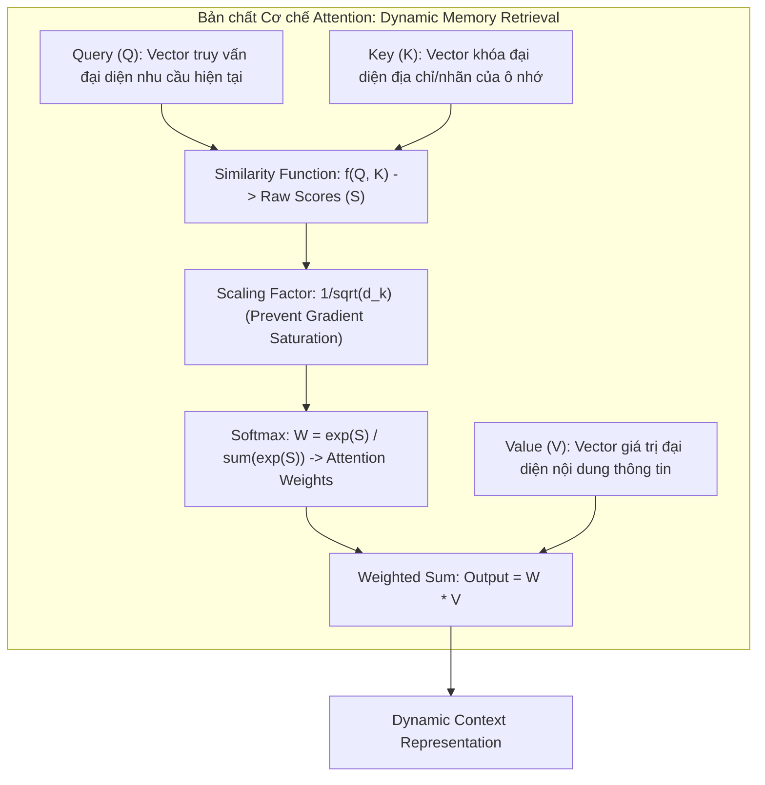

---

## 2. Chi tiết từng Keyword

---

### 1. Attention Mechanism (Cơ chế Chú ý)

#### a. Định nghĩa Bản chất Toán học
Về mặt toán học, **Attention Mechanism** là một ánh xạ khả vi từ một vector truy vấn $q \in \mathbb{R}^{d_k}$ và một tập hợp các cặp khóa-giá trị $\{(k_i, v_i)\}_{i=1}^m$ với $k_i \in \mathbb{R}^{d_k}, v_i \in \mathbb{R}^{d_v}$ thành một vector ngữ cảnh $c \in \mathbb{R}^{d_v}$:
$$\text{Attention}(q, K, V) = \sum_{i=1}^m \alpha_i v_i$$
Trong đó các trọng số liên kết mềm $\alpha_i \in [0, 1]$ thỏa mãn điều kiện phân phối xác suất $\sum_{i=1}^m \alpha_i = 1$, được suy ra từ hàm tính độ tương đồng $e_i = f_{\text{sim}}(q, k_i)$:
$$\alpha_i = \frac{\exp(e_i)}{\sum_{j=1}^m \exp(e_j)} = \text{Softmax}(e)_i$$

#### b. Cơ chế Tầng Sâu & Điện toán (Internals)
- **Độ phức tạp tính toán**: Với chuỗi độ dài $N$, ma trận tương tác $Q K^T$ đòi hỏi $\mathcal{O}(N^2 d)$ phép nhân cộng dấu phẩy động (FLOPs).
- **Bộ nhớ & Băng thông (Memory-Bound)**: Softmax yêu cầu lưu trữ toàn bộ ma trận $N \times N$ trên GPU HBM (High Bandwidth Memory), gây áp lực lớn lên bộ nhớ khi chuỗi dài ($N \ge 4096$).
- **SRAM vs HBM**: Trong tính toán thuần túy, việc nạp và ghi ma trận chú ý qua lại giữa HBM và SRAM của GPU Streaming Multiprocessor (SM) tạo thành hiện tượng nghẽn băng thông bộ nhớ (Memory-bound kernel).

#### c. Sơ đồ Minh họa
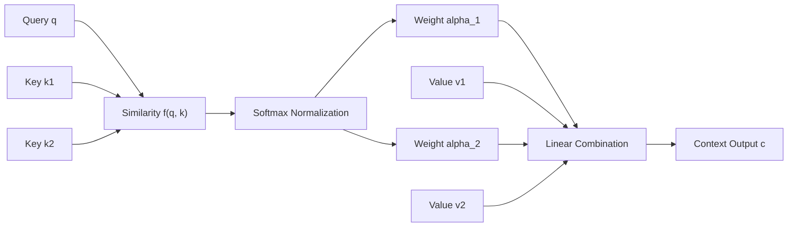

#### d. Code Thực chiến (C++ & Python)
```cpp
// C++17: Triển khai Attention trừu tượng với con trỏ thuần
#include <iostream>
#include <vector>
#include <cmath>
#include <numeric>

std::vector<float> naive_attention(const std::vector<float>& q, 
                                   const std::vector<std::vector<float>>& K, 
                                   const std::vector<std::vector<float>>& V) {
    size_t m = K.size();
    size_t d_k = q.size();
    size_t d_v = V[0].size();
    std::vector<float> scores(m, 0.0f);
    
    // 1. Dot-product similarity
    for (size_t i = 0; i < m; ++i) {
        float dot = 0.0f;
        for (size_t j = 0; j < d_k; ++j) dot += q[j] * K[i][j];
        scores[i] = dot / std::sqrt(static_cast<float>(d_k));
    }
    
    // 2. Numerically stable Softmax
    float max_s = *std::max_element(scores.begin(), scores.end());
    float sum_exp = 0.0f;
    for (size_t i = 0; i < m; ++i) {
        scores[i] = std::exp(scores[i] - max_s);
        sum_exp += scores[i];
    }
    for (size_t i = 0; i < m; ++i) scores[i] /= sum_exp;
    
    // 3. Weighted aggregation
    std::vector<float> context(d_v, 0.0f);
    for (size_t i = 0; i < m; ++i) {
        for (size_t j = 0; j < d_v; ++j) {
            context[j] += scores[i] * V[i][j];
        }
    }
    return context;
}
```

```python
# PyTorch: Khái niệm cốt lõi Attention
import torch
import torch.nn.functional as F

def basic_attention(q: torch.Tensor, k: torch.Tensor, v: torch.Tensor) -> torch.Tensor:
    # q: [batch, d_k], k: [batch, seq_len, d_k], v: [batch, seq_len, d_v]
    d_k = q.size(-1)
    # scores: [batch, seq_len]
    scores = torch.bmm(k, q.unsqueeze(-1)).squeeze(-1) / (d_k ** 0.5)
    weights = F.softmax(scores, dim=-1) # [batch, seq_len]
    context = torch.bmm(weights.unsqueeze(1), v).squeeze(1) # [batch, d_v]
    return context
```

#### e. Lỗi Thường gặp & Ổn định Số học
- **Tràn số Softmax**: Nếu không trừ đi $\max(e_i)$, $\exp(e_i)$ với $e_i > 88.7$ (đối với float32) sẽ sinh ra `+inf`, dẫn tới phép chia `inf / inf = NaN`.
- **Vanishing Gradients**: Khi các giá trị điểm số quá lớn, đạo hàm của hàm softmax tiệm cận 0, khiến quá trình học bị đóng băng.

#### f. Ứng dụng Thực chiến trong AI
- Toàn bộ các mô hình Ngôn ngữ Lớn (LLMs như GPT-4, LLaMA-3), Vision Transformers (ViT), mô hình Diffusion (Cross-Attention trong Stable Diffusion giữa văn bản và latent features).

---

### 2. Query (Q)

#### a. Định nghĩa Bản chất Toán học
**Query** $\mathbf{Q} \in \mathbb{R}^{N \times d_k}$ là ma trận biểu diễn các truy vấn thông tin xuất phát từ các vị trí cần tạo ra trạng thái biểu diễn mới. Với một chuỗi token đầu vào $\mathbf{X} \in \mathbb{R}^{N \times d_{model}}$, Query được tạo ra qua một phép biến đổi tuyến tính có trọng số khả vi $\mathbf{W}_Q \in \mathbb{R}^{d_{model} \times d_k}$:
$$\mathbf{Q} = \mathbf{X} \mathbf{W}_Q$$

#### b. Cơ chế Tầng Sâu & Điện toán
- **Linear Projection GEMM**: Tính $\mathbf{Q}$ là một phép nhân ma trận tổng quát (General Matrix Multiply - GEMM) với kích thước $[N, d_{model}] \times [d_{model}, d_k]$.
- **Hardware Mapping**: Trên GPU Tensor Cores, phép toán này được tối ưu thông qua tiling FP16/BF16 thành các warp block (ví dụ $16 \times 16 \times 16$).
- **Inference vs Training**: Trong quá trình sinh autoregressive inference, $N = 1$ (chỉ nạp token hiện tại), biến phép tính thành Matrix-Vector Multiplication (GEMV), khiến việc tính Q hoàn toàn phụ thuộc băng thông bộ nhớ trọng số.

#### c. Sơ đồ Minh họa
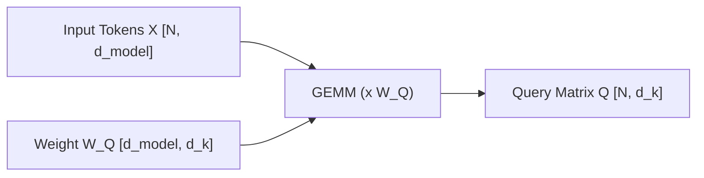

#### d. Code Thực chiến (C++ & Python)
```cpp
// C++20: Chiếu tuyến tính Query với Row-Major Memory
#include <vector>

void project_query(const float* X, const float* W_Q, float* Q, 
                   int N, int d_model, int d_k) {
    // Q = X * W_Q: [N x d_model] * [d_model x d_k] -> [N x d_k]
    for (int i = 0; i < N; ++i) {
        for (int j = 0; j < d_k; ++j) {
            float sum = 0.0f;
            for (int k = 0; k < d_model; ++k) {
                sum += X[i * d_model + k] * W_Q[k * d_k + j];
            }
            Q[i * d_k + j] = sum;
        }
    }
}
```

```python
import torch
import torch.nn as nn

class QueryProjection(nn.Module):
    def __init__(self, d_model: int, d_k: int):
        super().__init__()
        self.w_q = nn.Linear(d_model, d_k, bias=False)
        
    def forward(self, x: torch.Tensor) -> torch.Tensor:
        # x: [B, N, d_model] -> Q: [B, N, d_k]
        return self.w_q(x)
```

#### e. Lỗi Thường gặp & Ổn định Số học
- Quên scale phương sai khi khởi tạo trọng số $\mathbf{W}_Q$: Nên dùng khởi tạo Xavier/Glorot ($Var(W) = \frac{2}{d_{model} + d_k}$) để giữ phương sai của $Q$ xấp xỉ 1, tránh gây bất ổn định cho phép tính tích vô hướng tiếp theo.

#### f. Ứng dụng Thực chiến trong AI
- Trong Decoder self-attention: Query đại diện cho token đang được giải mã. Trong Cross-attention: Query đến từ trạng thái Decoder, tìm kiếm thông tin từ Encoder.

---

### 3. Key (K)

#### a. Định nghĩa Bản chất Toán học
**Key** $\mathbf{K} \in \mathbb{R}^{M \times d_k}$ là ma trận các vector khóa, đóng vai trò như các nhãn mô tả hoặc địa chỉ của ô nhớ trong bộ nhớ ngữ cảnh. Với đầu vào ngữ cảnh $\mathbf{Y} \in \mathbb{R}^{M \times d_{model}}$ (trong Self-Attention thì $\mathbf{Y} = \mathbf{X}$), Key được chiếu qua ma trận trọng số $\mathbf{W}_K \in \mathbb{R}^{d_{model} \times d_k}$:
$$\mathbf{K} = \mathbf{Y} \mathbf{W}_K$$

#### b. Cơ chế Tầng Sâu & Điện toán
- **KV Cache Memory Footprint**: Trong inference LLM, toàn bộ các vector Key của các token trước đó phải được giữ lại trong VRAM (KV Cache) để tránh tính toán lại:
  $$\text{Memory}_{K} = 2 \times B \times L \times n_{\text{layers}} \times n_{\text{heads}} \times d_k \times \text{sizeof(FP16)}$$
- Khi sequence length $L = 128\text{K}$, dung lượng KV Cache vượt qua cả trọng số mô hình.

#### c. Sơ đồ Minh họa
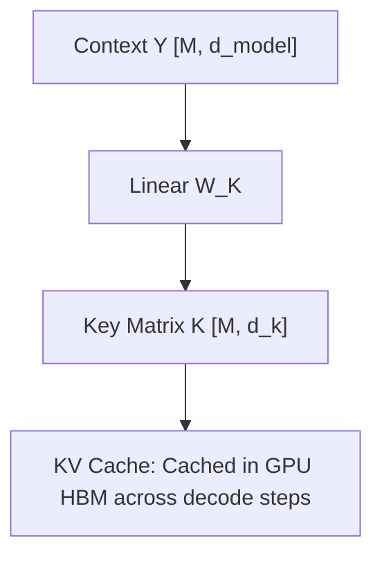

#### d. Code Thực chiến (C++ & Python)
```cpp
// C++17: Khởi tạo và append vector Key vào Buffer liên tục (KV Cache simulation)
#include <vector>
#include <cstring>

struct KeyCache {
    std::vector<float> buffer;
    int max_seq_len;
    int d_k;
    int current_len = 0;

    KeyCache(int max_len, int dim) : max_seq_len(max_len), d_k(dim) {
        buffer.resize(max_len * dim, 0.0f);
    }

    void append_key(const float* new_key) {
        if (current_len < max_seq_len) {
            std::memcpy(&buffer[current_len * d_k], new_key, d_k * sizeof(float));
            current_len++;
        }
    }
};
```

```python
import torch
import torch.nn as nn

class KeyProjectionWithCache(nn.Module):
    def __init__(self, d_model: int, d_k: int):
        super().__init__()
        self.w_k = nn.Linear(d_model, d_k, bias=False)

    def forward(self, x: torch.Tensor, past_k: torch.Tensor = None) -> tuple[torch.Tensor, torch.Tensor]:
        current_k = self.w_k(x) # [B, 1, d_k]
        if past_k is not None:
            full_k = torch.cat([past_k, current_k], dim=1)
        else:
            full_k = current_k
        return current_k, full_k
```

#### e. Lỗi Thường gặp & Ổn định Số học
- Kích thước chiều đặc trưng $d_k$ của Key bắt buộc phải bằng chính xác $d_k$ của Query để phép nhân $Q K^T$ hợp lệ.

#### f. Ứng dụng Thực chiến trong AI
- Quản lý bộ nhớ PagedAttention trong vLLM: Chia nhỏ ma trận Key thành các trang bộ nhớ vật lý không liên tục để loại bỏ phân mảnh bộ nhớ VRAM.

---

### 4. Value (V)

#### a. Định nghĩa Bản chất Toán học
**Value** $\mathbf{V} \in \mathbb{R}^{M \times d_v}$ là ma trận các vector giá trị, mang nội dung thông tin thực sự cần được trích xuất và tổng hợp. Khi mạng xác định được các vùng chú ý thông qua tương tác giữa Query và Key, nó sẽ lấy tổ hợp tuyến tính các hàng của Value:
$$\mathbf{V} = \mathbf{Y} \mathbf{W}_V, \quad \mathbf{W}_V \in \mathbb{R}^{d_{model} \times d_v}$$

#### b. Cơ chế Tầng Sâu & Điện toán
- Trong khi Query và Key buộc phải có cùng số chiều $d_k$, Value có thể có số chiều $d_v \neq d_k$. Tuy nhiên, trong hầu hết kiến trúc Transformer hiện đại, người ta chọn $d_k = d_v = d_{model} / h$ để đảm bảo tính đối xứng và tối ưu hóa bộ nhớ đệm ma trận.
- Vector Value được lưu trong KV Cache song song cùng vector Key.

#### c. Sơ đồ Minh họa
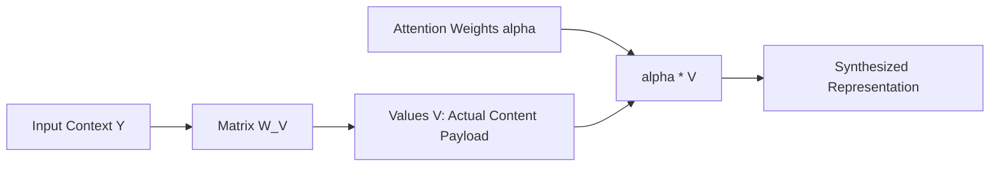

#### d. Code Thực chiến (C++ & Python)
```cpp
// C++17: Tính tổng có trọng số của các Vector Value với AVX2
#include <vector>

void weighted_sum_values(const float* weights, const float* V, float* out, 
                         int seq_len, int d_v) {
    for (int j = 0; j < d_v; ++j) out[j] = 0.0f;
    for (int i = 0; i < seq_len; ++i) {
        float w = weights[i];
        for (int j = 0; j < d_v; ++j) {
            out[j] += w * V[i * d_v + j];
        }
    }
}
```

```python
import torch
import torch.nn as nn

class ValueProjection(nn.Module):
    def __init__(self, d_model: int, d_v: int):
        super().__init__()
        self.w_v = nn.Linear(d_model, d_v, bias=False)

    def forward(self, x: torch.Tensor) -> torch.Tensor:
        return self.w_v(x)
```

#### e. Lỗi Thường gặp & Ổn định Số học
- Lỗi tích lũy sai số làm tròn khi $M$ rất lớn: Tổng hàng triệu phần tử có trọng số có thể gây mất độ chính xác (catastrophic cancellation). Kahan summation hoặc tính toán tích lũy ở FP32 trước khi ép kiểu về BF16 là bắt buộc.

#### f. Ứng dụng Thực chiến trong AI
- Trong RAG (Retrieval-Augmented Generation), vector Value đóng vai trò như các đoạn văn bản chunk thực tế được truy vấn từ vector database.

---

### 5. Query-Key Similarity (Độ tương đồng Query-Key)

#### a. Định nghĩa Bản chất Toán học
**Query-Key Similarity** là hàm đo khoảng cách hoặc mức độ tương thích ngữ nghĩa giữa vector truy vấn $\mathbf{q}$ và vector khóa $\mathbf{k}$.
- Dạng Dot-Product: $\text{sim}(\mathbf{q}, \mathbf{k}) = \mathbf{q}^T \mathbf{k}$
- Dạng Cosine: $\text{sim}(\mathbf{q}, \mathbf{k}) = \frac{\mathbf{q}^T \mathbf{k}}{\|\mathbf{q}\|_2 \|\mathbf{k}\|_2}$
- Dạng Mahalanobis: $\text{sim}(\mathbf{q}, \mathbf{k}) = \mathbf{q}^T \mathbf{M} \mathbf{k}$

#### b. Cơ chế Tầng Sâu & Điện toán
- Dot-product được ưu tiên tuyệt đối so với Cosine Similarity vì nó tương đương trực tiếp với phép nhân ma trận GEMM trên phần cứng, tận dụng tối đa kiến trúc Systolic Array của Google TPU hoặc Tensor Core của GPU NVIDIA mà không cần tính căn bậc hai và phép chia đắt đỏ.

#### c. Sơ đồ Minh họa
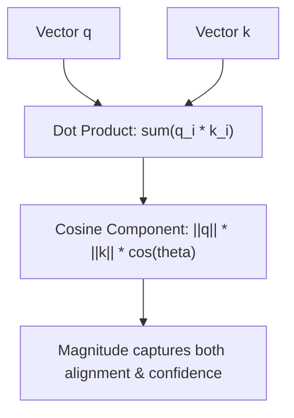

#### d. Code Thực chiến (C++ & Python)
```cpp
// C++20: Tính dot product tối ưu
#include <vector>
#include <numeric>

float dot_similarity(const float* q, const float* k, int d_k) {
    float sim = 0.0f;
    #pragma omp simd reduction(+:sim)
    for (int i = 0; i < d_k; ++i) {
        sim += q[i] * k[i];
    }
    return sim;
}
```

```python
import torch

def compute_similarity(q: torch.Tensor, k: torch.Tensor) -> torch.Tensor:
    # q: [B, N, D], k: [B, M, D] -> sim: [B, N, M]
    return torch.matmul(q, k.transpose(-2, -1))
```

#### e. Lỗi Thường gặp & Ổn định Số học
- Nếu $\|\mathbf{q}\|$ hoặc $\|\mathbf{k}\|$ tăng tỷ lệ thuận với số chiều $d_k$, giá trị dot-product sẽ có độ lệch chuẩn $\sigma = \sqrt{d_k}$, dẫn đến các giá trị số cực lớn làm bão hòa softmax.

#### f. Ứng dụng Thực chiến trong AI
- Định vị token liên quan trong ngữ cảnh dài: Ví dụ từ "Apple" (Query) khớp với "iPhone" (Key) thông qua không gian biểu diễn ẩn chung.

---

### 6. Attention Scores (Điểm Chú ý)

#### a. Định nghĩa Bản chất Toán học
**Attention Scores** $\mathbf{S} \in \mathbb{R}^{N \times M}$ là ma trận các giá trị vô hướng biểu thị mức độ tương quan thô (chưa chuẩn hóa phân phối xác suất) giữa mọi cặp Query $i$ và Key $j$:
$$\mathbf{S}_{ij} = f_{\text{sim}}(\mathbf{q}_i, \mathbf{k}_j)$$
Trong Scaled Dot-Product Attention:
$$\mathbf{S} = \frac{\mathbf{Q} \mathbf{K}^T}{\sqrt{d_k}}$$

#### b. Cơ chế Tầng Sâu & Điện toán
- Ma trận $\mathbf{S}$ có kích thước hình học $[B, H, N, M]$ trong đó $B$ là batch size, $H$ là số head, $N$ là seq_len của Q, $M$ là seq_len của K.
- Khi $N = M = 32768$, một ma trận $\mathbf{S}$ đơn lẻ tiêu tốn:
  $$32768 \times 32768 \times 2 \text{ bytes (FP16)} \approx 2.147 \text{ GB}$$
  Mỗi head tiêu tốn hơn 2 GB VRAM chỉ để chứa Attention Scores, minh chứng cho sự bùng nổ bậc hai của bộ nhớ.

#### c. Sơ đồ Minh họa
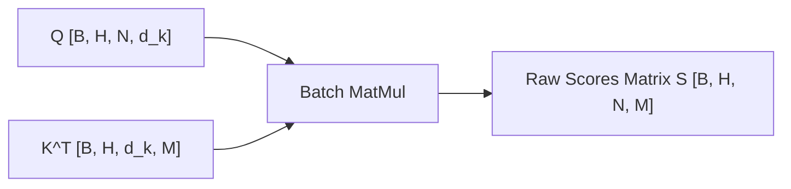

#### d. Code Thực chiến (C++ & Python)
```cpp
// C++17: Tính toán Scores ma trận
#include <vector>

void compute_attention_scores(const float* Q, const float* K, float* S, 
                              int N, int M, int d_k, float scale) {
    for (int i = 0; i < N; ++i) {
        for (int j = 0; j < M; ++j) {
            float sum = 0.0f;
            for (int k = 0; k < d_k; ++k) {
                sum += Q[i * d_k + k] * K[j * d_k + k];
            }
            S[i * M + j] = sum * scale;
        }
    }
}
```

```python
import torch

def get_attention_scores(q: torch.Tensor, k: torch.Tensor) -> torch.Tensor:
    d_k = q.size(-1)
    scores = torch.matmul(q, k.transpose(-2, -1)) / (d_k ** 0.5)
    return scores
```

#### e. Lỗi Thường gặp & Ổn định Số học
- Quên nhân hệ số tỉ lệ $1/\sqrt{d_k}$ khiến các phần tử trong $\mathbf{S}$ vọt lên hàng trăm, biến Softmax thành phân phối One-Hot (mất tính gradient mềm).

#### f. Ứng dụng Thực chiến trong AI
- Được áp dụng trực tiếp trong các ma trận Attention Visualization để kiểm tra hành vi mô hình (xem từ nào chú ý đến từ nào).

---

### 7. Attention Weights (Trọng số Chú ý)

#### a. Định nghĩa Bản chất Toán học
**Attention Weights** $\mathbf{A} \in \mathbb{R}^{N \times M}$ là ma trận xác suất hợp lệ thu được sau khi áp dụng hàm Softmax dọc theo chiều khóa (chiều cuối cùng) của ma trận Attention Scores:
$$\mathbf{A}_{ij} = \frac{\exp(\mathbf{S}_{ij})}{\sum_{l=1}^M \exp(\mathbf{S}_{il})}, \quad \text{với } \sum_{j=1}^M \mathbf{A}_{ij} = 1, \quad \forall i$$
Mỗi hàng $\mathbf{A}_{i,:}$ là một phân phối xác suất rời rạc xác định tỷ trọng thông tin cần trích xuất từ các vector Value tương ứng.

#### b. Cơ chế Tầng Sâu & Điện toán
- **GPU Softmax Kernel**: Softmax là phép toán Reduction (tìm max và sum). Việc tính Softmax trên GPU đòi hỏi các thread trong một Warp/Block phải giao tiếp và đồng bộ thông qua Shuffle Instructions (`__shfl_down_sync`) hoặc Shared Memory.
- Sau khi Softmax hoàn thành, kết quả $\mathbf{A}$ phải được ghi ngược lại HBM trong thuật toán chuẩn, gây lãng phí bộ nhớ băng thông lớn.

#### c. Sơ đồ Minh họa
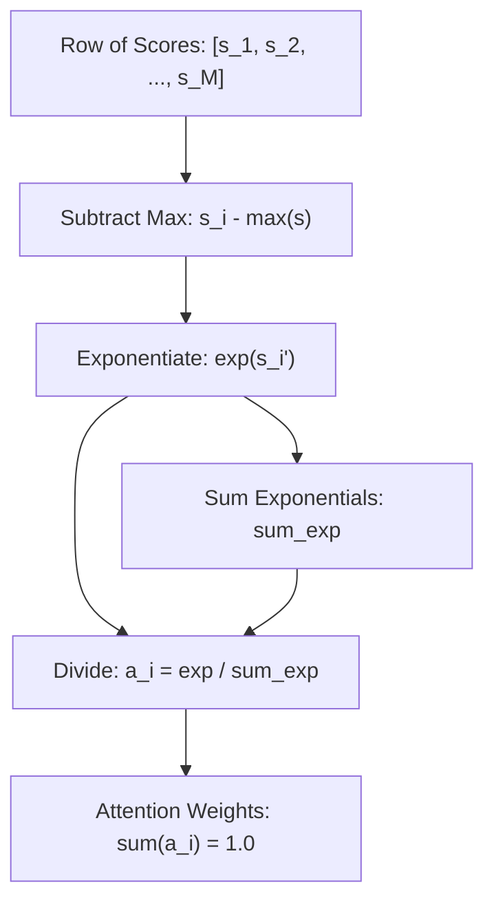

#### d. Code Thực chiến (C++ & Python)
```cpp
// C++17: Safe Softmax dọc theo hàng
#include <vector>
#include <cmath>
#include <algorithm>

void rowwise_softmax(float* S, int N, int M) {
    for (int i = 0; i < N; ++i) {
        float* row = &S[i * M];
        float max_val = *std::max_element(row, row + M);
        float sum = 0.0f;
        for (int j = 0; j < M; ++j) {
            row[j] = std::exp(row[j] - max_val);
            sum += row[j];
        }
        float inv_sum = 1.0f / sum;
        for (int j = 0; j < M; ++j) {
            row[j] *= inv_sum;
        }
    }
}
```

```python
import torch
import torch.nn.functional as F

def get_attention_weights(scores: torch.Tensor) -> torch.Tensor:
    # scores: [B, H, N, M]
    weights = F.softmax(scores, dim=-1)
    return weights
```

#### e. Lỗi Thường gặp & Ổn định Số học
- Thực hiện Softmax sai chiều (`dim=-2` thay vì `dim=-1`) khiến việc chuẩn hóa diễn ra giữa các Query khác nhau thay vì chuẩn hóa giữa các Key của cùng một Query.

#### f. Ứng dụng Thực chiến trong AI
- Trọng số Chú ý cung cấp tính giải thích được (Explainability) cục bộ cho mô hình: phân tích các Attention Head chuyên biệt như induction heads, syntactic heads trong LLM.

---

### 8. Scaled Dot-Product Attention

#### a. Định nghĩa Bản chất Toán học
Được giới thiệu trong bài báo kinh điển *"Attention Is All You Need"* (Vaswani et al., 2017), **Scaled Dot-Product Attention** tích hợp toàn bộ các bước tính toán trên vào một công thức duy nhất:
$$\text{Attention}(\mathbf{Q}, \mathbf{K}, \mathbf{V}) = \text{Softmax}\left(\frac{\mathbf{Q} \mathbf{K}^T}{\sqrt{d_k}}\right) \mathbf{V}$$
Lý do chia cho $\sqrt{d_k}$: Giả sử các thành phần của $\mathbf{q}$ và $\mathbf{k}$ là các biến ngẫu nhiên độc lập có kỳ vọng bằng 0 và phương sai bằng 1:
$$\mathbb{E}[\mathbf{q}_i] = 0, \quad \text{Var}(\mathbf{q}_i) = 1, \quad \mathbb{E}[\mathbf{k}_i] = 0, \quad \text{Var}(\mathbf{k}_i) = 1$$
Tích vô hướng $\mathbf{q} \cdot \mathbf{k} = \sum_{i=1}^{d_k} q_i k_i$ sẽ có kỳ vọng và phương sai:
$$\mathbb{E}[\mathbf{q} \cdot \mathbf{k}] = 0, \quad \text{Var}(\mathbf{q} \cdot \mathbf{k}) = \sum_{i=1}^{d_k} \text{Var}(q_i k_i) = \sum_{i=1}^{d_k} 1 = d_k$$
Do đó, khi $d_k$ lớn, giá trị tích vô hướng có độ lệch chuẩn $\sigma = \sqrt{d_k}$. Phép chia cho $\sqrt{d_k}$ đưa phương sai trở về 1, giữ cho giá trị điểm số nằm trong vùng có đạo hàm tốt của hàm Softmax.

#### b. Cơ chế Tầng Sâu & Điện toán
- **Hai phép GEMM liên tiếp**:
  1. $\mathbf{GEMM}_1$: $\mathbf{Q} [N, d_k] \times \mathbf{K}^T [d_k, M] \to \mathbf{S} [N, M]$ (FLOPs: $2 N M d_k$).
  2. $\mathbf{GEMM}_2$: $\mathbf{A} [N, M] \times \mathbf{V} [M, d_v] \to \mathbf{O} [N, d_v]$ (FLOPs: $2 N M d_v$).
- Tổng FLOPs cho Scaled Dot-Product Attention: $4 N M d$ (với $d_k = d_v = d$).

#### c. Sơ đồ Minh họa
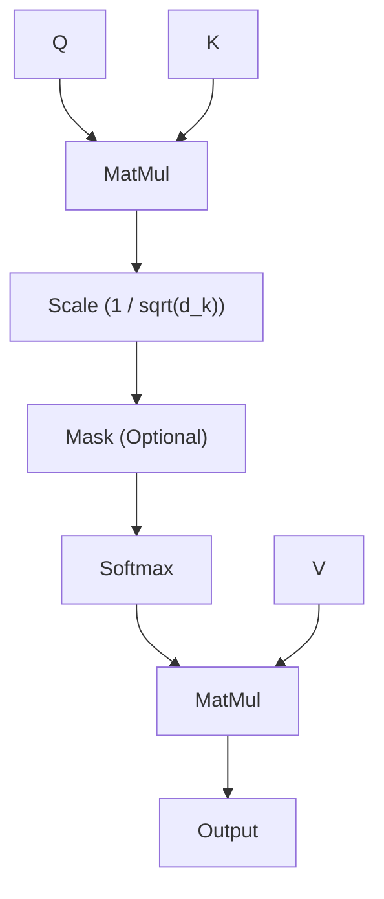

#### d. Code Thực chiến (C++ & Python)
```cpp
// C++17: Triển khai toàn diện Scaled Dot-Product Attention
#include <vector>
#include <cmath>
#include <algorithm>

std::vector<float> scaled_dot_product_attention(
    const std::vector<float>& Q, const std::vector<float>& K, const std::vector<float>& V,
    int N, int M, int d_k, int d_v) {
    
    std::vector<float> S(N * M, 0.0f);
    float scale = 1.0f / std::sqrt(static_cast<float>(d_k));
    
    // 1. Q * K^T / sqrt(d_k)
    for (int i = 0; i < N; ++i) {
        for (int j = 0; j < M; ++j) {
            float sum = 0.0f;
            for (int k = 0; k < d_k; ++k) sum += Q[i * d_k + k] * K[j * d_k + k];
            S[i * M + j] = sum * scale;
        }
    }
    
    // 2. Softmax row-wise
    for (int i = 0; i < N; ++i) {
        float max_val = -1e9f;
        for (int j = 0; j < M; ++j) max_val = std::max(max_val, S[i * M + j]);
        float sum_exp = 0.0f;
        for (int j = 0; j < M; ++j) {
            S[i * M + j] = std::exp(S[i * M + j] - max_val);
            sum_exp += S[i * M + j];
        }
        for (int j = 0; j < M; ++j) S[i * M + j] /= sum_exp;
    }
    
    // 3. Scores * V
    std::vector<float> O(N * d_v, 0.0f);
    for (int i = 0; i < N; ++i) {
        for (int j = 0; j < d_v; ++j) {
            float sum = 0.0f;
            for (int k = 0; k < M; ++k) sum += S[i * M + k] * V[k * d_v + j];
            O[i * d_v + j] = sum;
        }
    }
    return O;
}
```

```python
import torch
import torch.nn.functional as F

def scaled_dot_product_attention(q: torch.Tensor, k: torch.Tensor, v: torch.Tensor, mask: torch.Tensor = None) -> torch.Tensor:
    # q: [B, H, N, d_k], k: [B, H, M, d_k], v: [B, H, M, d_v]
    d_k = q.size(-1)
    scores = torch.matmul(q, k.transpose(-2, -1)) / math.sqrt(d_k)
    if mask is not None:
        scores = scores.masked_fill(mask == 0, -1e9)
    weights = F.softmax(scores, dim=-1)
    output = torch.matmul(weights, v)
    return output
```

#### e. Lỗi Thường gặp & Ổn định Số học
- Khởi tạo giá trị mask âm vô cùng bằng `-float('inf')`: Trong FP16, `-inf` trừ đi một số khác có thể sinh ra NaN trong phép toán phân tán. Giá trị an toàn chuẩn là `-1e4` cho FP16 hoặc `-1e9` cho FP32.

#### f. Ứng dụng Thực chiến trong AI
- Trái tim của mọi khối Transformer layer trong GPT-4, Gemini, Claude, LLaMA, BERT và ViT.

---

### 9. Additive Attention (Chú ý Cộng tính)

#### a. Định nghĩa Bản chất Toán học
Được giới thiệu bởi Bahdanau et al. (2014), **Additive Attention** tính điểm tương thích bằng mạng nơ-ron truyền thẳng 1 lớp ẩn với hàm kích hoạt phi tuyến (tanh):
$$e_{ij} = \mathbf{v}_a^T \tanh(\mathbf{W}_a \mathbf{s}_{i-1} + \mathbf{U}_a \mathbf{h}_j)$$
Trong đó $\mathbf{s}_{i-1} \in \mathbb{R}^{d_s}$ là trạng thái ẩn của Decoder (Query), $\mathbf{h}_j \in \mathbb{R}^{d_h}$ là trạng thái ẩn của Encoder (Key), $\mathbf{W}_a \in \mathbb{R}^{d_a \times d_s}, \mathbf{U}_a \in \mathbb{R}^{d_a \times d_h}$, và $\mathbf{v}_a \in \mathbb{R}^{d_a}$ là vector trọng số học được.

#### b. Cơ chế Tầng Sâu & Điện toán
- Khác với dot-product attention vốn chỉ là phép nhân ma trận thuần túy, Additive Attention đòi hỏi tính toán phép cộng phát sóng (broadcast add), hàm phi tuyến $\tanh$, và nhân vector.
- Phép tính này không thể ánh xạ hiệu quả lên kiến trúc Systolic Array / Tensor Core, dẫn tới thông lượng tính toán (TFLOPS) thấp hơn rất nhiều so với dot-product attention.

#### c. Sơ đồ Minh họa
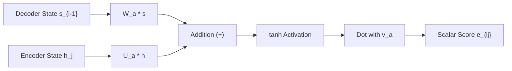

#### d. Code Thực chiến (C++ & Python)
```cpp
// C++17: Additive Attention Scoring
#include <vector>
#include <cmath>

float additive_score(const std::vector<float>& s, const std::vector<float>& h,
                     const std::vector<std::vector<float>>& W_a,
                     const std::vector<std::vector<float>>& U_a,
                     const std::vector<float>& v_a, int d_a) {
    float final_score = 0.0f;
    for (int a = 0; a < d_a; ++a) {
        float term_s = 0.0f;
        for (size_t i = 0; i < s.size(); ++i) term_s += W_a[a][i] * s[i];
        float term_h = 0.0f;
        for (size_t j = 0; j < h.size(); ++j) term_h += U_a[a][j] * h[j];
        
        float hidden = std::tanh(term_s + term_h);
        final_score += v_a[a] * hidden;
    }
    return final_score;
}
```

```python
import torch
import torch.nn as nn

class AdditiveAttention(nn.Module):
    def __init__(self, query_dim: int, key_dim: int, hidden_dim: int):
        super().__init__()
        self.w_q = nn.Linear(query_dim, hidden_dim, bias=False)
        self.w_k = nn.Linear(key_dim, hidden_dim, bias=False)
        self.v_a = nn.Linear(hidden_dim, 1, bias=False)

    def forward(self, query: torch.Tensor, keys: torch.Tensor) -> torch.Tensor:
        # query: [B, 1, D_q], keys: [B, M, D_k]
        q_proj = self.w_q(query) # [B, 1, H]
        k_proj = self.w_k(keys)  # [B, M, H]
        scores = self.v_a(torch.tanh(q_proj + k_proj)).squeeze(-1) # [B, M]
        weights = torch.softmax(scores, dim=-1)
        return weights
```

#### e. Lỗi Thường gặp & Ổn định Số học
- Khối lượng tham số lớn: Additive attention có số lượng tham số học được lớn hơn nhiều so với Dot-Product Attention (thêm ma trận $\mathbf{W}_a, \mathbf{U}_a, \mathbf{v}_a$).

#### f. Ứng dụng Thực chiến trong AI
- Mô hình Sequence-to-Sequence kinh điển trong dịch máy NMT giai đoạn 2014–2017, nhận dạng giọng nói ASR (Listen, Attend and Spell).

---

### 10. Multiplicative Attention (Chú ý Nhân tính)

#### a. Định nghĩa Bản chất Toán học
**Multiplicative Attention** (hay General Attention theo Luong et al., 2015) sử dụng một ma trận trọng số khả vi $\mathbf{W}_a \in \mathbb{R}^{d_s \times d_h}$ đặt giữa Query và Key để mô hình hóa tương quan tuyến tính tổng quát:
$$e_{ij} = \mathbf{s}_i^T \mathbf{W}_a \mathbf{h}_j$$
Nếu $\mathbf{W}_a = \mathbf{I}$, nó suy biến thành Dot-Product Attention thông thường. Nếu $d_s = d_h$, ma trận $\mathbf{W}_a$ có thể coi như một phép biến đổi cơ sở xoay và scale không gian vector của Key trước khi đo tích vô hướng với Query.

#### b. Cơ chế Tầng Sâu & Điện toán
- Triển khai thành hai phép nhân ma trận: $(\mathbf{S} \mathbf{W}_a) \mathbf{H}^T$.
- Tận dụng GEMM hoàn hảo hơn Additive Attention, giúp tốc độ huấn luyện trên GPU tăng gấp 2 đến 3 lần so với Additive Attention ở cùng kích thước chiều ẩn.

#### c. Sơ đồ Minh họa
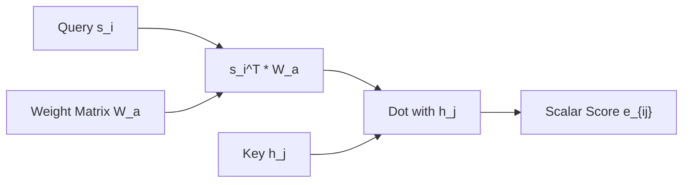

#### d. Code Thực chiến (C++ & Python)
```cpp
// C++17: Multiplicative Attention Score
#include <vector>

float multiplicative_score(const float* s, const float* h, const float* W_a, int d_s, int d_h) {
    float score = 0.0f;
    for (int j = 0; j < d_h; ++j) {
        float s_W = 0.0f;
        for (int i = 0; i < d_s; ++i) {
            s_W += s[i] * W_a[i * d_h + j];
        }
        score += s_W * h[j];
    }
    return score;
}
```

```python
import torch
import torch.nn as nn

class MultiplicativeAttention(nn.Module):
    def __init__(self, query_dim: int, key_dim: int):
        super().__init__()
        self.w_a = nn.Linear(query_dim, key_dim, bias=False)

    def forward(self, query: torch.Tensor, keys: torch.Tensor) -> torch.Tensor:
        # query: [B, 1, D_q], keys: [B, M, D_k]
        q_trans = self.w_a(query) # [B, 1, D_k]
        scores = torch.bmm(q_trans, keys.transpose(1, 2)).squeeze(1) # [B, M]
        return torch.softmax(scores, dim=-1)
```

#### e. Lỗi Thường gặp & Ổn định Số học
- Khi $d_s, d_h$ rất lớn, ma trận $\mathbf{W}_a$ dễ bị ill-conditioned (số điều kiện $\kappa$ quá lớn), khiến gradient truyền qua $\mathbf{W}_a$ bị bùng nổ.

#### f. Ứng dụng Thực chiến trong AI
- Nền tảng trung gian dẫn tới thiết kế ma trận $\mathbf{W}_Q, \mathbf{W}_K$ phân rã bậc thấp (Low-rank factorization) trong kiến trúc Transformer.

---

### 11. Bahdanau Attention (Chú ý Bahdanau)

#### a. Định nghĩa Bản chất Toán học
**Bahdanau Attention** (còn gọi là *Global Additive Attention*) được thiết kế cho mô hình dịch máy nơ-ron (NMT) với kiến trúc Encoder-Decoder RNN:
$$e_{ij} = \mathbf{v}_a^T \tanh(\mathbf{W}_a \mathbf{s}_{i-1} + \mathbf{U}_a \mathbf{h}_j)$$
$$\alpha_{ij} = \frac{\exp(e_{ij})}{\sum_{k=1}^{T_x} \exp(e_{ik})}, \quad \mathbf{c}_i = \sum_{j=1}^{T_x} \alpha_{ij} \mathbf{h}_j$$
Điểm mấu chốt: Trạng thái ẩn của Decoder tại bước $i$ được tính từ trạng thái trước đó $\mathbf{s}_{i-1}$, từ đầu vào hiện tại $y_{i-1}$, và từ vector ngữ cảnh $\mathbf{c}_i$:
$$\mathbf{s}_i = f(\mathbf{s}_{i-1}, y_{i-1}, \mathbf{c}_i)$$

#### b. Cơ chế Tầng Sâu & Điện toán
- Trong Bahdanau attention, vector ngữ cảnh $\mathbf{c}_i$ được đưa vào **trước** khi tính trạng thái ẩn hiện tại $\mathbf{s}_i$.
- Vì $\mathbf{U}_a \mathbf{h}_j$ không phụ thuộc vào bước giải mã $i$, toàn bộ các giá trị chiếu của Encoder $\mathbf{U}_a \mathbf{H}$ có thể được tiền tính toán một lần (pre-computed) trước vòng lặp giải mã, giúp tiết kiệm đáng kể thời gian tính toán.

#### c. Sơ đồ Minh họa
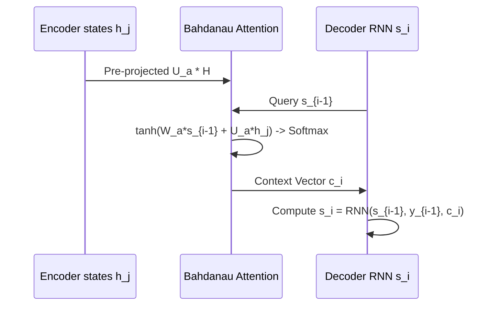

#### d. Code Thực chiến (C++ & Python)
```cpp
// C++17: Bahdanau Attention Step
#include <vector>
#include <cmath>

struct BahdanauStep {
    int hidden_dim;
    std::vector<float> v_a;
    
    std::vector<float> step(const std::vector<float>& s_prev,
                            const std::vector<std::vector<float>>& precomputed_Uh,
                            const std::vector<std::vector<float>>& W_a,
                            int seq_len) {
        std::vector<float> scores(seq_len, 0.0f);
        for (int j = 0; j < seq_len; ++j) {
            float sum = 0.0f;
            for (int d = 0; d < hidden_dim; ++d) {
                float w_s = 0.0f;
                for (size_t k = 0; k < s_prev.size(); ++k) w_s += W_a[d][k] * s_prev[k];
                sum += v_a[d] * std::tanh(w_s + precomputed_Uh[j][d]);
            }
            scores[j] = sum;
        }
        return scores;
    }
};
```

```python
import torch
import torch.nn as nn

class BahdanauDecoderCell(nn.Module):
    def __init__(self, enc_dim: int, dec_dim: int, att_dim: int):
        super().__init__()
        self.w_s = nn.Linear(dec_dim, att_dim, bias=False)
        self.w_h = nn.Linear(enc_dim, att_dim, bias=False)
        self.v_a = nn.Linear(att_dim, 1, bias=False)
        self.rnn_cell = nn.GRUCell(enc_dim + dec_dim, dec_dim)

    def forward(self, y_prev: torch.Tensor, s_prev: torch.Tensor, 
                h_enc: torch.Tensor, precomputed_Uh: torch.Tensor) -> tuple[torch.Tensor, torch.Tensor]:
        # s_prev: [B, dec_dim], precomputed_Uh: [B, T, att_dim]
        s_proj = self.w_s(s_prev).unsqueeze(1) # [B, 1, att_dim]
        scores = self.v_a(torch.tanh(s_proj + precomputed_Uh)).squeeze(-1) # [B, T]
        alpha = torch.softmax(scores, dim=-1) # [B, T]
        context = torch.bmm(alpha.unsqueeze(1), h_enc).squeeze(1) # [B, enc_dim]
        
        rnn_in = torch.cat([y_prev, context], dim=-1)
        s_curr = self.rnn_cell(rnn_in, s_prev)
        return s_curr, alpha
```

#### e. Lỗi Thường gặp & Ổn định Số học
- Không pre-compute $\mathbf{U}_a \mathbf{h}_j$: Khiến độ phức tạp của bước giải mã tăng từ $\mathcal{O}(T_y \cdot T_x)$ lên $\mathcal{O}(T_y \cdot T_x \cdot d_{enc})$.

#### f. Ứng dụng Thực chiến trong AI
- Cột mốc lịch sử khởi đầu kỷ nguyên Attention, biến hệ thống Google Neural Machine Translation (GNMT) thành chuẩn dịch thuật công nghiệp năm 2016.

---

### 12. Luong Attention (Chú ý Luong)

#### a. Định nghĩa Bản chất Toán học
Luong et al. (2015) đề xuất biến thể **Effective Attention** với hai điểm cải tiến chính:
1. Sử dụng trạng thái hiện tại của Decoder $\mathbf{s}_t$ (đã được tính từ bước RNN hiện tại) thay vì trạng thái trước đó $\mathbf{s}_{t-1}$.
2. Đề xuất ba hàm tính điểm số tương thích:
   $$\text{score}(\mathbf{s}_t, \mathbf{h}_i) = \begin{cases} \mathbf{s}_t^T \mathbf{h}_i & \text{Dot} \\ \mathbf{s}_t^T \mathbf{W}_a \mathbf{h}_i & \text{General} \\ \mathbf{v}_a^T \tanh(\mathbf{W}_a [\mathbf{s}_t; \mathbf{h}_i]) & \text{Concat} \end{cases}$$
Vector ngữ cảnh $\mathbf{c}_t$ sau đó được kết hợp với $\mathbf{s}_t$ để tạo thành vector biểu diễn chú ý cuối cùng:
$$\tilde{\mathbf{s}}_t = \tanh(\mathbf{W}_c [\mathbf{c}_t; \mathbf{s}_t])$$

#### b. Cơ chế Tầng Sâu & Điện toán
- Thứ tự tính toán: `RNN -> s_t -> Attention(s_t, H) -> c_t -> Attentional Vector s~_t -> Prediction`.
- Cấu trúc này tinh gọn hơn Bahdanau, giảm sự phụ thuộc tuần tự lồng ghép giữa Attention và RNN cell, mở đường cho việc tách biệt hoàn toàn module Attention.

#### c. Sơ đồ Minh họa
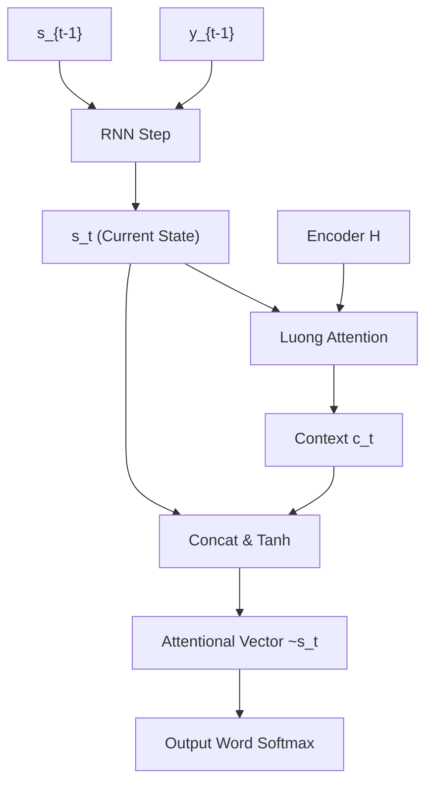

#### d. Code Thực chiến (C++ & Python)
```cpp
// C++17: Luong General Attention
#include <vector>

void luong_general_score(const float* s_t, const float* H, const float* W_a, 
                         float* scores, int seq_len, int d_dec, int d_enc) {
    std::vector<float> sW(d_enc, 0.0f);
    for (int j = 0; j < d_enc; ++j) {
        for (int i = 0; i < d_dec; ++i) {
            sW[j] += s_t[i] * W_a[i * d_enc + j];
        }
    }
    for (int t = 0; t < seq_len; ++t) {
        float dot = 0.0f;
        for (int j = 0; j < d_enc; ++j) {
            dot += sW[j] * H[t * d_enc + j];
        }
        scores[t] = dot;
    }
}
```

```python
import torch
import torch.nn as nn

class LuongAttention(nn.Module):
    def __init__(self, dec_dim: int, enc_dim: int, method: str = 'general'):
        super().__init__()
        self.method = method
        if method == 'general':
            self.w = nn.Linear(enc_dim, dec_dim, bias=False)
        self.w_c = nn.Linear(dec_dim + enc_dim, dec_dim, bias=False)

    def forward(self, s_t: torch.Tensor, h_enc: torch.Tensor) -> torch.Tensor:
        # s_t: [B, 1, dec_dim], h_enc: [B, T, enc_dim]
        if self.method == 'general':
            scores = torch.bmm(s_t, self.w(h_enc).transpose(1, 2)) # [B, 1, T]
        elif self.method == 'dot':
            scores = torch.bmm(s_t, h_enc.transpose(1, 2))
            
        weights = torch.softmax(scores, dim=-1)
        context = torch.bmm(weights, h_enc) # [B, 1, enc_dim]
        
        # Attentional vector
        concat = torch.cat([context, s_t], dim=-1)
        s_tilde = torch.tanh(self.w_c(concat))
        return s_tilde
```

#### e. Lỗi Thường gặp & Ổn định Số học
- Dùng phương pháp `dot` khi số chiều $d_{dec} \neq d_{enc}$ gây lỗi kích thước ma trận trong runtime.

#### f. Ứng dụng Thực chiến trong AI
- Mô hình dịch máy tuần tự, cơ chế Local Attention phân đoạn trong text summarization.

---

### 13. Self-Attention (Tự Chú ý)

#### a. Định nghĩa Bản chất Toán học
**Self-Attention** (Intra-Attention) là cơ chế chú ý trong đó Query, Key và Value đều được sinh ra từ cùng một chuỗi đầu vào duy nhất $\mathbf{X} \in \mathbb{R}^{N \times d}$:
$$\mathbf{Q} = \mathbf{X} \mathbf{W}_Q, \quad \mathbf{K} = \mathbf{X} \mathbf{W}_K, \quad \mathbf{V} = \mathbf{X} \mathbf{W}_V$$
$$\text{Self-Attention}(\mathbf{X}) = \text{Softmax}\left(\frac{(\mathbf{X} \mathbf{W}_Q)(\mathbf{X} \mathbf{W}_K)^T}{\sqrt{d_k}}\right)(\mathbf{X} \mathbf{W}_V)$$
Cơ chế này cho phép mỗi token trong một chuỗi trực tiếp kết nối và tương tác với mọi token khác trong cùng chuỗi đó, bất kể khoảng cách vị trí vật lý giữa chúng là bao nhiêu ($O(1)$ path length).

#### b. Cơ chế Tầng Sâu & Điện toán
- **Độ phức tạp đường đi cực tiểu**: Trong khi RNN cần $O(N)$ bước tuần tự để truyền thông tin từ đầu chuỗi đến cuối chuỗi, Self-Attention chỉ cần đúng 1 bước ($O(1)$ operations).
- **Tính toán song song hoàn toàn**: Trong giai đoạn huấn luyện, toàn bộ $N$ token được xử lý đồng thời qua ma trận $N \times N$, tận dụng 100% tài nguyên tính toán của các SM trên GPU mà không có bất kỳ bước phụ thuộc thời gian nào.

#### c. Sơ đồ Minh họa
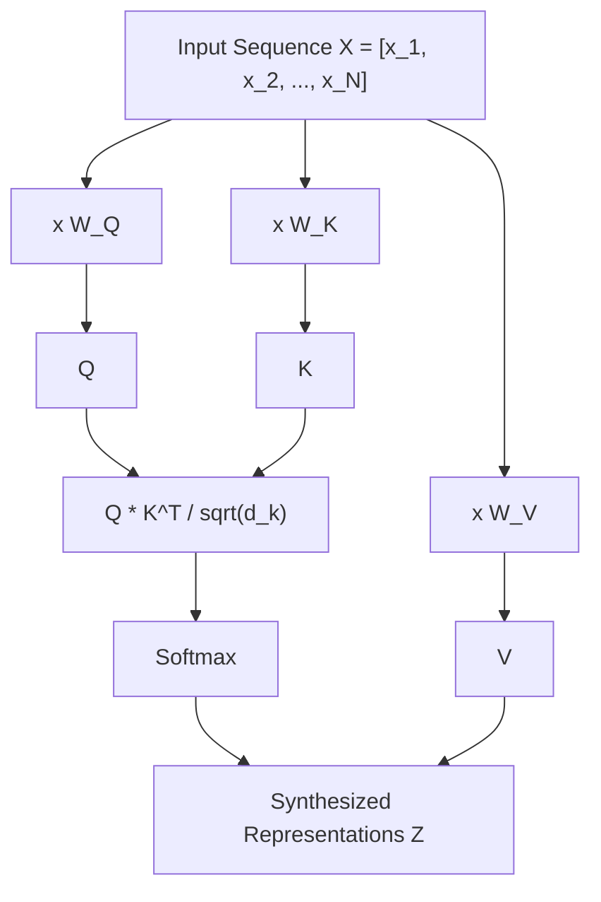

#### d. Code Thực chiến (C++ & Python)
```cpp
// C++17: Self-Attention Kernel Skeleton
#include <vector>
#include <cmath>

struct SelfAttentionLite {
    int seq_len;
    int d_model;
    
    void forward(const float* X, const float* W_Q, const float* W_K, const float* W_V,
                 float* Out) {
        // Tương đương phép tính tuần tự Q = X*W_Q, K = X*W_K, V = X*W_V
        // Sau đó tính Softmax(Q*K^T / sqrt(d)) * V
    }
};
```

```python
import torch
import torch.nn as nn

class SelfAttention(nn.Module):
    def __init__(self, d_model: int, d_k: int):
        super().__init__()
        self.d_k = d_k
        self.q_proj = nn.Linear(d_model, d_k, bias=False)
        self.k_proj = nn.Linear(d_model, d_k, bias=False)
        self.v_proj = nn.Linear(d_model, d_k, bias=False)

    def forward(self, x: torch.Tensor) -> torch.Tensor:
        # x: [B, N, d_model]
        q = self.q_proj(x)
        k = self.k_proj(x)
        v = self.v_proj(x)
        
        scores = torch.matmul(q, k.transpose(-2, -1)) / (self.d_k ** 0.5)
        weights = torch.softmax(scores, dim=-1)
        return torch.matmul(weights, v)
```

#### e. Lỗi Thường gặp & Ổn định Số học
- Hiện tượng **Rank Collapse** khi mô hình quá sâu: Khi xếp chồng nhiều tầng Self-Attention thuần túy mà không có Skip-Connection và MLP, ma trận biểu diễn đầu ra có xu hướng sụp đổ về rank 1 (tất cả các token trở nên giống hệt nhau).

#### f. Ứng dụng Thực chiến trong AI
- Kiến trúc nền tảng của Transformer Encoder (BERT) và Transformer Decoder (GPT series).

---

### 14. Cross-Attention (Chú ý Chéo)

#### a. Định nghĩa Bản chất Toán học
**Cross-Attention** kết nối hai chuỗi dữ liệu độc lập khác nhau: một chuỗi đóng vai trò nguồn (Source/Context) và một chuỗi đóng vai trò đích (Target).
- Query được tạo ra từ chuỗi đích $\mathbf{X}_{\text{target}} \in \mathbb{R}^{N \times d_1}$:
  $$\mathbf{Q} = \mathbf{X}_{\text{target}} \mathbf{W}_Q$$
- Key và Value được tạo ra từ chuỗi nguồn $\mathbf{X}_{\text{source}} \in \mathbb{R}^{M \times d_2}$:
  $$\mathbf{K} = \mathbf{X}_{\text{source}} \mathbf{W}_K, \quad \mathbf{V} = \mathbf{X}_{\text{source}} \mathbf{W}_V$$
$$\text{Cross-Attention}(\mathbf{Q}, \mathbf{K}, \mathbf{V}) = \text{Softmax}\left(\frac{\mathbf{Q} \mathbf{K}^T}{\sqrt{d_k}}\right) \mathbf{V} \in \mathbb{R}^{N \times d_v}$$

#### b. Cơ chế Tầng Sâu & Điện toán
- Kích thước ma trận kết quả điểm số là $N \times M$ (hình chữ nhật nếu $N \neq M$).
- **Không đối xứng về mặt tính toán**: Chuỗi nguồn $M$ có thể rất dài (ví dụ tài liệu văn bản hoặc ảnh phân giải cao), trong khi chuỗi đích $N$ ngắn (ví dụ câu hỏi hoặc token sinh ra).
- Trong Decoder-only models, không có Cross-Attention. Nhưng trong Encoder-Decoder (T5) hoặc Multimodal models (Flamingo, Stable Diffusion), Cross-Attention là cầu nối thông tin sống còn.

#### c. Sơ đồ Minh họa
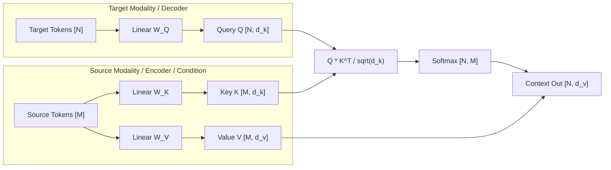

#### d. Code Thực chiến (C++ & Python)
```cpp
// C++17: Cross-Attention Interface
#include <vector>

void cross_attention_shapes(int N_target, int M_source, int d_k, int d_v) {
    // Kích thước Q: [N_target, d_k]
    // Kích thước K: [M_source, d_k]
    // Kích thước V: [M_source, d_v]
    // Kích thước Scores: [N_target, M_source]
    // Kích thước Output: [N_target, d_v]
}
```

```python
import torch
import torch.nn as nn

class CrossAttention(nn.Module):
    def __init__(self, d_target: int, d_source: int, d_k: int):
        super().__init__()
        self.d_k = d_k
        self.w_q = nn.Linear(d_target, d_k, bias=False)
        self.w_k = nn.Linear(d_source, d_k, bias=False)
        self.w_v = nn.Linear(d_source, d_k, bias=False)

    def forward(self, x_target: torch.Tensor, x_source: torch.Tensor) -> torch.Tensor:
        # x_target: [B, N, D_t], x_source: [B, M, D_s]
        q = self.w_q(x_target)
        k = self.w_k(x_source)
        v = self.w_v(x_source)
        
        scores = torch.matmul(q, k.transpose(-2, -1)) / (self.d_k ** 0.5)
        weights = torch.softmax(scores, dim=-1)
        return torch.matmul(weights, v)
```

#### e. Lỗi Thường gặp & Ổn định Số học
- Nhầm lẫn giữa chuỗi nguồn và chuỗi đích: Đặt Query từ Encoder và Key/Value từ Decoder sẽ đảo ngược hoàn toàn luồng thông tin, làm vỡ mô hình.

#### f. Ứng dụng Thực chiến trong AI
- **Text-to-Image Diffusion Models**: Tương tác giữa Text Embeddings (từ CLIP/T5 Encoder đóng vai trò Source) và Latent Image Features (trong UNet/DiT đóng vai trò Target).

---

### 15. Multi-Head Attention (Chú ý Đa đầu)

#### a. Định nghĩa Bản chất Toán học
Thay vì chỉ tính một hàm chú ý duy nhất với số chiều $d_{model}$, **Multi-Head Attention** (MHA) chiếu tuyến tính các Query, Key và Value $h$ lần với các ma trận chiếu khác nhau thành các không gian con có số chiều $d_k = d_v = d_{model} / h$:
$$\text{MHA}(\mathbf{Q}, \mathbf{K}, \mathbf{V}) = \text{Concat}(\text{head}_1, \dots, \text{head}_h) \mathbf{W}_O$$
$$\text{head}_i = \text{Attention}(\mathbf{Q} \mathbf{W}_Q^{(i)}, \mathbf{K} \mathbf{W}_K^{(i)}, \mathbf{V} \mathbf{W}_V^{(i)})$$
Trong đó $\mathbf{W}_Q^{(i)} \in \mathbb{R}^{d_{model} \times d_k}$, $\mathbf{W}_K^{(i)} \in \mathbb{R}^{d_{model} \times d_k}$, $\mathbf{W}_V^{(i)} \in \mathbb{R}^{d_{model} \times d_v}$, và $\mathbf{W}_O \in \mathbb{R}^{h d_v \times d_{model}}$.

Cơ chế này cho phép mô hình đồng thời quan sát và kết hợp thông tin từ nhiều không gian biểu diễn con khác nhau ở các vị trí khác nhau (ví dụ: một head chuyên theo dõi quan hệ cú pháp ngữ pháp, một head chuyên theo dõi đại từ thay thế, một head chuyên theo dõi ngữ cảnh thời gian).

#### b. Cơ chế Tầng Sâu & Điện toán
- **Tensor Transposition & Memory Layout**:
  - Dữ liệu đầu vào ban đầu có shape: `[Batch, SeqLen, Dim]`.
  - Sau phép chiếu Q, K, V: reshape thành `[Batch, SeqLen, NumHeads, HeadDim]`.
  - Để thực hiện phép nhân ma trận song song trên tất cả các head, bắt buộc phải đổi trục (transpose/permute) thành:
    `[Batch, NumHeads, SeqLen, HeadDim]`
  - Thao tác đổi trục này làm thay đổi **Strides** của tensor và tạo ra một tensor **Non-Contiguous**. Nếu gọi `.view()` mà không có `.contiguous()`, PyTorch sẽ báo lỗi.
- **Batched GEMM (BGEMM)**: GPU thực thi $h$ phép nhân ma trận độc lập cùng lúc bằng một lời gọi hàm cuBLAS duy nhất `cublasGemmStridedBatched`.

#### c. Sơ đồ Minh họa
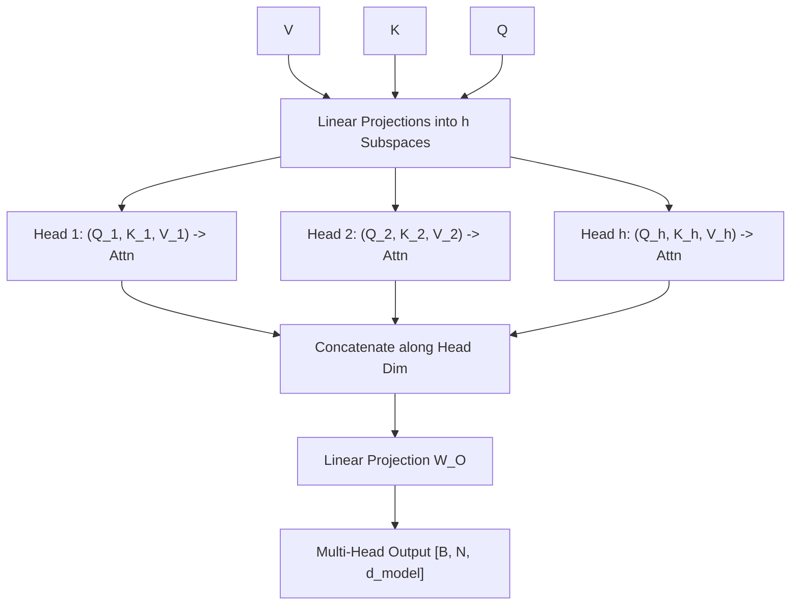

#### d. Code Thực chiến (C++ & Python)
```cpp
// C++17: Cấu trúc tensor 4D cho Multi-Head Attention Layout
#include <vector>
#include <iostream>

struct Tensor4D {
    int B, H, N, D;
    std::vector<float> data;
    
    Tensor4D(int b, int h, int n, int d) : B(b), H(h), N(n), D(d), data(b * h * n * d) {}
    
    // Tính offset bộ nhớ vật lý liên tục (Row-Major: [B, H, N, D])
    inline size_t get_offset(int b, int h, int n, int d) const {
        return ((b * H + h) * N + n) * D + d;
    }
};
```

```python
import torch
import torch.nn as nn
import math

class MultiHeadAttention(nn.Module):
    def __init__(self, d_model: int, num_heads: int):
        super().__init__()
        assert d_model % num_heads == 0, "d_model must be divisible by num_heads"
        self.d_model = d_model
        self.num_heads = num_heads
        self.head_dim = d_model // num_heads
        
        # Gộp chung Q, K, V thành 1 ma trận tuyến tính để tối ưu bộ nhớ đệm
        self.qkv_proj = nn.Linear(d_model, 3 * d_model, bias=False)
        self.out_proj = nn.Linear(d_model, d_model, bias=False)

    def forward(self, x: torch.Tensor, mask: torch.Tensor = None) -> torch.Tensor:
        B, N, _ = x.shape
        # 1. Chiếu đồng thời Q, K, V: [B, N, 3 * d_model]
        qkv = self.qkv_proj(x)
        # 2. Reshape và Permute thành [3, B, num_heads, N, head_dim]
        qkv = qkv.reshape(B, N, 3, self.num_heads, self.head_dim).permute(2, 0, 3, 1, 4)
        q, k, v = qkv[0], qkv[1], qkv[2]
        
        # 3. Scaled Dot-Product Attention trên từng head
        scores = torch.matmul(q, k.transpose(-2, -1)) / math.sqrt(self.head_dim)
        if mask is not None:
            scores = scores.masked_fill(mask == 0, -1e9)
        weights = torch.softmax(scores, dim=-1)
        context = torch.matmul(weights, v) # [B, num_heads, N, head_dim]
        
        # 4. Gộp các head lại: transpose -> contiguous -> view
        context = context.transpose(1, 2).contiguous().view(B, N, self.d_model)
        return self.out_proj(context)
```

#### e. Lỗi Thường gặp & Ổn định Số học
- **Head Redundancy (Dư thừa Head)**: Nhiều nghiên cứu thực nghiệm chỉ ra rằng phần lớn các attention head trong mô hình đã huấn luyện có trọng số tương tự nhau hoặc có thể cắt tỉa (prune) tới 50% số head mà không làm giảm đáng kể hiệu năng của mô hình.
- Lỗi quên `.contiguous()` trước khi `.view()` trong PyTorch sẽ ném ra runtime exception do stride bộ nhớ không khớp.

#### f. Ứng dụng Thực chiến trong AI
- Kiến trúc chuẩn mực áp dụng trong mọi mô hình Transformer hiện đại (Llama, GPT-3/4, Mistral, Gemma, Claude, BERT).
