# Chuyên đề: Các Cơ chế Chú ý Hiệu năng Cao & Nâng cao (Efficient & Advanced Attention Mechanisms)

## 1. Tổng quan Chuyên đề
Khi độ dài chuỗi ngữ cảnh (Context Length $N$) tăng từ vài nghìn token lên hàng chục nghìn, hàng trăm nghìn hoặc hàng triệu token (ví dụ LLaMA-3 với 128K context, Gemini 1.5 với 2M context), độ phức tạp tính toán bậc hai $\mathcal{O}(N^2)$ và nút thắt cổ chai băng thông bộ nhớ (Memory Bandwidth Bottleneck) của cơ chế Multi-Head Attention chuẩn trở thành rào cản chí mạng.

Để giải quyết vấn đề này, các nghiên cứu hiện đại đã phát triển ba hướng tiếp cận cốt lõi:
1. **Tối ưu hóa Bố cục Bộ nhớ Đệm (KV Cache Optimization)**: Multi-Query Attention (MQA) và Grouped-Query Attention (GQA) giúp giảm mạnh dung lượng VRAM tiêu tốn cho Key-Value Cache trong quá trình inference.
2. **Cấu trúc Chú ý Thưa & Tuyến tính (Sparse & Linear Attention)**: Sliding Window Attention, Local/Global Attention, Block-Sparse Attention và Linear Attention biến đổi cấu trúc ma trận để giảm độ phức tạp từ $\mathcal{O}(N^2)$ xuống $\mathcal{O}(N \sqrt{N})$ hoặc $\mathcal{O}(N)$.
3. **Thuật toán Nhận biết Phần cứng (Hardware IO-Aware Algorithms)**: Dòng thuật toán FlashAttention (1, 2, 3) khai thác trực tiếp hệ thống phân cấp bộ nhớ GPU (SRAM vs HBM), thực hiện tiling và online softmax để loại bỏ hoàn toàn việc lưu ma trận $N \times N$ trên HBM, đạt tốc độ thực thi tiệm cận giới hạn vật lý của GPU.

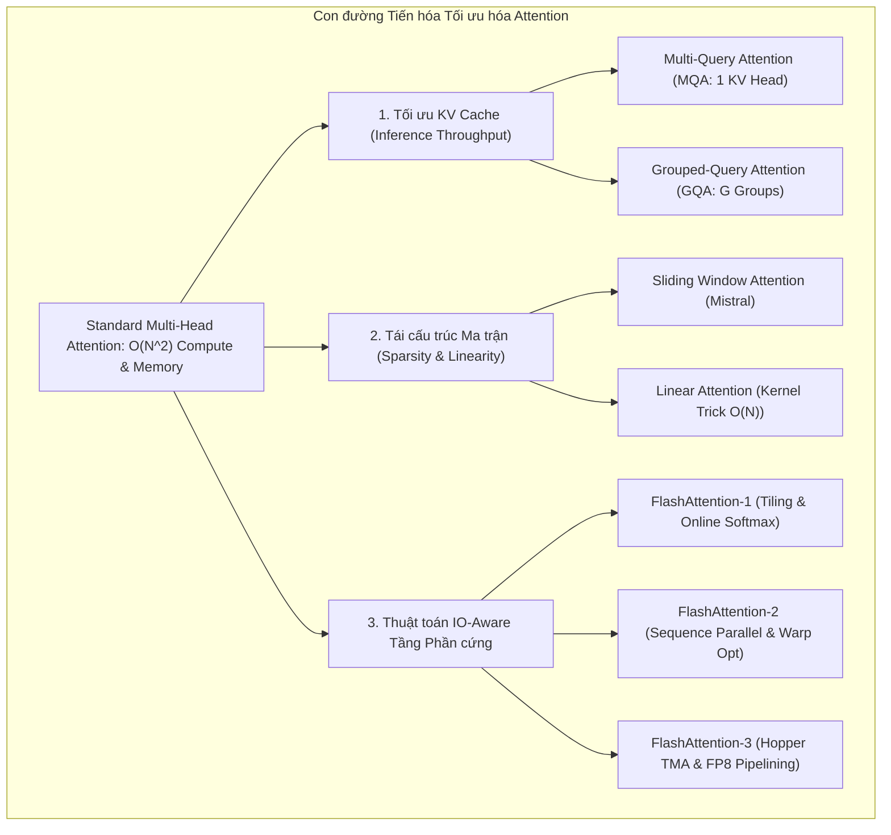

---

## 2. Chi tiết từng Keyword

---

### 16. Grouped-Query Attention (GQA)

#### a. Định nghĩa Bản chất Toán học
**Grouped-Query Attention** (Ainslie et al., 2023) là một kiến trúc trung gian tổng quát hóa giữa Multi-Head Attention (MHA) và Multi-Query Attention (MQA). Trong GQA, $H_Q$ query heads được chia thành $G$ nhóm (với $1 < G < H_Q$). Mỗi nhóm gồm $H_Q / G$ query heads sẽ chia sẻ chung một cặp key head và value head duy nhất:
$$H_{KV} = G, \quad \text{Group Size} = \frac{H_Q}{G}$$
Với mỗi nhóm $g \in \{1, \dots, G\}$ và query head $i \in \{1, \dots, H_Q/G\}$ thuộc nhóm $g$:
$$\text{head}_{g, i} = \text{Attention}(\mathbf{Q}_{g, i}, \mathbf{K}_g, \mathbf{V}_g)$$

#### b. Cơ chế Tầng Sâu & Điện toán
- **Giảm dung lượng KV Cache**: Dung lượng KV Cache giảm đi đúng $H_Q / G$ lần so với MHA:
  $$\text{Memory}_{\text{KV-GQA}} = \frac{G}{H_Q} \times \text{Memory}_{\text{KV-MHA}}$$
- **Tăng Batch Size & Decoding Throughput**: Khi suy luận autoregressive ở ngữ cảnh dài (ví dụ 128K token), việc giảm KV cache từ $8\times$ đến $4\times$ giải phóng hàng chục GB VRAM, cho phép tăng batch size phục vụ (serving) gấp nhiều lần mà không làm suy giảm năng lực biểu diễn như MQA.
- **Broadcasting / Expansion Kernel**: Trước khi thực hiện phép nhân ma trận $Q K^T$, tensor $K$ và $V$ được broadcast dọc theo chiều head group. Phép broadcast này được thực hiện bằng cách thay đổi **strides** (`stride=0`) mà không cấp phát thêm bộ nhớ vật lý (Zero-copy).

#### c. Sơ đồ Minh họa
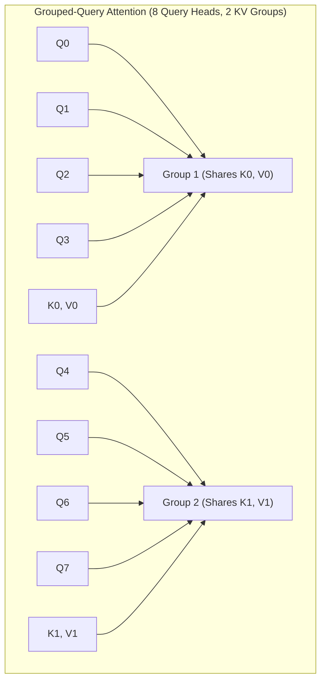

#### d. Code Thực chiến (C++ & Python)
```cpp
// C++17: Mô phỏng logic tính Stride cho GQA Zero-Copy Broadcast
#include <iostream>
#include <vector>

struct GQA_Strides {
    int B, H_q, H_kv, N, D;
    int group_size;

    GQA_Strides(int b, int h_q, int h_kv, int n, int d) 
        : B(b), H_q(h_q), H_kv(h_kv), N(n), D(d), group_size(h_q / h_kv) {}

    // Map query head idx về KV head idx
    inline int get_kv_head(int q_head) const {
        return q_head / group_size;
    }

    // Offset trong buffer KV liên tục [B, H_kv, N, D]
    inline size_t get_kv_offset(int b, int q_head, int n, int d) const {
        int kv_head = get_kv_head(q_head);
        return ((static_cast<size_t>(b) * H_kv + kv_head) * N + n) * D + d;
    }
};
```

```python
import torch
import torch.nn as nn
import math

class GroupedQueryAttention(nn.Module):
    def __init__(self, d_model: int, num_q_heads: int, num_kv_heads: int):
        super().__init__()
        assert num_q_heads % num_kv_heads == 0
        self.d_model = d_model
        self.num_q_heads = num_q_heads
        self.num_kv_heads = num_kv_heads
        self.group_size = num_q_heads // num_kv_heads
        self.head_dim = d_model // num_q_heads

        self.q_proj = nn.Linear(d_model, num_q_heads * self.head_dim, bias=False)
        self.k_proj = nn.Linear(d_model, num_kv_heads * self.head_dim, bias=False)
        self.v_proj = nn.Linear(d_model, num_kv_heads * self.head_dim, bias=False)
        self.out_proj = nn.Linear(d_model, d_model, bias=False)

    def forward(self, x: torch.Tensor) -> torch.Tensor:
        B, N, _ = x.shape
        q = self.q_proj(x).view(B, N, self.num_q_heads, self.head_dim).transpose(1, 2)
        k = self.k_proj(x).view(B, N, self.num_kv_heads, self.head_dim).transpose(1, 2)
        v = self.v_proj(x).view(B, N, self.num_kv_heads, self.head_dim).transpose(1, 2)

        # Zero-copy repeat interleave dọc theo trục head
        k = k.repeat_interleave(self.group_size, dim=1) # [B, num_q_heads, N, head_dim]
        v = v.repeat_interleave(self.group_size, dim=1)

        scores = torch.matmul(q, k.transpose(-2, -1)) / math.sqrt(self.head_dim)
        weights = torch.softmax(scores, dim=-1)
        out = torch.matmul(weights, v) # [B, num_q_heads, N, head_dim]
        out = out.transpose(1, 2).contiguous().view(B, N, self.d_model)
        return self.out_proj(out)
```

#### e. Lỗi Thường gặp & Ổn định Số học
- Dùng `k.repeat()` thay vì `k.repeat_interleave()` hoặc expand view: `repeat()` tạo bản sao thực trong bộ nhớ, phá hỏng toàn bộ lợi ích tiết kiệm RAM của GQA.

#### f. Ứng dụng Thực chiến trong AI
- Kiến trúc chuẩn của toàn bộ các open-weights LLMs hàng đầu: **LLaMA-2 (70B), LLaMA-3 (8B, 70B), Mistral-7B, Qwen-2**.

---

### 17. Multi-Query Attention (MQA)

#### a. Định nghĩa Bản chất Toán học
**Multi-Query Attention** (Shazeer, 2019) là trường hợp cực hạn của GQA khi $G = 1$. Trong MQA, toàn bộ tất cả các Query Heads đều chia sẻ chung đúng **1 Key Head** và **1 Value Head** duy nhất:
$$H_Q = h, \quad H_K = 1, \quad H_V = 1$$
$$\text{head}_i = \text{Attention}(\mathbf{Q}_i, \mathbf{K}, \mathbf{V}), \quad \forall i \in \{1, \dots, h\}$$

#### b. Cơ chế Tầng Sâu & Điện toán
- **Bộ nhớ KV Cache cực tiểu**: Tiết kiệm VRAM lên tới $h$ lần (ví dụ $32\times$ đến $64\times$).
- **Memory-Bound Decoding**: Trong bước autoregressive generation, mỗi bước mô hình phải load $K$ và $V$ từ HBM vào SRAM. Với MQA, lượng dữ liệu cần nạp giảm đi $h$ lần, biến decoding từ hoàn toàn nghẽn băng thông bộ nhớ (memory-bound) sang tiệm cận tính toán (compute-bound).
- **Hạn chế năng lực**: Do toàn bộ các query heads đều phải nhìn cùng một bộ keys và values, mô hình bị giảm bớt độ phong phú trong việc mô hình hóa các mối liên kết đồng thời giữa các phần tử khác nhau.

#### c. Sơ đồ Minh họa
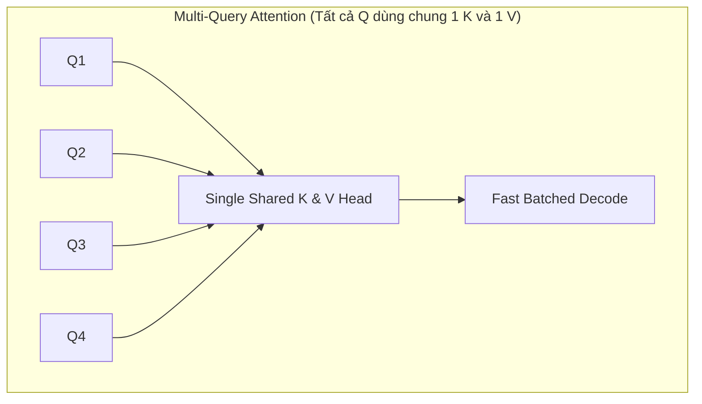

#### d. Code Thực chiến (C++ & Python)
```cpp
// C++17: MQA Pointer indexing
#include <vector>

void mqa_dot_product(const float* Q, const float* K_single, float* scores, 
                     int H_q, int N, int d_k) {
    // Q có shape [H_q, d_k], K_single có shape [N, d_k]
    for (int h = 0; h < H_q; ++h) {
        for (int n = 0; n < N; ++n) {
            float sum = 0.0f;
            for (int d = 0; d < d_k; ++d) {
                sum += Q[h * d_k + d] * K_single[n * d_k + d];
            }
            scores[h * N + n] = sum;
        }
    }
}
```

```python
import torch
import torch.nn as nn
import math

class MultiQueryAttention(nn.Module):
    def __init__(self, d_model: int, num_heads: int):
        super().__init__()
        self.num_heads = num_heads
        self.head_dim = d_model // num_heads

        self.q_proj = nn.Linear(d_model, d_model, bias=False)
        self.k_proj = nn.Linear(d_model, self.head_dim, bias=False) # Chỉ 1 head
        self.v_proj = nn.Linear(d_model, self.head_dim, bias=False) # Chỉ 1 head
        self.out_proj = nn.Linear(d_model, d_model, bias=False)

    def forward(self, x: torch.Tensor) -> torch.Tensor:
        B, N, _ = x.shape
        q = self.q_proj(x).view(B, N, self.num_heads, self.head_dim).transpose(1, 2)
        k = self.k_proj(x).view(B, N, 1, self.head_dim).transpose(1, 2) # [B, 1, N, head_dim]
        v = self.v_proj(x).view(B, N, 1, self.head_dim).transpose(1, 2)

        # Broadcasting tự động trên trục head
        scores = torch.matmul(q, k.transpose(-2, -1)) / math.sqrt(self.head_dim)
        weights = torch.softmax(scores, dim=-1)
        out = torch.matmul(weights, v) # [B, num_heads, N, head_dim]
        out = out.transpose(1, 2).contiguous().view(B, N, -1)
        return self.out_proj(out)
```

#### e. Lỗi Thường gặp & Ổn định Số học
- Giảm chất lượng khi fine-tuning từ checkpoint MHA có sẵn: Để chuyển từ MHA sang MQA cần kỹ thuật "Uptraining" (tiếp tục pre-training 5% tokens) để các query head thích ứng với việc chia sẻ KV.

#### f. Ứng dụng Thực chiến trong AI
- Kiến trúc của **PaLM (Google)**, **StarCoder**, và **Falcon-7B/40B**.

---

### 18. Sliding Window Attention (Chú ý Cửa sổ Trượt)

#### a. Định nghĩa Bản chất Toán học
**Sliding Window Attention** (Beltagy et al., 2020; Jiang et al., 2023 trong Mistral) giới hạn vùng chú ý của mỗi token trong một cửa sổ cục bộ kích thước $W$ xung quanh nó. Token tại vị trí $i$ chỉ được phép chú ý đến các token tại vị trí $j$ thỏa mãn:
$$\max(0, i - W) \le j \le i$$
$$\mathbf{A}_{ij} = \begin{cases} \text{Softmax}\left(\frac{\mathbf{q}_i \mathbf{k}_j^T}{\sqrt{d_k}}\right) & \text{nếu } i - W \le j \le i \\ 0 & \text{ngược lại} \end{cases}$$
Mặc dù ở mỗi tầng, vùng nhận cảm (receptive field) chỉ là $W$, nhưng qua $L$ tầng xếp chồng, vùng nhận cảm lý thuyết mở rộng tuyến tính:
$$\text{Receptive Field} = L \times W$$

#### b. Cơ chế Tầng Sâu & Điện toán
- **Giảm độ phức tạp tính toán**: Từ $\mathcal{O}(N^2)$ xuống $\mathcal{O}(N \times W)$. Với $W = 4096$ cố định và $N = 100,000$, lượng tính toán giảm hơn $24\times$.
- **Rolling Buffer KV Cache**: Trong inference, chỉ cần duy trì một bộ nhớ đệm tròn (circular buffer) có kích thước cố định bằng $W$. Các token thứ $i$ sẽ ghi đè lên vị trí $i \pmod W$, giữ cho dung lượng VRAM không đổi bất kể chuỗi dài đến đâu.

#### c. Sơ đồ Minh họa
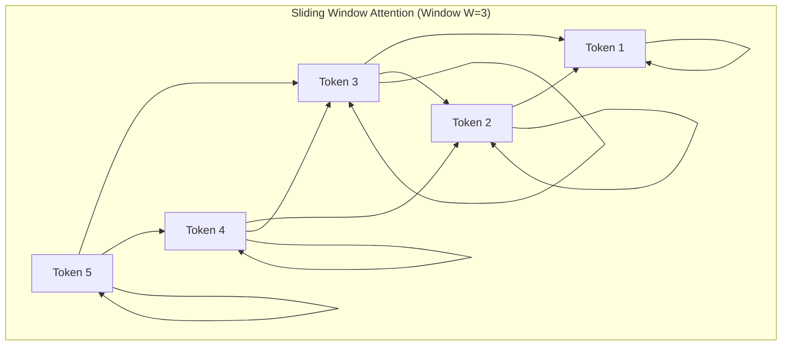

#### d. Code Thực chiến (C++ & Python)
```cpp
// C++17: Sliding Window Rolling Buffer Indexing
#include <iostream>

struct RollingKVCache {
    int W; // Cửa sổ trượt
    int d_k;
    std::vector<float> buffer;

    RollingKVCache(int window_size, int dim) 
        : W(window_size), d_k(dim), buffer(window_size * dim, 0.0f) {}

    void insert_token(int step, const float* key_vec) {
        int slot = step % W; // Ghi đè theo vòng tròn
        for (int d = 0; d < d_k; ++d) {
            buffer[slot * d_k + d] = key_vec[d];
        }
    }
};
```

```python
import torch

def create_sliding_window_mask(seq_len: int, window_size: int) -> torch.Tensor:
    # 1 tại các vị trí hợp lệ, 0 tại các vị trí ngoài cửa sổ
    mask = torch.ones(seq_len, seq_len, dtype=torch.bool)
    # Mask causal tam giác trên
    mask = torch.tril(mask)
    # Mask ngoài cửa sổ W
    mask = torch.triu(mask, diagonal=-window_size + 1)
    return mask # [seq_len, seq_len]
```

#### e. Lỗi Thường gặp & Ổn định Số học
- Hiện tượng **Lost Attention Sink**: Nếu loại bỏ token đầu tiên ($token_0$), perplexity của LLM tăng vọt. Cần duy trì "Attention Sink" (giữ vĩnh viễn 4 token đầu tiên trong KV cache bên cạnh cửa sổ trượt).

#### f. Ứng dụng Thực chiến trong AI
- Kiến trúc cốt lõi của **Mistral-7B**, **Mixtral-8x7B**, và kỹ thuật StreamingLLM cho suy luận chuỗi vô hạn.

---

### 19. Local Attention (Chú ý Cục bộ)

#### a. Định nghĩa Bản chất Toán học
**Local Attention** (Luong et al., 2015; Parmar et al., 2018) giới hạn sự tương tác của một phần tử trong một vùng lân cận có bán kính $R$:
$$\mathcal{N}(i) = \{j \mid |i - j| \le R\}$$
Ma trận chú ý tương ứng là ma trận dải đường chéo (band-diagonal matrix) với độ rộng dải $2R + 1$:
$$\mathbf{S}_{ij} = \begin{cases} \frac{\mathbf{q}_i \mathbf{k}_j^T}{\sqrt{d_k}} & \text{nếu } |i - j| \le R \\ -\infty & \text{ngược lại} \end{cases}$$

#### b. Cơ chế Tầng Sâu & Điện toán
- Tận dụng tính cục bộ không gian (spatial locality) và thời gian (temporal locality).
- Khi tính toán trên CPU/GPU, ma trận dải có thể được tổ chức lại dưới dạng ma trận đặc nén (packed dense layout) với kích thước $N \times (2R + 1)$ thay vì $N \times N$, giúp nạp toàn bộ vào L1/L2 cache.

#### c. Sơ đồ Minh họa
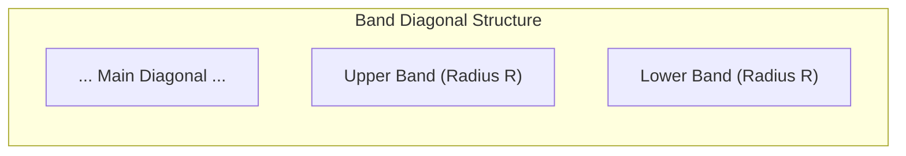

#### d. Code Thực chiến (C++ & Python)
```cpp
// C++17: Local Attention Band-Diagonal GEMM
#include <vector>

void local_attention_scores(const float* Q, const float* K, float* S_band, 
                            int N, int R, int d_k) {
    int band_width = 2 * R + 1;
    for (int i = 0; i < N; ++i) {
        for (int offset = -R; offset <= R; ++offset) {
            int j = i + offset;
            int col_idx = offset + R;
            if (j >= 0 && j < N) {
                float dot = 0.0f;
                for (int d = 0; d < d_k; ++d) {
                    dot += Q[i * d_k + d] * K[j * d_k + d];
                }
                S_band[i * band_width + col_idx] = dot;
            } else {
                S_band[i * band_width + col_idx] = -1e9f;
            }
        }
    }
}
```

```python
import torch

def local_attention_dense(q: torch.Tensor, k: torch.Tensor, radius: int) -> torch.Tensor:
    # q, k: [B, H, N, D]
    scores = torch.matmul(q, k.transpose(-2, -1))
    N = q.size(-2)
    indices = torch.arange(N)
    distance = torch.abs(indices.unsqueeze(0) - indices.unsqueeze(1))
    mask = distance <= radius
    scores = scores.masked_fill(~mask, -1e9)
    return torch.softmax(scores, dim=-1)
```

#### e. Lỗi Thường gặp & Ổn định Số học
- Thiếu thông tin liên kết toàn cục giữa các phần tử ở khoảng cách xa hơn $2R \times L$.

#### f. Ứng dụng Thực chiến trong AI
- Image Transformer, xử lý tín hiệu âm thanh và bước đầu của mô hình xử lý văn bản dài.

---

### 20. Global Attention (Chú ý Toàn cục)

#### a. Định nghĩa Bản chất Toán học
Trong các kiến trúc Sparse Attention (như Longformer, BigBird), **Global Attention** được bổ sung để khắc phục nhược điểm của Local Attention. Một tập hợp con các token đặc biệt $\mathcal{G} \subset \{1, \dots, N\}$ (ví dụ: token `[CLS]`, token câu hỏi, hoặc các vị trí cách đều) được cấp quyền tương tác toàn cục:
1. Mọi token $i \in \{1, \dots, N\}$ đều chú ý đến mọi token $g \in \mathcal{G}$.
2. Mọi token $g \in \mathcal{G}$ chú ý đến toàn bộ token trong chuỗi.
$$\mathbf{A}_{ij} = \text{Softmax}\left(\frac{\mathbf{q}_i \mathbf{k}_j^T}{\sqrt{d_k}}\right) \quad \text{nếu } i \in \mathcal{G} \lor j \in \mathcal{G} \lor |i - j| \le R$$

#### b. Cơ chế Tầng Sâu & Điện toán
- Kết hợp Global Attention ($|\mathcal{G}| = k \ll N$) với Local Attention ($R$) giúp đường kính đồ thị tính toán giảm từ $\mathcal{O}(N/R)$ xuống $\mathcal{O}(1)$ mà tổng lượng tính toán chỉ là $\mathcal{O}(k N + N R) = \mathcal{O}(N)$.

#### c. Sơ đồ Minh họa
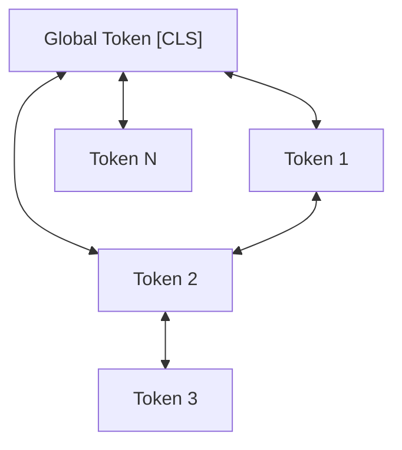

#### d. Code Thực chiến (C++ & Python)
```cpp
// C++17: Kiểm tra điều kiện Global Attention
inline bool is_attended(int i, int j, int R, const std::vector<bool>& is_global) {
    if (is_global[i] || is_global[j]) return true; // Global
    if (std::abs(i - j) <= R) return true;         // Local window
    return false;
}
```

```python
import torch

def build_longformer_pattern(seq_len: int, radius: int, global_indices: list[int]) -> torch.Tensor:
    mask = torch.zeros(seq_len, seq_len, dtype=torch.bool)
    # 1. Local window
    for i in range(seq_len):
        start = max(0, i - radius)
        end = min(seq_len, i + radius + 1)
        mask[i, start:end] = True
    # 2. Global tokens
    for g in global_indices:
        mask[g, :] = True
        mask[:, g] = True
    return mask
```

#### e. Lỗi Thường gặp & Ổn định Số học
- Phân bổ quá nhiều global token làm triệt tiêu tính hiệu quả tính toán của ma trận thưa.

#### f. Ứng dụng Thực chiến trong AI
- **Longformer**, **ETC**, **BigBird** trong các tác vụ Question Answering và trích xuất thông tin trên tài liệu pháp lý dài.

---

### 21. Sparse Attention (Chú ý Thưa)

#### a. Định nghĩa Bản chất Toán học
**Sparse Attention** (Child et al., OpenAI 2019) thay thế ma trận chú ý dày đặc $N \times N$ bằng một đồ thị có hướng thưa với tập cạnh $S = \{S_1, \dots, S_N\}$ trong đó $S_i$ là tập các chỉ số token mà token $i$ được phép tương tác:
$$\text{Attention}(\mathbf{Q}, \mathbf{K}, \mathbf{V})_i = \text{Softmax}\left(\frac{\mathbf{q}_i \mathbf{K}_{S_i}^T}{\sqrt{d_k}}\right) \mathbf{V}_{S_i}$$
Bằng cách phân rã liên kết thành hai mẫu chú ý: *Strided Attention* (bước nhảy chu kỳ $p$) và *Local Attention* (cửa sổ $w$), đồ thị đảm bảo sau 2 tầng, mọi cặp token bất kỳ đều có đường truyền thông tin với nhau, giảm độ phức tạp xuống $\mathcal{O}(N \sqrt{N})$.

#### b. Cơ chế Tầng Sâu & Điện toán
- GPU xử lý các cấu trúc thưa ngẫu nhiên (irregular sparsity) rất kém do phân kỳ luồng (warp divergence) và truy cập bộ nhớ không liên tục (uncoalesced memory access).
- Để đạt hiệu năng cao trên phần cứng, Sparse Attention phải được cấu trúc thành các khối cố định (**Block-Sparse**), ví dụ khối $16 \times 16$ hoặc $32 \times 32$ để tận dụng Tensor Cores.

#### c. Sơ đồ Minh họa
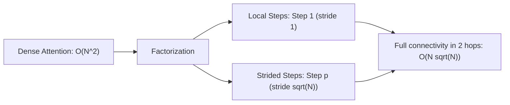

#### d. Code Thực chiến (C++ & Python)
```cpp
// C++17: Strided Sparse Pattern Check
inline bool is_strided_sparse(int i, int j, int stride, int window) {
    if (i - j >= 0 && i - j < window) return true; // Cục bộ
    if (j % stride == 0) return true;              // Bước nhảy Strided
    return false;
}
```

```python
import torch

def create_sparse_child_pattern(seq_len: int, stride: int, window: int) -> torch.Tensor:
    mask = torch.zeros(seq_len, seq_len, dtype=torch.bool)
    for i in range(seq_len):
        for j in range(i + 1):
            if (i - j < window) or (j % stride == 0):
                mask[i, j] = True
    return mask
```

#### e. Lỗi Thường gặp & Ổn định Số học
- Lỗi triển khai mask thưa bằng cách nhân với tensor 0/1 trên ma trận dense: Điều này không làm giảm bộ nhớ mà còn tốn thêm thời gian tính toán. Bắt buộc phải dùng custom CUDA kernel thưa (Block-Sparse kernel).

#### f. Ứng dụng Thực chiến trong AI
- **Sparse Transformer (OpenAI)** trong xử lý dữ liệu ảnh độ phân giải cao và chuỗi âm thanh nguyên bản thô (raw audio waveforms).

---

### 22. Linear Attention (Chú ý Tuyến tính)

#### a. Định nghĩa Bản chất Toán học
**Linear Attention** (Katharopoulos et al., 2020) loại bỏ hàm Softmax phi tuyến tính và thay thế nó bằng tích vô hướng của các hàm đặc trưng nhân tử (feature map) $\phi(x) \ge 0$:
$$\text{sim}(\mathbf{q}_i, \mathbf{k}_j) = \phi(\mathbf{q}_i)^T \phi(\mathbf{k}_j)$$
Biểu thức attention trở thành:
$$\mathbf{O}_i = \frac{\sum_{j=1}^N (\phi(\mathbf{q}_i)^T \phi(\mathbf{k}_j)) \mathbf{v}_j}{\sum_{j=1}^N \phi(\mathbf{q}_i)^T \phi(\mathbf{k}_j)} = \frac{\phi(\mathbf{q}_i)^T \left(\sum_{j=1}^N \phi(\mathbf{k}_j) \mathbf{v}_j^T\right)}{\phi(\mathbf{q}_i)^T \left(\sum_{j=1}^N \phi(\mathbf{k}_j)\right)}$$
Nhờ tính chất kết hợp của phép nhân ma trận $(A B) C = A (B C)$, thay vì tính $(Q K^T) V$ tốn $\mathcal{O}(N^2 d)$, ta tính $Q (K^T V)$ tốn $\mathcal{O}(N d^2)$:
$$\mathbf{M} = \sum_{j=1}^N \phi(\mathbf{k}_j) \mathbf{v}_j^T \in \mathbb{R}^{d \times d}$$
Với $d \ll N$, độ phức tạp giảm từ **bậc hai sang tuyến tính hoàn toàn $\mathcal{O}(N)$**.

#### b. Cơ chế Tầng Sâu & Điện toán
- Biến đổi mô hình thành dạng **Recurrent State-Space Model (SSM)** trong quá trình suy luận:
  $$\mathbf{M}_t = \mathbf{M}_{t-1} + \phi(\mathbf{k}_t) \mathbf{v}_t^T, \quad \mathbf{z}_t = \mathbf{z}_{t-1} + \phi(\mathbf{k}_t)$$
  $$\mathbf{o}_t = \frac{\phi(\mathbf{q}_t)^T \mathbf{M}_t}{\phi(\mathbf{q}_t)^T \mathbf{z}_t}$$
- Không cần lưu KV Cache tăng theo độ dài chuỗi! Bộ nhớ suy luận cố định là một ma trận $d \times d$.

#### c. Sơ đồ Minh họa
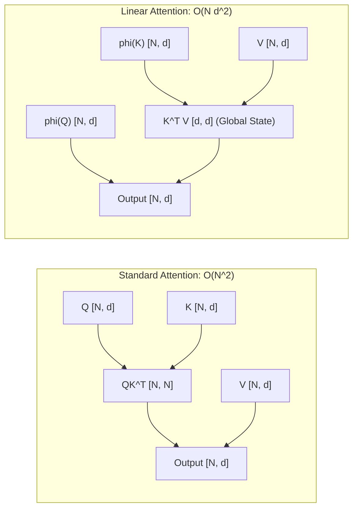

#### d. Code Thực chiến (C++ & Python)
```cpp
// C++17: Linear Attention Recurrent Step
#include <vector>

void linear_attention_step(const float* phi_q, const float* phi_k, const float* v,
                           float* M_state, float* z_state, float* out, int d) {
    // 1. Cập nhật state M += phi_k * v^T (rank-1 update)
    // 2. Cập nhật z += phi_k
    for (int i = 0; i < d; ++i) {
        z_state[i] += phi_k[i];
        for (int j = 0; j < d; ++j) {
            M_state[i * d + j] += phi_k[i] * v[j];
        }
    }
    // 3. Tính out = phi_q^T * M / (phi_q^T * z)
    float denom = 0.0f;
    for (int i = 0; i < d; ++i) denom += phi_q[i] * z_state[i];
    
    for (int j = 0; j < d; ++j) {
        float num = 0.0f;
        for (int i = 0; i < d; ++i) num += phi_q[i] * M_state[i * d + j];
        out[j] = num / (denom + 1e-6f);
    }
}
```

```python
import torch
import torch.nn as nn
import torch.nn.functional as F

class LinearAttention(nn.Module):
    def __init__(self, d_model: int):
        super().__init__()
        self.d_model = d_model

    def feature_map(self, x: torch.Tensor) -> torch.Tensor:
        return F.elu(x) + 1.0 # Luôn dương

    def forward(self, q: torch.Tensor, k: torch.Tensor, v: torch.Tensor) -> torch.Tensor:
        # q, k, v: [B, N, D]
        q = self.feature_map(q)
        k = self.feature_map(k)
        
        # Causal linear attention qua cumsum
        # KV: [B, N, D, D]
        kv = torch.einsum('bni,bnj->bnij', k, v)
        kv_state = torch.cumsum(kv, dim=1)
        z_state = torch.cumsum(k, dim=1)
        
        num = torch.einsum('bni,bnij->bnj', q, kv_state)
        denom = torch.einsum('bni,bni->bn', q, z_state).unsqueeze(-1) + 1e-6
        return num / denom
```

#### e. Lỗi Thường gặp & Ổn định Số học
- **Attention Dissipation**: Vì không có Softmax phân cực, Linear Attention gặp khó khăn trong việc tập trung chính xác vào 1 token duy nhất trong biển hàng triệu token (Recall task kém).

#### f. Ứng dụng Thực chiến trong AI
- Nền tảng cảm hứng trực tiếp cho các kiến trúc hiện đại: **Mamba (State Space Models)**, **RWKV**, và **RetNet (Retention Networks)**.

---

### 23. FlashAttention

#### a. Định nghĩa Bản chất Toán học
**FlashAttention** (Dao et al., NeurIPS 2022) không thay đổi bản chất toán học của Scaled Dot-Product Attention:
$$\mathbf{O} = \text{Softmax}\left(\frac{\mathbf{Q} \mathbf{K}^T}{\sqrt{d_k}}\right) \mathbf{V}$$
Đóng góp cách mạng của FlashAttention nằm ở cấp độ **kỹ thuật điện toán phần cứng**: Nó nhận ra rằng tính toán Attention trên GPU hiện đại không bị nghẽn bởi số phép tính (Compute-bound) mà bị nghẽn bởi tốc độ đọc/ghi dữ liệu vào bộ nhớ HBM (Memory-IO Bound). FlashAttention biến đổi thuật toán để tính chính xác Attention với **độ phức tạp bộ nhớ phụ $\mathcal{O}(N)$** thay vì $\mathcal{O}(N^2)$ mà không bao giờ cần tạo ra ma trận $N \times N$ trong HBM.

#### b. Cơ chế Tầng Sâu & Điện toán (Tiling & Online Softmax)
Hệ thống phân cấp bộ nhớ GPU:
- **HBM (High Bandwidth Memory)**: Dung lượng lớn (80 GB trên A100), nhưng băng thông tương đối chậm (~1.5–2.0 TB/s).
- **SRAM (Shared Memory trong mỗi SM)**: Cực nhanh (~19 TB/s), nhưng dung lượng rất nhỏ (~192 KB mỗi SM).

Thuật toán FlashAttention chia ma trận $Q, K, V$ thành các khối nhỏ (blocks) kích thước $B_r \times d$ và $B_c \times d$ vừa khít với SRAM:
1. Nạp từng khối $Q_i$ và $K_j, V_j$ từ HBM vào SRAM.
2. Tính tích vô hướng cục bộ trên SRAM.
3. Sử dụng công thức **Online Softmax** (Milakov & Gimelshein, 2018) để liên tục cập nhật hệ số chuẩn hóa mà không cần duyệt qua toàn bộ chuỗi:
   $$m_{\text{new}} = \max(m_{\text{old}}, \max(S_{\text{local}}))$$
   $$d_{\text{new}} = d_{\text{old}} \cdot e^{m_{\text{old}} - m_{\text{new}}} + \sum e^{S_{\text{local}} - m_{\text{new}}}$$
   $$O_{\text{new}} = O_{\text{old}} \cdot \frac{d_{\text{old}} e^{m_{\text{old}} - m_{\text{new}}}}{d_{\text{new}}} + \frac{\text{Softmax}(S_{\text{local}}) V_{\text{local}}}{d_{\text{new}}}$$
4. Trong lượt backward pass, FlashAttention **không lưu ma trận Attention $N \times N$** từ forward pass mà chỉ lưu vector thống kê logsumexp ($m, d$) có kích thước $\mathcal{O}(N)$, sau đó tính toán lại (recompute) ma trận attention ngay trên SRAM, giúp tiết kiệm triệt để bộ nhớ.

#### c. Sơ đồ Minh họa
```mermaid
flowchart TD
    subgraph StandardAttention ["Standard Attention: Massive HBM Roundtrips"]
        HBM1["HBM: Store Q, K, V"] -->|Read| SM1["GPU SM"]
        SM1 -->|"Write O(N^2) Matrix"| HBM_S["HBM: Score Matrix S"]
        HBM_S -->|Read| SM2["GPU SM Softmax"]
        SM2 -->|"Write O(N^2) Matrix"| HBM_P["HBM: Prob Matrix P"]
        HBM_P -->|Read| SM3["GPU SM MatMul V"]
        SM3 -->|"Write O(N)"| HBM_Out["HBM: Output O"]
    end
    subgraph FlashAttentionFlow ["FlashAttention: Fused SRAM Tiling"]
        HBM_In["HBM: Q, K, V Blocks"] -->|Read Chunk| SRAM["Fast On-Chip SRAM (192 KB)"]
        SRAM -->|Compute Block MatMul & Online Softmax| SRAM
        SRAM -->|Write Only Final Blocks| HBM_Final["HBM: Output O & Stats (m, l)"]
    end
```

#### d. Code Thực chiến (C++ & Python)
```cpp
// C++17: Mô phỏng logic Online Softmax 2 khối
#include <iostream>
#include <vector>
#include <cmath>
#include <algorithm>

struct OnlineSoftmaxAccumulator {
    float m = -1e9f; // Max cục bộ
    float d = 0.0f;  // Tổng exp cục bộ
    float val = 0.0f;// Giá trị tích lũy O

    void update(float x_val, float v_val) {
        float m_prev = m;
        m = std::max(m_prev, x_val);
        float exp_prev = std::exp(m_prev - m);
        float exp_curr = std::exp(x_val - m);
        
        d = d * exp_prev + exp_curr;
        val = val * exp_prev + exp_curr * v_val;
    }

    float finalize() const {
        return val / d;
    }
};
```

```python
import torch

def flash_attention_reference_online_softmax(q_chunk: torch.Tensor, k_chunk: torch.Tensor, v_chunk: torch.Tensor):
    # Minh họa toán học Online Softmax cho 1 chunk
    # q_chunk: [B_r, D], k_chunk: [B_c, D], v_chunk: [B_c, D]
    d_k = q_chunk.size(-1)
    s = torch.matmul(q_chunk, k_chunk.T) / (d_k ** 0.5) # [B_r, B_c]
    m_block = torch.max(s, dim=-1, keepdim=True).values
    p_block = torch.exp(s - m_block)
    l_block = torch.sum(p_block, dim=-1, keepdim=True)
    o_block = torch.matmul(p_block, v_chunk)
    return o_block, m_block, l_block
```

#### e. Lỗi Thường gặp & Ổn định Số học
- Kích thước khối (Block size $B_r, B_c$) không chia hết cho kích thước tensor hoặc vượt quá dung lượng Shared Memory tối đa của SM dẫn đến lỗi CUDA launch failure.

#### f. Ứng dụng Thực chiến trong AI
- Công nghệ tăng tốc nền tảng trong PyTorch 2.0+ (`torch.nn.functional.scaled_dot_product_attention`) và HuggingFace Transformers.

---

### 24. FlashAttention-2

#### a. Định nghĩa Bản chất Toán học
**FlashAttention-2** (Dao, 2023) giữ nguyên nguyên lý toán học và IO-Aware của phiên bản 1, nhưng tái thiết kế lại toàn bộ luồng thực thi song song để tối ưu hóa hiệu suất sử dụng GPU (tăng từ 30-40% FLOPs efficiency lên tới 50-73% theoretical peak FLOPs trên A100).

Ba cải tiến kỹ thuật đột phá:
1. **Giảm thiểu các phép toán phi ma trận (Non-MatMul FLOPs)**: Chuyển phép chia chuẩn hóa $1/d$ ra ngoài cùng, chỉ thực hiện 1 lần duy nhất ở cuối thay vì chia ở mỗi bước lặp trong SRAM.
2. **Song song hóa dọc theo chiều Sequence Length (Parallelize over Sequence)**: Ngoài song song qua Batch và Head, FlashAttention-2 phân bổ các khối Query dọc theo chiều Sequence Length cho các Thread Blocks khác nhau, tăng độ chiếm dụng (occupancy) của GPU ngay cả khi Batch size nhỏ.
3. **Warp Partitioning tối ưu**: Thay vì chia nhỏ $Q$ cho các warp khác nhau gây tốn chi phí đồng bộ (synchronization overhead), FlashAttention-2 phân bổ để tất cả các warp trong cùng một thread block cùng chia sẻ $Q$ và chia nhau các phần của $K, V$.

#### b. Cơ chế Tầng Sâu & Điện toán
- Giảm số lệnh `__syncthreads()` giữa các warp trong cùng một SM.
- Tốc độ tăng gấp 2 lần so với FlashAttention-1, huấn luyện GPT-3 175B nhanh hơn hàng tuần.

#### c. Sơ đồ Minh họa
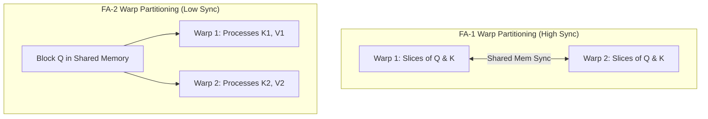

#### d. Code Thực chiến (C++ & Python)
```cpp
// C++17: Giảm Non-MatMul FLOPs bằng cách hoãn phép chia chuẩn hóa
#include <vector>

void fa2_deferred_normalization(float* O_accum, const float* L_sum, int N, int D) {
    // Chỉ thực hiện phép chia 1 lần duy nhất tại Global Memory write
    #pragma omp parallel for
    for (int i = 0; i < N; ++i) {
        float inv_L = 1.0f / L_sum[i];
        for (int d = 0; d < D; ++d) {
            O_accum[i * D + d] *= inv_L;
        }
    }
}
```

```python
import torch

# Kích hoạt FlashAttention-2 trong PyTorch hiện đại
def run_fa2_native(q: torch.Tensor, k: torch.Tensor, v: torch.Tensor):
    # Yêu cầu đầu vào [B, N, H, D] và kiểu dữ liệu FP16 hoặc BF16
    with torch.backends.cuda.sdp_kernel(enable_flash=True, enable_math=False, enable_mem_efficient=False):
        out = torch.nn.functional.scaled_dot_product_attention(
            q.transpose(1, 2), k.transpose(1, 2), v.transpose(1, 2)
        )
    return out.transpose(1, 2)
```

#### e. Lỗi Thường gặp & Ổn định Số học
- FlashAttention-2 yêu cầu phần cứng GPU NVIDIA kiến trúc Ampere (A100), Ada Lovelace (RTX 4090) hoặc Hopper (H100) trở lên; không chạy được trên Turing (T4) hay Volta (V100) cho FP8/BF16.

#### f. Ứng dụng Thực chiến trong AI
- Engine mặc định trong toàn bộ các framework huấn luyện LLM lớn: **Megatron-LM**, **Deepspeed**, **vLLM**, **TGI**.

---

### 25. FlashAttention-3

#### a. Định nghĩa Bản chất Toán học
**FlashAttention-3** (Shah, Dao et al., 2024) được thiết kế chuyên biệt để khai thác tối đa năng lực phần cứng của kiến trúc NVIDIA Hopper (H100) và Blackwell, vượt qua mức 75% peak FLOPs trên GPU Hopper và đạt tốc độ 1 PFLOPs/s ở chế độ FP8.

Ba trụ cột kiến trúc phần cứng:
1. **Asynchronous Tensor Memory Accelerator (TMA)**: Sử dụng đơn vị phần cứng TMA chuyên dụng trên chip H100 để chuyển dữ liệu 5D/Tensor trực tiếp giữa Global Memory (HBM) và Shared Memory (SRAM) hoàn toàn bất đồng bộ mà không tốn bất kỳ chu kỳ tính toán nào của thanh ghi CPU/SM.
2. **Warp-Specialization (Chuyên biệt hóa Warp)**: Tách các Warp trong một SM thành hai nhóm độc lập: *Producer Warps* (chuyên điều khiển nạp dữ liệu qua TMA) và *Consumer Warps* (chuyên thực hiện phép nhân ma trận GEMM trên Tensor Cores qua lệnh WGMMA - Warp Group Matrix Multiply and Accumulate).
3. **Pipelining xen kẽ GEMM và Softmax**: Chồng lấn (overlap) thời gian tính toán Softmax trên FP32 ALU với thời gian tính ma trận GEMM trên Tensor Cores, loại bỏ hoàn toàn thời gian trễ không làm việc (idle bubble).
4. **Hỗ trợ FP8 Tensor Cores với Scaling Block thông minh** để giảm thiểu sai số lượng tử hóa.

#### b. Cơ chế Tầng Sâu & Điện toán
- Phép nhân `wgmma.mma_async` trên H100 cho phép các consumer warps ra lệnh nhân ma trận bất đồng bộ và tiếp tục làm việc khác trong khi Tensor Core đang chạy.

#### c. Sơ đồ Minh họa
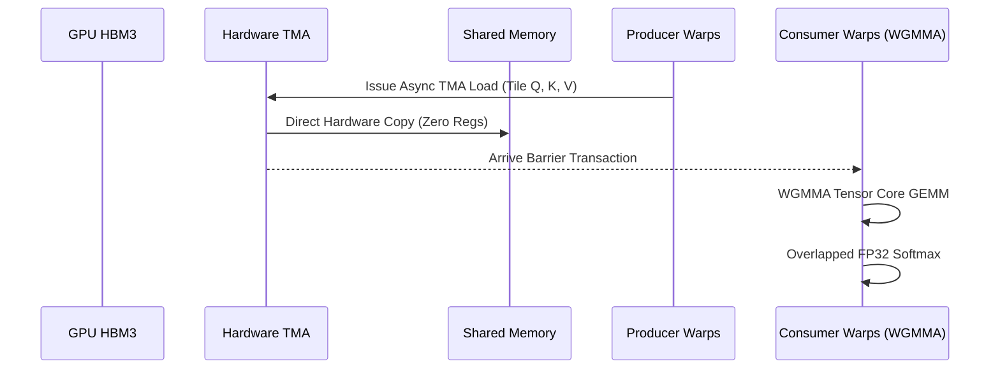

#### d. Code Thực chiến (C++ & Python)
```cpp
// C++20 / CUDA Concept: Khái niệm Warp Specialization
#include <iostream>

void simulate_warp_specialization(int warp_id) {
    if (warp_id == 0) {
        // Producer: Điều phối TMA
        std::cout << "Producer Warp: Issuing Async DMA Transfer\n";
    } else {
        // Consumer: Chạy Tensor Cores WGMMA
        std::cout << "Consumer Warp: Executing Tensor Core Multiply\n";
    }
}
```

```python
import torch

def flash_attn_3_fp8_concept(q: torch.Tensor, k: torch.Tensor, v: torch.Tensor):
    # Khái niệm lượng tử hóa FP8 cho FlashAttention-3
    # E4M3 cho forward pass, E5M2 cho backward gradients
    q_fp8 = q.to(torch.float8_e4m3fn)
    k_fp8 = k.to(torch.float8_e4m3fn)
    v_fp8 = v.to(torch.float8_e4m3fn)
    # Forward thông qua FA3 kernel hỗ trợ FP8
    return q_fp8, k_fp8, v_fp8
```

#### e. Lỗi Thường gặp & Ổn định Số học
- Sự mất độ chính xác trong định dạng FP8: Dynamic Range rất hẹp, nếu không áp dụng block scaling chính xác, ma trận attention sẽ bị tràn số hoặc sụp đổ về 0.

#### f. Ứng dụng Thực chiến trong AI
- Huấn luyện và phục vụ suy luận thế hệ frontier models trên cụm hàng chục nghìn GPU H100/H200 và GB200.
