# Chuyên đề: Xử lý Ngữ cảnh Dài, Kỹ thuật Che Mặt nạ & Tối ưu Hóa Độ phức tạp (Long Context, Attention Masking & Complexity Optimization)

## 1. Tổng quan Chuyên đề
Khả năng mở rộng chiều dài ngữ cảnh (Context Window) là thước đo quan trọng nhất cho năng lực suy luận của các mô hình nơ-ron hiện đại. Tuy nhiên, rào cản lớn nhất nằm ở **Độ phức tạp bậc hai $\mathcal{O}(N^2)$** cả về thời gian tính toán lẫn dung lượng bộ nhớ. Khi độ dài chuỗi $N$ nhân đôi, lượng FLOPs và bộ nhớ lưu trữ ma trận điểm số tăng gấp bốn lần ($4\times$).

Để mở rộng từ ngữ cảnh ngắn (2K token thời kỳ đầu) lên hàng triệu token (1M–10M tokens), kiến trúc hiện đại kết hợp:
1. **Cơ chế Mặt nạ Chính xác (Masking Semantics)**: Causal Masking cho mô hình tự hồi quy (Autoregressive), Padding Mask cho dữ liệu batch có độ dài không đều, và Bi-directional Masking cho các bộ mã hóa (Encoder).
2. **Song song hóa Phân tán Vòng xuyến (Ring Attention)**: Phân bổ các khối Query, Key, Value trên một vòng xuyến GPU (GPU Ring), chồng lấn giao tiếp mạng P2P (Peer-to-Peer) qua NVLink với tính toán lõi để mở rộng ngữ cảnh gần như vô hạn.
3. **Các Kỹ thuật Giảm tải Bộ nhớ Vật lý**: Kích hoạt lại (Activation Checkpointing), PagedAttention (Quản lý phân trang VRAM), và lượng tử hóa KV Cache.

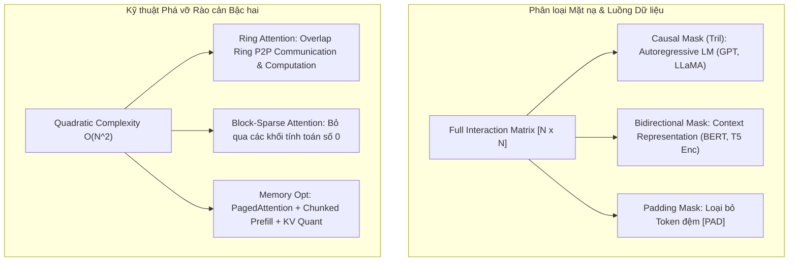

---

## 2. Chi tiết từng Keyword

---

### 26. Ring Attention (Chú ý Dạng vòng)

#### a. Định nghĩa Bản chất Toán học
**Ring Attention** (Liu et al., 2023) là thuật toán chú ý phân tán vượt qua giới hạn bộ nhớ của một GPU đơn lẻ bằng cách chia chuỗi có độ dài siêu lớn $N$ thành $P$ phân đoạn (blocks) trên $P$ thiết bị GPU được kết nối thành một vòng xuyến mạng (Ring Topology):
$$N = P \times B_s$$
Mỗi GPU $p \in \{0, \dots, P-1\}$ lưu trữ cố định phân đoạn Query $\mathbf{Q}_p \in \mathbb{R}^{B_s \times d}$. Tại mỗi bước thời gian $t \in \{0, \dots, P-1\}$:
1. GPU $p$ tính toán chú ý cục bộ giữa $\mathbf{Q}_p$ với khối Key-Value hiện tại $\mathbf{K}_p^{(t)}, \mathbf{V}_p^{(t)}$ bằng thuật toán FlashAttention Online Softmax:
   $$\mathbf{O}_p^{(t)}, m_p^{(t)}, l_p^{(t)} \leftarrow \text{OnlineSoftmax}(\mathbf{Q}_p, \mathbf{K}_p^{(t)}, \mathbf{V}_p^{(t)})$$
2. Đồng thời (asynchronously), GPU $p$ gửi khối $\mathbf{K}_p^{(t)}, \mathbf{V}_p^{(t)}$ cho GPU kế tiếp $(p + 1) \pmod P$ và nhận khối mới từ GPU $(p - 1) \pmod P$ qua kênh truyền P2P NVLink.

#### b. Cơ chế Tầng Sâu & Điện toán (Overlapping Comm & Compute)
- **Zero Idle Bubbles**: Thời gian tính toán ma trận Attention trên SRAM:
  $$T_{\text{compute}} \approx \frac{2 B_s^2 d}{\text{Peak TFLOPS}}$$
  Thời gian truyền khối $K, V$ qua vòng NVLink:
  $$T_{\text{comm}} = \frac{2 B_s d \times \text{sizeof(FP16)}}{\text{NVLink Bandwidth}}$$
  Khi $B_s$ đủ lớn (ví dụ $B_s \ge 4096$), $T_{\text{compute}} \ge T_{\text{comm}}$. Toàn bộ chi phí truyền thông qua mạng được ẩn hoàn toàn (100% overlapped) sau thời gian tính toán của GPU Tensor Cores.
- Dung lượng bộ nhớ mỗi GPU chỉ là $\mathcal{O}(N/P)$, cho phép mở rộng ngữ cảnh tuyến tính theo số lượng GPU (hàng triệu token).

#### c. Sơ đồ Minh họa
```mermaid
sequenceDiagram
    participant GPU0 as GPU 0 (Q0, K0, V0)
    participant GPU1 as GPU 1 (Q1, K1, V1)
    participant GPU2 as GPU 2 (Q2, K2, V2)
    
    rect rgb(20, 40, 80)
    Note over GPU0,GPU2: Step 0: Compute Local Attention
    GPU0->>GPU0: FA(Q0, K0, V0)
    GPU1->>GPU1: FA(Q1, K1, V1)
    GPU2->>GPU2: FA(Q2, K2, V2)
    end
    
    rect rgb(80, 40, 20)
    Note over GPU0,GPU2: Overlapped Step: Ring Send/Receive KV Blocks
    GPU0->>GPU1: P2P Send K0, V0
    GPU1->>GPU2: P2P Send K1, V1
    GPU2->>GPU0: P2P Send K2, V2
    end
```

#### d. Code Thực chiến (C++ & Python)
```cpp
// C++17 / MPI Pseudo-Code: Ring Communication Topology
#include <iostream>

void ring_shift_kv(int rank, int num_ranks, float* send_buffer, float* recv_buffer, size_t size_bytes) {
    int next_rank = (rank + 1) % num_ranks;
    int prev_rank = (rank - 1 + num_ranks) % num_ranks;
    
    // Bắt đầu truyền nhận P2P bất đồng bộ (Non-blocking Send/Recv)
    // MPI_Isend(send_buffer, size_bytes, ..., next_rank, ...);
    // MPI_Irecv(recv_buffer, size_bytes, ..., prev_rank, ...);
}
```

```python
import torch
import torch.distributed as dist

def ring_attention_step(q_local: torch.Tensor, k_local: torch.Tensor, v_local: torch.Tensor, 
                        rank: int, world_size: int):
    # Khối giao tiếp P2P trên vòng tròn
    next_rank = (rank + 1) % world_size
    prev_rank = (rank - 1 + world_size) % world_size
    
    # Chuẩn bị buffer truyền nhận bất đồng bộ
    k_recv = torch.empty_like(k_local)
    v_recv = torch.empty_like(v_local)
    
    reqs = []
    # Gửi K, V cho rank kế tiếp và nhận từ rank trước đó
    reqs.append(dist.isend(k_local, dst=next_rank))
    reqs.append(dist.irecv(k_recv, src=prev_rank))
    
    # Tính toán cục bộ trên Tensor Cores song song với truyền thông
    # out, m, l = flash_attn_online(q_local, k_local, v_local)
    
    for req in reqs:
        req.wait()
    return k_recv, v_recv
```

#### e. Lỗi Thường gặp & Ổn định Số học
- Khi áp dụng Ring Attention cho Causal Masking, chỉ khoảng một nửa số khối cần tính toán ($j \le i$), nửa còn lại bị che hoàn toàn. Nếu không phân phối khối thông minh (Striped Attention), sẽ xảy ra mất cân bằng tải trầm trọng (Load Imbalance) giữa các GPU.

#### f. Ứng dụng Thực chiến trong AI
- Kiến trúc mở rộng ngữ cảnh lên 1M–10M tokens trong **Gemini 1.5 Pro** và các mô hình xử lý video dài (Long-Video Foundation Models).

---

### 27. Block-Sparse Attention (Chú ý Thưa Theo Khối)

#### a. Định nghĩa Bản chất Toán học
**Block-Sparse Attention** chia ma trận chú ý $N \times N$ thành lưới các khối vuông cố định kích thước $B \times B$ (thường $B \in \{16, 32, 64\}$):
$$\mathbf{S} \in \mathbb{R}^{\frac{N}{B} \times \frac{N}{B} \times B \times B}$$
Một ma trận nhị phân điều khiển (Block Mask Topology) $\mathbf{M}_{\text{block}} \in \{0, 1\}^{\frac{N}{B} \times \frac{N}{B}}$ xác định khối nào cần được tính toán:
$$\text{Attention}(\mathbf{Q}, \mathbf{K}, \mathbf{V}) = \sum_{J: \mathbf{M}_{IJ} = 1} \text{Softmax}\left(\frac{\mathbf{Q}_I \mathbf{K}_J^T}{\sqrt{d_k}}\right) \mathbf{V}_J$$
Các khối có $\mathbf{M}_{IJ} = 0$ hoàn toàn bị bỏ qua trong cả lượt forward và backward pass.

#### b. Cơ chế Tầng Sâu & Điện toán
- Khác với độ thưa ngẫu nhiên từng phần tử (Fine-grained Element-wise Sparsity) vốn không thể tăng tốc trên GPU, Block-Sparse Attention xử lý trực tiếp ở cấp độ khối gạch (Tile).
- Mỗi khối $B \times B$ tương thích hoàn hảo với kích thước lệnh GEMM của NVIDIA Tensor Cores (như WMMA $16 \times 16$ hoặc WGMMA $64 \times 64$), đạt 100% hiệu suất phần cứng trên các khối được tính toán.

#### c. Sơ đồ Minh họa
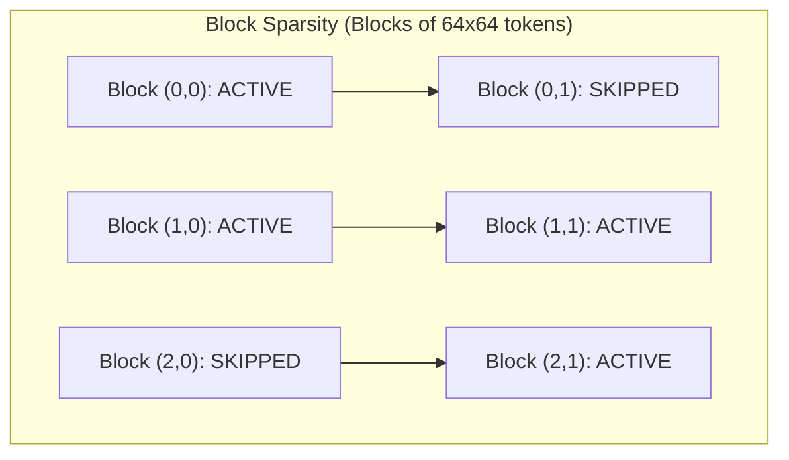

#### d. Code Thực chiến (C++ & Python)
```cpp
// C++17: Block-Sparse Skipping Scheduler
#include <vector>

struct BlockCoordinate {
    int row_block;
    int col_block;
};

std::vector<BlockCoordinate> build_active_blocks(const std::vector<std::vector<bool>>& mask_grid) {
    std::vector<BlockCoordinate> active_list;
    int n_blocks = mask_grid.size();
    for (int i = 0; i < n_blocks; ++i) {
        for (int j = 0; j < n_blocks; ++j) {
            if (mask_grid[i][j]) {
                active_list.push_back({i, j});
            }
        }
    }
    return active_list;
}
```

```python
import torch

def block_sparse_matmul(q_blocks: list, k_blocks: list, block_layout: torch.Tensor):
    # block_layout: [num_blocks_q, num_blocks_k] boolean
    outputs = []
    for i in range(block_layout.size(0)):
        row_accum = 0
        for j in range(block_layout.size(1)):
            if block_layout[i, j]: # Chỉ tính khi cờ khối bật
                q_tile = q_blocks[i]
                k_tile = k_blocks[j]
                # Tương tác cục bộ trên SRAM
                scores = torch.matmul(q_tile, k_tile.T)
                row_accum += scores
        outputs.append(row_accum)
    return outputs
```

#### e. Lỗi Thường gặp & Ổn định Số học
- Kích thước khối $B$ chọn quá nhỏ (ví dụ $B = 4$) sẽ gây phân mảnh và chi phí điều phối (scheduling overhead) vượt quá thời gian tính toán thực tế.

#### f. Ứng dụng Thực chiến trong AI
- Kiến trúc **FlexAttention (PyTorch 2.5+)**, **OpenAI Triton Block-Sparse Kernels**, và mô hình nén mã nguồn StarCoder.

---

### 28. Causal Attention (Chú ý Nhân quả)

#### a. Định nghĩa Bản chất Toán học
Trong bài toán sinh văn bản tự hồi quy (Autoregressive Generation), quá trình sinh phải tuân thủ nghiêm ngặt nguyên lý nhân quả: việc dự đoán token tại thời điểm $t$ chỉ được phép phụ thuộc vào các token trong quá khứ và hiện tại $\{x_1, \dots, x_t\}$, tuyệt đối không được phép nhìn thấy các token tương lai $\{x_{t+1}, \dots, x_N\}$ (tránh rò rỉ thông tin - Information Leakage).
$$\mathbf{S}_{ij} = \begin{cases} \frac{\mathbf{q}_i \mathbf{k}_j^T}{\sqrt{d_k}} & \text{nếu } j \le i \\ -\infty & \text{nếu } j > i \end{cases}$$
$$\mathbf{A}_{ij} = \frac{\exp(\mathbf{S}_{ij})}{\sum_{l=1}^i \exp(\mathbf{S}_{il})}, \quad \text{với } \mathbf{A}_{ij} = 0 \quad \forall j > i$$
Ma trận trọng số chú ý $\mathbf{A}$ có dạng **Ma trận Tam giác dưới (Lower Triangular Matrix)**.

#### b. Cơ chế Tầng Sâu & Điện toán
- **Tiết kiệm 50% tính toán**: Do tam giác trên (Upper Triangular) hoàn toàn bằng 0, thuật toán tối ưu (như Causal FlashAttention) chỉ cần duyệt và tính toán các khối nằm ở đường chéo chính và nửa dưới tam giác, giúp giảm trực tiếp $50\%$ số lượng FLOPs so với Bidirectional Attention.

#### c. Sơ đồ Minh họa
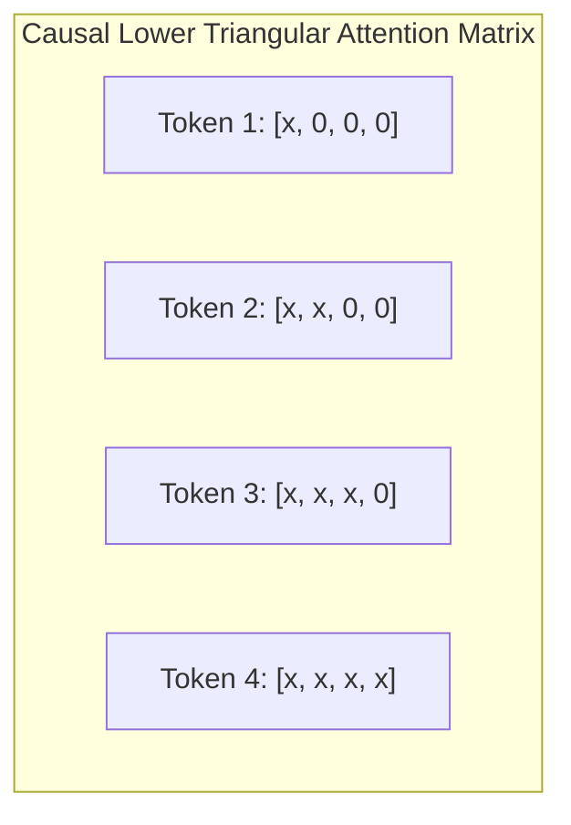

#### d. Code Thực chiến (C++ & Python)
```cpp
// C++17: Causal Loop Optimization (Bỏ qua hoàn toàn j > i)
#include <vector>

void causal_attention_scores(const float* Q, const float* K, float* S, 
                             int N, int d_k, float scale) {
    for (int i = 0; i < N; ++i) {
        // Chỉ duyệt j từ 0 đến i
        for (int j = 0; j <= i; ++j) {
            float dot = 0.0f;
            for (int d = 0; d < d_k; ++d) {
                dot += Q[i * d_k + d] * K[j * d_k + d];
            }
            S[i * N + j] = dot * scale;
        }
        // Điền -inf cho nửa tam giác trên
        for (int j = i + 1; j < N; ++j) {
            S[i * N + j] = -1e9f;
        }
    }
}
```

```python
import torch

def apply_causal_mask(scores: torch.Tensor) -> torch.Tensor:
    # scores: [B, H, N, N]
    seq_len = scores.size(-1)
    mask = torch.triu(torch.full((seq_len, seq_len), float('-inf'), device=scores.device), diagonal=1)
    return scores + mask
```

#### e. Lỗi Thường gặp & Ổn định Số học
- Áp dụng nhầm đường chéo tam giác (`diagonal=0` thay vì `diagonal=1`), khiến token hiện tại tự che chính nó ($j < i$ thay vì $j \le i$).

#### f. Ứng dụng Thực chiến trong AI
- Toàn bộ các mô hình LLM giải mã tự hồi quy (GPT series, LLaMA series, Mistral, DeepSeek).

---

### 29. Bidirectional Attention (Chú ý Hai chiều)

#### a. Định nghĩa Bản chất Toán học
**Bidirectional Attention** cho phép mọi token tại bất kỳ vị trí $i$ nào trong chuỗi đều được quyền chú ý và tương tác trực tiếp với toàn bộ các token khác $j \in \{1, \dots, N\}$ (cả phía trước lẫn phía sau) mà không có bất kỳ ràng buộc thứ tự nào:
$$\mathbf{S}_{ij} = \frac{\mathbf{q}_i \mathbf{k}_j^T}{\sqrt{d_k}}, \quad \forall i, j \in \{1, \dots, N\}$$
$$\mathbf{A} = \text{Softmax}\left(\frac{\mathbf{Q} \mathbf{K}^T}{\sqrt{d_k}}\right) \in \mathbb{R}^{N \times N}$$
Toàn bộ ma trận chú ý là một ma trận đầy đủ (Dense Matrix), thu nhận ngữ cảnh toàn vẹn hai chiều (Bi-directional context).

#### b. Cơ chế Tầng Sâu & Điện toán
- Không thể áp dụng cho việc sinh từ tuần tự vì vi phạm tính nhân quả.
- Tận dụng tối đa băng thông bộ nhớ và FLOPs trong một lượt suy luận duy nhất (Single Forward Pass) vì không có vòng lặp autoregressive.

#### c. Sơ đồ Minh họa
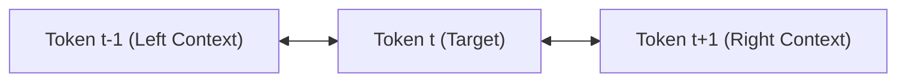

#### d. Code Thực chiến (C++ & Python)
```cpp
// C++17: Full Bidirectional MatMul
void bidirectional_scores(const float* Q, const float* K, float* S, int N, int d_k, float scale) {
    #pragma omp parallel for collapse(2)
    for (int i = 0; i < N; ++i) {
        for (int j = 0; j < N; ++j) {
            float dot = 0.0f;
            for (int d = 0; d < d_k; ++d) {
                dot += Q[i * d_k + d] * K[j * d_k + d];
            }
            S[i * N + j] = dot * scale;
        }
    }
}
```

```python
import torch

def bidirectional_attention(q: torch.Tensor, k: torch.Tensor, v: torch.Tensor) -> torch.Tensor:
    # Không dùng bất kỳ causal mask nào
    d_k = q.size(-1)
    scores = torch.matmul(q, k.transpose(-2, -1)) / (d_k ** 0.5)
    weights = torch.softmax(scores, dim=-1)
    return torch.matmul(weights, v)
```

#### e. Lỗi Thường gặp & Ổn định Số học
- Dùng Bidirectional Attention để huấn luyện mô hình sinh văn bản sẽ gây ra hiện tượng rò rỉ đáp án (Label Leakage), khiến mô hình ghi nhớ đáp án mà không học được khả năng suy luận tiếp theo.

#### f. Ứng dụng Thực chiến trong AI
- Kiến trúc nền tảng của **BERT**, **RoBERTa**, **DeBERTa**, **Vision Transformer (ViT)**, và các mô hình Text Embedding.

---

### 30. Attention Masking (Kỹ thuật Che Mặt nạ Chú ý)

#### a. Định nghĩa Bản chất Toán học
**Attention Masking** là kỹ thuật can thiệp vào ma trận Attention Scores $\mathbf{S}$ trước khi đưa vào hàm kích hoạt Softmax bằng cách cộng thêm một ma trận mặt nạ $\mathbf{M} \in \mathbb{R}^{N \times M}$:
$$\tilde{\mathbf{S}} = \mathbf{S} + \mathbf{M}$$
$$\mathbf{A}_{ij} = \text{Softmax}(\tilde{\mathbf{S}})_{ij} = \frac{\exp(\mathbf{S}_{ij} + \mathbf{M}_{ij})}{\sum_{k=1}^M \exp(\mathbf{S}_{ik} + \mathbf{M}_{ik})}$$
Nguyên lý ánh xạ giá trị vô cực:
$$\mathbf{M}_{ij} = \begin{cases} 0 & \text{vị trí HỢP LỆ (được chú ý)} \\ -\infty \text{ (hoặc } -10^9) & \text{vị trí CẦN CHE (bị vô hiệu hóa)} \end{cases}$$
Khi $\mathbf{M}_{ij} \to -\infty$, ta có $\exp(\mathbf{S}_{ij} - \infty) = 0$, dẫn đến trọng số chú ý cuối cùng bằng chính xác 0 tuyệt đối:
$$\mathbf{A}_{ij} = 0$$

#### b. Cơ chế Tầng Sâu & Điện toán
- Phép cộng $\mathbf{S} + \mathbf{M}$ là một phép toán Element-wise Addition.
- Trong các GPU kernel hợp nhất (Fused Kernels), mặt nạ không được khởi tạo dưới dạng một ma trận đầy đủ trong VRAM mà được tính toán logic trực tiếp theo điều kiện (Predicate evaluation) ngay trong thanh ghi của thread trước khi gọi hàm $\exp$.

#### c. Sơ đồ Minh họa
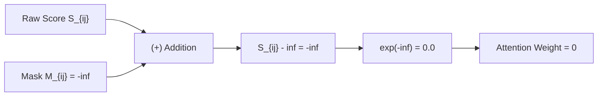

#### d. Code Thực chiến (C++ & Python)
```cpp
// C++17: Safe Additive Masking
#include <vector>
#include <limits>

void apply_additive_mask(float* scores, const bool* valid_mask, int N, int M) {
    const float NEG_INF = -1e9f;
    for (int i = 0; i < N; ++i) {
        for (int j = 0; j < M; ++j) {
            if (!valid_mask[i * M + j]) {
                scores[i * M + j] += NEG_INF;
            }
        }
    }
}
```

```python
import torch

def apply_custom_mask(scores: torch.Tensor, mask: torch.Tensor) -> torch.Tensor:
    # mask: True là hợp lệ, False là bị che
    return scores.masked_fill(~mask, -1e9)
```

#### e. Lỗi Thường gặp & Ổn định Số học
- Dùng `-float('inf')` trong nửa độ chính xác (FP16): Khi một hàng toàn bộ bị che bởi `-inf`, hàm Softmax sẽ tính `sum(exp) = 0`, sinh ra phép chia `0 / 0 = NaN`.

#### f. Ứng dụng Thực chiến trong AI
- Kiểm soát luồng thông tin trong Document Packing, Chatbot Multi-turn Dialog formatting, và Image Patch Masking.

---

### 31. Padding Mask (Mặt nạ Đệm)

#### a. Định nghĩa Bản chất Toán học
Trong xử lý theo lô (Mini-batching), các chuỗi dữ liệu trong cùng một batch thường có độ dài khác nhau. Để đưa về một tensor hình chữ nhật đồng nhất kích thước $[B, N_{\max}]$, các chuỗi ngắn hơn được chèn thêm các token đệm đặc biệt (thường là `[PAD]` với token ID = 0).

**Padding Mask** là một ma trận nhị phân $\mathbf{M}_{\text{pad}} \in \{0, 1\}^{B \times N_{\max}}$ chỉ ra vị trí token thật và token đệm:
$$\mathbf{M}_{\text{pad}}[b, j] = \begin{cases} 1 & \text{nếu } x[b, j] \neq \text{PAD\_ID} \\ 0 & \text{nếu } x[b, j] = \text{PAD\_ID} \end{cases}$$
Khi tính Attention, ma trận mặt nạ được phát sóng (broadcast) thành shape $[B, 1, 1, N_{\max}]$ để đảm bảo không một token nào hướng sự chú ý về các token đệm vô nghĩa.

#### b. Cơ chế Tầng Sâu & Điện toán
- **Lãng phí FLOPs do Padding**: Nếu trong batch có 1 câu dài 1024 token và 31 câu dài 32 token, thì hơn $95\%$ số phép tính ma trận là tính toán vô ích trên các token `[PAD]`.
- **Giải pháp tối ưu hóa (Unpadding / FlashAttention VarLen)**: Thay vì pad các câu thành hình chữ nhật, ta ghép phẳng toàn bộ các token thật của cả batch thành một vector 1D duy nhất $[N_{\text{total}}, D]$ kèm theo một mảng chỉ số vị trí bắt đầu `cu_seqlens` (Cumulative Sequence Lengths), loại bỏ 100% token pad.

#### c. Sơ đồ Minh họa
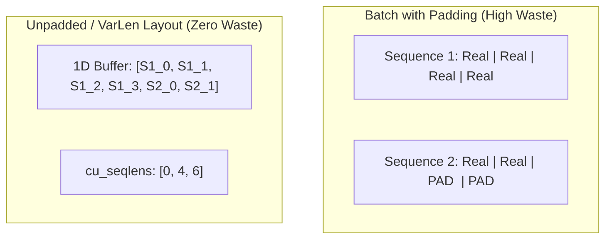

#### d. Code Thực chiến (C++ & Python)
```cpp
// C++17: Xây dựng cu_seqlens cho Unpadded Ragged Tensor
#include <vector>

std::vector<int> build_cu_seqlens(const std::vector<int>& seq_lengths) {
    std::vector<int> cu_seqlens(seq_lengths.size() + 1, 0);
    for (size_t i = 0; i < seq_lengths.size(); ++i) {
        cu_seqlens[i + 1] = cu_seqlens[i] + seq_lengths[i];
    }
    return cu_seqlens;
}
```

```python
import torch

def create_padding_mask(input_ids: torch.Tensor, pad_token_id: int = 0) -> torch.Tensor:
    # input_ids: [B, N]
    # mask: [B, 1, 1, N] để broadcast với attention scores
    return (input_ids != pad_token_id).unsqueeze(1).unsqueeze(2)
```

#### e. Lỗi Thường gặp & Ổn định Số học
- Quên che gradient của các token đệm trong quá trình backward pass khiến trọng số của token `[PAD]` vẫn bị cập nhật sai lệch.

#### f. Ứng dụng Thực chiến trong AI
- Module tiền xử lý chuẩn trong Hugging Face Tokenizers và kiến trúc xử lý độ dài biến thiên của vLLM.

---

### 32. Causal Mask (Mặt nạ Nhân quả)

#### a. Định nghĩa Bản chất Toán học
**Causal Mask** (còn gọi là *Autoregressive Mask* hoặc *Look-ahead Mask*) là ma trận mặt nạ vuông $\mathbf{M}_{\text{causal}} \in \mathbb{R}^{N \times N}$ được định nghĩa chính xác:
$$\mathbf{M}_{\text{causal}}[i, j] = \begin{cases} 0 & \text{khi } j \le i \\ -\infty & \text{khi } j > i \end{cases}$$
Biểu diễn ma trận cụ thể:
$$\mathbf{M}_{\text{causal}} = \begin{bmatrix} 0 & -\infty & -\infty & \dots & -\infty \\ 0 & 0 & -\infty & \dots & -\infty \\ 0 & 0 & 0 & \dots & -\infty \\ \vdots & \vdots & \vdots & \ddots & \vdots \\ 0 & 0 & 0 & \dots & 0 \end{bmatrix}$$

#### b. Cơ chế Tầng Sâu & Điện toán
- Khi huấn luyện theo cơ chế **Teacher Forcing**, toàn bộ chuỗi đích được nạp vào mô hình cùng một lúc. Nhờ có Causal Mask, mô hình có thể dự đoán đồng thời tất cả các token tiếp theo $\{x_2, \dots, x_{N+1}\}$ trong một bước forward duy nhất mà không bị vi phạm tính nhân quả.

#### c. Sơ đồ Minh họa
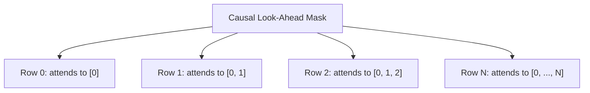

#### d. Code Thực chiến (C++ & Python)
```cpp
// C++17: Khởi tạo Causal Mask ma trận
#include <vector>

std::vector<float> generate_causal_mask(int N) {
    std::vector<float> mask(N * N, -1e9f);
    for (int i = 0; i < N; ++i) {
        for (int j = 0; j <= i; ++j) {
            mask[i * N + j] = 0.0f;
        }
    }
    return mask;
}
```

```python
import torch

def generate_causal_mask(seq_len: int, device: torch.device) -> torch.Tensor:
    # Trả về bool tensor: True ở tam giác dưới (kể cả đường chéo)
    return torch.tril(torch.ones((seq_len, seq_len), device=device, dtype=torch.bool))
```

#### e. Lỗi Thường gặp & Ổn định Số học
- Đặt `diagonal` sai trong hàm `torch.triu`: Nếu đặt `diagonal=0` với `-inf`, đường chéo chính sẽ bị che, khiến token hiện tại không thể tự nhìn thấy chính nó.

#### f. Ứng dụng Thực chiến trong AI
- Trái tim của toàn bộ các mô hình GPT, LLaMA, Mistral và mọi bộ giải mã tự hồi quy (Autoregressive Decoders).

---

### 33. Attention Complexity (Độ phức tạp Tính toán của Attention)

#### a. Định nghĩa Bản chất Toán học
Độ phức tạp tính toán và không gian của một tầng Multi-Head Attention tiêu chuẩn (với độ dài chuỗi $N$, số chiều ẩn $d$, số đầu $h$, và kích thước đầu $d_k = d / h$):
1. **Phép chiếu tuyến tính (Q, K, V Projections)**:
   $$\text{FLOPs} = 3 \times (2 N d^2) = 6 N d^2$$
2. **Tính Attention Scores ($\mathbf{Q} \mathbf{K}^T$)**:
   $$\text{FLOPs} = h \times (2 N \cdot N \cdot d_k) = 2 N^2 d$$
3. **Chuẩn hóa Softmax**:
   $$\text{FLOPs} \approx h \times (3 N^2) = 3 h N^2$$
4. **Nhân với Value ($\mathbf{A} \mathbf{V}$)**:
   $$\text{FLOPs} = h \times (2 N \cdot N \cdot d_k) = 2 N^2 d$$
5. **Chiếu đầu ra (Output Projection)**:
   $$\text{FLOPs} = 2 N d^2$$
$$\text{Tổng FLOPs} = 8 N d^2 + 4 N^2 d$$

#### b. Cơ chế Tầng Sâu & Điện toán
- Khi $N \ll d$ (ví dụ $N = 512, d = 4096$), số hạng $8 N d^2$ chiếm ưu thế: mô hình bị chi phối bởi các phép nhân trọng số tuyến tính (Compute-bound).
- Khi $N \gg d$ (ví dụ $N = 32768, d = 4096$), số hạng $4 N^2 d$ hoàn toàn áp đảo: chi phí tính toán bùng nổ theo hàm bậc hai của độ dài chuỗi $N$.

#### c. Sơ đồ Minh họa
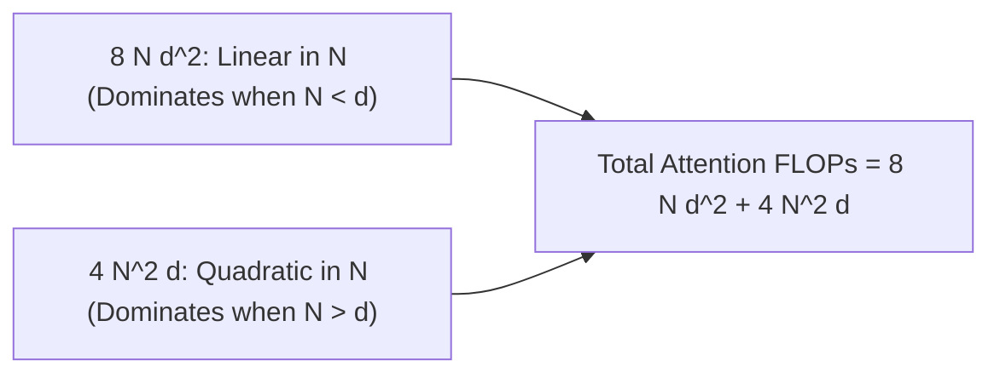

#### d. Code Thực chiến (C++ & Python)
```cpp
// C++17: Ước lượng FLOPs chính xác cho một tầng MHA
#include <iostream>

unsigned long long calculate_mha_flops(unsigned long long N, unsigned long long d) {
    unsigned long long proj_flops = 8 * N * d * d;
    unsigned long long core_attn_flops = 4 * N * N * d;
    return proj_flops + core_attn_flops;
}
```

```python
def estimate_attention_flops(seq_len: int, d_model: int) -> dict:
    linear_flops = 8 * seq_len * (d_model ** 2)
    quadratic_flops = 4 * (seq_len ** 2) * d_model
    total = linear_flops + quadratic_flops
    return {
        "linear_flops": linear_flops,
        "quadratic_flops": quadratic_flops,
        "total_flops": total,
        "quadratic_ratio": quadratic_flops / total
    }
```

#### e. Lỗi Thường gặp & Ổn định Số học
- Nhầm lẫn giữa số phép tính dấu phẩy động (FLOPs) và số tham số mô hình (Parameters): Số tham số của MHA là cố định ($4 d^2$), không hề phụ thuộc vào $N$.

#### f. Ứng dụng Thực chiến trong AI
- Cân bằng tài nguyên tính toán (Roofline Model) khi thiết kế kích thước mô hình và độ dài ngữ cảnh tối ưu.

---

### 34. Quadratic Complexity (Độ phức tạp Bậc hai)

#### a. Định nghĩa Bản chất Toán học
Thuật ngữ **Quadratic Complexity** chỉ sự phụ thuộc bậc hai $\mathcal{O}(N^2)$ của số lượng phần tử trong ma trận Attention Scores $\mathbf{S} \in \mathbb{R}^{N \times N}$ theo độ dài chuỗi đầu vào $N$.
Khi tăng chiều dài chuỗi từ $N$ lên $k \cdot N$:
$$\text{Memory}(\mathbf{S}) \propto (k N)^2 = k^2 \cdot N^2$$
$$\text{Time}(\mathbf{S}) \propto k^2 \cdot N^2$$
Ví dụ, khi tăng chiều dài ngữ cảnh gấp 8 lần (từ 4K token lên 32K token), tài nguyên tính toán và bộ nhớ dành cho ma trận chú ý tăng gấp $8^2 = 64$ lần!

#### b. Cơ chế Tầng Sâu & Điện toán
- Bản chất vật lý: Mỗi token trong chuỗi đều phải thực hiện một phép tính tích vô hướng với tất cả các token khác trong chuỗi.
- Rào cản VRAM Out-of-Memory (OOM): Với $N = 128\text{K}$, một mô hình có 32 heads ở độ chính xác FP16 sẽ yêu cầu:
  $$32 \times 128000 \times 128000 \times 2 \text{ bytes} \approx 1048 \text{ GB}$$
  Vượt xa dung lượng VRAM của bất kỳ GPU đơn lẻ nào trên thế giới.

#### c. Sơ đồ Minh họa
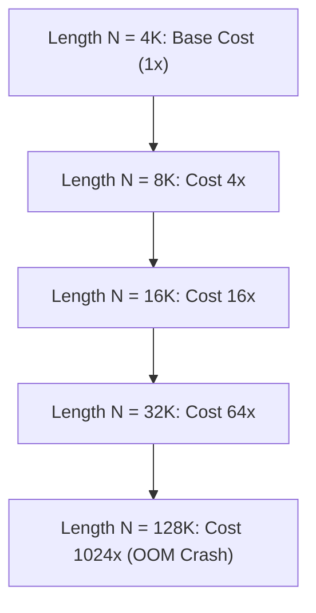

#### d. Code Thực chiến (C++ & Python)
```cpp
// C++17: Minh họa sự tăng trưởng bậc hai của dung lượng bộ nhớ
#include <iostream>

void print_memory_growth(int base_N, int factor) {
    for (int k = 1; k <= 8; k *= 2) {
        long long current_N = base_N * k;
        long long elements = current_N * current_N;
        double mem_gb = (elements * 2.0) / (1024.0 * 1024.0 * 1024.0); // FP16
        std::cout << "SeqLen: " << current_N << " | Matrix Memory: " << mem_gb << " GB\n";
    }
}
```

```python
import matplotlib.pyplot as plt

def plot_growth():
    seq_lens = [1024, 2048, 4096, 8192, 16384, 32768, 65536]
    memory_gb = [(s ** 2 * 32 * 2) / (1024**3) for s in seq_lens] # 32 heads, FP16
    return seq_lens, memory_gb
```

#### e. Lỗi Thường gặp & Ổn định Số học
- Cố gắng chạy standard PyTorch attention trên chuỗi dài mà không dùng FlashAttention hoặc Gradient Checkpointing, dẫn đến lỗi CUDA OOM ngay lập tức.

#### f. Ứng dụng Thực chiến trong AI
- Thúc đẩy sự ra đời của toàn bộ các nghiên cứu về kiến trúc Attention hiệu năng cao (Linear Attention, FlashAttention, Mamba, Ring Attention).

---

### 35. Attention Memory Optimization (Tối ưu Hóa Bộ nhớ Attention)

#### a. Định nghĩa Bản chất Toán học
**Attention Memory Optimization** là tập hợp các phương pháp kỹ thuật phần cứng và phần mềm nhằm giảm thiểu dung lượng bộ nhớ đỉnh (Peak Memory Footprint) của khối Attention trong cả hai giai đoạn Huấn luyện (Training) và Phục vụ Suy luận (Serving/Inference).

Các trụ cột tối ưu hóa chính:
1. **Activation Checkpointing (Gradient Checkpointing)**: Trong lượt forward pass, không lưu các ma trận kích hoạt trung gian (chỉ lưu đầu vào của mỗi khối Transformer). Trong lượt backward pass, chạy lại forward pass cục bộ để tái tạo kích hoạt. Đổi $33\%$ thời gian tính toán thêm để giảm bộ nhớ kích hoạt từ $\mathcal{O}(L \cdot N)$ xuống $\mathcal{O}(\sqrt{L} \cdot N)$ hoặc $\mathcal{O}(N)$.
2. **FlashAttention Recomputation**: Loại bỏ hoàn toàn ma trận $N \times N$ khỏi bộ nhớ HBM.
3. **PagedAttention (Kwon et al., 2023 trong vLLM)**: Khắc phục phân mảnh bộ nhớ KV Cache bằng cách phân bổ bộ nhớ thành các trang vật lý kích thước cố định (ví dụ 16 token mỗi trang) tương tự Virtual Memory trong Hệ điều hành, giúp đạt hiệu suất sử dụng VRAM tới 96%.
4. **Quantized KV Cache**: Lượng tử hóa ma trận Key và Value từ FP16 (16-bit) xuống FP8 (8-bit) hoặc INT4 (4-bit), giảm tức thì dung lượng bộ nhớ KV từ $2\times$ đến $4\times$.
5. **Chunked Prefill**: Chia nhỏ chuỗi prompt đầu vào dài thành các đoạn nhỏ (chunks) để xử lý xen kẽ với các bước giải mã token (decode), làm phẳng đột biến bộ nhớ đỉnh.

#### b. Cơ chế Tầng Sâu & Điện toán
- Kết hợp PagedAttention + FP8 KV Cache cho phép một máy chủ 8x H100 phục vụ đồng thời hàng trăm người dùng ở ngữ cảnh 32K token với throughput tăng gấp 4–8 lần.

#### c. Sơ đồ Minh họa
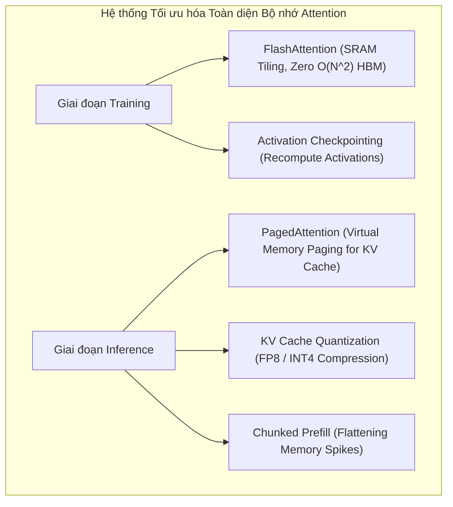

#### d. Code Thực chiến (C++ & Python)
```cpp
// C++17: Mô phỏng Bảng Phân Trang PagedAttention Block Table
#include <vector>
#include <unordered_map>

struct PagedKVCacheManager {
    int block_size = 16; // 16 tokens mỗi trang
    std::unordered_map<int, std::vector<int>> sequence_to_blocks;

    void allocate_token(int seq_id, int current_seq_len) {
        if (current_seq_len % block_size == 0) {
            int new_physical_block_id = rand() % 1000; // Cấp phát 1 trang mới
            sequence_to_blocks[seq_id].push_back(new_physical_block_id);
        }
    }
};
```

```python
import torch

def activation_checkpointing_example(module: torch.nn.Module, x: torch.Tensor):
    # PyTorch Gradient Checkpointing
    from torch.utils.checkpoint import checkpoint
    # Không lưu kích hoạt của module này trong forward pass
    return checkpoint(module, x, use_reentrant=False)
```

#### e. Lỗi Thường gặp & Ổn định Số học
- Lượng tử hóa KV Cache xuống INT4 mà không có per-channel hoặc per-token scale factor sẽ làm sụp đổ hoàn toàn độ mạch lạc ngữ nghĩa khi sinh văn bản dài (Perplexity bùng nổ).

#### f. Ứng dụng Thực chiến trong AI
- Nền tảng cốt lõi của các serving engine hiệu năng cao công nghiệp hiện nay: **vLLM**, **TGI (Text Generation Inference)**, **TensorRT-LLM**, và **SGLang**.
