# Chuyên đề: Kiến trúc Khối Transformer Cốt lõi (Transformer Core Architecture)

## 1. Tổng quan Chuyên đề
Kiến trúc **Transformer** được giới thiệu trong bài báo *"Attention Is All You Need"* (Vaswani et al., 2017) đã tạo ra một cuộc cách mạng thay đổi hoàn toàn cục diện Trí tuệ Nhân tạo hiện đại. Bằng cách loại bỏ hoàn toàn các vòng lặp tuần tự (Recurrence) của RNN/LSTM và các phép tích chập (Convolution) cục bộ của CNN, Transformer xây dựng toàn bộ cơ chế mô hình hóa ngôn ngữ dựa trên sự tương tác trực tiếp giữa các token thông qua **Attention**.

Kiến trúc chuẩn bao gồm sự kết hợp hài hòa giữa:
1. **Khối Mã hóa (Encoder) & Khối Giải mã (Decoder)**: Xây dựng biểu diễn ngữ cảnh hai chiều (Encoder) hoặc sinh văn bản tự hồi quy nhân quả (Decoder).
2. **Các Khối Biến đổi Tuyến tính & Phi tuyến (Self-Attention, Cross-Attention & FFN)**: Phân rã luồng xử lý thành các tầng kết hợp ngữ cảnh (Attention) và các tầng lưu trữ tri thức tham số (Position-Wise Feed-Forward Networks).
3. **Đường truyền Gradient Ổn định (Residual Connections & Layer Normalization)**: Cơ chế kết nối tắt (Skip Connections) và chuẩn hóa tầng (Pre-Norm vs Post-Norm) bảo đảm việc huấn luyện ổn định cho các mô hình hàng chục đến hàng trăm tầng.

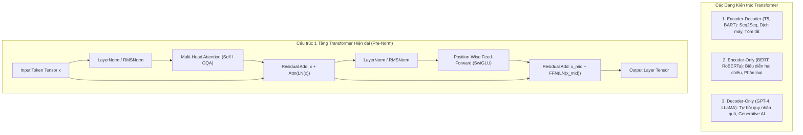

---

## 2. Chi tiết từng Keyword

---

### 36. Transformer Architecture (Kiến trúc Transformer)

#### a. Định nghĩa Bản chất Toán học
Kiến trúc **Transformer** là một bộ xử lý chuỗi khả vi toàn phần, biến đổi một chuỗi các vector biểu diễn đầu vào $\mathbf{X}^{(0)} = [\mathbf{x}_1^{(0)}, \dots, \mathbf{x}_N^{(0)}]^T \in \mathbb{R}^{N \times d_{\text{model}}}$ qua $L$ tầng đồng dạng xếp chồng (stacked layers) thành chuỗi biểu diễn ẩn cấp cao $\mathbf{X}^{(L)} \in \mathbb{R}^{N \times d_{\text{model}}}$:
$$\mathbf{X}^{(l)} = \text{TransformerLayer}^{(l)}(\mathbf{X}^{(l-1)}), \quad \forall l \in \{1, \dots, L\}$$
Mỗi tầng Transformer bao gồm hai khối chức năng chính:
1. **Khối Trộn Thông tin Không gian Token (Token Mixer)**: Cơ chế Multi-Head Attention, tính toán tương tác qua lại giữa các token dọc theo chiều Sequence Length $N$.
2. **Khối Trộn Thông tin Kênh Đặc trưng (Channel Mixer)**: Khối Position-Wise Feed-Forward Network (FFN), biến đổi độc lập từng token dọc theo chiều Feature Dimension $d_{\text{model}}$.

#### b. Cơ chế Tầng Sâu & Điện toán
- **Khả năng song song hóa tối đa (High Parallelism)**: Không có bất kỳ bước phụ thuộc thời gian tuần tự $t \to t+1$ trong quá trình forward và backward pass ở giai đoạn training. Toàn bộ chuỗi được nạp đồng thời vào GPU.
- **Tỷ lệ FLOPs trên Byte (Arithmetic Intensity)**: Các tầng FFN và phép chiếu Attention có tỷ lệ FLOPs/Byte cao, giúp tận dụng tối đa công suất tính toán của GPU Tensor Cores.

#### c. Sơ đồ Minh họa
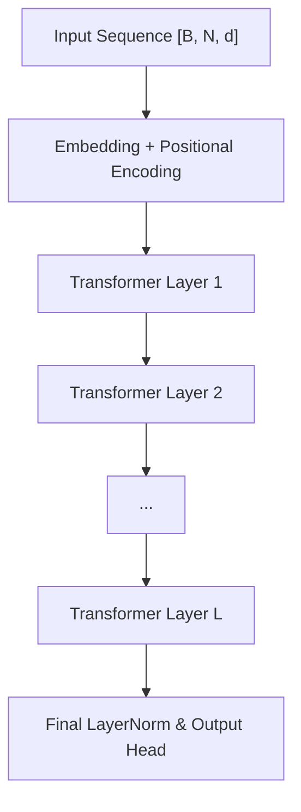

#### d. Code Thực chiến (C++ & Python)
```cpp
// C++17: Khung dữ liệu một khối Transformer Layer
#include <vector>

struct TransformerConfig {
    int vocab_size = 32000;
    int d_model = 4096;
    int num_layers = 32;
    int num_heads = 32;
    int ffn_hidden_dim = 11008;
    float norm_eps = 1e-5f;
};
```

```python
import torch
import torch.nn as nn

class TransformerBlock(nn.Module):
    def __init__(self, d_model: int, num_heads: int, ffn_dim: int):
        super().__init__()
        self.ln1 = nn.LayerNorm(d_model)
        self.attn = nn.MultiheadAttention(d_model, num_heads, batch_first=True)
        self.ln2 = nn.LayerNorm(d_model)
        self.ffn = nn.Sequential(
            nn.Linear(d_model, ffn_dim),
            nn.GELU(),
            nn.Linear(ffn_dim, d_model)
        )

    def forward(self, x: torch.Tensor, mask: torch.Tensor = None) -> torch.Tensor:
        # Pre-Norm Architecture
        norm_x = self.ln1(x)
        attn_out, _ = self.attn(norm_x, norm_x, norm_x, attn_mask=mask)
        x = x + attn_out
        x = x + self.ffn(self.ln2(x))
        return x
```

#### e. Lỗi Thường gặp & Ổn định Số học
- Khởi tạo trọng số không đúng tỷ lệ với số tầng $L$: Khi $L \ge 32$, nếu không thu nhỏ biên độ khởi tạo của các tầng cuối (scale down by $1/\sqrt{2L}$), phương sai kích hoạt sẽ tăng vọt dẫn tới bùng nổ tín hiệu.

#### f. Ứng dụng Thực chiến trong AI
- Nền tảng cấu trúc của toàn bộ ngành Trí tuệ Nhân tạo hiện đại: LLM, Vision Transformer, Audio Transformer, Multimodal Models.

---

### 37. Transformer Encoder (Bộ Mã hóa Transformer)

#### a. Định nghĩa Bản chất Toán học
**Transformer Encoder** là một ngăn xếp gồm $N_{\text{enc}}$ tầng giống hệt nhau, với nhiệm vụ ánh xạ một chuỗi biểu diễn ký hiệu đầu vào $\mathbf{X}$ thành một chuỗi biểu diễn liên tục hai chiều giàu ngữ cảnh $\mathbf{Z} = [\mathbf{z}_1, \dots, \mathbf{z}_N]$:
$$\mathbf{H}^{(0)} = \mathbf{X} + \mathbf{PE}$$
$$\tilde{\mathbf{H}}^{(l)} = \text{LayerNorm}(\mathbf{H}^{(l-1)} + \text{MultiHeadSelfAttention}(\mathbf{H}^{(l-1)}))$$
$$\mathbf{H}^{(l)} = \text{LayerNorm}(\tilde{\mathbf{H}}^{(l)} + \text{FeedForward}(\tilde{\mathbf{H}}^{(l)}))$$
$$\mathbf{Z} = \mathbf{H}^{(N_{\text{enc}})}$$
Đặc tính cốt lõi: Mọi tầng Attention trong Encoder đều là **Bidirectional Self-Attention** (không sử dụng mặt nạ nhân quả). Mỗi token có thể trao đổi thông tin với toàn bộ ngữ cảnh xung quanh.

#### b. Cơ chế Tầng Sâu & Điện toán
- Do không có mặt nạ nhân quả, ma trận Attention là ma trận đầy đủ $N \times N$, tiêu thụ gấp đôi FLOPs tính toán so với tầng Causal Decoder ở cùng độ dài chuỗi $N$.
- Tận dụng tối ưu khả năng tính toán theo batch trên GPU vì toàn bộ chuỗi được biết trước.

#### c. Sơ đồ Minh họa
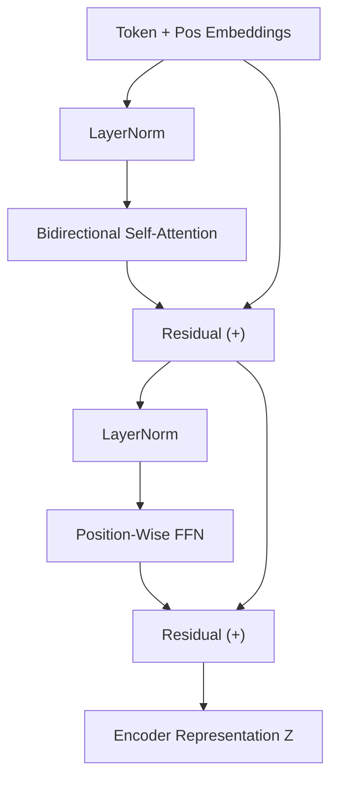

#### d. Code Thực chiến (C++ & Python)
```cpp
// C++17: Mô phỏng Pipeline Encoder
void encoder_forward(const float* X_in, float* Z_out, int seq_len, int d_model) {
    // 1. Bidirectional Attention
    // 2. Residual + LayerNorm
    // 3. FFN
    // 4. Residual + LayerNorm
}
```

```python
import torch
import torch.nn as nn

class TransformerEncoderStack(nn.Module):
    def __init__(self, num_layers: int, d_model: int, num_heads: int, ffn_dim: int):
        super().__init__()
        layer = nn.TransformerEncoderLayer(d_model=d_model, nhead=num_heads, 
                                           dim_feedforward=ffn_dim, batch_first=True, norm_first=True)
        self.encoder = nn.TransformerEncoder(layer, num_layers=num_layers)

    def forward(self, src: torch.Tensor, src_key_padding_mask: torch.Tensor = None) -> torch.Tensor:
        return self.encoder(src, src_key_padding_mask=src_key_padding_mask)
```

#### e. Lỗi Thường gặp & Ổn định Số học
- Dùng Transformer Encoder cho bài toán sinh ngôn ngữ tự do: Vì Encoder sử dụng chú ý hai chiều, nó không thể dùng để giải mã từng từ mới mà chỉ phù hợp cho trích xuất đặc trưng hoặc dự đoán từ bị che (Masked LM).

#### f. Ứng dụng Thực chiến trong AI
- **BERT**, **RoBERTa**, **DeBERTa**, trích xuất đặc trưng ảnh trong **Vision Transformer (ViT)**, và module mã hóa trong CLIP.

---

### 38. Transformer Decoder (Bộ Giải mã Transformer)

#### a. Định nghĩa Bản chất Toán học
**Transformer Decoder** có nhiệm vụ sinh chuỗi đầu ra $\mathbf{Y} = [y_1, \dots, y_M]$ từng token một theo cơ chế tự hồi quy. Mỗi tầng Decoder bao gồm ba khối con liên tiếp:
1. **Masked Multi-Head Self-Attention**: Chú ý tự thân có Causal Mask, ngăn token hiện tại nhìn về tương lai:
   $$\mathbf{S}^{(l)} = \text{MaskedSelfAttn}(\mathbf{H}^{(l-1)})$$
2. **Multi-Head Cross-Attention (Encoder-Decoder Attention)**: Query đến từ Decoder, Key và Value đến từ đầu ra của Encoder $\mathbf{Z}$:
   $$\mathbf{C}^{(l)} = \text{CrossAttn}(\mathbf{S}^{(l)}, \mathbf{Z}, \mathbf{Z})$$
3. **Position-Wise Feed-Forward Network**:
   $$\mathbf{H}^{(l)} = \text{FFN}(\mathbf{C}^{(l)})$$
*(Lưu ý: Trong các mô hình Decoder-Only hiện đại như LLaMA hay GPT, khối Cross-Attention được lược bỏ hoàn toàn).*

#### b. Cơ chế Tầng Sâu & Điện toán
- Hai pha vận hành với cơ chế phần cứng hoàn toàn khác biệt:
  1. **Prefill Phase (Prompt Evaluation)**: Xử lý toàn bộ prompt đầu vào có độ dài $N_{prompt}$ cùng lúc -> **Compute-Bound (Tận dụng tối đa Tensor Cores)**.
  2. **Decode Phase (Token Generation)**: Sinh từng token đơn lẻ ($N = 1$) lặp đi lặp lại -> **Memory-Bound (Bị giới hạn bởi tốc độ đọc KV Cache từ VRAM)**.

#### c. Sơ đồ Minh họa
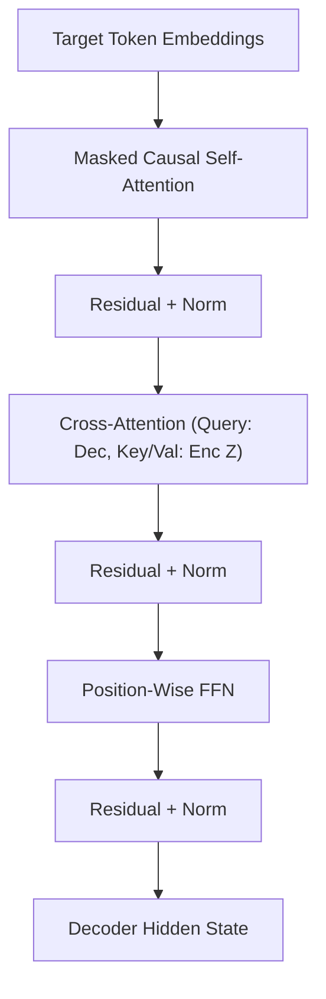

#### d. Code Thực chiến (C++ & Python)
```cpp
// C++17: Mô phỏng logic Decoder một bước giải mã
void decode_single_step(const float* current_token_emb, const float* kv_cache, 
                        float* out_logits) {
    // 1. Causal self-attn với KV cache cũ
    // 2. Cross-attn (nếu có Encoder)
    // 3. FFN
    // 4. Output projection -> Vocab Logits
}
```

```python
import torch
import torch.nn as nn

class ClassicDecoderLayer(nn.Module):
    def __init__(self, d_model: int, num_heads: int, ffn_dim: int):
        super().__init__()
        self.self_attn = nn.MultiheadAttention(d_model, num_heads, batch_first=True)
        self.cross_attn = nn.MultiheadAttention(d_model, num_heads, batch_first=True)
        self.ffn = nn.Sequential(nn.Linear(d_model, ffn_dim), nn.ReLU(), nn.Linear(ffn_dim, d_model))
        self.norm1 = nn.LayerNorm(d_model)
        self.norm2 = nn.LayerNorm(d_model)
        self.norm3 = nn.LayerNorm(d_model)

    def forward(self, tgt: torch.Tensor, memory: torch.Tensor, tgt_mask: torch.Tensor) -> torch.Tensor:
        # tgt: [B, M, D], memory (from encoder): [B, N, D]
        tgt2, _ = self.self_attn(tgt, tgt, tgt, attn_mask=tgt_mask)
        tgt = self.norm1(tgt + tgt2)
        tgt2, _ = self.cross_attn(tgt, memory, memory)
        tgt = self.norm2(tgt + tgt2)
        tgt2 = self.ffn(tgt)
        return self.norm3(tgt + tgt2)
```

#### e. Lỗi Thường gặp & Ổn định Số học
- Quên truyền Causal Mask trong quá trình training làm cho mô hình "nhìn trộm" token tiếp theo, dẫn đến train loss giảm về 0 nhưng inference sinh toàn từ vô nghĩa lặp lại.

#### f. Ứng dụng Thực chiến trong AI
- Thành phần giải mã văn bản trong dịch máy (Vaswani 2017), nhận dạng giọng nói (Whisper), và sinh mô tả hình ảnh.

---

### 39. Encoder-Decoder Transformer (Mô hình Transformer Mã hóa - Giải mã)

#### a. Định nghĩa Bản chất Toán học
Kiến trúc **Encoder-Decoder Transformer** (Vaswani et al., 2017; T5, Raffel et al., 2020) thiết lập phân phối xác suất có điều kiện của chuỗi đích $\mathbf{Y} = (y_1, \dots, y_M)$ dựa trên chuỗi nguồn $\mathbf{X} = (x_1, \dots, x_N)$:
$$P(\mathbf{Y} \mid \mathbf{X}) = \prod_{t=1}^M P(y_t \mid y_{<t}, \mathbf{X})$$
Toàn bộ chuỗi nguồn $\mathbf{X}$ được nén thành không gian biểu diễn ẩn tĩnh $\mathbf{Z} \in \mathbb{R}^{N \times d_{\text{model}}}$ thông qua Encoder. Bộ Decoder sau đó giải mã tuần tự có điều kiện trên $\mathbf{Z}$ thông qua cơ chế Cross-Attention.

#### b. Cơ chế Tầng Sâu & Điện toán
- Tách biệt rõ ràng giữa hai không gian: độ dài $N$ của nguồn và độ dài $M$ của đích có thể hoàn toàn độc lập ($N \neq M$).
- Quá trình tính toán của Encoder chỉ cần chạy đúng **1 lần duy nhất** cho toàn bộ prompt nguồn. Sau đó trạng thái $\mathbf{Z}$ được giữ nguyên trong suốt $M$ bước sinh của Decoder.

#### c. Sơ đồ Minh họa
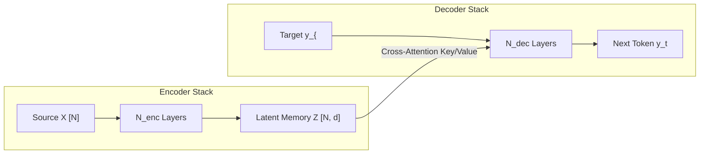

#### d. Code Thực chiến (C++ & Python)
```cpp
// C++17: Khung điều phối Encoder-Decoder
#include <vector>

struct Seq2SeqTransformer {
    void run(const std::vector<float>& src_tokens, std::vector<float>& tgt_tokens) {
        // 1. Run Encoder once -> Z_memory
        // 2. Loop while (!EOS): Run Decoder step with Z_memory -> emit token
    }
};
```

```python
import torch
import torch.nn as nn

class EncoderDecoderTransformer(nn.Module):
    def __init__(self, d_model: int = 512, nhead: int = 8, num_enc: int = 6, num_dec: int = 6):
        super().__init__()
        self.transformer = nn.Transformer(
            d_model=d_model, nhead=nhead, 
            num_encoder_layers=num_enc, num_decoder_layers=num_dec, 
            batch_first=True
        )

    def forward(self, src: torch.Tensor, tgt: torch.Tensor, tgt_mask: torch.Tensor) -> torch.Tensor:
        return self.transformer(src, tgt, tgt_mask=tgt_mask)
```

#### e. Lỗi Thường gặp & Ổn định Số học
- Hiện tượng **Exposure Bias**: Trong lúc huấn luyện sử dụng Teacher Forcing (dữ liệu đích hoàn hảo), nhưng lúc suy luận tự sinh nếu mô hình sinh sai một token thì sai số sẽ tích lũy dây chuyền ở các bước sau.

#### f. Ứng dụng Thực chiến trong AI
- **Google T5**, **FLAN-T5**, **BART**, mô hình nhận dạng giọng nói **OpenAI Whisper**.

---

### 40. Encoder-Only Models (Mô hình Chỉ Mã hóa)

#### a. Định nghĩa Bản chất Toán học
**Encoder-Only Models** loại bỏ hoàn toàn khối Decoder, chỉ giữ lại ngăn xếp Transformer Encoder với cơ chế Bidirectional Self-Attention. Hàm mục tiêu huấn luyện chủ đạo là **Masked Language Modeling (MLM)**:
$$\mathcal{L}_{\text{MLM}}(\theta) = -\sum_{i \in \mathcal{M}} \log P(x_i \mid \tilde{\mathbf{X}}; \theta)$$
Trong đó $\mathcal{M}$ là tập các vị trí token bị che (thường là $15\%$ tổng số token) và $\tilde{\mathbf{X}}$ là câu đã bị che. Mô hình tận dụng tối đa ngữ cảnh của cả hai phía (trước và sau) để tái tạo lại từ bị che.

#### b. Cơ chế Tầng Sâu & Điện toán
- Đầu ra của mô hình là một tensor $\mathbf{H} \in \mathbb{R}^{B \times N \times d_{\text{model}}}$.
- Token đặc biệt `[CLS]` ở vị trí đầu tiên ($h_{[\text{CLS}]}$) thường được đưa qua một tầng Linear Classifier (Classification Head) để phục vụ các bài toán phân loại câu hoặc phân tích cảm xúc.
- Cực kỳ tối ưu cho inference vì thời gian trễ (latency) là hằng số cho toàn bộ câu (chỉ mất đúng 1 forward pass, không có vòng lặp).

#### c. Sơ đồ Minh họa
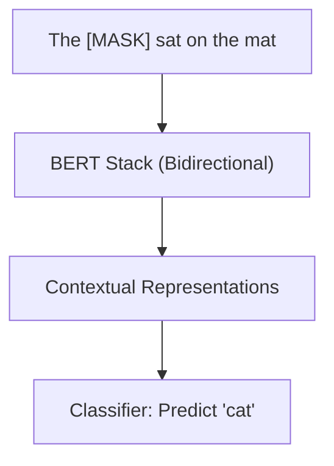

#### d. Code Thực chiến (C++ & Python)
```cpp
// C++17: Trích xuất CLS token representation
void extract_cls_embedding(const float* all_hidden, float* cls_out, int d_model) {
    // CLS token luôn nằm ở vị trí index 0
    for (int d = 0; d < d_model; ++d) {
        cls_out[d] = all_hidden[0 * d_model + d];
    }
}
```

```python
import torch
import torch.nn as nn

class EncoderOnlyClassifier(nn.Module):
    def __init__(self, encoder: nn.Module, d_model: int, num_classes: int):
        super().__init__()
        self.encoder = encoder
        self.pooler = nn.Linear(d_model, d_model)
        self.classifier = nn.Linear(d_model, num_classes)

    def forward(self, input_ids: torch.Tensor, mask: torch.Tensor) -> torch.Tensor:
        hidden = self.encoder(input_ids, src_key_padding_mask=mask)
        cls_rep = torch.tanh(self.pooler(hidden[:, 0, :])) # Token [CLS]
        logits = self.classifier(cls_rep)
        return logits
```

#### e. Lỗi Thường gặp & Ổn định Số học
- Sự sai lệch phân phối (Pretrain-Finetune Discrepancy): Ký hiệu `[MASK]` xuất hiện trong lúc pre-training nhưng hoàn toàn không bao giờ xuất hiện trong dữ liệu thực tế lúc fine-tuning.

#### f. Ứng dụng Thực chiến trong AI
- **BERT**, **RoBERTa**, **ELECTRA**, **DeBERTa**, các mô hình tạo Text Embeddings (BGE, E5), và trích xuất thực thể có tên (NER).

---

### 41. Decoder-Only Models (Mô hình Chỉ Giải mã)

#### a. Định nghĩa Bản chất Toán học
**Decoder-Only Models** loại bỏ hoàn toàn khối Encoder và các tầng Cross-Attention, chỉ giữ lại các tầng Masked Causal Self-Attention và FFN. Mô hình tối ưu hóa trực tiếp hàm mục tiêu **Causal Language Modeling (CLM)** hay dự đoán token kế tiếp:
$$\mathcal{L}_{\text{CLM}}(\theta) = -\sum_{t=1}^N \log P(x_t \mid x_1, \dots, x_{t-1}; \theta)$$
Mọi tác vụ trí tuệ nhân tạo (dịch thuật, tóm tắt văn bản, trả lời câu hỏi, lập trình mã nguồn, lập luận logic) đều được thống nhất quy về một định dạng duy nhất: **Text-to-Text Next-Token Prediction**.

#### b. Cơ chế Tầng Sâu & Điện toán
- **Thống trị thế giới Generative AI**: Cấu trúc đồng nhất, cực kỳ dễ scale up lên hàng trăm tỷ tham số trên các cụm tính toán phân tán (Tensor Parallelism, Pipeline Parallelism).
- **Vấn đề KV Cache**: Đòi hỏi hệ thống phần cứng phải quản lý KV cache khổng lồ trong bộ nhớ HBM khi số lượng người dùng đồng thời lớn.

#### c. Sơ đồ Minh họa
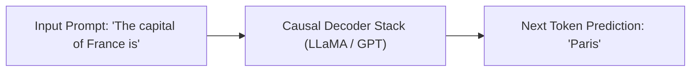

#### d. Code Thực chiến (C++ & Python)
```cpp
// C++17: Vòng lặp Autoregressive Sampling cơ bản
#include <vector>

int sample_next_token(const float* logits, int vocab_size) {
    // Tìm argmax hoặc sample nhiệt độ (Greedy Search)
    int best_id = 0;
    float max_logit = logits[0];
    for (int i = 1; i < vocab_size; ++i) {
        if (logits[i] > max_logit) {
            max_logit = logits[i];
            best_id = i;
        }
    }
    return best_id;
}
```

```python
import torch
import torch.nn as nn

class DecoderOnlyLLM(nn.Module):
    def __init__(self, vocab_size: int, d_model: int, num_layers: int, num_heads: int):
        super().__init__()
        self.tok_embeddings = nn.Embedding(vocab_size, d_model)
        self.layers = nn.ModuleList([
            TransformerBlock(d_model, num_heads, ffn_dim=4 * d_model)
            for _ in range(num_layers)
        ])
        self.norm = nn.LayerNorm(d_model)
        self.lm_head = nn.Linear(d_model, vocab_size, bias=False)

    def forward(self, input_ids: torch.Tensor) -> torch.Tensor:
        B, N = input_ids.shape
        x = self.tok_embeddings(input_ids)
        # Sinh causal mask
        causal_mask = torch.triu(torch.full((N, N), float('-inf'), device=x.device), diagonal=1)
        for layer in self.layers:
            x = layer(x, mask=causal_mask)
        x = self.norm(x)
        logits = self.lm_head(x) # [B, N, vocab_size]
        return logits
```

#### e. Lỗi Thường gặp & Ổn định Số học
- Hiện tượng **Repetition Loop (Lặp từ vô tận)**: Khi mô hình sinh ra một từ nhất định với xác suất cao, xác suất của chính từ đó trong các bước sau càng tăng lên, khiến mô hình rơi vào bẫy lặp lại một cụm từ mãi mãi nếu không áp dụng Repetition Penalty.

#### f. Ứng dụng Thực chiến trong AI
- Toàn bộ các mô hình Ngôn ngữ Lớn tiên tiến nhất hiện nay: **GPT-4, LLaMA-3, Mistral, Gemma, Claude, DeepSeek-V2**.

---

### 42. Self-Attention Layers (Các Tầng Tự Chú ý)

#### a. Định nghĩa Bản chất Toán học
Một **Self-Attention Layer** trong kiến trúc Transformer biến đổi ma trận đầu vào $\mathbf{X} \in \mathbb{R}^{N \times d}$ thành ma trận đầu ra có cùng kích thước $\mathbf{Y} \in \mathbb{R}^{N \times d}$ bằng cách cho phép mỗi vị trí vector $i$ tái tổng hợp thông tin từ tất cả các vị trí vector $j$ trong chính tập hợp $\mathbf{X}$:
$$\mathbf{Y} = \sum_{j=1}^N \alpha_{ij} (\mathbf{X} \mathbf{W}_V)_j, \quad \alpha_{ij} \propto \exp\left(\frac{(\mathbf{x}_i \mathbf{W}_Q)(\mathbf{x}_j \mathbf{W}_K)^T}{\sqrt{d_k}}\right)$$
Về mặt hình học, Self-Attention layer thực hiện phép co dãn và tái định hướng động các vector biểu diễn trong không gian embedding dựa trên ngữ cảnh xung quanh.

#### b. Cơ chế Tầng Sâu & Điện toán
- Chiếm khoảng $33\%$ tổng số FLOPs trong một Transformer Block tiêu chuẩn (với $d_{\text{ffn}} = 4 d_{\text{model}}$).
- Bộ nhớ kích hoạt phục vụ backward pass (Activation Memory) bị chi phối bởi ma trận attention weights nếu không áp dụng FlashAttention.

#### c. Sơ đồ Minh họa
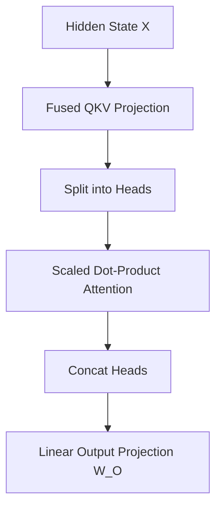

#### d. Code Thực chiến (C++ & Python)
```cpp
// C++17: Gộp bộ nhớ cho phép chiếu Fused QKV
void fused_qkv_gemm(const float* X, const float* W_qkv, float* QKV_out, 
                    int N, int d_model) {
    // W_qkv có shape [d_model, 3 * d_model]
    // Giảm 3 lời gọi hàm cuBLAS rời rạc thành 1 lời gọi duy nhất
}
```

```python
import torch
import torch.nn as nn

class OptimizedSelfAttentionLayer(nn.Module):
    def __init__(self, d_model: int, num_heads: int):
        super().__init__()
        self.num_heads = num_heads
        self.head_dim = d_model // num_heads
        # Fused projection 3 trong 1
        self.qkv_proj = nn.Linear(d_model, 3 * d_model, bias=False)
        self.o_proj = nn.Linear(d_model, d_model, bias=False)

    def forward(self, x: torch.Tensor) -> torch.Tensor:
        B, N, D = x.shape
        qkv = self.qkv_proj(x).reshape(B, N, 3, self.num_heads, self.head_dim).permute(2, 0, 3, 1, 4)
        q, k, v = qkv[0], qkv[1], qkv[2]
        out = torch.nn.functional.scaled_dot_product_attention(q, k, v, is_causal=True)
        out = out.transpose(1, 2).reshape(B, N, D)
        return self.o_proj(out)
```

#### e. Lỗi Thường gặp & Ổn định Số học
- Tách rời 3 phép nhân `w_q(x)`, `w_k(x)`, `w_v(x)` thay vì dùng một ma trận gộp duy nhất làm tăng chi phí khởi động kernel trên GPU (Kernel Launch Overhead).

#### f. Ứng dụng Thực chiến trong AI
- Thành phần cốt lõi của mọi khối Transformer.

---

### 43. Cross-Attention Layers (Các Tầng Chú ý Chéo)

#### a. Định nghĩa Bản chất Toán học
Trong một **Cross-Attention Layer**, hai luồng dữ liệu độc lập gặp nhau:
- Luồng truy vấn (Query Stream) đại diện cho trạng thái hiện tại của quá trình sinh đích $\mathbf{H}_{\text{tgt}} \in \mathbb{R}^{M \times d}$.
- Luồng bộ nhớ (Memory Stream) đại diện cho thông tin điều kiện từ nguồn $\mathbf{H}_{\text{src}} \in \mathbb{R}^{N \times d_{\text{src}}}$.
$$\mathbf{Q} = \mathbf{H}_{\text{tgt}} \mathbf{W}_Q, \quad \mathbf{K} = \mathbf{H}_{\text{src}} \mathbf{W}_K, \quad \mathbf{V} = \mathbf{H}_{\text{src}} \mathbf{W}_V$$
$$\mathbf{Y}_{\text{cross}} = \text{Softmax}\left(\frac{\mathbf{Q} \mathbf{K}^T}{\sqrt{d_k}}\right) \mathbf{V} \in \mathbb{R}^{M \times d}$$

#### b. Cơ chế Tầng Sâu & Điện toán
- Kích thước ma trận chú ý là $M \times N$.
- Trong quá trình inference của Encoder-Decoder, ma trận $\mathbf{K}$ và $\mathbf{V}$ của Cross-Attention được tính toán **đúng 1 lần duy nhất** từ Encoder và được giữ cố định trong bộ nhớ đệm (Static Cross-KV Cache), không bị thay đổi qua các bước sinh $t = 1 \dots M$.

#### c. Sơ đồ Minh họa
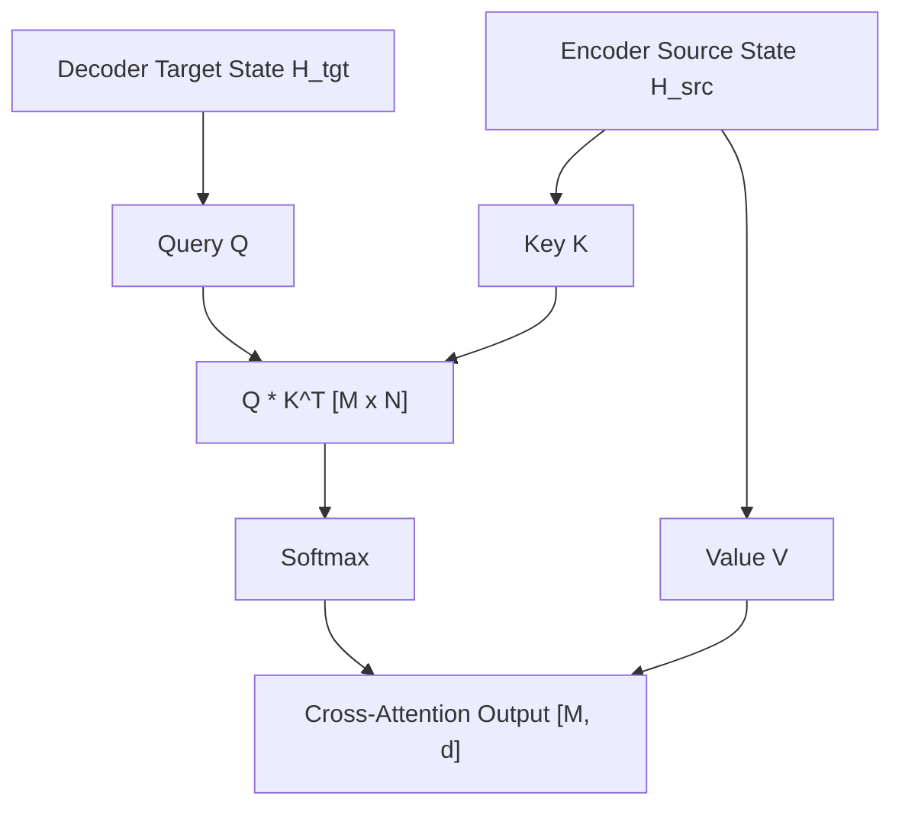

#### d. Code Thực chiến (C++ & Python)
```cpp
// C++17: Cache Key/Value tĩnh cho Cross Attention
struct StaticCrossKVCache {
    std::vector<float> cached_K;
    std::vector<float> cached_V;
    int src_len;
    int d_k;

    void initialize(const float* K_in, const float* V_in, int len, int dim) {
        src_len = len;
        d_k = dim;
        cached_K.assign(K_in, K_in + len * dim);
        cached_V.assign(V_in, V_in + len * dim);
    }
};
```

```python
import torch
import torch.nn as nn

class CrossAttentionLayer(nn.Module):
    def __init__(self, d_model: int, num_heads: int):
        super().__init__()
        self.num_heads = num_heads
        self.head_dim = d_model // num_heads
        self.q_proj = nn.Linear(d_model, d_model, bias=False)
        self.kv_proj = nn.Linear(d_model, 2 * d_model, bias=False)
        self.out_proj = nn.Linear(d_model, d_model, bias=False)

    def forward(self, tgt_x: torch.Tensor, memory_src: torch.Tensor) -> torch.Tensor:
        B, M, D = tgt_x.shape
        N = memory_src.size(1)
        q = self.q_proj(tgt_x).view(B, M, self.num_heads, self.head_dim).transpose(1, 2)
        kv = self.kv_proj(memory_src).view(B, N, 2, self.num_heads, self.head_dim).permute(2, 0, 3, 1, 4)
        k, v = kv[0], kv[1]
        out = torch.nn.functional.scaled_dot_product_attention(q, k, v)
        out = out.transpose(1, 2).reshape(B, M, D)
        return self.out_proj(out)
```

#### e. Lỗi Thường gặp & Ổn định Số học
- Tính toán lại phép chiếu $K, V$ của Encoder ở mỗi bước decode gây lãng phí hàng nghìn phép tính dư thừa.

#### f. Ứng dụng Thực chiến trong AI
- Điều kiện hóa văn bản trong Stable Diffusion (Text-to-Image), Whisper (Audio-to-Text), và T5/BART.

---

### 44. Feed-Forward Networks (FFN - Mạng Truyền thẳng)

#### a. Định nghĩa Bản chất Toán học
Trong Transformer, khối **Feed-Forward Network** là một mạng nơ-ron đa tầng (MLP) gồm 2 phép biến đổi tuyến tính kẹp giữa một hàm kích hoạt phi tuyến tính:
$$\text{FFN}(\mathbf{x}) = \sigma(\mathbf{x} \mathbf{W}_1 + \mathbf{b}_1) \mathbf{W}_2 + \mathbf{b}_2$$
Trong đó $\mathbf{W}_1 \in \mathbb{R}^{d_{\text{model}} \times d_{\text{ffn}}}, \mathbf{W}_2 \in \mathbb{R}^{d_{\text{ffn}} \times d_{\text{model}}}$.
Thông thường, số chiều ẩn được mở rộng:
$$d_{\text{ffn}} = 4 \times d_{\text{model}}$$
Trong các kiến trúc hiện đại (như LLaMA), người ta sử dụng biến thể **SwiGLU (Swish-Gated Linear Unit)** không dùng bias:
$$\text{SwiGLU}(\mathbf{x}) = (\text{Swish}(\mathbf{x} \mathbf{W}_{\text{gate}}) \odot (\mathbf{x} \mathbf{W}_{\text{up}})) \mathbf{W}_{\text{down}}$$
Với số chiều trung gian được chọn là $d_{\text{ffn}} \approx \frac{8}{3} d_{\text{model}}$.

Về mặt lý thuyết biểu diễn tri thức (Geva et al., 2021), FFN hoạt động như một **Bộ nhớ Lưu trữ Tri thức Fact (Key-Value Memory Store)**: Tầng thứ nhất đóng vai trò nhận diện mẫu (Keys) và tầng thứ hai đóng vai trò trả về thông tin tương ứng (Values).

#### b. Cơ chế Tầng Sâu & Điện toán
- FFN chiếm xấp xỉ **$66\%$ (hai phần ba) tổng số tham số** và FLOPs của một mô hình Transformer chuẩn.
- Các phép toán là ma trận GEMM lớn, đạt hiệu suất khai thác phần cứng cực cao trên GPU.

#### c. Sơ đồ Minh họa
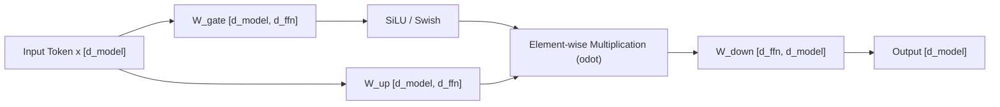

#### d. Code Thực chiến (C++ & Python)
```cpp
// C++17: SwiGLU Element-wise Activation
#include <vector>
#include <cmath>

inline float silu(float x) {
    return x / (1.0f + std::exp(-x));
}

void swiglu_intermediate(const float* gate, const float* up, float* intermediate, int size) {
    for (int i = 0; i < size; ++i) {
        intermediate[i] = silu(gate[i]) * up[i];
    }
}
```

```python
import torch
import torch.nn as nn
import torch.nn.functional as F

class LLaMASwiGLUFFN(nn.Module):
    def __init__(self, d_model: int, hidden_dim: int):
        super().__init__()
        self.w_gate = nn.Linear(d_model, hidden_dim, bias=False)
        self.w_up = nn.Linear(d_model, hidden_dim, bias=False)
        self.w_down = nn.Linear(hidden_dim, d_model, bias=False)

    def forward(self, x: torch.Tensor) -> torch.Tensor:
        # x: [B, N, d_model]
        return self.w_down(F.silu(self.w_gate(x)) * self.w_up(x))
```

#### e. Lỗi Thường gặp & Ổn định Số học
- Giữ nguyên $d_{\text{ffn}} = 4 d_{\text{model}}$ khi chuyển sang SwiGLU: SwiGLU có 3 ma trận trọng số thay vì 2, nên nếu giữ nguyên hệ số 4 thì tổng số tham số sẽ tăng $1.5\times$. Phải giảm xuống $\frac{8}{3} d_{\text{model}}$ để giữ nguyên tổng số tham số.

#### f. Ứng dụng Thực chiến trong AI
- Nơi lưu trữ kiến thức thế giới (World Knowledge) trong GPT-4, LLaMA-3, Mistral.

---

### 45. Position-Wise Feed-Forward Network

#### a. Định nghĩa Bản chất Toán học
Từ **Position-Wise** nhấn mạnh tính chất độc lập giữa các vị trí: Mạng FFN được áp dụng riêng biệt và giống hệt nhau (identically and independently) cho vector biểu diễn tại từng vị trí token một cách độc lập:
$$\text{FFN}(\mathbf{X})_i = \text{FFN}(\mathbf{x}_i), \quad \forall i \in \{1, \dots, N\}$$
Không có bất kỳ sự trao đổi thông tin hay liên kết nào giữa vị trí $i$ và vị trí $j$ trong khối này. Phép toán này tương đương với một phép tích chập 1D với kích thước kernel bằng 1 ($\text{Conv1D}(k=1)$).

#### b. Cơ chế Tầng Sâu & Điện toán
- Do các vị trí hoàn toàn độc lập, phép toán có thể được biểu diễn dưới dạng nhân ma trận 2D lớn bằng cách gộp chiều Batch và Sequence Length:
  $$[B \times N, d_{\text{model}}] \times [d_{\text{model}}, d_{\text{ffn}}]$$
- Không cần bất kỳ thao tác truyền dữ liệu liên luồng (cross-thread communication) hay đồng bộ nào giữa các vị trí.

#### c. Sơ đồ Minh họa
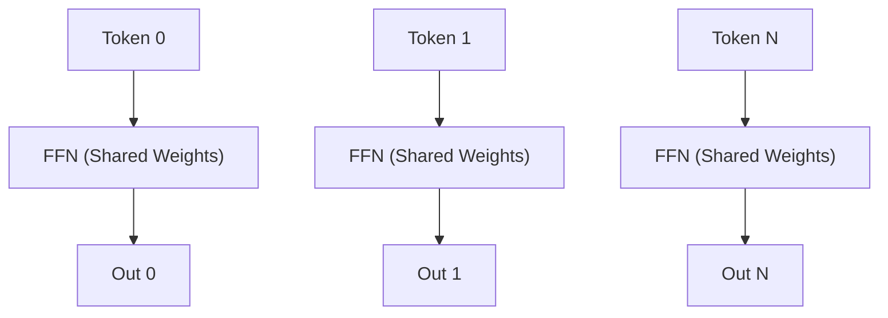

#### d. Code Thực chiến (C++ & Python)
```cpp
// C++17: Flattened 2D Matrix View cho Position-Wise FFN
void position_wise_gemm(const float* X_flat, const float* W, float* Out_flat,
                        int total_tokens, int in_dim, int out_dim) {
    // total_tokens = Batch * SeqLen
    // Thực hiện 1 phép GEMM phẳng lớn
}
```

```python
import torch

def flatten_for_positionwise(x: torch.Tensor, linear_layer: torch.nn.Linear) -> torch.Tensor:
    B, N, D = x.shape
    # Flatten thành 2D để tối ưu kernel cuBLAS
    x_2d = x.view(B * N, D)
    out_2d = linear_layer(x_2d)
    return out_2d.view(B, N, -1)
```

#### e. Lỗi Thường gặp & Ổn định Số học
- Lặp vòng lặp `for` qua từng token trong Python: Gây sụt giảm hiệu năng hàng trăm lần do overhead của Python runtime.

#### f. Ứng dụng Thực chiến trong AI
- Thành phần cơ bản của mọi kiến trúc Transformer hiện đại.

---

### 46. Residual Connections (Kết nối Phần dư / Skip Connection)

#### a. Định nghĩa Bản chất Toán học
Được kế thừa từ ResNet (He et al., 2016), **Residual Connection** trong Transformer cộng trực tiếp đầu vào của một khối con vào đầu ra của khối con đó:
$$\mathbf{x}_{\text{out}} = \mathbf{x} + \text{SubLayer}(\mathbf{x})$$
Về mặt giải tích, khi tính gradient theo quy tắc dây chuyền:
$$\frac{\partial \mathcal{L}}{\partial \mathbf{x}} = \frac{\partial \mathcal{L}}{\partial \mathbf{x}_{\text{out}}} \left(\mathbf{I} + \frac{\partial \text{SubLayer}(\mathbf{x})}{\partial \mathbf{x}}\right)$$
Thành phần ma trận đơn vị $\mathbf{I}$ đóng vai trò như một **Đường cao tốc Gradient (Gradient Highway)**, cho phép gradient truyền ngược trực tiếp qua hàng trăm tầng mạng mà không bị suy giảm theo cấp số nhân (loại bỏ hiện tượng Vanishing Gradients).

#### b. Cơ chế Tầng Sâu & Điện toán
- Phép toán Element-wise Addition: $\mathcal{O}(N \cdot d)$ FLOPs (rất nhỏ so với GEMM).
- **Residual Stream Memory Persistence**: Đường truyền dư (Residual Stream) phải được lưu trữ liên tục trong VRAM xuyên suốt forward pass để phục vụ phép cộng backward, chiếm dung lượng bộ nhớ cố định lớn trong các mô hình sâu.

#### c. Sơ đồ Minh họa
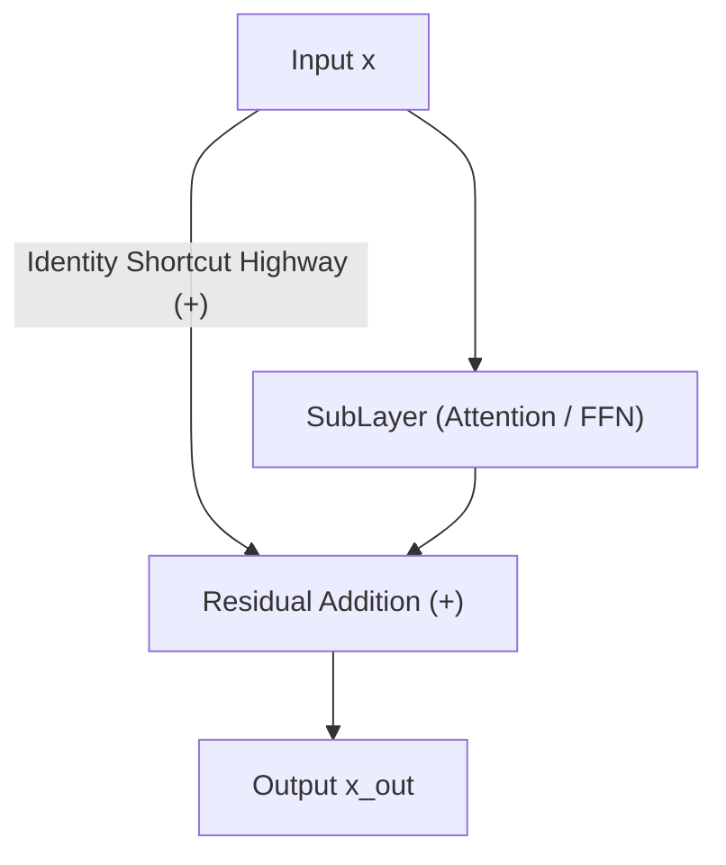

#### d. Code Thực chiến (C++ & Python)
```cpp
// C++17: Vectorized Element-wise Residual Addition
void residual_add(const float* x, const float* sublayer_out, float* out, int size) {
    #pragma omp simd
    for (int i = 0; i < size; ++i) {
        out[i] = x[i] + sublayer_out[i];
    }
}
```

```python
import torch

def residual_block(x: torch.Tensor, sublayer: torch.nn.Module) -> torch.Tensor:
    return x + sublayer(x)
```

#### e. Lỗi Thường gặp & Ổn định Số học
- Dùng phép toán cộng in-place (`x += sublayer(x)`) trong PyTorch khi đang bật autograd: Gây lỗi RuntimeError vì tensor gốc bị ghi đè dữ liệu cần thiết cho backward pass.

#### f. Ứng dụng Thực chiến trong AI
- Kỹ thuật sống còn cho phép huấn luyện các mô hình có độ sâu lớn (ví dụ LLaMA-3 70B với 80 layers, GPT-3 175B với 96 layers).

---

### 47. Layer Normalization (Chuẩn hóa Tầng)

#### a. Định nghĩa Bản chất Toán học
Khác với Batch Normalization tính giá trị thống kê qua toàn bộ các mẫu trong batch, **Layer Normalization** (Ba, Kiros, Hinton, 2016) chuẩn hóa các kích hoạt dọc theo chiều đặc trưng (feature dimension $d$) cho **từng token riêng biệt** của một mẫu đơn lẻ:
$$\mu = \frac{1}{d} \sum_{i=1}^d x_i, \quad \sigma^2 = \frac{1}{d} \sum_{i=1}^d (x_i - \mu)^2$$
$$\hat{x}_i = \frac{x_i - \mu}{\sqrt{\sigma^2 + \epsilon}}$$
$$y_i = \gamma_i \hat{x}_i + \beta_i$$
Trong đó $\gamma, \beta \in \mathbb{R}^d$ là các tham số scale và shift học được, và $\epsilon > 0$ là hằng số bảo vệ chống chia cho 0.

Trong các mô hình hiện đại (LLaMA, Mistral, Gemma), biến thể **RMSNorm (Root Mean Square Normalization)** được sử dụng phổ biến để tiết kiệm chi phí tính toán bằng cách giả định trung bình $\mu = 0$:
$$\text{RMS}(\mathbf{x}) = \sqrt{\frac{1}{d} \sum_{i=1}^d x_i^2 + \epsilon}, \quad \text{RMSNorm}(\mathbf{x}) = \frac{\mathbf{x}}{\text{RMS}(\mathbf{x})} \odot \mathbf{\gamma}$$

#### b. Cơ chế Tầng Sâu & Điện toán
- Hoàn toàn độc lập với kích thước Batch size $B$, cho phép mô hình hoạt động ổn định bất kể khi train với batch lớn hay khi suy luận với batch = 1.
- Kernel Fusion: Tính $\mu, \sigma$, chuẩn hóa và nhân scale/shift được hợp nhất vào một CUDA kernel duy nhất để tránh đọc/ghi HBM nhiều lần.

#### c. Sơ đồ Minh họa


#### d. Code Thực chiến (C++ & Python)
```cpp
// C++17: Triển khai RMSNorm tối ưu
#include <vector>
#include <cmath>

void rms_norm(const float* x, const float* gamma, float* out, int d, float eps = 1e-6f) {
    float sum_sq = 0.0f;
    for (int i = 0; i < d; ++i) sum_sq += x[i] * x[i];
    float rms = 1.0f / std::sqrt((sum_sq / d) + eps);
    for (int i = 0; i < d; ++i) {
        out[i] = x[i] * rms * gamma[i];
    }
}
```

```python
import torch
import torch.nn as nn

class RMSNorm(nn.Module):
    def __init__(self, d_model: int, eps: float = 1e-6):
        super().__init__()
        self.eps = eps
        self.weight = nn.Parameter(torch.ones(d_model))

    def forward(self, x: torch.Tensor) -> torch.Tensor:
        # x: [B, N, d_model]
        variance = x.pow(2).mean(-1, keepdim=True)
        return x * torch.rsqrt(variance + self.eps) * self.weight
```

#### e. Lỗi Thường gặp & Ổn định Số học
- Đặt $\epsilon$ quá nhỏ trong FP16: Nếu $\epsilon = 10^{-12}$, trong nửa độ chính xác FP16 (giới hạn dưới $\approx 6 \times 10^{-5}$), $\epsilon$ bị làm tròn về 0, gây lỗi phép chia cho 0 khi vector có phương sai nhỏ.

#### f. Ứng dụng Thực chiến trong AI
- Thành phần kiểm soát ổn định gradient không thể thiếu trong mọi kiến trúc Deep Transformer.

---

### 48. Pre-Norm (Chuẩn hóa Trước Tầng)

#### a. Định nghĩa Bản chất Toán học
Trong kiến trúc **Pre-Norm** (Xiong et al., 2020), Layer Normalization được đặt **trước** mỗi khối con (Attention hoặc FFN), và kết nối tắt Residual đi thẳng mà không bị chuẩn hóa:
$$\mathbf{x}_{l+1} = \mathbf{x}_l + \text{SubLayer}(\text{LayerNorm}(\mathbf{x}_l))$$
Khai triển qua $L$ tầng liên tiếp:
$$\mathbf{x}_L = \mathbf{x}_0 + \sum_{l=0}^{L-1} \text{SubLayer}(\text{LayerNorm}(\mathbf{x}_l))$$
Đầu ra tầng cuối cùng $\mathbf{x}_L$ là tổng trực tiếp của trạng thái ban đầu $\mathbf{x}_0$ với tất cả các biến đổi trung gian.

#### b. Cơ chế Tầng Sâu & Điện toán
- Gradient truyền ngược từ tầng $L$ về tầng đầu tiên $\mathbf{x}_0$ có một đường dẫn trực tiếp:
  $$\frac{\partial \mathbf{x}_L}{\partial \mathbf{x}_0} = \mathbf{I} + \dots$$
- Mô hình Pre-Norm **cực kỳ ổn định khi huấn luyện**, không bao giờ bị bùng nổ gradient ở các tầng đầu, và có thể bắt đầu huấn luyện ngay với learning rate lớn mà **không cần giai đoạn Warm-up khắt khe**.

#### c. Sơ đồ Minh họa
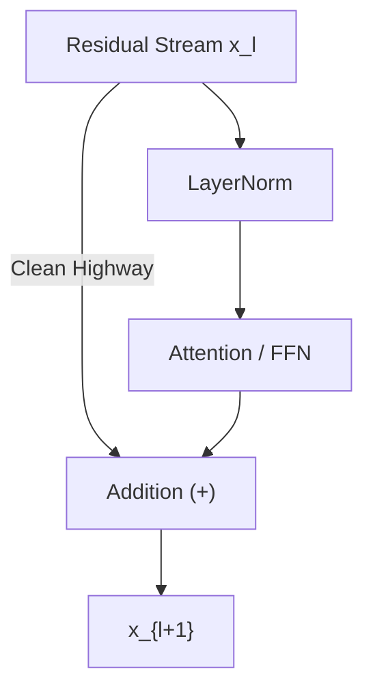

#### d. Code Thực chiến (C++ & Python)
```cpp
// C++17: Pre-Norm Forward Step
void pre_norm_step(const float* x_in, float* x_out, int size) {
    // 1. ln_out = layernorm(x_in)
    // 2. sub_out = sublayer(ln_out)
    // 3. x_out = x_in + sub_out
}
```

```python
import torch.nn as nn

class PreNormSubLayer(nn.Module):
    def __init__(self, d_model: int, sublayer: nn.Module):
        super().__init__()
        self.norm = nn.LayerNorm(d_model)
        self.sublayer = sublayer

    def forward(self, x):
        return x + self.sublayer(self.norm(x))
```

#### e. Lỗi Thường gặp & Ổn định Số học
- Quên đặt một tầng Final LayerNorm ở cuối cùng trước khi đưa vào Linear LM Head: Khi tích lũy qua 80 tầng, biên độ của residual stream $\mathbf{x}_L$ tăng tỷ lệ với $\sqrt{L}$, nếu không chuẩn hóa trước khi chiếu ra từ vựng sẽ gây bất ổn định cho softmax loss.

#### f. Ứng dụng Thực chiến trong AI
- Chuẩn mực thiết kế của $100\%$ các LLM hiện đại: **LLaMA series, GPT-3, Mistral, Gemma, Falcon**.

---

### 49. Post-Norm (Chuẩn hóa Sau Tầng)

#### a. Định nghĩa Bản chất Toán học
Trong kiến trúc **Post-Norm** (thiết kế gốc trong Transformer của Vaswani et al., 2017), Layer Normalization được đặt **sau** phép cộng Residual:
$$\mathbf{x}_{l+1} = \text{LayerNorm}(\mathbf{x}_l + \text{SubLayer}(\mathbf{x}_l))$$

#### b. Cơ chế Tầng Sâu & Điện toán
- **Vấn đề Gradient Vanishing ở các tầng đầu**: Gradient đi qua tầng LayerNorm ở mỗi bước sẽ bị co lại bởi hệ số tỉ lệ nghịch với độ lệch chuẩn:
  $$\frac{\partial \mathbf{x}_{l+1}}{\partial \mathbf{x}_l} \propto \frac{1}{\sigma_l}$$
  Khi mô hình sâu ($L > 12$), gradient truyền ngược về các tầng đầu tiên bị triệt tiêu gần như bằng 0 (Vanishing Gradients).
- Bắt buộc phải có giai đoạn **Learning Rate Warm-up** cực kỳ cẩn thận (hàng nghìn bước đầu với lr rất nhỏ) để ngăn mô hình bị phân kỳ (diverge) ngay khi bắt đầu train.

#### c. Sơ đồ Minh họa
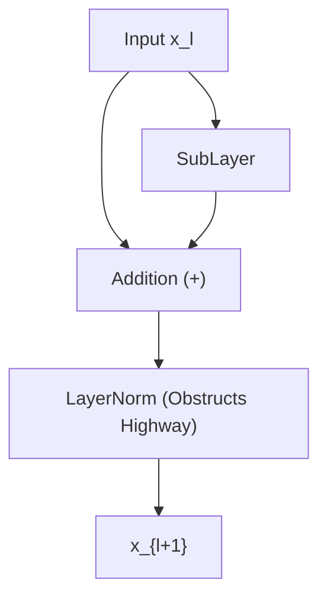

#### d. Code Thực chiến (C++ & Python)
```cpp
// C++17: Post-Norm Forward Step
void post_norm_step(const float* x_in, float* x_out, int size) {
    // 1. sub_out = sublayer(x_in)
    // 2. add_out = x_in + sub_out
    // 3. x_out = layernorm(add_out)
}
```

```python
import torch.nn as nn

class PostNormSubLayer(nn.Module):
    def __init__(self, d_model: int, sublayer: nn.Module):
        super().__init__()
        self.norm = nn.LayerNorm(d_model)
        self.sublayer = sublayer

    def forward(self, x):
        return self.norm(x + self.sublayer(x))
```

#### e. Lỗi Thường gặp & Ổn định Số học
- Huấn luyện mô hình Post-Norm sâu trên 20 tầng mà không có kỹ thuật khởi tạo DeepNorm hoặc warmup sẽ khiến training loss bị NaN ngay ở step đầu tiên.

#### f. Ứng dụng Thực chiến trong AI
- Mô hình Transformer gốc (2017), **BERT**, và **RoBERTa**.

---

### 50. Positional Encoding (Mã hóa Vị trí)

#### a. Định nghĩa Bản chất Toán học
Do cơ chế Self-Attention có tính chất **Bất biến theo Phép hoán vị (Permutation Invariance)**:
$$\text{Attention}(\mathbf{P} \mathbf{X}) = \mathbf{P} \text{Attention}(\mathbf{X})$$
(Trong đó $\mathbf{P}$ là một ma trận hoán vị bất kỳ), nếu không có cơ chế bổ sung vị trí, mô hình sẽ coi câu "Mèo đuổi chuột" và "Chuột đuổi mèo" là hoàn toàn giống hệt nhau.

**Positional Encoding (PE)** là kỹ thuật tiêm thông tin thứ tự thời gian vào các vector biểu diễn token:
$$\tilde{\mathbf{X}} = \mathbf{X}_{\text{token}} + \mathbf{PE}$$
Trong đó $\mathbf{PE} \in \mathbb{R}^{N \times d_{\text{model}}}$ ánh xạ mỗi chỉ số vị trí $pos \in \{0, \dots, N-1\}$ thành một vector đặc trưng duy nhất.

#### b. Cơ chế Tầng Sâu & Điện toán
- Phép cộng $\mathbf{X} + \mathbf{PE}$ được thực hiện ở tầng dưới cùng ngay sau bảng tra cứu từ điển (Embedding Lookup).
- Cho phép mô hình phân biệt vị trí tuyệt đối và vị trí tương đối giữa các token.

#### c. Sơ đồ Minh họa
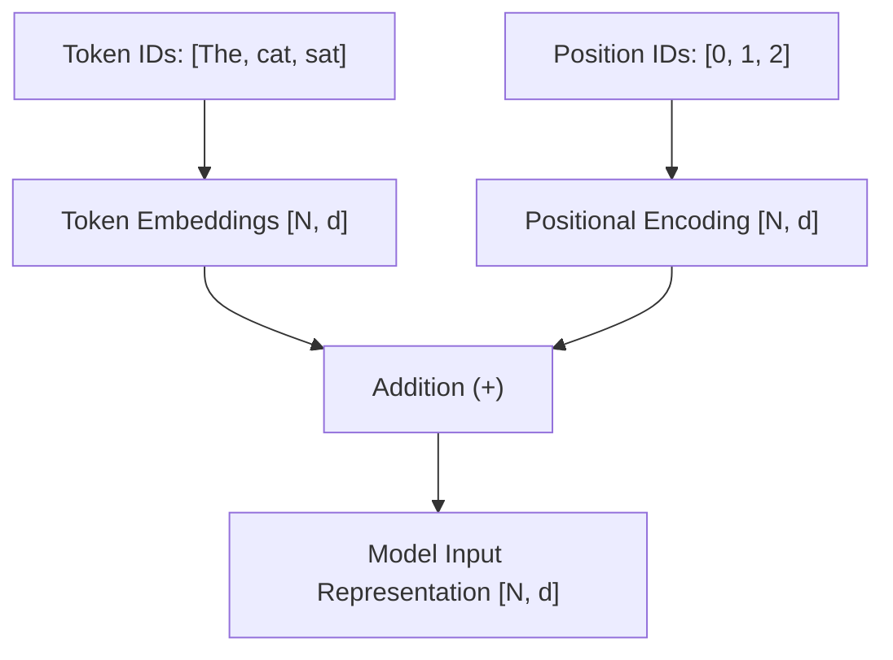

#### d. Code Thực chiến (C++ & Python)
```cpp
// C++17: Khung cộng vị trí
void inject_position(float* token_emb, const float* pos_enc, int N, int d_model) {
    for (int i = 0; i < N * d_model; ++i) {
        token_emb[i] += pos_enc[i];
    }
}
```

```python
import torch
import torch.nn as nn

class EmbeddingWithPositionalEncoding(nn.Module):
    def __init__(self, vocab_size: int, d_model: int, max_len: int = 5000):
        super().__init__()
        self.tok_emb = nn.Embedding(vocab_size, d_model)
        self.pos_emb = nn.Parameter(torch.randn(max_len, d_model))

    def forward(self, input_ids: torch.Tensor) -> torch.Tensor:
        seq_len = input_ids.size(1)
        return self.tok_emb(input_ids) + self.pos_emb[:seq_len, :]
```

#### e. Lỗi Thường gặp & Ổn định Số học
- Giới hạn chiều dài cố định: Nếu dùng Learned Positional Embeddings, mô hình không thể suy luận trên chuỗi dài hơn $max\_len$ được định nghĩa lúc pre-train.

#### f. Ứng dụng Thực chiến trong AI
- Nền tảng xác định cấu trúc ngữ pháp và thứ tự câu trong mọi kiến trúc NLP.
