# Chuyên đề: Mã hóa Vị trí & Cơ chế Mô hình hóa Ngôn ngữ (Positional Embeddings & Language Modeling Frameworks)

## 1. Tổng quan Chuyên đề
Ngôn ngữ tự nhiên có bản chất tuần tự chặt chẽ: ý nghĩa của một câu phụ thuộc hoàn toàn vào thứ tự xuất hiện của các từ. Vì cơ chế Self-Attention là bất biến với phép hoán vị (Permutation Invariant), việc đưa thông tin vị trí vào mạng nơ-ron là điều kiện tiên quyết để mô hình hiểu được ngữ pháp và trật tự logic.

Sự tiến hóa của các phương pháp mã hóa vị trí phản ánh cuộc đua mở rộng chiều dài ngữ cảnh (Context Window Extension):
1. **Từ Mã hóa Tuyệt đối (Absolute Positional Encodings)**: Sinusoidal PE (Vaswani 2017) và Learned Positional Embeddings (BERT, GPT-2) bị giới hạn cứng ở độ dài cố định lúc huấn luyện, không thể ngoại suy (extrapolate) khi gặp chuỗi dài hơn.
2. **Đến Mã hóa Tương đối (Relative Positional Encodings) & Hình học Xoay**: Rotary Position Embedding (RoPE) và ALiBi biến thông tin vị trí thành phép xoay trong không gian phức hoặc độ dốc tuyến tính, cho phép mô hình mở rộng ngữ cảnh từ 4K lên 128K–1M token thông qua các kỹ thuật nội suy tần số (YaRN, RoPE Scaling).
3. **Cơ chế Mô hình hóa Ngôn ngữ (Language Modeling Paradigms)**: Phân hóa giữa Causal Language Modeling (CLM - Dự đoán từ kế tiếp) của các Decoder-only LLMs và Masked Language Modeling (MLM - Điền từ vào chỗ trống) của các Encoder models.

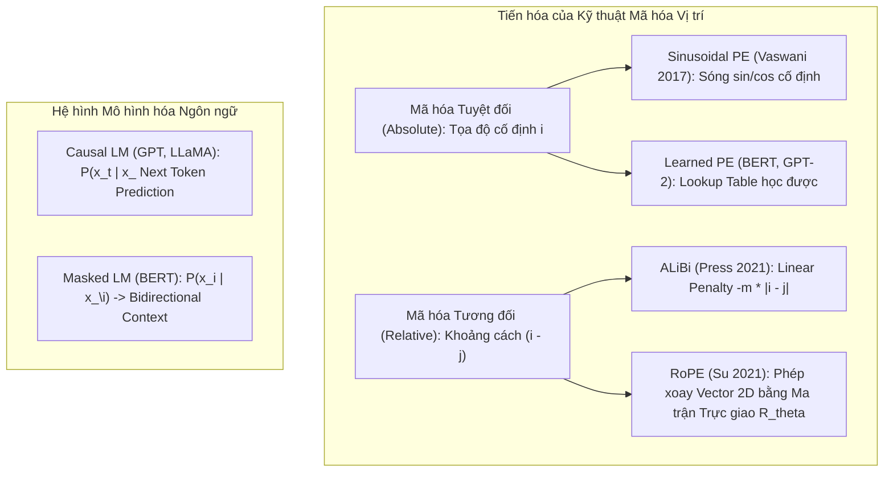

---

## 2. Chi tiết từng Keyword

---

### 51. Sinusoidal Positional Encoding (Mã hóa Vị trí Dạng sóng Sin)

#### a. Định nghĩa Bản chất Toán học
Được giới thiệu trong Transformer gốc (Vaswani et al., 2017), **Sinusoidal Positional Encoding** gán cho mỗi vị trí $pos \in \{0, \dots, N-1\}$ một vector xác định bằng các hàm lượng giác có bước sóng biến thiên hình học từ $2\pi$ đến $10000 \cdot 2\pi$:
$$\mathbf{PE}_{(pos, 2i)} = \sin\left(\frac{pos}{10000^{2i / d_{\text{model}}}}\right)$$
$$\mathbf{PE}_{(pos, 2i+1)} = \cos\left(\frac{pos}{10000^{2i / d_{\text{model}}}}\right)$$
Trong đó $i \in \{0, \dots, \frac{d_{\text{model}}}{2} - 1\}$ là chỉ số kênh đặc trưng.

**Tính chất Ngoại suy Tuyến tính**: Với bất kỳ độ lệch vị trí cố định $k$, vector vị trí $\mathbf{PE}_{pos + k}$ có thể được biểu diễn dưới dạng một phép biến đổi tuyến tính của $\mathbf{PE}_{pos}$:
$$\begin{bmatrix} \mathbf{PE}_{(pos+k, 2i)} \\ \mathbf{PE}_{(pos+k, 2i+1)} \end{bmatrix} = \begin{bmatrix} \cos(k \theta_i) & \sin(k \theta_i) \\ -\sin(k \theta_i) & \cos(k \theta_i) \end{bmatrix} \begin{bmatrix} \mathbf{PE}_{(pos, 2i)} \\ \mathbf{PE}_{(pos, 2i+1)} \end{bmatrix}$$
Điều này về mặt lý thuyết giúp mô hình dễ dàng học cách chú ý theo khoảng cách tương đối.

#### b. Cơ chế Tầng Sâu & Điện toán
- Không tốn tham số học được (0 learnable parameters).
- Bảng Sin/Cos được tiền tính toán một lần (Precomputed Lookup Buffer) và nạp vào bộ nhớ GPU dưới dạng hằng số.

#### c. Sơ đồ Minh họa
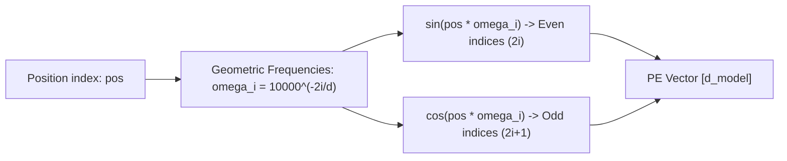

#### d. Code Thực chiến (C++ & Python)
```cpp
// C++17: Khởi tạo bảng Sinusoidal Positional Encoding
#include <vector>
#include <cmath>

std::vector<float> create_sinusoidal_pe(int max_len, int d_model) {
    std::vector<float> pe(max_len * d_model);
    for (int pos = 0; pos < max_len; ++pos) {
        for (int i = 0; i < d_model / 2; ++i) {
            float div_term = std::exp(i * -2.0f * std::log(10000.0f) / d_model);
            pe[pos * d_model + 2 * i] = std::sin(pos * div_term);
            pe[pos * d_model + 2 * i + 1] = std::cos(pos * div_term);
        }
    }
    return pe;
}
```

```python
import torch
import torch.nn as nn
import math

class SinusoidalPositionalEncoding(nn.Module):
    def __init__(self, d_model: int, max_len: int = 5000):
        super().__init__()
        pe = torch.zeros(max_len, d_model)
        position = torch.arange(0, max_len, dtype=torch.float).unsqueeze(1)
        div_term = torch.exp(torch.arange(0, d_model, 2).float() * (-math.log(10000.0) / d_model))
        pe[:, 0::2] = torch.sin(position * div_term)
        pe[:, 1::2] = torch.cos(position * div_term)
        self.register_buffer('pe', pe.unsqueeze(0)) # [1, max_len, d_model]

    def forward(self, x: torch.Tensor) -> torch.Tensor:
        # x: [B, N, d_model]
        return x + self.pe[:, :x.size(1)]
```

#### e. Lỗi Thường gặp & Ổn định Số học
- Trong thực tế, mặc dù có tính chất tuyến tính lượng giác, mạng nơ-ron sâu rất khó tự học cách nội suy các phép quay này khi độ dài chuỗi vượt quá độ dài tối đa lúc huấn luyện ($N > max\_len$).

#### f. Ứng dụng Thực chiến trong AI
- Transformer bản gốc (2017), Text-to-Speech (Tacotron), và Transformer trong dự báo chuỗi thời gian.

---

### 52. Learned Positional Embeddings (Mã hóa Vị trí Học được)

#### a. Định nghĩa Bản chất Toán học
Thay vì sử dụng các hàm toán học cố định, **Learned Positional Embeddings** coi mỗi chỉ số vị trí $pos \in \{0, \dots, L_{\max} - 1\}$ như một token độc lập trong từ điển vị trí và gán cho nó một vector tham số học được $\mathbf{E}_{\text{pos}} \in \mathbb{R}^{L_{\max} \times d_{\text{model}}}$:
$$\mathbf{x}_{\text{input}} = \mathbf{E}_{\text{token}}[x_i] + \mathbf{E}_{\text{pos}}[i]$$
Toàn bộ ma trận $\mathbf{E}_{\text{pos}}$ được cập nhật thông qua lan truyền ngược (Backpropagation) cùng với toàn bộ trọng số của mô hình.

#### b. Cơ chế Tầng Sâu & Điện toán
- Hoạt động như một phép toán tra cứu bảng bộ nhớ (Embedding Lookup):
  $$\text{Address} = \text{BasePtr} + pos \times d_{\text{model}} \times \text{sizeof(FP16)}$$
- **Giới hạn cứng (Hard Limit)**: Hoàn toàn không thể xử lý bất kỳ chuỗi nào có độ dài $N > L_{\max}$ vì các chỉ số vị trí lớn hơn không hề tồn tại trong bảng ma trận trọng số.

#### c. Sơ đồ Minh họa
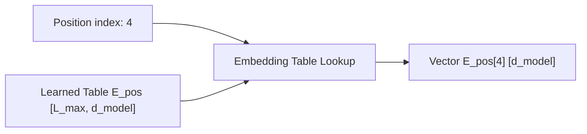

#### d. Code Thực chiến (C++ & Python)
```cpp
// C++17: Tra cứu bộ nhớ bảng vị trí học được
void lookup_learned_pos(const float* E_pos, int pos, float* out_vec, int d_model) {
    const float* src = E_pos + pos * d_model;
    std::copy(src, src + d_model, out_vec);
}
```

```python
import torch
import torch.nn as nn

class LearnedPositionalEmbedding(nn.Module):
    def __init__(self, max_len: int, d_model: int):
        super().__init__()
        self.pos_emb = nn.Embedding(max_len, d_model)

    def forward(self, x: torch.Tensor) -> torch.Tensor:
        seq_len = x.size(1)
        positions = torch.arange(seq_len, device=x.device).unsqueeze(0) # [1, N]
        return x + self.pos_emb(positions)
```

#### e. Lỗi Thường gặp & Ổn định Số học
- Mô hình hiếm khi nhìn thấy các vị trí gần $L_{\max}$ trong tập dữ liệu huấn luyện, khiến các vector vị trí ở cuối ma trận nhận được rất ít gradient cập nhật, dẫn tới biểu diễn kém chất lượng ở đuôi văn bản.

#### f. Ứng dụng Thực chiến trong AI
- **BERT**, **RoBERTa**, **GPT-2**, **ViT (Vision Transformer)** gốc.

---

### 53. Relative Positional Encoding (Mã hóa Vị trí Tương đối)

#### a. Định nghĩa Bản chất Toán học
Shaw et al. (2018) và Dai et al. (Transformer-XL, 2019) lập luận rằng đối với ngôn ngữ, khoảng cách tương đối $i - j$ giữa hai từ quan trọng hơn nhiều so với tọa độ tuyệt đối $i$ và $j$ của chúng trong văn bản.

Trong **Relative Positional Encoding**, ma trận điểm chú ý được biến đổi để tính trực tiếp độ lệch khoảng cách $k = \text{clip}(i - j, -k_{\max}, k_{\max})$:
$$\mathbf{S}_{ij} = \frac{\mathbf{q}_i \mathbf{k}_j^T + \mathbf{q}_i \mathbf{R}_{i-j}^T}{\sqrt{d_k}}$$
$$\mathbf{O}_i = \sum_{j=1}^N \mathbf{A}_{ij} (\mathbf{v}_j + \mathbf{P}_{i-j})$$
Trong đó $\mathbf{R}_{i-j}, \mathbf{P}_{i-j} \in \mathbb{R}^{d_k}$ là các vector biểu diễn khoảng cách tương đối học được.

#### b. Cơ chế Tầng Sâu & Điện toán
- Giúp mô hình có khả năng tổng quát hóa trên các văn bản dài hơn nhiều so với chiều dài gặp trong lúc train (Extrapolation).
- Tuy nhiên, việc cộng thêm vector vào ma trận tương tác làm mất tính chất phân rã của tích ma trận $Q K^T$, đòi hỏi các thuật toán chuyển vị (Skewing Algorithm) để tính toán hiệu quả trên GPU.

#### c. Sơ đồ Minh họa
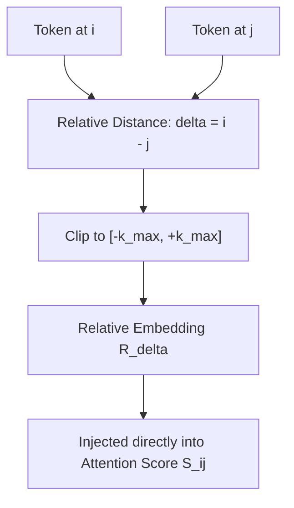

#### d. Code Thực chiến (C++ & Python)
```cpp
// C++17: Relative Index Clipping
inline int get_relative_bin(int i, int j, int max_distance) {
    int rel = i - j;
    if (rel < -max_distance) return 0;
    if (rel > max_distance) return 2 * max_distance;
    return rel + max_distance; // Dịch về chỉ số dương
}
```

```python
import torch
import torch.nn as nn

class RelativePositionBias(nn.Module):
    def __init__(self, num_heads: int, max_distance: int = 128):
        super().__init__()
        self.num_heads = num_heads
        self.max_distance = max_distance
        self.bias_table = nn.Parameter(torch.zeros(num_heads, 2 * max_distance + 1))

    def forward(self, q_len: int, k_len: int) -> torch.Tensor:
        q_pos = torch.arange(q_len)[:, None]
        k_pos = torch.arange(k_len)[None, :]
        rel_pos = k_pos - q_pos + self.max_distance
        rel_pos = torch.clamp(rel_pos, 0, 2 * self.max_distance)
        # bias: [1, num_heads, q_len, k_len]
        return self.bias_table[:, rel_pos].unsqueeze(0)
```

#### e. Lỗi Thường gặp & Ổn định Số học
- Bộ nhớ trung gian tăng lên do phải lưu trữ ma trận bias tương đối cho từng cặp head và token.

#### f. Ứng dụng Thực chiến trong AI
- **T5 (Raffel et al., 2020)**, **Transformer-XL**, và kiến trúc **DeBERTa**.

---

### 54. Rotary Position Embedding (RoPE - Nhúng Vị trí Xoay)

#### a. Định nghĩa Bản chất Toán học
**RoPE** (Su et al., 2021) là một trong những phát minh quan trọng nhất cho các mô hình LLM hiện đại. RoPE kết hợp sự ưu việt của vị trí tuyệt đối (tính toán độc lập trên từng token) với vị trí tương đối (tích vô hướng tự nhiên phản ánh khoảng cách $m - n$).

Về bản chất, RoPE chia vector đặc trưng $\mathbf{x} \in \mathbb{R}^d$ thành $d/2$ cặp số thực 2D, coi mỗi cặp như một số phức $z_i = x_{2i} + j x_{2i+1} \in \mathbb{C}$. Để mã hóa vị trí $m$, RoPE **xoay** số phức này một góc $m \theta_i$:
$$\mathbf{R}_{\Theta, m}^d = \text{diag}\left(\mathbf{R}_{\theta_1, m}, \dots, \mathbf{R}_{\theta_{d/2}, m}\right)$$
$$\mathbf{R}_{\theta_i, m} = \begin{bmatrix} \cos(m \theta_i) & -\sin(m \theta_i) \\ \sin(m \theta_i) & \cos(m \theta_i) \end{bmatrix}, \quad \theta_i = 10000^{-2(i-1)/d}$$
Khi áp dụng phép xoay cho Query $\mathbf{q}$ tại vị trí $m$ và Key $\mathbf{k}$ tại vị trí $n$:
$$\tilde{\mathbf{q}}_m = \mathbf{R}_{\Theta, m}^d \mathbf{q}_m, \quad \tilde{\mathbf{k}}_n = \mathbf{R}_{\Theta, n}^d \mathbf{k}_n$$
Tích vô hướng giữa Query và Key thu được:
$$\langle \tilde{\mathbf{q}}_m, \tilde{\mathbf{k}}_n \rangle = (\mathbf{R}_m \mathbf{q})^T (\mathbf{R}_n \mathbf{k}) = \mathbf{q}^T \mathbf{R}_m^T \mathbf{R}_n \mathbf{k} = \mathbf{q}^T \mathbf{R}_{n - m} \mathbf{k}$$
**Độ tương đồng Query-Key phụ thuộc duy nhất vào khoảng cách tương đối $(n - m)$** thông qua góc quay lệch $(n - m)\theta_i$, hoàn toàn không phụ thuộc vào tọa độ tuyệt đối!

#### b. Cơ chế Tầng Sâu & Điện toán
- Triển khai cực kỳ tối ưu trên phần cứng không qua nhân ma trận lớn mà qua công thức xoay trực tiếp:
  $$\tilde{\mathbf{x}}_m = \mathbf{x} \odot \cos(m \Theta) + \text{rotate\_half}(\mathbf{x}) \odot \sin(m \Theta)$$
  Trong đó $\text{rotate\_half}(\mathbf{x}) = [-x_{d/2:], x_{:d/2}]$.
- Tương thích $100\%$ với **KV Cache** và **FlashAttention**.

#### c. Sơ đồ Minh họa
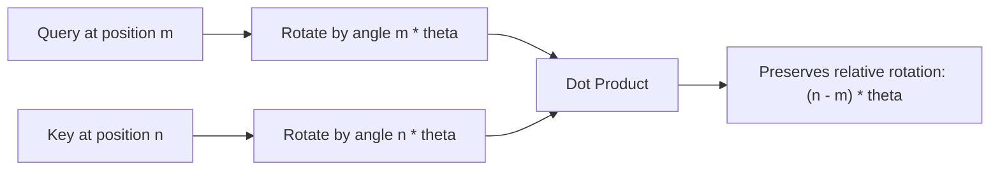

#### d. Code Thực chiến (C++ & Python)
```cpp
// C++17: Triển khai xoay RoPE trên cặp 2D
#include <vector>
#include <cmath>

void apply_rope_2d(float* x, int pos, float theta, int d) {
    for (int i = 0; i < d; i += 2) {
        float angle = pos * std::pow(theta, -static_cast<float>(i) / d);
        float cos_a = std::cos(angle);
        float sin_a = std::sin(angle);
        
        float x0 = x[i];
        float x1 = x[i + 1];
        
        x[i]     = x0 * cos_a - x1 * sin_a;
        x[i + 1] = x0 * sin_a + x1 * cos_a;
    }
}
```

```python
import torch

def precompute_rope_freqs(dim: int, max_seq_len: int, theta: float = 10000.0) -> tuple[torch.Tensor, torch.Tensor]:
    freqs = 1.0 / (theta ** (torch.arange(0, dim, 2)[: (dim // 2)].float() / dim))
    t = torch.arange(max_seq_len, dtype=torch.float)
    freqs = torch.outer(t, freqs) # [max_seq_len, dim // 2]
    cos = torch.cos(freqs).repeat_interleave(2, dim=-1) # [max_seq_len, dim]
    sin = torch.sin(freqs).repeat_interleave(2, dim=-1)
    return cos, sin

def apply_rope(x: torch.Tensor, cos: torch.Tensor, sin: torch.Tensor) -> torch.Tensor:
    # x: [B, H, N, D]
    # rotate_half logic: [-x2, x1, -x4, x3, ...]
    x_rot = torch.stack([-x[..., 1::2], x[..., 0::2]], dim=-1).flatten(-2)
    return (x * cos) + (x_rot * sin)
```

#### e. Lỗi Thường gặp & Ổn định Số học
- Suy giảm hiệu năng khi mở rộng ngữ cảnh ngoài vùng train: Cần áp dụng kỹ thuật **RoPE Interpolation**, **NTK-Aware Scaling**, hoặc **YaRN** để điều chỉnh lại tần số $\theta$.

#### f. Ứng dụng Thực chiến trong AI
- Chuẩn mực vàng áp dụng trong $90\%$ các mô hình mã nguồn mở hiện đại: **LLaMA-1/2/3, Mistral, Mixtral, Qwen-2, Gemma, DeepSeek-V2**.

---

### 55. ALiBi (Attention with Linear Biases - Chú ý với Độ lệch Tuyến tính)

#### a. Định nghĩa Bản chất Toán học
**ALiBi** (Press et al., 2021) loại bỏ hoàn toàn mọi vector nhúng vị trí (không cộng thêm bất kỳ embedding vị trí nào vào đầu vào). Thay vào đó, ALiBi đưa trực tiếp một giá trị phạt tuyến tính (linear bias penalty) tỷ lệ thuận với khoảng cách giữa Query và Key vào ma trận Attention Scores:
$$\mathbf{S}_{ij} = \frac{\mathbf{q}_i \mathbf{k}_j^T}{\sqrt{d_k}} - m \cdot (i - j)$$
Trong đó $(i - j) \ge 0$ là khoảng cách giữa token $i$ và $j$, và $m$ là một hệ số dốc (slope) hình học không học được (cố định), chuyên biệt cho từng head $h \in \{1, \dots, H\}$:
$$m_h = 2^{-\frac{8 h}{H}}$$

#### b. Cơ chế Tầng Sâu & Điện toán
- **Khả năng ngoại suy chiều dài phi thường (Zero-shot Length Extrapolation)**: Mô hình huấn luyện trên chuỗi 2048 token có thể suy luận trực tiếp trên chuỗi 8192 token mà perplexity không hề bị bùng nổ.
- Cực kỳ nhẹ về mặt tính toán: Chỉ cần cộng một ma trận hằng số vào scores, không tốn tài nguyên xoay vector như RoPE.

#### c. Sơ đồ Minh họa
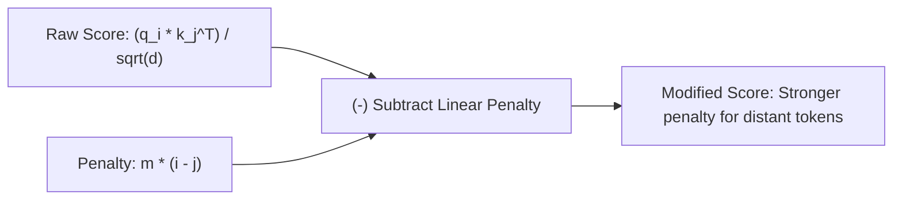

#### d. Code Thực chiến (C++ & Python)
```cpp
// C++17: Tính ma trận ALiBi Slope
#include <vector>
#include <cmath>

std::vector<float> compute_alibi_slopes(int num_heads) {
    std::vector<float> slopes(num_heads);
    double ratio = std::pow(2.0, -8.0 / num_heads);
    for (int h = 0; h < num_heads; ++h) {
        slopes[h] = static_cast<float>(std::pow(ratio, h + 1));
    }
    return slopes;
}
```

```python
import torch

def get_alibi_slopes(num_heads: int) -> torch.Tensor:
    def get_slopes_power_of_2(n):
        start = (2 ** (-2 ** -(math.log2(n) - 3)))
        ratio = start
        return [start * (ratio ** i) for i in range(n)]
    return torch.tensor(get_slopes_power_of_2(num_heads))
```

#### e. Lỗi Thường gặp & Ổn định Số học
- Khó khăn trong việc học các mẫu phụ thuộc xa hoàn hảo: Do phạt tuyến tính đơn điệu, mô hình ALiBi có xu hướng luôn đánh giá các từ ở xa kém quan trọng hơn các từ ở gần, gây khó khăn cho các tác vụ cần tìm kiếm thông tin kim trong bọc (Needle-in-a-Haystack).

#### f. Ứng dụng Thực chiến trong AI
- Kiến trúc chính của **BLOOM (BigScience)**, **MPT-7B/30B (MosaicML)**, và **Falcon**.

---

### 56. Context Window (Cửa sổ Ngữ cảnh)

#### a. Định nghĩa Bản chất Toán học
**Context Window** $\mathcal{W}_{\text{ctx}} = [x_1, \dots, x_N]$ định nghĩa giới hạn số lượng token tối đa mà một mô hình ngôn ngữ có thể tiếp nhận và chú ý đồng thời trong một bước suy luận hoặc huấn luyện duy nhất mà không bị mất mát thông tin.

#### b. Cơ chế Tầng Sâu & Điện toán
- Kích thước Context Window trực tiếp quyết định kích thước ma trận tính toán Attention $N \times N$ và dung lượng VRAM phân bổ cho KV Cache:
  $$\text{VRAM}_{\text{KV}} \propto N$$
- Việc mở rộng từ 4K lên 128K đòi hỏi các thuật toán phân tán (Ring Attention, Context Parallelism) và lượng tử hóa KV Cache.

#### c. Sơ đồ Minh họa


#### d. Code Thực chiến (C++ & Python)
```cpp
// C++17: Kiểm tra giới hạn Context Window
bool validate_context_fit(int current_tokens, int max_context_window) {
    return current_tokens <= max_context_window;
}
```

```python
class ContextManager:
    def __init__(self, max_context_length: int):
        self.max_context = max_context_length

    def truncate_or_chunk(self, tokens: list[int]) -> list[int]:
        if len(tokens) > self.max_context:
            return tokens[-self.max_context:] # Giữ ngữ cảnh mới nhất
        return tokens
```

#### e. Lỗi Thường gặp & Ổn định Số học
- Hiện tượng **Lost in the Middle**: Mặc dù Context Window hỗ trợ 128K, mô hình thường nhớ rất tốt thông tin ở đầu và cuối cửa sổ nhưng dễ bỏ sót thông tin nằm ở đoạn giữa.

#### f. Ứng dụng Thực chiến trong AI
- Thước đo phân loại thế hệ LLM: GPT-3 (2K) $\to$ GPT-4 (32K/128K) $\to$ LLaMA-3 (128K) $\to$ Gemini 1.5 Pro (2M–10M tokens).

---

### 57. Sequence Length (Độ dài Chuỗi)

#### a. Định nghĩa Bản chất Toán học
**Sequence Length** $N \in \mathbb{N}^+$ là số lượng token thực tế chứa trong một tensor mẫu cụ thể đưa vào mô hình:
$$\mathbf{X} \in \mathbb{R}^{B \times N \times d_{\text{model}}}$$
Trong huấn luyện theo batch, $N$ thường được chuẩn hóa bằng cách cắt ngắn (truncation) hoặc đệm (padding) về giá trị lớn nhất trong batch $N_{\max}$.

#### b. Cơ chế Tầng Sâu & Điện toán
- Quyết định hình học của các ma trận trong GPU Kernel.
- Khi $N$ thay đổi động giữa các request (Variable Length), GPU compiler gặp khó khăn trong việc tối ưu hóa thanh ghi cố định (Dynamic Shape Overhead).

#### c. Sơ đồ Minh họa
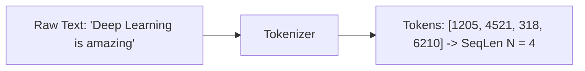

#### d. Code Thực chiến (C++ & Python)
```cpp
// C++17: Dynamic Sequence Length Tracker
struct SequenceBatch {
    int batch_size;
    std::vector<int> seq_lengths;
    int max_len;
};
```

```python
import torch

def get_dynamic_shapes(x: torch.Tensor):
    batch_size, seq_len, d_model = x.shape
    return {"batch": batch_size, "seq_len": seq_len, "hidden": d_model}
```

#### e. Lỗi Thường gặp & Ổn định Số học
- Cố định kích thước $N$ cứng nhắc (Static Shapes) gây lãng phí bộ nhớ trên các chuỗi ngắn.

#### f. Ứng dụng Thực chiến trong AI
- Tối ưu hóa throughput suy luận thông qua cơ chế Dynamic Batching và Continuous Batching.

---

### 58. Token Embeddings (Nhúng Ký hiệu)

#### a. Định nghĩa Bản chất Toán học
**Token Embeddings** là tầng đầu tiên của mô hình, ánh xạ các token ID rời rạc $x_t \in \{0, \dots, V-1\}$ từ không gian từ vựng có kích thước $V$ thành các vector liên tục dày đặc trong không gian metric đa chiều:
$$\mathbf{e}_t = \mathbf{E}_{\text{vocab}}[x_t] \in \mathbb{R}^{d_{\text{model}}}$$
Toàn bộ ma trận nhúng $\mathbf{W}_E \in \mathbb{R}^{V \times d_{\text{model}}}$ chứa đựng các biểu diễn ngữ nghĩa sơ khởi của từ vựng.

#### b. Cơ chế Tầng Sâu & Điện toán
- Bản chất phần cứng: Đây là phép tra cứu bảng chỉ mục (Table Lookup / Gather Kernel).
- Tỷ lệ tham số lớn: Với $V = 128,256$ (như LLaMA-3) và $d_{\text{model}} = 4096$, riêng tầng embedding đã chiếm:
  $$128256 \times 4096 \times 2 \text{ bytes (FP16)} \approx 1.05 \text{ GB (525 triệu tham số)}$$

#### c. Sơ đồ Minh họa
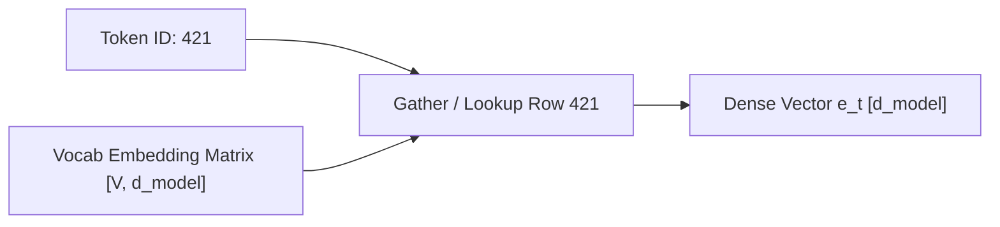

#### d. Code Thực chiến (C++ & Python)
```cpp
// C++17: Tra cứu Embedding bằng con trỏ thuần
void gather_embedding(const int* token_ids, const float* W_emb, float* out_tensor, 
                      int N, int d_model) {
    for (int i = 0; i < N; ++i) {
        int id = token_ids[i];
        std::memcpy(&out_tensor[i * d_model], &W_emb[id * d_model], d_model * sizeof(float));
    }
}
```

```python
import torch.nn as nn

class TokenEmbeddingLayer(nn.Module):
    def __init__(self, vocab_size: int, d_model: int):
        super().__init__()
        self.embedding = nn.Embedding(vocab_size, d_model)

    def forward(self, input_ids):
        return self.embedding(input_ids)
```

#### e. Lỗi Thường gặp & Ổn định Số học
- Khởi tạo phương sai quá lớn khiến các vector embedding ban đầu quá xa nhau, làm rối loạn cơ chế Attention ở các bước đầu.

#### f. Ứng dụng Thực chiến trong AI
- Cổng vào bắt buộc của mọi mô hình xử lý ngôn ngữ tự nhiên.

---

### 59. Output Projection (Chiếu Đầu ra)

#### a. Định nghĩa Bản chất Toán học
**Output Projection** là tầng tuyến tính cuối cùng của mô hình, biến đổi vector biểu diễn ẩn từ tầng Transformer cuối cùng $\mathbf{h}_N \in \mathbb{R}^{d_{\text{model}}}$ trở lại không gian kích thước từ vựng $\mathbb{R}^V$ để sinh ra điểm số unnormalized log-probabilities (Logits):
$$\mathbf{z} = \mathbf{h}_N \mathbf{W}_{\text{out}} + \mathbf{b}_{\text{out}}, \quad \mathbf{W}_{\text{out}} \in \mathbb{R}^{d_{\text{model}} \times V}$$

**Kỹ thuật Trói Trọng số (Weight Tying)**: Press & Wolf (2017) đề xuất chia sẻ chung ma trận trọng số giữa tầng Input Embedding và Output Projection:
$$\mathbf{W}_{\text{out}} = \mathbf{W}_E^T$$
Giúp tiết kiệm hàng trăm triệu tham số và tăng tính ổn định ngữ nghĩa (từ có vector embedding tương tự sẽ có xác suất dự đoán tương tự).

#### b. Cơ chế Tầng Sâu & Điện toán
- Phép nhân ma trận GEMM có kích thước rất lớn $[B \cdot N, d_{\text{model}}] \times [d_{\text{model}}, V]$.
- Tiêu tốn băng thông bộ nhớ và FLOPs rất lớn khi kích thước từ vựng $V > 100,000$.

#### c. Sơ đồ Minh họa
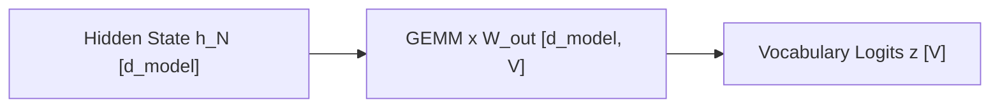

#### d. Code Thực chiến (C++ & Python)
```cpp
// C++17: Output GEMM
void output_projection(const float* h_last, const float* W_out, float* logits, 
                       int d_model, int vocab_size) {
    for (int v = 0; v < vocab_size; ++v) {
        float sum = 0.0f;
        for (int d = 0; d < d_model; ++d) {
            sum += h_last[d] * W_out[d * vocab_size + v];
        }
        logits[v] = sum;
    }
}
```

```python
import torch
import torch.nn as nn

class OutputHead(nn.Module):
    def __init__(self, d_model: int, vocab_size: int, tie_weights: bool = True, embedding_weight: nn.Parameter = None):
        super().__init__()
        self.proj = nn.Linear(d_model, vocab_size, bias=False)
        if tie_weights and embedding_weight is not None:
            self.proj.weight = embedding_weight

    def forward(self, x: torch.Tensor) -> torch.Tensor:
        return self.proj(x)
```

#### e. Lỗi Thường gặp & Ổn định Số học
- Logits có biên độ quá lớn dẫn đến tràn số khi đưa vào hàm Softmax tiếp theo.

#### f. Ứng dụng Thực chiến trong AI
- Thành phần quyết định tốc độ suy luận ở bước cuối cùng của LLM.

---

### 60. Language Modeling Head (Đầu Mô hình Ngôn ngữ)

#### a. Định nghĩa Bản chất Toán học
**Language Modeling Head (LM Head)** bao gồm Output Projection kết hợp với hàm phân phối xác suất Softmax có điều khiển nhiệt độ (Temperature $T$):
$$P(y = w \mid \mathbf{x}) = \frac{\exp(\mathbf{z}_w / T)}{\sum_{v=1}^V \exp(\mathbf{z}_v / T)}$$
- Khi $T \to 0$: Phân phối tiến về Dirac delta (Greedy decoding).
- Khi $T > 1$: Phân phối phẳng hơn, tăng tính sáng tạo và đa dạng của văn bản sinh ra.

#### b. Cơ chế Tầng Sâu & Điện toán
- Kết hợp các thuật toán lấy mẫu (Top-k Sampling, Top-p / Nucleus Sampling, Min-p Sampling) trực tiếp trên GPU để tránh việc chuyển toàn bộ tensor Logits kích thước lớn về RAM của CPU.

#### c. Sơ đồ Minh họa
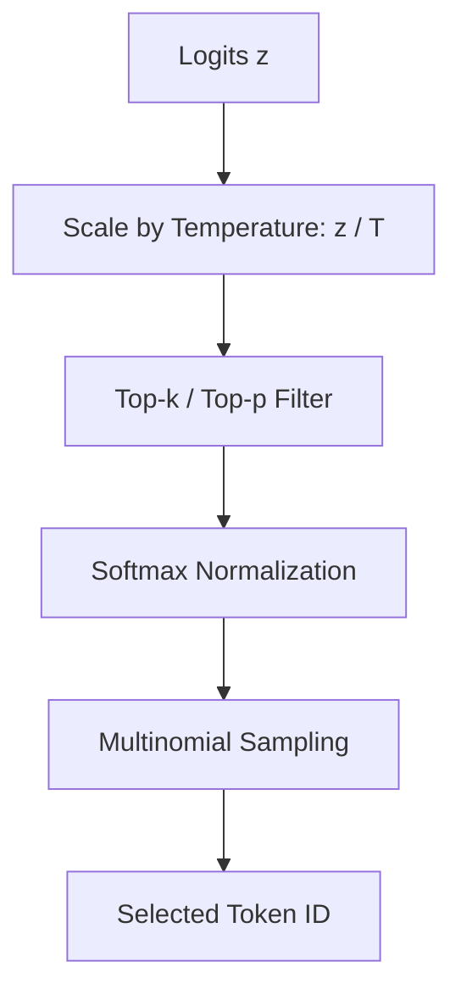

#### d. Code Thực chiến (C++ & Python)
```cpp
// C++17: Temperature scaling trên Logits
void apply_temperature(float* logits, int size, float temperature) {
    float inv_t = 1.0f / temperature;
    for (int i = 0; i < size; ++i) {
        logits[i] *= inv_t;
    }
}
```

```python
import torch

def sample_top_p(logits: torch.Tensor, p: float = 0.9, temp: float = 0.8) -> int:
    logits = logits / temp
    probs = torch.softmax(logits, dim=-1)
    sorted_probs, indices = torch.sort(probs, descending=True)
    cumulative_probs = torch.cumsum(sorted_probs, dim=-1)
    
    # Loại bỏ các token ngoài top-p
    sorted_indices_to_remove = cumulative_probs > p
    sorted_indices_to_remove[..., 1:] = sorted_indices_to_remove[..., :-1].clone()
    sorted_indices_to_remove[..., 0] = 0
    
    sorted_probs[sorted_indices_to_remove] = 0.0
    sorted_probs = sorted_probs / torch.sum(sorted_probs)
    next_token = torch.multinomial(sorted_probs, 1)
    return indices[next_token].item()
```

#### e. Lỗi Thường gặp & Ổn định Số học
- Đặt nhiệt độ $T = 0$ gây ra lỗi chia cho 0 (`ZeroDivisionError`).

#### f. Ứng dụng Thực chiến trong AI
- Điều phối phong cách sinh văn bản trong mọi ứng dụng ChatGPT, trợ lý AI và Agent.

---

### 61. Autoregressive Modeling (Mô hình hóa Tự hồi quy)

#### a. Định nghĩa Bản chất Toán học
**Autoregressive Modeling** áp dụng quy tắc nhân xác suất (Chain Rule of Probability) để phân rã phân phối xác suất đồng thời của một chuỗi $X = (x_1, \dots, x_T)$ thành tích các phân phối có điều kiện:
$$P(X) = P(x_1, x_2, \dots, x_T) = \prod_{t=1}^T P(x_t \mid x_1, \dots, x_{t-1})$$
Mỗi biến cố tương lai được sinh ra tuần tự dựa trên điều kiện toàn bộ lịch sử quá khứ.

#### b. Cơ chế Tầng Sâu & Điện toán
- Khi huấn luyện: Huấn luyện song song $100\%$ qua Teacher Forcing.
- Khi suy luận: Sinh tuần tự từng bước (Sequential Decoding), bị giới hạn bởi tính tuần tự nghiêm ngặt (không thể sinh song song token $t+1$ khi chưa biết token $t$).

#### c. Sơ đồ Minh họa
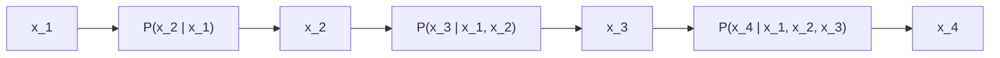

#### d. Code Thực chiến (C++ & Python)
```cpp
// C++17: Vòng lặp Autoregressive Controller
struct AutoregressiveController {
    int max_tokens = 100;
    int eos_id = 2;

    void generate(std::vector<int>& context) {
        while (context.size() < max_tokens) {
            // int next_token = forward_and_sample(context);
            // if (next_token == eos_id) break;
            // context.push_back(next_token);
        }
    }
};
```

```python
import torch

def autoregressive_generate(model, prompt_ids: torch.Tensor, max_new_tokens: int, eos_id: int):
    current_ids = prompt_ids
    for _ in range(max_new_tokens):
        logits = model(current_ids)
        next_token = torch.argmax(logits[:, -1, :], dim=-1, keepdim=True)
        if next_token.item() == eos_id:
            break
        current_ids = torch.cat([current_ids, next_token], dim=1)
    return current_ids
```

#### e. Lỗi Thường gặp & Ổn định Số học
- Tích lũy trôi dạt ngữ nghĩa (Hallucination & Drift): Khi độ dài sinh quá dài, các lỗi nhỏ tích lũy khiến văn bản mất tính mạch lạc.

#### f. Ứng dụng Thực chiến trong AI
- Mô hình nền tảng cho Generative AI hiện đại (Text, Audio, Code).

---

### 62. Encoder-Decoder Attention (Chú ý Mã hóa - Giải mã)

#### a. Định nghĩa Bản chất Toán học
Được phân tích chi tiết trong mục Cross-Attention, **Encoder-Decoder Attention** là cầu nối truyền thông tin giữa biểu diễn tiềm ẩn hai chiều $\mathbf{Z} \in \mathbb{R}^{N \times d}$ của Encoder và trạng thái giải mã $\mathbf{S} \in \mathbb{R}^{M \times d}$ của Decoder:
$$\text{EncDecAttention}(\mathbf{S}, \mathbf{Z}) = \text{Softmax}\left(\frac{(\mathbf{S} \mathbf{W}_Q)(\mathbf{Z} \mathbf{W}_K)^T}{\sqrt{d_k}}\right) (\mathbf{Z} \mathbf{W}_V)$$

#### b. Cơ chế Tầng Sâu & Điện toán
- Cho phép bộ giải mã tập trung vào các đoạn liên quan nhất trong văn bản nguồn tại mỗi thời điểm sinh từ đích.

#### c. Sơ đồ Minh họa
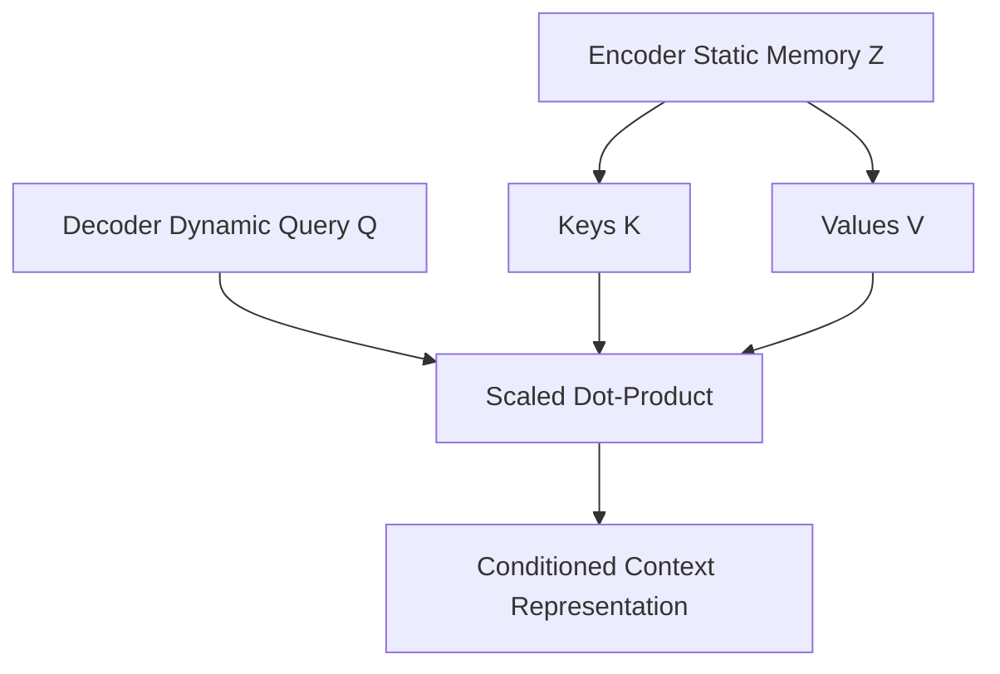

#### d. Code Thực chiến (C++ & Python)
```cpp
// C++17: Wrapper cho EncDec Attention
void enc_dec_attn_call(const float* dec_q, const float* enc_k, const float* enc_v, float* out);
```

```python
import torch.nn as nn

class EncDecAttention(nn.Module):
    def __init__(self, d_model: int, num_heads: int):
        super().__init__()
        self.attn = nn.MultiheadAttention(d_model, num_heads, batch_first=True)

    def forward(self, dec_query, enc_memory):
        return self.attn(dec_query, enc_memory, enc_memory)[0]
```

#### e. Lỗi Thường gặp & Ổn định Số học
- Quên truyền padding mask của Encoder vào Cross-Attention khiến Decoder chú ý vào các token `[PAD]` của câu nguồn.

#### f. Ứng dụng Thực chiến trong AI
- Mô hình Dịch máy Google Translate, Tóm tắt văn bản tự động T5.

---

### 63. Causal Language Modeling (CLM - Mô hình hóa Ngôn ngữ Nhân quả)

#### a. Định nghĩa Bản chất Toán học
**Causal Language Modeling (CLM)** là phương pháp huấn luyện tự giám sát (Self-supervised Pretraining) trong đó mô hình được huấn luyện để tối thiểu hóa hàm mất mát Cross-Entropy giữa phân phối dự đoán của token tiếp theo và nhãn ground-truth:
$$\mathcal{L}_{\text{CLM}} = -\frac{1}{N} \sum_{t=1}^N \log P(x_t \mid x_{<t}; \theta)$$
Trong quá trình này, một **Causal Mask** được áp dụng bắt buộc trên toàn bộ các tầng Attention để đảm bảo thông tin tương lai không bao giờ bị rò rỉ về các bước trước đó.

#### b. Cơ chế Tầng Sâu & Điện toán
- Tận dụng tối đa dữ liệu văn bản thô không cần gán nhãn trên quy mô hàng chục Terabytes (Common Crawl, GitHub, Wikipedia, ArXiv).
- Mỗi token trong văn bản đều đóng vai trò vừa là đầu vào, vừa là nhãn giám sát cho token phía trước (Zero Waste of Supervised Signal).

#### c. Sơ đồ Minh họa
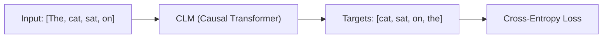

#### d. Code Thực chiến (C++ & Python)
```cpp
// C++17: Shift Logits và Targets cho hàm CLM Loss
void shift_for_clm(const int* input_ids, int* targets, int seq_len) {
    // Target là input dịch trái 1 vị trí
    for (int i = 0; i < seq_len - 1; ++i) {
        targets[i] = input_ids[i + 1];
    }
}
```

```python
import torch
import torch.nn as nn

def compute_clm_loss(logits: torch.Tensor, labels: torch.Tensor) -> torch.Tensor:
    # logits: [B, N, V], labels: [B, N]
    # Shift so that tokens < n predict n
    shift_logits = logits[..., :-1, :].contiguous()
    shift_labels = labels[..., 1:].contiguous()
    loss_fct = nn.CrossEntropyLoss()
    return loss_fct(shift_logits.view(-1, shift_logits.size(-1)), shift_labels.view(-1))
```

#### e. Lỗi Thường gặp & Ổn định Số học
- Quên shift logits và labels (`shift_logits` vs `shift_labels`) khiến mô hình học cách copy token hiện tại thay vì dự đoán token kế tiếp.

#### f. Ứng dụng Thực chiến trong AI
- Phương pháp tiền huấn luyện (Pre-training) của toàn bộ dòng mô hình GPT, LLaMA, Mistral.

---

### 64. Masked Language Modeling (MLM - Mô hình hóa Ngôn ngữ Che)

#### a. Định nghĩa Bản chất Toán học
**Masked Language Modeling (MLM)** (Devlin et al., 2018 - BERT) là cơ chế tiền huấn luyện theo dạng bài tập điền vào chỗ trống (Cloze Task). Trong một câu đầu vào $\mathbf{X}$, một tỷ lệ token ngẫu nhiên (thường là $15\%$) được chọn để che:
- $80\%$ trường hợp: Thay bằng token đặc biệt `[MASK]`.
- $10\%$ trường hợp: Thay bằng một từ ngẫu nhiên trong từ điển.
- $10\%$ trường hợp: Giữ nguyên từ gốc.

Hàm mất mát chỉ tính trên các token bị che $\mathcal{M}$:
$$\mathcal{L}_{\text{MLM}} = -\sum_{i \in \mathcal{M}} \log P(x_i \mid \tilde{\mathbf{X}}; \theta)$$

#### b. Cơ chế Tầng Sâu & Điện toán
- Ép mô hình phải học cách tổng hợp thông tin sâu sắc từ cả hai chiều ngữ cảnh (trước và sau) để khôi phục từ bị mất.
- Nhược điểm: Chỉ $15\%$ số token trong câu sinh ra gradient huấn luyện (hiệu suất dữ liệu thấp hơn so với CLM vốn khai thác $100\%$ tokens).

#### c. Sơ đồ Minh họa
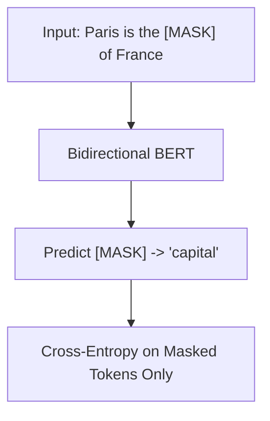

#### d. Code Thực chiến (C++ & Python)
```cpp
// C++17: Mask Token Generator
#include <vector>
#include <random>

void apply_mlm_masking(std::vector<int>& tokens, int mask_id, float mask_prob = 0.15f) {
    for (size_t i = 0; i < tokens.size(); ++i) {
        if ((rand() / (float)RAND_MAX) < mask_prob) {
            tokens[i] = mask_id;
        }
    }
}
```

```python
import torch
import torch.nn as nn

def compute_mlm_loss(logits: torch.Tensor, targets: torch.Tensor, mask_positions: torch.Tensor):
    # Chỉ tính loss tại các vị trí mask_positions == True
    active_logits = logits[mask_positions]
    active_labels = targets[mask_positions]
    return nn.functional.cross_entropy(active_logits, active_labels)
```

#### e. Lỗi Thường gặp & Ổn định Số học
- Che quá nhiều token ($>30\%$) khiến câu mất hết ngữ cảnh và mô hình không thể học được, hoặc che quá ít ($<5\%$) làm tăng chi phí tính toán không cần thiết.

#### f. Ứng dụng Thực chiến trong AI
- Nền tảng huấn luyện của **BERT**, **RoBERTa**, **ALBERT**, và **ELECTRA**.

---

### 65. Next Token Prediction (Dự đoán Token Kế tiếp)

#### a. Định nghĩa Bản chất Toán học
**Next Token Prediction** là nguyên lý cốt lõi của việc sinh văn bản: Tại bước thời gian $t$, dựa trên chuỗi lịch sử $(x_1, \dots, x_{t-1})$, mô hình tính toán phân phối xác suất và chọn ra token kế tiếp $x_t \sim P(x \mid x_{<t})$. Quá trình này lặp lại liên tục cho đến khi token kết thúc câu `[EOS]` (End-Of-Sequence) được sinh ra hoặc đạt đến giới hạn độ dài cực đại.

#### b. Cơ chế Tầng Sâu & Điện toán
- Bản chất của giai đoạn Serving/Inference trên các nền tảng LLM: Tốc độ Next Token Prediction (đo bằng **Tokens per Second - tok/s**) là chỉ số quan trọng nhất quyết định trải nghiệm người dùng và chi phí máy chủ.
- Để tăng tốc, các kỹ thuật hiện đại sử dụng **Speculative Decoding** (sử dụng một mô hình nhỏ dự đoán trước nhiều token, mô hình lớn kiểm tra lại đồng thời).

#### c. Sơ đồ Minh họa
```mermaid
sequenceDiagram
    participant Model as LLM Engine
    participant KV as KV Cache
    
    rect rgb(20, 50, 80)
    Note over Model,KV: Decode Step t
    Model->>KV: Fetch Cached Keys & Values
    Model->>Model: Compute Attention for Single Token
    Model->>Model: Sample Next Token x_t
    Model->>KV: Append Key_t, Value_t to Cache
    end
    Note over Model,KV: Repeat for Step t+1 ...
```

#### d. Code Thực chiến (C++ & Python)
```cpp
// C++17: Kiểm tra điều kiện dừng sinh Token
bool is_generation_finished(int current_token, int eos_token_id, int current_step, int max_steps) {
    if (current_token == eos_token_id) return true;
    if (current_step >= max_steps) return true;
    return false;
}
```

```python
import torch

def generate_step(model, input_token: torch.Tensor, kv_cache=None):
    # Sinh 1 token đơn lẻ với KV Cache
    with torch.no_grad():
        out = model(input_token, past_key_values=kv_cache)
        logits = out.logits[:, -1, :]
        next_token = torch.argmax(logits, dim=-1, keepdim=True)
        return next_token, out.past_key_values
```

#### e. Lỗi Thường gặp & Ổn định Số học
- Không kiểm soát độ trễ của KV cache allocation khiến bộ nhớ bị phân mảnh và tốc độ sinh token tụt dốc không phanh khi số lượng người dùng đồng thời tăng cao.

#### f. Ứng dụng Thực chiến trong AI
- Nguyên lý vận hành của mọi sản phẩm AI hội thoại, Agent tự hành và trợ lý lập trình hiện nay.
