# Chuyên đề: Các Dòng Mô hình Ngôn ngữ Tiêu biểu từ BERT đến LLaMA (Pretrained Language Models: BERT to LLaMA Era)

## 1. Tổng quan Chuyên đề
Lịch sử phát triển của các mô hình ngôn ngữ dựa trên Transformer phản ánh sự chuyển dịch mô hình (paradigm shift) từ các mạng mã hóa hai chiều chuyên biệt cho từng tác vụ sang các siêu mô hình giải mã tự hồi quy vạn năng (General-Purpose Autoregressive Foundation Models).

Bản đồ tiến hóa kiến trúc trải qua ba giai đoạn lớn:
1. **Kỷ nguyên Mã hóa Hai chiều & Transfer Learning (2018–2020)**: BERT, RoBERTa, ALBERT, DistilBERT, ELECTRA, DeBERTa chứng minh sức mạnh của Masked Language Modeling trong việc xây dựng các biểu diễn ngữ nghĩa tinh vi phục vụ bài toán hiểu ngôn ngữ (NLU).
2. **Kỷ nguyên Thống nhất Text-to-Text & Seq2Seq (2019–2021)**: T5, FLAN-T5, BART thống nhất mọi bài toán NLP về dạng ánh xạ chuỗi sang chuỗi với cấu trúc Encoder-Decoder.
3. **Kỷ nguyên Mở rộng Bùng nổ & Decoder-Only LLMs (2020–Hiện nay)**: GPT series (1, 2, 3, 4), PaLM, Falcon, BLOOM, OPT mở đường cho scaling laws. Tiếp nối là làn sóng mã nguồn mở hiệu năng cao hiện đại: LLaMA (1, 2, 3), Mistral, Mixtral (MoE), Qwen, Gemma, Phi, DeepSeek tích hợp các cải tiến phần cứng: RMSNorm, SwiGLU, RoPE, Grouped-Query Attention (GQA) và Multi-head Latent Attention (MLA).

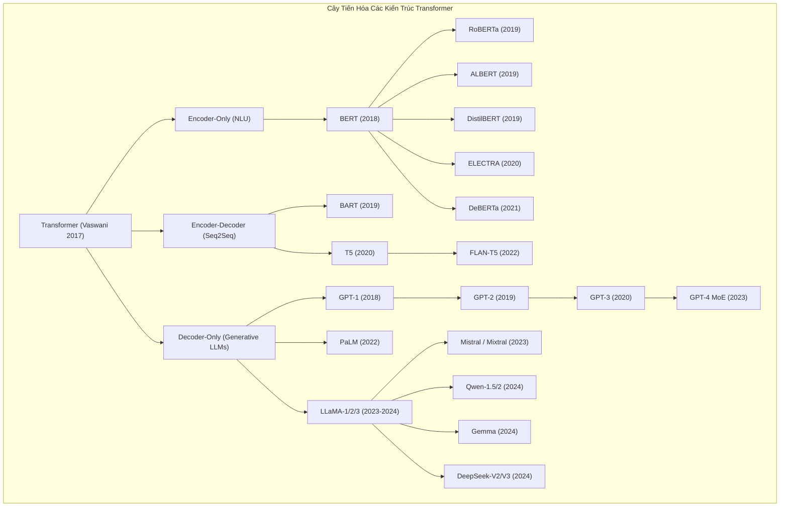

---

## 2. Chi tiết từng Keyword

---

### 66. BERT (Bidirectional Encoder Representations from Transformers)

#### a. Định nghĩa Bản chất Toán học
**BERT** (Devlin et al., Google 2018) là mô hình Encoder-Only sử dụng cơ chế Attention hai chiều để xây dựng biểu diễn ngữ cảnh sâu sắc cho từng từ.
Hàm mất mát kết hợp hai nhiệm vụ tự giám sát:
$$\mathcal{L}_{\text{BERT}} = \mathcal{L}_{\text{MLM}} + \mathcal{L}_{\text{NSP}}$$
1. **Masked Language Model (MLM)**: Che ngẫu nhiên $15\%$ tokens trong câu và yêu cầu mô hình dự đoán từ gốc dựa trên toàn bộ ngữ cảnh hai chiều xung quanh.
2. **Next Sentence Prediction (NSP)**: Phân loại nhị phân xem câu $B$ có phải là câu kế tiếp của câu $A$ trong văn bản gốc hay không:
   $$\hat{y}_{\text{NSP}} = \text{Softmax}(\mathbf{W}_{\text{NSP}} \tanh(\mathbf{W}_{\text{pool}} \mathbf{h}_{[\text{CLS}]}))$$

#### b. Cơ chế Tầng Sâu & Điện toán
- Kiến trúc Post-Norm với kích thước chuẩn:
  - **BERT-Base**: $L = 12, H = 768, A = 12$ (110M params).
  - **BERT-Large**: $L = 24, H = 1024, A = 16$ (340M params).
- Sử dụng bảng nhúng vị trí học được (Learned Positional Embeddings) với giới hạn tối đa $L_{\max} = 512$ tokens. Tokenizer WordPiece với từ vựng 30,522 tokens.

#### c. Sơ đồ Minh họa
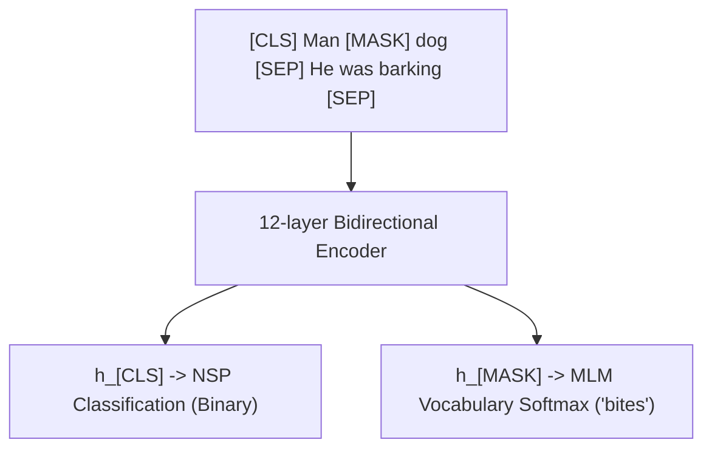

#### d. Code Thực chiến (C++ & Python)
```cpp
// C++17: Phân đoạn Segment / Token Type Embedding cho BERT
void add_segment_embedding(float* emb, int segment_id, const float* W_seg, int d_model) {
    // segment_id = 0 (câu A) hoặc 1 (câu B)
    for (int i = 0; i < d_model; ++i) {
        emb[i] += W_seg[segment_id * d_model + i];
    }
}
```

```python
import torch
import torch.nn as nn

class BertPooler(nn.Module):
    def __init__(self, hidden_size: int):
        super().__init__()
        self.dense = nn.Linear(hidden_size, hidden_size)
        self.activation = nn.Tanh()

    def forward(self, hidden_states: torch.Tensor) -> torch.Tensor:
        # Lấy token đầu tiên [CLS]
        first_token = hidden_states[:, 0]
        return self.activation(self.dense(first_token))
```

#### e. Lỗi Thường gặp & Ổn định Số học
- Quên chèn token `[CLS]` ở đầu câu hoặc `[SEP]` giữa hai câu khiến mô hình không thể phân định ranh giới câu.

#### f. Ứng dụng Thực chiến trong AI
- Trích xuất đặc trưng văn bản, phân loại ý định người dùng (Intent Classification), và tìm kiếm văn bản trong Google Search.

---

### 67. RoBERTa (Robustly Optimized BERT Approach)

#### a. Định nghĩa Bản chất Toán học
**RoBERTa** (Liu et al., Meta 2019) chứng minh rằng BERT gốc bị huấn luyện thiếu nghiêm trọng (severely undertrained). RoBERTa cải tiến quy trình tiền huấn luyện với 4 trụ cột:
1. **Loại bỏ hoàn toàn tác vụ NSP**: Thực nghiệm chứng minh NSP làm giảm nhẹ hoặc không giúp ích gì cho các downstream tasks.
2. **Dynamic Masking**: Thay vì tạo mask tĩnh 1 lần lúc tiền xử lý dữ liệu, mặt nạ che $15\%$ được sinh ngẫu nhiên mỗi khi một mẫu được nạp vào training loop.
3. **Mở rộng Batch Size & Data**: Tăng batch size từ 256 lên **8192** tokens (huấn luyện trên 160 GB văn bản thay vì 16 GB của BERT).
4. **Byte-level BPE Tokenizer**: Sử dụng từ điển 50,000 subwords dựa trên byte, loại bỏ hoàn toàn các ký tự out-of-vocabulary (`<unk>`).

#### b. Cơ chế Tầng Sâu & Điện toán
- Huấn luyện với batch size 8K giúp tăng cường tính song song (Parallelism), tối ưu hóa băng thông bộ nhớ trên 1024 GPU V100.

#### c. Sơ đồ Minh họa
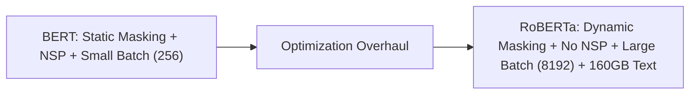

#### d. Code Thực chiến (C++ & Python)
```cpp
// C++17: Mô phỏng Dynamic Masking runtime
void dynamic_mask_step(int* tokens, int len, int mask_token_id, float prob = 0.15f) {
    for (int i = 0; i < len; ++i) {
        if ((rand() / (float)RAND_MAX) < prob) {
            tokens[i] = mask_token_id;
        }
    }
}
```

```python
import torch

def dynamic_mask_tokens(inputs: torch.Tensor, mask_id: int, p: float = 0.15) -> tuple[torch.Tensor, torch.Tensor]:
    # Sinh mask động độc lập cho từng batch
    probability_matrix = torch.full(inputs.shape, p)
    masked_indices = torch.bernoulli(probability_matrix).bool()
    labels = inputs.clone()
    labels[~masked_indices] = -100 # Bỏ qua trong PyTorch CrossEntropy
    inputs[masked_indices] = mask_id
    return inputs, labels
```

#### e. Lỗi Thường gặp & Ổn định Số học
- Khi tăng batch size lên 8K mà không tăng learning rate theo quy tắc căn bậc hai hoặc tuyến tính ($lr \propto \sqrt{B}$), mô hình sẽ hội tụ rất chậm.

#### f. Ứng dụng Thực chiến trong AI
- Mô hình nền tảng mạnh mẽ cho trích xuất thông tin, chấm điểm tương đồng ngữ nghĩa, và phân tích pháp lý.

---

### 68. ALBERT (A Lite BERT)

#### a. Định nghĩa Bản chất Toán học
**ALBERT** (Lan et al., Google 2019) giải quyết vấn đề số lượng tham số khổng lồ của BERT thông qua hai kỹ thuật giảm tham số:
1. **Factorized Embedding Parameterization**: Tách ma trận nhúng từ vựng $V \times H$ thành hai ma trận nhỏ hơn $V \times E$ và $E \times H$ với $E \ll H$ (ví dụ $E = 128, H = 768$ hoặc $2048$):
   $$\mathcal{O}(V \times H) \longrightarrow \mathcal{O}(V \times E + E \times H)$$
2. **Cross-Layer Parameter Sharing**: Toàn bộ $L$ tầng Transformer chia sẻ chung $100\%$ các ma trận trọng số (cả Attention và FFN). Trọng số tại tầng $l$ bằng chính xác trọng số tại tầng $l+1$.
3. **Sentence Order Prediction (SOP)**: Thay thế NSP bằng bài toán phân biệt thứ tự hai câu liên tiếp (Normal vs Swapped).

#### b. Cơ chế Tầng Sâu & Điện toán
- Giảm số lượng tham số của mô hình lên tới **$90\%$** (ALBERT-Base chỉ có 12M tham số so với 110M của BERT-Base).
- **Lưu ý phần cứng**: Mặc dù giảm dung lượng lưu trữ trọng số trên VRAM, số lượng FLOPs và thời gian tính toán của forward/backward pass vẫn giữ nguyên vì dữ liệu vẫn phải đi qua đủ 12 tầng.

#### c. Sơ đồ Minh họa
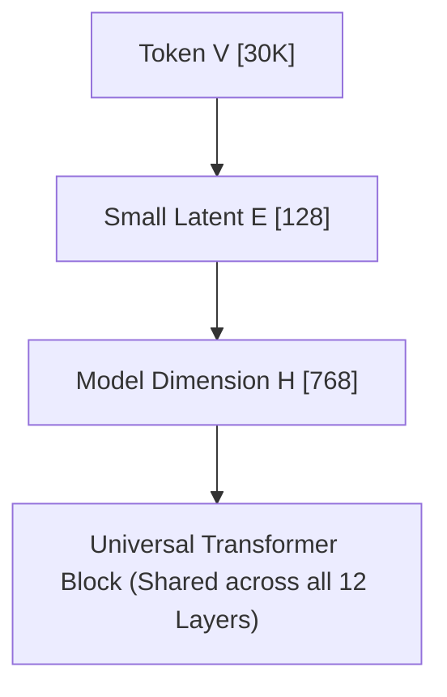

#### d. Code Thực chiến (C++ & Python)
```cpp
// C++17: Factorized Embedding Projection
void factorized_embedding(int token_id, const float* W_e, const float* W_proj, 
                         float* out_h, int E, int H) {
    // 1. Vector E_dim = W_e[token_id]
    // 2. Vector out_h = E_dim * W_proj
}
```

```python
import torch
import torch.nn as nn

class FactorizedEmbedding(nn.Module):
    def __init__(self, vocab_size: int, embed_dim: int, hidden_dim: int):
        super().__init__()
        self.token_embed = nn.Embedding(vocab_size, embed_dim)
        self.projection = nn.Linear(embed_dim, hidden_dim, bias=False)

    def forward(self, input_ids: torch.Tensor) -> torch.Tensor:
        return self.projection(self.token_embed(input_ids))
```

#### e. Lỗi Thường gặp & Ổn định Số học
- Tưởng lầm rằng ALBERT chạy nhanh hơn BERT trên GPU: Vì số tầng tính toán không đổi, tốc độ suy luận của ALBERT-Base tương đương với BERT-Base.

#### f. Ứng dụng Thực chiến trong AI
- Triển khai mô hình hiểu ngôn ngữ trên các thiết bị biên (Edge Devices, Mobile) có dung lượng bộ nhớ lưu trữ flash hạn chế.

---

### 69. DistilBERT (Chưng cất Tri thức từ BERT)

#### a. Định nghĩa Bản chất Toán học
**DistilBERT** (Sanh et al., HuggingFace 2019) áp dụng kỹ thuật **Knowledge Distillation** để nén mô hình BERT-Base (12 tầng) thành một mô hình học sinh (Student) nhỏ gọn gồm 6 tầng.
Hàm mất mát chưng cất tích hợp:
$$\mathcal{L}_{\text{Distil}} = \alpha \mathcal{L}_{\text{ce}} + \beta \mathcal{L}_{\text{mlm}} + \gamma \mathcal{L}_{\text{cos}}$$
1. **Distillation Cross-Entropy Loss** với nhiệt độ làm mềm phân phối $T$:
   $$\mathcal{L}_{\text{ce}} = -T^2 \sum p_i(z_s / T) \log p_i(z_t / T)$$
2. **Cosine Embedding Loss**: Ép vector trạng thái ẩn của mô hình học sinh căn chỉnh góc cùng hướng với mô hình giáo viên:
   $$\mathcal{L}_{\text{cos}} = 1 - \frac{\mathbf{h}_s \cdot \mathbf{h}_t}{\|\mathbf{h}_s\|_2 \|\mathbf{h}_t\|_2}$$

#### b. Cơ chế Tầng Sâu & Điện toán
- Giảm $40\%$ số lượng tham số, tăng tốc độ suy luận lên **$60\%$**, đồng thời giữ lại hơn **$97\%$** năng lực hiểu ngôn ngữ của mô hình BERT gốc trên GLUE benchmark.
- Mô hình học sinh được khởi tạo bằng cách lấy xen kẽ 1 tầng từ mỗi 2 tầng của mô hình giáo viên.

#### c. Sơ đồ Minh họa
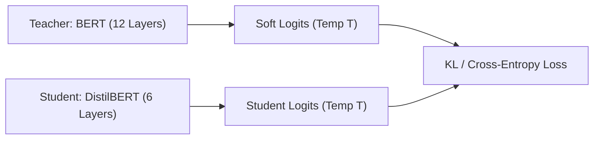

#### d. Code Thực chiến (C++ & Python)
```cpp
// C++17: Softmax với nhiệt độ làm mềm Temperature
void temperature_softmax(const float* logits, float* probs, int size, float T) {
    float max_l = -1e9f;
    for (int i = 0; i < size; ++i) if (logits[i] / T > max_l) max_l = logits[i] / T;
    float sum_exp = 0.0f;
    for (int i = 0; i < size; ++i) {
        probs[i] = std::exp((logits[i] / T) - max_l);
        sum_exp += probs[i];
    }
    for (int i = 0; i < size; ++i) probs[i] /= sum_exp;
}
```

```python
import torch
import torch.nn as nn
import torch.nn.functional as F

def distillation_loss(student_logits: torch.Tensor, teacher_logits: torch.Tensor, 
                      temperature: float = 2.0) -> torch.Tensor:
    p_teacher = F.softmax(teacher_logits / temperature, dim=-1)
    log_p_student = F.log_softmax(student_logits / temperature, dim=-1)
    return F.kl_div(log_p_student, p_teacher, reduction='batchmean') * (temperature ** 2)
```

#### e. Lỗi Thường gặp & Ổn định Số học
- Quên nhân hệ số $T^2$ vào hàm mất mát chưng cất: Khi chia logits cho $T$, gradient bị co lại theo tỷ lệ $1/T^2$, nếu không nhân bù lại thì gradient của học sinh sẽ bị suy yếu nghiêm trọng.

#### f. Ứng dụng Thực chiến trong AI
- Phục vụ các API yêu cầu độ trễ cực thấp (Sub-10ms Latency) trong các hệ thống tìm kiếm thời gian thực.

---

### 70. ELECTRA (Efficiently Learning an Encoder that Classifies Token Replacements)

#### a. Định nghĩa Bản chất Toán học
**ELECTRA** (Clark et al., Stanford/Google 2020) giải quyết triệt để sự thiếu hiệu quả của Masked Language Modeling (chỉ tính loss trên $15\%$ token). ELECTRA đề xuất cơ chế **Replaced Token Detection (RTD)** với cấu trúc hai mạng:
1. **Generator ($G$)**: Một mô hình MLM nhỏ học cách sinh ra các token thay thế khả dĩ cho các vị trí bị che.
2. **Discriminator ($D$)**: Mô hình đích cần huấn luyện, đóng vai trò phân loại nhị phân trên **$100\%$ các token trong câu**:
   $$D(x, t) = \sigma(\mathbf{w}^T \mathbf{h}_t) \in [0, 1]$$
   Dự đoán xem token tại vị trí $t$ là token "thật" từ văn bản gốc ($y=1$) hay là token "giả" do Generator sinh ra ($y=0$).

$$\mathcal{L}_{\text{ELECTRA}} = \mathcal{L}_{\text{MLM}}(G) + \lambda \sum_{t=1}^N \mathcal{L}_{\text{BCE}}(D(\mathbf{x}^{\text{corrupt}}, t), \mathbb{I}(x_t^{\text{corrupt}} = x_t^{\text{orig}}))$$

#### b. Cơ chế Tầng Sâu & Điện toán
- **Tận dụng 100% gradient**: Mọi token trong câu đều tạo ra tín hiệu phản hồi cho Discriminator. Nhờ đó, ELECTRA đạt hiệu năng tương đương BERT với lượng tài nguyên tính toán chỉ bằng **$25\%$**.
- Khác với GAN, Generator được huấn luyện bằng Maximum Likelihood chứ không phải Adversarial Minimax, loại bỏ hiện tượng sụp đổ mode (Mode Collapse).

#### c. Sơ đồ Minh họa
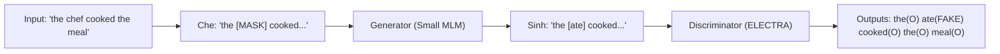

#### d. Code Thực chiến (C++ & Python)
```cpp
// C++17: Nhãn nhị phân cho Replaced Token Detection
void build_rtd_labels(const int* orig_tokens, const int* gen_tokens, int* labels, int len) {
    for (int i = 0; i < len; ++i) {
        labels[i] = (orig_tokens[i] == gen_tokens[i]) ? 1 : 0;
    }
}
```

```python
import torch
import torch.nn as nn

class ElectraDiscriminatorLoss(nn.Module):
    def __init__(self):
        super().__init__()
        self.loss_fct = nn.BCEWithLogitsLoss()

    def forward(self, logits: torch.Tensor, is_original: torch.Tensor) -> torch.Tensor:
        # logits: [B, N], is_original: [B, N] (float: 1.0 hoặc 0.0)
        return self.loss_fct(logits, is_original)
```

#### e. Lỗi Thường gặp & Ổn định Số học
- Lan truyền gradient từ Discriminator ngược về Generator qua phép lấy mẫu rời rạc: Phép lấy mẫu token là không khả vi; Generator phải được huấn luyện độc lập bằng MLM loss thông thường.

#### f. Ứng dụng Thực chiến trong AI
- Mô hình nhận diện ngữ pháp, kiểm tra lỗi chính tả và phân loại văn bản với ngân sách huấn luyện hạn hẹp.

---

### 71. DeBERTa (Decoding-enhanced BERT with Disentangled Attention)

#### a. Định nghĩa Bản chất Toán học
**DeBERTa** (He et al., Microsoft 2020, 2021) đại diện cho đỉnh cao kiến trúc của dòng Encoder-Only, vượt qua con người trên thang điểm SuperGLUE benchmark. DeBERTa giới thiệu hai cải tiến then chốt:
1. **Disentangled Attention (Chú ý Phân tách)**: Mỗi từ được biểu diễn bởi hai vector tách biệt: vector nội dung $\mathbf{c}_i$ và vector vị trí tương đối $\mathbf{p}_{i|j}$. Tích vô hướng điểm chú ý giữa token $i$ và $j$ được phân rã thành tổng của 4 thành phần:
   $$\mathbf{S}_{ij} = \mathbf{c}_i \mathbf{c}_j^T + \mathbf{c}_i \mathbf{p}_{j|i}^T + \mathbf{p}_{i|j} \mathbf{c}_j^T + \mathbf{p}_{i|j} \mathbf{p}_{j|i}^T$$
   (Trong DeBERTa-v1, thành phần thứ 4 vị trí-vị trí được bỏ qua do ít đóng góp).
2. **Enhanced Mask Decoder (EMD)**: Đưa thông tin vị trí tuyệt đối vào ngay trước tầng Softmax dự đoán từ bị che, giúp mô hình phân biệt cú pháp của các vị trí từ liền kề.

#### b. Cơ chế Tầng Sâu & Điện toán
- Yêu cầu bộ nhớ lớn hơn do tính toán ma trận tương tác phân rã.
- Trong DeBERTa-v3, kết hợp thêm cơ chế huấn luyện RTD của ELECTRA để tối ưu hóa hiệu quả dữ liệu.

#### c. Sơ đồ Minh họa
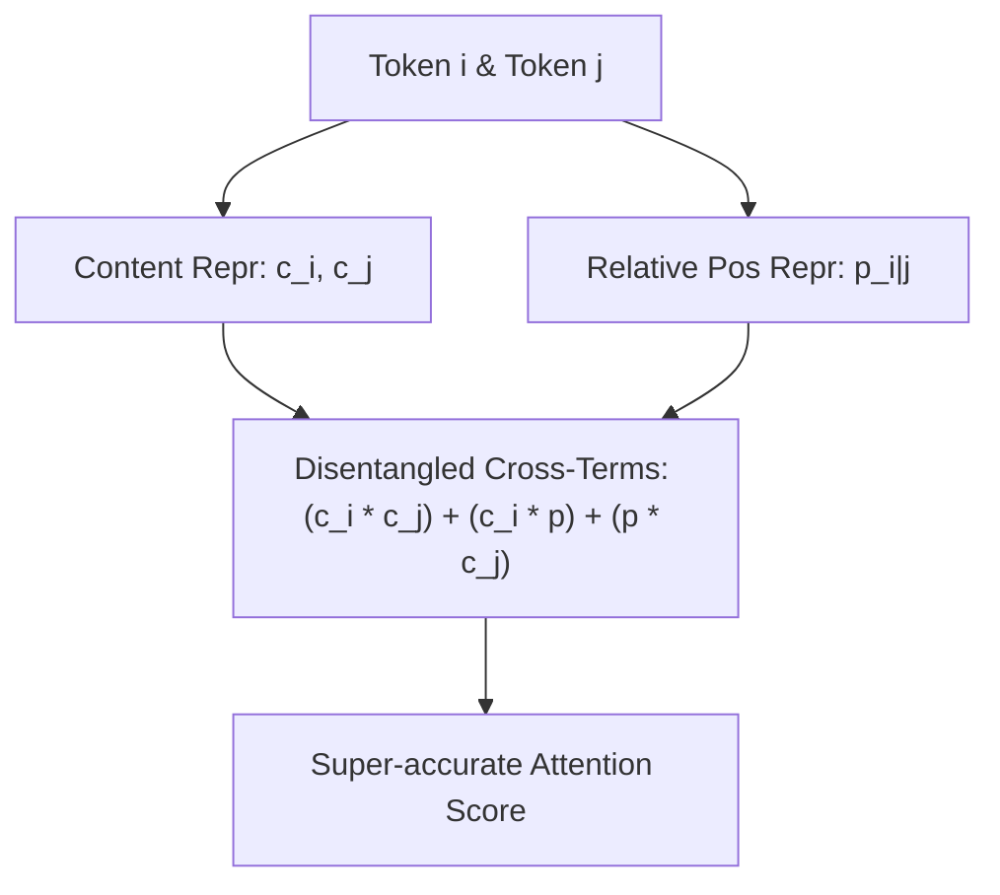

#### d. Code Thực chiến (C++ & Python)
```cpp
// C++17: Khung tính 3 thành phần Disentangled Attention
float disentangled_score(const float* c_i, const float* c_j, 
                         const float* p_rel, int d) {
    float term_cc = 0.0f, term_cp = 0.0f, term_pc = 0.0f;
    for (int k = 0; k < d; ++k) {
        term_cc += c_i[k] * c_j[k];
        term_cp += c_i[k] * p_rel[k];
        term_pc += p_rel[k] * c_j[k];
    }
    return term_cc + term_cp + term_pc;
}
```

```python
import torch

def disentangled_attention_bias(content_q: torch.Tensor, content_k: torch.Tensor, 
                               rel_pos_k: torch.Tensor) -> torch.Tensor:
    # content_to_content: [B, H, N, N]
    c2c = torch.matmul(content_q, content_k.transpose(-1, -2))
    # content_to_pos: [B, H, N, N]
    c2p = torch.matmul(content_q, rel_pos_k.transpose(-1, -2))
    return c2c + c2p
```

#### e. Lỗi Thường gặp & Ổn định Số học
- Tốn kém VRAM khi chuỗi dài do các ma trận tương tác tensor 4D mở rộng.

#### f. Ứng dụng Thực chiến trong AI
- Mô hình đứng đầu bảng xếp hạng NLU, trích xuất thực thể y sinh, và reranker trong hệ thống RAG hiện đại.

---

### 72. T5 (Text-to-Text Transfer Transformer)

#### a. Định nghĩa Bản chất Toán học
**T5** (Raffel et al., Google 2020) tái cấu trúc toàn bộ các bài toán xử lý ngôn ngữ tự nhiên thành một khuôn khổ duy nhất: **Text-to-Text**.
Bất kể tác vụ là dịch máy, tóm tắt, phân loại cảm xúc hay kiểm tra ngữ pháp:
$$\text{Task Input Text} \longrightarrow \text{T5 (Encoder-Decoder)} \longrightarrow \text{Task Output Text}$$
Ví dụ:
- Phân loại: `"cola sentence: The course is jumping -> unacceptable"`
- Dịch máy: `"translate English to German: That is good -> Das ist gut"`

**Span Corruption Pretraining**: Thay vì che từng token đơn lẻ như BERT, T5 che các đoạn văn bản liên tục (spans, độ dài trung bình 3 tokens) bằng các token định danh duy nhất `<extra_id_0>`, `<extra_id_1>`, và Decoder chỉ cần học cách sinh lại đúng các đoạn bị che đó:
$$\text{Input: The } \langle \text{extra\_id\_0} \rangle \text{ sat on the } \langle \text{extra\_id\_1} \rangle$$
$$\text{Target: } \langle \text{extra\_id\_0} \rangle \text{ cute cat } \langle \text{extra\_id\_1} \rangle \text{ mat} \langle \text{extra\_id\_2} \rangle$$

#### b. Cơ chế Tầng Sâu & Điện toán
- Sử dụng tập dữ liệu khổng lồ **C4 (Colossal Clean Crawled Corpus)** ~750 GB văn bản được lọc sạch.
- Cấu trúc Encoder-Decoder chuẩn với Relative Position Bias học được theo log-binning.

#### c. Sơ đồ Minh họa
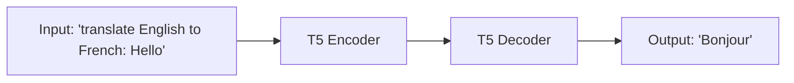

#### d. Code Thực chiến (C++ & Python)
```cpp
// C++17: Relative Position Log-Binning của T5
#include <cmath>
#include <algorithm>

int t5_relative_position_bucket(int relative_position, int num_buckets = 32, int max_distance = 128) {
    int ret = 0;
    int n = -relative_position;
    if (n < 0) {
        ret += num_buckets / 2;
        n = -n;
    }
    int max_exact = num_buckets / 4;
    if (n < max_exact) return ret + n;
    
    // Log scale cho các khoảng cách lớn
    float scale = (num_buckets / 2 - max_exact) / std::log(max_distance / (float)max_exact);
    int val = max_exact + static_cast<int>(std::log(n / (float)max_exact) * scale);
    return ret + std::min(val, num_buckets / 2 - 1);
}
```

```python
from transformers import T5Tokenizer, T5ForConditionalGeneration

def run_t5_inference(prompt: str):
    tokenizer = T5Tokenizer.from_pretrained("t5-small")
    model = T5ForConditionalGeneration.from_pretrained("t5-small")
    input_ids = tokenizer(prompt, return_tensors="pt").input_ids
    outputs = model.generate(input_ids)
    return tokenizer.decode(outputs[0], skip_special_tokens=True)
```

#### e. Lỗi Thường gặp & Ổn định Số học
- Quên thêm chuỗi tiền tố tác vụ (Task Prefix như `"summarize: "` hoặc `"translate: "`) khiến mô hình không xác định được mục tiêu cần thực hiện.

#### f. Ứng dụng Thực chiến trong AI
- Xương sống của các hệ thống tóm tắt văn bản tự động và xử lý tài liệu đa nhiệm.

---

### 73. FLAN-T5 (Fine-tuned LAnguage Net on T5)

#### a. Định nghĩa Bản chất Toán học
**FLAN-T5** (Chung et al., Google 2022) nâng cấp T5 thông qua **Instruction Fine-Tuning** quy mô lớn trên hơn 1,836 tác vụ đa dạng được đóng gói dưới dạng hướng dẫn ngôn ngữ tự nhiên kèm theo giải thích từng bước (Chain-of-Thought - CoT):
$$\mathcal{L}_{\text{FLAN}} = -\sum_{(x, y) \in \mathcal{D}_{\text{instructions}}} \log P(y \mid x; \theta)$$

#### b. Cơ chế Tầng Sâu & Điện toán
- Đạt bước nhảy vọt về khả năng thực thi tác vụ không cần mẫu (Zero-shot Performance) mà không làm tăng bất kỳ tham số mô hình nào so với T5 gốc.
- Kích thước đa dạng: Small (80M), Base (250M), Large (780M), XL (3B), XXL (11B).

#### c. Sơ đồ Minh họa
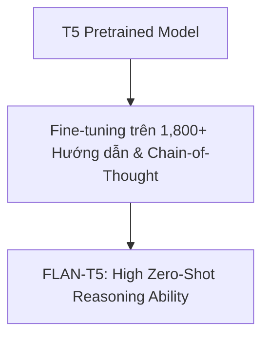

#### d. Code Thực chiến (C++ & Python)
```python
from transformers import AutoModelForSeq2SeqLM, AutoTokenizer

def query_flan_t5(instruction: str) -> str:
    tokenizer = AutoTokenizer.from_pretrained("google/flan-t5-base")
    model = AutoModelForSeq2SeqLM.from_pretrained("google/flan-t5-base")
    inputs = tokenizer(instruction, return_tensors="pt")
    outputs = model.generate(**inputs, max_length=128)
    return tokenizer.decode(outputs[0], skip_special_tokens=True)
```

#### e. Lỗi Thường gặp & Ổn định Số học
- Kích thước Context Window của T5/FLAN-T5 gốc chỉ là 512 tokens; nếu đưa tài liệu dài vào sẽ bị cắt cụt dữ liệu.

#### f. Ứng dụng Thực chiến trong AI
- Trợ lý AI mã nguồn mở gọn nhẹ phục vụ suy luận logic, giải toán đơn giản và trích xuất cấu trúc JSON.

---

### 74. BART (Bidirectional and Auto-Regressive Transformers)

#### a. Định nghĩa Bản chất Toán học
**BART** (Lewis et al., Meta 2019) kết hợp kiến trúc Bidirectional Encoder (như BERT) và Autoregressive Decoder (như GPT) thành một mạng tự mã hóa khử nhiễu (Denoising Autoencoder) cho Seq2Seq.
BART làm biến dạng văn bản đầu vào $\mathbf{X}$ bằng 5 loại nhiễu:
1. **Token Masking**: Che ngẫu nhiên các token (`[MASK]`).
2. **Token Deletion**: Xóa ngẫu nhiên các token khỏi câu.
3. **Text Infilling**: Thay thế các đoạn văn bản có độ dài ngẫu nhiên bằng một token `[MASK]` duy nhất (học cách dự đoán có bao nhiêu token bị thiếu).
4. **Sentence Permutation**: Xáo trộn thứ tự các câu trong văn bản.
5. **Document Rotation**: Chọn ngẫu nhiên một token làm điểm bắt đầu và xoay vòng văn bản.
Decoder tự hồi quy được giao nhiệm vụ tái tạo lại chính xác văn bản gốc ban đầu:
$$\mathcal{L}_{\text{BART}} = -\sum_{t=1}^N \log P(x_t \mid x_{<t}, \text{Encoder}(\text{Corrupted}(\mathbf{X})))$$

#### b. Cơ chế Tầng Sâu & Điện toán
- Kết hợp hoàn hảo khả năng hiểu ngữ cảnh phức tạp của Encoder và khả năng sinh ngôn ngữ mượt mà tự nhiên của Decoder.

#### c. Sơ đồ Minh họa


#### d. Code Thực chiến (C++ & Python)
```python
from transformers import BartForConditionalGeneration, BartTokenizer

def run_bart_summarization(text: str) -> str:
    tokenizer = BartTokenizer.from_pretrained("facebook/bart-large-cnn")
    model = BartForConditionalGeneration.from_pretrained("facebook/bart-large-cnn")
    inputs = tokenizer([text], max_length=1024, return_tensors="pt", truncation=True)
    summary_ids = model.generate(inputs["input_ids"], num_beams=4, max_length=140, min_length=40)
    return tokenizer.decode(summary_ids[0], skip_special_tokens=True)
```

#### e. Lỗi Thường gặp & Ổn định Số học
- Lạm dụng Beam Search kích thước quá lớn ($num\_beams > 8$) làm tăng gấp bội thời gian suy luận mà chất lượng văn bản không tăng thêm đáng kể.

#### f. Ứng dụng Thực chiến trong AI
- Chuẩn mực công nghiệp cho các bài toán tóm tắt tin tức báo chí (`bart-large-cnn`) và sửa lỗi ngữ pháp.

---

### 75. GPT (Generative Pre-trained Transformer - GPT-1)

#### a. Định nghĩa Bản chất Toán học
**GPT-1** (Radford et al., OpenAI 2018) đặt nền móng cho cuộc cách mạng Generative AI bằng cách đề xuất quy trình hai giai đoạn:
1. **Unsupervised Pre-training**: Tiền huấn luyện tự hồi quy không giám sát trên tập dữ liệu sách lớn (BooksCorpus) bằng hàm mục tiêu Causal LM:
   $$\mathcal{L}_1(\mathcal{U}) = \sum_i \log P(u_i \mid u_{i-k}, \dots, u_{i-1}; \Theta)$$
2. **Supervised Fine-tuning**: Tinh chỉnh có giám sát trên tập dữ liệu đích với nhãn $y$:
   $$\mathcal{L}_2(\mathcal{C}) = \sum_{(x, y)} \log P(y \mid x^1, \dots, x^m) + \lambda \mathcal{L}_1(\mathcal{C})$$

#### b. Cơ chế Tầng Sâu & Điện toán
- Kiến trúc Decoder-Only gồm 12 tầng, $d_{\text{model}} = 768$, 12 heads (117M tham số).
- Sử dụng hàm kích hoạt GELU (Gaussian Error Linear Unit) thay cho ReLU truyền thống.

#### c. Sơ đồ Minh họa
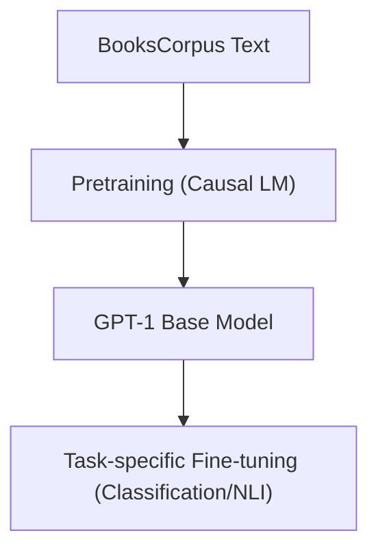

#### d. Code Thực chiến (C++ & Python)
```cpp
// C++17: Hàm kích hoạt GELU xấp xỉ của GPT
#include <cmath>

inline float gelu_fast(float x) {
    const float k0 = 0.7978845608f; // sqrt(2/pi)
    return 0.5f * x * (1.0f + std::tanh(k0 * (x + 0.044715f * x * x * x)));
}
```

```python
import torch
import torch.nn as nn

class GPT1Block(nn.Module):
    def __init__(self, d_model: int = 768, num_heads: int = 12):
        super().__init__()
        self.attn = nn.MultiheadAttention(d_model, num_heads, batch_first=True)
        self.ln1 = nn.LayerNorm(d_model)
        self.ln2 = nn.LayerNorm(d_model)
        self.mlp = nn.Sequential(
            nn.Linear(d_model, 4 * d_model),
            nn.GELU(),
            nn.Linear(4 * d_model, d_model)
        )

    def forward(self, x: torch.Tensor, mask: torch.Tensor) -> torch.Tensor:
        # Post-Norm trong GPT-1
        x = self.ln1(x + self.attn(x, x, x, attn_mask=mask)[0])
        x = self.ln2(x + self.mlp(x))
        return x
```

#### e. Lỗi Thường gặp & Ổn định Số học
- Cấu trúc Post-Norm của GPT-1 khiến việc mở rộng độ sâu mô hình gặp rào cản gradient vanishing nếu không chuyển sang Pre-Norm.

#### f. Ứng dụng Thực chiến trong AI
- Chứng minh tính khả thi của mô hình Decoder-only trên các tác vụ đa năng.

---

### 76. GPT-2

#### a. Định nghĩa Bản chất Toán học
**GPT-2** (Radford et al., OpenAI 2019) mang thông điệp cốt lõi: *"Language Models are Unsupervised Multitask Learners"*. Mô hình chứng minh rằng khi mở rộng quy mô dữ liệu và tham số, mô hình ngôn ngữ có thể giải quyết các tác vụ mà **hoàn toàn không cần tinh chỉnh (Zero-shot Task Transfer)**.

Cải tiến kiến trúc then chốt:
1. **Chuyển sang cấu trúc Pre-Norm**: Đặt Layer Normalization trước mỗi khối con (Input của Attention và MLP).
2. **Bổ sung Final LayerNorm**: Đặt một tầng LayerNorm bổ sung ngay sau khối Self-Attention cuối cùng.
3. **Scale trọng số Residual lúc khởi tạo**: Thu nhỏ độ lệch chuẩn khởi tạo của các tầng cộng phần dư theo hệ số $1/\sqrt{2L}$ (với $L$ là số tầng).
4. Mở rộng từ điển BPE lên **50,257** tokens và mở rộng context window lên **1024** tokens.

#### b. Cơ chế Tầng Sâu & Điện toán
- Kích thước tối đa: **GPT-2 Extra Large (1.5B tham số)** với 48 tầng, $d_{\text{model}} = 1600$. Huấn luyện trên tập dữ liệu WebText (40 GB văn bản Reddit chất lượng cao).

#### c. Sơ đồ Minh họa
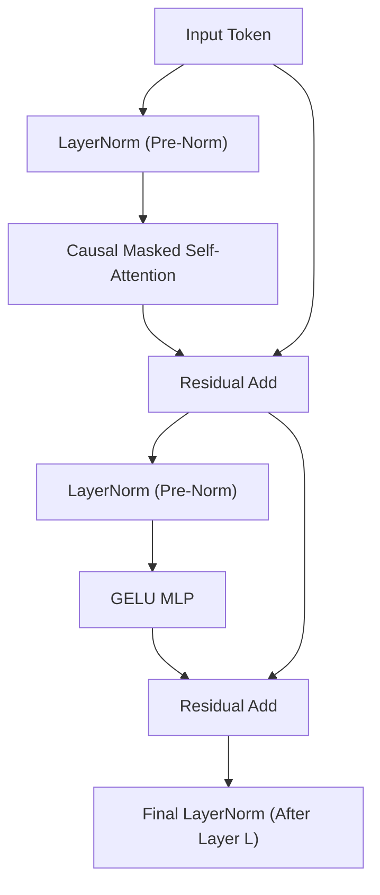

#### d. Code Thực chiến (C++ & Python)
```cpp
// C++17: Khởi tạo trọng số scale theo số tầng 1/sqrt(2L)
#include <random>
#include <cmath>

void init_residual_projection(float* W, int size, int num_layers) {
    float std_dev = 0.02f / std::sqrt(2.0f * num_layers);
    std::default_random_engine generator;
    std::normal_distribution<float> distribution(0.0f, std_dev);
    for (int i = 0; i < size; ++i) {
        W[i] = distribution(generator);
    }
}
```

```python
from transformers import GPT2LMHeadModel, GPT2Tokenizer

def generate_gpt2(prompt: str) -> str:
    tokenizer = GPT2Tokenizer.from_pretrained("gpt2")
    model = GPT2LMHeadModel.from_pretrained("gpt2")
    input_ids = tokenizer(prompt, return_tensors="pt").input_ids
    output = model.generate(input_ids, max_length=50, do_sample=True, top_k=50)
    return tokenizer.decode(output[0], skip_special_tokens=True)
```

#### e. Lỗi Thường gặp & Ổn định Số học
- Sinh văn bản bị trôi dạt và hallucination nếu không kiểm soát nhiệt độ (temperature) và top-p nucleus sampling.

#### f. Ứng dụng Thực chiến trong AI
- Mô hình mã nguồn mở kinh điển được dùng làm thước đo benchmark chuẩn mực trong nghiên cứu học máy.

---

### 77. GPT-3

#### a. Định nghĩa Bản chất Toán học
**GPT-3** (Brown et al., OpenAI 2020) tạo ra cú nhảy vọt lên **175 tỷ tham số** ($116\times$ lớn hơn GPT-2), mở ra khả năng **Học trong ngữ cảnh (In-Context Learning - Few-Shot Prompting)**: Mô hình có thể học tác vụ mới ngay trong thời gian thực suy luận chỉ bằng cách quan sát 1 vài ví dụ mẫu (k-shots) trong prompt mà hoàn toàn không cập nhật bất kỳ gradient trọng số nào ($\Delta \theta = 0$).

#### b. Cơ chế Tầng Sâu & Điện toán
- Thông số kỹ thuật: $L = 96$ tầng, $d_{\text{model}} = 12288$, $h = 96$ heads, Context window $N = 2048$.
- Áp dụng xen kẽ giữa các tầng Attention dày đặc (Dense) và các tầng Attention thưa cục bộ theo dải (Locally Banded Sparse Attention).
- Huấn luyện trên 300 tỷ tokens với hạ tầng siêu máy tính Microsoft Azure gồm hàng nghìn GPU V100 liên kết qua InfiniBand.

#### c. Sơ đồ Minh họa
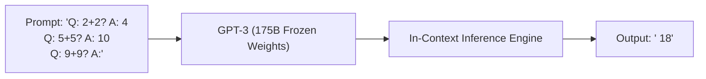

#### d. Code Thực chiến (C++ & Python)
```python
# Cấu trúc một prompt Few-Shot tiêu chuẩn cho GPT-3
few_shot_prompt = """Dịch tiếng Anh sang tiếng Việt:
Sea -> Biển
Mountain -> Núi
River -> Sông
Cloud -> """
```

#### e. Lỗi Thường gặp & Ổn định Số học
- Độ nhạy cảm cực cao với định dạng prompt (Prompt Fragility): Thay đổi dấu phẩy, khoảng trắng hoặc thứ tự các ví dụ vài-shot có thể làm đảo lộn kết quả trả về.

#### f. Ứng dụng Thực chiến trong AI
- Khởi động làn sóng thương mại hóa API trí tuệ nhân tạo tạo sinh và nền móng cho ChatGPT.

---

### 78. GPT-4 Architecture Concepts (Các Khái niệm Kiến trúc GPT-4)

#### a. Định nghĩa Bản chất Toán học
Mặc dù thông số chi tiết không được OpenAI công bố chính thức, các phân tích dịch ngược kỹ thuật (reverse-engineering) và tài liệu nghiên cứu công nghiệp thống nhất các trụ cột kiến trúc cốt lõi của **GPT-4**:
1. **Kiến trúc Hỗn hợp Chuyên gia Thưa (Sparse Mixture-of-Experts - MoE)**:
   - Tổng số tham số ước tính: $\approx 1.8$ nghìn tỷ tham số trên 16 experts.
   - Mỗi token chỉ kích hoạt **2 experts** (Top-2 Routing) trong mỗi tầng FFN, tiêu tốn khoảng **$\approx 220$ tỷ active parameters** cho mỗi forward pass.
2. **Cửa sổ Ngữ cảnh Siêu dài (Long Context Window)**: Hỗ trợ 32K đến 128K tokens.
3. **Mô hình Đa phương thức Bản địa (Native Multimodal)**: Tích hợp Vision Encoder chiếu thẳng các patch ảnh thành các token embedding cùng không gian với văn bản.
4. **Học Tăng cường từ Phản hồi Con người (RLHF)**: Tích hợp PPO (Proximal Policy Optimization) và DPO kết hợp Rule-Based Reward Models để định hướng an toàn (Alignment).

#### b. Cơ chế Tầng Sâu & Điện toán
- **Speculative Decoding & Serving Clusters**: Hệ thống serving của GPT-4 sử dụng các mô hình nhỏ (Draft Models) để đoán trước 4–5 token, sau đó cụm MoE 1.8T chạy 1 bước forward duy nhất để xác thực song song, tăng tốc độ sinh token lên gấp 2–3 lần.

#### c. Sơ đồ Minh họa
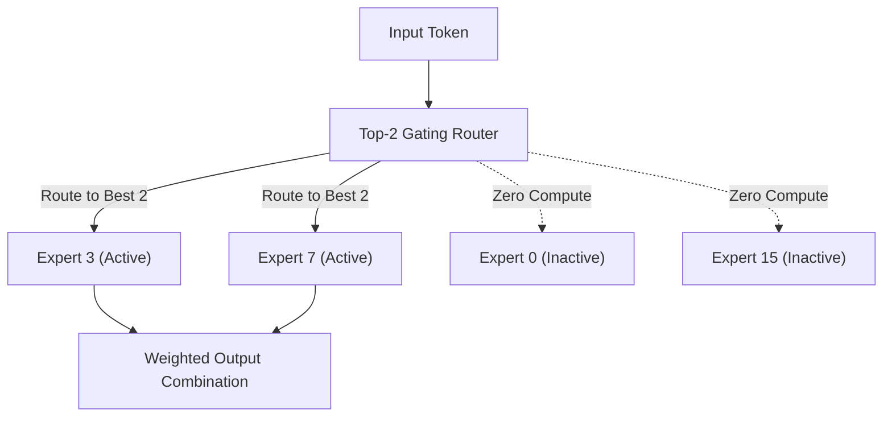

#### d. Code Thực chiến (C++ & Python)
```python
import torch
import torch.nn as nn

class MoETop2GatingConcept(nn.Module):
    def __init__(self, d_model: int, num_experts: int):
        super().__init__()
        self.gate = nn.Linear(d_model, num_experts, bias=False)

    def forward(self, x: torch.Tensor):
        logits = self.gate(x) # [B, N, num_experts]
        weights, indices = torch.topk(torch.softmax(logits, dim=-1), k=2, dim=-1)
        # Chuẩn hóa lại tổng trọng số của 2 expert được chọn về 1.0
        weights = weights / weights.sum(dim=-1, keepdim=True)
        return weights, indices
```

#### e. Lỗi Thường gặp & Ổn định Số học
- Hiện tượng mất cân bằng tải giữa các Expert (Expert Collapse): Một vài expert bị gọi liên tục trong khi các expert khác bị bỏ đói, đòi hỏi phải bổ sung hàm phụ trợ Auxiliary Load Balancing Loss.

#### f. Ứng dụng Thực chiến trong AI
- Đỉnh cao trí tuệ nhân tạo hiện đại trong lập luận toán học, viết code phức tạp và giải quyết vấn đề đa lĩnh vực.

---

### 79. LLaMA (Large Language Model Meta AI)

#### a. Định nghĩa Bản chất Toán học
Dòng mô hình **LLaMA** (Touvron et al., Meta 2023–2024: LLaMA-1, LLaMA-2, LLaMA-3) là cột mốc vĩ đại nhất của phong trào mã nguồn mở. LLaMA chứng minh định luật Chinchilla: một mô hình nhỏ hơn nhưng được **huấn luyện quá mức tối ưu (over-trained)** trên lượng dữ liệu khổng lồ (từ 1.4T tokens ở LLaMA-1 lên tới **15T tokens ở LLaMA-3**) sẽ vượt trội hơn nhiều so với các mô hình khổng lồ nhưng thiếu dữ liệu.

Bốn cải tiến kiến trúc chuẩn mực của LLaMA:
1. **Pre-normalization với RMSNorm**: Ổn định gradient, tiết kiệm $7\%$ thời gian tính toán so với LayerNorm.
2. **Hàm kích hoạt SwiGLU**: Nâng cao năng lực biểu diễn phi tuyến của tầng FFN.
3. **Rotary Position Embeddings (RoPE)**: Cho phép mở rộng ngữ cảnh tương đối chính xác.
4. **Loại bỏ hoàn toàn Bias**: Mọi ma trận Linear đều thiết lập `bias=False`, tăng tính ổn định số học và tối ưu bộ nhớ.

#### b. Cơ chế Tầng Sâu & Điện toán
- **Grouped-Query Attention (GQA)**: Được áp dụng từ LLaMA-2 70B và $100\%$ các phiên bản LLaMA-3 (8B, 70B, 405B) để nén KV Cache.
- **LLaMA-3 Tokenizer**: Sử dụng từ điển tiktoken 128,256 tokens, tăng hiệu suất nén văn bản lên $15\%$.

#### c. Sơ đồ Minh họa
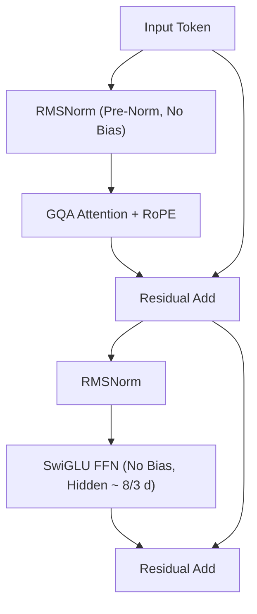

#### d. Code Thực chiến (C++ & Python)
```cpp
// C++17: Triển khai LLaMA Transformer Block
struct LlamaBlock {
    // RMSNorm -> RoPE GQA -> Residual -> RMSNorm -> SwiGLU -> Residual
};
```

```python
import torch
import torch.nn as nn

class LlamaTransformerBlock(nn.Module):
    def __init__(self, d_model: int, num_heads: int, num_kv_heads: int, hidden_dim: int):
        super().__init__()
        self.norm1 = RMSNorm(d_model)
        self.attn = GroupedQueryAttention(d_model, num_heads, num_kv_heads)
        self.norm2 = RMSNorm(d_model)
        self.ffn = LLaMASwiGLUFFN(d_model, hidden_dim)

    def forward(self, x: torch.Tensor) -> torch.Tensor:
        x = x + self.attn(self.norm1(x))
        x = x + self.ffn(self.norm2(x))
        return x
```

#### e. Lỗi Thường gặp & Ổn định Số học
- Quên điều chỉnh tần số cơ sở RoPE $\theta$ khi mở rộng ngữ cảnh lên 128K (LLaMA-3 sử dụng $\theta = 500,000$ thay vì $10,000$).

#### f. Ứng dụng Thực chiến trong AI
- Nền tảng cốt lõi được hàng triệu lập trình viên và doanh nghiệp tinh chỉnh (Fine-tuning) thành các mô hình chuyên ngành.

---

### 80. Mistral

#### a. Định nghĩa Bản chất Toán học
**Mistral-7B** (Mistral AI, 2023) đạt hiệu năng vượt qua LLaMA-2 13B trên toàn bộ các thước đo đánh giá dù chỉ có 7 tỷ tham số.
Hai công nghệ vũ khí cốt lõi:
1. **Sliding Window Attention (SWA)**: Giới hạn tầm nhìn mỗi tầng trong cửa sổ trượt $W = 4096$ tokens, giảm độ phức tạp tính toán và bộ nhớ VRAM.
2. **Rolling Buffer KV Cache**: Giữ kích thước KV Cache cố định bằng $W$, ghi đè các token cũ theo modulo vòng tròn.
3. Tích hợp sẵn **Grouped-Query Attention (GQA)** cho kích thước 7B (8 KV heads cho 32 Query heads).

#### b. Cơ chế Tầng Sâu & Điện toán
- Tốc độ suy luận nhanh gấp 2 lần so với các mô hình 7B chuẩn ở ngữ cảnh dài nhờ giảm thiểu lượng truy xuất bộ nhớ HBM.

#### c. Sơ đồ Minh họa


#### d. Code Thực chiến (C++ & Python)
```python
# Cấu hình Mistral-7B tiêu chuẩn
mistral_config = {
    "dim": 4096,
    "n_layers": 32,
    "n_heads": 32,
    "n_kv_heads": 8, # GQA group size = 4
    "sliding_window": 4096,
    "vocab_size": 32000
}
```

#### e. Lỗi Thường gặp & Ổn định Số học
- Chạy inference mà không hỗ trợ SWA kernel sẽ làm mất lợi thế tốc độ của mô hình.

#### f. Ứng dụng Thực chiến trong AI
- Tiêu chuẩn vàng cho các ứng dụng chạy cục bộ trên máy tính cá nhân (Local LLM qua Ollama, llama.cpp).

---

### 81. Mixtral (Mixtral 8x7B / 8x22B)

#### a. Định nghĩa Bản chất Toán học
**Mixtral 8x7B** (Mistral AI, 2023) là mô hình Sparse Mixture-of-Experts mã nguồn mở thành công nhất:
- Mỗi khối Transformer có **8 chuyên gia FFN độc lập**.
- Tại mỗi token, mạng Gating Network chọn ra **2 chuyên gia tốt nhất (Top-2)** để thực thi:
  $$\mathbf{y} = \sum_{i \in \text{Top2}} P_i(\mathbf{x}) \cdot \text{Expert}_i(\mathbf{x})$$
- Tổng số tham số: **46.7 tỷ tham số**, nhưng số tham số hoạt động (Active Parameters) cho mỗi token chỉ là **12.9 tỷ tham số**.

#### b. Cơ chế Tầng Sâu & Điện toán
- Mang lại chất lượng và tri thức tương đương mô hình dense 70B (ngang ngửa GPT-3.5 và LLaMA-2 70B), nhưng tốc độ suy luận và chi phí FLOPs chỉ bằng một mô hình 13B.
- Hỗ trợ ngữ cảnh 32K tokens mượt mà.

#### c. Sơ đồ Minh họa
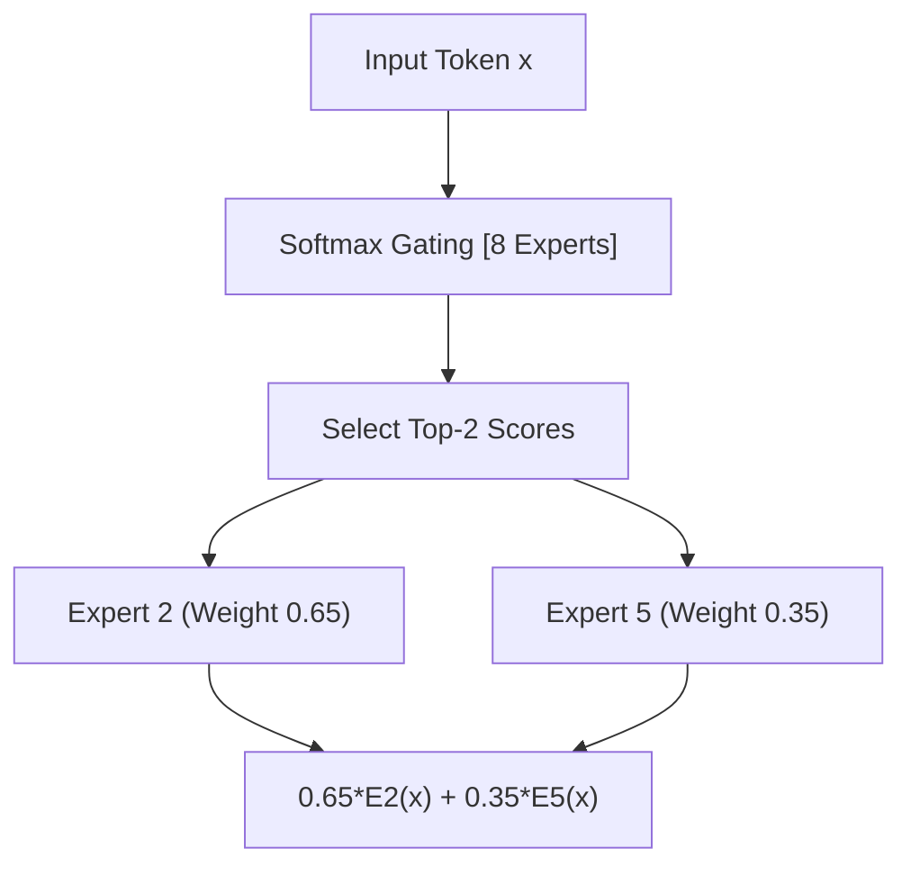

#### d. Code Thực chiến (C++ & Python)
```cpp
// C++17: Khung thực thi Top-2 Experts Weighted Combination
void execute_top2_experts(const float* x, const float* w_gate, 
                          float* out, int d_model) {
    // 1. Tính router logits -> top 2 indices (idx1, idx2)
    // 2. out = w1 * Expert[idx1](x) + w2 * Expert[idx2](x)
}
```

```python
import torch
import torch.nn as nn

class MixtralMoELayer(nn.Module):
    def __init__(self, d_model: int, num_experts: int = 8, top_k: int = 2):
        super().__init__()
        self.top_k = top_k
        self.gate = nn.Linear(d_model, num_experts, bias=False)
        self.experts = nn.ModuleList([
            LLaMASwiGLUFFN(d_model, hidden_dim=14336) for _ in range(num_experts)
        ])

    def forward(self, x: torch.Tensor) -> torch.Tensor:
        # x: [B, N, D]
        orig_shape = x.shape
        x_flat = x.view(-1, orig_shape[-1])
        gate_logits = self.gate(x_flat)
        weights, selected_experts = torch.topk(torch.softmax(gate_logits, dim=-1), self.top_k, dim=-1)
        weights = weights / weights.sum(dim=-1, keepdim=True)

        final_out = torch.zeros_like(x_flat)
        for k in range(self.top_k):
            for exp_idx in range(len(self.experts)):
                mask = selected_experts[:, k] == exp_idx
                if mask.any():
                    tokens_in = x_flat[mask]
                    tokens_out = self.experts[exp_idx](tokens_in)
                    final_out[mask] += weights[mask, k:k+1] * tokens_out
        return final_out.view(orig_shape)
```

#### e. Lỗi Thường gặp & Ổn định Số học
- Kích thước VRAM nạp trọng số: Mặc dù lúc tính chỉ tốn 13B FLOPs, **toàn bộ 47B tham số vẫn phải nằm trọn trong VRAM** (~90 GB ở FP16 hoặc ~24 GB ở INT4), khiến mô hình đòi hỏi dung lượng VRAM lớn hơn nhiều so với mô hình 7B.

#### f. Ứng dụng Thực chiến trong AI
- Mô hình mã nguồn mở hiệu quả nhất để triển khai trên các máy chủ đám mây cân bằng giữa chi phí phần cứng và chất lượng phản hồi.

---

### 82. Qwen (Qwen-1.5 / Qwen-2)

#### a. Định nghĩa Bản chất Toán học
Dòng mô hình **Qwen** (Alibaba Cloud, 2023–2024) đại diện cho sức mạnh LLM đa ngôn ngữ hàng đầu thế giới:
- Dải kích thước toàn diện: từ 0.5B, 1.5B, 7B, 14B đến 72B và các biến thể MoE (Qwen-2-57B-A14B).
- **Từ vựng mở rộng 152,064 tokens**: Hỗ trợ xuất sắc tiếng Trung, tiếng Anh và hàng chục ngôn ngữ lập trình.
- Cấu hình RoPE với tần số cơ sở mở rộng lên tới $\theta = 1,000,000$, hỗ trợ ngữ cảnh lên tới **128K tokens bản địa**.

#### b. Cơ chế Tầng Sâu & Điện toán
- Kết hợp SwiGLU, RMSNorm và GQA trên toàn bộ các kích thước mô hình từ 7B trở lên.
- Đứng đầu các bảng xếp hạng toán học (GSM8K, MATH) và viết mã nguồn (HumanEval) trong thế giới mã nguồn mở.

#### c. Sơ đồ Minh họa
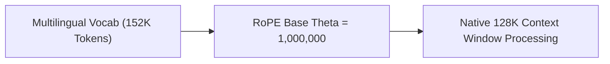

#### d. Code Thực chiến (C++ & Python)
```python
# Cấu hình RoPE tần số 1M của Qwen-2
qwen2_rope_config = {
    "rope_theta": 1000000.0,
    "max_position_embeddings": 32768,
    "use_sliding_window": False
}
```

#### e. Lỗi Thường gặp & Ổn định Số học
- Dung lượng từ điển lớn (152K) khiến ma trận Embedding chiếm hơn 1.2 GB VRAM ngay cả trên các mô hình nhỏ 0.5B.

#### f. Ứng dụng Thực chiến trong AI
- Ứng dụng xử lý đa ngôn ngữ, dịch thuật tài liệu kỹ thuật phức tạp và AI lập trình tự động.

---

### 83. Gemma

#### a. Định nghĩa Bản chất Toán học
**Gemma** (Google DeepMind, 2024: Gemma-1, Gemma-2) là dòng mô hình mở được xây dựng từ cùng nền tảng nghiên cứu và công nghệ của siêu mô hình Gemini:
- Các kích thước: 2B, 7B, 9B, và 27B.
- **GeGLU Activations**: Sử dụng GeGLU thay vì SwiGLU:
  $$\text{GeGLU}(\mathbf{x}) = (\text{GELU}(\mathbf{x} \mathbf{W}_{\text{gate}}) \odot (\mathbf{x} \mathbf{W}_{\text{up}})) \mathbf{W}_{\text{down}}$$
- **RMSNorm with Unit Offset**: Chuẩn hóa RMSNorm có cộng thêm 1 vào hệ số tỉ lệ:
  $$y = x \cdot \text{rsqrt}(\text{Var} + \epsilon) \cdot (1 + \gamma)$$
- **Alternating Local & Global Attention**: Xếp chồng xen kẽ một tầng Sliding Window Local Attention (4096 tokens) với một tầng Full Global Attention.

#### b. Cơ chế Tầng Sâu & Điện toán
- Gemma-2 tích hợp kỹ thuật **Logit Soft-Capping**: Ngăn logits vượt quá một ngưỡng cố định bằng hàm $\tanh$:
  $$\mathbf{z}_{\text{capped}} = \text{cap\_val} \cdot \tanh(\mathbf{z} / \text{cap\_val})$$
  Giúp triệt tiêu hoàn toàn sự mất ổn định số học trong quá trình pre-training.

#### c. Sơ đồ Minh họa
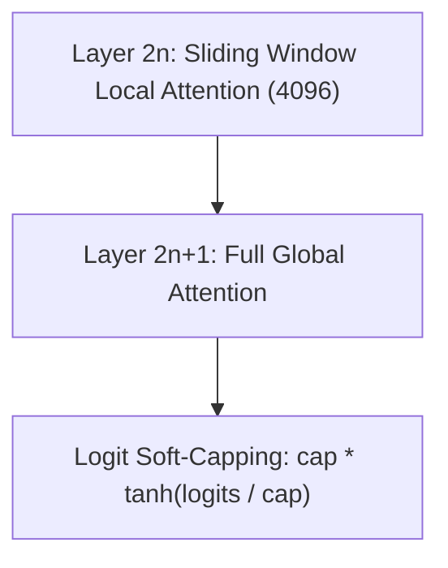

#### d. Code Thực chiến (C++ & Python)
```cpp
// C++17: Logit Soft-Capping của Gemma-2
#include <cmath>

void logit_soft_cap(float* logits, int size, float cap_value) {
    for (int i = 0; i < size; ++i) {
        logits[i] = cap_value * std::tanh(logits[i] / cap_value);
    }
}
```

```python
import torch

def soft_cap_logits(logits: torch.Tensor, cap: float = 30.0) -> torch.Tensor:
    return cap * torch.tanh(logits / cap)
```

#### e. Lỗi Thường gặp & Ổn định Số học
- Quên nhân $(1 + \gamma)$ trong custom RMSNorm kernel của Gemma khiến toàn bộ trọng số bị lệch phân phối kích hoạt.

#### f. Ứng dụng Thực chiến trong AI
- Mô hình lý luận toán học và học máy trên thiết bị cá nhân được tối ưu hóa cho phần cứng Google TPU và Android NPU.

---

### 84. Phi (Phi-1, Phi-2, Phi-3, Phi-4)

#### a. Định nghĩa Bản chất Toán học
Dòng mô hình **Phi** (Microsoft Research, 2023–2024) chứng minh luận điểm mang tính đột phá: *"Textbooks Are All You Need"*. Thay vì cào dữ liệu web hỗn tạp (noisy web data), Phi tập trung $100\%$ vào **Dữ liệu chất lượng cao tựa sách giáo khoa (Textbook-quality Data)**:
- Dữ liệu tổng hợp từ các mô hình lớn dạy tư duy logic và lập trình từng bước.
- Dữ liệu web được chọn lọc khắt khe về mặt sư phạm và giá trị giáo dục.
Nhờ đó, Phi-3 (3.8B tham số) đạt năng lực lập luận và giải toán tương đương các mô hình lớn gấp 5 đến 10 lần (như LLaMA-2 70B hay Mixtral 8x7B).

#### b. Cơ chế Tầng Sâu & Điện toán
- Phi-3-Mini hỗ trợ cửa sổ ngữ cảnh **128K tokens** thông qua kỹ thuật **LongRoPE**.
- Cấu trúc nhỏ gọn cho phép chạy mượt mà ngay trên chip Apple M-series hoặc vi xử lý điện thoại Snapdragon.

#### c. Sơ đồ Minh họa
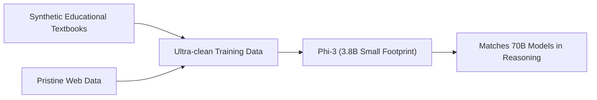

#### d. Code Thực chiến (C++ & Python)
```python
# Cấu hình siêu nhỏ gọn nhưng mạnh mẽ của Phi-3-Mini
phi3_config = {
    "hidden_size": 3072,
    "intermediate_size": 8192,
    "num_hidden_layers": 32,
    "num_attention_heads": 32,
    "num_key_value_heads": 32,
    "max_position_embeddings": 4096 # Mở rộng lên 128K với LongRoPE
}
```

#### e. Lỗi Thường gặp & Ổn định Số học
- Do kích thước nhỏ, mô hình dễ bị hạn chế về bề rộng kiến thức thế giới thực (Trivia/Factual recall) so với các mô hình 70B, dù năng lực tư duy logic rất cao.

#### f. Ứng dụng Thực chiến trong AI
- Triển khai cục bộ trên các thiết bị Internet-of-Things (IoT), smartphone và ứng dụng kiểm thử an ninh.

---

### 85. DeepSeek (DeepSeek-V1, V2, V3, Coder, Math)

#### a. Định nghĩa Bản chất Toán học
**DeepSeek** (DeepSeek AI, 2024) tạo ra địa chấn trong giới AI với hai phát minh kiến trúc mang tính cách mạng:
1. **Multi-head Latent Attention (MLA)**: Giải quyết triệt để nút thắt cổ chai bộ nhớ của KV Cache. Thay vì lưu trữ toàn bộ các vector $K, V$ kích thước lớn trong VRAM, MLA nén các vector Key và Value thành một vector ẩn tiềm năng bậc thấp (Low-rank Latent Vector) $\mathbf{c}_t^{KV} \in \mathbb{R}^{d_c}$ với $d_c \ll d_{\text{model}}$:
   $$\mathbf{c}_t^{KV} = \mathbf{x}_t \mathbf{W}_{DKV}$$
   Trong quá trình suy luận, KV Cache chỉ cần lưu duy nhất vector nén $\mathbf{c}_t^{KV}$, **giảm dung lượng KV Cache tới $93.3\%$** so với MHA chuẩn!
2. **DeepSeekMoE (Fine-Grained Expert Architecture)**:
   - Thay vì chia thành 8 chuyên gia lớn, DeepSeek chia thành **64 chuyên gia nhỏ** và kích hoạt 8 chuyên gia cùng lúc.
   - Bổ sung **Shared Experts cố định** luôn luôn được kích hoạt bên cạnh các routed experts, giúp cô lập tri thức nền tảng chung và tăng cường tính chuyên biệt hóa cho từng chuyên gia.
3. **Multi-Token Prediction (MTP)**: Huấn luyện mô hình dự đoán đồng thời 2 token tiếp theo trong mỗi forward pass.

#### b. Cơ chế Tầng Sâu & Điện toán
- DeepSeek-V2 (236B tổng tham số, 21B active) và DeepSeek-V3 (671B tổng tham số, 37B active) đạt chi phí huấn luyện và chi phí suy luận rẻ nhất thế giới, cạnh tranh trực tiếp với Claude 3.5 Sonnet và GPT-4o.

#### c. Sơ đồ Minh họa
```mermaid
graph TD
    subgraph MLA_Innovation ["Multi-head Latent Attention (MLA)"]
        Tokens["Input Tokens x_t"] --> Compress["Compress via W_DKV"]
        Compress --> LatentKV["Low-rank Compressed KV Cache (93.3% VRAM Saved!)"]
        LatentKV --> Decompress["Decompress on-the-fly to Heads"]
    end
    subgraph DeepSeekMoE_Design ["Fine-Grained MoE + Shared Experts"]
        InputMoE["Token Repr"] --> Shared["Shared Experts (Always Active)"]
        InputMoE --> Routed["64 Fine-Grained Routed Experts (Top-8 Selected)"]
        Shared & Routed --> MoEOut["Combined Output"]
    end
```

#### d. Code Thực chiến (C++ & Python)
```cpp
// C++17: Mô phỏng lưu trữ Latent KV Cache của DeepSeek MLA
struct DeepSeekMLACache {
    int latent_dim = 512; // Nhỏ hơn nhiều so với num_heads * head_dim
    std::vector<float> compressed_kv_buffer;

    void store_latent(int pos, const float* latent_vec) {
        std::memcpy(&compressed_kv_buffer[pos * latent_dim], latent_vec, latent_dim * sizeof(float));
    }
};
```

```python
import torch
import torch.nn as nn

class MultiHeadLatentAttentionConcept(nn.Module):
    def __init__(self, d_model: int, num_heads: int, head_dim: int, latent_dim: int):
        super().__init__()
        self.latent_dim = latent_dim
        self.num_heads = num_heads
        self.head_dim = head_dim
        # Nén KV xuống latent space
        self.w_dkv = nn.Linear(d_model, latent_dim, bias=False)
        # Chiếu ngược lại từ latent space lên Key và Value
        self.w_uk = nn.Linear(latent_dim, num_heads * head_dim, bias=False)
        self.w_uv = nn.Linear(latent_dim, num_heads * head_dim, bias=False)

    def forward(self, x: torch.Tensor):
        # x: [B, 1, d_model]
        latent_kv = self.w_dkv(x) # Chỉ cần cache tensor này [B, 1, latent_dim]!
        keys = self.w_uk(latent_kv).view(-1, 1, self.num_heads, self.head_dim)
        values = self.w_uv(latent_kv).view(-1, 1, self.num_heads, self.head_dim)
        return latent_kv, keys, values
```

#### e. Lỗi Thường gặp & Ổn định Số học
- Sự phức tạp của việc phân rã RoPE trong MLA: Phần Key mang RoPE phải được tách riêng (Decoupled RoPE Key) khỏi phần Key mang nội dung để bảo toàn tính xoay tương đối.

#### f. Ứng dụng Thực chiến trong AI
- Nền tảng của các mô hình toán học và lập trình mã nguồn mở mạnh nhất thế giới (DeepSeek-Coder-V2, DeepSeek-Math, DeepSeek-R1).

---

### 86. BLOOM (BigScience Large Open-science Open-access Multilingual)

#### a. Định nghĩa Bản chất Toán học
**BLOOM** (BigScience Consortium, 2022) là mô hình đa ngôn ngữ mã nguồn mở gồm **176 tỷ tham số** được hợp tác huấn luyện bởi hơn 1,000 nhà nghiên cứu từ hơn 70 quốc gia:
- Hỗ trợ 46 ngôn ngữ tự nhiên và 13 ngôn ngữ lập trình.
- Cải tiến kiến trúc then chốt: Sử dụng **ALiBi Positional Embeddings** thay vì RoPE hay Learned PE, cho phép ngoại suy ngữ cảnh vượt qua độ dài 2048 tokens lúc huấn luyện.
- Bổ sung một tầng **LayerNorm ngay sau Input Embedding Layer** để giữ ổn định phân phối số học khi huấn luyện ở quy mô 176B.

#### b. Cơ chế Tầng Sâu & Điện toán
- Huấn luyện trên siêu máy tính Jean Zay của Pháp với 384 GPU NVIDIA A100 80GB trong 3.5 tháng thông qua Megatron-DeepSpeed (kết hợp 3D Parallelism: Tensor, Pipeline và ZeRO-Stage 1 Data Parallelism).

#### c. Sơ đồ Minh họa
```mermaid
graph LR
    Input["Input Tokens"] --> Emb["Embedding"] --> PostEmbLN["Post-Embedding LayerNorm"]
    PostEmbLN --> Block["70 Transformer Layers with ALiBi Slopes"]
```

#### d. Code Thực chiến (C++ & Python)
```python
# Cấu hình BLOOM-176B
bloom_config = {
    "n_layer": 70,
    "n_head": 112,
    "hidden_size": 14336,
    "apply_residual_connection_post_layernorm": False,
    "position_embedding_type": "alibi"
}
```

#### e. Lỗi Thường gặp & Ổn định Số học
- Quên tầng Post-Embedding LayerNorm trong mô hình 100B+ sẽ khiến gradient bị phân kỳ (Divergence) ở các bước huấn luyện đầu tiên.

#### f. Ứng dụng Thực chiến trong AI
- Di sản quan trọng của phong trào khoa học mở vì cộng đồng nghiên cứu AI toàn cầu.

---

### 87. OPT (Open Pre-trained Transformer Language Models)

#### a. Định nghĩa Bản chất Toán học
**OPT** (Meta AI, 2022) là bộ mô hình từ 125M đến **175B tham số** được Meta phát hành nhằm tái tạo chính xác hiệu năng và kiến trúc của GPT-3 nhưng mở $100\%$ trọng số và nhật ký ghi chép quá trình huấn luyện (Training Logbook).
- Kiến trúc tương tự GPT-3: Decoder-Only, Pre-Norm, Learned Positional Embeddings, Context 2048 tokens.

#### b. Cơ chế Tầng Sâu & Điện toán
- Bản ghi chép (Logbook) của OPT lần đầu tiên công khai trước công chúng những khó khăn kỹ thuật khi huấn luyện mô hình 175B: Hàng chục sự cố sụp đổ phần cứng GPU, mất ổn định số học (Loss Spikes) đòi hỏi phải can thiệp thủ công hạ learning rate và chuyển đổi giữa FP16 sang dynamic loss scaling.

#### c. Sơ đồ Minh họa
```mermaid
graph TD
    GPT3["GPT-3 (Closed Weights)"] --> Replicate["Open Science Replication"]
    Replicate --> OPT["OPT-175B: Weights + Hardware Training Logbooks Publicly Released"]
```

#### d. Code Thực chiến (C++ & Python)
```python
from transformers import AutoModelForCausalLM, AutoTokenizer

def load_opt():
    tokenizer = AutoTokenizer.from_pretrained("facebook/opt-350m")
    model = AutoModelForCausalLM.from_pretrained("facebook/opt-350m")
    return tokenizer, model
```

#### e. Lỗi Thường gặp & Ổn định Số học
- Sự cố tràn số FP16 trong OPT-175B: Các nhà nghiên cứu phải liên tục can thiệp điều chỉnh loss scale để cứu mô hình khỏi bị NaN loss.

#### f. Ứng dụng Thực chiến trong AI
- Tài liệu giáo khoa thực chiến vô giá về kỹ thuật vận hành cụm GPU huấn luyện quy mô lớn.

---

### 88. Falcon (Falcon-7B, 40B, 180B)

#### a. Định nghĩa Bản chất Toán học
Dòng mô hình **Falcon** (Technology Innovation Institute UAE, 2023) giới thiệu kiến trúc **Nhánh Chú ý và MLP Song song (Parallel Attention and MLP)**:
Thay vì thực hiện tuần tự:
$$\mathbf{x}_{\text{mid}} = \mathbf{x} + \text{Attention}(\text{LN}(\mathbf{x}))$$
$$\mathbf{x}_{\text{out}} = \mathbf{x}_{\text{mid}} + \text{MLP}(\text{LN}(\mathbf{x}_{\text{mid}}))$$
Falcon tính toán Attention và MLP song song từ cùng một đầu vào đã chuẩn hóa:
$$\mathbf{x}_{\text{out}} = \mathbf{x} + \text{Attention}(\text{LN}(\mathbf{x})) + \text{MLP}(\text{LN}(\mathbf{x}))$$
Đồng thời kết hợp **Multi-Query Attention (MQA)** và RoPE.

#### b. Cơ chế Tầng Sâu & Điện toán
- Việc tính song song Attention và MLP cho phép hợp nhất hai phép nhân ma trận GEMM đầu tiên của Attention ($W_{QKV}$) và MLP ($W_{\text{gate}}$) thành một phép GEMM duy nhất khổng lồ, tối đa hóa hiệu suất sử dụng GPU Tensor Cores.
- Được huấn luyện trên tập dữ liệu chất lượng cao trích lọc từ web mang tên **RefinedWeb**.

#### c. Sơ đồ Minh họa
```mermaid
graph TD
    x["Input x"] --> LN["Shared LayerNorm"]
    x ---->|Shortcut Highway| Add["Addition (+)"]
    LN --> Attn["MQA Self-Attention"]
    LN --> MLP["Parallel MLP"]
    Attn & MLP --> Add
    Add --> Out["Output x_out"]
```

#### d. Code Thực chiến (C++ & Python)
```cpp
// C++17: Khung tính song song Attention và MLP
void parallel_block_step(const float* x, const float* ln_x, float* out, int size) {
    // 1. attn_out = compute_attention(ln_x)
    // 2. mlp_out  = compute_mlp(ln_x)
    // 3. out = x + attn_out + mlp_out
}
```

```python
import torch
import torch.nn as nn

class FalconParallelBlock(nn.Module):
    def __init__(self, d_model: int, num_heads: int):
        super().__init__()
        self.input_layernorm = nn.LayerNorm(d_model)
        self.self_attention = nn.MultiheadAttention(d_model, num_heads, batch_first=True)
        self.mlp = nn.Sequential(
            nn.Linear(d_model, 4 * d_model),
            nn.GELU(),
            nn.Linear(4 * d_model, d_model)
        )

    def forward(self, x: torch.Tensor) -> torch.Tensor:
        norm_x = self.input_layernorm(x)
        attn_out, _ = self.self_attention(norm_x, norm_x, norm_x)
        mlp_out = self.mlp(norm_x)
        # Cộng đồng thời
        return x + attn_out + mlp_out
```

#### e. Lỗi Thường gặp & Ổn định Số học
- Kiến trúc song song có thể làm suy giảm nhẹ khả năng học sâu của mạng ở các mô hình siêu lớn so với thiết kế tuần tự truyền thống.

#### f. Ứng dụng Thực chiến trong AI
- Từng giữ vị trí số 1 bảng xếp hạng Hugging Face Open LLM Leaderboard năm 2023.

---

### 89. PaLM (Pathways Language Model)

#### a. Định nghĩa Bản chất Toán học
**PaLM** (Chowdhery et al., Google 2022) là mô hình ngôn ngữ khổng lồ **540 tỷ tham số** được huấn luyện trên hệ thống phân tán thế hệ mới **Google Pathways** qua 6,144 chip TPU v4:
- Kiến trúc: Decoder-Only với **Parallel Attention and FFN**.
- Sử dụng hàm kích hoạt **SwiGLU**.
- Tích hợp **Multi-Query Attention (MQA)** để tối ưu hóa bộ nhớ suy luận.
- Mã hóa vị trí **RoPE**.
- **Không sử dụng bias trong bất kỳ tầng nào** (`bias=False`).

#### b. Cơ chế Tầng Sâu & Điện toán
- Hệ thống **Pathways**: Cho phép điều phối và mở rộng tính toán trên hai Pod TPU v4 độc lập về mặt địa lý thông qua mạng kết nối trung tâm của Google mà không bị nghẽn thông lượng.
- Đạt hiệu suất sử dụng phần cứng phi thường: **57.8% Model Flops Utilization (MFU)** trên quy mô 540B tham số.
- Là nền tảng khoa học trực tiếp phát triển nên siêu mô hình Gemini sau này.

#### c. Sơ đồ Minh họa
```mermaid
graph TD
    Pod1["TPU v4 Pod 1 (3072 Chips)"] <-->|Pathways Client Controller| Pod2["TPU v4 Pod 2 (3072 Chips)"]
    Pod1 & Pod2 --> PaLM["PaLM 540B Parameters (MFU 57.8%)"]
```

#### d. Code Thực chiến (C++ & Python)
```python
# Cấu hình PaLM-540B
palm_540b_config = {
    "num_layers": 118,
    "d_model": 18432,
    "num_heads": 48,
    "num_kv_heads": 1, # MQA thuần túy
    "ffn_dim": 73728,  # 4 * d_model với SwiGLU
    "vocab_size": 256000
}
```

#### e. Lỗi Thường gặp & Ổn định Số học
- Huấn luyện trên quy mô 6000+ accelerators nếu không có cơ chế checkpointing bất đồng bộ liên tục sẽ bị đình trệ bởi tỷ lệ lỗi phần cứng (Hardware Failure Rate).

#### f. Ứng dụng Thực chiến trong AI
- Nền tảng khoa học tạo nên bước nhảy vọt về khả năng lập luận đa bước (Chain-of-Thought Reasoning) và giải toán trong Google Bard / Gemini.
