# Chuyên đề: Kiến trúc Hỗn hợp Chuyên gia & Mở rộng Quy mô Hiệu quả (Mixture of Experts & Efficient Scaling)

## 1. Tổng quan Chuyên đề
Trong các mô hình Transformer dày đặc (Dense Models), toàn bộ các tham số của mạng đều được kích hoạt cho mọi token đầu vào. Khi số lượng tham số mở rộng lên hàng trăm tỷ hoặc nghìn tỷ, chi phí tính toán (FLOPs) và băng thông tiêu thụ trên mỗi bước forward pass tăng tỷ lệ thuận, tạo ra bức tường lửa về chi phí năng lượng và giới hạn phần cứng.

**Mixture of Experts (MoE - Hỗn hợp Chuyên gia)** là giải pháp kiến trúc đột phá giải phóng sự ràng buộc giữa **Tổng số tham số (Total Parameters)** và **Số tham số hoạt động (Active Parameters)**:
1. **Tính Thưa Cấp độ Khối (Block-level Sparsity)**: Thay thế tầng Position-Wise FFN đơn lẻ bằng một tập hợp gồm $E$ chuyên gia độc lập. Một mạng điều phối (Gating Router) chỉ chọn ra một lượng rất nhỏ chuyên gia ($k \ll E$, ví dụ Top-1 hoặc Top-2) để xử lý mỗi token.
2. **Khai thác Băng thông Song song Phân tán (Expert Parallelism)**: Phân bổ các chuyên gia khác nhau lên các GPU khác nhau trong mạng phân tán, sử dụng giao tiếp tập thể `All-to-All` để luân chuyển token giữa các nút tính toán.
3. **Các Kiến trúc Tinh vi Hiện đại**: Switch Transformer (Top-1), GShard (Top-2 SPMD), DeepSeekMoE (Fine-grained + Shared Experts), và kỹ thuật Tái sinh Thưa (Sparse Upcycling) biến một mô hình dense có sẵn thành mô hình MoE mà không cần huấn luyện lại từ đầu.

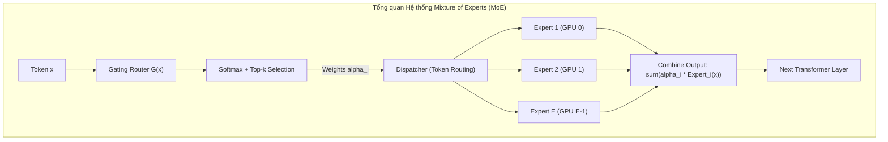

---

## 2. Chi tiết từng Keyword

---

### 90. Switch Transformer

#### a. Định nghĩa Bản chất Toán học
**Switch Transformer** (Fedus, Zoph, Shazeer, Google 2021) tái thiết kế lại cơ chế MoE truyền thống bằng cách đơn giản hóa tối đa: **Chỉ điều phối mỗi token tới duy nhất 1 chuyên gia (Top-1 Routing)**:
$$k = 1$$
Với token đầu vào $\mathbf{x} \in \mathbb{R}^d$, router tính toán xác suất:
$$h(\mathbf{x}) = \mathbf{x} \mathbf{W}_g, \quad p_i(\mathbf{x}) = \frac{\exp(h(\mathbf{x})_i)}{\sum_{j=1}^E \exp(h(\mathbf{x})_j)}$$
$$i^* = \arg\max_i p_i(\mathbf{x})$$
Đầu ra của tầng Switch FFN:
$$\mathbf{y} = p_{i^*}(\mathbf{x}) \cdot \text{FFN}_{i^*}(\mathbf{x})$$

#### b. Cơ chế Tầng Sâu & Điện toán
- **Triệt tiêu chi phí truyền thông**: Khi chuyển từ Top-2 sang Top-1, khối lượng dữ liệu trao đổi qua mạng phân tán giảm đi đúng $50\%$.
- Giúp mở rộng quy mô mô hình lên tới **1.6 nghìn tỷ tham số (Switch-C)**, tăng tốc độ tiền huấn luyện lên **$7\times$** so với mô hình T5 tương đương về lượng FLOPs.

#### c. Sơ đồ Minh họa


#### d. Code Thực chiến (C++ & Python)
```cpp
// C++17: Top-1 Switch Router Selection
int switch_top1_route(const float* router_logits, int num_experts, float* out_weight) {
    int best_expert = 0;
    float max_logit = router_logits[0];
    for (int i = 1; i < num_experts; ++i) {
        if (router_logits[i] > max_logit) {
            max_logit = router_logits[i];
            best_expert = i;
        }
    }
    // Giả sử đã qua Softmax
    *out_weight = max_logit;
    return best_expert;
}
```

```python
import torch
import torch.nn as nn

class SwitchRouter(nn.Module):
    def __init__(self, d_model: int, num_experts: int):
        super().__init__()
        self.w_g = nn.Linear(d_model, num_experts, bias=False)

    def forward(self, x: torch.Tensor):
        logits = self.w_g(x) # [B, N, num_experts]
        probs = torch.softmax(logits, dim=-1)
        # Top-1 selection
        weights, indices = torch.max(probs, dim=-1, keepdim=True) # [B, N, 1]
        return weights, indices
```

#### e. Lỗi Thường gặp & Ổn định Số học
- Sự mất ổn định khi huấn luyện với FP16: Giá trị router logits dễ bị bão hòa; Switch Transformer khuyến nghị tính toán router và softmax ở độ chính xác đơn **FP32** trước khi chuyển sang bfloat16 cho các khối expert.

#### f. Ứng dụng Thực chiến trong AI
- Nền tảng huấn luyện các mô hình đa ngôn ngữ khổng lồ tại Google Research.

---

### 91. GShard

#### a. Định nghĩa Bản chất Toán học
**GShard** (Lepikhin et al., Google 2020) là framework tính toán phân tán và kiến trúc MoE đầu tiên vượt qua ngưỡng **600 tỷ tham số** cho bài toán dịch máy đa ngôn ngữ (100 ngôn ngữ).
Đặc tính cốt lõi của GShard:
1. **Top-2 Routing with Random Fallback**: Mỗi token được định tuyến tới tối đa 2 chuyên gia. Chuyên gia thứ nhất luôn là chuyên gia có xác suất cao nhất. Chuyên gia thứ hai được chọn có xác suất tỷ lệ thuận với trọng số, nếu không đủ dung lượng thì token thứ hai được bỏ qua.
2. **Compiler SPMD Sharding**: Mô hình hóa việc phân tán các chuyên gia lên các TPU pods thông qua các chỉ thị phân vùng tự động của compiler XLA (`xla::Sharding`), giúp người phát triển viết code như trên 1 thiết bị đơn lẻ.

#### b. Cơ chế Tầng Sâu & Điện toán
- Thiết lập khái niệm **Expert Capacity Factor**: Giới hạn số lượng token tối đa mà một chuyên gia được phép tiếp nhận:
  $$\text{Capacity} = C \times \left(\frac{N}{E}\right)$$
  (Với $C \in [1.0, 2.0]$). Nếu vượt quá dung lượng này, token sẽ bị tràn (Dropped Token) và được dẫn thẳng qua kết nối Residual mà không tính toán qua FFN.

#### c. Sơ đồ Minh họa
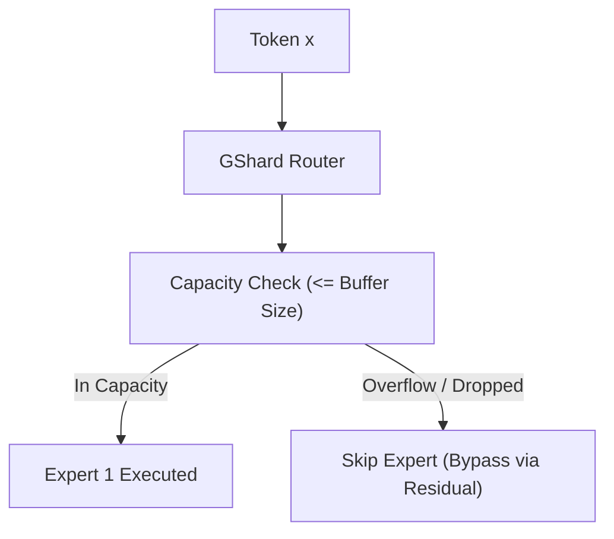

#### d. Code Thực chiến (C++ & Python)
```cpp
// C++17: Kiểm tra dung lượng Expert Capacity
bool dispatch_with_capacity(int expert_id, int max_capacity, std::vector<int>& expert_counts) {
    if (expert_counts[expert_id] < max_capacity) {
        expert_counts[expert_id]++;
        return true; // Chấp nhận xử lý
    }
    return false; // Token bị drop / tràn bộ đệm
}
```

```python
import torch

def enforce_expert_capacity(indices: torch.Tensor, num_experts: int, capacity: int) -> torch.Tensor:
    # indices: [total_tokens]
    mask = torch.zeros_like(indices, dtype=torch.bool)
    counts = [0] * num_experts
    for i, idx in enumerate(indices):
        e = idx.item()
        if counts[e] < capacity:
            counts[e] += 1
            mask[i] = True
    return mask
```

#### e. Lỗi Thường gặp & Ổn định Số học
- Đặt Capacity Factor quá thấp ($C < 1.0$) khiến tỷ lệ token bị rơi (Token Dropping Rate) tăng cao, làm suy giảm nghiêm trọng độ mạch lạc của văn bản.

#### f. Ứng dụng Thực chiến trong AI
- Nền tảng phân tán của Google Translate và hệ thống Gemini Multimodal.

---

### 92. Mixture of Experts (MoE - Hỗn hợp Chuyên gia)

#### a. Định nghĩa Bản chất Toán học
Được khởi xướng từ công trình kinh điển của Jacobs, Jordan, Nowlan, và Hinton (1991), nguyên lý **Mixture of Experts** dựa trên triết lý "Chia để trị" (Divide and Conquer):
Thay vì một mạng nơ-ron nguyên khối phải gánh vác việc ghi nhớ toàn bộ mọi lĩnh vực tri thức, hệ thống phân rã thành một tập hợp gồm $E$ mạng chuyên gia độc lập $f_1, f_2, \dots, f_E$, được điều phối bởi một mạng cổng $G$:
$$\mathbf{y} = \sum_{i=1}^E G(\mathbf{x})_i f_i(\mathbf{x})$$
Trong đó $G(\mathbf{x})_i \ge 0$ và $\sum_{i=1}^E G(\mathbf{x})_i = 1$.

#### b. Cơ chế Tầng Sâu & Điện toán
- Trong MoE nguyên bản (Dense MoE), toàn bộ $E$ chuyên gia đều phải thực hiện tính toán cho mọi đầu vào. Điều này hữu ích cho các mạng nhỏ nhưng không thể mở rộng cho các siêu mô hình.
- Tiền đề lý thuyết trực tiếp dẫn tới sự ra đời của **Sparse MoE**.

#### c. Sơ đồ Minh họa
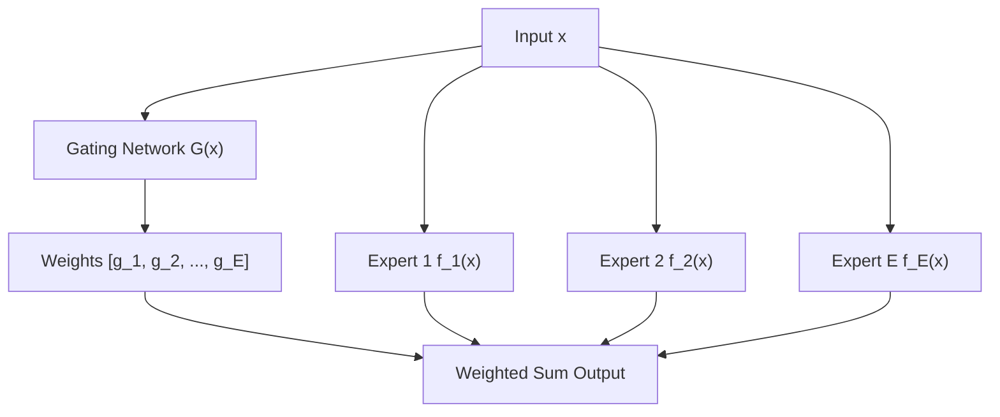

#### d. Code Thực chiến (C++ & Python)
```cpp
// C++17: Dense MoE Combination
void dense_moe_forward(const float* x, const float* g_weights, 
                       const std::vector<std::vector<float>>& expert_outputs, 
                       float* y_out, int num_experts, int dim) {
    for (int d = 0; d < dim; ++d) y_out[d] = 0.0f;
    for (int i = 0; i < num_experts; ++i) {
        float w = g_weights[i];
        for (int d = 0; d < dim; ++d) {
            y_out[d] += w * expert_outputs[i][d];
        }
    }
}
```

```python
import torch
import torch.nn as nn

class DenseMoE(nn.Module):
    def __init__(self, d_model: int, num_experts: int):
        super().__init__()
        self.gate = nn.Linear(d_model, num_experts)
        self.experts = nn.ModuleList([
            nn.Sequential(nn.Linear(d_model, 4 * d_model), nn.ReLU(), nn.Linear(4 * d_model, d_model))
            for _ in range(num_experts)
        ])

    def forward(self, x: torch.Tensor) -> torch.Tensor:
        weights = torch.softmax(self.gate(x), dim=-1) # [B, N, E]
        out = 0
        for i, expert in enumerate(self.experts):
            out = out + weights[..., i:i+1] * expert(x)
        return out
```

#### e. Lỗi Thường gặp & Ổn định Số học
- Tính toán Dense MoE trên mô hình lớn khiến chi phí FLOPs tăng gấp $E$ lần mà không đạt được lợi ích về tốc độ.

#### f. Ứng dụng Thực chiến trong AI
- Nền tảng lý thuyết cho các hệ thống Ensemble Learning và phân rã nhiệm vụ đa tác vụ (Multi-task Learning).

---

### 93. Sparse MoE (Hỗn hợp Chuyên gia Thưa)

#### a. Định nghĩa Bản chất Toán học
**Sparse MoE** (Shazeer et al., 2017) biến đổi biểu thức tính toán của MoE bằng cách chỉ giữ lại $k$ giá trị lớn nhất trong hàm gating, các giá trị còn lại bị triệt tiêu về $-\infty$ trước khi qua Softmax:
$$\text{KeepTopK}(\mathbf{v}, k)_i = \begin{cases} v_i & \text{nếu } v_i \in \text{Top-k}(\mathbf{v}) \\ -\infty & \text{ngược lại} \end{cases}$$
$$G(\mathbf{x}) = \text{Softmax}(\text{KeepTopK}(H(\mathbf{x}), k))$$
Vì $G(\mathbf{x})_i = 0$ cho phần lớn các chuyên gia ($E - k$ chuyên gia), ta hoàn toàn **không cần thực thi hay tính toán** các chuyên gia có trọng số bằng 0:
$$\mathbf{y} = \sum_{i \in \text{TopK}} G(\mathbf{x})_i \cdot \text{Expert}_i(\mathbf{x})$$

#### b. Cơ chế Tầng Sâu & Điện toán
- Cho phép mô hình sở hữu dung lượng lưu trữ tri thức khổng lồ (ví dụ 100 tỷ tham số) nhưng chi phí tính toán trên mỗi token chỉ tương đương mô hình 10 tỷ tham số ($k/E \approx 10\%$).
- Đạt hiệu năng áp đảo trên cùng một ngân sách FLOPs huấn luyện.

#### c. Sơ đồ Minh họa
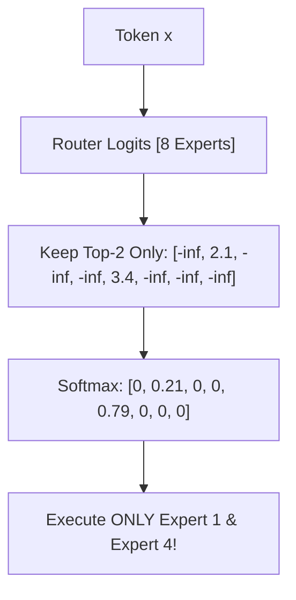

#### d. Code Thực chiến (C++ & Python)
```cpp
// C++17: Lọc Top-k thưa
#include <vector>
#include <algorithm>

std::vector<int> get_top_k_indices(const float* logits, int E, int k) {
    std::vector<std::pair<float, int>> score_idx(E);
    for (int i = 0; i < E; ++i) score_idx[i] = {logits[i], i};
    std::partial_sort(score_idx.begin(), score_idx.begin() + k, score_idx.end(), 
                      std::greater<std::pair<float, int>>());
    std::vector<int> result(k);
    for (int i = 0; i < k; ++i) result[i] = score_idx[i].second;
    return result;
}
```

```python
import torch

def sparse_top_k_gating(logits: torch.Tensor, k: int = 2):
    top_logits, top_indices = torch.topk(logits, k, dim=-1)
    top_weights = torch.softmax(top_logits, dim=-1)
    return top_weights, top_indices
```

#### e. Lỗi Thường gặp & Ổn định Số học
- Hiện tượng **Routing Collapse**: Mạng nơ-ron tìm ra lối tắt (shortcut) luôn định tuyến toàn bộ token vào cùng một chuyên gia duy nhất, khiến $E-1$ chuyên gia còn lại hoàn toàn bị bỏ hoang (Dead Experts).

#### f. Ứng dụng Thực chiến trong AI
- Cốt lõi của các siêu mô hình tiên tiến: **Mixtral-8x7B**, **GPT-4**, **DeepSeek-V3**.

---

### 94. Expert Routing (Định tuyến Chuyên gia)

#### a. Định nghĩa Bản chất Toán học
**Expert Routing** là thuật toán quyết định ánh xạ phân phối từ tập hợp các token đầu vào $\mathcal{X} = \{\mathbf{x}_1, \dots, \mathbf{x}_N\}$ tới tập hợp các chuyên gia $\mathcal{E} = \{1, \dots, E\}$.
Các trường phái định tuyến chính:
1. **Token-Choice Routing (Phổ biến nhất)**: Mỗi token độc lập chọn ra $k$ chuyên gia tốt nhất cho nó. Nhược điểm: Dễ gây mất cân bằng tải giữa các chuyên gia.
2. **Expert-Choice Routing (Zhou et al., 2022)**: Mỗi chuyên gia tự chọn ra $k$ tokens phù hợp nhất với nó từ batch dữ liệu. Đảm bảo $100\%$ cân bằng tải hoàn hảo, nhưng một số token có thể bị nhiều chuyên gia chọn hoặc không được chuyên gia nào chọn.
3. **Soft MoE (Puigcerver et al., 2023)**: Trộn lẫn toàn bộ các token thành các vector siêu token liên tục trước khi nạp vào chuyên gia (loại bỏ hoàn toàn tính rời rạc).

#### b. Cơ chế Tầng Sâu & Điện toán
- Routing rời rạc sinh ra bài toán hoán vị dữ liệu (Data Permutation): Các token nằm rải rác trong batch phải được gom nhóm (pack/scatter) theo chỉ số expert để nạp vào cùng một khối GEMM liên tục trong VRAM.

#### c. Sơ đồ Minh họa
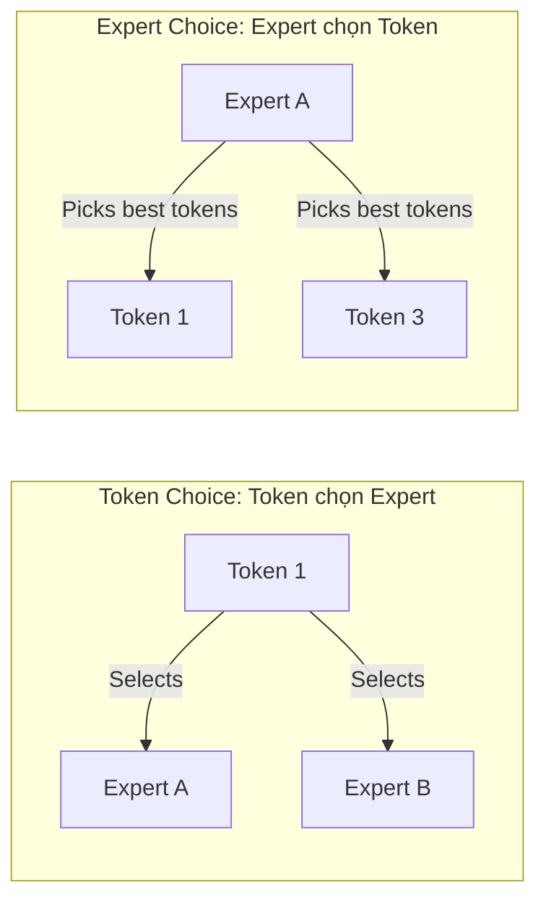

#### d. Code Thực chiến (C++ & Python)
```cpp
// C++17: Scatter và Gather Token Indices theo Expert
#include <vector>

struct ExpertDispatchTable {
    std::vector<std::vector<int>> expert_to_token_indices;
    
    void build_table(const std::vector<int>& assigned_experts, int num_experts) {
        expert_to_token_indices.resize(num_experts);
        for (size_t t = 0; t < assigned_experts.size(); ++t) {
            expert_to_token_indices[assigned_experts[t]].push_back(t);
        }
    }
};
```

```python
import torch

def scatter_tokens_to_experts(tokens: torch.Tensor, expert_indices: torch.Tensor, num_experts: int):
    # Gom các token vào từng expert bucket để tính toán song song
    expert_buckets = [tokens[expert_indices == e] for e in range(num_experts)]
    return expert_buckets
```

#### e. Lỗi Thường gặp & Ổn định Số học
- Sự phân tán bộ nhớ ngẫu nhiên (Non-coalesced memory access) khi scatter/gather token làm giảm tốc độ thực thi nếu không có custom CUDA kernel được tối ưu hóa.

#### f. Ứng dụng Thực chiến trong AI
- Quyết định thông lượng và hiệu suất scaling của các cụm máy chủ phục vụ MoE.

---

### 95. Gating Networks (Mạng Cổng Điều phối)

#### a. Định nghĩa Bản chất Toán học
**Gating Network** là một module học sâu nhỏ có nhiệm vụ dự đoán phân phối xác suất gán chuyên gia từ vector ngữ cảnh của token $\mathbf{x} \in \mathbb{R}^d$.
Hai thiết kế kinh điển:
1. **Noisy Top-k Gating (Shazeer et al., 2017)**: Thêm nhiễu Gauss có thể điều chỉnh để kích thích khám phá (Exploration) trong giai đoạn đầu huấn luyện:
   $$H(\mathbf{x})_i = (\mathbf{x} \mathbf{W}_g)_i + \epsilon \cdot \text{Softplus}((\mathbf{x} \mathbf{W}_{\text{noise}})_i), \quad \epsilon \sim \mathcal{N}(0, 1)$$
2. **Normalized Top-k Gating**:
   $$G(\mathbf{x}) = \text{Softmax}(\text{TopK}(H(\mathbf{x}), k))$$

#### b. Cơ chế Tầng Sâu & Điện toán
- Kích thước tham số rất nhỏ: $\mathbf{W}_g \in \mathbb{R}^{d \times E}$. Với $d = 4096$ và $E = 8$, chỉ tiêu tốn 32K tham số (hoàn toàn không đáng kể).
- Quyết định toàn bộ chất lượng phân vùng chuyên môn hóa (Specialization) của các chuyên gia.

#### c. Sơ đồ Minh họa
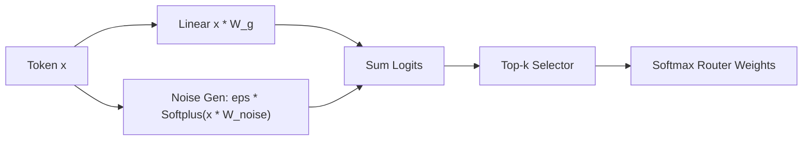

#### d. Code Thực chiến (C++ & Python)
```cpp
// C++17: Router Linear Projection
void router_forward(const float* x, const float* W_g, float* logits, int d_model, int E) {
    for (int e = 0; e < E; ++e) {
        float sum = 0.0f;
        for (int d = 0; d < d_model; ++d) {
            sum += x[d] * W_g[d * E + e];
        }
        logits[e] = sum;
    }
}
```

```python
import torch
import torch.nn as nn
import torch.nn.functional as F

class NoisyTopKGating(nn.Module):
    def __init__(self, d_model: int, num_experts: int, k: int = 2):
        super().__init__()
        self.w_gate = nn.Linear(d_model, num_experts, bias=False)
        self.w_noise = nn.Linear(d_model, num_experts, bias=False)
        self.k = k

    def forward(self, x: torch.Tensor, train: bool = True):
        clean_logits = self.w_gate(x)
        if train:
            raw_noise = torch.randn_like(clean_logits)
            noise_std = F.softplus(self.w_noise(x))
            logits = clean_logits + (raw_noise * noise_std)
        else:
            logits = clean_logits

        top_logits, top_indices = torch.topk(logits, self.k, dim=-1)
        top_weights = torch.softmax(top_logits, dim=-1)
        return top_weights, top_indices
```

#### e. Lỗi Thường gặp & Ổn định Số học
- Quên chuẩn hóa lại Softmax trên các trọng số Top-k được chọn khiến tổng các trọng số không bằng 1.0, làm méo mó biên độ kích hoạt của tầng kế tiếp.

#### f. Ứng dụng Thực chiến trong AI
- Thành phần kiểm soát định tuyến của mọi kiến trúc Mixture of Experts.

---

### 96. Load Balancing Loss (Hàm Mất mát Cân bằng Tải)

#### a. Định nghĩa Bản chất Toán học
Để ngăn chặn hiện tượng **Routing Collapse** (một số ít chuyên gia bị quá tải trong khi các chuyên gia khác bị bỏ đói), một hàm mục tiêu phụ trợ **Load Balancing Loss** (Auxiliary Loss $\mathcal{L}_{\text{aux}}$) được cộng trực tiếp vào hàm mất mát tổng:
$$\mathcal{L}_{\text{total}} = \mathcal{L}_{\text{task}} + \alpha \cdot \mathcal{L}_{\text{aux}}$$
Định nghĩa chuẩn của Switch Transformer và GShard:
$$\mathcal{L}_{\text{aux}} = \alpha \cdot E \sum_{i=1}^E f_i \cdot P_i$$
Trong đó:
- $E$ là tổng số chuyên gia.
- $f_i$ là **tỷ lệ phần trăm số token thực tế** được định tuyến tới chuyên gia $i$ trong một batch gồm $T$ tokens:
  $$f_i = \frac{1}{T} \sum_{x \in \mathcal{X}} \mathbb{I}(\text{Expert } i \in \text{TopK}(x))$$
- $P_i$ là **tổng xác suất trung bình** mà router phân bổ cho chuyên gia $i$:
  $$P_i = \frac{1}{T} \sum_{x \in \mathcal{X}} p_i(x)$$
- Hệ số $\alpha$ thường là một siêu tham số nhỏ (ví dụ $\alpha \in [10^{-3}, 10^{-2}]$).

**Nguyên lý Toán học**: Tích vô hướng $\sum_{i=1}^E f_i P_i$ đạt giá trị cực tiểu khi và chỉ khi phân phối là đều tuyệt đối ($f_i = \frac{1}{E}$ và $P_i = \frac{1}{E}$ với mọi $i$). Khi đó $\mathcal{L}_{\text{aux}} = \alpha \cdot E \cdot \sum_{i=1}^E \frac{1}{E^2} = \alpha$. Mọi sự mất cân bằng đều làm tăng giá trị loss và bị phạt nặng.

#### b. Cơ chế Tầng Sâu & Điện toán
- $P_i$ là hàm khả vi (differentiable) theo trọng số của router $\mathbf{W}_g$, cho phép truyền gradient để điều chỉnh router không dồn token vào một chuyên gia.
- $f_i$ là hằng số phi khả vi được tính từ phép gán rời rạc.

#### c. Sơ đồ Minh họa
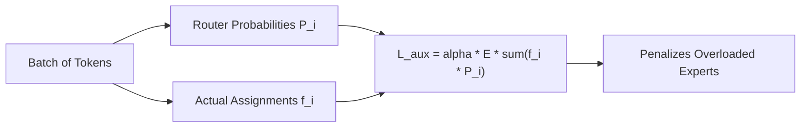

#### d. Code Thực chiến (C++ & Python)
```cpp
// C++17: Tính Load Balancing Loss
#include <vector>
#include <numeric>

float compute_load_balance_loss(const std::vector<float>& f_fractions, 
                               const std::vector<float>& P_probs, 
                               int num_experts, float alpha) {
    float dot_product = 0.0f;
    for (int i = 0; i < num_experts; ++i) {
        dot_product += f_fractions[i] * P_probs[i];
    }
    return alpha * num_experts * dot_product;
}
```

```python
import torch

def compute_auxiliary_loss(router_probs: torch.Tensor, expert_indices: torch.Tensor, 
                           num_experts: int, alpha: float = 0.01) -> torch.Tensor:
    # router_probs: [B * N, E], expert_indices: [B * N, k]
    total_tokens = router_probs.size(0)
    
    # 1. P_i: Xác suất trung bình của router cho expert i
    P = router_probs.mean(dim=0) # [E]
    
    # 2. f_i: Tỷ lệ token được gán thực tế
    one_hot = torch.zeros_like(router_probs)
    one_hot.scatter_(1, expert_indices, 1.0)
    f = one_hot.mean(dim=0) # [E]
    
    aux_loss = alpha * num_experts * torch.sum(f * P)
    return aux_loss
```

#### e. Lỗi Thường gặp & Ổn định Số học
- Đặt $\alpha$ quá lớn ($>0.1$): Mô hình ưu tiên việc chia đều token hơn là tối ưu chất lượng ngôn ngữ, làm giảm nghiêm trọng năng lực suy luận của mô hình.

#### f. Ứng dụng Thực chiến trong AI
- Thành phần bắt buộc để ổn định quá trình tiền huấn luyện mọi mô hình MoE (Mixtral, Switch, DeepSeek).

---

### 97. Expert Parallelism (Song song hóa Chuyên gia)

#### a. Định nghĩa Bản chất Toán học
**Expert Parallelism (EP)** là phương thức phân tán mô hình trong đó các chuyên gia khác nhau trong cùng một tầng MoE được phân bổ để lưu trữ và thực thi trên các thiết bị tăng tốc (GPU / TPU) khác nhau:
$$\text{GPU}_p \text{ lưu trữ } \{\text{Expert}_i \mid i \pmod P = p\}$$
Khi một GPU xử lý một lô token, router trên GPU đó sẽ xác định xem mỗi token cần được xử lý bởi chuyên gia nào. Nếu chuyên gia đó nằm trên một GPU khác, token sẽ được gửi qua mạng thông qua thao tác giao tiếp tập thể **All-to-All Dispatch**:
$$\text{Tokens}_{\text{local}} \xrightarrow{\text{All-to-All Dispatch}} \text{Tokens}_{\text{expert-assigned}}$$
Sau khi các GPU thực thi xong chuyên gia cục bộ của mình, kết quả được gửi trả về GPU ban đầu thông qua thao tác **All-to-All Combine**:
$$\text{Outputs}_{\text{expert}} \xrightarrow{\text{All-to-All Combine}} \text{Outputs}_{\text{local}}$$

#### b. Cơ chế Tầng Sâu & Điện toán
- Khác với Tensor Parallelism (cắt ma trận trọng số yêu cầu giao tiếp All-Reduce liên tục với độ trễ cao), Expert Parallelism giao tiếp ở cấp độ token qua `All-to-All`.
- Băng thông mạng liên kết (Interconnect Bandwidth như NVLink giữa các GPU trong node hoặc InfiniBand giữa các node) là yếu tố quyết định thông lượng của EP.

#### c. Sơ đồ Minh họa
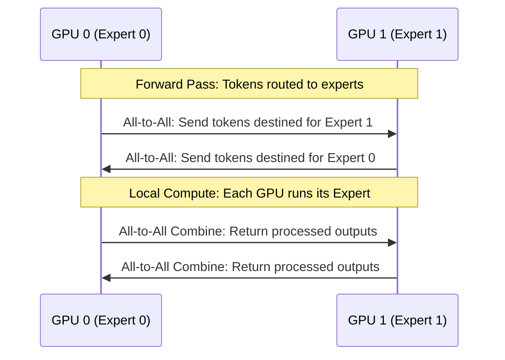

#### d. Code Thực chiến (C++ & Python)
```cpp
// C++17 / NCCL: Khái niệm All-to-All Token Exchange
void nccl_all_to_all_tokens(const float* send_buf, float* recv_buf, size_t tokens_per_rank, size_t dim) {
    // ncclAllToAll(send_buf, recv_buf, tokens_per_rank * dim * sizeof(float), ...);
}
```

```python
import torch
import torch.distributed as dist

def expert_parallel_all_to_all(local_tokens: torch.Tensor, output_splits: list[int], input_splits: list[int]):
    # Giao tiếp All-to-All phân tán token qua các GPU ranks
    output_tokens = torch.empty(sum(input_splits), local_tokens.size(-1), device=local_tokens.device)
    dist.all_to_all_single(output_tokens, local_tokens, input_split_sizes=input_splits, output_split_sizes=output_splits)
    return output_tokens
```

#### e. Lỗi Thường gặp & Ổn định Số học
- Sự mất cân bằng tải giữa các chuyên gia sẽ biến thành **Straggler Problem**: GPU chứa chuyên gia quá tải sẽ làm tất cả các GPU khác phải đứng chờ (idle) ở rào cản All-to-All.

#### f. Ứng dụng Thực chiến trong AI
- Huấn luyện các siêu mô hình MoE hàng trăm tỷ đến nghìn tỷ tham số trên cụm siêu máy tính.

---

### 98. Shared Experts (Chuyên gia Chia sẻ Chung)

#### a. Định nghĩa Bản chất Toán học
Được phát minh trong kiến trúc **DeepSeekMoE** (Dai et al., 2024), **Shared Experts** là một hoặc một vài chuyên gia cố định luôn luôn được kích hoạt cho **$100\%$ mọi token**, hoàn toàn độc lập với quyết định của Router:
$$\mathbf{y} = \sum_{s \in \mathcal{E}_{\text{shared}}} \text{SharedExpert}_s(\mathbf{x}) + \sum_{i \in \text{TopK}} g_i(\mathbf{x}) \cdot \text{RoutedExpert}_i(\mathbf{x})$$

#### b. Cơ chế Tầng Sâu & Điện toán
- **Giải quyết xung đột tri thức**: Trong MoE truyền thống, các chuyên gia được định tuyến thường xuyên phải học lại các kiến thức ngữ pháp và cú pháp nền tảng chung của ngôn ngữ (dẫn đến dư thừa tham số).
- Shared Experts đóng vai trò như một bộ nhớ nền tảng tiếp thu toàn bộ tri thức phổ quát, giúp các Routed Experts hoàn toàn tự do tập trung học sâu vào các tri thức chuyên môn hóa hẹp.

#### c. Sơ đồ Minh họa
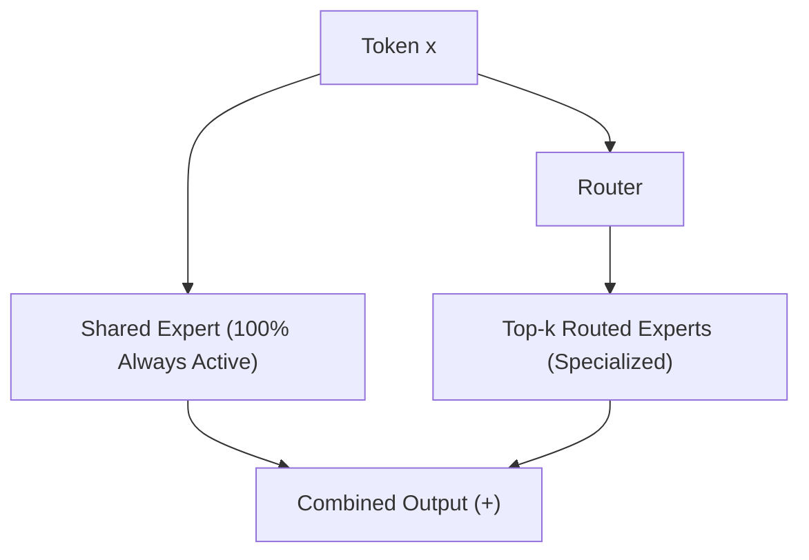

#### d. Code Thực chiến (C++ & Python)
```cpp
// C++17: Shared + Routed Output Merge
void merge_shared_and_routed(const float* shared_out, const float* routed_out, 
                             float* final_out, int size) {
    for (int i = 0; i < size; ++i) {
        final_out[i] = shared_out[i] + routed_out[i];
    }
}
```

```python
import torch
import torch.nn as nn

class MoEWithSharedExperts(nn.Module):
    def __init__(self, d_model: int, num_routed: int, num_shared: int, top_k: int):
        super().__init__()
        self.shared_experts = nn.ModuleList([
            LLaMASwiGLUFFN(d_model, hidden_dim=2048) for _ in range(num_shared)
        ])
        self.routed_experts = nn.ModuleList([
            LLaMASwiGLUFFN(d_model, hidden_dim=2048) for _ in range(num_routed)
        ])
        self.gate = nn.Linear(d_model, num_routed, bias=False)
        self.top_k = top_k

    def forward(self, x: torch.Tensor) -> torch.Tensor:
        # 1. Luôn tính toán shared experts
        shared_out = sum(expert(x) for expert in self.shared_experts)
        
        # 2. Tính toán routed experts qua Top-k
        logits = self.gate(x)
        weights, indices = torch.topk(torch.softmax(logits, dim=-1), self.top_k, dim=-1)
        # (Thực thi routed experts ...)
        routed_out = torch.zeros_like(x)
        return shared_out + routed_out
```

#### e. Lỗi Thường gặp & Ổn định Số học
- Kích thước Shared Experts quá lớn làm mất đi tính thưa và làm tăng đáng kể lượng FLOPs bắt buộc trên mỗi token.

#### f. Ứng dụng Thực chiến trong AI
- Kiến trúc vũ khí cốt lõi của **DeepSeek-V2**, **DeepSeek-V3**, và các mô hình MoE thế hệ mới 2024.

---

### 99. DeepSeekMoE

#### a. Định nghĩa Bản chất Toán học
**DeepSeekMoE** (Dai et al., DeepSeek AI 2024) đưa tính chuyên môn hóa của chuyên gia lên mức tột cùng bằng cách áp dụng hai nguyên lý kiến trúc mang tính cách mạng:
1. **Phân rã Chuyên gia Siêu mịn (Fine-Grained Expert Segmentation)**:
   Thay vì chia tầng FFN thành một số lượng nhỏ các chuyên gia lớn (như Mixtral chia 8 chuyên gia có kích thước mỗi chuyên gia là $1 \times \text{FFN}$ và chọn Top-2), DeepSeekMoE chia thành **rất nhiều chuyên gia siêu nhỏ** (ví dụ chia nhỏ thành $E = 64$ hoặc $128$ chuyên gia, mỗi chuyên gia có kích thước bằng $1/4 \times \text{FFN}$) và chọn **Top-8** hoặc **Top-16**:
   $$\text{Kích thước 1 Expert} \ll \text{Standard FFN}$$
   Tổng số FLOPs giữ nguyên, nhưng số lượng tổ hợp chuyên gia tiềm năng bùng nổ theo cấp số nhân:
   $$\binom{64}{8} \approx 4.4 \times 10^9 \text{ tổ hợp} \gg \binom{8}{2} = 28 \text{ tổ hợp của Mixtral}$$
2. **Tách biệt Chuyên gia Chia sẻ (Shared Experts Isolation)**: Bổ sung 1 đến 2 chuyên gia dùng chung cố định.

#### b. Cơ chế Tầng Sâu & Điện toán
- Tối đa hóa khả năng biểu diễn tri thức hẹp và phức tạp.
- Kết hợp với hệ thống lập lịch truyền thông **DualPipe** để ẩn hoàn toàn độ trễ giao tiếp All-to-All trên cụm GPU H800/H100.

#### c. Sơ đồ Minh họa
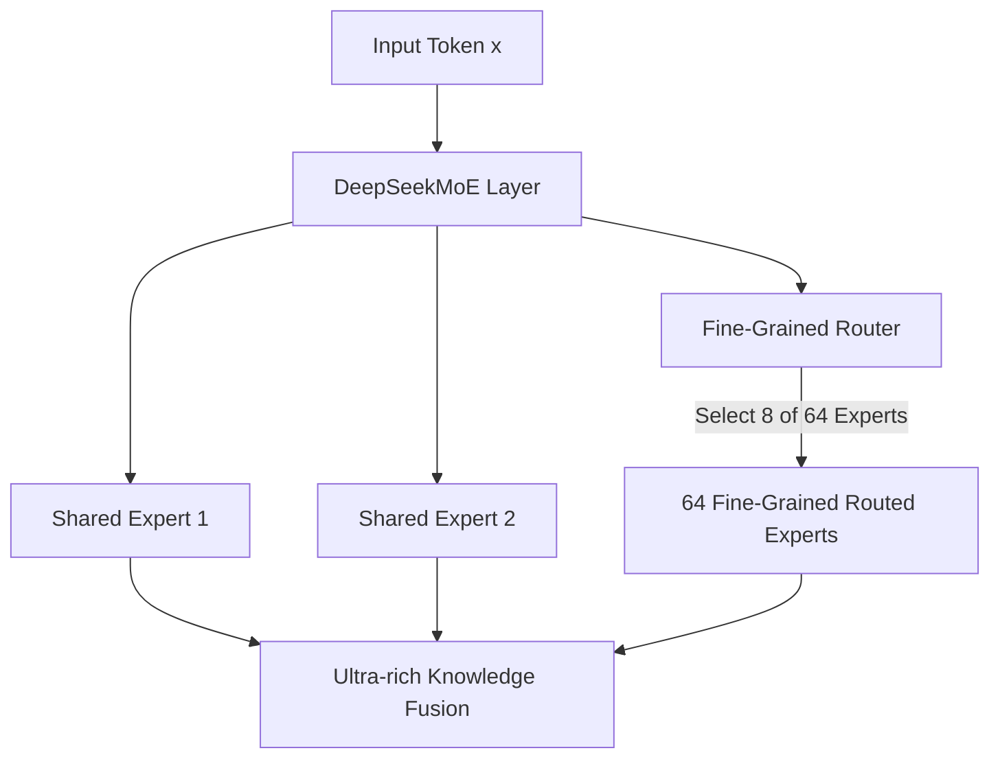

#### d. Code Thực chiến (C++ & Python)
```python
# Cấu hình DeepSeekMoE (DeepSeek-V2 Lite)
deepseek_moe_config = {
    "num_routed_experts": 64,
    "num_shared_experts": 2,
    "num_experts_per_tok": 6, # Top-6 selection
    "moe_intermediate_size": 1408, # Rất nhỏ so với intermediate_size thông thường (5632)
    "norm_topk_prob": True
}
```

#### e. Lỗi Thường gặp & Ổn định Số học
- Quản lý quá nhiều kernel nhỏ (Fine-grained kernels) dễ gây nghẽn hàng đợi lệnh (Kernel Launch Overhead) trên GPU nếu không sử dụng Triton/CUDA Megakernels.

#### f. Ứng dụng Thực chiến trong AI
- Kiến trúc nền tảng giúp **DeepSeek-V2** và **DeepSeek-V3** đạt điểm số ngang ngửa GPT-4 với chi phí chỉ bằng $1/10$.

---

### 100. Sparse Upcycling (Tái sinh Thưa từ Mô hình Dày)

#### a. Định nghĩa Bản chất Toán học
**Sparse Upcycling** (Komatsuzaki et al., Google 2022) là kỹ thuật khởi tạo một mô hình Sparse MoE trực tiếp từ một checkpoint của mô hình Transformer Dày đặc (Dense Transformer) đã được tiền huấn luyện hoàn chỉnh, giúp tiết kiệm hàng triệu đô la chi phí điện toán.

Quy trình toán học:
1. Giữ nguyên toàn bộ các tầng Embedding, Self-Attention và Layer Normalization từ mô hình Dense.
2. Với mỗi tầng Position-Wise FFN nguyên bản có trọng số $\mathbf{W}_{\text{dense}}$, ta **sao chép nhân bản** nó thành $E$ bản sao giống hệt nhau để khởi tạo cho $E$ chuyên gia:
   $$\mathbf{W}_{\text{expert}_i} \leftarrow \mathbf{W}_{\text{dense}}, \quad \forall i \in \{1, \dots, E\}$$
3. Khởi tạo ngẫu nhiên ma trận trọng số của Gating Router $\mathbf{W}_g$ với phương sai nhỏ.
4. Tiếp tục quá trình tiền huấn luyện (Continued Pre-training). Các chuyên gia ban đầu giống hệt nhau sẽ nhanh chóng phân hóa (diverge) và chuyên môn hóa vào các miền tri thức khác nhau.

#### b. Cơ chế Tầng Sâu & Điện toán
- Tiết kiệm hơn **$90\%$** thời gian và FLOPs so với việc huấn luyện một mô hình MoE từ các trọng số ngẫu nhiên ban đầu (from scratch).
- Cho phép bất kỳ doanh nghiệp nào biến mô hình dense có sẵn (như LLaMA-3 8B) thành mô hình MoE (như LLaMA-8x8B) một cách dễ dàng.

#### c. Sơ đồ Minh họa
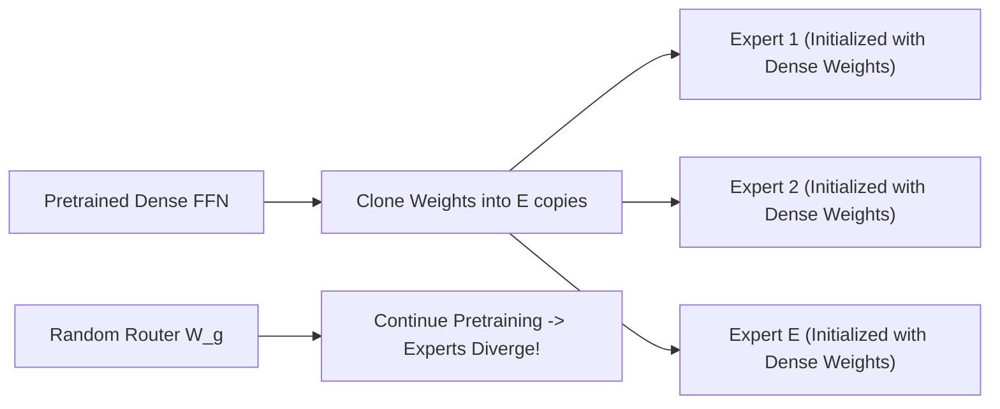

#### d. Code Thực chiến (C++ & Python)
```cpp
// C++17: Sao chép trọng số FFN Dense sang E Experts
void sparse_upcycle_copy(const float* dense_W, float* moe_weights, int E, int param_count) {
    for (int e = 0; e < E; ++e) {
        std::memcpy(&moe_weights[e * param_count], dense_W, param_count * sizeof(float));
    }
}
```

```python
import torch
import torch.nn as nn

def sparse_upcycle_ffn_to_moe(dense_ffn: nn.Module, num_experts: int, d_model: int, top_k: int = 2):
    # Tạo module MoE mới
    moe_layer = MixtralMoELayer(d_model=d_model, num_experts=num_experts, top_k=top_k)
    # Sao chép trọng số từ Dense FFN sang tất cả các experts
    for expert in moe_layer.experts:
        expert.load_state_dict(dense_ffn.state_dict())
    return moe_layer
```

#### e. Lỗi Thường gặp & Ổn định Số học
- Khởi tạo router logits quá lớn khiến ngay từ step đầu tiên của continued pre-training chỉ có 1 expert nhận toàn bộ token, phá hủy sự cân bằng trước khi các chuyên gia kịp phân hóa.

#### f. Ứng dụng Thực chiến trong AI
- Phương pháp phát triển các biến thể cộng đồng nổi tiếng như **Mixtral-8x7B (upcycled từ Mistral-7B)** và **Solar 10.7B**.
