# Chuyên đề: Nền tảng Học Biểu diễn & Các Hệ thống Không gian Nhúng (Representation Learning & Embedding Spaces)

## 1. Tổng quan Chuyên đề
Trong kỷ nguyên trước Deep Learning, các hệ thống AI phụ thuộc hoàn toàn vào kỹ nghệ đặc trưng thủ công (Feature Engineering) — một quá trình tốn kém nhân lực, dễ vỡ và không thể mở rộng. **Học Biểu diễn (Representation Learning)** ra đời nhằm tự động khám phá và trích xuất các đặc trưng tiềm ẩn từ dữ liệu thô (văn bản, hình ảnh, âm thanh, đồ thị), chuyển hóa các thực thể biểu tượng rời rạc thành các vector liên tục đa chiều (**Embeddings**) trong một không gian mêtric chung.

Cốt lõi của không gian biểu diễn hiện đại:
1. **Từ Biểu diễn Rời rạc Thưa (Sparse / One-Hot) đến Biểu diễn Phân tán Dày đặc (Dense / Distributed Representations)**: Cho phép mã hóa ngữ nghĩa tiềm ẩn thông qua các chiều đặc trưng liên tục, nơi khoảng cách hình học phản ánh trực tiếp sự tương đồng ngữ nghĩa.
2. **Tính Đa phương thức & Đa cấp độ (Multimodal & Multi-granularity Embeddings)**: Từ cấp độ ký hiệu nhỏ nhất (Token, Word), mở rộng lên cấp độ chuỗi (Sentence, Document), và mở rộng xuyên phương thức (Image, Audio, Video, Graph, Knowledge Base).
3. **Không gian Biểu diễn Tiềm ẩn & Hình học Ngữ nghĩa (Latent Spaces & Semantic Geometry)**: Khám phá cách các mô hình nơ-ron tổ chức tri thức dưới dạng các đa tạp đại số (Manifolds), nơi các phép toán vector thể hiện mối quan hệ loại suy ngữ nghĩa logic.

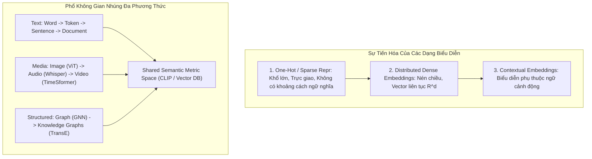

---

## 2. Chi tiết từng Keyword

---

### 1. Representation Learning (Học Biểu diễn)

#### a. Định nghĩa Bản chất Toán học
**Representation Learning** (Bengio, Courville, Vincent, 2013) là nhánh học máy tập trung vào việc học một phép ánh xạ tham số hóa khả vi $f_\theta: \mathcal{X} \to \mathcal{Z}$ biến đổi không gian dữ liệu đầu vào $\mathcal{X} \subset \mathbb{R}^D$ thành không gian đặc trưng biểu diễn $\mathcal{Z} \subset \mathbb{R}^d$ (thường $d \ll D$) sao cho các thông tin hữu ích và các yếu tố biến thiên tiềm ẩn (latent explanatory factors) được tách biệt và giữ lại tối đa:
$$\mathbf{z} = f_\theta(\mathbf{x})$$
Phép ánh xạ tối ưu thỏa mãn nguyên lý cực đại hóa thông tin tương hỗ (Mutual Information Maximization):
$$\theta^* = \arg\max_\theta I(\mathbf{X}; f_\theta(\mathbf{X})) - \beta I(f_\theta(\mathbf{X}); \mathbf{Y}_{\text{noise}})$$

#### b. Cơ chế Tầng Sâu & Điện toán
- Thay vì trích xuất đặc trưng bằng các thuật toán thủ công (như SIFT trong thị giác hay TF-IDF trong NLP), mạng nơ-ron sâu tự động tìm ra các tầng biểu diễn phân cấp: các tầng thấp học các cạnh/vần sơ cấp, các tầng cao học các khái niệm trừu tượng.

#### c. Sơ đồ Minh họa
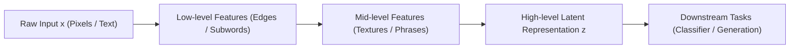

#### d. Code Thực chiến (C++ & Python)
```cpp
// C++17: Abstract Feature Extractor Interface
#include <vector>

class FeatureExtractor {
public:
    virtual std::vector<float> encode(const std::vector<float>& raw_input) = 0;
    virtual ~FeatureExtractor() = default;
};
```

```python
import torch
import torch.nn as nn

class GenericRepresentationLearner(nn.Module):
    def __init__(self, input_dim: int, latent_dim: int):
        super().__init__()
        self.encoder = nn.Sequential(
            nn.Linear(input_dim, 512),
            nn.BatchNorm1d(512),
            nn.ReLU(),
            nn.Linear(512, latent_dim)
        )

    def forward(self, x: torch.Tensor) -> torch.Tensor:
        return self.encoder(x)
```

#### e. Lỗi Thường gặp & Ổn định Số học
- Sự sụp đổ biểu diễn (Representation Collapse): Toàn bộ không gian $\mathcal{Z}$ ánh xạ về một điểm hằng số duy nhất, triệt tiêu mọi thông tin phân biệt.

#### f. Ứng dụng Thực chiến trong AI
- Nền tảng cốt lõi của toàn bộ Deep Learning hiện đại.

---

### 2. Distributed Representations (Biểu diễn Phân tán)

#### a. Định nghĩa Bản chất Toán học
Được đề xuất bởi Geoffrey Hinton (1986), **Distributed Representation** dựa trên nguyên lý:
1. Mỗi khái niệm/thực thể không được lưu trữ tại một nơ-ron đơn lẻ mà được phân bổ (distributed) trên **nhiều chiều đặc trưng đồng thời**.
2. Ngược lại, mỗi chiều đặc trưng tham gia vào việc biểu diễn **nhiều khái niệm khác nhau**.
$$\mathbf{v}_{\text{cat}} = [0.25, -0.81, 0.44, \dots, 0.12] \in \mathbb{R}^d$$
Không có chiều đơn lẻ nào mang nhãn "mèo"; ý nghĩa chỉ xuất hiện từ tổ hợp kích hoạt của toàn bộ $d$ chiều.

#### b. Cơ chế Tầng Sâu & Điện toán
- Năng lực lưu trữ tăng theo hàm mũ: Với $d$ nơ-ron nhị phân, biểu diễn phân tán có thể mã hóa tới $2^d$ trạng thái khác nhau (so với chỉ $d$ trạng thái của biểu diễn cục bộ One-Hot).

#### c. Sơ đồ Minh họa
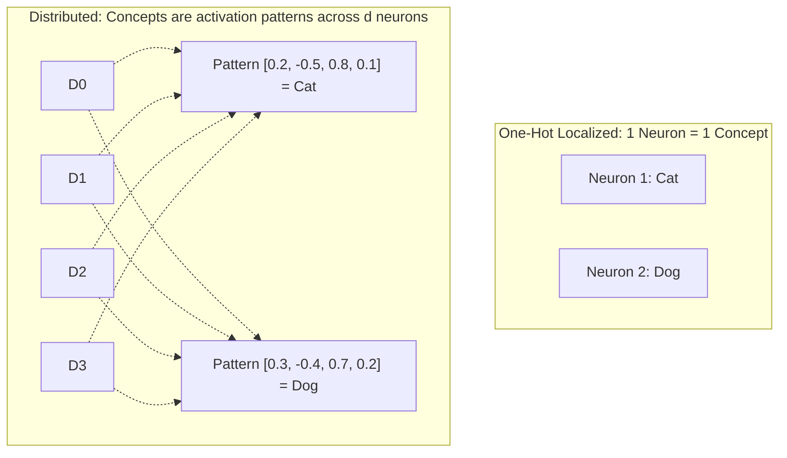

#### d. Code Thực chiến (C++ & Python)
```cpp
// C++17: Kiểm tra độ phủ phân tán của Vector
#include <vector>
#include <cmath>

bool is_distributed(const std::vector<float>& vec, float threshold = 0.01f) {
    int active_dims = 0;
    for (float val : vec) {
        if (std::abs(val) > threshold) active_dims++;
    }
    // Phần lớn các chiều đều tham gia biểu diễn
    return active_dims > (vec.size() / 2);
}
```

```python
import torch

def inspect_distributed_activation(dense_vector: torch.Tensor):
    # dense_vector: [D]
    non_zero_ratio = (dense_vector.abs() > 1e-4).float().mean().item()
    return {"active_dimension_ratio": non_zero_ratio}
```

#### e. Lỗi Thường gặp & Ổn định Số học
- Nhầm lẫn với điện toán phân tán (Distributed Computing) trên nhiều máy chủ GPU.

#### f. Ứng dụng Thực chiến trong AI
- Nền tảng của các mạng nơ-ron kết nối (Connectionist models) và vector nhúng.

---

### 3. Dense Representations (Biểu diễn Dày đặc)

#### a. Định nghĩa Bản chất Toán học
Một biểu diễn $\mathbf{z} \in \mathbb{R}^d$ được gọi là **Dense** khi hầu hết tất cả các phần tử $z_i$ đều mang giá trị số thực khác 0:
$$\frac{\|\mathbf{z}\|_0}{d} \approx 1.0$$
Số chiều $d$ thường cố định và tương đối nhỏ ($d \in [64, 4096]$).

#### b. Cơ chế Tầng Sâu & Điện toán
- Cực kỳ tối ưu hóa trên phần cứng: Các mảng liên tục (contiguous arrays) với dữ liệu dày đặc cho phép khai thác $100\%$ hiệu suất của các tập lệnh SIMD (AVX2, AVX-512) và GPU Tensor Cores thông qua các phép nhân ma trận chuẩn BLAS Level 3 (GEMM).

#### c. Sơ đồ Minh họa
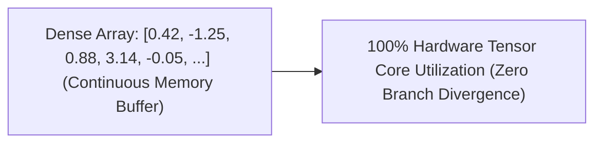

#### d. Code Thực chiến (C++ & Python)
```cpp
// C++20: Aligned Dense Memory Allocation
#include <vector>

struct AlignedDenseVector {
    alignas(64) std::vector<float> data;
    explicit AlignedDenseVector(size_t dim) : data(dim, 0.0f) {}
};
```

```python
import torch

dense_rep = torch.randn(1, 768, dtype=torch.float32)
print("Sparsity level:", (dense_rep == 0).float().mean().item()) # = 0.0
```

#### e. Lỗi Thường gặp & Ổn định Số học
- Khó diễn giải (Lack of Interpretability): Không thể biết chính xác từng con số thực mang ý nghĩa ngữ nghĩa gì một cách độc lập.

#### f. Ứng dụng Thực chiến trong AI
- Vector nhúng trong Transformer, CLIP, và các cơ sở dữ liệu vector hiện đại (Pinecone, Milvus, Qdrant).

---

### 4. Sparse Representations (Biểu diễn Thưa)

#### a. Định nghĩa Bản chất Toán học
Một biểu diễn $\mathbf{s} \in \mathbb{R}^V$ được gọi là **Sparse** khi đại đa số các phần tử bằng 0 tuyệt đối:
$$\frac{\|\mathbf{s}\|_0}{V} \ll 0.01$$
Không gian số chiều $V$ thường rất lớn ($V \in [30000, 10^7]$). Ví dụ kinh điển:
- **One-Hot Encoding**: $\|\mathbf{s}\|_0 = 1$.
- **TF-IDF / BM25 Vector**: $\|\mathbf{s}\|_0 \le 200$ trên từ điển kích thước hàng triệu từ.
- **SPLADE (Sparse Lexical and Expansion Model)**: Dự đoán trọng số thưa trên từ điển từ mô hình BERT.

#### b. Cơ chế Tầng Sâu & Điện toán
- Lưu trữ bằng các cấu trúc dữ liệu thưa: CSR (Compressed Sparse Row), COO (Coordinate Format), hoặc bảng chỉ mục ngược (Inverted Index).
- Cho phép tìm kiếm tài liệu chính xác tuyệt đối theo từ khóa (Exact Keyword Matching) thông qua các công cụ tìm kiếm truyền thống như Elasticsearch.

#### c. Sơ đồ Minh họa
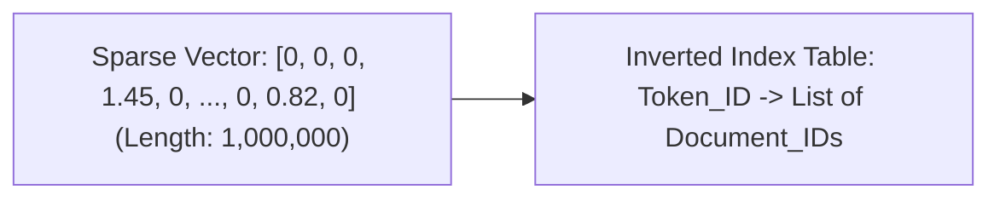

#### d. Code Thực chiến (C++ & Python)
```cpp
// C++17: Coordinate (COO) Sparse Representation
#include <vector>

struct SparseEntry {
    int index;
    float value;
};

using SparseVectorCOO = std::vector<SparseEntry>;
```

```python
import torch

def create_sparse_representation(indices: list[int], values: list[float], vocab_size: int):
    i = torch.tensor([indices])
    v = torch.tensor(values, dtype=torch.float32)
    return torch.sparse_coo_tensor(i, v, (vocab_size,))
```

#### e. Lỗi Thường gặp & Ổn định Số học
- Vấn đề từ đồng nghĩa (Vocabulary Mismatch): Không nhận diện được "oto" và "xe hơi" có liên quan nếu chúng có mã chỉ mục khác nhau.

#### f. Ứng dụng Thực chiến trong AI
- Tìm kiếm từ khóa lexical trong công cụ tìm kiếm, mô hình **SPLADE**, và hệ thống Hybrid Search (Dense + Sparse Retrieval).

---

### 5. Embeddings (Vector Nhúng)

#### a. Định nghĩa Bản chất Toán học
**Embedding** là một vector liên tục $\mathbf{e} \in \mathbb{R}^d$ biểu diễn một đối tượng trừu tượng (từ, ảnh, người dùng, sản phẩm) trong một không gian Euclid hoặc Riemann đa chiều, được học sao cho khoảng cách hoặc góc giữa các vector phản ánh mối quan hệ ngữ nghĩa trong miền ứng dụng:
$$\text{Dist}(\mathbf{e}_A, \mathbf{e}_B) \propto \text{Dissimilarity}(A, B)$$

#### b. Cơ chế Tầng Sâu & Điện toán
- Chuyển hóa dữ liệu rời rạc (Categorical/Symbolic) thành dữ liệu liên tục khả vi để nạp vào các mô hình nơ-ron học sâu.

#### c. Sơ đồ Minh họa
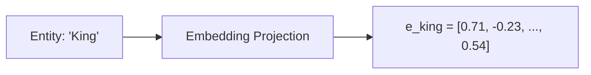

#### d. Code Thực chiến (C++ & Python)
```cpp
// C++17: Embedding Dot Product
float embedding_similarity(const float* e1, const float* e2, int dim) {
    float dot = 0.0f;
    for (int i = 0; i < dim; ++i) dot += e1[i] * e2[i];
    return dot;
}
```

```python
import torch.nn as nn

embedding_table = nn.Embedding(num_embeddings=10000, embedding_dim=128)
```

#### e. Lỗi Thường gặp & Ổn định Số học
- Chiều embedding $d$ chọn quá nhỏ dẫn đến tắc nghẽn thông tin (Capacity Bottleneck), chọn quá lớn dẫn đến hiện tượng quá khớp (Overfitting) và tốn tài nguyên VRAM.

#### f. Ứng dụng Thực chiến trong AI
- Xương sống của mọi hệ thống gợi ý (Recommendation Systems), Vector Databases và LLM.

---

### 6. Word Embeddings (Vector Nhúng Từ)

#### a. Định nghĩa Bản chất Toán học
**Word Embeddings** ánh xạ mỗi từ nguyên vẹn $w$ trong từ điển cố định $\mathcal{V}$ thành một vector tĩnh $\mathbf{v}_w \in \mathbb{R}^d$ duy nhất:
$$f(w) = \mathbf{v}_w$$
Đặc tính: **Tĩnh (Static)** — Một từ chỉ có đúng một vector duy nhất, bất kể nó xuất hiện trong câu văn nào (ví dụ từ "bank" trong "river bank" và "money bank" có cùng một vector biểu diễn).

#### b. Cơ chế Tầng Sâu & Điện toán
- Nổi tiếng với tính chất số học bảo toàn mối quan hệ loại suy ngữ nghĩa (Semantic Analogy Arithmetic):
  $$\mathbf{v}_{\text{King}} - \mathbf{v}_{\text{Man}} + \mathbf{v}_{\text{Woman}} \approx \mathbf{v}_{\text{Queen}}$$

#### c. Sơ đồ Minh họa
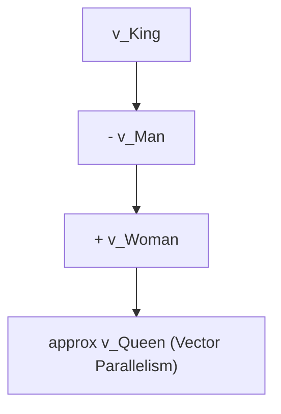

#### d. Code Thực chiến (C++ & Python)
```python
# Minh họa tính chất loại suy ngữ nghĩa (gensim / word2vec)
def analogy(word_a, word_b, word_c, word_vectors):
    # a is to b as c is to ?
    result = word_vectors[word_b] - word_vectors[word_a] + word_vectors[word_c]
    return result
```

#### e. Lỗi Thường gặp & Ổn định Số học
- Vấn đề từ đa nghĩa (Polysemy): Bị ép phải nén mọi nghĩa khác nhau của một từ vào một vector tĩnh duy nhất.

#### f. Ứng dụng Thực chiến trong AI
- Các mô hình **Word2Vec**, **GloVe**, **FastText**.

---

### 7. Token Embeddings (Vector Nhúng Ký hiệu)

#### a. Định nghĩa Bản chất Toán học
Khắc phục nhược điểm của Word Embeddings (bị lỗi khi gặp từ chưa biết Out-Of-Vocabulary), **Token Embeddings** ánh xạ các đơn vị từ con (Subwords như BPE, WordPiece, Unigram) thành vector:
$$\mathbf{x} = \text{Tokenizer}("unbelievable") \longrightarrow ["un", "believ", "able"] \longrightarrow [\mathbf{e}_{\text{un}}, \mathbf{e}_{\text{believ}}, \mathbf{e}_{\text{able}}]$$

#### b. Cơ chế Tầng Sâu & Điện toán
- Kích thước từ vựng tối ưu: $V \in [30000, 150000]$, xử lý được $100\%$ mọi từ vựng mới bằng cách ghép các mảnh subword lại với nhau.

#### c. Sơ đồ Minh họa
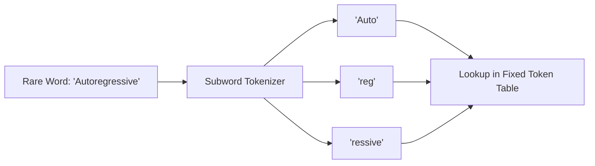

#### d. Code Thực chiến (C++ & Python)
```python
from transformers import AutoTokenizer

tokenizer = AutoTokenizer.from_pretrained("bert-base-uncased")
tokens = tokenizer.tokenize("transformerization")
print("Subword tokens:", tokens) # ['transform', '##eri', '##zation']
```

#### e. Lỗi Thường gặp & Ổn định Số học
- Sự phân mảnh quá mức (Over-tokenization) đối với các ngôn ngữ tượng hình hoặc ngôn ngữ có dấu thanh nếu tokenizer không được tối ưu.

#### f. Ứng dụng Thực chiến trong AI
- Tầng đầu vào chuẩn mực của mọi mô hình Transformer hiện đại.

---

### 8. Sentence Embeddings (Vector Nhúng Câu)

#### a. Định nghĩa Bản chất Toán học
**Sentence Embeddings** nén toàn bộ ngữ nghĩa của một câu hoàn chỉnh gồm $N$ tokens thành một vector đơn lẻ duy nhất $\mathbf{u} \in \mathbb{R}^d$:
$$\mathbf{u} = \text{SentenceEncoder}(x_1, \dots, x_N)$$
Phương pháp phổ biến: Áp dụng cơ chế **Mean Pooling** trên các trạng thái ẩn tầng cuối của mô hình ngôn ngữ:
$$\mathbf{u} = \frac{\sum_{i=1}^N \mathbf{h}_i \cdot \mathbf{M}_{\text{pad}}[i]}{\sum_{i=1}^N \mathbf{M}_{\text{pad}}[i]}$$

#### b. Cơ chế Tầng Sâu & Điện toán
- Cho phép so sánh ngữ nghĩa giữa hai câu trong $\mathcal{O}(d)$ thông qua Cosine Similarity thay vì phải chạy cross-attention tốn $\mathcal{O}(N^2)$ (nhanh hơn $1000\times$).

#### c. Sơ đồ Minh họa
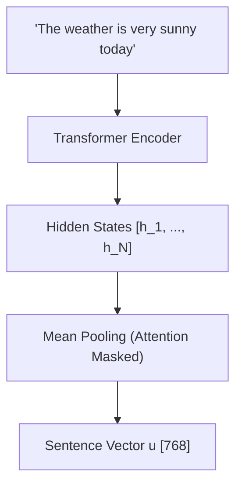

#### d. Code Thực chiến (C++ & Python)
```cpp
// C++17: Mean Pooling có mặt nạ Padding
void mean_pooling(const float* hidden_states, const bool* mask, float* out_vec, 
                  int seq_len, int d_model) {
    for (int d = 0; d < d_model; ++d) out_vec[d] = 0.0f;
    int count = 0;
    for (int i = 0; i < seq_len; ++i) {
        if (mask[i]) {
            count++;
            for (int d = 0; d < d_model; ++d) {
                out_vec[d] += hidden_states[i * d_model + d];
            }
        }
    }
    float inv_count = 1.0f / (count > 0 ? count : 1);
    for (int d = 0; d < d_model; ++d) out_vec[d] *= inv_count;
}
```

```python
import torch

def masked_mean_pooling(last_hidden_state: torch.Tensor, attention_mask: torch.Tensor) -> torch.Tensor:
    input_mask_expanded = attention_mask.unsqueeze(-1).expand(last_hidden_state.size()).float()
    sum_embeddings = torch.sum(last_hidden_state * input_mask_expanded, dim=1)
    sum_mask = torch.clamp(input_mask_expanded.sum(dim=1), min=1e-9)
    return sum_embeddings / sum_mask
```

#### e. Lỗi Thường gặp & Ổn định Số học
- Dùng trực tiếp vector `[CLS]` của BERT gốc mà không qua fine-tuning tương phản (SBERT/SimCSE): Vector `[CLS]` của pre-trained BERT thô bị hiện tượng suy biến bất đẳng hướng (Anisotropy), cho kết quả tương đồng kém hơn cả trung bình cộng GloVe.

#### f. Ứng dụng Thực chiến trong AI
- Trái tim của hệ thống **Semantic Search**, **Dense Retrieval** và **RAG**.

---

### 9. Document Embeddings (Vector Nhúng Tài liệu)

#### a. Định nghĩa Bản chất Toán học
**Document Embeddings** ánh xạ các tài liệu dài gồm nhiều đoạn văn hoặc nhiều trang thành một biểu diễn vector toàn cục:
$$\mathbf{d} = \text{DocEncoder}(D)$$
Các hướng tiếp cận:
1. **Hierarchical Encoding**: Nhúng từng câu $\mathbf{s}_i$, sau đó nhúng chuỗi các câu thành $\mathbf{d}$.
2. **Chunk Pooling**: Cắt nhỏ tài liệu thành các chunks, tính embedding từng chunk và lấy trung bình hoặc lưu trữ đa vector (ColBERT / Multi-vector representation).

#### b. Cơ chế Tầng Sâu & Điện toán
- Vấn đề nén thông tin (Information Bottleneck): Việc ép một tài liệu 10 trang vào một vector 1024 số thực sẽ làm mất mát các chi tiết cục bộ tinh vi.

#### c. Sơ đồ Minh họa
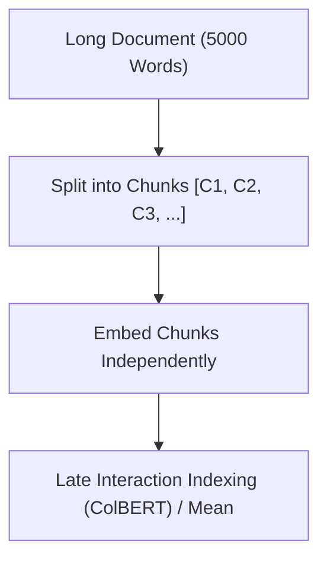

#### d. Code Thực chiến (C++ & Python)
```python
def chunk_and_embed(text: str, chunk_size: int = 500, overlap: int = 50):
    words = text.split()
    chunks = []
    for i in range(0, len(words), chunk_size - overlap):
        chunks.append(" ".join(words[i:i + chunk_size]))
    return chunks
```

#### e. Lỗi Thường gặp & Ổn định Số học
- Cắt vụn tài liệu làm đứt gãy ngữ cảnh giữa các đoạn (phải dùng kỹ thuật Overlap Sliding Window).

#### f. Ứng dụng Thực chiến trong AI
- Phân loại hồ sơ pháp lý, lọc văn bản trùng lặp và phân cụm thư viện tài liệu.

---

### 10. Contextual Embeddings (Vector Nhúng Phụ thuộc Ngữ cảnh)

#### a. Định nghĩa Bản chất Toán học
Khác biệt hoàn toàn với Word Embeddings tĩnh, **Contextual Embeddings** (Peters et al., 2018 - ELMo; Devlin et al., 2018 - BERT) là một hàm ánh xạ động phụ thuộc vào toàn bộ chuỗi xung quanh:
$$\mathbf{h}_t = f_{\theta}(x_t \mid x_1, \dots, x_N)$$
Một từ có nhiều nghĩa sẽ sinh ra **các vector khác nhau tùy thuộc vào ngữ cảnh**:
$$\mathbf{h}_{\text{"bank"}}(\text{"river bank"}) \neq \mathbf{h}_{\text{"bank"}}(\text{"central bank"})$$

#### b. Cơ chế Tầng Sâu & Điện toán
- Được tạo ra bởi các tầng Self-Attention trong Transformer: Mỗi token liên tục thu hút và trao đổi thông tin với các token xung quanh qua từng tầng, biến đổi dần từ biểu diễn ký hiệu thuần túy sang biểu diễn ngữ cảnh chuyên biệt.

#### c. Sơ đồ Minh họa
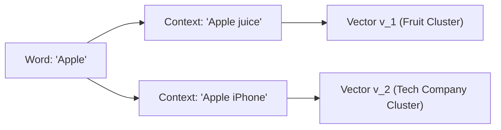

#### d. Code Thực chiến (C++ & Python)
```python
import torch
from transformers import AutoModel, AutoTokenizer

tokenizer = AutoTokenizer.from_pretrained("bert-base-uncased")
model = AutoModel.from_pretrained("bert-base-uncased")

# Cùng từ 'apple' nhưng ngữ cảnh khác nhau
inputs1 = tokenizer("fresh apple juice", return_tensors="pt")
inputs2 = tokenizer("buy Apple stock", return_tensors="pt")

with torch.no_grad():
    v1 = model(**inputs1).last_hidden_state[0, 2] # token 'apple'
    v2 = model(**inputs2).last_hidden_state[0, 2] # token 'Apple'

cos_sim = torch.cosine_similarity(v1, v2, dim=0).item()
print("Contextual Cosine Similarity:", cos_sim) # < 1.0
```

#### e. Lỗi Thường gặp & Ổn định Số học
- Tốn tài nguyên tính toán vì không thể tra cứu bảng tĩnh mà bắt buộc phải chạy qua mạng nơ-ron Transformer.

#### f. Ứng dụng Thực chiến trong AI
- Chuẩn mực biểu diễn của toàn bộ ngành xử lý ngôn ngữ tự nhiên hiện đại.

---

### 11. Positional Embeddings (Vector Nhúng Vị trí)

#### a. Định nghĩa Bản chất Toán học
Được phân tích sâu trong phần Transformer, **Positional Embeddings** ánh xạ vị trí thời gian hoặc không gian thành vector để phá vỡ tính bất biến hoán vị của mạng nơ-ron.

#### b. Cơ chế Tầng Sâu & Điện toán
- Kết hợp bằng phép cộng trực tiếp ($\mathbf{x} + \mathbf{p}$) hoặc qua phép xoay tích vô hướng (RoPE).

#### c. Sơ đồ Minh họa
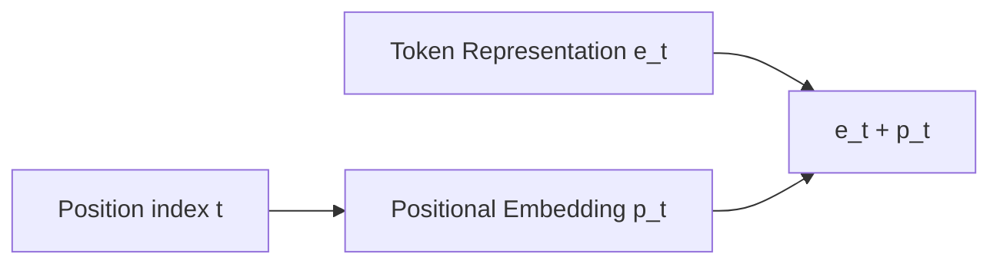

#### d. Code Thực chiến (C++ & Python)
```python
import torch.nn as nn
pos_layer = nn.Embedding(512, 768)
```

#### e. Lỗi Thường gặp & Ổn định Số học
- Giới hạn cứng độ dài chuỗi khi dùng learned positional embeddings.

#### f. Ứng dụng Thực chiến trong AI
- Transformer, ViT, Diffusion Models.

---

### 12. Image Embeddings (Vector Nhúng Hình ảnh)

#### a. Định nghĩa Bản chất Toán học
**Image Embeddings** nén thông tin thị giác của một bức ảnh đa kênh $\mathbf{I} \in \mathbb{R}^{C \times H \times W}$ thành một vector đặc trưng duy nhất $\mathbf{z}_{\text{img}} \in \mathbb{R}^d$.
Phương pháp Vision Transformer (ViT, Dosovitskiy et al., 2020):
1. Chia ảnh thành lưới các mảnh vuông (Patches) kích thước $P \times P$ (thường $16 \times 16$).
2. Trải phẳng các patch và chiếu tuyến tính thành token:
   $$\mathbf{x}_p \in \mathbb{R}^{P^2 C} \xrightarrow{\mathbf{W}_E} \mathbf{z}_p \in \mathbb{R}^d$$
3. Bổ sung token đặc biệt `[CLS]` và Positional Embeddings, nạp qua Transformer Encoder. Vector `[CLS]` ở tầng cuối cùng chính là Image Embedding.

#### b. Cơ chế Tầng Sâu & Điện toán
- Cực kỳ tối ưu trên GPU nhờ biến toàn bộ bài toán xử lý ảnh thành các phép toán nhân ma trận chuỗi token giống hệt xử lý văn bản.

#### c. Sơ đồ Minh họa
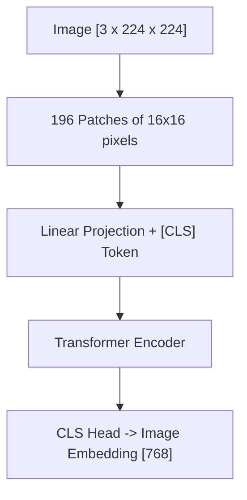

#### d. Code Thực chiến (C++ & Python)
```python
import torch
import torchvision.models as models

resnet = models.resnet50(pretrained=True)
# Cắt bỏ tầng phân loại cuối cùng để lấy embedding
modules = list(resnet.children())[:-1]
feature_extractor = torch.nn.Sequential(*modules)

dummy_img = torch.randn(1, 3, 224, 224)
embedding = feature_extractor(dummy_img).squeeze() # [2048]
```

#### e. Lỗi Thường gặp & Ổn định Số học
- Thay đổi kích thước ảnh đầu vào mà không nội suy lại positional embeddings 2D sẽ khiến mô hình ViT bị lỗi runtime.

#### f. Ứng dụng Thực chiến trong AI
- **CLIP (OpenAI)**, tìm kiếm ảnh bằng hình ảnh (Reverse Image Search), phát hiện vật thể, xe tự hành.

---

### 13. Audio Embeddings (Vector Nhúng Âm thanh)

#### a. Định nghĩa Bản chất Toán học
**Audio Embeddings** biến đổi tín hiệu sóng âm thanh thô 1D (Raw Audio Waveforms $x(t)$) thành vector biểu diễn ngữ nghĩa $\mathbf{z}_{\text{audio}} \in \mathbb{R}^d$.
Quy trình chuẩn:
1. Áp dụng biến đổi Fourier ngắn hạn (STFT) để chuyển sóng âm sang biểu đồ phổ âm thanh (Log-Mel Spectrogram) 2D.
2. Coi Spectrogram như một bức ảnh 1 kênh và đưa qua mô hình nơ-ron (CNN hoặc Audio Spectrogram Transformer - AST, Whisper Encoder).

#### b. Cơ chế Tầng Sâu & Điện toán
- Phép biến đổi STFT và Mel-Filterbank được tối ưu hóa bằng thuật toán FFT (Fast Fourier Transform) trên phần cứng DSP hoặc GPU Tensor Cores.

#### c. Sơ đồ Minh họa
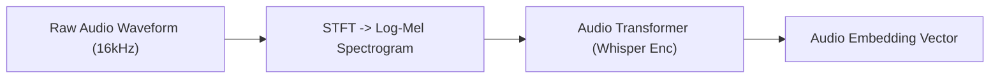

#### d. Code Thực chiến (C++ & Python)
```python
import torchaudio

def extract_mel_spectrogram(waveform, sample_rate=16000):
    mel_transform = torchaudio.transforms.MelSpectrogram(
        sample_rate=sample_rate, n_fft=400, hop_length=160, n_mels=80
    )
    return mel_transform(waveform)
```

#### e. Lỗi Thường gặp & Ổn định Số học
- Sự không khớp về tần số lấy mẫu (Sample Rate Mismatch: ví dụ nạp âm thanh 44.1kHz vào mô hình yêu cầu 16kHz) làm biến dạng hoàn toàn đặc trưng tần số.

#### f. Ứng dụng Thực chiến trong AI
- Nhận dạng giọng nói (Whisper), nhận diện người nói (Speaker Identification), tìm kiếm bài hát (Shazam).

---

### 14. Video Embeddings (Vector Nhúng Video)

#### a. Định nghĩa Bản chất Toán học
**Video Embeddings** mô hình hóa dữ liệu không-thời gian (Spatiotemporal Data) $\mathbf{V} \in \mathbb{R}^{T \times C \times H \times W}$ (với $T$ là số khung hình theo thời gian).
Các kiến trúc tiêu biểu:
- **TimeSformer (Bertasius et al., 2021)**: Áp dụng cơ chế Divided Space-Time Attention (phân rã chú ý không gian và chú ý thời gian riêng biệt trong từng tầng) để tránh bùng nổ bậc hai của số lượng patches.
- Vector đầu ra nắm bắt cả nội dung vật thể lẫn hành động biến đổi theo thời gian.

#### b. Cơ chế Tầng Sâu & Điện toán
- Tốn kém bộ nhớ VRAM khổng lồ: Một video 32 khung hình phân giải cao có thể đòi hỏi hàng chục GB bộ nhớ kích hoạt nếu không có cơ chế phân rã không-thời gian.

#### c. Sơ đồ Minh họa
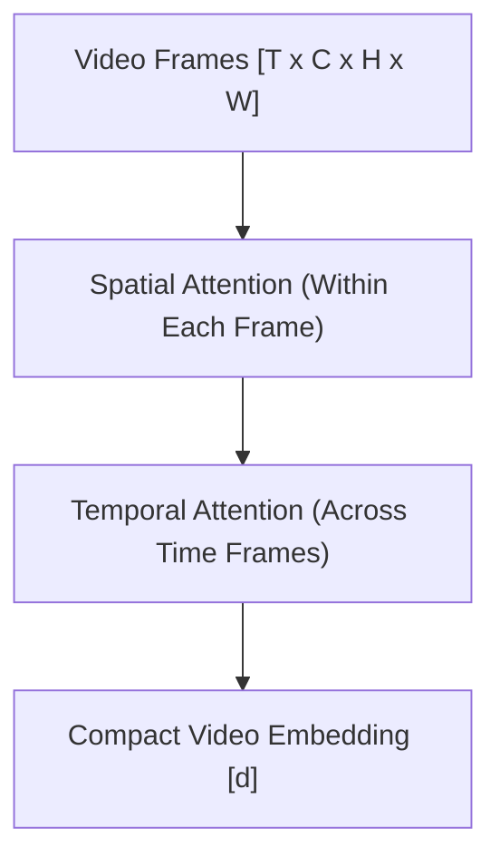

#### d. Code Thực chiến (C++ & Python)
```python
import torch

def sample_video_frames(total_frames: int, num_samples: int = 16) -> list[int]:
    # Lấy mẫu đều các khung hình theo trục thời gian
    indices = torch.linspace(0, total_frames - 1, num_samples).long().tolist()
    return indices
```

#### e. Lỗi Thường gặp & Ổn định Số học
- Lấy mẫu khung hình quá thưa làm mất các hành động diễn ra nhanh trong video.

#### f. Ứng dụng Thực chiến trong AI
- Phân loại hành động video (Action Recognition), tìm kiếm video theo văn bản (Text-to-Video Retrieval).

---

### 15. Graph Embeddings (Vector Nhúng Đồ thị)

#### a. Định nghĩa Bản chất Toán học
**Graph Embeddings** ánh xạ các đỉnh $v \in \mathcal{V}$ hoặc toàn bộ đồ thị $\mathcal{G} = (\mathcal{V}, \mathcal{E})$ thành các vector trong không gian liên tục:
$$\mathbf{z}_v \in \mathbb{R}^d$$
sao cho các đỉnh kề nhau hoặc có cấu trúc mạng tương tự nhau trong đồ thị sẽ nằm gần nhau trong không gian vector:
$$\text{sim}(\mathbf{z}_u, \mathbf{z}_v) \approx \mathbf{A}_{uv}$$
Các thuật toán: **Node2Vec, DeepWalk (Random Walk)** và **Graph Neural Networks (GCN, GAT)** qua cơ chế lan truyền thông điệp (Message Passing):
$$\mathbf{h}_v^{(l+1)} = \sigma\left(\mathbf{W} \cdot \sum_{u \in \mathcal{N}(v)} \frac{1}{c_{uv}} \mathbf{h}_u^{(l)}\right)$$

#### b. Cơ chế Tầng Sâu & Điện toán
- Dữ liệu đồ thị có tính chất bất đối xứng và thưa phi cấu trúc, đòi hỏi các thư viện chuyên dụng như PyTorch Geometric (PyG) hoặc DGL với các kernel phân tán trên GPU.

#### c. Sơ đồ Minh họa


#### d. Code Thực chiến (C++ & Python)
```python
import torch
import torch.nn as nn

class SimpleGCNLayer(nn.Module):
    def __init__(self, in_feat: int, out_feat: int):
        super().__init__()
        self.linear = nn.Linear(in_feat, out_feat, bias=False)

    def forward(self, x: torch.Tensor, adj_norm: torch.Tensor) -> torch.Tensor:
        # x: [num_nodes, in_feat], adj_norm: Normalized Adjacency [N, N]
        return torch.relu(adj_norm @ self.linear(x))
```

#### e. Lỗi Thường gặp & Ổn định Số học
- Hiện tượng **Over-smoothing**: Khi xếp chồng quá nhiều tầng GNN ($L > 4$), vector biểu diễn của toàn bộ các đỉnh trong đồ thị bị hội tụ về cùng một điểm hằng số.

#### f. Ứng dụng Thực chiến trong AI
- Dự đoán liên kết mạng xã hội, phát hiện gian lận tài chính, thiết kế phân tử thuốc sinh học.

---

### 16. Knowledge Embeddings (Vector Nhúng Đồ thị Tri thức)

#### a. Định nghĩa Bản chất Toán học
**Knowledge Graph Embeddings (KGE)** nhúng các thực thể (Entities $h, t \in \mathcal{E}$) và các mối quan hệ (Relations $r \in \mathcal{R}$) trong một đồ thị tri thức gồm các bộ ba (triplets) $(h, r, t)$ (ví dụ: `(Hanoi, isCapitalOf, Vietnam)`).
Mô hình kinh điển **TransE** (Bordes et al., 2013) coi quan hệ như một phép tịnh tiến (translation) trong không gian vector:
$$\mathbf{h} + \mathbf{r} \approx \mathbf{t}$$
Hàm tính điểm năng lượng:
$$f_r(h, t) = -\|\mathbf{h} + \mathbf{r} - \mathbf{t}\|_p$$
Các biến thể nâng cao: **TransH** (chiếu lên siêu phẳng quan hệ), **RotatE** (quan hệ là phép xoay trong không gian phức $\mathbf{t} = \mathbf{h} \odot \mathbf{r}, |r_i| = 1$).

#### b. Cơ chế Tầng Sâu & Điện toán
- RotatE có khả năng mô hình hóa hoàn hảo các tính chất logic: Đối xứng (Symmetry), Bất đối xứng (Antisymmetry), Nghịch đảo (Inversion), và Hợp thành (Composition).

#### c. Sơ đồ Minh họa
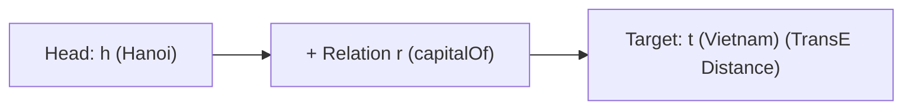

#### d. Code Thực chiến (C++ & Python)
```cpp
// C++17: TransE Score Function (L2 Distance)
#include <cmath>

float trans_e_score(const float* h, const float* r, const float* t, int dim) {
    float dist = 0.0f;
    for (int i = 0; i < dim; ++i) {
        float diff = h[i] + r[i] - t[i];
        dist += diff * diff;
    }
    return -std::sqrt(dist);
}
```

```python
import torch

def rotate_score(head: torch.Tensor, rel_phase: torch.Tensor, tail: torch.Tensor):
    # RotatE: h, t là số phức biểu diễn qua cặp thực/ảo
    # r = cos(theta) + i*sin(theta)
    r_cos = torch.cos(rel_phase)
    r_sin = torch.sin(rel_phase)
    # Phép nhân số phức h * r
    re_score = head[..., 0] * r_cos - head[..., 1] * r_sin - tail[..., 0]
    im_score = head[..., 0] * r_sin + head[..., 1] * r_cos - tail[..., 1]
    return -torch.norm(torch.stack([re_score, im_score], dim=-1), p=2, dim=-1)
```

#### e. Lỗi Thường gặp & Ổn định Số học
- TransE không thể mô hình hóa quan hệ đối xứng (nếu $r(a, b)$ và $r(b, a)$ cùng đúng thì TransE buộc $r = 0$ và $a = b$).

#### f. Ứng dụng Thực chiến trong AI
- Trả lời câu hỏi trên cơ sở tri thức (KGQA), hoàn thiện đồ thị tri thức (Link Prediction), và tăng cường dữ liệu cho LLM (Graph-RAG).

---

### 17. Latent Representations (Biểu diễn Tiềm ẩn)

#### a. Định nghĩa Bản chất Toán học
**Latent Representation** $\mathbf{z}$ là biến ngẫu nhiên ẩn (Unobserved Latent Variable) trong các mô hình sinh xác suất (như VAE, Diffusion Models, GANs), đại diện cho các yếu tố nguyên nhân sâu xa chi phối dữ liệu quan sát được $\mathbf{x} \sim p(\mathbf{x})$:
$$p(\mathbf{x}) = \int p(\mathbf{x} \mid \mathbf{z}) p(\mathbf{z}) d\mathbf{z}$$
Trong Variational Autoencoders (VAE):
$$q_\phi(\mathbf{z} \mid \mathbf{x}) = \mathcal{N}(\mathbf{\mu}(\mathbf{x}), \mathbf{\Sigma}(\mathbf{x}))$$
Sử dụng **Reparameterization Trick** để duy trì tính khả vi:
$$\mathbf{z} = \mathbf{\mu} + \mathbf{\sigma} \odot \mathbf{\epsilon}, \quad \mathbf{\epsilon} \sim \mathcal{N}(0, \mathbf{I})$$

#### b. Cơ chế Tầng Sâu & Điện toán
- Không gian tiềm ẩn thường được điều chuẩn (Regularized) bởi phân kỳ KL Divergence với phân phối chuẩn tắc $\mathcal{N}(0, \mathbf{I})$, tạo ra một không gian mượt mà cho phép nội suy liên tục (Continuous Latent Interpolation).

#### c. Sơ đồ Minh họa
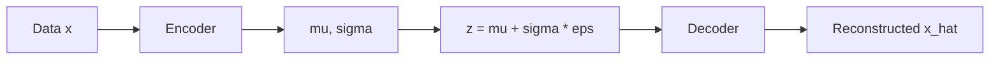

#### d. Code Thực chiến (C++ & Python)
```cpp
// C++17: Reparameterization Trick
void reparameterize(const float* mu, const float* log_var, const float* eps, 
                    float* z, int dim) {
    for (int i = 0; i < dim; ++i) {
        float std_dev = std::exp(0.5f * log_var[i]);
        z[i] = mu[i] + std_dev * eps[i];
    }
}
```

```python
import torch

def vae_reparameterize(mu: torch.Tensor, logvar: torch.Tensor) -> torch.Tensor:
    std = torch.exp(0.5 * logvar)
    eps = torch.randn_like(std)
    return mu + eps * std
```

#### e. Lỗi Thường gặp & Ổn định Số học
- Hiện tượng **Posterior Collapse**: Mạng Decoder quá mạnh khiến nó bỏ qua hoàn toàn vector tiềm ẩn $\mathbf{z}$ và phân phối $q(\mathbf{z}|\mathbf{x})$ sụp đổ về prior $\mathcal{N}(0, \mathbf{I})$.

#### f. Ứng dụng Thực chiến trong AI
- Không gian tiềm ẩn của **Stable Diffusion (Latent Diffusion Models)**, sinh khuôn mặt, biến đổi giọng nói.

---

### 18. Semantic Representations (Biểu diễn Ngữ nghĩa)

#### a. Định nghĩa Bản chất Toán học
**Semantic Representation** là biểu diễn vector nắm bắt được bản chất ý nghĩa logic, mối quan hệ khái niệm và thông tin ngữ nghĩa trừu tượng của dữ liệu, độc lập với hình thức biểu hiện bề mặt (Syntactic or Lexical variations):
$$\text{Text 1: 'The dog chased the cat'}$$
$$\text{Text 2: 'A feline was pursued by a hound'}$$
Mặc dù hai câu có từ vựng ($100\%$ lexical overlap = 0) và cấu trúc ngữ pháp khác nhau hoàn toàn, một bộ mã hóa ngữ nghĩa lý tưởng sẽ sinh ra:
$$\mathbf{z}_{\text{Text1}} \approx \mathbf{z}_{\text{Text2}}$$

#### b. Cơ chế Tầng Sâu & Điện toán
- Được tinh chỉnh thông qua các hàm mất mát tương phản ngữ nghĩa (như InfoNCE, Multiple Negatives Ranking Loss) ép các cặp câu đồng nghĩa lại gần nhau.

#### c. Sơ đồ Minh họa
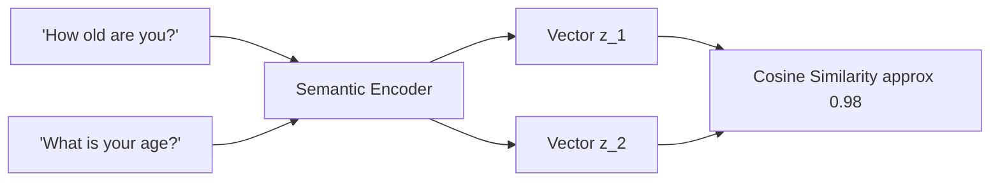

#### d. Code Thực chiến (C++ & Python)
```python
from sentence_transformers import SentenceTransformer, util

model = SentenceTransformer('all-MiniLM-L6-v2')
emb1 = model.encode("The weather is freezing")
emb2 = model.encode("It is extremely cold outside")
similarity = util.cos_sim(emb1, emb2).item()
print("Semantic Similarity Score:", similarity) # ~0.85
```

#### e. Lỗi Thường gặp & Ổn định Số học
- Sự đánh tráo giữa ngữ nghĩa (Semantics) và từ khóa (Lexical): Các câu phủ định như "Tôi thích táo" và "Tôi không thích táo" dễ bị xếp rất gần nhau do cấu trúc từ gần như giống hệt.

#### f. Ứng dụng Thực chiến trong AI
- Hệ thống phát hiện đạo văn, máy hỏi đáp tự động, phân loại khiếu nại khách hàng.

---

### 19. Semantic Similarity (Độ tương đồng Ngữ nghĩa)

#### a. Định nghĩa Bản chất Toán học
**Semantic Similarity** là một hàm mêtric đo lường khoảng cách hoặc mức độ tương đồng giữa hai biểu diễn vector $\mathbf{u}, \mathbf{v} \in \mathbb{R}^d$:
$$\mathcal{S}(\mathbf{u}, \mathbf{v}) \in [-1, 1] \text{ (hoặc } [0, 1])$$
Phản ánh mức độ tương đương về mặt thông tin và ý nghĩa của hai thực thể được so sánh trong thế giới thực.

#### b. Cơ chế Tầng Sâu & Điện toán
- Được tính toán hàng triệu lần mỗi giây trong các hệ thống Vector Search: Để tăng tốc độ, các vector được chuẩn hóa trước ($L_2\text{-norm} = 1$), biến phép tính Cosine Similarity thành phép tích vô hướng đơn giản (Dot Product) có thể tăng tốc cực độ qua SIMD AVX-512 hoặc GPU.

#### c. Sơ đồ Minh họa
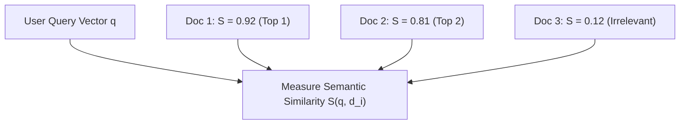

#### d. Code Thực chiến (C++ & Python)
```cpp
// C++17: Fast Cosine Similarity
#include <vector>
#include <cmath>

float fast_cosine_similarity(const float* a, const float* b, int dim) {
    float dot = 0.0f, norm_a = 0.0f, norm_b = 0.0f;
    #pragma omp simd reduction(+:dot, norm_a, norm_b)
    for (int i = 0; i < dim; ++i) {
        dot += a[i] * b[i];
        norm_a += a[i] * a[i];
        norm_b += b[i] * b[i];
    }
    return dot / (std::sqrt(norm_a) * std::sqrt(norm_b) + 1e-9f);
}
```

```python
import torch
import torch.nn.functional as F

def pairwise_semantic_similarity(embeddings_a: torch.Tensor, embeddings_b: torch.Tensor) -> torch.Tensor:
    # Chuẩn hóa L2 trước
    a_norm = F.normalize(embeddings_a, p=2, dim=-1)
    b_norm = F.normalize(embeddings_b, p=2, dim=-1)
    # Tích ma trận -> Cosine Similarity Matrix
    return torch.matmul(a_norm, b_norm.transpose(-1, -2))
```

#### e. Lỗi Thường gặp & Ổn định Số học
- So sánh các vector chưa được chuẩn hóa độ dài khi dùng các thư viện tìm kiếm yêu cầu Inner Product (như FAISS `IndexFlatIP`).

#### f. Ứng dụng Thực chiến trong AI
- Thang đo quyết định kết quả truy xuất trong RAG, phân cụm văn bản, và lọc trùng lặp dữ liệu lớn.
