# Chuyên đề: Các Độ đo Khoảng cách & Các Mô hình Nhúng Cổ điển (Distance Metrics & Classic Embedding Systems)

## 1. Tổng quan Chuyên đề
Để biến các vector số học thành công cụ phục vụ suy luận ngữ nghĩa, một không gian nhúng (Embedding Space) bắt buộc phải được trang bị một **Hàm Mêtric (Metric Function)** xác định khoảng cách hoặc góc giữa các vector. Các độ đo hình học như **Cosine Similarity, Euclidean Distance ($L_2$), Manhattan Distance ($L_1$), và Dot Product** quy định cách các thuật toán tìm kiếm vector lân cận (ANN Search - Approximate Nearest Neighbors) định vị tri thức trong không gian đa chiều.

Bên cạnh đó, nền tảng của toàn bộ ngành xử lý ngôn ngữ hiện đại bắt nguồn từ **Giả thuyết Phân phối Ngữ nghĩa (Distributional Semantics)** của J.R. Firth (1957): *"Bạn sẽ hiểu một từ thông qua các từ bầu bạn cùng nó"*.
Các mô hình nhúng tĩnh kinh điển:
1. **Word2Vec (Mikolov et al., 2013)**: CBOW và Skip-Gram kết hợp Negative Sampling biến bài toán thống kê đồng xuất hiện thành bài toán tối ưu mạng nơ-ron khả vi tốc độ cao.
2. **GloVe (Pennington et al., 2014)**: Phân rã ma trận đồng xuất hiện toàn cục (Global Log-Bilinear Matrix Factorization), kết hợp ưu thế của thống kê đếm toàn cục và cửa sổ ngữ cảnh cục bộ.
3. **FastText (Bojanowski et al., 2016)**: Nhúng các n-gram ký tự con (Subword Character n-grams), giải quyết triệt để rào cản từ chưa biết (OOV) và các ngôn ngữ biến hình hình thái học phức tạp.

```mermaid
graph TD
    subgraph MetricSpaces ["Các Độ Đo Hình Học & Biến Đổi Không Gian"]
        Dot["Dot Product: <u, v> = norm(u) norm(v) cos(theta)"]
        Dot -->|"L2 Normalization: norm(u) = 1"| Cosine["Cosine Similarity: cos(theta)"]
        Euclid["Euclidean Distance L2: sqrt(sum(u_i - v_i)^2)"]
        Manhattan["Manhattan Distance L1: sum(|u_i - v_i &#124; )"]
    end
    subgraph ClassicModels ["Các Mô Hình Nhúng Cổ Điển"]
        Firth["Distributional Hypothesis (Firth 1957)"] --> W2V["Word2Vec (2013): Prediction-based"]
        W2V --> CBOW["CBOW: Context --> Target Word"]
        W2V --> SkipGram["Skip-Gram: Center Word --> Context"]
        SkipGram --> NegSamp["Negative Sampling (NCE Approximation)"]
        
        Firth --> GloVe["GloVe (2014): Count-based Global Matrix Factorization"]
        W2V --> FastText["FastText (2016): Subword Character n-grams"]
    end
```

---

## 2. Chi tiết từng Keyword

---

### 20. Cosine Similarity (Độ tương đồng Cosine)

#### a. Định nghĩa Bản chất Toán học
**Cosine Similarity** đo lường góc $\theta$ giữa hai vector $\mathbf{u}, \mathbf{v} \in \mathbb{R}^d$ trong không gian tích trong, hoàn toàn độc lập với độ lớn (magnitude) của chúng:
$$\text{CosineSimilarity}(\mathbf{u}, \mathbf{v}) = \cos(\theta) = \frac{\mathbf{u} \cdot \mathbf{v}}{\|\mathbf{u}\|_2 \|\mathbf{v}\|_2} = \frac{\sum_{i=1}^d u_i v_i}{\sqrt{\sum_{i=1}^d u_i^2} \sqrt{\sum_{i=1}^d v_i^2}}$$
Miền giá trị: $\cos(\theta) \in [-1, 1]$.
- $\cos(\theta) = 1$: Hai vector cùng hướng hoàn hảo ($\theta = 0^\circ$).
- $\cos(\theta) = 0$: Hai vector trực giao, không liên quan ($\theta = 90^\circ$).
- $\cos(\theta) = -1$: Hai vector đối nghịch hoàn toàn ($\theta = 180^\circ$).

Khoảng cách Cosine tương ứng:
$$\text{CosineDistance}(\mathbf{u}, \mathbf{v}) = 1 - \text{CosineSimilarity}(\mathbf{u}, \mathbf{v}) \in [0, 2]$$

#### b. Cơ chế Tầng Sâu & Điện toán
- Khi cả hai vector đã được chuẩn hóa $L_2$ trước ($\|\mathbf{u}\|_2 = \|\mathbf{v}\|_2 = 1$), Cosine Similarity trở thành **tích vô hướng thuần túy** ($\mathbf{u} \cdot \mathbf{v}$).
- Loại bỏ ảnh hưởng của độ dài văn bản: Một bài viết dài 100 từ và một bài viết dài 1000 từ có cùng tỷ lệ chủ đề sẽ có Cosine Similarity $\approx 1.0$.

#### c. Sơ đồ Minh họa
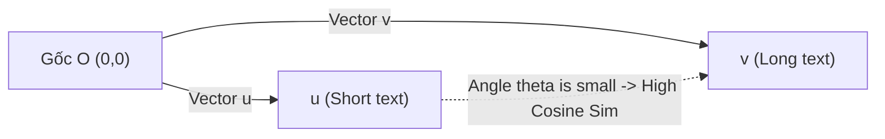

#### d. Code Thực chiến (C++ & Python)
```cpp
// C++17: Vectorized Cosine Similarity
#include <vector>
#include <cmath>

float compute_cosine(const float* a, const float* b, int d) {
    float dot = 0.0f, norm_a = 0.0f, norm_b = 0.0f;
    for (int i = 0; i < d; ++i) {
        dot += a[i] * b[i];
        norm_a += a[i] * a[i];
        norm_b += b[i] * b[i];
    }
    float denom = std::sqrt(norm_a) * std::sqrt(norm_b);
    return (denom > 1e-12f) ? (dot / denom) : 0.0f;
}
```

```python
import torch

def cosine_sim(u: torch.Tensor, v: torch.Tensor) -> torch.Tensor:
    return torch.nn.functional.cosine_similarity(u, v, dim=-1)
```

#### e. Lỗi Thường gặp & Ổn định Số học
- Khi một vector là vector 0 ($\|\mathbf{u}\| = 0$), mẫu số bằng 0 gây ra lỗi phép chia cho 0 (`NaN`). Bắt buộc phải cộng thêm hằng số bảo vệ $\epsilon = 10^{-12}$.

#### f. Ứng dụng Thực chiến trong AI
- Thang đo mặc định trong các hệ thống RAG, tìm kiếm tương đồng tài liệu và mô hình CLIP.

---

### 21. Euclidean Distance (Khoảng cách Euclid / Chuẩn L2)

#### a. Định nghĩa Bản chất Toán học
**Euclidean Distance** ($L_2$ Distance) là độ dài đoạn thẳng hình học nối giữa hai điểm $\mathbf{u}$ và $\mathbf{v}$ trong không gian Euclid $\mathbb{R}^d$:
$$d_2(\mathbf{u}, \mathbf{v}) = \|\mathbf{u} - \mathbf{v}\|_2 = \sqrt{\sum_{i=1}^d (u_i - v_i)^2}$$
Mối liên hệ mật thiết với Cosine Similarity khi hai vector có chuẩn đơn vị ($\|\mathbf{u}\| = \|\mathbf{v}\| = 1$):
$$\|\mathbf{u} - \mathbf{v}\|_2^2 = \|\mathbf{u}\|^2 + \|\mathbf{v}\|^2 - 2 (\mathbf{u} \cdot \mathbf{v}) = 2 - 2 \cos(\theta)$$
$$\|\mathbf{u} - \mathbf{v}\|_2 = \sqrt{2 (1 - \cos(\theta))}$$
Tối thiểu hóa khoảng cách Euclid tương đương trực tiếp với tối đa hóa Cosine Similarity!

#### b. Cơ chế Tầng Sâu & Điện toán
- Tính toán: $\mathcal{O}(d)$ phép trừ, nhân và cộng.
- Độ nhạy với độ lớn: Chịu ảnh hưởng lớn bởi độ dài của vector. Nếu hai văn bản có cùng nội dung nhưng tần suất xuất hiện từ khác nhau, khoảng cách Euclid sẽ rất lớn.

#### c. Sơ đồ Minh họa
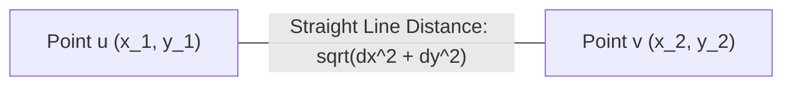

#### d. Code Thực chiến (C++ & Python)
```cpp
// C++17: Euclidean Distance AVX2-friendly
#include <cmath>

float euclidean_distance(const float* a, const float* b, int d) {
    float sum_sq = 0.0f;
    #pragma omp simd reduction(+:sum_sq)
    for (int i = 0; i < d; ++i) {
        float diff = a[i] - b[i];
        sum_sq += diff * diff;
    }
    return std::sqrt(sum_sq);
}
```

```python
import torch

def euclidean_dist(u: torch.Tensor, v: torch.Tensor) -> torch.Tensor:
    return torch.norm(u - v, p=2, dim=-1)
```

#### e. Lỗi Thường gặp & Ổn định Số học
- Lời nguyền số chiều (Curse of Dimensionality): Khi số chiều $d > 1000$, tỷ lệ giữa khoảng cách tới điểm xa nhất và điểm gần nhất tiệm cận 1:
  $$\lim_{d \to \infty} \frac{d_{\max} - d_{\min}}{d_{\min}} \to 0$$
  khiến khoảng cách Euclid mất dần tính phân biệt.

#### f. Ứng dụng Thực chiến trong AI
- Thuật toán phân cụm K-Means, mạng nơ-ron tích chập nhận diện khuôn mặt (FaceNet Triplet Loss).

---

### 22. Manhattan Distance (Khoảng cách Manhattan / Chuẩn L1)

#### a. Định nghĩa Bản chất Toán học
**Manhattan Distance** ($L_1$ Distance / City Block Distance) là tổng độ dài các hình chiếu của đoạn thẳng nối hai điểm lên các trục tọa độ:
$$d_1(\mathbf{u}, \mathbf{v}) = \|\mathbf{u} - \mathbf{v}\|_1 = \sum_{i=1}^d |u_i - v_i|$$
Mô phỏng khoảng cách di chuyển giữa hai giao lộ trên lưới đường phố vuông góc của thành phố Manhattan.

#### b. Cơ chế Tầng Sâu & Điện toán
- Không sử dụng phép tính căn bậc hai và phép nhân bình phương, tiết kiệm chu kỳ xung nhịp CPU/GPU so với Euclidean Distance.
- **Tính bền vững trước ngoại lai (Robustness to Outliers)**: Khác với khoảng cách Euclid bình phương sai số khiến các chiều ngoại lai bị khuếch đại cực đại, Manhattan Distance tăng tuyến tính với sai số, giúp mô hình ít bị chi phối bởi các chiều dị biệt.

#### c. Sơ đồ Minh họa
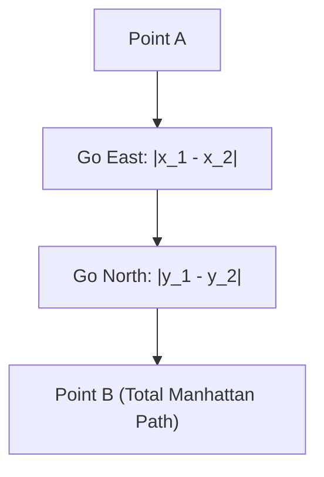

#### d. Code Thực chiến (C++ & Python)
```cpp
// C++17: Manhattan Distance
#include <cmath>

float manhattan_distance(const float* a, const float* b, int d) {
    float sum = 0.0f;
    for (int i = 0; i < d; ++i) {
        sum += std::abs(a[i] - b[i]);
    }
    return sum;
}
```

```python
import torch

def manhattan_dist(u: torch.Tensor, v: torch.Tensor) -> torch.Tensor:
    return torch.norm(u - v, p=1, dim=-1)
```

#### e. Lỗi Thường gặp & Ổn định Số học
- Đạo hàm tại điểm 0 không khả vi: $\frac{d}{dx}|x|$ không xác định tại $x = 0$ (phải dùng đạo hàm dưới - Subgradient).

#### f. Ứng dụng Thực chiến trong AI
- Xử lý biểu diễn thưa (Sparse Representations), điều chuẩn L1 (Lasso Regularization), và thị giác máy tính phát hiện biến đổi nền.

---

### 23. Dot Product Similarity (Độ tương đồng Tích vô hướng)

#### a. Định nghĩa Bản chất Toán học
**Dot Product Similarity** (Inner Product $\langle \mathbf{u}, \mathbf{v} \rangle$) là tổng tích các phần tử tương ứng của hai vector:
$$\langle \mathbf{u}, \mathbf{v} \rangle = \mathbf{u}^T \mathbf{v} = \sum_{i=1}^d u_i v_i = \|\mathbf{u}\|_2 \|\mathbf{v}\|_2 \cos(\theta)$$
Khác với Cosine Similarity vốn chỉ đo góc $\theta$, Dot Product kết hợp đồng thời cả hai yếu tố:
1. **Góc căn chỉnh ($\cos\theta$)**: Thể hiện sự tương đồng về hướng ngữ nghĩa.
2. **Độ lớn ($\|\mathbf{u}\| \cdot \|\mathbf{v}\|$)**: Thể hiện mức độ tự tin, tầm quan trọng hoặc tần suất của thực thể.

#### b. Cơ chế Tầng Sâu & Điện toán
- Đây là phép toán cơ bản nhất của phần cứng: Ánh xạ trực tiếp thành các lệnh FMA (Fused Multiply-Add: $a \cdot b + c$) trên GPU Tensor Cores, đạt tốc độ thực thi hàng nghìn TFLOPS.

#### c. Sơ đồ Minh họa
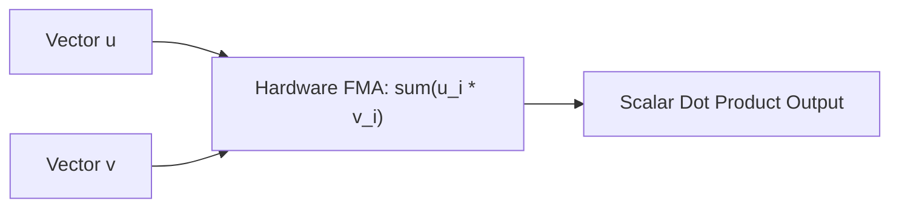

#### d. Code Thực chiến (C++ & Python)
```cpp
// C++17: Dot Product with OpenMP SIMD
float dot_product(const float* a, const float* b, int d) {
    float res = 0.0f;
    #pragma omp simd reduction(+:res)
    for (int i = 0; i < d; ++i) {
        res += a[i] * b[i];
    }
    return res;
}
```

```python
import torch

def dot_similarity(u: torch.Tensor, v: torch.Tensor) -> torch.Tensor:
    return torch.sum(u * v, dim=-1)
```

#### e. Lỗi Thường gặp & Ổn định Số học
- Thiên vị các tài liệu dài hoặc các từ xuất hiện nhiều: Vector có chuẩn lớn sẽ luôn có Dot Product cao bất kể góc có lệch.

#### f. Ứng dụng Thực chiến trong AI
- Trái tim của cơ chế **Attention ($\mathbf{Q}\mathbf{K}^T$)** trong Transformer và hệ thống gợi ý Matrix Factorization.

---

### 24. Vector Normalization (Chuẩn hóa Vector)

#### a. Định nghĩa Bản chất Toán học
**Vector Normalization** (thường là Chuẩn hóa $L_2$) chiếu một vector tùy ý $\mathbf{v} \in \mathbb{R}^d \setminus \{\mathbf{0}\}$ lên mặt cầu siêu đơn vị (Unit Hypersphere) $\mathbb{S}^{d-1}$:
$$\hat{\mathbf{v}} = \frac{\mathbf{v}}{\|\mathbf{v}\|_2} = \frac{\mathbf{v}}{\sqrt{\sum_{i=1}^d v_i^2}}$$
Sau khi chuẩn hóa, độ dài vector luôn bằng 1 tuyệt đối: $\|\hat{\mathbf{v}}\|_2 = 1$.

Hệ quả điện toán:
$$\langle \hat{\mathbf{u}}, \hat{\mathbf{v}} \rangle = \frac{\mathbf{u} \cdot \mathbf{v}}{\|\mathbf{u}\|_2 \|\mathbf{v}\|_2} = \text{CosineSimilarity}(\mathbf{u}, \mathbf{v})$$
Chuẩn hóa vector biến phép tính Cosine Similarity đắt đỏ (cần tính 2 căn bậc hai và 1 phép chia) thành một phép nhân vô hướng đơn giản trên phần cứng!

#### b. Cơ chế Tầng Sâu & Điện toán
- Trong các cơ sở dữ liệu vector (FAISS, Milvus), các vector được chuẩn hóa ngay khi nạp vào chỉ mục (indexing time), giúp tìm kiếm Cosine đạt tốc độ tiệm cận cực đại bằng kernel `IndexFlatIP`.

#### c. Sơ đồ Minh họa
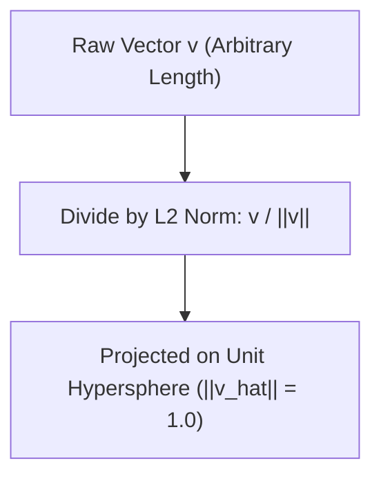

#### d. Code Thực chiến (C++ & Python)
```cpp
// C++17: L2 In-place Vector Normalization
#include <cmath>

void l2_normalize(float* vec, int d) {
    float sum_sq = 0.0f;
    for (int i = 0; i < d; ++i) sum_sq += vec[i] * vec[i];
    float inv_norm = 1.0f / (std::sqrt(sum_sq) + 1e-12f);
    for (int i = 0; i < d; ++i) vec[i] *= inv_norm;
}
```

```python
import torch
import torch.nn.functional as F

def normalize_embeddings(x: torch.Tensor) -> torch.Tensor:
    # x: [B, D]
    return F.normalize(x, p=2, dim=-1)
```

#### e. Lỗi Thường gặp & Ổn định Số học
- Chuẩn hóa vector trước khi đưa vào các tầng tuyến tính có học trọng số độ lớn (Magnitude-aware layers) làm mất thông tin biên độ.

#### f. Ứng dụng Thực chiến trong AI
- Tiền xử lý bắt buộc cho mọi mô hình Text Embedding (OpenAI `text-embedding-3`, BGE, E5) trước khi lưu vào Vector Database.

---

### 25. Embedding Spaces (Không gian Nhúng)

#### a. Định nghĩa Bản chất Toán học
Một **Embedding Space** là một không gian topo mêtric liên tục $(\mathcal{M}, d_{\mathcal{M}})$ (thường là không gian Euclid $\mathbb{R}^d$ hoặc không gian phi Euclid Hyperbolic $\mathbb{H}^d$) được trang bị một độ đo khoảng cách, nơi các khái niệm dữ liệu được ánh xạ vào:
- **Tính Đẳng cấu Ngữ nghĩa (Semantic Isomorphism)**: Sự gần gũi về mặt khái niệm tương ứng với sự gần gũi về mặt topo học trong không gian.
- **Tính Liên tục & Khả vi**: Cho phép thực hiện các phép vi phân, nội suy và dịch chuyển vector.

#### b. Cơ chế Tầng Sâu & Điện toán
- Không gian nhúng Euclid phù hợp với các mối quan hệ phẳng, nhưng không gian nhúng phi Euclid (như Không gian Poincare / Hyperbolic Space) phù hợp vượt trội để nhúng các cấu trúc phân cấp cây (Tree Hierarchy) như phân loại sinh học hoặc ontology.

#### c. Sơ đồ Minh họa


#### d. Code Thực chiến (C++ & Python)
```python
# Minh họa trực quan hóa Embedding Space qua t-SNE / PCA
from sklearn.manifold import TSNE
import numpy as np

def reduce_embedding_space_for_viz(embeddings: np.ndarray):
    tsne = TSNE(n_components=2, perplexity=30, random_state=42)
    return tsne.fit_transform(embeddings) # [N, 2]
```

#### e. Lỗi Thường gặp & Ổn định Số học
- Mật độ phân bổ không đồng đều: Các vector dồn hết về một góc hẹp trong không gian (Cone Effect / Anisotropy).

#### f. Ứng dụng Thực chiến trong AI
- Không gian biểu diễn đa phương thức CLIP (kết nối chữ và ảnh), phân cụm dữ liệu phi cấu trúc.

---

### 26. Embedding Dimensions (Số chiều Không gian Nhúng)

#### a. Định nghĩa Bản chất Toán học
**Embedding Dimension** $d \in \mathbb{N}^+$ là số lượng trục tọa độ tự do trong không gian biểu diễn vector:
- Các kích thước phổ biến: $d = 300$ (Word2Vec, GloVe), $d = 768$ (BERT-Base), $d = 1536$ (OpenAI `text-embedding-3-small`), $d = 4096$ (LLaMA-3 8B), $d = 8192$ (LLaMA-3 70B).

**Định lý Johnson-Lindenstrauss (JL Lemma)**: Cho một tập hợp $m$ điểm trong không gian số chiều cao, ta có thể chiếu chúng xuống một không gian con ngẫu nhiên có số chiều $d \ge \mathcal{O}\left(\frac{\log m}{\epsilon^2}\right)$ mà khoảng cách giữa mọi cặp điểm chỉ bị sai lệch trong phạm vi hệ số $(1 \pm \epsilon)$.

#### b. Cơ chế Tầng Sâu & Điện toán
- Chi phí lưu trữ và tìm kiếm: Tăng tỷ lệ tuyến tính $\mathcal{O}(d)$.
- Kỹ thuật **Matryoshka Representation Learning (MRL)** (Kusupati et al., 2022): Huấn luyện vector sao cho chỉ cần cắt lấy $d' < d$ chiều đầu tiên (ví dụ lấy 256 chiều đầu từ vector 1536 chiều) mà vẫn giữ lại hơn $95\%$ độ chính xác tìm kiếm, giúp tiết kiệm $6\times$ chi phí RAM/VRAM lưu trữ Vector DB!

#### c. Sơ đồ Minh họa
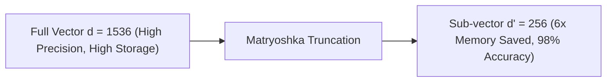

#### d. Code Thực chiến (C++ & Python)
```python
import torch
import torch.nn.functional as F

def matryoshka_truncate(embedding: torch.Tensor, target_dim: int = 256) -> torch.Tensor:
    # Cắt lấy target_dim chiều đầu và chuẩn hóa lại L2
    sub_vec = embedding[..., :target_dim]
    return F.normalize(sub_vec, p=2, dim=-1)
```

#### e. Lỗi Thường gặp & Ổn định Số học
- Cắt bớt chiều vector của các mô hình thông thường (không được huấn luyện bằng MRL) sẽ phá hỏng hoàn toàn độ chính xác tương đồng.

#### f. Ứng dụng Thực chiến trong AI
- Tối ưu hóa chi phí vận hành Vector Database quy mô hàng tỷ bản ghi trong OpenAI `text-embedding-3` và Nomic Embed.

---

### 27. Embedding Alignment (Căn chỉnh Không gian Nhúng)

#### a. Định nghĩa Bản chất Toán học
**Embedding Alignment** là bài toán tìm một phép biến đổi hình học (thường là phép quay trực giao $\mathbf{W} \in \mathbb{R}^{d \times d}$) để ánh xạ một không gian nhúng nguồn $\mathcal{X}$ sang không gian nhúng đích $\mathcal{Y}$ sao cho các khái niệm tương đương được xếp chồng khít lên nhau.
Bài toán **Orthogonal Procrustes**:
$$\mathbf{W}^* = \arg\min_{\mathbf{W}} \|\mathbf{X} \mathbf{W} - \mathbf{Y}\|_F^2 \quad \text{thỏa mãn } \mathbf{W}^T \mathbf{W} = \mathbf{I}$$
Lời giải giải tích chính xác qua SVD của ma trận tương quan $\mathbf{M} = \mathbf{Y}^T \mathbf{X}$:
$$\mathbf{M} = \mathbf{U} \mathbf{\Sigma} \mathbf{V}^T \Longrightarrow \mathbf{W}^* = \mathbf{V} \mathbf{U}^T$$

#### b. Cơ chế Tầng Sâu & Điện toán
- Điều kiện trực giao $\mathbf{W}^T \mathbf{W} = \mathbf{I}$ cực kỳ quan trọng vì nó bảo toàn hoàn hảo khoảng cách Euclid và tích vô hướng bên trong không gian nguồn (Isometry).

#### c. Sơ đồ Minh họa
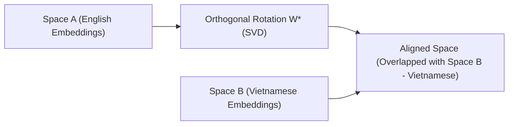

#### d. Code Thực chiến (C++ & Python)
```python
import numpy as np

def procrustes_alignment(X: np.ndarray, Y: np.ndarray) -> np.ndarray:
    # X: [N, d], Y: [N, d] (Cặp từ tương đương giữa 2 ngôn ngữ)
    M = Y.T @ X
    U, _, Vt = np.linalg.svd(M)
    W = Vt.T @ U.T
    return W # Ma trận xoay tối ưu
```

#### e. Lỗi Thường gặp & Ổn định Số học
- Dùng ma trận tuyến tính tự do không ràng buộc trực giao: Làm méo mó góc và khoảng cách nội tại của không gian nguồn.

#### f. Ứng dụng Thực chiến trong AI
- Dịch máy không giám sát (Unsupervised Cross-Lingual Alignment - MUSE), căn chỉnh đa ngôn ngữ.

---

### 28. Embedding Geometry & The Anisotropy Problem (Hình học Nhúng & Vấn nạn Bất đẳng hướng)

#### a. Định nghĩa Bản chất Toán học
Trong một không gian nhúng lý tưởng (Isotropic Space), các vector phân bổ đều khắp mọi hướng trên mặt cầu siêu đơn vị, ma trận hiệp phương sai tương đương ma trận đơn vị: $\mathbf{\Sigma} \propto \mathbf{I}$.

Tuy nhiên, Ethayarajh (2019) và Gao et al. (2019) phát hiện rằng các mô hình ngôn ngữ dựa trên Transformer (như BERT, GPT-2) đều gặp phải **Vấn nạn Bất đẳng hướng (The Anisotropy Problem / Cone Effect)**:
- Toàn bộ các vector biểu diễn token đều bị dồn vào một **hình nón hẹp (narrow cone)** trong không gian.
- Hệ quả tai hại: Bất kỳ hai từ ngẫu nhiên nào (kể cả hoàn toàn không liên quan) cũng có Cosine Similarity rất cao (thường $\ge 0.7 - 0.9$):
  $$\mathbb{E}_{u, v}[\cos(\mathbf{u}, \mathbf{v})] \gg 0$$
- Chi phối bởi các từ xuất hiện với tần suất cực cao (Word Frequency Bias) kéo tâm của đám mây vector lệch khỏi gốc tọa độ.

Giải pháp toán học:
1. **Centering**: Trừ đi vector trọng tâm $\mathbf{\mu} = \frac{1}{N} \sum \mathbf{v}_i$.
2. **BERT-Whitening (Su et al., 2021)**: Biến đổi affine để ma trận hiệp phương sai trở thành ma trận đơn vị:
   $$\tilde{\mathbf{v}} = (\mathbf{v} - \mathbf{\mu}) \mathbf{W}_{\text{whiten}}, \quad \mathbf{W}_{\text{whiten}} = \mathbf{V} \mathbf{\Sigma}^{-1/2}$$

#### b. Cơ chế Tầng Sâu & Điện toán
- Whitening là phép toán hậu xử lý cực nhanh (chỉ mất vài mili-giây trên CPU/GPU) mà không cần huấn luyện lại mạng nơ-ron, lập tức khôi phục tính phân cực ngữ nghĩa cho Cosine Similarity.

#### c. Sơ đồ Minh họa
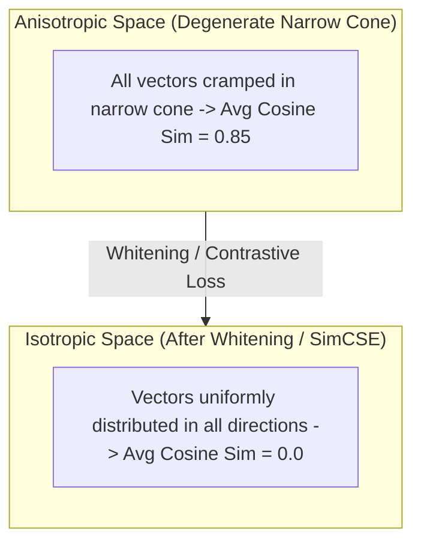

#### d. Code Thực chiến (C++ & Python)
```cpp
// C++17: Vector Centering
void center_vectors(float* vectors, const float* mean_vec, int N, int d) {
    for (int i = 0; i < N; ++i) {
        for (int j = 0; j < d; ++j) {
            vectors[i * d + j] -= mean_vec[j];
        }
    }
}
```

```python
import torch

def compute_whitening_transform(embeddings: torch.Tensor):
    # embeddings: [N, D]
    mu = torch.mean(embeddings, dim=0, keepdim=True)
    cov = torch.cov((embeddings - mu).T)
    u, s, vt = torch.linalg.svd(cov)
    W = torch.matmul(u, torch.diag(1.0 / torch.sqrt(s + 1e-6)))
    return mu, W

def apply_whitening(embeddings: torch.Tensor, mu: torch.Tensor, W: torch.Tensor) -> torch.Tensor:
    return torch.matmul(embeddings - mu, W)
```

#### e. Lỗi Thường gặp & Ổn định Số học
- Ma trận hiệp phương sai bị suy biến (Singular) khi số lượng mẫu $N < d$: Cần thêm hệ số điều chuẩn Ridge $\epsilon \mathbf{I}$ trước khi phân tích SVD.

#### f. Ứng dụng Thực chiến trong AI
- Hậu xử lý tăng tốc và nâng cao chất lượng tìm kiếm cho các mô hình embedding chưa qua fine-tuning tương phản.

---

### 29. Distributional Semantics (Ngữ nghĩa học Phân phối)

#### a. Định nghĩa Bản chất Toán học
**Distributional Semantics** dựa trên giả thuyết phân phối: *"Mức độ tương đồng về ngữ nghĩa giữa hai biểu thức ngôn ngữ là hàm số của mức độ tương đồng giữa các phân phối ngữ cảnh xuất hiện của chúng trong kho ngữ liệu lớn"*:
$$P(\text{Context} \mid w_1) \approx P(\text{Context} \mid w_2) \iff \text{Semantics}(w_1) \approx \text{Semantics}(w_2)$$
Toàn bộ thông tin ngữ nghĩa được trích xuất từ thống kê đồng xuất hiện (Co-occurrence Statistics) giữa các từ mà không cần bất kỳ sự can thiệp của chuyên gia con người.

#### b. Cơ chế Tầng Sâu & Điện toán
- Chuyển đổi bài toán ngôn ngữ biểu tượng thành bài toán đại số tuyến tính thống kê trên ma trận đồng xuất hiện kích thước khổng lồ $|\mathcal{V}| \times |\mathcal{V}|$.

#### c. Sơ đồ Minh họa


#### d. Code Thực chiến (C++ & Python)
```python
from collections import defaultdict

def build_cooccurrence_matrix(corpus: list[list[str]], window_size: int = 2):
    cooccur = defaultdict(lambda: defaultdict(int))
    for sentence in corpus:
        for i, word in enumerate(sentence):
            start = max(0, i - window_size)
            end = min(len(sentence), i + window_size + 1)
            for j in range(start, end):
                if i != j:
                    cooccur[word][sentence[j]] += 1
    return cooccur
```

#### e. Lỗi Thường gặp & Ổn định Số học
- Các từ chức năng (Stopwords như "the", "is", "a") xuất hiện khắp mọi nơi, làm loãng tín hiệu thống kê nếu không dùng kỹ thuật PMI (Pointwise Mutual Information) hoặc Subsampling.

#### f. Ứng dụng Thực chiến trong AI
- Nền tảng triết lý khoa học của toàn bộ ngành Ngôn ngữ học Tính toán và LLMs.

---

### 30. Word2Vec

#### a. Định nghĩa Bản chất Toán học
**Word2Vec** (Mikolov et al., Google 2013) là mô hình mạng nơ-ron hai tầng không có tầng kích hoạt phi tuyến, học các biểu diễn vector từ phân phối văn bản bằng cách tối đa hóa xác suất có điều kiện.
Bao gồm hai kiến trúc đối ngẫu:
1. **Continuous Bag of Words (CBOW)**.
2. **Skip-Gram**.
Tối ưu hóa thông qua hai giải pháp điện toán đột phá: **Hierarchical Softmax** hoặc **Negative Sampling**.

#### b. Cơ chế Tầng Sâu & Điện toán
- Tốc độ huấn luyện phi thường: Có thể xử lý hàng tỷ từ văn bản chỉ trong vài chục phút trên CPU đa nhân thông qua các kỹ thuật khóa luồng nhẹ (Lock-free Hogwild! SGD).

#### c. Sơ đồ Minh họa
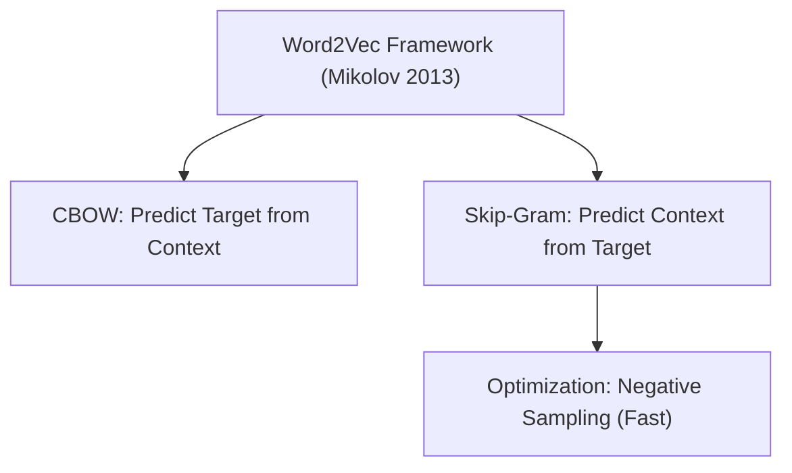

#### d. Code Thực chiến (C++ & Python)
```python
from gensim.models import Word2Vec

# Huấn luyện mô hình Word2Vec đơn giản
sentences = [["cat", "say", "meow"], ["dog", "say", "woof"]]
model = Word2Vec(sentences, vector_size=100, window=5, min_count=1, workers=4, sg=1)
```

#### e. Lỗi Thường gặp & Ổn định Số học
- Không loại bỏ các từ xuất hiện quá ít (`min_count < 5`): Khiến ma trận embedding bị phình to bởi các từ sai chính tả và nhiễu.

#### f. Ứng dụng Thực chiến trong AI
- Khởi động cuộc cách mạng Deep Learning trong Xử lý Ngôn ngữ Tự nhiên.

---

### 31. CBOW (Continuous Bag of Words)

#### a. Định nghĩa Bản chất Toán học
Kiến trúc **CBOW** dự đoán một từ trung tâm đích $w_t$ dựa trên ngữ cảnh gồm $2C$ từ xung quanh nó:
$$\text{Context}(w_t) = \{w_{t-C}, \dots, w_{t-1}, w_{t+1}, \dots, w_{t+C}\}$$
Các vector biểu diễn đầu vào của các từ ngữ cảnh được **lấy trung bình cộng (hoặc tổng)**:
$$\mathbf{v}_{\text{context}} = \frac{1}{2C} \sum_{-C \le j \le C, j \neq 0} \mathbf{v}_{w_{t+j}}$$
Hàm mục tiêu tối đa hóa log-likelihood của từ đích:
$$\mathcal{L}_{\text{CBOW}} = \sum_{t=1}^T \log P(w_t \mid \mathbf{v}_{\text{context}})$$

#### b. Cơ chế Tầng Sâu & Điện toán
- Huấn luyện nhanh hơn Skip-Gram khoảng $C$ lần vì toàn bộ ngữ cảnh được nén thành 1 vector trung bình trước khi thực hiện bước cập nhật duy nhất.
- Hoạt động cực tốt và mượt mà trên các tập dữ liệu lớn và các từ ngữ thông dụng.

#### c. Sơ đồ Minh họa
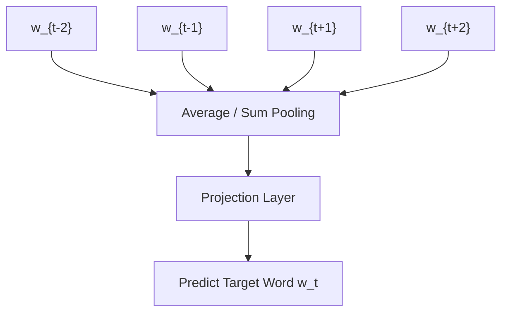

#### d. Code Thực chiến (C++ & Python)
```cpp
// C++17: CBOW Context Accumulation
void accumulate_cbow_context(const int* context_ids, const float* W_in, float* context_vec, 
                             int window_size, int d_model) {
    for (int d = 0; d < d_model; ++d) context_vec[d] = 0.0f;
    for (int i = 0; i < window_size; ++i) {
        int id = context_ids[i];
        for (int d = 0; d < d_model; ++d) {
            context_vec[d] += W_in[id * d_model + d];
        }
    }
    float inv_w = 1.0f / window_size;
    for (int d = 0; d < d_model; ++d) context_vec[d] *= inv_w;
}
```

```python
import torch
import torch.nn as nn

class CBOWModel(nn.Module):
    def __init__(self, vocab_size: int, embed_dim: int):
        super().__init__()
        self.embeddings = nn.Embedding(vocab_size, embed_dim)
        self.linear = nn.Linear(embed_dim, vocab_size, bias=False)

    def forward(self, context_ids: torch.Tensor) -> torch.Tensor:
        # context_ids: [B, 2C]
        x = self.embeddings(context_ids).mean(dim=1) # [B, embed_dim]
        return self.linear(x)
```

#### e. Lỗi Thường gặp & Ổn định Số học
- Việc lấy trung bình cộng làm mất hoàn toàn thứ tự từ (Bag of Words effect): Không phân biệt được "chó cắn người" và "người cắn chó".

#### f. Ứng dụng Thực chiến trong AI
- Huấn luyện vector nhúng nhanh trên các kho văn bản quy mô lớn (Wikipedia).

---

### 32. Skip-Gram

#### a. Định nghĩa Bản chất Toán học
Kiến trúc **Skip-Gram** đảo ngược hoàn toàn bài toán của CBOW: Sử dụng **từ trung tâm $w_t$** để dự đoán độc lập từng từ ngữ cảnh $w_{t+j}$ nằm trong cửa sổ kích thước $C$:
$$\mathcal{L}_{\text{SG}} = \sum_{t=1}^T \sum_{-C \le j \le C, j \neq 0} \log P(w_{t+j} \mid w_t)$$
Trong đó xác suất được định nghĩa bằng hàm Softmax:
$$P(w_O \mid w_I) = \frac{\exp(\mathbf{v}'_{w_O}{}^T \mathbf{v}_{w_I})}{\sum_{w=1}^V \exp(\mathbf{v}'_w{}^T \mathbf{v}_{w_I})}$$
($\mathbf{v}_w$ là vector nhúng đầu vào, $\mathbf{v}'_w$ là vector nhúng đầu ra của từ $w$).

#### b. Cơ chế Tầng Sâu & Điện toán
- Chậm hơn CBOW do phải thực hiện $2C$ phép cập nhật độc lập cho mỗi từ trung tâm.
- **Vượt trội trên các từ hiếm (Rare Words)**: Vì không bị làm phẳng bởi phép trung bình cộng, các từ hiếm nhận được tín hiệu cập nhật nguyên vẹn khi đóng vai trò là từ đích hoặc từ trung tâm.

#### c. Sơ đồ Minh họa
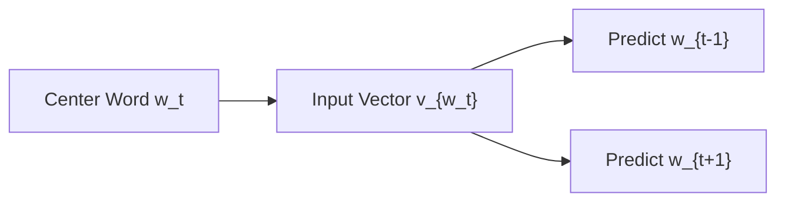

#### d. Code Thực chiến (C++ & Python)
```cpp
// C++17: Skip-Gram Loop Structure
void skipgram_step(int center_token, const std::vector<int>& context_tokens) {
    for (int target : context_tokens) {
        // Cập nhật gradient cho cặp (center_token, target)
    }
}
```

```python
import torch
import torch.nn as nn

class SkipGramModel(nn.Module):
    def __init__(self, vocab_size: int, embed_dim: int):
        super().__init__()
        self.in_embeddings = nn.Embedding(vocab_size, embed_dim)
        self.out_embeddings = nn.Embedding(vocab_size, embed_dim)

    def forward(self, target_word: torch.Tensor, context_word: torch.Tensor) -> torch.Tensor:
        # Tích vô hướng giữa vector đầu vào của target và vector đầu ra của context
        v_in = self.in_embeddings(target_word)    # [B, D]
        v_out = self.out_embeddings(context_word) # [B, D]
        return torch.sum(v_in * v_out, dim=-1)
```

#### e. Lỗi Thường gặp & Ổn định Số học
- Tính toán trực tiếp mẫu số Softmax đầy đủ trên toàn bộ từ điển $V = 100,000$ từ tốn $\mathcal{O}(V)$ cho mỗi bước lặp, khiến việc huấn luyện bất khả thi nếu không có Negative Sampling.

#### f. Ứng dụng Thực chiến trong AI
- Nền tảng học vector nhúng cho đồ thị (Node2Vec), gợi ý sản phẩm (Item2Vec) và Word2Vec chất lượng cao.

---

### 33. Negative Sampling (Lấy mẫu Tiêu cực / NEG)

#### a. Định nghĩa Bản chất Toán học
**Negative Sampling** (Mikolov et al., 2013) là phương pháp xấp xỉ biến phân dựa trên nguyên lý Noise Contrastive Estimation (NCE), biến bài toán phân loại đa lớp đắt đỏ ($V$ lớp) thành một chuỗi các bài toán hồi quy Logistic nhị phân độc lập.
Hàm mục tiêu cho một cặp từ thật $(w_I, w_O)$:
$$\log \sigma(\mathbf{v}'_{w_O}{}^T \mathbf{v}_{w_I}) + \sum_{i=1}^k \mathbb{E}_{w_i \sim P_n(w)} \left[ \log \sigma(-\mathbf{v}'_{w_i}{}^T \mathbf{v}_{w_I}) \right]$$
Trong đó:
- $\sigma(x) = \frac{1}{1 + e^{-x}}$ là hàm sigmoid.
- $k$ là số lượng từ mẫu tiêu cực được lấy ngẫu nhiên (thường $k \in [5, 20]$).
- $P_n(w)$ là phân phối unigram lũy thừa $3/4$ (Unigram Distribution raised to the $3/4$ power):
  $$P_n(w) = \frac{f(w)^{3/4}}{\sum_{w'} f(w')^{3/4}}$$
  Lũy thừa $3/4$ giúp tăng xác suất lấy mẫu các từ hiếm lên một cách vừa phải so với tần suất tự nhiên của chúng.

#### b. Cơ chế Tầng Sâu & Điện toán
- Giảm độ phức tạp tính toán từ $\mathcal{O}(V)$ xuống **$\mathcal{O}(k)$** trên mỗi bước cập nhật ($k \ll V$, ví dụ $k = 5$ so với $V = 100,000$, tăng tốc độ tính toán **$20,000\times$**!).
- Bảng lấy mẫu Unigram được biểu diễn bằng một mảng 1D lớn (ví dụ kích thước $10^8$ phần tử) trên RAM để lấy mẫu ngẫu nhiên trong thời gian $\mathcal{O}(1)$.

#### c. Sơ đồ Minh họa
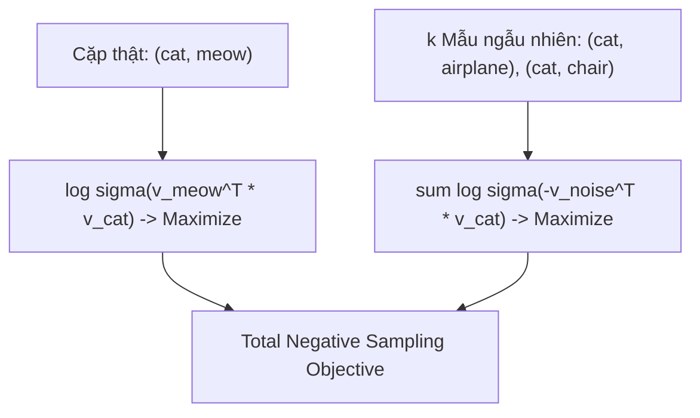

#### d. Code Thực chiến (C++ & Python)
```cpp
// C++17: Khởi tạo bảng Unigram Table lũy thừa 3/4 của Word2Vec
#include <vector>
#include <cmath>

std::vector<int> build_unigram_table(const std::vector<int>& word_counts, size_t table_size = 1e7) {
    std::vector<int> table(table_size);
    double train_words_pow = 0.0;
    for (int count : word_counts) train_words_pow += std::pow(count, 0.75);
    
    int word_idx = 0;
    double d1 = std::pow(word_counts[0], 0.75) / train_words_pow;
    for (size_t a = 0; a < table_size; ++a) {
        table[a] = word_idx;
        if (a / (double)table_size > d1) {
            word_idx++;
            d1 += std::pow(word_counts[word_idx], 0.75) / train_words_pow;
        }
    }
    return table;
}
```

```python
import torch
import torch.nn.functional as F

def negative_sampling_loss(v_center: torch.Tensor, v_pos: torch.Tensor, v_negs: torch.Tensor):
    # v_center: [B, D], v_pos: [B, D], v_negs: [B, K, D]
    pos_score = torch.sum(v_center * v_pos, dim=-1) # [B]
    pos_loss = F.logsigmoid(pos_score)
    
    # neg_score: [B, K]
    neg_score = torch.bmm(v_negs, v_center.unsqueeze(-1)).squeeze(-1)
    neg_loss = F.logsigmoid(-neg_score).sum(dim=-1)
    
    return -(pos_loss + neg_loss).mean()
```

#### e. Lỗi Thường gặp & Ổn định Số học
- Lấy mẫu trúng chính từ ngữ cảnh thật làm mẫu tiêu cực (False Negative): Cần bộ lọc kiểm tra để loại bỏ từ đúng khỏi tập mẫu âm.

#### f. Ứng dụng Thực chiến trong AI
- Nền tảng huấn luyện các hệ thống khuyến nghị triệu người dùng (YouTube Candidate Generation) và Word2Vec.

---

### 34. GloVe (Global Vectors for Word Representation)

#### a. Định nghĩa Bản chất Toán học
**GloVe** (Pennington, Socher, Manning, Stanford 2014) kết hợp hai trường phái:
1. Phương pháp phân rã ma trận toàn cục (như LSA).
2. Phương pháp cửa sổ ngữ cảnh cục bộ (như Word2Vec).

GloVe quan sát thấy rằng **Tỷ số giữa các xác suất đồng xuất hiện (Ratio of Co-occurrence Probabilities)** mang thông tin ngữ nghĩa thuần khiết nhất:
$$\frac{P(k \mid \text{ice})}{P(k \mid \text{steam})} = \begin{cases} \gg 1 & \text{khi } k = \text{solid} \\ \ll 1 & \text{khi } k = \text{gas} \\ \approx 1 & \text{khi } k = \text{water hoặc fashion} \end{cases}$$
Hàm mất mát bình phương có trọng số của GloVe:
$$\mathcal{J} = \sum_{i, j=1}^V f(X_{ij}) \left( \mathbf{w}_i^T \tilde{\mathbf{w}}_j + b_i + \tilde{b}_j - \log X_{ij} \right)^2$$
Trong đó:
- $X_{ij}$ là số lần từ $i$ và $j$ xuất hiện cùng nhau trong toàn bộ kho ngữ liệu.
- $f(x)$ là hàm cắt trọng số (Weighting Function) ngăn các từ xuất hiện quá nhiều chi phối hàm loss:
  $$f(x) = \begin{cases} (x / x_{\max})^\alpha & \text{nếu } x < x_{\max} \text{ (thường } x_{\max} = 100, \alpha = 0.75) \\ 1 & \text{ngược lại} \end{cases}$$

#### b. Cơ chế Tầng Sâu & Điện toán
- Mô hình chạy song song cực nhanh qua AdaGrad trên ma trận thưa các cặp có $X_{ij} > 0$.
- Sau khi huấn luyện, vector nhúng cuối cùng của từ thường được lấy bằng tổng hai ma trận: $\mathbf{w}_{\text{final}} = \mathbf{w}_i + \tilde{\mathbf{w}}_i$.

#### c. Sơ đồ Minh họa
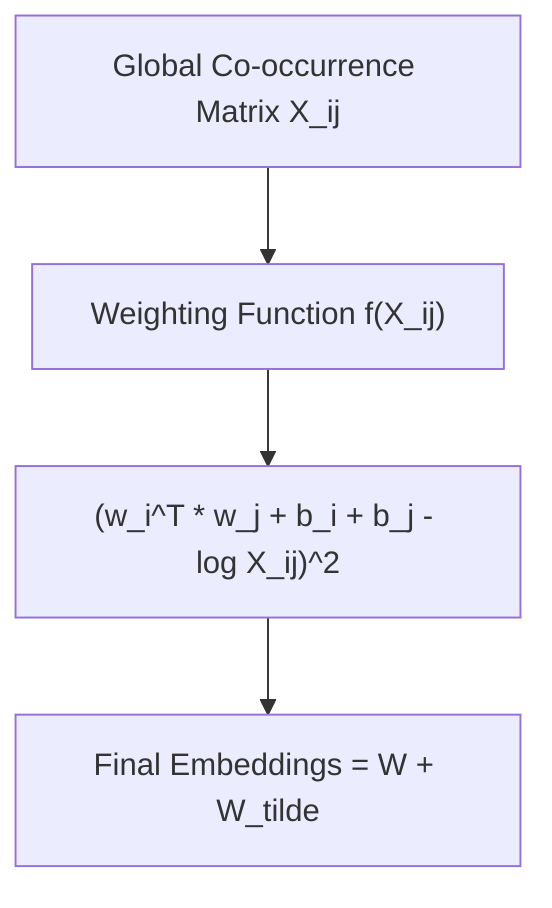

#### d. Code Thực chiến (C++ & Python)
```cpp
// C++17: Hàm trọng số GloVe f(x)
#include <cmath>

inline float glove_weight(float x, float x_max = 100.0f, float alpha = 0.75f) {
    if (x < x_max) {
        return std::pow(x / x_max, alpha);
    }
    return 1.0f;
}
```

```python
import torch
import torch.nn as nn

class GloVeLoss(nn.Module):
    def __init__(self, x_max: float = 100.0, alpha: float = 0.75):
        super().__init__()
        self.x_max = x_max
        self.alpha = alpha

    def forward(self, w_i: torch.Tensor, w_j: torch.Tensor, 
                b_i: torch.Tensor, b_j: torch.Tensor, X_ij: torch.Tensor) -> torch.Tensor:
        weights = torch.where(X_ij < self.x_max, (X_ij / self.x_max) ** self.alpha, torch.ones_like(X_ij))
        diff = torch.sum(w_i * w_j, dim=-1) + b_i + b_j - torch.log(X_ij)
        loss = torch.sum(weights * (diff ** 2))
        return loss
```

#### e. Lỗi Thường gặp & Ổn định Số học
- Cố gắng tính toán trên các cặp có $X_{ij} = 0$: Giá trị $\log(0)$ bằng $-\infty$, phá hỏng gradient. GloVe chỉ duyệt qua các phần tử khác 0 của ma trận thưa.

#### f. Ứng dụng Thực chiến trong AI
- Nguồn vector tĩnh chuẩn mực được tải hàng triệu lần trên các kho dữ liệu của Đại học Stanford.

---

### 35. FastText

#### a. Định nghĩa Bản chất Toán học
**FastText** (Bojanowski et al., Facebook AI Research 2016) giải quyết nhược điểm lớn nhất của Word2Vec và GloVe: hoàn toàn bất lực khi gặp từ mới chưa từng xuất hiện trong tập huấn luyện (Out-Of-Vocabulary - OOV).

Nguyên lý: **Biểu diễn từ dưới dạng một tập hợp các n-gram ký tự con (Character n-grams)**.
Ví dụ từ `"where"` với $n=3$, kèm theo các ký tự ranh giới `<` và `>`:
$$\mathcal{G}_{\text{"where"}} = \{\text{<wh}, \text{whe}, \text{her}, \text{ere}, \text{re>}, \text{<where>}\}$$
Vector biểu diễn của toàn bộ từ $w$ được tính bằng **tổng các vector nhúng của tất cả các n-gram con** cấu thành nên nó:
$$\mathbf{v}_w = \sum_{g \in \mathcal{G}_w} \mathbf{z}_g$$

#### b. Cơ chế Tầng Sâu & Điện toán
- Khi gặp một từ OOV hoàn toàn mới (ví dụ từ ghép hoặc lỗi chính tả như `"unhapppiness"`), FastText chỉ cần phân rã từ đó thành các n-gram con đã biết và cộng vector lại, sinh ra một embedding có ngữ nghĩa hợp lý ngay lập tức!
- **Hashing Trick**: Áp dụng hàm băm (MurmurHash3) để ánh xạ hàng triệu n-gram vào một bảng bộ nhớ cố định kích thước $K$ (ví dụ $K = 2 \times 10^6$), tiết kiệm RAM.

#### c. Sơ đồ Minh họa
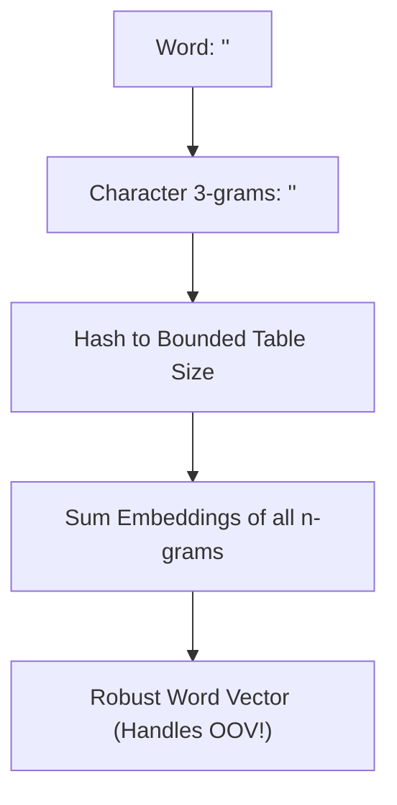

#### d. Code Thực chiến (C++ & Python)
```cpp
// C++17: Trích xuất Character n-grams cho FastText
#include <string>
#include <vector>

std::vector<std::string> extract_char_ngrams(const std::string& word, int min_n = 3, int max_n = 5) {
    std::string wrapped = "<" + word + ">";
    std::vector<std::string> ngrams;
    int len = wrapped.length();
    for (int n = min_n; n <= max_n; ++n) {
        for (int i = 0; i <= len - n; ++i) {
            ngrams.push_back(wrapped.substr(i, n));
        }
    }
    ngrams.push_back(wrapped); // Kèm theo toàn bộ từ đặc biệt
    return ngrams;
}
```

```python
# Sử dụng fasttext trong Python
import fasttext

# Huấn luyện mô hình FastText có hỗ trợ subword
# model = fasttext.train_unsupervised('data.txt', model='skipgram', minn=3, maxn=6, dim=100)
# vector_oov = model.get_word_vector("some_unseen_complex_word")
```

#### e. Lỗi Thường gặp & Ổn định Số học
- Kích thước file model rất lớn: Do bảng n-gram hash table chứa hàng triệu phần tử, file nhị phân của FastText thường nặng từ 2 GB đến 7 GB nếu không qua bước nén (Quantization).

#### f. Ứng dụng Thực chiến trong AI
- Công cụ phân loại ngôn ngữ thời gian thực (FastText Language Identification: 176 ngôn ngữ với tốc độ micro-giây) và xử lý các ngôn ngữ phong phú về hình thái (Morphologically rich languages như tiếng Đức, tiếng Thổ Nhĩ Kỳ, tiếng Nga).
